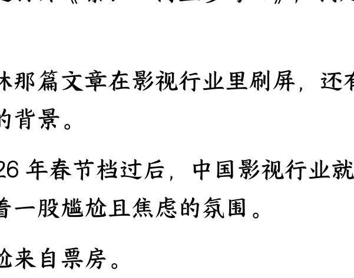

# 245 | 《哪吒 2》出品方转型：“一切为了 IP”

260312

整理：公众号懒人搜索，懒人专属群精选

懒人微信：lazyhelper1

欢迎打开《蔡钰·商业参考 4》，我是蔡钰。

郑林那篇文章在影视行业里刷屏，还有特殊的背景。

2026 年春节档过后，中国影视行业就弥漫着一股尴尬且焦虑的氛围。

尴尬来自票房。

上一个春节期间，不少从业者抱怨：《哪吒 2》制造了虹吸效应，把原本该分属于全行业的票房都吸走了。结果 2026 年春节档没有类似的虹吸独角兽了，假期还比 2025 年多一天，总票房却只有 2025 年的 60%，跌回了 2018 年的水平。

到了 2 月 24 日复工，光线传媒、中国电影、金逸影视、横店影视、博纳影业等电影公司的股价纷纷跌停，幸福蓝海下跌超 15%。

焦虑则是来自 AI。

春节前夕，快手上线了视频模型可灵 3.0，字节发布了视频模型 Seedance 2.0，让全球的影视行业都炸了锅。

电影《死侍》的系列编剧感慨说：“我不想这么说，但对我们来说可能结束了。”影视飓风创始人 Tim 感慨说，“传统影视流程距离被 AI 海啸冲走，已经彻底进入倒计时了。”马斯克都感慨说，“这发生得也太快了。”美国电影协会干脆直接发声谴责，要求字节“立即停止侵权活动”。

所以啊，郑林在这个时候聊起了 AI、聊起了 IP，也就引发了同行们的深深共鸣。

无独有偶，在郑林这篇文章刷屏的当天，光线传媒的董事长王长田，也发了一封写给员工的信。这封信，也引发了电影圈的激烈讨论。

## 为什么？

原因很简单。王长田执掌的光线传媒，是中国最大的动画电影公司，也是去年现象级电影《哪吒 2》的核心出品方、主要投资方和发行方。《哪吒 2》这部电影是光线传媒历史上最成功的项目。2025 年春节档，《哪吒 2》上线，直接让光线传媒 3 个月就赚了此前全年 7 倍的钱。

这个命运，也直接推动了公司的战略转型。

在《哪吒 2》大火之前的 2023 年，光线传媒就已经专门成立了一个名叫“光线动画”的新厂牌，要自行构建一个“中国神话宇宙”。这个体系，光线计划要用二三十年、50 多部电影来搭建出来。

王长田这封信，就是正式确认公司转型这件事的。转型的方向，他确定为，“一切为了 IP”。

你看，王长田这个主题，跟郑林的思考高度呼应，而且直接落到了一家打过胜仗的公司的战略行动上。

光线传媒去年赢在《哪吒 2》，今年要全面拥抱 IP，怎么个逻辑？王长田的判断对整个行业是不是也适用？这当然也引发了影视行业的讨论。

王长田聊了些什么呢？我把他这封信分享给你，你可以留意三个内容：

首先，光线对 IP 的定义，是“内容生命体”。

其次，光线要把业务简化为两类：创造 IP 与运营 IP。围绕 IP 来组建团队，每个团队负责不同 IP 的创造与运营。整个公司的雄心是，创造并运营 20 个全球级的大 IP。

再次，内容仍然重要，但内容不再是目的，而是孵化 IP 的工具和养料。

好，你来听听他怎么说。

## 信件

亲爱的同事们：

每年春节后开年会，是我们独特的传统。但今年，我不准备讲话了，而是选择将我的思考写成一封信，希望唤起大家的共同思考。这些思考不只关乎公司未来，也关乎我们每个人的未来五年、十年，乃至整个职业生涯的走向。

今天，我想谈的主题和年会主题一样，“一切为了 IP”。

从“一切为了娱乐”，到“一切为了电影”，再到今天的“一切为了 IP”，公司年会主题的变迁，清晰刻画了我们战略重心的升维。

回想去年此时，我们站在了传统电影模式的辉煌顶点。但那个年会之后，我和管理层却有一个清晰的预感，行业的危机即将到来，现在正是我们居安思危，开启新征程的时刻。于是，我们在去年三月决定让公司从“高端内容提供商”向“IP 的创造者与运营者”全面进化。

光线的发展史，就是一部持续的自我进化史。每次进化，我们都更加接近内容领域，尤其是娱乐内容领域的核心和本质：
- 1999 年，我们在电视时代开创了制播分离，学会了市场化生存；
- 2006 年，我们进入电影领域，从报道内容进入创造内容；
- 2013 年，我们就开始布局动画电影，目前已进入全球动画第一阵营;
- 2015 年，我们放弃电视节目全面转向电影，改变了行业格局；

现在，公司定位转向 IP 的创造和运营，将让我们获得更强大的内容生命。

IP，不只是版权证书和注册商标。IP 是扎根于文化土壤，具有持续生命力、可跨域开发、能与一代代人共情共振、不断繁衍生长的“内容生命体”。

它需要极致的创造力、对时代的深刻洞察、对人性的精准把握、超越同类内容的震撼力与感染力。同时，它需要强大的运营，让它能跨越电影、剧集、游戏、音乐、消费产品乃至线下娱乐体验，生生不息。

据不完全统计，全球前 50 位最赚钱的顶级 IP，绝大部分被其他国家占据。而排名第一的 IP 累计总收入近千亿美元，创造的商品交易总额接近 2 万亿人民币。对中国的内容产业来说，这是一片巨大的空白，也是我们这一代内容人必须抓住的历史机会。

一年前，我们还不敢想象我们的电影，能闯入有 130 年历史的全球票房榜前列，并位居动画电影票房第一。那么今天，我们敢不敢展望在世界动画电影票房 Top10 中，占据 5 个席位？敢不敢设想创造并运营 20 个足以影响全球内容市场的强大 IP？

目前，世界前 20 位最有价值的 IP 中，日本占 11 位，迪士尼占 7 位，我们有没有一天可以超越他们？创造顶级世界性 IP，才是真正的文化走向世界。这正是我们的目标与使命，这是我们这次转型的长远目标。

为了这次转型，公司将进行一系列的观念、策略、业务和组织方式的转变。

公司将围绕"IP"重构，呈现“小公司、大 IP"的体态。接下来公司只有两种业务：创造 IP 与运营 IP。只有两类人：IP 的创造者与 IP 的运营者。

我们将按 IP 来组建团队，每个团队都将是一个或几个 IP 的“创世者”与“守护者”，负责其从概念到运营的全生命周期。我甚至希望，未来大家不仅以“在光线工作”为荣，更以“我创造了或正在运营某个 IP"为傲。“光线”的名字或许会改变，但我们创造的 IP 之名，必须刻在历史里。

最好的 IP 始于最好的内容。我们永远是一个内容公司。只是从此，我们的一切创作，都有了共同的方向：通向 IP 的星辰大海。

电影，仍是我们最重要的起点，但不再是终点。

动画电影将是我们未来的核心主航道。我们将成为一家“全民动画公司”。公司的主力厂牌和团队都将参与到动画 IP 创造之中。目前，我们有数十部动画电影正以未来二三十年为周期进行开发，这就是我们为未来种下的森林。

真人电影仍然是并行的内容领域，但今后项目评估重点，将转向 IP 价值，即系列片潜力、行业资源整合价值、对艺人、音乐、版权、衍生品的带动作用等，而不是仅仅考虑票房收益。

同时，我们将拓展新的内容领域，游戏、线下主题娱乐、新的艺人养成模式、面向海外市场的内容。

我们还需要建立强大的 IP 运营能力，在主要的衍生品领域，实现自主创意、开发、生产、营销，让我们的 IP 能跨渠道、跨媒体、跨品类、跨地域传播和销售。

希望大家都找到自己的位置。在 AI 颠覆一切的时代，我们要拥抱 AI，更要坚定地去做 AI 做不了的事——创意、审美、人性共情、价值判断与天马行空的想象力。这是我们的护城河。

我们已经站在了一个新时代的门口。门后，是一个个等待被我们赋予灵魂的 IP 王国。我们的使命，就是创造它们、丰富它们、守护它们，让它们穿越时间，成为人类精神世界的一部分。

如果我们做到了，我们将不仅是一家伟大的内容公司，更将成为一家持续、稳定、强大的商业公司。因为伟大的 IP，其生命甚至比公司更长久。

“做这个时代最有价值的 IP"具体是什么样子？我现在还不知道终极的答案。

但我确信，答案就在我们这群人之中。我们将一起找到它。

王长田
2026 年 2 月 27 日于北京

## 总结

好，你肯定发现了，王长田和郑林的思考有不少高度呼应的地方，我帮你整理一下：

- 第一，IP 将成为影视行业的终极资产。
- 第二，人类的审美与共情，是影视行业面对 AI 的最后护城河。
- 第三，适合在 AI 时代存活的影视团队，是小规模特种部队。
- 第四，值得用来运营超级 IP 的主航道，是动画和奇幻。

其中的第二条，我们可以留意一下。

在当下，影视行业都把“人味”当作对抗 AI 的最后堡垒。但你记得吗，234 讲（《开发者的新共识：AI 有了品味和自我进化能力》）我们说，硅谷有看法认为，AI 开始有了品味和自我进化能力，Claude 甚至会“忍不住做坏事”和“认为自己应该当一个合格坏人”了。不知道等这个判断流传到电影行业，会不会影响从业者们的看法。

不过，不管答案还值不值得商榷，在 2026 年，影视行业已经身体力行地把拥抱 IP，当作了应对 AI 的救命方案。

那么，2025 年成功搞出了另一个超级 IP——LABUBU——的泡泡玛特，最近这段时间又在想什么、干什么呢？

我们下一讲来关心一下。

再见。

- 1. 光线对 IP 的定义，是“内容生命体”。光线要把业务简化为两类：创造 IP 与运营 IP。内容仍然重要，但内容不再是目的，而是孵化 IP 的工具和养料。

- 2. IP 将成为影视行业的终极资产。人类的审美与共情，是影视行业面对 AI 的最后护城河。适合在 AI 时代存活的影视团队，是小规模特种部队。值得用来运营超级 IP 的主航道，是动画和奇幻。

> ————分割线————

绝大多数人只盯着眼前的工资，却不知道一次远在中东的冲突、一次降息的决议，就能在一夜之间洗牌普通人的财富。

看懂宏观，是为了在周期切换时，不被当作代价。

如果你认同这种“抬头看路”的长期主义，欢迎围观我的个人情报智库：【懒人专属群】。

圈子已稳定运行 7 年。我们每天过滤全网最顶级的政经内参、大 V 付费研报，剔除情绪噪音，只保留能指导资产配置和商业决策的真实信号。做你最冷酷的“外部大脑”。

⚠️□ 查阅圈子最新宏观内参目录：

https://hk57gvlx7u.feishu.cn/docx/H0kRdZbSboIBR0xkaXtcuVE0nTg

拒绝伸手党，只识有缘人。扫码加我微信，备注：【破局上车】

微信：lazyhelper1