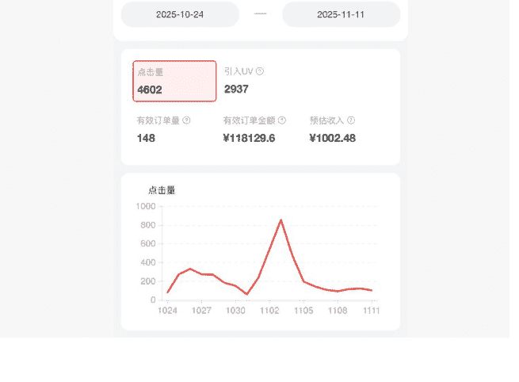
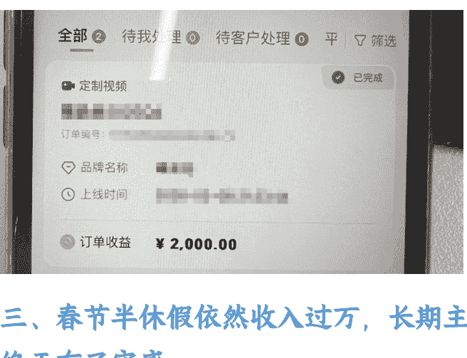

# 00 后裸辞做 B 站好物，从首月赚 20 到月入 1.8W+，我做对了什么？

260312 副业 SC 精华

公众号懒人搜索，懒人专属群独享

懒人微信：lazyhelper1

微信：lazyhelper1

## 一、前言

大家好，我是拓。一名 00 后自由职业者，加入生财的第 1 年。

去年 9 月，我带着半年的生活费裸辞，满怀憧憬地 All in 了 B 站好物项目，结果却被现实狠狠上了一课——首月累死累活，只赚了不到 20 元。

但在熬过了前 3 个月“没有正反馈”的至暗时刻后，我靠着跑通“选品策略”和找准“细分赛道”，在第 4 个月迎来了转折，并在今年 1 月拿到了单月收入 1.8W+ 的结果，其中 1.6w 是带货佣金，2000 元是商单稿费。

刚过去的 2 月份，哪怕我只开工了 10 天，也依然轻松实现了月入破万，其中商单稿费 6000 元左右，真正吃到了 B 站长尾流量的复利。

### 文章大纲：

- 1、从裸辞入局到首月 18 元，我是怎么坚持下去的
- 2、做对关键决策，靠“细分赛道 + 长尾效应”迎来收益拐点
- 3、如何找到能赚钱的选题？一套可操作的筛选方法
- 4、下一步规划
- 5、给 0 基础想入局的圈友的几句心里话

如果你也正处于项目探索的迷茫期，或者想找一个能长期深耕、享受复利的赛道，希望我走过的弯路和跑通的经验，能为你省下几个月的摸索时间。

## 二、从裸辞入局到首月 18 元，我是怎么坚持下去的

### 一、为什么选 B 站？

其实在决定 All in 做 B 站好物之前的一年里，我断断续续做过不少副业。但绝大多数项目都让我觉得很没有安全感——它们都有明显的周期性，可能几个月红利期一过，项目就“死”了，根本没办法当作全职来做。

我当时的状态非常内耗：虽然在职，但极度渴望离职，手里却又没有一个能支撑我全职干下去的底牌项目。直到我看到了家蒙老师发的帖子，了解到 B 站好物。

我最看重它的点就是“长期可持续”。B 站的长尾效应意味着内容是有复利的，这是一个可以长期深耕的赛道。恰好当时生财深海圈第一期开这个训练营，我觉得时机到了，于是果断决定试一试。

### 二、起步的毒打，裸辞滤镜碎了一地

很多人以为裸辞后 Allin，一定是每天像打了鸡血一样奋斗。但说实话，刚起步的阶段，我被现实狠狠上了一课。

刚辞职时我极度不适应，在家办公效率奇低。9 月份我大概给自己放了两周的假，美其名曰“过渡期”，紧接着又是十一国庆连休 7 天。等真正坐在电脑前开始做视频时，我发现最难的根本不是剪辑，而是迟迟没有正反馈带来的巨大自我怀疑和内耗。

当时没有任何长视频经验，镜头表现非常僵硬，文案更是不知道怎么写。而且刚起步时，我内心是比较逃避“选品”这个核心环节的，总安慰自己：选品没那么快学会，先把视频数量堆上去再说。于是，我盲目跟风去做那些最热门、但也最拥挤的数码产品。每次做新视频都感觉在机械地重复，没有任何实质性的提升。

第一个月，我磕磕绊绊做出了 5 个视频。我原本对首月的预期是赚个 2000-3000 元，结果现实是：整个月只出了 1 单。

但我至今记得出第一单时的场景。那天下午我在健身房，习惯性地打开“京粉”刷新，突然发现后台躺着一笔订单——是一款键盘，佣金 18 块钱。

你们可能无法理解，对于一个裸辞、迷茫、焦虑了一个月的人来说，那 18 块钱带来的兴奋感，甚至比我后来一天赚几百块佣金还要强烈。因为它证明了，这套逻辑是真的能跑通的！

### 三、放下执念先拿结果

虽然出了第一单，但国庆收假回来后，我的状态依旧浑浑噩噩。直到遇到了项目里的第一个转折点。

当时原神在群里分享了“录屏流”的玩法。不用真人出镜，不用很长的制作周期，大大降低了制作门槛。他分享完的第二天，我就马上动手尝试了，结果非常神奇——当天就出单了！这是我做项目以来第二次感到特别兴奋。

在这里顺便拆解一下时间安排：

- 选品与找热点 (1 小时)：核心工作，决定视频能不能赚钱。
- 写高转化脚本 (1 小时)：结合热点写文案
- 录屏与剪辑排版 (0.5 小时)：纯执行动作。

也就是说，制作单条视频可以控制在 3 小时以内。

从那之后直到双十一，我每天都在死磕录屏流。整个双十一期间，我靠着录屏流赚到了 1000 多块钱。

现在回过头来看，这段经历对我来说至关重要。如果不是录屏流带来了这波及时的反馈和几千块的收入，我可能早就放弃这个项目了。

所以我想对 0 基础的新手说：初期千万别眼高手低，想尽一切办法先拿到哪怕一块钱的正反馈，这才是支撑你坚持做下去的唯一燃料。

### 四、瓶颈与觉醒：瞎努力不如做正确的事

双十一过后，录屏流的红利减弱，我的热情也随之下降，又小小地休息了一段时间。看着群里很多做长视频的大佬接连发了精华帖，拿到大结果，我再次陷入了迷茫：为什么别人做长视频能赚钱，我不行？

我开始静下心来仔细研究他们的方法，开始摸索怎么样提升效率，把类似保姆级选购和避坑指南的视频质量做得更好。视频质量确实有一些提升，但数据依然没有太大起色。

我意识到自己闭门造车不行了，于是去找了家蒙老师帮忙诊断账号。他一针见血地指出了我的死穴：视频质量其实勉强够用了，核心问题在于“品和赛道”不对。

其实回过头去看，我已经在“选品和赛道”这个事情上吃过亏了，但有时候人就是会陷入当局者迷的状态，必须要大佬点你那么一下才能醒悟。这也让我彻底明白：做项目最怕的不是做不出好内容，而是在错误的方向上瞎努力。

## 三、做对关键决策，靠“细分赛道 + 长尾效应”迎来收益拐点

### 一、做对一次选题，胜过盲目更新十次

12 月份，我果断切换了赛道，瞄准了那些竞争相对小、但用户需求极其明确的细分刚需品。但当时为了保底，我接了不少低价商单（一期可能才赚 400 块），在这些商单中间，我穿插了 3 期自己真正想尝试的品类。

这 3 期视频加起来只花了我 6 天时间，但它们最终为我带来了接近 1W+ 的收入！回头看，这几期视频的制作质量并没有特别大的提升，纯粹是因为选题对了，直接迎来了指数级的增长。怎么去寻找赚钱的选题，我也会在后面讲。

### 二、长尾流量的复利与垂直高溢价的魅力

今年 1 月份，我的收入达到了 1.8W+。但复盘数据时我发现一个事情：12 月那两个视频带来的长尾流量，贡献了将近一半的佣金。这让我深刻体会到了 B 站长尾流量的性感之处——只要内容生命周期够长，它就能源源不断地为你打工。

同时，1 月份我还做了一个重要尝试：起了一个垂直品类的小号。这个小号只有 3000 粉丝，发了 2 个视频，但因为数据跑得不错且内容极度垂直，很快就接到了一个 2000 元稿费的商单。这让我意识到，在 B 站，内容垂直带来的高溢价非常可观。只要你的内容质量过关，哪怕在竞争不激烈的细分品类，品牌方也非常愿意买单。

### 三、春节半休假依然收入过万，长期主义终于有了实感

到了 2 月份，因为临近过年，我其实总共只工作了 10 来天。但是靠着 1 月份还算不错的选题带来的长尾流量，以及接的几个商单，整个月的收入依然很轻松地达到了 1W+。

经历了前期的煎熬和试错，直到这一刻，我才真正感受到了当初选择 B 站好物时所追求的“长期主义”和复利的价值。

## 四、如何找到能赚钱的选题？一套可操作的筛选方法

选对产品方向，是成功的关键。下面这套方法，能帮你系统性地做出判断。

### 一、核心思路：两种赛道，两种策略

你面对的选题，大体可分为两类：

- 1. 红海赛道（竞争激烈）
  - 特征：市场成熟，已有大量创作者在制作同类内容（如数码、美妆等大众品类）。
  - 策略与预期：在这里想靠带货获得极高佣金收入比较困难。它的主要价值在于：稳定的佣金收入 + 较强的商单潜力（因为品牌预算多）。你需要更关注内容差异化和视频质量。
- 2. 蓝海/细分赛道（竞争较少）
  - 特征：内容较少，或瞄准了某个未被满足的特定需求（即“细分刚需品”）。
  - 策略与预期：这是实现收入突破的主要机会区。一旦选准，往往能获得超出预期的回报。我 12 月的转折点，正是抓住了一个“细分刚需品”。

### 二、具体操作：三步筛选法

从想法到确定选题，建议遵循以下三个步骤：

#### 第一步：建立初始选品库

不要空想。你可以：

- 借助 AI 工具，让它帮你生成“适合在 B 站推荐的商品品类”列表。
- 直接浏览淘宝、京东等电商平台的一级/二级类目，寻找灵感。
- 目标：先建立一个尽可能丰富的备选清单（建议 15-20 个品类起步）。

#### 第二步：评估 B 站竞争环境

针对清单中的每个品类，在 B 站搜索“品类名 + 推荐”，核心是分析搜索结果的数量与质量：

- 潜力大（蓝海特征）：优质、认真的带货视频数量少于 3 个。
- 竞争强（红海特征）：优质带货视频数量众多，远超 3 个。

#### 第三步：进行商业价值判断

对上一步中筛选出的潜力品类，进行最终评估：

- 3. 估算佣金水平：找一个优质对标视频，查看其中推荐商品（需覆盖高、中、低价位）的佣金情况，计算平均单笔订单佣金。若平均佣金长期低于 10 元，则需谨慎，除非该产品具有极高的销售转化潜力。
- 4. 综合评估关键因素：一个品是否值得做，需权衡以下三点：
  - 佣金率：单笔收益高低。
  - 出单概率：受产品单价、平台竞争度、是否应季/热点等因素影响。
  - 商单价值：该品类未来吸引品牌商单的可能性。

核心原则：高佣金不一定就是好选择，低佣金也不代表没机会，必须结合出单概率与长期商业价值综合判断。

### 三、重要提醒：选品库的规模决定你的成功率

这是一个很容易被忽视但至关重要的点：你日常积累的选品库深度，直接决定了你做出优质选择的能力。

- 如果你的选品库只有 5 个选项，那么你本月的尝试就被限制在这 5 个之内。
- 如果你的选品库有 50 个经过初步筛选的选项，你就可以从中挑出 5 个最优解去执行。
- 两者最终的产出效果会有显著差异。因此，持续地发现和积累潜在选品，是一项必须坚持的日常工作。

### 四、实战拆解：如何把红海品做成“细分刚需品”？

很多新人一找赛道，脑子里蹦出来的都是“数码”、“家电”、“服饰”这些大词。我拿去年冬天的“羽绒服”举个例子：冬天推羽绒服，确实符合热点思维，但这也是一片红海，新人跟大 UP 主硬刚，根本卷不出头。

聪明的做法是什么？给大类目叠加上了“特定人群”与“极端场景”。

去年哈尔滨冰雪游爆火，无数南方游客涌向东北。这时候，如果你顺势做一期《南方人去东北旅游，到底该怎么挑羽绒服？保姆级选购/避坑指南》，这，就叫高转化的“细分刚需品”。

#### 为什么它好卖？

- 痛点极度明确：南方人不懂抗寒级别 (充绒量/蓬松度)，怕买错冻感冒，同时又不想花大几千买件这辈子可能只穿一次的极地装备。
- 受众极度精准：会主动搜这个词点进来看的人，100% 是机票都订好了、手里攥着钱急需买衣服的精准流量。

这时候，我们在带货脚本里，只需要拿出硬核的保暖参数做对比，帮大家做好不同价位的排雷，直接给出购买建议即可。这种基于**“特定人群 + 极端场景 + 保姆级避坑”**的内容，转化率高得惊人！这就是为什么我们一定要找细分刚需品的原因。

而且，这套思路是可以无限复制的。其实不仅是羽绒服，去年沿着“哈尔滨防寒”这个细分场景，从发热鞋垫、防风雷锋帽到防冻打底裤，只要是顺着这个逻辑选的品，几乎全都卖爆了。

## 五、下一步规划

B 站好物的核心收入就是“带货佣金”和“商单稿费”，接下来我的重心是把这两块系统化、放大化：

### 一、带货佣金 (靠矩阵放大)

偶尔出个单视频赚 1w+ 的爆款是玄学，但单视频赚 1000-2000 是可以复制的。下一步我会把跑通的高转化脚本，换出镜人、多账号分发 (核心是攻克查重限流问题)，实现利润放大。

### 二、商单稿费 (靠质量提价)

B 站目前的商单对于中小达人还有红利。我要把剪辑外包，控制单条视频个人投入时间在 8 小时内。通过不断优化拍摄和文案质量，把单条商单的价格从目前的 2000 元，提升到 3000-5000 元。

### 三、打造个人资产 (系统化)

真正的资产不是账号，而是你“稳定产出高质量视频的系统”。接下来我要建立完善的素材库 (对标账号库、剪辑素材包、爆款品类库)，让每一次创作都产生复利。

## 六、给 0 基础想入局圈友的几句心里话

从 0 到 1 永远是最难的。我们在圈子里常看到“一个月跑通项目”的大佬，但那背后往往是别人在其他领域的厚积薄发。

如果你是 0 基础刚起步，想做 B 站好物项目，我给你两个建议：

- 5. 前期死磕视频质量，对结果保持钝感。
  当选题不佳、出单不理想时，别过度内耗。只要你的文案逻辑、剪辑排版在线，就算长视频带货差一点，也容易接到商单保底。活下去，你才有机会慢慢培养出对“爆款选题”的网感。
- 6. 给策略设定一个“信任期”。比如设定 30 天，如果过了这个时间还没正反馈，大概率是方向错了。这时候退一步，去向上社交找更高维度的大佬指点，或者向 AI 求助。

失败是常态，项目有滞后性也很正常。只要我们能从失败中总结经验，早晚有一天能拿到属于自己的结果。

祝大家都能在各自的项目里，早日迎来自己的那波“指数级增长”！

———分割线———

看完这篇 SOP，你觉得你懂了。但 90% 的人一到实操就会卡在第一步。

工具和教程只是最低级的壁垒，真正的壁垒是“立刻动手”和“圈层信息差”。

如果你想看全网最新的变现玩法，并且和一群执行力极强的极客一起下场拿结果，欢迎围观我的核心私域：【懒人专属群】。

我们不聊虚的，只做商业闭环的拆解与 AI 效率的压榨。系统内已沉淀 1000+ 跑通的套利实战局。

⚠️查阅圈子最新搞钱实操记录:

https://hk57gvlx7u.feishu.cn/docx/H0kRdZbSbolBR0xkaXtcuVE0nTg

认同价值、准备好下场干活的，扫码加我微信

备注：【实操上车】

微信：lazyhelper1