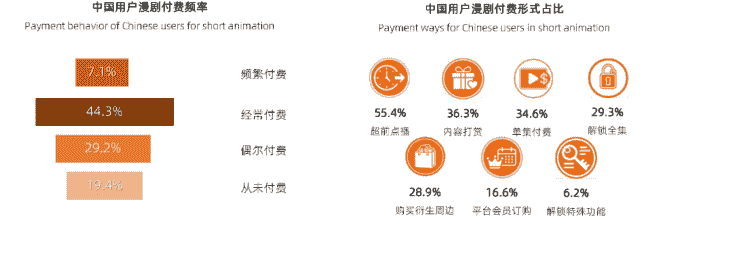
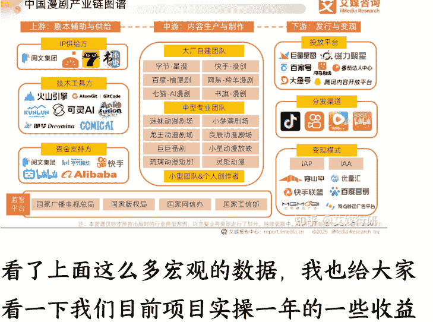
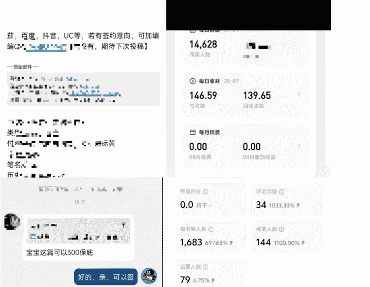
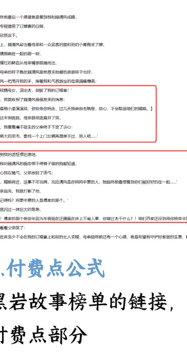
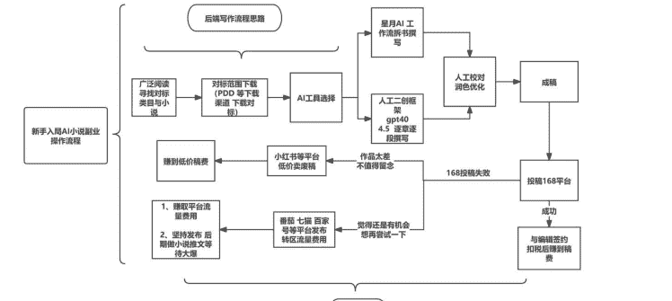
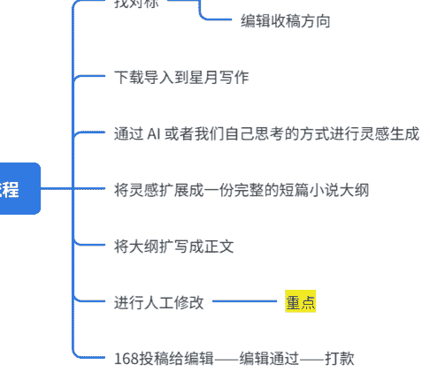
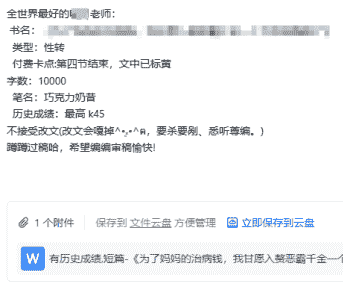
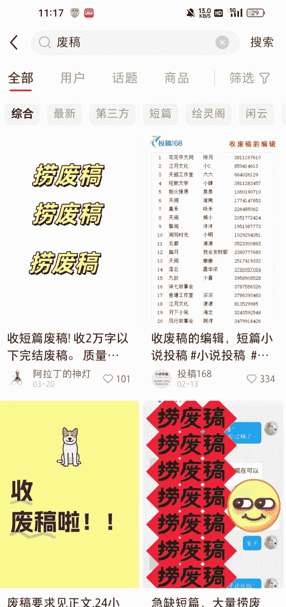

## 如何利用 AI 创作短篇小说赚取收入？

# 260312 副业 SC 精华

公众号懒人搜索，懒人专属群独享

懒人微信：lazyhelper1


大家好，这里是荷包蛋，一个不上班的 00 后，写作七年，正在搭建自己的人生躺赢系统。上周六天津举行了生财的第一场大型线下的 AI 项目沙龙活动，我是本次的分享嘉宾。

首先简单做一下自我介绍。我是一个 00 后的自由职业者，目前已经从事写作六年。自 2018 年上大学以来，我便开始以笔为生，而到了 2023 年，我抓住了 AI 的风口，将 AI 技术赋能于我的写作业务，实现了每年 30-40 万的纯个人利润。2025 年初，我发现小说网文的市场正在上升，于是将重心转向小说写作这一赛道，并且实现了单月收入突破万元的成绩。

如今已经是 2026 年，借助 AI，我们可以短时间内生成创意，甚至自动生成文章的框架或段落。通过高效创作优质内容，并在小说平台发布，来获得收入。

说到这里，大家可能已经有了些跃跃欲试的想法。很多人问我，普通人如何进入小说创作项目？我同样在使用 AI，但为什么我的内容一直赚不到钱，编辑也不愿意签约我？

这里我得先给大家泼点冷水：AI 只是一个工具，并不是万能的。它的效果取决于谁在使用它。为什么我们都在用 AI，有些人赚到了钱，有些人却依然一无所获？其中的奥秘在于，大家要沉下心来，虚心学习，脚踏实地，秉持长期主义，才能在这个项目中越走越远。

对于想要进入 AI 小说创作的新手来说，最重要的是先从简单入手。所以，今天的分享将会重点讲解短篇小说赛道的入门内容。

我们将涵盖以下五个方面：

### 一、2026 年网文市场前景机会分析

> 2026 年及未来 5 年市场数据中国泛娱乐产品行业市场发展数据监测及投资战略咨询报告
>
> 二、细分赛道市场格局与竞争态势对比研究
> 2.1 游戏、短视频、网络文学、虚拟偶像等子行业规模与增速对比

#### 1. 市场趋势利好，规模逐年增长。

2025 年市场规模约为 386 亿元（中国作家协会数据），预计 2026 年将突破 500 亿元人民币大关。核心市场规模虽已成熟，但带动市场（含衍生品）规模仍有望突破 3000 亿元。

#### 2. AI 漫剧爆发，促进网文需求。

从 2025 年下半年开始，漫剧行业开始崭露头角，嗅觉灵敏的短剧从业者开始进入漫剧行业。2025 年也被视为“漫剧元年”。

头部公司也在 2025 年下半年及今年年初加码布局漫剧赛道。2025 年 10 月，阅文集团宣布入局漫剧新赛道并推出四大举措，将其与短剧视为 IP 视觉化的重要引擎。面对成长期的新赛道，平台公司也纷纷涌入。腾讯、字节、百度发布漫剧独立 APP，爱奇艺、优酷增加漫剧独立频道。各家漫剧平台在分账、流量等扶持政策持续升级。

AI 大幅降低了漫剧的制作成本、缩短了制作周期，并降低了制作门槛。在 AI 工具链赋能下，传统数月制作周期被压缩至数周甚至更短，成本降幅超过 60%。

Seedance 2.0 近期爆火，再一次让“漫剧”这个 AI 与传媒产业深度融合的产物站上了风口浪尖。

漫剧是指依托网络文学 IP，通过 AI 工具完成剧本生成、人物建模、场景绘制、配音合成的全流程数字化制作，最终呈现“漫画视觉风格与短剧叙事节奏”的复合内容形态。市场最新预测显示，2026 年我国漫剧市场规模有望突破 240 亿元，用户规模超过 3 亿。





看了上面这么多宏观的数据，我也给大家看一下我们目前项目实操一年的一些收益截屏。



无论是和编辑签约拿稿费，还是发布到主流平台上，只要开始踏踏实实写，都是有机会赚取收入的。

但是关键点在于，如何利用 AI 写出高质量的文章呢，来赚取更多的收益呢？接下来的内容会给你答疑解惑。

### 二、用 AI 生成小说剧情的五大思路


- 1. 导语抽卡法
  利用关键词变化来快速替换故事背景和人设。比如从现代言情转换为古代、仙侠或年代文等。这种方式改变背景设定，能迅速调整故事氛围和吸引不同类型的读者。

- 2. 热点融合法
  选取社会新闻热点与原有素材相结合。通过将现实事件（如台风、疫情等）融入到已有的故事框架中，创造新的情节，借势热点话题，又能引发读者关注和讨论。

- 3. 融梗法
  在已有的故事框架基础上，添加新的元素或梗。例如，可以通过添加心声或弹幕等梗来改变故事的表达方式，甚至通过改变角色的身份或设定，使同一篇内容焕然一新。

- 4. 达尔文裁剪法
  通过组合不同来源的导语和正文，创造出新的内容。例如，可以将不同作者的导语片段拼接起来，或将多个导语的不同部分合成一个新的版本，高效地产生新内容，同时避免被识别为抄袭。

- 5. 视角替换法
  通过改变故事中的叙述视角来创新。比如将女主的视角换成胎儿、老年人或反派角色等，从不同的角度讲述同一故事，带来全新的感受和视角变化。

### 三、常见类型小说写作的标准公式

#### 1. 标准公式

- 导语 50 到 200 字左右，抛出猎奇矛盾或者拉悬疑感
- (1000-2000)，展开剧情，直接写案件或者悬疑事件
- (3000-4000)，卡点付费，制造钩子吸引读者，比如，我成了杀人嫌疑犯！
- (5000-7000)，安排真相，但是不是全盘托出，需要一点点透露，继续拉悬疑感！
- (8000-10000)，真正出现幕后大 boss，事情真相，但出现奇怪的点！
- (10000-12000)，大结局，悬疑反转，一种是推翻之前所有真相，出现大逆转；而一种是让真相再次跌宕起伏！

#### 2. 导语公式

小说开篇通常在 50 字到 200 字之间，在末尾一般点“......”之后紧接着“|”，是用来放在首页引流的，读者第一眼看到的是标题，第二眼就是导语，导语一定要吸睛、吸睛、吸睛。

绝大部分短篇小说都是要做成小说推文的，在抖音投放，如果没有噱头，如果不吸睛，如果开篇不再 3 秒炸裂，抖音用户就直接划过去了，所以开头第一句话不要使用对话，使用对话会让刷抖音的用户觉得莫名其妙。

> 父亲葬礼当晚，正在守灵的我被贼人抓走。
> 他们撕烂父亲的遗照。
> 敞开父亲的骨灰盒威胁我配合三个男人拍下了长达八个小时的不雅视频。
> 次日，那视频就被剪辑成视频传播了乡镇的各个角落。
> 当晚的未婚夫毅然决然的退婚。
> 日日嘲讽羞辱的女校霸也没了踪影。
> 重重打击之下，身体孱弱的母亲捂着父亲所剩无几的骨灰撒手人寰。
> 绝望之际，未婚夫的小叔意墨替跪地向我求婚了。
> 犹如飘雨的小船终于找到了港湾。
> 我信下了这桩婚事。
> 婚后半年，我去市里接醉酒醉酒意墨存回家。
> 在包厢门外听到了他和好兄弟的对话。
> “墨存，半年前那件事你做的太过火了吧？不过是一桩婚姻，一份工作，小蝶家境优渥，想要什么没有？怎么偏偏什么都要抢曹云的呢？那工作可是她爸爸用命换来的！你看曹云如今整日恍惚的样子......"
> “我也没办法。正因为如此，才更要用这极端的办法。只有毁了贞洁，女校才会把她拒之门外，只有毁了贞洁，意扬才会毫不犹豫的退缩。我没办法守护小蝶一生，只能为她扫清障碍......"
> “那裙子上那些光辉我安排兄弟们去收了啊，半年了，你不知道现在棚子里的男人看到曹云是什么眼神，猥琐的恨不得当众面对面吃......”
> “别吃。”
> 包厢内一阵沉默。
> 随后传来一声男人低哑的嗓吼。
> “曹云你到底是人是鬼？！那光盘你自己看过没有？！结发妻子被三个男人活活折磨了八个小时，最后曹云眼窝里流出的都是血水！为了虐掉那样一个女人，这么做值得吗？！”
> “够了！我何尝不知道她难过，再等等，等小蝶生下意家的孩子，一切都确定了再说，无非就是谎言谎言，总比皮肉之苦好过。不过了，曹云说好的来找我，被听到就麻烦了......"

#### 3. 开头公式

小说的导语和开头，最好是连续的，这样他们会进行一个联动，产生情绪升级的效果。

比如这个“一对戏精母女，滚出去，别脏了我的订婚宴”。

之后在正文，紧接着就是“槿月，婚期将近，这事不可玩闹，况且清风是你妈妈中意的人，她临终前最想看到你们能好好的在一起......胡说！傅家的那个前些年因为车祸现在还瘫痪在床上不省人事，你嫁过去干什么？”

从母亲吐血→母亲的遗愿。

通过对话产生了一个情绪升级的效果。

有一个反面案例是：导语是总结概括了整个小说，之后开头非常平淡，瞬间就产生了一个情绪落层，原本导语的情绪是非常激烈的（老公为了青梅对我如何不好）。之后瞬间开头非常的平淡，平平无奇的剧情没有冲突，瞬间就会产生一个情绪落层。



#### 4. 付费点公式

黑岩故事榜单的链接，点开滑到最后就是付费点部分。
从最后往前数 500 字都算付费点。

付费点通常是 3 个小恶心 +1 个大恶心 + 留下悬念。


公众号懒人搜索，懒人专属群分享

打算放弃宋锦年之后，仔细想想，宋锦年除了这幅皮囊刚好在我的审美之上，其他的条件跟我的竹马比，实在算不上什么优秀。

他们 10 个人站一起，也能组个男团出道。

偏偏，我就喜欢宋锦年这一款。

我心头又是密密麻麻的酸涩。

外面做了点热菜，佣人刻意跟我说：“先生陪周小姐去拍卖会了，周小姐说喜欢一款项链，我看网上说那款项链三十个亿。” “先生不带一点犹豫的，直接帮周小姐过去。”

我安安静静的吃着。

佣人又继续道：“现在都奉行一句话，不被爱的才是第三者。”

我吃完了，抬眼看佣人。

佣人有点犯怵。

我只往嘴里：“哦。”

起身往楼上客厅去拿我的行李。

身份证，银行卡，充电器。到楼下我跟佣人说：“宋锦年和周锦华回来的时候，告诉他们，我给他们准备了一份礼物，在婚房的床头柜里。”佣人不置，也应了声：“行。”

我轻轻的出了门，联系朋友拿了出国的那些证件，到机场直接上飞机。

飞机还没起飞的时候，收到宋锦年的一条消息：在家吗？锦华要去买新衣服，你的衣服不是全扔了吗，我们过来接你一起买两件。

宋锦年：不许跟周锦华抢，她喜欢的衣服，你必须避开。

我轻笑一声，看着这些文字突然觉得也没什么大不了的了。

把短信这条信息发给我妈之后，直接将手机关机，手机卡抽出来掰断，扔进了垃圾桶内。

到国外的话，机场有人接，也不需要手机联系。

我闭上眼。

过去的那些时光，全都再见了。

宋锦年，再见了。

......

启程，宋锦年带着周锦华往家里去。

周锦华还在摆弄着刚拍下的项链，高兴的不行。

宋锦年给他打了好多次电话，想让锦年先出来，以免他到家接，打消了周锦华买衣服的兴趣。

可这电话怎么都打不通。

他开始崩溃，到家后带着些愤怒进房门。

“太太宅？”

佣人道：“太太出门了。对了，太太说，给您和周小姐准备了一份礼物，放在主卧的床头柜里。”

虚弱地走在路上，我经过一栋写字楼，却撞见叶文芳被保安恭敬地迎出门。

看我夹着包，她以为里面是简历，无情嘲笑我：“哟，你这是上门求职？骗子出来要饭啦！”

我本不想理会，但叶文芳误会我要进大楼，一把拽住我。

“死心吧！就算你去给里面老板磕破头，洗厕所的工作都轮不到你！”

保安更冲上来一把拽下我包，扔向远处。

“快滚！我们老板说了，垃圾就该丢丢远点！”

我包里资料摔得七零八落。

叶文芳一脚踩上去，碾了又碾，“看见没？说封杀你就封杀你，你的职业生涯、人生都完了！”“你有真本事真文凭又怎样？媒体都为我说话！你没背景没靠山，没人会为你出头讨公道！”

叶文芳讥笑着扬长而去，残酷的话语却如同一座大山，压得我喘不过气。

我不明白，辛苦努力换来的一纸文凭，为什么换不来公平？

难道没背景没靠山，就要被欺负到死！

屈辱的泪水在眼眶打转。

我死死咬着唇，捡起地上的资料。

其中有我仅存的一张硕士证，上面沾着斑斑点点的咖啡渍，细高跟的鞋印无比刺眼。

可曾经，为我颁发证书的校长说，世界顶尖学府的文凭，足以让各大龙头行业为我抢破头！

如今我看向不远处的法国大使馆，拿着被狠狠践踏残破的证书，走上去。

我问大使馆。

“帮我看看，这是你们国际名校的证书吗？”“可现在网上都说，你们办的是野鸡大学。国家的名誉，你们还要不要了！”

还有一个多星期，还有一个多星期就结束了。

推开二楼的卧室，许嘉衣衫不整地躺在床上，整个出人大汗淋漓。洁白的双腮压在真丝的睡衣外面，脸上的潮红还未褪去。她瞧见我进来，轻蔑地一笑：“过来，扶我去浴室，帮我洗澡。”

我扶着她的手臂走进浴室，放好水示意她可以进去了。

她拖着手靠墙上，抬起一只脚，伸到我最前。

“麻烦姐，我累得很，不想自己动手，你替我洗吧。”

我定在原地没有动，她用脚碰了碰我的手，挑衅地说：“怎么？要我踩扁你你才肯动吗？”

“他要看见你这样不情不愿，恐怕你在乎的【夺父计划】就要泡汤了。”

我眼睛猛地看向她，厉质问道：“你没失忆！”

她搭嘴哭出了声：“失忆？什么老土的小说情节。”

“我早就知道你们结婚了，我在太空站的时候就知道。不过那又怎么样呢？我随便勾勾手指，装装晕倒，禹舟就满心满眼都是我。”

“不像你，卖力卖身卖青春，他连看都不看你一眼。”

我转头就要走，她挡在我面前。

“怎么？想去告诉他真相？你觉得他会信你还是信我，别时我只要一句话，就让你前半生的心血毁于一旦！”

我直直地盯着她，眼神里迸发的怒火：“你敢！”

她看着我发怒，笑得更开心，突然眼睛一转，指尖点了点头：“哦！对了，【夺父计划】是你爸妈拼了命运续下来的吧。真可惜，当初那瓶行星生物样本只感染了你们妈。”

包你爸妈命不好，当初我不过好奇打开看了一下，谁知道这生物样本那么容易挥发。”

一瞬间气直涌上我的脑膜，如遭雷击懵在了原地。

我一巴掌扇在她的脸上，响声明回荡在空旷的浴室。

“贱人，我会替我爸妈讨回公道，我要向所有人揭开你的真面目！”

他恶毒的声音在我背后响起：“生物样本没错，你猜，在现场的我为什么没事？”

### 四、如何 0-1 利用 AI 写作小说变现

短篇小说，通常字数在 8000 到 12000 字之间，更接近于人日常的碎片化阅读，追求的是类似于短视频的爽、短、快。冲突、噱头、反转、跌宕起伏~世界观通常使用日常世界观，追求一开篇就是炸裂，拉动情绪。

#### 1. 一句话讲清全流程



我们在各种榜单和各家编辑收稿方向上寻找对标文，通过 AI 或者我们自己想一个类似的脑洞，再使用 AI 生成剧情大纲，进行剧情扩写。拿出完整的成文后手动修改打磨，最后通过 168 投稿投稿给编辑编辑出价，我们售卖拿钱。



#### 2. 按收益划分

按收益分为免费流量分成和编辑付费独家买断。

#### 免费流量分成

最典型的代表是番茄小说平台，发布番茄，然后作者和番茄瓜分广告收益。

总结看的人越多，收益越高，但很有可能没什么人看，只有几分钱的收益，最好的方法就是用数量对抗概率。

#### 编辑付费独家买断

是我们将我们的稿子发给编辑，编辑选择是否买断出价，通常在千字 30 元~千字 100 元之间 (k30~k100)，但对于稿件的质量要求比较看重。

一篇一万字的稿子，即便是千字 30 也在 300 元，这就需要我们打磨好稿件的质量。

### 五、投稿的注意事项与常见误区梳理

#### 1. 投稿流程

1.  第一步：点击创建投稿计划，添加自己这篇 Word
2.  第二步：添加作品字数、作品分类、作品风格、作品类型
    作品类型那里如果是追妻，选择虐文和追妻 - 追夫
3.  第三步：添加邮件主题和正文
    邮件主题这里：作品类型 + 《书名》 + 字数 + 有历史成绩
    在投稿邮件内容这里需要手动改一下，有很多粗暴 AI 文会直接使用这个模板改也不改，有一部分编辑看到这个模板会自动默认是 AI 文。
    所以我推荐这里，一定要改改成自己的风格和方式。这是我自己的仅供参考。

    

4.  第四步：在投稿计划这里点击 AI 智选，最下面有一个保存，点击保存

    

5.  第五步：保存后回到自动投稿页面，在作品信息那里有一个开始投稿，点击投稿，开始投稿就会自动投稿。

#### 2. 168 投稿注意事项

1.  在投稿那里，最好选择文件投稿，而不是中转站。
    中转站在邮箱里显示是一个链接。
    有一部分编辑并不会点进去，害怕是钓鱼邮件之类的。
    第 2 个是可能有一部分编辑的电脑会很老，甚至是 win7 系统，点进去打不开那个链接。
    因此，这里推荐选择文件投稿。

2.  投稿文件是完整稿件。
    将短篇小说的全部内容放入稿件中，如果不全的话可能有一些部分编辑直接会审核不通过。

3.  关于使用邮箱。
    最好是使用老的 QQ 邮箱，新注册的 QQ 邮箱发送多封邮件，邮件容易进垃圾箱。
    163 之类的邮箱不是很推荐。

4.  过审后，最好和编辑打好关系。
    因为下一本会提价。
    比如在这个编辑过了一篇 30 元/千字的稿子。
    下一篇再过的话，可能会提到 35 元/千字的，或者是 40 元/千字的。

5.  关于历史成绩。
    即便是第一次投稿，没有过过稿，但历史成绩那一栏最好也填上 k30/k40。
    如果稿件通过审核编辑会询价，会问之前是否有历史成绩？最好说之前是 k30 左右然后要一个 k30 或者是 k35 的价格。

6.  关于废稿。
    如果是被杀的稿子，收到一大堆拒信，可以把它发到番茄，或者是小红书上有收废稿的，可以问问废稿。
    小红书上有收废稿的，大概是 100~200 左右。
    如果投稿后编辑的评价通常是缺乏付费感之类的说明文章质量可以，卖废稿很大可能卖出去。其实也可以专门卖废稿。
    AI 生成的质量确实是和 k30 之间有一定差距，这个差距需要人工补齐。
    但如果是废稿的话，基本上 AI 生成的就可以直接卖。
    小红书上直接搜【废稿】。

    

### 写在最后

非常感谢生财有术平台满足了我的分享欲望的同时也可以帮助更多人赚到钱。

希望对小说感兴趣的圈友们可以和我一起靠写作赚钱养活自己。

别有心理压力，写小说在自己的小世界里构思剧情本身就是件很快乐的事情，还是比较好上手的，拿到第 1 篇 k30 就会信心满满，大家一起加油吧！！！

完整 ppt:

百问百答：

三月的 AI 小说航海群_问题汇总百问百答贴

我是荷包蛋，一个不上班的 00 后，写作 7 年，正在搭建自己的躺赢系统。

希望对大家有帮助!!

————分割线————

看完这篇 SOP，你觉得你懂了。但 90% 的人一到实操就会卡在第一步。

工具和教程只是最低级的壁垒，真正的壁垒是“立刻动手”和“圈层信息差”。

如果你想看全网最新的变现玩法，并且和一群执行力极强的极客一起下场拿结果，欢迎围观我的核心私域：【懒人专属群】。

我们不聊虚的，只做商业闭环的拆解与 AI 效率的压榨。系统内已沉淀 1000+ 跑通的套利实战局。

⚠️ 查阅圈子最新搞钱实操记录:

```
https://hk57gvIx7u.feishu.cn/docx/H0kRdZbSbolBR0xkaXtcuVE0nTg
```

认同价值、准备好下场干活的，扫码加我微信

备注:【实操上车】

