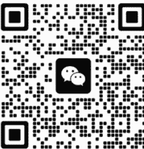

# 经常庆功，就能成功

260316

整理：公众号懒人搜索，懒人专属群精选

懒人微信:lazyhelper1

新春之后开工的这段时间，很多人在网上晒出了自己的“开工仪式”。

有人在办公桌上摆橘子，橘谐音吉，寓意大吉大利；还有人必须按照固定的顺序打开电脑、登录系统、查看邮件；还有人开工前，必须按照特定的方式整理一遍桌面，等等。甚至有人说，开工第一天必须穿同一件衬衫，已经坚持了五年。

有人可能会觉得，这些都是迷信，充其量算是心理安慰。毕竟，穿什么颜色的袜子，跟工作顺不顺利，能有什么关系？

但是要知道，有类似习惯的，不只是我们普通人，全世界顶尖运动员也在这么干。网球名将纳达尔，每次比赛前，场边的水瓶商标必须冲着他所在一边的底线。小威廉姆斯总是把浴室拖鞋带到赛场，一发前拍球五次，二发前拍球两次。

你看，这些世界冠军，难道也是在搞迷信？还是说，这些仪式，本身就有着独一无二的作用？

其实，关于仪式的研究很多，各种理论也不少。今天我们说一本新书，哈佛商学院教授迈克尔·诺顿的《仪式的力量》。诺顿用了十多年时间，专门研究“人们如何在日常生活中使用仪式”。根据诺顿的研究，很多看似“没用”的动作，实际上能产生真实的、可测量的心理和生理效应。

那么，仪式到底有什么用？又该怎么利用这个机制？

要想回答这个问题，我们得先从一个实验说起。

诺顿做过一个实验，过程很简单。他把参与者分成两组，给他们吃巧克力。A 组拿到的是有包装的巧克力，吃之前要先读包装上的内容，欣赏一番，然后再吃。B 组拿到的是拆好的巧克力，直接吃。

结果呢？A 组的人普遍觉得巧克力更好吃。

你可能会说，这不还是心理作用吗？

关键来了。诺顿进一步做了神经科学测试，发现当人们在吃东西前做仪式性动作时，大脑的多巴胺奖励系统会被激活。换句话说，**仪式真的改变了大脑的化学反应**。这不是“单纯的错觉”，而是你的大脑真的分泌了更多让你感到愉悦的物质。

为了验证这个发现，诺顿又做了一个更极端的实验，胡萝卜实验。

这次，A 组的人在吃胡萝卜之前，要先说一段比较长的 Rap。注意，是 Rap，不是什么优美的诗歌。B 组直接吃。按理说，让一个完全不懂 Rap 的人说 Rap，应该会让人觉得尴尬，影响心情才对。

但结果恰恰相反。A 组对胡萝卜的评价明显高于 B 组。

诺顿发现，进食前由仪式产生的延迟，会增强人们对食物的享受。这个机制跟我们小时候的经验很像，过年前妈妈把好吃的藏起来，不让你吃，等到过年那天才拿出来。那时候你会觉得特别好吃，不仅仅是因为食物本身，更是因为这个“等待”的过程。

换句话说，仪式通过制造延迟、增加步骤，实际上是在调动你的期待感，让大脑提前进入“准备享受”的状态。等你真正吃到的时候，享受就被放大了。

从这个角度看，假如你想让日常生活中的某个体验变得更好，不需要换更贵的东西，只需要在体验之前，加一个小小的仪式。

比如，喝咖啡。你可以像大多数人一样，买了就喝，快速摄入咖啡因。但你也可以这样，先闻一闻咖啡豆的香气，观察一下咖啡的颜色，想象一下这杯咖啡的产地，然后再慢慢喝第一口。同样的咖啡，后者会让你觉得更好喝。

再比如，看电影。你可以打开视频网站直接看，也可以先关掉手机，调暗灯光，泡一杯茶，然后再开始。后者会让你的观影体验明显提升。

关键不在于你做了什么，而在于你怎么做。仪式不是在欺骗你的大脑，而是在帮助你的大脑更充分地享受当下。

说到这，还要注意区分一组概念，仪式和习惯。这本质上是两回事。

有什么区别呢？诺顿认为，区分习惯和仪式，关键不在于你做什么，而在于你怎么理解你在做的事。

习惯的目的是让行为自动化，帮你高效完成任务。刷牙、洗脸、穿衣服，这些都是习惯。习惯的重点是结果，把牙刷干净、把脸洗干净、把衣服穿上。

但仪式不一样。仪式的重点不是结果，而是过程本身。你在过程中赋予了它情感和意义。

同样是煮咖啡，假如你只是为了快速摄入咖啡因，那它就是习惯。但如果你坚持用粗磨咖啡粉、法压壶，享受水温、时间、手法带来的细微差别，那它就是仪式。

诺顿总结了仪式的三个核心特征:
- 第一，固定的程式，有预先确定的动作序列
- 第二，象征意义，这些行为超越了行为本身
- 第三，非功能性，没有明显的实用目的

举个具体的例子。

有家公司设计了一套新人入职体验。新员工第一天上班，会有专人在门口迎接，带着参观整个公司。走到新员工的办公桌前，桌上会升起一个小横幅，写着“新人在这儿”。电脑屏幕上是代表公司理念的精美图片。桌上还有一个不锈钢产品模型作为礼物。CEO 会亲自写信鼓励。

你看，这些动作有实际功能吗？没有。新员工该做的工作，一样都不会少，但这套仪式创造了一种“被重视”的感觉。

有意思的是，即便新员工知道每个人都有着样的待遇，他们仍然会把它当做难忘的经历。

那么，怎么把日常的习惯转化为仪式呢？诺顿给了三个具体方法。
- 第一，给行为赋予象征意义。比如，早晨的第一杯水，不只是补充水分，而是“唤醒身体，开启新的一天”。这个意义是你赋予的，但一旦赋予了，这个行为就不再是机械的习惯。
- 第二，增加固定的步骤。比如，睡前不只是刷牙洗脸，而是先整理书桌，然后写三件今天值得感恩的事，最后才上床。这些步骤组合在一起，就形成了一个“告别今天，准备明天”的仪式。
- 第三，放慢速度，关注过程。习惯追求效率，仪式追求体验。同样是洗碗，你可以快速冲洗完事，也可以感受水温、泡沫、碗碟的触感。后者就是把习惯转化成了仪式。

换句话说，仪式不需要你做什么特别的事，只需要你换一种方式看待你正在做的事。

这也是在诺顿看来，仪式最重要的一个特点，它不是为了控制结果，而是为了恢复控制感。

诺顿做过一个实验，让参与者在演讲前清洁一个装饰品，直到他们认为它干净为止。结果发现，那些被告知要做高压演讲的人，清洁动作明显更重复、更僵化。面对没有把握的挑战，人们会不知不觉做点小动作来缓解紧张。

当我们面对复杂、不可控的环境时，控制感会降低，对未来的预估能力也会下降。这时候，通过做一些重复性、具有确定性的动作，能够提升内心的稳定感。

这就是为什么很多运动员在比赛之前，都有一些很个人化的小动作。比如我们前面说的纳达尔、小威廉姆斯等等。

这也解释了为什么很多文化中都存在哀悼仪式。亲人去世，这是最极端的“失控”体验。人们无法改变这个事实，无法预测未来会怎样。但通过守灵、追思、祭奠这些仪式，生者能够从“无常”的阴影中慢慢恢复过来。

还有一个实验很有意思。哈佛大学的研究者让参与者在陌生人面前唱歌，这是个高压任务。一组人在唱歌前开展特定仪式，包括在纸上撒盐之类的；另一组只是安静坐着。结果，做过仪式的那组，唱歌时心率更平稳，焦虑感更低，唱得也更好。

那么，回到我们自己，怎么设计一个有效的仪式呢？诺顿给出了三个原则。
- 第一，在不确定性高的时刻，设计固定的动作序列。比如，重要会议前，固定喝一杯水，深呼吸三次，整理一下衣领。这些动作本身不重要，重要的是它们的固定性和可预测性。
- 第二，选择你能完全掌控的动作。不要选那些依赖外部条件的事情。比如，不要依赖“听到某首歌”，因为你不一定能听到，而是选择“做五个深蹲”，这是你随时随地都能做的。
- 第三，赋予这些动作象征意义。比如，深呼吸不只是呼吸，而是“把紧张呼出去，把能量吸进来”。这个意义会强化仪式的效果。

有句话叫，经常庆功，就能成功。你看，庆功本质上就是一种仪式。这个仪式做了什么？

首先，它激活了你的多巴胺奖励系统，让你的大脑把“完成目标”和“愉悦感”建立连接。下次再面对类似任务时，大脑会更有动力。其次，它赋予了“完成小目标”这件事象征意义，让你觉得自己在进步，而不是在机械重复。最后，它在不确定的奋斗过程中，给了你一个确定的、可控的积极反馈。

换句话说，庆功不仅是成功的结果，更是成功的原因之一。从这个角度看，也推荐你有事没事，经常庆功。就像诺顿说的，仪式的力量不在于它有多复杂，而在于你是否相信它，是否持续去做。

——————分割线——————

绝大多数人只盯着眼前的工资，却不知道一次远在中东的冲突、一次降息的决议，就能在一夜之间洗牌普通人的财富。

看懂宏观，是为了在周期切换时，不被当作代价。

如果你认同这种“抬头看路”的长期主义，欢迎围观我的个人情报智库：【懒人专属群】。

圈子已稳定运行 7 年。我们每天过滤全网最顶级的政经内参、大 V 付费研报，剔除情绪噪音，只保留能指导资产配置和商业决策的真实信号。做你最冷酷的“外部大脑”。

⚠️ 查阅圈子最新宏观内参目录:

https://hk57gv1x7u.feishu.cn/docx/H0kRdZbSboIBR0xkaXtcuVE0nTg

拒绝伸手党，只识有缘人。扫码加我微信，

## 备注:【破局上车】

微信: lazyhelper1