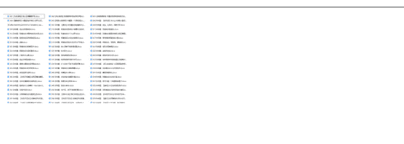
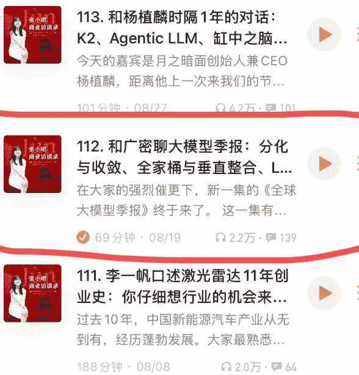

## 0 到万粉公众号垂直 IP 复盘：我的一些笨办法和真感受

260316 副业 SC 精华

公众号懒人搜索，懒人专属群独享

懒人微信:lazyhelper1


放老大镇楼！感谢亦仁大大给我这个机会，让我认真复盘一下自己做垂直小号这一路的过程。


先说一下成绩，前后认真做了 3 个月，0 到万粉，平均阅读 2k，变现当天社群产品收入过万。

当然现在还远算不上做得好的，所以这篇不是成功经验，而是一份阶段性复盘。分享做号以来我的心路历程和经验，给正在做垂直公众号的小伙伴一点参考。

### 01 为什么垂直小号值得做？

我第一次意识到这个机会，是看到了几个案例。

我平常炒美港股，2024 年底正好想买车，就开始研究理想汽车。然后我经常刷到一个面向理想投资者的公众号，平均阅读两三千，我觉得很有意思，就花了 299 进了他的社群。

进去之后我有点震惊，群里 500 人几乎满员，而且大概率还不止一个群。我当时粗略算了一下，光付费群收入就已经很可观了，更别说这个号带给号主的隐藏价值（结识公司高层和车圈人脉）。

那段时间我还刷到一些其他的公众号，比如粮厂研究员 Will，专门研究小米的；林氪，专门研究拼多多的；猫笔叨的读后感专区，专门研究猫笔刀这个公众号的😄。

它们给我最大的启发，不是数据有多好，而是让我真正相信：**哪怕只是理想、小米、拼多多这样很具体的公司投资者，看起来人群很窄，但只要你研究得足够深，依然可以做成一门成立的内容生意。一厘米宽，一万米深。**


> 右滑查看更多

举一反三，那蔚来可不可以做？英伟达可不可以做？特斯拉可不可以做？蒋介石能不能写？

我当时脑子里很多想法，但都没认真做。直到 2025 年 7 月，我看到亦仁发垂直小号超级标，思路一下子清晰起来，于是下了决心：这件事不能再等了，值得好好做。

在做之前，我把亦仁的超级标反复琢磨了好几遍，把这件事情想清楚了。

### 02 为什么选择做深度垂直 IP?

我当时参与了航海，看到垂直公众号这件事，大家有两种做法。

一种是赚流量的钱，多做矩阵号流量，流量主/卖货/卖课赚钱，这条路我看到像刘智行老师、辰风老师都做得很好。

另一种是做深度垂直 IP。内容未必每篇都爆，但会慢慢积累信任，把个人 IP 做起来。

我心里一直更偏向第二种。尤其是看到亦仁发的硅谷王川的社群，我觉得这就是我真正想做的，不只是为了流量，而是在自己喜欢的领域里，聚一帮人一起前行。

总结：如果你想走垂直深度 IP 这条路，最好选一个自己内心真的有感觉、愿意长期泡在里面的领域。因为短期可以靠勤奋，长期还是得靠热爱和认同感撑着。

### 03 关于起号和 IP 定位

我一开始定位是写美港股，但刚开始更新的时候，其实挺惨的。基本没人看，坚持了半个月，阅读量都不过两位数。

直到有一天我在 X 上看到一篇关于孙宇晨的帖子，写他十年前就倡导 90 后不结婚、不买房、买英伟达、买特斯拉。那种超前感一下子击中了我。

这篇帖子刚发，数据很猛，属于异常值（显著高于博主其他帖子平均阅读量），加上我也很认同这篇内容，所以我也顺着这个思路写了一篇，发到公众号。划重点：把爆款重写一遍，而不是想写啥写啥。


很幸运，这篇直接爆了。

我意识到，正反馈来了，我必须抓住这波流量。虽然这篇内容和我一开始设想的定位有一些偏差，但在起号阶段，先把号跑起来更重要。

按照自媒体的经验，爆过的内容会反复爆。既然大家喜欢看，那我顺着这个思路（孙宇晨语录）继续更新。

我用了个笨办法，开始系统搜集孙宇晨过往的公开表达，包括多年前在喜马拉雅上的录音课，我都去找来转写，一篇篇去看；还买了他的书，还翻了过去几年他在抖音、X、视频号、小红书上的发言和直播内容，都看了一遍。把其中关于投资判断、时代机会的内容摘取出来，再重新整理成选题。




那阵子刚好“孙学”特别火，很多号都开始写，我有先发优势，一篇接一篇地爆，号算是起来了，经常会有过万阅读。

> （这件事告诉我们：起号阶段先找到一个有传播力的爆款，复制爆款，然后想办法延长爆款生命力，先把号跑起来再说。）

但起号之后，我开始纠结了，我一开始设想做的是个人 IP，却不小心做成了孙哥 IP😂这其实也证明了垂直小号红利是存在的，围绕孙宇晨的 ip 可以做成一个可以变现的社群。

但我最终还是希望做自己的 ip，所以我结合我原先美港股的定位和目前的受众，进一步提炼了我的细分定位：发现 AI 革命下的全球投资机会。

相比之前的定位，我认为是更加清晰了，也更符合“经营一个小众人群”的垂直小号核心理念了。所以我觉得起号阶段定位可以不要想太多，知道个大方向就行，有了流量之后慢慢会想清楚的。

### 04 如何提高推荐流量比例

我开始增强我这个 ip 之后，开始写我发现的新机会，我对 AI 趋势的判断，我的全球套利策略这些。

但这个阶段并不顺利：粉丝数变成负增长、阅读量下降，推荐比例下降。

但要做 ip，粉丝流失是一个必经的过程：筛选掉不同路的人，才能把真正认同你的人留下来。你只管表达你自己。

关于怎么提高推荐比例，我的办法，主要是从异常值找爆款选题，这个很好用。因为公众号文章火不火主要看选题和标题，在其他平台火的选题，在公众号火的概率很大，而且你的标题直接用火的就行，多尝试几次，会发现推荐比例比自己坑哧吭哧写要好。

我们拿这篇数据不错的文章举例：


第一步，找到垂直领域的热点事件，比如我是投资美股领域的，那美股里比较有名的人物是段永平，这一篇爆款就是源自于【段永平发雪球看好谷歌的大模型】。

大道无形我有型 09-12 22:46

现在市场上的大模型很多，10 年后能活下来的大概率不会超过 10%，所以这是个九死一生的游戏（这是我猜的）。大家可以猜猜 10 年后大家还在用的主流大模型会是什么？我会猜 Gemini，因为背后的 Google 很强大，而且已经醒了。

> @吉建晔 0666：@大道无形我有型 段永平老师：就像您港股自选里排位第三的商汤一样，很多人一直拿汤教授去世为由，认为没有创始人的商汤，也将走下坡路一样


$ 谷歌 A +0.74% 加自选

我发现段这篇帖子的数据明显高于平均值，属于异常值，再加上符合本号的定位，因此判断可以作为选题。其他垂直领域也是一样的，你沉浸在那个领域里，多刷社媒，或者长期跟踪一两个头部 KOL，就比较容易找到数据异常高且适合发挥的帖子。

第二步，确定选题之后，就是内容了。有的人可能干巴巴开始写，但是光有好的选题，没有好的内容无法获得推荐。怎么获得好的内容？那就是直接找这个选题爆过的内容！

比如我这个选题主要回答想【为什么段看好谷歌？大模型现在竞争态势是怎样的？谁会胜出？】，我不是随便找资料就往里放，而是去找已经是爆款的文章，或者头部账号发的内容。

什么是好内容？提供信息增量？提供情感共鸣？这些都对，但最简单的一条判断标准是：被市场认可过的内容是好内容。什么是验证过？要么数据异常高的内容，要么是头部大号写的内容。

我这篇参考的就是商业访谈头部账号《张小珺商业访谈录》里关于 AI 大模型竞争格局的内容。



第三步，确定内容后，就是互动了。互动的精髓在于有观点有争议，能让大家都想说点什么。这篇内容我本来对比的是国外大模型，结果评论区因为我提了一嘴“豆包比通义牛逼”吵起来了，主观上我并非有意，客观上这能提高互动率，提高系统推荐和流量主收益。

这告诉我们：选题时，对比类内容可能更有看点；写内容时，可以设计一两句吸引评论的钩子，比如豆包 VS 通义千问，理想 VS 问界，苹果 VS 小米。不过要注意不要主动挑起两个群体的对峙，容易违规！

以上是通过爆款选题提高推荐流量的方法。

其实还有另外一个方法也可以尝试下，就是氪金加热一下，我现在会尝试给有自然推荐的文章小小加热下，初步看下来，如果文章和选题本来底子也好的话，这个带来的流量和粉丝数还是挺可观的。如果文章数据反馈不错，不妨可以试试。

### 05 关于日更

做号过程中有个插曲，去年年底我跑去菲律宾学了三个月英语，公众号也断更了。回来之后，流量就不太好了（事实证明断更对流量确实有影响），但我日更了一个多月，流量又开始所有起色。


我逐渐想明白了一件事：写公众号，其实很像摆摊。既然你已经选择了一个品类，那剩下的就是——按时出摊。出摊不一定能卖出去，但不出摊，是一定卖不出来的。

所以我对自己说：不管今天有没有灵感，不管今天觉得写得好不好，都要按时出摊。

哪怕今天下雨，哪怕我知道今天生意可能不好，但我还是要把它摆出来。我不是为了一定要卖出东西，而是希望每天路过的人，都能看到我还在这里。

在这个高度不确定的时代，我希望我来做那个确定性。每天晚上你打开公众号，就能看到我，我写的东西可能不好，但你打开，我一定会在那里。

当然，我知道日更很困难，尤其是没有选题的时候。这里有个小技巧，如果你实在是不知道写什么，那就发短文字，总比不发好！相信我，只要动笔写下 10 个字，你就会开始顺起来，你就一定能完成今天的日更。

当然了，你也不一定要跟我一样日更，但我觉得最好有自己固定的更新频率，一方面是断流，另一方面如果没有纪律，很容易逐渐就放弃了。

### 07 一些碎碎念的感悟

其实写公众号这件事，对我来说还有另一层意义。

从 2023 年我赚到人生第一桶金之后，我就过得特别不顺，之后的两年，我陷入了一段漫长的迷茫期。

那段时间我换过很多项目，可能不下 5 个。有的短暂跑起来过，有的完全没跑通，两年下来，屡战屡败，不仅没赚到钱，反而蹉跎了岁月。那种感觉挺难受的。

某种程度上，是写公众号这件事，把我慢慢拉回来了。每天坐下来写一点东西，哪怕没什么人看，但重新帮我找回了一种生活的节奏，我安心了很多。写作真的是一场修行。

前段时间我刷到一个视频，是胖东来的创始人直播时教一个年轻人创业。那个小伙在杭州做烤肉摆摊已经四五年了，一直没什么起色。

于东来说：就算是摆地摊也要做的有品质，选好的肉，干净整洁，让顾客感觉到美好。做个一两年，在当地就会小有名气，做个五年，就是优秀，做个十年，就是杭州的烤肉大王。

我当时听到这句话，深受触动。这两年我换来换去赛道，很多时候不是方向错了，而是扎根不够深，不够坚持。我们经常高估一年的变化，却又低估十年的变化。

垂直小号这条路其实不容易，但很多事情本来就不容易。但如果你想拿到一个大多数人拿不到的结果，那可能也要接受一条大多数人走不下来的路。

共勉!

最后，如果你也在做垂直公众号，欢迎留言，我们一起交流。

——————分割线——————

看完这篇 SOP，你觉得你懂了。但 90% 的人一到实操就会卡在第一步。

工具和教程只是最低级的壁垒，真正的壁垒是“立刻动手”和“圈层信息差”。

如果你想看全网最新的变现玩法，并且和一群执行力极强的极客一起下场拿结果，欢迎围观我的核心私域：【懒人专属群】。

我们不聊虚的，只做商业闭环的拆解与 AI 效率的压榨。系统内已沉淀 1000+ 跑通的套利实战局。

⚠️⬜ 查阅圈子最新搞钱实操记录：

```
https://hk57gvIx7u.feishu.cn/docx/H0kRdZbSbolBR0xkaXtcuVE0nJg
```

认同价值、准备好下场干活的，扫码加我微信

备注：【实操上车】


微信:lazyhelper1