# 从收入归零到稳定月入 5 万，我如何在政策合规下完成 AI 写作服务工作室的成功转型？

2026-03-16 副业 SC 精华

公众号懒人搜索，懒人专属群独享

懒人微信：lazyhelper1

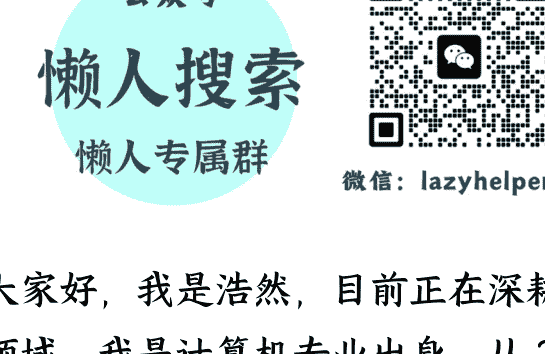

大家好，我是浩然，目前正在深耕 AI 写作领域。我是计算机专业出身，从 2024 年开始运营写作工作室，经历过月入 10 万的高峰，也经历过政策冲击后收入归零的至暗时刻。目前团队已经完成转型，搭建了一套 AI 驱动的写作服务交付体系。

2024-2025 年上半年，我们工作室做学术写作服务，月流水稳定在 10 万以上。2025 年下半年，国家开始严厉打击学术不端，我当时第一时间停掉了相关业务——国家明确打击的事情，坚决不碰。核心品类砍掉后，收入一度接近归零。

经过大半年的转型调整，到 2026 年初，工作室全面转向合规的写作服务，月收入稳定在 3-5 万，旺季可以冲到 6 万以上。

本篇文章是一份完整的转型复盘。我会按时间线拆解每个阶段的决策逻辑、具体打法和数据结果，包括：政策变动后怎么快速切换赛道、怎么从零跑通小单模式、如何用 AI 和数据驱动运营优化、写手培训体系怎么搭建、以及我们正在推进的 MCN 平台化转型思路。

所有数据和截图都是真实的。希望对正在做写作服务、知识付费、或者任何技能型交付业务的朋友有参考价值。

## 一、背景与转折

先交代背景。2024 年到 2025 年上半年，我们的商业模式很简单：前端通过闲鱼、小红书引流获客，中间客服对接报价，后端找写手交付，赚中间差价。品类以学术写作为主，客单价几百到上万不等，利润率 40%-60%，月流水 10 万+。

表面上看数据不错，但这个模式有四个结构性问题：

- 第一，品类过于集中。几乎所有收入来自学术写作这一个品类，抗风险能力为零。
- 第二，供给端流动性大。写手一半是我们自己培训的，一半是外面找的，但无论哪种，写手的流动性都很高——一旦他们自己有了客源，随时可能绕过我们直接接单。
- 第三，没有壁垒。本质上是信息差中介，模式可以被任何人复制。
- 第四，收入周期性强。学术写作有非常明显的淡旺季——开学季、毕业季、期末集中爆单，寒暑假和平时则大幅回落。收入波动大，团队和产能很难维持稳定。

这些问题在高收入时期被掩盖了。直到 2025 年下半年政策变动，核心品类直接被切断，这些结构性缺陷才集中暴露。

2025 年下半年，国家对学术不端的打击力度大幅升级，学术代写这条线基本走不通了。各大平台全面封堵——只要发布学术相关的内容，不是封号就是限流，获客渠道直接被掐死了。

当时面临两个选择：一是换个马甲继续做，赌政策执行力度；二是彻底转型，找合规品类重新开始。

我选了后者。原因不是道德洁癖，而是商业判断——政策打击只会越来越严，灰色业务的风险收益比已经不划算了。与其每天提心吊胆，不如把精力花在建一个能长期跑的模式上。

转型的核心思路是：保留我们在获客、派单、售后这套交付体系上的积累，把品类从学术写作切换到合规的写作服务。

## 二、转型与数据

转型后我们切入的是以前看不上的“小单子”——几十块到一两百块一单的写作需求，包括简历优化、年终总结、工作汇报、公文写作、情侣之间的小作文等等，下图是经过 AI 分析我们的聊天记录，总结的接单类型。

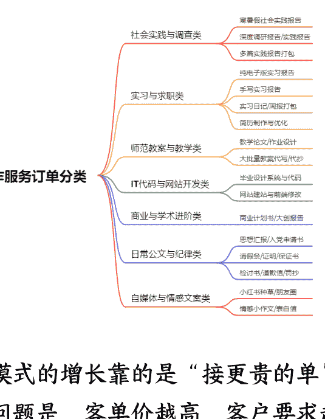

大单模式的增长靠的是“接更贵的单”——但问题是，客单价越高，客户要求越高，修改次数越多，交付越依赖个人能力，你根本没法批量复制。一个优秀写手的产能天花板就是整个业务的天花板。这是线性增长，甚至是有上限的线性增长。

小单模式的增长靠的是“加更多标准化产能”——单子虽然小，但结构固定、流程可复制，一个经过 SOP 培训的新写手就能胜任。想要增长，加写手就行。这是可规模化的增长。

之所以选这个方向，是因为跑了一段时间数据后发现，小单模式在几个关键指标上比大单模式更优：

- **修改率极低。** 大单（比如学术写作类型的）客户会反复修改，一单的沟通成本往往超过写作成本。小单客户几十块钱的东西，交付了基本就完事，售后成本几乎为零。
- **交付周期短。** 学术写作一篇要一两周加三四次修改，简历一两个小时搞定。单位时间的产出效率高出一个量级。
- **需求量大、频次高。** 简历、年终总结、工作汇报……这类需求覆盖面极广，而且不受政策影响。
- **最关键的一点：可标准化。** 论文每篇都不一样，但简历的结构是固定的，年终总结的框架是固定的。标准化意味着两件事——可以用 AI 提效，可以通过 SOP 批量培训写手。这是规模化的前提。

直接上数据。以下是 2026 年转型稳定后的收入情况：

### 账单

#### 2026 年 2 月

| 交易时间 | 描述 | 金额 |
| :--- | :--- | :--- |
| 2 月 28 日 21:02 | 二维码收款 - 来自*拉 | +400.00 |
| 2 月 28 日 19:08 | 二维码收款 - 来自*央 | +150.00 |
| 2 月 28 日 18:53 | 二维码收款 - 来自 o*i | +70.00 |
| 2 月 28 日 18:13 | 二维码收款 - 来自*n | +80.00 |
| 2 月 28 日 17:52 | 二维码收款 - 来自*呀 | +50.00 |
| 2 月 28 日 17:37 | 二维码收款 - 来自 Z*i | +140.00 |
| 2 月 28 日 17:23 | 二维码收款 - 来自 J*s | +30.00 |
| 2 月 28 日 15:45 | 二维码收款 - 来自 X*7 | +50.00 |
| 2 月 28 日 15:05 | 二维码收款 - 来自*见 | +120.00 |

#### 2026 年 3 月

| 交易时间 | 描述 | 金额 |
| :--- | :--- | :--- |
| 3 月 8 日 19:59 | 经营收款 - 来自*轻 | +80.00 |
| 3 月 8 日 17:13 | 经营收款 - 来自*旺 | +40.00 |
| 3 月 8 日 17:13 | 经营收款 - 来自 M*I | +59.77 |
| 3 月 8 日 16:58 | 经营收款 - 来自_ _ | +20.00 |
| 3 月 8 日 16:17 | 经营收款 - 来自 J*. | +40.00 |
| 3 月 8 日 14:49 | 经营收款 - 来自 e*e | +50.00 |
| 3 月 8 日 14:31 | 经营收款 - 来自*拾 | +80.00 |
| 3 月 8 日 14:11 | 经营收款 - 来自 C*. | +35.00 |
| 3 月 8 日 13:41 | 经营收款 - 来自*盘 | +40.00 |

### 统计

#### 2026 年 1 月

| 项目 | 数值 |
| :--- | :--- |
| 总收入 (元) | 15281.00 |
| 总支出 (元) | 0.00 |
| 交易收支 | 包括收钱码交易、淘宝交易等 |
| 收入金额 | +15281.00 |
| 交易笔数 | 55 笔 |
| 退款金额 | 0.00 |
| 退款笔数 | 0 笔 |
| 订单金额 | 15281.00 |
| 订单退款金额 | 0.00 |
| 商家优惠 | 0.00 |

> 注：收入金额=订单金额 - 商家优惠

#### 2026 年 2 月

| 项目 | 数值 |
| :--- | :--- |
| 总收入 (元) | 14455.00 |
| 总支出 (元) | 0.00 |
| 交易收支 | 包括收钱码交易、淘宝交易等 |
| 收入金额 | +14455.00 |
| 交易笔数 | 1005 笔 |
| 退款金额 | 0.00 |
| 退款笔数 | 0 笔 |
| 订单金额 | 14455.00 |
| 订单退款金额 | 0.00 |
| 商家优惠 | 0.00 |

> 注：收入金额=订单金额 - 商家优惠

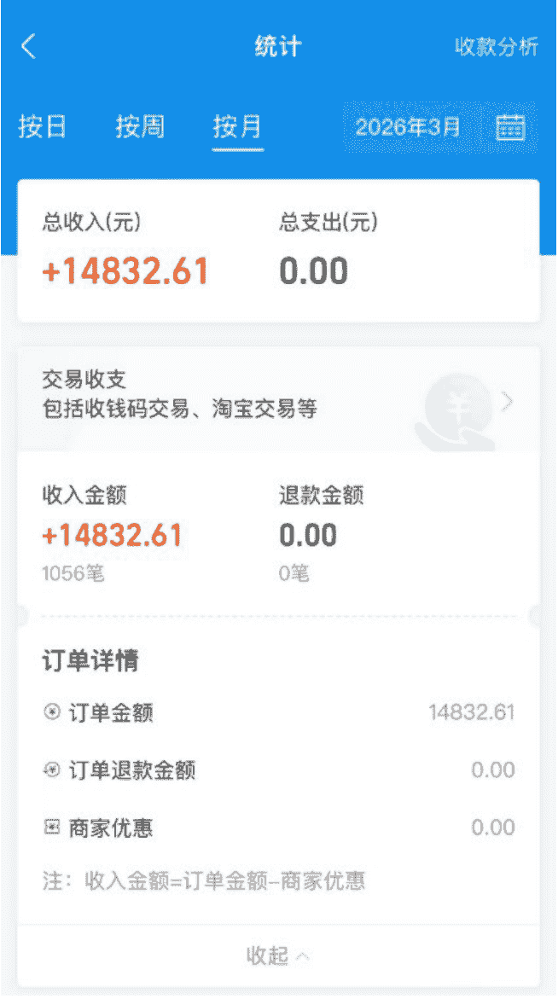

1 月总收入约 49,500 元，2 月约 68,100 元，3 月截至 8 号已接近 30,000 元。综合下来月流水在 4-8 万区间，旺季可冲 10 万以上。

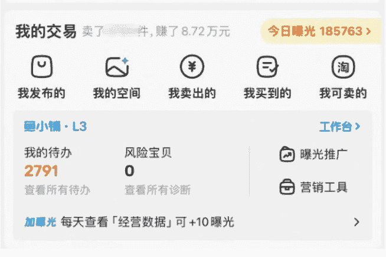

闲鱼是我们目前最主要的获客渠道之一，单账号的数据如上。

成本结构：写手稿费 + 客服工资，合计占总收入约 30%。月净利润在 3-5 万之间。

跟之前月入 10 万相比，绝对值下降了。但有三个本质区别：第一，完全合规，没有政策风险；第二，收入来自每天几十个小单的聚合，抗波动能力远强于依赖几个大单的模式；第三，小单的标准化程度高，加写手就能加产能，有明确的规模化路径。

转型后团队也做了调整。目前稳定运转的核心团队是 3 个人：1 个负责整体运营、流量策略；2 个客服负责接单、报价、派单和售后。写手池扩大到上百人，全部是兼职，按单结算。

写手端的变化更大：从依赖少数“能力强”的写手，变成了依赖 SOP 培训出来的标准化写手池。人多了，但管理反而更轻了，因为流程标准化之后，客服和派单都可以半自动化。

收入数据的背后，是前端流量的支撑。闲鱼是我们目前最主要的获客渠道，这一年在闲鱼的玩法上也经历了很多迭代，讲一下我们摸索出来的框架。

闲鱼的流量逻辑在去年发生了很大变化，以前随便发发就有曝光的时代已经过去了。现在想要稳定获客，必须把“擦亮”和“投放”当成一套系统来做，而不是随手操作。

### 怎么识别有流量的类目

可以在生意参谋、灰豚、巨量算数查看近期热搜类目、热搜榜的关键词。

识别后，开始用 3-5 个账号赛马测试。能跑通的类目，就继续做。

跑通后，核心要做的是投流，做超级擦亮。但擦亮不是无脑刷。

### 投钱之前的策略

千万不要一上新链接就投流，如果你直接投，基本是钱花了，但没人咨询。有自然流量之后，再开始投流。

### 如何做到有自然流？重点关注这 2 点：

- 1、封面图必须有吸引力！用户先看到的是你的封面图、标题，而你的图必须在满屏平平无奇的照片中，用大字、高亮色瞬间抓住用户眼球，并且吸引用户无脑点击。

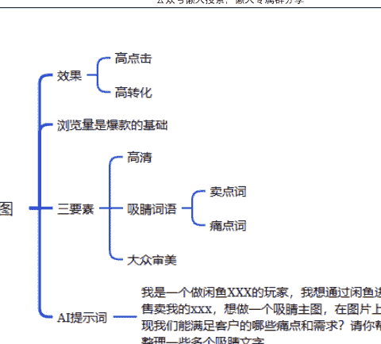

- 2、关键词布局：标题前 5 个字要精准。例如：润色修改、演讲稿代写、PPT 美化

利用自动回复：超级擦亮带来的流量很快，如果不能秒回，客户就流失了。一定要设置好自动回复。

文案的逻辑是相通的，不管做咸鱼、小红书、公众号或者任一平台，做好文案的准则就是牢记 3 句话：

- 1）文案具体，比如，能说“做 ppt 2 小时出稿”，就不能只是说“制作 ppt"
- 2）让用户无脑直接点击，不要让人思考。比如 不能说“拒绝 ai"，而是说“纯人工”。
- 3）少用形容词，多用动词

要做到这些，这需要大量的实操，做好。

### 超级擦亮的投放策略

- 1、避开深夜，瞄准黄金时间：
不要在凌晨投。最佳时间是 上午 10:00-11:00 和 15:30-20:30（流量高峰）。

- 2、小额多次测试：
先投最低档位试试。如果半小时内点赞和想要 (咨询) 明显增多，说明这个宝贝有爆款潜力，再追加投放。

- 3、新老链接的打法不一样：
新链接的节奏：刚发布的链接，前期重点投曝光，目的是让系统快速识别你的品类标签、积累初始数据。等曝光量跑到一定基数后，切换到投浏览，提升点击率。当链接的点击率和停留时长数据稳定之后，再开始投咨询，直接导转化。这三个阶段的节奏如果搞反了，要么烧钱没效果，要么链接直接废掉。

老链接的策略：已经有一定成交量和评价的老链接，核心目标是维持权重和持续转化。老链接主要投咨询，因为它已经有了曝光基础和信任背书，直接投转化的 ROI 最高。同时定期用擦亮维持活跃度，防止链接沉底。

## 三、AI 驱动运营

转型后我做的最重要的一件事，是把 AI 深度融入日常运营——不是用 AI 帮写手写稿那种表面用法，而是用 AI 做团队管理和流程优化的核心工具。

具体做法：我们每天把客服的聊天记录导出，用 AI 做系统化分析，生成一份“客服综合分析报告”。报告包含五个维度的评分：响应速度、需求确认、报价规范、沟通技巧、SOP 合规，每项 20 分，满分 100。

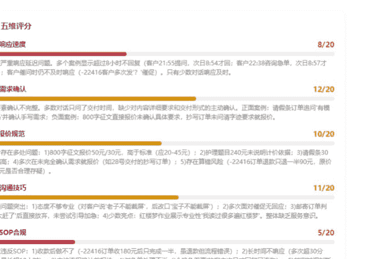

### 做得好的地方

- **x96 订单服务较完整：** 120 元 PPT 订单，确认需求、报价、收款、交付、催尾款流程规范，客户评价‘做得很好’
- **展示专业能力：** 红楼梦作业中主动说‘我读过很多遍红楼梦’建立信任

### 发现的问题

#### 响应严重超时，导致客户流失（高级）

**证据：** 「客户 21:55 提问 800 字征文“明天可以写完吗”，22:02 发"hello"催促，直到次日 8:54 才回复，此时客户可能已找其他渠道。」；另一客户 22:38 说“今晚急看要”，次日 8:57 才回复，客户 12:04 明确表示“不需要了”

**建议：** 设置消息提醒，承诺 5 分钟内首次响应，急单 1 分钟内回复；晚间咨询需在 30 分钟内回复或说明次日处理时间

#### 收款后无法完成订单（高级）

**证据：** 「-22416 客户付 180 元 12 篇作文订单，后续只完成部分，客服主动说“退一半的钱吗”退款 90 元。客户在群里反馈找了其他人完成」

**建议：** 接单前必须评估能力和时间，不确定的订单不能收款；若确实无法完成需全额退款而非协商退一半

#### 沟通用语不专业，有损品牌形象（高级）

**证据：** 「客服发送“老子不能截屏”，虽立即改口为“宝子不能截屏”，但已暴露情绪管理问题」

**建议：** 任何情况下保持专业用语，禁止使用“老子”等粗俗表达；建立话术模板库，压力情况下使用标准话术

#### 报价不规范且偏高（中级）

**证据：** 「800 字征文报价 50 元（高质量）/30 元（标准），超出 SOP 标准 20-45 元；请假条报价 30 元偏高；多次未确认需求就报价」

**建议：** 严格执行报价标准，特殊情况需说明理由；必须先确认三要素（内容 + 时间 + 形式）再报价

#### 时间判断不准确，错失订单（中级）

**证据：** 「客户要求 28 号前完成成都邮寄抄写，客服 26 号判断“太赶了”“怕来不及”放弃订单。实际有 2 天时间，顺次月达安全来得及」

#### 对客户催促无响应（中级）

**证据：** 『-22416 客户多次发“催促”(19:54、9:03、9:09)，客服响应不及时；客户.2 发“着急”后等待 53 分钟才得到回复』

**建议：** 客户发“或在吗”应 1 分钟内回复；看到“着急”等字样立即优先处理

#### 需求确认不完整（低级）

**证据：** 『多个订单未主动确认支付方式 (电子版/手写/邮寄)，如 800 字征文、护理作业等，需客户主动说明』

**建议：** 标准话术必须包含三要素确认：‘您需要什么内容？什么时候要？要电子版还是手写邮寄？’

### SOP 违规项

- 收款后无法完成订单 (-22416 订单收 180 元只完成一半)
- 长时间不回复超过 30 分钟 (多个案例超 8-10 小时)
- 未确认需求就报价 (800 字征文、护理作业等)
- 邮费时间判断错误 (26 号接 28 号成都订单说来不及，实际顺丰 2 天足够)
- 响应速度违规 (多次超过 5 分钟首次响应标准)

### 优化路径

- **P0 建立消息预警机制：** 设置 5 分钟未回复提醒、30 分钟未回复升级警报；晚间咨询次日 9 点前必须跟进
  *预期效果：减少因响应延迟导致的客户流失，预计提升成交量 20-30%*
- **P0 严格执行“先评估再收款”原则：** 不确定能否完成的订单不得收款，或明确说明风险并预收定金 (不超过 30%)
  *预期效果：避免退款纠纷，维护品牌信誉，减少客户投诉*
- **P0 规范沟通用语：** 建立标准话术库，禁用词清单包括“老子”“随便”“不管”等，所有客服必须培训通过
  *预期效果：提升专业形象，减少客户不满，增强品牌信任度*
- **P1 更新报价标准卡片：** 包含各业务类型基础价 + 加价 + 字数阶梯价；报价前必填三要素确认表
  *预期效果：报价准确率提升至 95% 以上，减少价格争议，提高客户信任*
- **P1 建立邮费时效计算器：** 输入目标城市 + 交付日期自动计算是否来得及，明确各快递时效 (顺丰/EMS 等)
  *预期效果：避免误判订单可行性，预计减少 30% 的错误退单*
- **P2 设置客户催促自动回复：** 检测到“？”“在吗”“着急”等关键词自动回复‘收到，正在处理，X 分钟内回复您’
  *预期效果：即使暂时无法详细回复，也能安抚客户情绪，降低流失率*
- **P2 完善需求确认 SOP：** 制作三要素确认话术模板，系统检测未确认要素时弹窗提醒
  *预期效果：需求确认完整率从 60% 提升至 90%，减少后续沟通成本*

分析下一条记录 查看历史记录

AI 不只给分数，还会列出每个问题的具体证据 (精确到哪条消息、几点几分)，并按 P0-P2 优先级生成优化建议和预期效果。比如响应超时导致客户流失，AI 会建议设置 5 分钟未回复提醒和 30 分钟升级警报，并预估这能提升成交率 20-30%。

这套分析不是一次性的，而是每天跑。每个客服每周都有评分报告，趋势是上升还是下降一目了然。哪个环节出了问题、该怎么改，AI 直接给方案，我只需要决定执不执行。

同时，基于 AI 对大量聊天记录的分析，我们整理出了一套完整的客服 SOP 手册，覆盖从接线、需求确认、报价、成交促单、退单处理到售后的全流程。

### 第一章 服务流程总览

#### 1.1 完整服务链路

每一位客户从进线到交付，需经过以下标准化流程：

- ① 首次响应（30 秒内） → ② 需求明确（3 个必问） → ③ 评估可行性 → ④ 报价 → ⑤ 确认付款 → ⑥ 派单/执行 → ⑦ 交付验收 → ⑧ 售后跟进

> **核心原则**
> 1. 先了解需求再报价，切忌上来就问「多少钱」
> 2. 接不了的单子要第一时间告知，绝不拖延
> 3. 已收款的单子务必交付，万不得已退单必须当天退款
> 4. 所有承接都要文字记录，不过头承诺做不到的事

#### 1.2 三个必问信息

在任何业务类型中，确认订单前必须获取以下三项关键信息：

- 内容要求：写什么？字数多少？有没有模板/文件/具体要求？
- 交付时间：什么时候要？是电子版还是邮递？邮递到哪里？
- 交付形式：电子版（Word/拍照）还是手写邮递？纸张有无要求？

> **经验提醒**
> 从聊天记录看，大量订单因为没有提前确认邮寄时间和地址导致退单。邮寄类订单请务必先评估快递时效再接单，至少预留 3 天邮寄时间。

这套 SOP 不是拍脑袋写的，而是从真实的客户流失数据和聊天问题中反向推导出来的。比如 SOP 里要求“三个必问信息”（内容要求、交付时间、交付形式），就是因为数据显示大量订单因为没提前确认邮寄时间和地址导致退单。

AI 分析客服记录还产出了另一个重要成果——客户流失原因排名表。时间太紧接不了（37.3%）、邮寄来不及（15.5%）、回复不及时（12.4%）、价格超预算（11.2%）、客户自行解决（9.3%）、产能不足退款（7.5%）、无法提供特殊服务（5%）、质量不满意（1.9%）。

| 序号 | 流失原因 | 涉及客户数 (估) | 占比 | 典型场景 | 改进建议 |
| :--- | :--- | :--- | :--- | :--- | :--- |
| 1 | 时间太紧，接不了 | 60 | 37.3% | 3 天内要邮寄到手的寒假作业 | 增加写手储备，建立应急价格体系 |
| 2 | 邮费来不及 | 25 | 15.5% | 快递时效不可控导致无法承诺 | 发展本地同城业务/电子稿替代方案 |
| 3 | 产能不足，已接单退款 | 12 | 7.5% | 收钱后排不了单给客户退款 | 严控接单量，建立排单系统 |
| 4 | 价格超出客户预算 | 18 | 11.2% | 预算有限，觉得贵了 | 建立阶梯定价/获客户优惠价 |
| 5 | 客户自行解决/找别家 | 15 | 9.3% | 等待回复太久客户失去耐心 | 提高响应速度，15 分钟内回复 |
| 6 | 回复不及时/未回复 | 20 | 12.4% | 客户连续发消息无人回复 | 安排值班制度，设置自动回复 |
| 7 | 质量不满意 | 3 | 1.9% | 格式错误、AI 感太重 | 加强写手培训和质检 |
| 8 | 无法提供特殊服务 | 8 | 5.0% | 线下同城、游戏代练等超范围需求 | 明确服务范围，引导至咨询业务 |

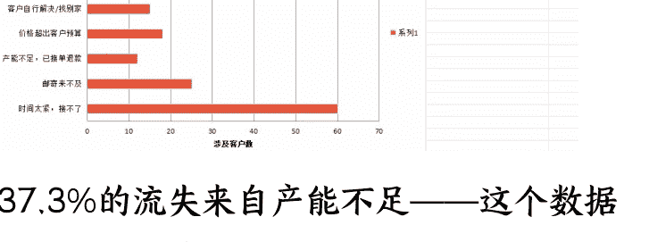

37.3% 的流失来自产能不足——这个数据直接决定了我们后续的第一优先级：扩充写手池。

| 优先级 | 问题 | 影响 | 建议措施 |
| :--- | :--- | :--- | :--- |
| P0-紧急 | 产能严重不足，大量退单退款 | 直接损失收入 + 口碑受损 | ① 扩大写手团队招募，尤其寒暑假高峰期储备 ② 建立写手分级制度 (新手/熟练/专家) ③ 设置每日接单上限，避免过度承诺 |
| P0-紧急 | 回复速度慢，客户流失严重 | 大量客户等不到回复自行离开 | ① 安排轮班值班，保证 15 分钟内首次回复 ② 设置自动回复话术引导客户发需求 ③ 高峰增加客服人手 |
| P1-重要 | 定价混乱，随意报价 | 客户砍价频繁 + 利润不稳定 | ① 建立标准定价表 (参见定价参考表 Sheet) ② 制定应急规则:24h 内 +50%, 48h 内 +30% ③ 批量订单阶梯优惠 |
| P1-重要 | 邮费业务时效不可控 | 大量订单因快递问题被拒 | ① 主推电子版/拍照交付业务 ② 邮客订单预留 3 天快递缓冲 ③ 发展重点城市同城配送 |
| P2-优化 | 缺乏标准化流程 | 订单管理混乱，容易落单 | ① 建立订单管理系统 (编号 - 状态 - 跟踪) ② 标准化接单话术模板 ③ 写手交付前质检流程 |
| P2-优化 | 客户结构过于依赖寒假作业 | 收入季节性波动大 | ① 发展论文/简历等全年需求业务 ② 拓展 B 端客户 (教案/标书/策划) ③ 建立老客户复购机制 |
| P3-长期 | 付款方式单一，客户信任度低 | 部分客户因不信任放弃 | ① 支持用闲鱼担保交易 (虽有佣金) ② 大额订单支持分期付款 (50% 定金 + 尾款) ③ 积累好评案例展示 |

核心方法论一句话：不要靠感觉管团队，让 AI 每天帮你做数据化的体检。问题出在哪里、该怎么改、预期效果如何，全部量化。这比老板凭经验拍脑袋高效得多。

## 四、体系搭建

数据告诉我最大的瓶颈是产能——37.3% 的流失是因为接不了。不是客户不想买，是我们交付不了。引流做得再好，后端接不住也是浪费。

过去，内部培训并不是我们的重心。工作室的运力主要依赖于在 Boss 直聘、小红书等平台上，直接招募“自带经验的优秀写手”。但实操下来，这种“重招募”的模式痛点极多：一是筛选与沟通成本居高不下；二是外部写手极度不可控，导致我们最终交付的时效性和成稿质量难以稳定保障。

为了彻底解决缺靠谱人、缺稳定产能的痛点，我们转换了思路——不再依赖高成本的外部淘金，而是全面建立内部的 SOP 标准化赋能与交付体系。

### 培训体系的设计逻辑：

- 第一步，把每个品类的操作流程全部固化。简历、年终总结、PPT、公文等高频品类，从接到需求到交付成品，每一步用什么工具、套什么模板、检查什么标准，全部写清楚。新人照着做就行，不依赖个人经验。

- 第二步，完成 SOP 学习的写手，首先通过低客单价的入门单进行实战，并由客服严格把关。这个阶段的核心是让新人积累真实的接单手感与客户反馈。为了降低新人的试错压力，我们提供了兜底机制——即便是客户退单的试水单，工作室也会正常为写手结算稿费，给予基础保障。

- 第三步，分级晋升。成品稳定达标后，逐步分配更高价值的订单。优秀写手可以升级为签约合伙人，拿更高分成比例，甚至参与新品类 SOP 的研发。

同时，我们设立了“经验反哺”奖励机制：鼓励优秀写手将实战中的接单技巧、优质案例总结成经验帖，内部投稿一经采纳，即发放现金红包奖励。这不仅拓宽了写手的收益渠道，也让我们的标准库得以持续迭代。

这套体系的核心打通了“培训”和“交付”两个环节。写手可以获得实战技能和接单机会，我们获得了标准化的产能供给。双方利益绑定，而不是一锤子买卖。

效果数据：新写手上手周期从原来的 3-7 天缩短到 1-3 天。写手池规模快速扩大，产能瓶颈有效缓解。

流失原因排名第二是邮寄时效（15.5%），主要出现在手写稿件类订单。客户要得急，但快递不可控。

解决方案：在闲鱼上按城市招募同城写手。客户在哪个城市，就派单给当地写手，当面交付或同城闪送。我们只负责对接、派单，赚差价。

在闲鱼上搜索手写，点击区域，直接筛选客户所在的城市，筛选的过程中，记得看店家的 IP，比如我要找一个在广州的抄写，但是店家发布的笔记在广州，IP 在四川，这种是要直接过滤的。

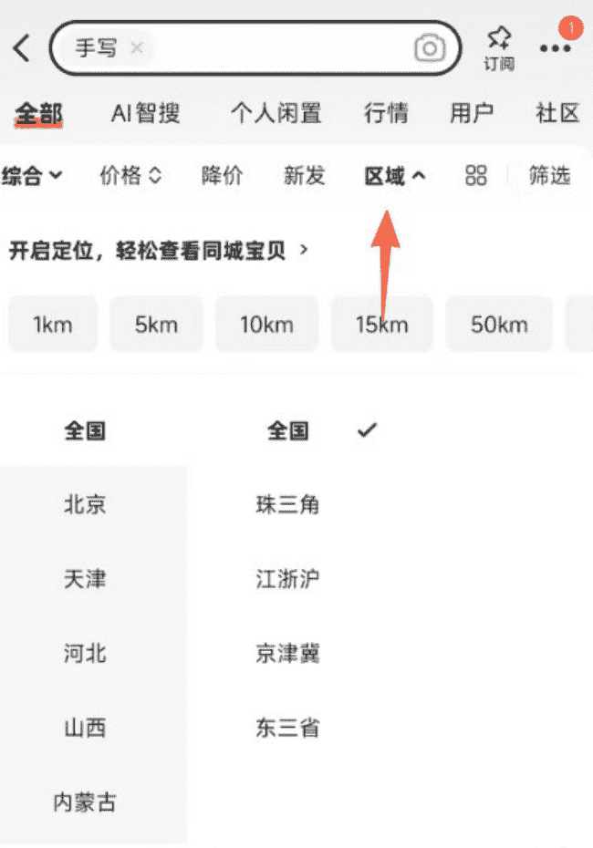

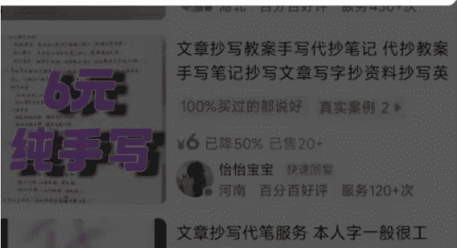

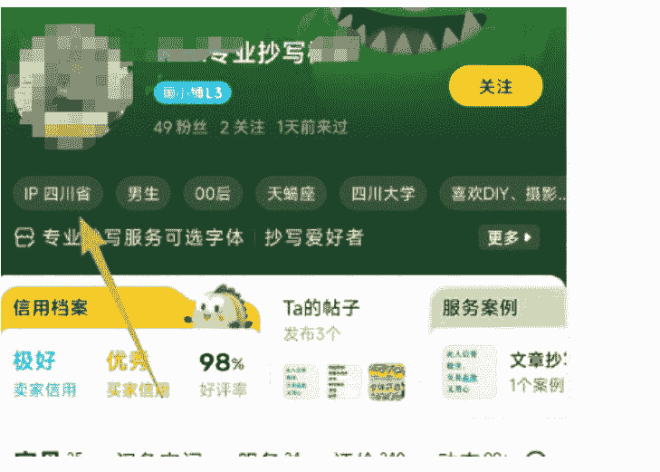

这个模式除了解决时效问题，还有一个意外收获：通过持续积累，我们在全国多个城市逐渐有了“驻点”写手。

小单模式解决了生存问题，但利润天花板有限。稳住基本盘后，我们开始有意识地拓展高价值品类。

我本身是计算机专业出身，在接单过程中发现了一批需求量大但供给严重不足的技术类目：计算机毕业设计、WordPress 建站、独立站搭建、数据分析、Python 脚本等。大家在学习 AI 编程的过程中，如果没法快速变现，也可以试试在闲鱼上接单，看自己能做什么类型的开发，给一些用户解决问题。

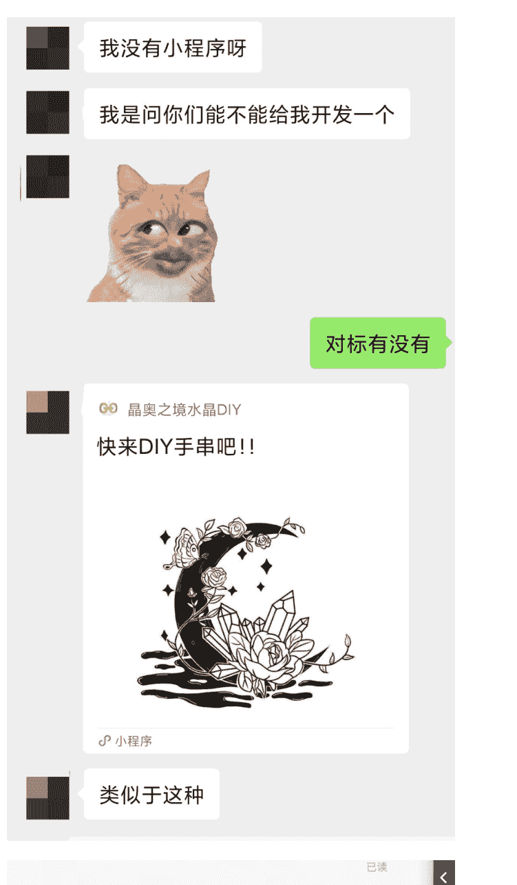

这些类目的特点：客单价高（几千到上万）、竞争小（大多数写作工作室没有技术能力）、复购和转介绍率高、底层技术栈有限所以同样可以 SOP 化。

目前这是我们重点拓展的方向，最大的瓶颈是后端产能——技术类写手严重短缺。

如果有计算机或相关技术背景，对这种合作模式感兴趣，欢迎来聊。

在做 AI 写作服务的过程中，我还发现了一个天然的延伸方向——虚拟产品。

逻辑很简单：我们每天接大量的写作订单，这些订单本身就是最好的市场调研。客户要什么、什么格式最受欢迎、哪些表述最专业，全部沉淀在我们的交付记录里。把这些经验提炼成标准化的模板，就是现成的虚拟产品。

以简历为例，我们不是做一个通用简历模板就完事了，而是按行业和场景细分：计算机简历模板、销售简历模板、国企简历模板、银行校招简历模板、考公简历模板……每个模板都是从真实客户需求中打磨出来的，针对性远比网上随便找的强。

同样的逻辑可以复制到其他品类：年终总结模板 (按岗位分：行政、技术、销售、管理层)、述职报告模板 (试用期转正、晋升答辩)、PPT 模板 (工作汇报、项目复盘、商业计划书)、公文模板 (请示、通知、会议纪要)、入党申请书模板、思想汇报模板等等。每个大类下面都可以按场景拆出几十个细分 SKU。

虚拟产品的好处是边际成本几乎为零——做一次，卖无数次。前端放在小红书、闲鱼等平台上卖模板引流，后端在私域里承接定制化服务。买了模板觉得不够用的客户，自然会来找你做定制，这就形成了从标准品到定制服务的转化漏斗。

对我们来说，这不是一个全新的业务，而是把已有的交付能力再多变现一次。

## 五、MCN 升维与未来

做到这个阶段，我对工作室的定位也发生了根本性变化：不做中介，做平台。

中介模式的核心矛盾很简单——所有事情都压在我一个人身上：找写手、管质量、做流量、盯客服。增长是线性的，天花板就是我个人的精力上限。

MCN 模式的逻辑完全不同。核心思路是把产业链拆成三端，每一端都有独立的收益来源，让盘子自己转起来：

**流量端**：我们自己打流量，或者跟专业的流量工作室合作。这一端的任务就是持续获客、做矩阵、跑转化。我们团队的核心精力放在这里，加上培训客服完成销转。

**SOP 端**：找到不同领域的优秀写手来合作，甚至可以引入外部 IP。他们负责两件——研发和更新品类 SOP，以及对新写手进行质检把关。他们的收益来自 SOP 课程的分成和质检管理费，这是一种管道收益，SOP 卖得越多、用的写手越多，他们赚得越多。

**交付端**：通过 SOP 培养出来的写手负责实际写作交付，按单计酬。其中表现优秀的写手，可以反过来参与 SOP 的协同开发，升级到 SOP 端，获取更高层级的管道收益。

这三端形成了一个飞轮：流量端获客 → 客户订单分配给交付端 → 交付中发现的问题反馈到 SOP 端迭代优化 → 更好的 SOP 培养出更多合格写手 → 更大的产能承接更多流量。每一端都能赚到钱，每转一圈系统都在变强。

我们要做的，就是守住流量端和客服销转这个核心环节，其他的交给生态里的合作伙伴。

同时也欢迎各位优秀的写手和流量做好的同伴一起交流！

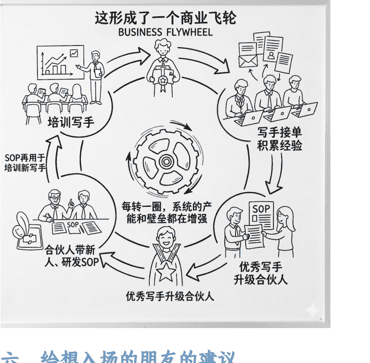

## 六、给想入场的朋友的建议

很多朋友看完可能会想：我也想做，但不知道从哪里开始。根据我们踩过的坑和跑通的经验，给几条实操建议：

- 1、从单一品类切入，不要贪多。

建议从简单的类目或者自己的专业开始。如果没有明确的专业方向，可以从小客单开始 (比如写演讲稿、读书笔记、简历润色等)，一个人跑通从发布、接单到交付的完整闭环。等跑稳了，再往其他品类扩展。如果你本身有某个领域的专业背景 (比如计算机、设计) 或者在某一方面的技能很突出，比如很会做 PPT，直接从对应品类切入，起步会更快，客单价也更高。

- 2、启动成本几乎为零，但要准备投入时间。

不需要租办公室、不需要雇人，一台电脑、一个闲鱼账号就能开始。真正的成本是前两周的测试时间——你需要发布不同类型的链接、测试不同的封面和文案、找到有流量的品类。这个阶段不要急着赚钱，目标是跑通获客链路。

- 3、用好 AI，但不要只靠 AI。

AI 是提效工具，前提是对写的这个东西有基本的认知，不会给客户乱改啥的。比如你帮人写公文或者做工作汇报，你得知道基本的逻辑框架，不能 AI 生成一堆华丽的废话你就直接交差。

前期你可以把 AI 当成你的起稿助手，先出初稿，然后借助 AI 工具和客户的真实反馈来不断修改、提升自己。认真对待每一次客户的退回和修改意见，这些都是你提升专业度最快的方式。懂的配合 AI 才是降维打击，盲目依赖 AI 只会把单子做死。

- 4、重视数据，别靠感觉做决策。

从第一天开始就记录关键数据：每天多少咨询、多少成交、客单价多少、流失原因是什么。不需要多复杂的工具，Excel 或者手机备忘录都行，关键是养成记录的习惯。

等积累了一两周的数据，你就能看出规律——哪个时间段咨询最多、哪类文案转化率最高、客户不下单的真实原因是什么。很多时候你以为的问题和数据告诉你的完全不一样。比如你觉得客户嫌贵，但一看数据发现其实是你回复太慢，客户等不及走了。

靠感觉做决策，做到天花板也不知道问题在哪；靠数据做决策，每一步都有方向。

- 5、一个人能做到月入多少？

根据我们的数据，稳定运转后月入 3000-5000 是比较现实的目标。当然，还是那句话，如果你有某个垂直领域的专业背景或者有很突出的技能点，切入对应的高价值品类，天花板会高很多。

## 七、写在最后

很多人有一个直觉：AI 出来了，写作服务是不是要被替代了？

我的判断恰恰相反。AI 正在重塑这个行业的成本结构和竞争格局，但需求不会消失，只会转移。

拆解一下底层逻辑：

第一，AI 降低了生产成本，但没有消灭需求。客户买的不是“一段文字”，而是“一份解决了我的问题的成品”。从需求到成品之间有理解需求、拆解任务、选择策略、调整格式、质量把控等多个环节，AI 只解决了“生成初稿”这一步。大多数客户没有能力也没有意愿完成剩下的步骤。

第二，AI 是工具，不是壁垒。人人都能用 ChatGPT、Claude、DeepSeek，但不是人人都能用好。真正的壁垒是 Prompt 体系的精准度、SOP 流程的标准化程度、质检标准的严格度、人才供应链的稳固度。这些是靠实战迭代出来的，不是下载一个工具就能获得的。

第三，AI 让规模化成为可能。以前一个写手一天能出 2-3 篇稿子，现在一个配合 AI 的写手一天能交付十几个小单。生产效率提升 5-10 倍，同样的人力服务更多客户，利润空间被显著放大。

第四，付费意愿不会消失，只会转移。以前客户付费买“有人帮我写”，以后付费买“有人帮我又快又好地搞定”。核心诉求没变：省时间、高质量、没麻烦。

所以这个赛道不是在萎缩，而是在升级——从“手工作坊”升级为"AI 驱动的标准化工厂”。被淘汰的是还在用纯人力堆时间的团队，吃到红利的是率先完成系统化升级的玩家。

最后拉高一层来看，我们这大半年跑通的模型，本质上是三件事的组合：

- 第一，SOP 标准化。把依赖个人能力的“手艺活”变成任何人经过培训都能操作的标准流程。
- 第二，培训 - 交付一体化。培训不是独立的业务线，而是交付体系的一部分。培训产出写手→写手完成交付→交付中发现的问题反哺到培训中迭代 SOP。自我强化的闭环。
- 第三，MCN 化组织。写手不是被管理的员工，而是平台上的创作者和合伙人，有自己的成长路径和利益机制。平台提供基础设施和流量，双方共赢。

这三件事的组合，可以迁移到任何技能服务行业：

- 设计服务：Canva/Midjourney 使用方法 + 设计 SOP 标准化→培训设计师→接单交付→同样的飞轮。
- 短视频代运营：剪辑流程 + 脚本模板 + 投流策略 SOP 化 → 培训运营手 → MCN 矩阵。
- 电商客服外包：话术模板 + 投诉处理流程 + AI 辅助客服标准化 → 培训客服 → 规模化接单。

底层逻辑一句话：任何可以被 SOP 化的技能服务，都有机会用“培训 + 交付”的飞轮模型做规模化。AI 的出现，让这个飞轮转得更快。

从月入 10 万到接近归零，再到月入 3-5 万稳定盈利。数字上看是退步了，但商业模式的健康度提升了一个量级。

### 几个关键认知变化:

赚合规的钱比赚灰色的钱更值钱，因为它可以持续、可以放大、可以睡得着。

小单子不“小”。标准化程度高、修改成本低、需求量大的品类，比高客单但不可控的大单更适合做规模化。

最大的瓶颈往往不在前端获客，而在后端产能。数据会告诉你真正的问题在哪里。

培训和交付不应该分开做。打通之后形成的飞轮效应，远比单独做任何一端的价值大。

从“赚差价的中介”到“做系统的平台”，是个人工作室规模化的关键跃迁。

工作室还在路上，技术类目在拓展，MCN 模式在验证，还有很多事要做。

## 最后

政策会变、平台会变、客户会变，但把事情做成系统的能力，是可以跟你一辈子的。共勉。

看完这篇 SOP，你觉得你懂了。但 90% 的人一到实操就会卡在第一步。工具和教程只是最低级的壁垒，真正的壁垒是“立刻动手”和“圈层信息差”。

如果你想看全网最新的变现玩法，并且和一群执行力极强的极客一起下场拿结果，

欢迎围观我的核心私域：【懒人专属群】。

我们不聊虚的，只做商业闭环的拆解与 AI 效率的压榨。系统内已沉淀 1000+ 跑通的套利实战局。

查阅圈子最新搞钱实操记录：

https://hk57gvIx7u.feishu.cn/docx/H0kRdZbSbolBR0xkaXtcuVE0nTg

认同价值、准备好下场干活的，扫码加我微信

备注：【实操上车】

