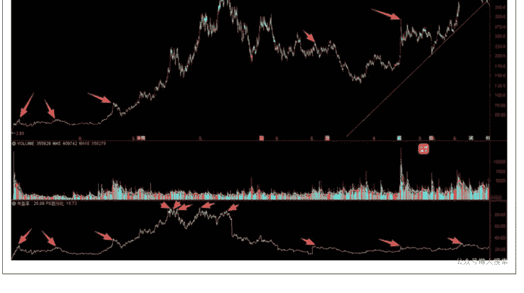
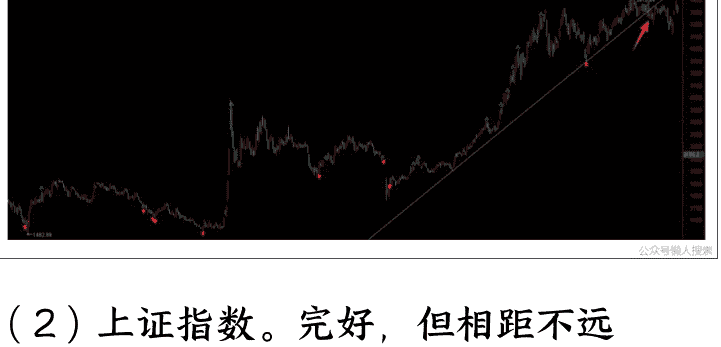
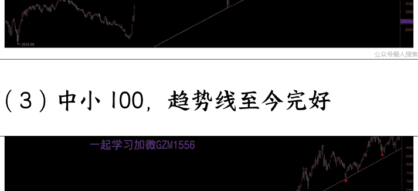
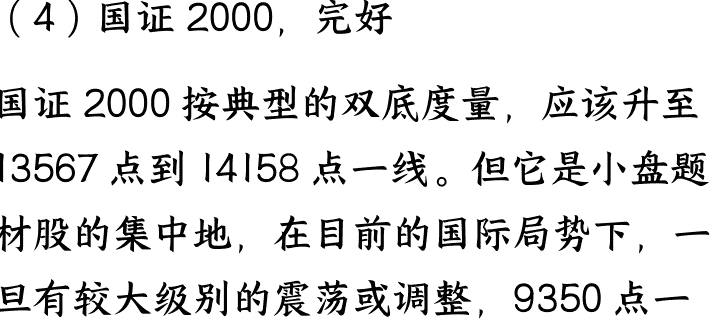
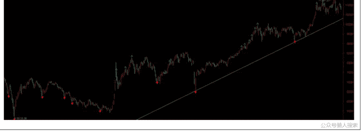
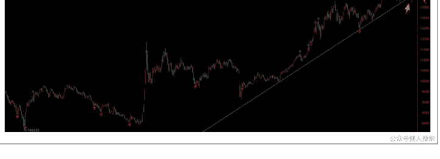
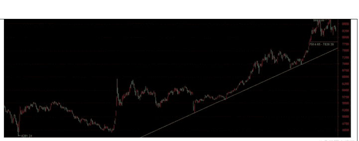
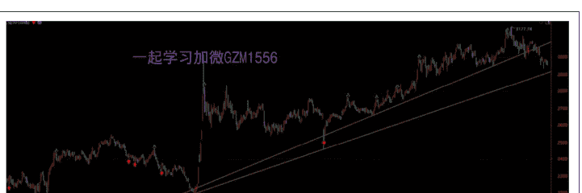
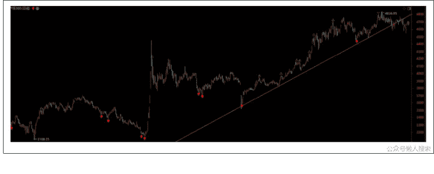
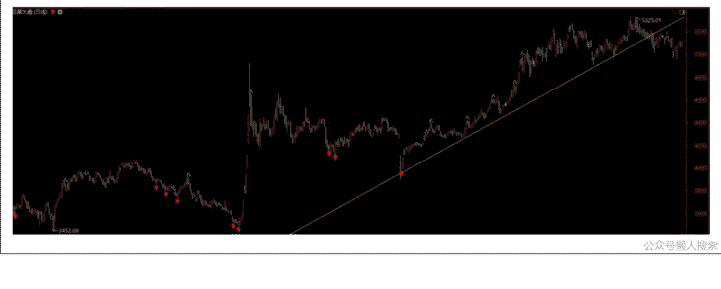

# 两极分化：美以伊战争对 A 股投资的影响

260316 安民分析付费

整理：公众号懒人搜索，懒人专属群精选

懒人微信:lazyhelper1

2 月 1 日的文章是《牛市走到哪一步了》，在那篇文章中，我们对后面的行情有预期。当时判断牛市并没有结束。但后面有几个重要的周期值得关注。

现在，我们对后面的大势继续进行分析，然后讲讲我们团队判断的、沪深两市中后面最有可能成为总龙头的个股。

不过，这一次的**逻辑**有点绕，是侧面的迂回进攻。以前为了论证什么，我们往往采用的是正面进攻的办法，这次则是迂回。

先讲当时对深成指后面关键时间窗点位的计算结果：

| 时间 | 下面压力位 | 上面压力位 |
| --- | --- | --- |
| 2 月 8 日 | 14612.60 | 16294.96 |
| 2 月 15 日 | 14605.98 | 16291.44 |
| 2 月 22 日 | 14599.37 | 16287.91 |
| 3 月 1 日 | 14592.75 | 16284.39 |
| 3 月 8 日 | 14586.14 | 16280.87 |
| 3 月 15 日 | 14579.52 | 16277.34 |
| 3 月 22 日 | 14572.90 | 16273.82 |

深成指前面出现的高点，2 月 26 日，14536.08 点；3 月 11 日有个小高点，为 14531.02 点。也即到本周为止，它并没有向上突破大三角形压力位。

下面，我们以 2 月 1 日的文章为起点，继续讲后面的大势。如果您没有看过 2 月 1 日的文章，建议您去看看；忘记了的，也可以回看一下。因为文章的观点有连续性，它们之间有各种逻辑或传承。

正常的话，按照 2 月 1 日的文章，我们得要从形态和周期出发，从这两个维度来讲大势，即侧重于技术分析。现在我们从第三个维度来讲后面的大势如何运行。这个维度就是中东战争背景下两市总龙头个股和领涨板块的维度。

因为按 2 月 1 日的文章，我们画出了上证 50 和沪深 300 的上升趋势线，讲它们如果向下突破，就比较容易带动其他指数也向下突破，那样就要注意防守。这就像拔河，一方力量摆在那里，是下跌的力量，但拔河还有另一方面的力量，即做多的力量。就是我们要找出市场上能够承担起多头攻击的力量，而且不是小的力量，小的力量没啥用，必须要找到那种很大的力量才成。

现在我们找到了市场上进攻的力量，并且认为它们是未来行情向上的进攻力量，是能起重要作用甚至是决定性作用的力量。这样的话，做多和做空的力量两方面拉扯，双方在一起拔河，最后若是多方胜出，就将指数带动向上。

换句话说，就是我们找到了领涨板块和龙头个股，看看它们有没有可能带动大势向上。最后，我们要分析中东战争对 A 股的影响，讲要回避掉一些什么样的公司，选择一些什么行业什么类型的公司投资。

(声明：本文只为开拓视野、引导思路，并非择时，亦非荐股，股市有风险，入市需谨慎。本文为多指数的大势和行业龙头研究，仅为对大势走向如何判断的客观分析和研判，不构成任何投资建议或意见，不为用户依据本文做出的任何投资与决策承担责任。请大家注意投资风险)

## 一、后市龙头个股和龙头板块

这波牛市，正常情况下运行到 3 月 20 日前后就差不多了 (其实有些个股和板块，在此之前就见顶了)。这个周期我们以前讲过，而且历史上，上波牛市出现的就是这个周期。

但现在出现了两个很特殊的情况，一是不同板块其实差别非常大，有的板块早就见顶了，有些板块还在上升周期，估计在本轮牛市的顶部，不同板块会分批次见顶；二是市场刚刚出现了领涨板块和龙头个股，它们将继续向上。从估值的角度，龙头个股还有不小的上涨空间，而且从以前牛市历史经验来看，最后一波上涨，核心板块的核心个股，不排除有可能翻番。这导致部分板块的牛市还将继续向上运行。

特别是中东战争，导致公司受益受损差别很大，市场两极分化严重，押对板块和个股，在未来显得更为重要。

### 1.领涨板块和龙头个股

这个板块是储能和锂电池板块，以前我们都有文章讲到过，而且讲过很多次。向下游带动到新能源汽车，向上游到锂电材料和资源。龙头是 300750 宁德时代，另外涉及到 300724 阳光电源，甚至也有可能还有 002594 比亚迪。总体上指标股不少。

#### (1) 宁王的定位不高

为什么说宁王是龙头呢？我们看看券商软件自带的市盈率云数据指标就成。

用这个指标一看，就知道宁王的股价并不高。它的市盈率，我们给一些小高点的市盈率让大家看看：

- 2018 年 7 月 24 日，27.04 倍。
- 2019 年 3 月 5 日，24.32 倍。
- 2020 年 2 月 6 日，39.01 倍。
- 2023 年 5 月 11 日，25.73 倍。
- 2024 年 10 月 8 日，26.27 倍。
- 2025 年 9 月 29 日，31.06 倍。
- 2026 年 3 月 13 日，周收盘 25.1 倍，宁王市盈率的百分比是多少呢？15.73%。也就是券商软件中自带的动态市盈率定位，宁王只比历史上 15.73% 的时候高，比 84.27% 的时候都低。换句话说，用这个市盈率指标来衡量，现在的 300750 定价很便宜。

当然，25.1 倍的市盈率并不是它底部的市盈率。本轮行情的最低点，宁王的市盈率最低到 13 倍以下。上轮牛市的最低点，曾到 12 倍以下。

那它最高峰时的市盈率是多少呢？

2020 年 12 月 30 日，91.64 倍。
2021 年 1 月 7 日，90.06 倍。
2021 年 1 月 22 日，88.85 倍。
2021 年 2 月 10 日，89.93 倍。
2021 年 6 月 29 日，92.12 倍。
2021 年 12 月 2 日，86.12 倍。

这是上一轮牛市它的 6 个高点的市盈率数据。平均 89.787 倍。上图中只画了 5 个，高处那 3 个在一起的箭头，本来是 4 个，没有地方画，就少画了一个。明白意思就成。

本轮牛市，估计它涨不到那么高的市盈率。上一轮牛市的高点，毕竟是上一轮，离现在 5 年多了。那时行业的增长空间跟现在比肯定要大得多，看起来肯定更有前途。

就是我们先要在心里给自己打个预防针。就是不能捏着鼻子哄嘴，自欺欺人。在这一点上，先要做到心里有数。

#### (2) 扫描全市场，换个角度换个眼光，用总市值的眼光来看

我们再从总市值的角度扫一扫全市场。

茅台之被称为茅王，是因为它的总市值在很多年中是两市最高的。我们看看它的总市值：

到上周五，茅王收盘价格为 1413.64 元，总股本为 125619.78 万股，则总市值为 17758.11 亿元。按本轮行情最高价计算，2024 年 10 月 8 日，它的最高价是 1910 元，总市值是 23993.38 亿。

我们看看两市总市值最高的 15 只股票（单位，亿元）。

| 股票 | 市值 | 股东净利润 | 市盈率 (倍) |
| :--- | :--- | :--- | :--- |
| 农业银行 | 30378.53 | | |
| 工商银行 | 29938.13 | | |
| 建设银行 | 26238.52 | | |
| 中国移动 | 25878.61 | | 13.8 |
| 中国石油 | 25055.57 | | |
| 贵州茅台 | 23993.38 | 646.27(前三) | 20.5 |
| 中国海油 | 21169.84 | | |
| 中国银行 | 20589.37 | | |
| 宁德时代 | 18118.30 | 722.01 | 25.1 |
| 工业富联 | 16528.55 | 352.86 | 29.5 |
| 中国人寿 | 14675.03 | | |
| 中国平安 | 13559.00 | | |
| 比亚迪 | 12551.65 | 233.33(前三) | 29.2 |
| 招商银行 | 12243.71 | | |
| 中国石化 | 9807.06 | | |

这里有几点要强调：一是只算 A 股，没有计算港股及海外的股票市值；二是这里是按本轮行情最高价计算的，因为有分红，高点出现早的，除了比亚迪，其他用的都是不复权价格；三是表中有些数据没有给出，因为是不同类型的股票，估值不一样，不能一样的标准，就没有比较的意思，强行比就是不懂行，因此就没有给出相应的数据；四是宁王用的是周五的收盘价，因为我们要研究它的上升空间，就用现在的价格。

一共 15 只股票。看明白这 15 只股票了，就看明白了大势，也就明白了龙头。

为啥这么讲？总市值 3 万亿是一道杠。历史上，除了茅王和农行曾经短暂突破过以外，其他所有股票都没有突破过。多数银行和保险股都没有突破过，而且对银行和保险股，我们这里不研究。故先将它们 7 只淘汰掉，就只剩下 8 只。

石油石化，也没有突破。它们是传统能源，典型的周期股而不是成长股。即使后面大涨，总市值突破 3 万亿，也是周期股。因此，我们也不研究，淘汰掉那 3 只。

剩下的科技股，就 4 只，再加茅王。

中国移动，最高市值没有突破 2.6 万亿，但公司也基本不具有多大的成长性。因此可以不研究。淘汰掉它，就只有 4 只了。

比亚迪，新能源汽车的代表，它的成长性肯定比宁德时代要差些，因为汽车的成长性（参看行业分析一）差于锂电池。原因就在于锂电池涉足更多的极具成长性的行业，可以参见我们前面的行业分析二、分析三和分析四。比亚迪的业务中，汽车是一块，锂电池是一块，还有一块是手机代工（成长性差），还有些其他交通业务，也没有什么成长性，而且比亚迪的重心现在也没有放在那些杂毛业务方面。它目前就是国内市场和全球市场竞争得太厉害，毛利率和净利率压得很低。所以，短期来看，它不如宁德时代。

但如果用长周期的眼光，比如 10 年周期来看，它在国际市场取得很大的竞争优势后，毛利率和净利率都会和现在有比较大的差别。

所以这波行情，核心不是比亚迪。这样就剩下 3 只。

工业富联和宁德时代 2025 年的成长性差不多，工业富联要稍微好一些，但它的盈利能力远弱于宁德时代。2025 年它的收入为 9028.87 亿，净利润为 352.8556 亿，净利率只有 3.91%。

公司的主要业务有工业互联网，毛利率不错，达到 46.37%，但量很小，只有 6.94 亿。中间的业务是通信及移动网络设备，收入 2978.51 亿，毛利率 9.28%，主要有苹果手机和消费电子代工业务，以及高速交换机、路由器等产品。最大的业务是云计算，收入 6026.79 亿，毛利率只有 5.73%。公司的云计算业务，主要是 AI 服务器、高性能计算、液冷数据中心解决方案、高速网络设备、模块化与边缘服务器等。这块业务扩张迅速，块头最大，但毛利率太低，如果行业竞争激烈，哪怕竞争对手跟他杀价，而且只降一两个百分点的毛利率，那公司的净利润就要减少几十上百亿，甚至不排除降更多。

在 AI 行业数据中心超高速发展的情况下，推动这些业务的毛利率维持在一个高一点的位置，这个没有问题，可一旦遇上行业竞争激烈，它的利润就比较容易大幅下滑。所以，从商业模式上来讲，工业富联天生比不过宁德时代的，它的商业模式天然经不起毛利率的波动。但二者 2025 年净利润差一倍以上，工业富联净利润只有 352.86 亿，可最高峰市值，它为 1.65 万亿，宁工周五收盘后的市值，只比工业富联高 9.62%。可以说宁工严重低估。表中最后一栏的市盈率，是上周五券商软件自带的市盈率云数据。

再就是跟茅王比较。2025 年前三季度，茅王收入增长 6.2%，净利润增长 6.25%，基本上失去成长性了。2026 年一季度，它即使有成长，估计成长性也不会高，能够有 10% 到 15% 就很不错了。但软件自带的市盈率，它有 20.2 倍。这个数据跟宁王比，高了。

当然，茅王 2024 年净利润 862.28 亿，2025 年估计在 900 亿左右，这个数据还是比宁王要高 180 亿左右。也就是它一旦高速增长的话，这个基础非常好，到时股价就比较容易涨，但难就难在高增长。

在进行了这么个比较之后，就很清楚，后市要看宁王的表现。

### 2.宁德时代带领创业板指、带领锂电池和储能产业链冲关

从上面的表中可以看出，某只股票要从总市值中脱颖而出，一是成长股它的年度净利润不能小，少说也要 500 亿往上，金融股得两三千亿，周期股得 1500 亿以上;

二是业绩增速还得可以，得增长。像农行前面是处于一个非常特殊的时期，就是港股由国际资本定价，他们刻意打压中国优质资产 20 多年了。这方面我们前期有一系列的文章，老粉丝都很清楚。像 2022 年，农行每股净资产 6.37 元，当年最低价 2.7 元，折价到 42.39%。公司每股能盈利 0.7 元到 0.78 元，分红 0.22 元到 0.23 元，以最低价算，红利率就超过 8%。上轮炒作，股价只是回到每股净资产之上，溢价 10.93%。非常严格地计算，即时市净率为 1.0967 倍。这其实很正常。但没有成长性也成为龙头的情况很特殊，是低利率下的资产荒所导致的。这类事件可能很多年才能遇到一次。

就净利润和成长性这两个硬指标来讲，宁王两项指标都硬，后面理论上应该成为 A 股总市值冲击 3 万亿的第三只股票，估计命运有可能好于农行，能不能好于当年的茅王，不知道。因为 2025 年，它的股东净利润 722.01 亿，增速 42.28%，很硬。

也就是，站在现在的两市，看拔尖的股票，宁王它就是龙头。

然后我们讲讲宁王为何能带领行业冲关，以及我们对这个市场未来的判断。

#### (1) 宁王就是整个市场的总龙头

它的 A 股总市值理论上应该突破 3 万亿，即只有茅台和农行曾经达到过的目标，它也应该达到。它理论上可以成为两市成长股和中国新能源产业的标杆，这也是中国新能源战略突破中东传统能源包围，突破地缘冲突地缘能源博弈的一个标志性事件。

#### (2)2025 年第一季度，宁王还能超高速增长，有可能出现利润断层

周五，宁王收盘 397 元，2025 年每股收益 16.14 元，以此计算，动态市盈率为 24.597 倍。我们用报表显示的总股本和股东净利润来计算，每股收益为 15.82042 元，动态市盈率为 25.094 倍。

如果 2026 年一季度，宁王业绩增长 30%，它的动态市盈率就降到 19.30 倍了。反推过去，这么低的市盈率，不可能是大顶。

那么，我们可以看看，2026 年第一季度，宁王业绩增长 30% 的可能性有多大？

我们判断，极有可能超过 30%，有可能达到 50% 左右，不排除还可能再高一点。

为什么？我们分两步计算。

第一步，先算公司能够稳稳拿到手的收入、毛利和净利润。

我们先看下表（单位，万元）：

| | 账面余额 | 跌价准备或履约准备 | 账面价值 |
|---|---|---|---|
| 库存商品 | 2607723.4 | 346260.1 | 2261463.3 |
| 已发出商品 | 4014790.8 | 147312 | 3864785 |
| 小计 | 6622514.2 | 493572.1 | 6128942 |
| 毛利率% | 27.21143438 | | 27.21143438 |
| 收入 | 8424595.306 | | 7796715.031 |
| 毛利 | 2292453.223 | | 2121597.994 |
| 净利率% | 15.97386632 | | 15.97386632 |
| 净利润 | 1057871.565 | | 979029.0019 |

这是我们根据公司年报中披露的库存商品和已发出商品推算的公司现在已经拿到手的收入和利润。

到 2025 年 12 月 31 日，公司库存商品 260.77 亿，已发出商品 401.48 亿，小计 662.25 亿。我们计算的公司 2025 年四季度的毛利率为 28.2114%，估算 2026 年一季度毛利率降 1 个百分点，则收入为 842.46 亿，毛利为 229.25 亿。2025 年四季度净利率为 16.4739%，估算降 0.5 个百分点，则净利润为 105.79 亿。考虑到公司减去存货跌价准备或合同履约成本后，收入为 779.67 亿，毛利为 212.16 亿，净利润为 97.9029 亿元。

这是已经拿到手了的。

第二步，估算 2026 年前两个月产成品的生产量，算它的价值。

计算 2026 年前两个月生产的产品，总共值多少。

按照公司的生产节奏，上游备货时间是 1 到 2 个月，生产 1 个月，送货 1 个月。也即要 3 到 4 个月左右的周期，上游订的货才能拿到。

我们根据这个周期来进行推算，看看公司前两个月能生产多少。

2025 年底，公司在手订单为 4923337.7 万，即 492.33 亿，倒推上去，合同总金额约为 1641.11 亿。这是一般情况下，4 个月内下游将要拿到的货。也即是到 2026 年 4 月 30 日，下游公司将能拿到的货，理论上值这么多钱。

但这只是理论情况，实际情况要比这个复杂一些。

考虑到下游公司从订单到拿货周期 4 个月，其中生产周期 1 个月，发货和入库周期是 1 个月，则到 2026 年 2 月 28 日生产的产成品，基本到 3 月 31 日前完成发货和下游厂家入库，以此确认收入。因此，上面的 1641.11 亿元，分成 3 个月，则前 2 个月理论上应该生产 1094.075 亿。我们不能将它打满，将这 1641.11 亿算成 4 个月生产，则平均每个月生产 410.28 亿，前两个月就生产 8205562.83 万，即 820.56 亿。仍按 27.2114% 计算毛利率，则毛利为 2232851.35 万，净利率仍按 15.9739% 估算，则为 1310745.64 万，即 131.07 亿。

这两个估算，后一个估算明显低于前一个，收入低了 273.52 亿，毛利低了 74.43 亿。我们的原则是就低不就高。

#### (3) 上面两项计算之和为 2026 年一季度公司业绩

上述两方面估算，才为公司今年一季度的业绩。

其中收入较高的估算为 1663.02 亿，收入较低的估算为 1600.23 亿元。净利润较高的估算为 236.86 亿，增长 69.64%，较低的估算为 228.98 亿，增长 63.99%。

在这个基础上，再打个折，增长 50% 是有把握的，再折一下，增长 40% 应该没有啥问题。

按上周五 397 元的收盘价计算，滚动的即时市盈率为 25.09 倍。一季度增长 40%，则市盈率掉到 17.92 倍去了；增长 50%，掉到 16.73 倍，增长 60%，就降到 15.68 倍去了。

这么个市盈率，不可能成为牛市大顶的市盈率。

需要强调几句，这里之所以用一季报估算全年，是因为炒股的一般喜欢根据一季报业绩*4 来预估全年业绩，券商系统内自带有这个功能。当然，这种预估肯定是不准确的，比较粗糙，但重点是，资金推高股价需要信心，到二季报三季报或年报时实在不准的话，股价可以跌回来。

#### (4) 几个行业证据和推论

第一，根据中国汽车动力电池产业创新联盟于 2026 年 2 月 11 日发布的权威数据，2026 年 1 月中国动力电池销量为 102.7GWh，同比增长 63.2%。1 月中国储能电池销量 46.1GWh，同比增长 164.0%。从出口的角度看，2026 年 1 月中国储能电池出口量为 6.4GWh，同比增长 1.4%，动力电池出口增速高达 59.3%。

1 月，我国动力和储能电池合计出口 24.1GWh，同比增长 38.3%。其中，动力电池出口量为 17.7GWh，同比增长 59.3%; 动力电池中，三元材料同比增长 49.2%，磷酸铁锂电池同比增长 86.6%，其他同比下降 10.6%。

第二，2 月我国动力和储能电池销量为 113.2GWh，同比增长 25.7%。其中，动力电池销量为 74.5GWh，同比增长 11.4%; 储能电池销量为 38.6GWh，同比增长 67.3%。2 月，我国动力和储能电池合计出口 23.9GWh，同比增长 13.2%。其中动力电池出口量为 16.9GWh，同比增长 31.9%; 储能电池出口量为 7.0GWh，同比下降 15.5%。

第三，前两个月，我国动力和储能电池累计出口 48.0GWh，同比增长 24.6%，其中国动力电池累计出口为 34.6GWh，同比增长 44.6%；储能电池累计出口量为 13.5GWh，累计同比下降 8.2%。

- 第四，可以看看前两个月动力电池装机量前 8 名，是装车。

| 公司名称 | 装机量 (GWh) | 占比 (%) | 同比变化 |
| :--- | :--- | :--- | :--- |
| 宁德时代 | 33.82 | 49.53 | 同比上升 3.68 个百分点 |
| 比亚迪 | 10.89 | 15.94 | 同比下降 7.30 个百分点 |
| 国轩高科 | 3.93 | 5.76 | 同比上升 0.71 个百分点 |
| 中创新航 | 3.80 | 5.56 | 同比下降 0.01 个百分点 |
| 亿纬锂能 | 3.27 | 4.79 | 同比上升 0.35 个百分点 |
| 瑞浦兰钧 | 2.10 | 3.08 | 同比上升 1.08 个百分点 |
| 欣旺达 | 1.93 | 2.82 | 同比上升 1.0 个百分点 |
| LG 新能源 | 1.71 | 2.51 | 同比上升 1.79 个百分点 |

- 第五，2026 年前两个月，我国动力和储能电池累计销量为 262.0GWh，累计同比增长 53.8%。其中动力电池累计销量为 177.2GWh，同比增长 36.5%；储能电池累计销量为 84.8GWh，同比增长 108.9%。

我们重点看标红的数字就可以了，前两个月累计增长 53.8%。

- 第六，我们可以用期货市场碳酸锂的价格简单理解上游原材料价格。

2025 年 3 月 13 日，碳酸锂期货收盘 75340 元，60 日均线价格为 77293.66 元。2026 年 3 月 13 日收盘 152080 元，60 日均价为 143581 元。一年时间，碳酸锂平均涨价 85.76%。这代表上游材料均已经涨价，只是涨幅会有较大差别。也即今年前三个月电池销售均价一定上涨。也就是锂电行业的收入上涨速度会快于销量上涨速度，因为单价涨了。

根据这些信息，我们推断：前两个月，全国电池平均销量增长 53.8%，这是第一。第二是价格涨了，价格上涨导致行业收入增速会快于销量增速。也就是前两个月行业收入平均增长 60% 左右是没有问题的。第三，宁德时代是龙头，龙头比较容易占便宜，龙头的表现至少不会差。而我们前面推算的它的收入增速可以达到 6 成以上，这个计算无论从公司年报数据看，还是从行业数据看，都是有依据的，而且是把合同负债按 4 个月来平均计算的，不排除有可能比较保守。

所以，我们前面推导的宁德时代一季度销售收入和净利润增速达到 40% 是没有多大问题的，甚至有可达到 50% 以上。极端情况下增长六到七成，不过暂时别这样预期。因为毛利率和净利率容易受压制。

## (5) 港股宁德时代创新高

港股宁王上轮高点是 10 月 3 日，614 港元，周五收盘 621 港元，最高 623 港元。按照 H 股和 A 股的比值，宁王 A 股折价率为 27.44%。人民币兑港元为 1.135，397 元人民币值 450.595 港元，也即 A 股要涨 37.82% 才能跟港股平齐。而且一般情况下，A 股相对于港股有溢价。

宁王港股主要是韩国资金炒起来的。想想它是如何压着韩国三家锂电池公司的，就知道韩国人对宁王有多热爱了。

LG 新能源股价 369000 韩元，相当于 1702.81 元人民币。股东净利润约为亏损 49.51 亿人民币，总股本是 2.34 亿股，周五市值是 3984.59 亿人民币。亏损快 50 亿，总市值快 4000 亿，市盈率算不了，为负。就算它挣到 50 亿的净利润，也快有 80 倍的市盈率。市净率是 4.2713 倍。宁王市净率 5.3746 倍。跟它比，宁王市净率只多 1.1033 倍。

也就是按照 LG 新能源的市净率来估值，同样按净资产出价，宁王只多出 1.1033 倍的市净率，公司整体净资产出价高出 3719.53 亿。但宁王今年会挣 900 亿到 1000 亿净利润，公司领导讲未来几年会以 25% 左右的速度增长，LG 新能源去年亏损 50 亿，今年也不得不亏损。这种局面只要维持 3 年多点，这溢价的净资产宁王就可以靠净利润挣出来；那时 LG 新能源能达到宁王的收入和净利润规模，跟宁王一样吗？

根本不可能。所以宁王定价很便宜。

而且，宁王港股能创新高，它就不会一下子就收手。想想一季度的业绩就知道。因为市场炒作，比较容易将一季度的业绩简单乘以 4 来进行估值；如果宁王一季度业绩到时炸裂，到时出现利润断层，也出现股价断层，那么到时就不知道它该如何涨了。而我们判断，它的业绩比较容易炸裂。

## (5) 市场顶部会给总龙头多少倍的市盈率？

第一，成长股和科技股，15 倍到 18 倍的市盈率成为大顶，大概率是不成的。

有人认为，宁德时代不是科技股，锂电池不是高科技。我们讲个理由吧：

全球能生产动力电池的国家，只有三个，中日韩。前 20 大生产商，中国 15 家，韩国 3 家（LG 新能源，SKOn，三星，三家合计市占率 12.9%），日本两家（松下，ATL，ATL 被日本 TDK 收购，市占率中，松下居于前 10）。ATL 早先跟宁王有关，1999 年由曾毓群等人在香港创立。

2011 年，宁德时代 (CATL) 从 ATL 内部的动力电池团队独立出来。2012 年到 2015 年，ATL 持有宁王 15% 的股权，2015 年转让。此后两家公司不再存在股权关联。这点大家需要知道。

如果这个理由不够，那么就看看特斯拉。它是全球高科技公司代表。特斯拉市盈率 390.68 倍，您可以说它研发人形机器人，搞自动驾驶有多么高大上，搞 AI，搞太空光伏，搞储能。但是，特斯拉生产电动汽车这么多年了，可它以前一直搞不定动力电池。科学狂人马斯克那么多年都搞不出来的东西，还不算高科技吗？

有人会说，特斯拉不一直在生产动力电池吗？那实际情况是什么？它原先一直没有解决大规模、高良率、低成本的动力电池生产，大规模生产的车型，都不能用公司自研的电池。公司自研自产的 4680 电池是在 2026 年 2 月初取得关键性技术产线突破的，技术突破的时间是 2025 年 11 月，当时取得一项关键专利，编号为 US2025/0364562。就是直到最近，特斯拉才解决动力电池的根本性问题，以前他们做不到大规模量产。

所以，即使到现在，也才 4 个国家能较好地完成动力电池规模化生产，而且韩国被宁王碾压，日本更被碾压，马斯克才刚能做到。

我们还可以看看 META，市盈率 26.7 倍，这是股价跌了 24.58% 时的情况。如果按最高价算它的市盈率，则为 33.26 倍。它算什么高科技公司呢？做元宇宙，还有头显，做出个啥来了？还有亚马逊，网购平台，这样的企业中国多的是，是高科技吗？它最高市盈率为 35.74 倍。当然，还好亚马逊还在做云计算。

再算研发投入。2025 年特斯拉的研发费用 64.11 亿美元，按去年底的汇率 6.9879 计算，为 447.99 亿人民币。宁王多少？221.47 亿。我们只要知道两点就成：第一，宁王的钱，全用到电池研发了。它只有电池和跟电池相关的业务。特斯拉又是汽车，又是自动驾驶，又是人形机器人，又是 AI，又是储能，还有啥？一堆业务，用到电池研发，能有多少？第二，我们一定要知道，美国的人工贵，东西贵，资金效率低，做同样的研发，中国的 1 亿人民币有可能抵得上他们的 1 亿美元。知道这个了，就知道宁王和特斯拉比，含科量即使不高的话，也不会低。

换句话讲，市场的大顶，只要是成长股，都不可能是这么低的市盈率。如果是科技股的话，市盈率会很高。宁王即使不是非常纯正的科技股，也有较高的科技含量吧。

第二，我们补充一个数据，上轮牛市最高点，也即 2021 年 2 月 18 日，茅台的估值是 33011.37075 亿，当年的股东净利润是 524.6014 亿，头一年是 466.9729 亿。按 2020 年业绩计算的市盈率是 70.69 倍，按 2021 年业绩计算的市盈率是 62.9266 倍。

当然，世界上没有两片相同的树叶，上轮茅台市盈率高达 70.69 倍，本轮宁王应该不会是个数据，估计也不可能达到那么高的市盈率。但市场会给出多少倍的市盈率呢？投资者经常会用 30 倍的市盈率来估，按 2026 年的业绩来估算，这个是可以作为参考的。然后可以跟踪市场走势，什么市盈率都能接受。

当然，我们也不宜将它估计得太高，估得太高的话，一旦市场达不到那么个数值，到时就会将到手的利润给放跑了。

一般情况下，当市场特别疯狂的时候，比较容易高出常规的估计。

第三，还有个很有意思的情况是，比亚迪近期也盘出底部了。这与它的二代刀片电池 9 分钟充满高度相关。这个技术，容易将油车打得找不着北。还有，这项 5 到 9 分钟快充的技术，宁德时代也有储备。

## 二、中东战争与周期

有了上面的结论，周期我们只简单讲一下。重点讲中东战争的影响。

### 1. 上升趋势线

各指数用趋势线做参考。

- (1) 创业板指

创业板指上升趋势线，2 月 6 日确认向下突破。近期盘整，如果向上升破且站稳 1 月 13 日的 3416.84 点，则证明盘整结束，重拾升势。这是右侧确认的点。考虑到宁王的情况，估计向上突破的可能性非常大。如果重拾升势，上升趋势线要重绘。不过，也要做两手准备。市场千变万化，走出小概率事件的可能性也有可能出现。这个也要有心理准备。

- (2) 上证指数。完好，但相距不远

- (3) 中小 100，趋势线至今完好

- (4) 国证 2000，完好

国证 2000 按典型的双底度量，应该升至 13567 点到 14158 点一线。但它是小盘题材股的集中地，在目前的国际局势下，一旦有较大级别的震荡或调整，9350 点一线的颈线位，是要重点关注的。只是在它之前，先关注上升趋势线。

- (5) 深成指，有破位，但收上去了

- (6) 中证 500，完好

- (7) 中证 1000、国证 1000、巨潮中盘、巨潮小盘的趋势也完好。不给图了。

- (8) 上证 50，下破第一条趋势线，第二条看有没有支撑作用

- (9) 沪深 300，趋势线破位

- (10) 巨潮大盘，破位

### 2. 多空。中东战争，原油对各类产业影响多大，有何选择逻辑

- ( 1 ) 创业板也有多空力量。多是与美以伊战争相关，是油价大涨的受益方向。创业板指中，是以宁王等为代表的新能源方向；中小 100 中，是以新能源和上游资源为代表的方向。空是与美国科技股，与 AI 高度相关的股票。中东战事，导致 AI 利空比较多。美国纳指科技股这段时间以来，一直受拖累。像微软跌得比较多，特斯拉虽然跌得不多，但一直向下。META 和苹果是第二波下跌趋势。奈飞跌了很长的时间，最近才反弹，PLTR 也是。博通盘了一段时间，似乎又要下跌。AMD 也在第二波下跌中。今年国内要注意与美国大公司相关的股票，估计它们迟早会做头的。

- ( 2 ) 注意回避那些在市场上议价能力比较差的公司。就是今年特别需要关注每家公司在产业链上的地位。地位弱的公司，一定要回避。因为去年以来，先是金银大涨，接着是有色，黑色系，锂资源，现在是原油，天然气，煤炭它们大涨。接下去是原油和天然气替代方向大涨，比如煤制油、地沟油生产生物柴油煤油甲醇等，再如风能光伏和锂电储能等。

它们一是上游资源，二是能源。它们大涨，必然推动中游价格上涨，再推动下游价格上涨。比如硫磺、碳酸锂是上游资源，它大涨后，就推动六氟磷酸锂等大涨，也推动正极、负极和电解液价格向上，它们推动电池价格向上。电池价格向上，再叠加市场竞争激烈，因此今年汽车市场中，小厂家会很吃亏，因为一方面上游涨成本，二方面同行卷技术卷配置（比如混动车，增配电池卷公里数，却不加价），三是市场对涨价容忍度比较有限，有些产品如果您涨价多了，市场不接受。

因此，一是回避弱的终端产品提供者。他们不能将上游中游提价的压力向消费者转移，最终利润就比较难看，股价会很难看。二是回避中游议价能力弱的公司。中游的公司，他比较小，然后在大厂进行谈判时，他没有议价能力，但他的上游在涨价，他不能较好地将上游涨价的成本转移到下游，因此他们也吃亏。这样的公司也要回避。因为利润、毛利率、净利率都不好。三是更重要的是回避中东战争受损的行业，这个看后面受益的行业就成，受益之外的，只要不是大底或在大底附近，特别是涨高了涨久了的，选择都要慎重。

### ( 3 ) 美元升值与出口

原油上涨，跟美元升值高度相关。逻辑也简单，美元绑定原油，原油涨价一倍，以前需要买 1000 亿美元的原油，现在需要 2000 亿。而很多不发达国家手中并没有多少美元，此时他们为了进口原油天然气等等，就要大量换美元，导致美元汇率上涨。况且日本韩国和欧洲石油进口主要来源于中东，霍尔穆兹海峡一封锁，日元欧元跌，美元就涨。

美元涨价阶段，人民币贬值。3 月 6 日，人民银行行长潘功胜在两会经济主题记者会上，明确表达了对人民币汇率过快升值的关切，并阐述了央行的政策立场。主要包括两方面：人民币汇率处于这些年来的中值区间，中国没有必要也无意通过汇率贬值获取贸易竞争优势，同时隐含反对人民币过快升值，因其可能对出口企业造成压力；坚持市场在汇率形成中的决定性作用，保持汇率弹性，加强预期引导，确保人民币汇率在合理均衡水平上的基本稳定。人民币汇率从 7.3515 升到 6.831，近期横盘。未来有可能在 6.7 和 7.3 之间波动。

人民币贬值，对什么企业有好处？对什么企业有坏处？这里简单讲一下。

假设某家企业，原来进口上游原材料生产自己的产品，假设生产一件产品需要的上游成本为 100 元，加上能源成本人工成本折旧成本等，为 150 元。上游涨价 30% 后，能源成本也增加 5 元，其他不变，这样生产一件产品的成本 185 元。假设他的产品在国外销售，毛利率 20%，增值税率 13%，则原来的售价为人民币 203.4 元。假设原来的汇率是 6.9，则原来的售价是 29.4783 美元。

现在这件产品成本是 185 元，毛利率和增值税率不变，则售价为 250.86 元人民币，价格涨了 47.46 元，涨幅 23.33%。如果汇率降到 7.2，则售价是 34.8417 美元，此时美元售价涨幅为 18.19%，比人民币涨价幅度小，原因就是汇率贬值。也即汇率贬值，让这家企业挣到的美元变少了。

这是理论情况。即这家企业在产业链上的地位强，人家接受他涨价，他的毛利率不变。如果这家企业很小，人家不接受他这么涨价。比如仍按 203.4 元销售，则减掉增值税后，他的毛利是 8.65%。极容易亏损。老是亏损的话，生意就做不下去了，只有关门。即这家企业是按 203.4 元销售，还是按 250.86 元销售，或者以其他价格销售，取决于下游企业的接受度，也取决于他在产业链上的地位。因此他是三向承压，上游成本上升，下游需求下降，然后汇率受制。这样就容易淘汰掉弱势企业。

这表明了什么？强势企业在后面的国内销售和出口中受益。弱势企业受损。强势企业 + 刚需是最具有优势的投资选择方向。

- (4) 重点是有货可依和涨价产业链，回避涨得多的非主流逻辑板块除了强势企业 + 刚需，市场还有两个机会。

第一，就是当霍尔穆兹海峡被封锁，某些国家原油储备消耗得差不多了之后，他们的重化工业中，以原油和天然气为原料的工业，比如烯烃、芳烃类化工产品，再到三烯三苯，再到名字中带烷带醇带胺带酚带酯的化工产品，以致最后的塑料、合成纤维、合成橡胶都受影响，容易出现无米下锅。而原油供应不受影响或受影响较小的国家，他们的化工产业则受益于涨价和市场替代。

第二，重点是涨价产业链。中东战争，导致核心是聚焦涨价产业链条，从上游传导到中游传导到下游。首选还是议价能力强的企业，再选上游不受影响或影响很小的企业；再可以叠加刚需程度来进行筛选。这是前面的逻辑和选股思路。

回避主要是两条，回避那些前期涨得多了的非底部的公司，回避不在涨价产业链条上的公司；它们的重点是避险，该卖卖。

所以，一旦创业板指向上突破，那么拉力赛就开始了，就看上证 50 和沪深 300 向不向上。考虑到上证 50 中金融股的权重比较大，而银行从 2025 年 11 月 14 日以来的第一波调整应该基本结束，至少在 1909 到 1633 点之间构造盘整带，因此，判断金融股调整要么结束，要么接近结束。换句话讲，后面上证 50 走势也未必会有多弱，估计是区间振荡的走势。

最后强调一句，各个板块的股票，要参考各板块指数的趋势线。指数太多了，每个板块的趋势线不同，就不多讲。

### 3. 美以伊冲突对新能源的正向刺激作用

这个大家都清楚，仍然讲几句。

冲突越持续，越是让油价处于高位。油价越处于高位，越有利于新旧能源。包括煤制油技术，完全成本就是计算折旧、财务费用等的成本在 90 到 110 美元，也就是当石油价格达到 90 到 110 美元时，煤制油技术就能达到盈亏平衡，价格低了就亏损。

石油价格在高位时间越长，中国新能源战略就会执行得越坚决。因为外国要卡中国的脖子，石油是最大项。中国解决这个问题的战略路径，就是新能源。而且油价越高，原油越是被卡，很多国家就会越是要走新能源转型之路。新能源中国最强，他们越是转型，对中国越有利。

### 4. 周期

因为创业板龙头已经出来了，它的大周期大概率向上，而且估计会成为市场的发动机，因此，创业板指的周期比较容易被它带动向上。因此，48 周期尽管是一个重要的周期，但它对不同板块影响截然相反。涨价产业链上的股票，大概率继续向上，48 周期不是他们的重要周期。非涨价产业链又不是处在重大底部的行业，则可以较大幅度的调整。重点看相关指数的上升趋势线。

所以，向上的板块，大周期的时间，后续有两个，52 和 65，顺便注意一下 61。也可以参考创业板上两波牛市的周期 130 和 143。到上周止，已经走了 108。

创业板指以突破和站稳 1 月 13 日的 3416.84 点为标志，深成指以突破和站稳 2 月 26 日高点 14536.08 点为标志。这是右侧确认的标准。

### 5. 不要激进

今年的行情比较动荡，到后面比较容易形成冰火两重天的格局。所以不要激进。即使再看好某个板块或个股，仍然要注意控制仓位。您不知道哪里会飞出来一只黑天鹅。大争之世，总会有些想不到的事件出现，让您在无意中受伤。

（声明：本文只为开拓视野、引导思路，并非择时，亦非荐股，股市有风险，入市需谨慎。本文为多指数的大势和行业龙头研究，仅为对大势走向如何判断的客观分析和研判，不构成任何投资建议或意见，不为用户依据本文做出的任何投资与决策承担责任。请大家注意投资风险）

---

绝大多数人只盯着眼前的工资，却不知道一次远在中东的冲突、一次降息的决议，就能在一夜之间洗牌普通人的财富。

看懂宏观，是为了在周期切换时，不被当作代价。

如果你认同这种“抬头看路”的长期主义，欢迎围观我的个人情报智库：【懒人专属群】。

圈子已稳定运行 7 年。我们每天过滤全网最顶级的政经内参、大 V 付费研报，剔除情绪噪音，只保留能指导资产配置和商业决策的真实信号。做你最冷酷的“外部大脑”。

- ⚠ 查阅圈子最新宏观内参目录：

https://hk57gvlx7u.feishu.cn/docx/H0kRdZbSbolBR0xkaXtcuVE0nTg

拒绝伸手党，只识有缘人。扫码加我微信，备注：【破局上车】

公众号 懒人搜索 懒人专属群 微信：lazyhelper1