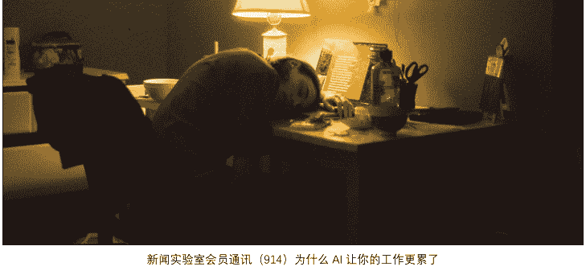
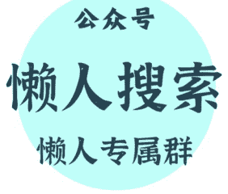
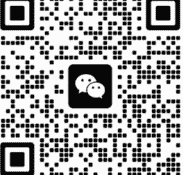

260316 新闻实验室

整理：公众号懒人搜索，懒人专属群精选

懒人微信：lazyhelper1

# 为什么 AI 让你的工作更累了

和 AI 共处一室，人们正被榨干。

(小懒现在就有这种感觉，AI 反而让自己会更忙了)

新闻实验室会员通讯 (914) 为什么 AI 让你的工作更累了

最近的“养龙虾 (OpenClaw)"热潮颇为魔幻。对于很多跟风的人来说，大家只是害怕错过什么重要的东西 (FOMO, Fear of Missing Out)。而真正花钱用上“龙虾”之后，却发现并没有什么应用场景，且有安全隐私方面的隐患。

“养龙虾”只是 AI 带来的焦虑现象的最新案例。最近有不少人都总结了这样一种现象：原本大家期待 AI 可以提升生产力，让大家的工作变得更轻松。可是，实际发生的情况却是，大家的工作更累了。

这是为什么？

## AI 吸血鬼

资深程序员、博客作者 Steve Yegge 在今年年初注意到一个令人不安的新现象：身边的人因为 AI 而过度工作，陷入前所未有的疲惫。他在 Medium 上发表了一篇广为流传的文章，将这种现象比作美剧《吸血鬼生活》中的能量吸血鬼 Colin Robinson——和他同处一室的人会被悄无声息地榨干精力。Yegge 写道：和 AI 共处一室，人们正被榨干。

这个比喻精准地击中了当下许多技术工作者的真实感受。Cua AI 创始人、软件工程师 Francesco Bonacci 在 X 平台上发了一篇题为《Vibe Coding 瘫痪：当无限生产力击溃你的大脑》的帖子，同样是引发了广泛共鸣。他写道：“我每天结束时都筋疲力尽——不是因为工作本身，而是因为对工作的管理。六个工作树打开着，四个写了一半的功能，两个‘快速修复’衍生出了无数兔子洞，还有一种越来越强烈的感觉——我正在迷失方向。”

他总结出一个悖论：你拥有的能力越强，你越觉得必须使用它；你越频繁地使用它，你的注意力就越碎片化；你的注意力越碎片化，你真正交付的东西就越少。

Yegge 用一个简洁的思想实验解释了问题的根源。假设 AI 确实能让你的生产力提升十倍。在情景 A 中，你决定用十倍的效率工作八小时来打动老板，结果是公司获取了 AI 带来的全部价值，而你什么也没得到，只落得精疲力竭，同事还因此怨恨你。在情景 B 中，你决定只工作一小时，用 AI 维持与同事相当的产出，那么你独享了全部价值，但公司很快就会被更努力的竞争对手淘汰。当然，在场景 A 里面，那家公司也很危险，因为所有员工都极度过劳。

现实的答案必须在两者之间找到平衡，否则所有人都将陷入困境。

问题在于，这种平衡极难把握。AI 原生初创公司正在以史无前例的速度榨干员工的精力，追逐的却往往是千篇一律的平庸创意。Yegge 观察到，无数创业者像淘金热中的矿工一样拼命奔跑，而终点却是集体力竭。

像 Yegge 这样的早期极客狂热者，以及 LinkedIn 上炫耀自己公司人手三个 Claude Pro/Max 账号的创业者们，都在无意中为所有人设定了不切实际的标准。正如 Yegge 自我反省的那样：“我有四十年的经验，带过大团队，我阅读速度很快，我有几乎无限的时间、精力和 token 来做实验。我完全不能代表普通开发者。但我仍然站出来告诉所有人‘照我这样做！’”

与此同时，大企业的 CEO 们看到这股浪潮，也开始焦虑地加速推动 AI 落地，往往是突然将 AI 强行塞入组织。

## 油炸大脑

这不仅仅是个人感受。波士顿咨询集团（BCG）的研究团队对 1488 名美国全职员工进行了一项大规模调查，研究结果发表在《哈佛商业评论》上。他们发现了一种真实且显著的现象，并将其命名为“AI 脑炸”（AI brain fry），定义为“过度使用或监督 AI 工具，超出个人认知能力而产生的精神疲劳”。研究的参与者们描述了一种“嗡嗡响”的感觉或精神迷雾，表现为难以集中注意力、决策速度变慢以及头痛，许多人不得不物理性地离开电脑才能重启大脑。

调查数据发现，最让人疲劳的是监督 AI 的工作。那些需要高强度监督 AI 工作的员工，在工作中多付出了 14% 的脑力，多承受了 12% 的精神疲劳，并多经历了 19% 的信息过载感。

研究还发现了 AI 工具数量与生产力之间的微妙关系：从一个工具增加到两个，生产力显著提升；增加到第三个时，提升幅度放缓；但超过三个工具后，大家的生产力反而下降了。不过这个结果也并不令人意外——多任务处理是人类大脑的老对手，而 AI 只是让我们再次栽进了同一个陷阱。

在受调查者中，14% 的 AI 使用者认为自己经历过“AI 脑炸”。不同岗位的差异很大，从法务部门的 6% 到市场营销部门的 26% 不等。一位高级工程经理这样描述他的经历：“我用一个工具帮我权衡技术决策，另一个吐出草稿和摘要，我不停地在它们之间来回跳转，反复检查每一个细节。但我没有变得更快，我的大脑开始感到拥堵。不是身体上的疲倦，而是……拥挤。就像我脑子里打开了十几个浏览器标签页，全在争夺注意力。最终让我清醒过来的，是我意识到我花在管理工具上的精力比解决实际问题还要多。”

> 一位财务总监写道：“我和 AI 反复讨论、重新构思、综合数据、组织框架……最后我甚至无法理解自己创造出来的东西是否有意义……只能什么都放下，第二天重新再看。”

"AI 脑炸”的商业代价是巨大的。据 BCG 的研究，经历过 AI 脑炸的员工比未经历的员工多承受 33% 的决策疲劳。对一家年收入 50 亿美元的公司而言，次优决策每年造成的损失高达 1.5 亿美元，而 33% 的决策疲劳增幅可能将这一数字推高数百万。更值得警惕的是，经历 AI 脑炸的员工中有 34% 表现出主动离职意向，而未经历者的离职意向是 25%。这意味着，企业里最密集使用 AI 的核心人才，恰恰也是最可能流失的那群人。

加州大学伯克利分校的两名研究者则从另一个角度提供了印证。他们对一家约 200 人的美国科技公司进行了长达八个月的田野研究，发现 AI 并未如承诺的那样减少工作，而是系统性地加剧了工作强度。

这种加剧表现为三种形式：
- 第一，任务扩张——产品经理开始写代码，研究员承担工程任务，人们吸收了原本属于他人的职责；
- 第二，工作和休息的边界模糊——员工在午餐时、会议中、等待文件加载时向 AI 发送提示词，离开工位前还要发一条最后的提示，让 AI 在自己不在时继续工作，工作日失去了天然的停顿节奏；
- 第三，多线程并行——人们同时运行多个 AI 线程，一边手动写代码一边让 AI 生成替代方案，不断在任务间切换，产生一种虚幻的高效感，实质上却是认知负荷的持续累积。

## 做个活人

面对 AI 带来的疲惫和过载，Steve Yegge 提出了一个他 25 年前在亚马逊工作时就发明的反榨取公式：$/hr，即你的薪资除以你的工作时长。

你也许无法控制分子（薪水），但你可以显著控制分母（工作时间）。他回忆道，当年在亚马逊西雅图国际区崭新的 USI 大楼里，同事们对无止境的加班怨言载道时，他走到白板前写下了这个比率。接下来几个月里，他不时路过别人的办公室，发现白板上赫然写着同样的公式。

Yegge 认为，AI 时代的新型工作日常应该是三到四个小时的高强度认知劳动，而不是八小时对着屏幕做这种吸血鬼式的工作。“你可能需要在办公室待八个小时和同事相处，但不是整天都在做这种疯狂的事。那会杀死人的。”

他呼吁每一个开发者在独处时也要对抗 AI 的诱惑——关掉电脑，去户外走走，做一个 人类。他自己也在身体力行：写完这篇 爆火的文章，合上电脑，然后去散步。

BCG 的研究提供了更具操作性的组织层面建议。其中的一个重点就是老板的作为 ——当管理者花时间回答员工关于 AI 的问题时，下属的精神疲劳评分降低了 15%；而当管理者期望员工自己摸索 AI 的使用方法时，下属的精神疲劳评分则上升了 5%。在团队层面，当团队有组织地将 AI 整合到工作流程中，而不是让每个人单打独斗时，认知负担显著减轻。在组织层面，感受到公司重视工作与生活平衡的员工，精神疲劳评分比其他人低 28%。

BCG 的管理合伙人 Tulie Bedard 在接受《财富》杂志采访时特别强调，太多公司 引入 AI 的方式是将其堆叠在员工已有的职责之上，而正确的做法应该是重新设计 岗位，并为员工提供规划和优先级排序方面的培训。

加州大学伯克利分校的两位研究者则提出了“AI 实践”（AI Practice）的概念，即一套有意识的规范和常规，来界定 AI 的使用方式、何时应该停止、以及工作范围如何回应新获得的能力。具体措施包括：

- 第一，有意识地设置暂停——随着工作节奏加快、工作和休息的界限日益模糊，员工若能利用一些简短而有条理的时刻来调节节奏，将大有裨益：这些受保护的暂停时间可以用于评估工作方向是否一致、重新审视工作中的一些假设，或在继续推进前消化信息。
- 第二，实施排序原则——将非紧急的 AI 输出通知批量处理，在自然的间歇点才推送更新，保护专注时段不受打扰；
- 第三，保护人际连接时间——在日益个人化的工作中，刻意留出倾听和交流的空间，建立人与人之间的连结。

最后，我们来看一个真实的“养龙虾”故事吧，主角是一个绝对的业内人士：AI 媒体 Every 的作者 Katie Parrott。

周五的午餐时间，她开始在 OpenClaw 配置 AI 助手，将它取名为 Margot。原本计划几个小时搞定，结果十二个小时后她和 Margot 写了两篇文章、重建了个人网站、还给另一个 app 添加了新功能。凌晨一点，她试图入睡，却发现自己从床上弹起冲向电脑。

她深入研究了行为科学文献，发现 AI 互动的成瘾机制与老虎机如出一辙——心理学家 B.F. Skinner 在上世纪五十年代就发现，不可预测的奖励间隔是最强大的行为强化模式。英属哥伦比亚大学研究者 M. Karen Shen 等人将这种现象命名为“AI 精灵现象”（AI genie phenomenon）：一个看似全能的助手随时待命，让你觉得停止许愿是不理性的。每一次 AI 的回答都部分满足你，但又打开新的问题，形成“认知兔子洞”——永远够好到让你继续，但永远不够好到让你停下。

Katie Parrott 还提到了安永 2025 年的一项调查：54% 的员工觉得自己在 AI 使用上落后于同事，85% 在自己的时间学习 AI，83% 完全靠自学。这种“害怕被淘汰”的恐惧 (FOBO, Fear of Becoming Obsolete) 与多巴胺的奖赏循环相互喂养——恐惧把你推向电脑，摸索产生了一次小胜利，小胜利感觉很好所以你继续，继续又拓展了你的能力边界，更大的能力边界又让你觉得自己应该做到更多，于是又要继续探索......

她没有给出完美的解决方案，但分享了帮助自己跳出循环的一些方法：那些发生在线下的、节奏更慢的活动，比如桌游和晚饭后遛狗。这些活动有天然的终点，一局游戏结束就是结束，一圈散步走完就是走完，而 AI 的循环没有内置的停止键。

Katie Parrott 在文章最后写下三个词，送给每一个需要听到它们的人：

> “你做得够多了。”

## ——————分割线——————

绝大多数人只盯着眼前的工资，却不知道一次远在中东的冲突、一次降息的决议，就能在一夜之间洗牌普通人的财富。

看懂宏观，是为了在周期切换时，不被当作代价。

如果你认同这种“抬头看路”的长期主义，欢迎围观我的个人情报智库：【懒人专属群】。

圈子已稳定运行 7 年。我们每天过滤全网最顶级的政经内参、大 V 付费研报，剔除情绪噪音，只保留能指导资产配置和商业决策的真实信号。做你最冷酷的“外部大脑”。

⚠️□ 查阅圈子最新宏观内参目录：

https://hk57gvix7u.feishu.cn/docx/H0kRdZbSbolBR0xkaXtcuVE0nTg

拒绝伸手党，只识有缘人。扫码加我微信，备注：[破局上车]

微信：lazyhelper1