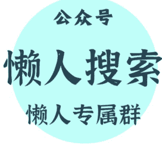

# 供养者焦虑

260317 守夜人总司令
整理：公众号懒人搜索，懒人专属群精选
懒人微信：lazyhelper1

## 前言

过去的婚姻是以生产导向，生产导向是基于共同目标的协作，现在的婚姻是以消费导向，消费导向是基于个人体验的满足，所以前者是 1+1>2，后者是零和博弈！

## 正文

越来越多的中年人的人生正在走向清零：一旦失业，不出半年就会被离婚，然后财产清零。前半生的所有挣扎又回到最初的地方，这是一个非常沉重但又极具现实意义的问题：男性在婚姻中感觉自己成了“供养者”，一旦失去创造价值的能力就可能被淘汰，精准地击中了当下婚姻焦虑的核心。当下的婚姻困境，并非单纯男女某一方的过错，而是经济模式、法律认知与人性博弈共同作用的结果。

### 从“共同生产”到“纯粹消费”

在农业和工业时代，家庭是生产单位，男女双方分别是劳动力（耕田）和劳动力再生产（操持家务、生育）的贡献者。那时，供养是双向的，因为生产是共同目标导向，而消费是个人体验导向！

而在现代都市生活中，当男性被简化为“工资卡”和“房子车子”，需要同时提供物质保障和情绪满足的安全感。那么，婚姻对于男性而言，就变成了一种单向的、不可持续的财务支出和自我消耗。不仅会让其感受不到协作，只感受到索取，而且在男性失去工具价值之后，就完全无法保障自身在关系中的存在。

在目前的司法实践中，离婚时的财产分割往往倾向于保护“弱势方”，（通常是因育儿而中断职业生涯的女性），这本身是为了纠正结构性不公，但在实际操作中，这种保护有时会被异化为一种投机工具。

这导致一些男性产生了一种“草木皆兵”的风险预判：我的奋斗成果，可能在离婚时被均分；我的困境（失业、生病），可能成为被抛弃的理由。当现代婚姻的退出成本极低（一方想离就能离），而违约成本极高（财产必须分）时，契约的神圣感就被破坏了。

当越来越多“捞女”的故事充斥屏幕，当“全款房不加名就是算计”和“生孩子警告”成为日常骂战，男女双方都被推向了“预设对方为敌人”的阵营。这种撕裂让人们在进入关系前，手里拿的不是鲜花，而是一份风险评估报告。

### 供养者困境

越来越多的中年男性正在经历：一旦人生遭遇困境，就会立刻被扫地出门的现实困境。这也凸显了男性在现代婚恋市场中的工具化焦虑。

社会对男性的评价往往只有“成功”和“失败”。成功了，你是“养家的人”；失败了，你连“人”都不是。在这种情况下，男性会恐惧：如果我只是一个“价值提供者”，那么当我的价值归零时，我的存在还有意义吗？传统观念要求男性坚强，这使得很多男性在婚姻中得不到情感滋养，却必须持续输出物质和情绪稳定，同时作为情绪和物质的提供者，在遭遇困境时却会发现身边空无一人！

面对这种现实，我们需要一种更清醒、更勇敢的选择策略：首先要看清婚姻的制度属性，但不放弃对情感的追求。婚姻确实带有财产制度的烙印，也是人类对抗孤独的方式。年轻人首先要做的，是把“爱”和“制度”分开来看。不要用爱情的滤镜去美化财产协议，也不要用利益的算计去否定真实的情感，在进入婚姻前，把财产、责任、风险摊在桌面上谈清楚，这不是算计，而是对双方的保护。

一个能和你谈钱、谈风险、谈底线的人，往往才是值得共度难关的人。

其次要从“供养关系”转向“合伙关系”。如果感觉自己只是“供养者”，关系模式一开始就出了问题。真正可持续的现代婚姻应该是一种强强联合的合伙制，或者抱团取暖的互助组。

所以，应该是寻找“战友”而非“客户”：如果你发现对方只关心你的收入，不关心你的健康；只负责花钱，不负责分忧，那这段关系本质上是交易。真正的伴侣，是当你陷入困境时，有能力（或至少愿意）出去工作、撑起家庭的人，而不是一边嫌弃你，一边等着分割财产的人。双方都能在“生产者”和“供养者”的角色中自由切换的婚姻才是健康和值得的。

另外，必须建立个人的“安全边际”，无论是否进入婚姻都需要保持一种随时可以重新出发的能力。经济独立是人格独立的基石：你的工作、你的技能、你的积蓄，是你在这段关系中最硬的底气。这既是对自己的负责，也是给关系减压，因为你不必因为生存而死死绑住对方，而且，不要把全部的情感寄托在另一半身上。拥有自己的社交圈、兴趣爱好和精神世界，会让你在关系中是“分享”而不是“捆绑”。保持随时止损的能力和退出的底气。婚姻应该是一份基于契约的合同，而不是人身依附。

对人的筛选很重要，当激情褪去，当面临困境，一个人是会推卸责任、落井下石，还是会顾念旧情、共担风雨呢？不要只看顺境时的状态，要看这个人如何对待身边的人，尤其是身处逆境中的朋友。选择一个本身就善良、有责任感、懂感恩的人，选择本身就优秀，本身就过得好的人。

婚姻是一场长期的复杂性实践。对于当代年轻人，尤其是感受到“供养者焦虑”的男性来说，婚姻确实不再是那个“稳赚不赔”的买卖了。但正因为如此，婚姻才可能回归本质，如果婚姻最终沦为交易博弈，那婚姻永远会有亏有赚；但如果婚姻是一种深刻的联结，是两个人在看清了彼此的局限、贪婪、恐惧之后，依然选择握紧对方的手，那么婚姻就超越了买卖。

不因为恐惧制度而拒绝拥抱人性，也不因为渴望爱情而放弃捍卫权益，去做一个清醒的参与者，而不是一个愤怒的旁观者。如果遇到那个愿意与你共担风雨、同舟共济的人，就勇敢地签下这份关于生命的契约；如果暂时没有，就先把自己活成一座坚固的、温暖的岛屿。不管男人还是女人，只有当自己本身就是有能力，活得好的人，才能真正拥有平等而自由地去爱别人的能力，否则，就一定会变成单向的索取和压榨。

---

绝大多数人只盯着眼前的工资，却不知道一次远在中东的冲突、一次降息的决议，就能在一夜之间洗牌普通人的财富。

看懂宏观，是为了在周期切换时，不被当作代价。

如果你认同这种“抬头看路”的长期主义，欢迎围观我的个人情报智库：【懒人专属群】。

圈子已稳定运行 7 年。我们每天过滤全网最顶级的政经内参、大 V 付费研报，剔除情绪噪音，只保留能指导资产配置和商业决策的真实信号。做你最冷酷的“外部大脑”。

⚠️ 查阅圈子最新宏观内参目录：

https://hk57gvlx7u.feishu.cn/docx/H0kRdZbSbolBROxkaXtcuVE0nTg

拒绝伸手党，只识有缘人。扫码加我微信，备注：【破局上车】

