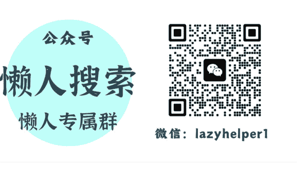

# 250|“龙虾”分歧 (下):科技公司的赌命局

260319

整理：公众号懒人搜索，懒人专属群 精选

懒人微信:lazyhelper1

欢迎打开《蔡钰·商业参考 4》，我是蔡钰。

上一讲，我们聊了 2026 年这股龙虾全民狂欢里，国家政府和地方政府的态度温差，国家在反复提示风险，地方在狂撒补贴抢人。

那么，中国的科技公司们又在想什么忙什么呢？

简单来回答的话，科技公司们在借着这股龙虾狂欢，打一场 AI 时代的生死暗战。

## 原生公司

我们先来看看整体上，2 月以来的科技公司龙虾大战。

最早动手的，是对前沿趋势最敏感的原生 AI 公司，也就是主业就是 AI 的公司。月之暗面的 Kimi，在 2 月中旬就推出了 KimiClaw 云端版，主打性价比，是国内最早适配 OpenClaw 生态的模型厂商之一。我最早摸到龙虾，就是当时打开 Kimi 的网页，发现新增了龙虾功能。

而到了春节后的 2 月 25 日，MiniMax 也跟进了一步，推出了自家龙虾 MaxClaw，允许开发者把语音、音乐技能直接上架到 ClawHub 上，那是龙虾的“技能市场”，相当于在苹果 App Store 里开了一个店面。

MiniMax 跟 Kimi 还不一样，MiniMax 已经在香港上市了，于是，它马上成了中国最正宗的“龙虾概念股”，市值一路飞涨到 3800 多亿港元，超过了百度。

3 月 10 日，另一家 AI 上市公司智谱，也赶紧推出了自己的龙虾，名字叫 AutoClaw。跟前两家比，智谱动作算晚的了。它又没有大公司的资源撑腰，于是出了个狠招，直接给的是“本地龙虾”的下载安装包，让用户们下载到电脑上，像装普通软件一样点击安装，连接入飞书这事儿都给包办了。我把智谱龙虾的网页链接 (https://autogl.m.zhipuai.cn/autoclaw/) 放在文稿里，你要是想试试，可以谨慎地试试。

这之外，傅盛养龙虾三万的故事不是引发了轰动么，他的公司猎豹移动也在 3 月 7 日发布了自己的龙虾 EasyClaw，号称是傅盛的“三万同款”。EasyClaw 也提供了下载和一键安装的功能，而且是本地版和云端版都有。我也把链接放在文稿里 (https://easyclaw.com/zh-cn)。

## 科技巨头

看完了标志性的 AI 原生公司，再来看看国内的科技巨头。

巨头们的动作更集中，也更能说明问题。

你可能知道，国内最早的一批 AI 发烧友们玩龙虾，普遍是把它接入了飞书，拿它当同事来用。这倒不是因为飞书对此做了专门布局，而是因为它作为一款成熟的办公套件，开放平台本来就提供有接入 AI 智能体的 API、事件订阅机制，这都跟部署 OpenClaw 的需求高度契合。事实上，企业微信、阿里钉钉也能接，只不过“先进企业都用飞书”，用飞书接龙虾也就成了最先一波流行。

但事实上，字节更加主动地入局龙虾，要到 3 月 9 日了。它的火山引擎在当时上线了一只云端龙虾，名叫 ArkClaw，接自家的飞书。

而动作更早的巨头，其实是阿里巴巴。早在 2 月份，阿里通义实验室，就推出了面向个人开发者的国产版龙虾——CoPaw。到了 3 月 3 日，阿里又推出了进阶版龙虾——HiClaw，这是面向团队开发者的。

而 C 端大众对龙虾的热情，我猜阿里也始料未及，所以直到 3 月 13 日，龙虾热度到顶一周之后，阿里才推出了面向大众的自家龙虾，起名叫 TVS Claw。

不过，请你注意，阿里这一系列产品，并不是对原版龙虾 OpenClaw 的二创，而是自行研发的。

要是只看 C 端市场，腾讯的嗅觉是最灵敏的，因为它机缘巧合撞上了一次田野调查。

3 月 6 日，还没几个普通民众知道龙虾的时候，腾讯就在深圳总部楼下摆摊，免费帮人安装龙虾。这次安排的初衷，是向企业客户们推广龙虾，没想现场一号难求，排队的人数近千，从 60 多岁到 6 岁的都有，大把是个人用户。这把马化腾都惊讶得发了个朋友圈，感叹说“没想到会这么火”。

当时，马化腾的感叹和排队装龙虾的照片流传到公网，又登上了热搜，还引发了一句经典的网友评论：“真是一代人有一代人的领鸡蛋”。

腾讯作为最懂消费级市场的社交巨头，当然意识到了什么。它很快也发大招了。

3 月 10 日，腾讯一口气发布了 5 款龙虾产品：

一个叫 WorkBuddy，工作搭档，云端龙虾；一个叫 QClaw，本地龙虾，可以直接关联微信；这两个是面向个人用户的。

接下来，还有一个叫腾讯云 Lighthouse、一个叫智能体开发平台 ADP、一个叫腾讯云桌面。这三个是支撑养龙虾的云产品或开发平台，面向开发者和企业客户的。

简单说，腾讯一次性把个人、企业、开发者、算力、云桌面五个环节都补齐了。

马化腾又在朋友圈转发了这个腾讯全系“龙虾”矩阵。还预告说，还有安全隔离“虾房”、云保安、知识库等一批产品，会陆续赶来。

在这三家之外——3 月上旬，华为云正式推出了 OpenClaw 体验计划，推出了鸿蒙版的小艺 Claw。百度推出了移动版 OpenClaw，主攻手机。美团也推出了云端部署服务。连京东都挂出了远程和上门部署 OpenClaw 的服务。也就在这一周，我的微信服务通知里，每天都有四五场“养虾”直播在开，腾讯的、百度的、傅盛的，百度文心和百度智能云还要同一时段分头开播。小米也争分夺秒蹭了个热点。3 月 6 日，雷军宣布，小米也要推出一个手机龙虾，名叫 MiClaw，暂时还不能发布，但是要先搞封闭测试。

你看，2 月中旬，到 3 月中旬，短短四周内，中国大大小小的科技公司，几乎都打出了龙虾牌。这场仗，比春节的 AI 红包大战要有技术含量多了。

## 机会逻辑

那么，大大小小的科技公司们，为什么这么整齐划一、这么着急？

第一层逻辑，是机会逻辑。

大模型的军备竞赛已经跑了两三年，能力已经卷出了新高度，但规模化的商业场景，除了聊天窗口，还迟迟没有出现。2026 年，是全球 AI 产业界公认的智能体之年、应用之年，也是商业化之年。

而在龙虾之前，虽然已经有一些 AI 应用摸到了商业闭环，比如帮着干活儿的 Manus、帮着做 AI 漫剧的 Seedance 2.0，但在消费级市场上，始终还缺一个用户肯付费的大产品。

> 龙虾的出现，让这个难题有了突破口。原因是什么？原因是，它比传统的大语言模型要更能燃烧 Token，同时又让消费级的用户展露了浓厚的使用兴趣。

我们稍微展开解释一下：

我们每次让龙虾干活，都是在调用它背后的大模型。调用一次，就消耗一批 Token。截至 2026 年 2 月底，全球前十大模型的总 Token 消耗量已经突破 28.7 万亿，其中中国模型贡献不但超过了一半，而且在前五中占了三席。

2 月中旬，OpenClaw 的爆发，又给这个消耗量再踩了一脚油门。有数据显示，2 月 9 日到 15 日这一周，中国模型的 Token 调用量达到了 4.12 万亿，首次超过了同期的美国模型。中国，成了事实上全球第一大 Token 出口国。

前面我们不是说，全球前五大模型的总 Token 消耗量里，中国模型占了三个吗？

这三家，分别是 MiniMax、Kimi、DeepSeek。

说到这里，我们又可以回过头来解释，为什么在中国这边，2 月份开始，MiniMax、Kimi 这样的原生 AI 公司，就开始率先向公众推出了龙虾服务。这些公司显然在自己的数据后台率先注意到，世界各地新出现的龙虾爱好者们，正在疯狂消耗自家的 Token，而类似的需求，中国市场过完年也一定会发生。

为什么海外龙虾爱好者也愿意接中国模型？很简单，中国的模型定价能压到美国高端闭源模型的 1/5，甚至 1/10。

同时，即便给出了这种极致价格，中国模型们本地借着电力和算力的成本优势，也仍然有利润的。所以，在这轮龙虾狂潮里，谁的模型如果能成为主流的龙虾大脑，谁就拥有了流量的水龙头。

## 风险逻辑

科技公司们着急进场的第二层逻辑，是风险逻辑。

OpenClaw 也有风险，风险不小于巨头们当初抵制的豆包手机。但问题是，OpenClaw 是开源的。

这意味着，它目前不归属某一位明确的竞争对手。谁能在这个开源生态里建立最深的适配、最好用的技能包、最顺手的部署方案，谁就能在下一代的 AI 工作流里，成为那个不可绕过的基础设施。

更重要的是，如果龙虾真的能够介入各种各样的生产和生活，那对身后的模型来说，又能拓展更多场景数据，来把自己训练得更聪明。

这场竞争反过来，对科技大厂们也就意味着，如果龙虾真的是下一代的国民应用，没有抢到它，不但失去了下一代流量入口，更失去了对消费级 AI 市场的基础设施定义权。

这可真是生死之争了。

不过，也不是所有商业巨头都喜欢这场狂欢。小红书在龙虾狂潮里发了一则公告，宣布说，自家平台禁止 AI 账号的运营。这事也很好理解。小红书的立身之本是“活人感”，AI 账号对它来说，妥妥是扼杀活人感的癌细胞。

这也是生死之争。

## 总结

好，这是我要向你汇报的，站在商业视角，我们所看到的 2026 年这场全民龙虾狂欢，事情的进展和解释逻辑。

我们追踪了一幅相对完整的图景：国家在强调风险，地方在撒补贴，模型厂商在抢 Token 入口，云厂商在争基础设施定义权，小红书在守护社区温度。同一只龙虾，在不同人眼里，有时是机会、有时是威胁、有时是工具、有时是风险，各有各的盘算。

但不管怎么说，在国家、地方、科技公司和普通企业这几方之间，“龙虾值得试试看”这个初步共识，已经形成了。

说到这里，我也想跟你念叨一句：

> 如果你也认同这个共识，那么在 3 月中旬之后，你不妨侧重考虑国内厂商们提供的各种云端虾和本地虾。就我目前的一些尝试发现，国产的龙虾们，大多是调教过的安全版本。比如智谱的 AutoClaw，默认设置就不让龙虾暴露在公网，限制各种账号权限，做啥事情需要主人二次确认，等等，会相对放心一些。

不过，这个共识可能也是暂时的。因为供给端还有一个巨大的问题没有确认：那些正在陷入狂热的 C 端养虾人们，在跟风热情消退之后，真正留下来的会有多少？龙虾是真对普通人有用，还是只是一个比特拉布布？

你肯定知道，今天的闲鱼上，已经出现“299 元上门卸载龙虾”的服务了。而这个问题，又不不仅仅是龙虾市场前景的问题了。我觉得这个问题的答案，跟我们每个人在 AI 时代的成长必修课紧密相关。

嘿嘿，我们找时间另起一行，借着龙虾谈谈人生。

再见。

- 1. 面对“龙虾”狂欢，模型厂商在抢 Token 入口，云厂商在争基础设施定义权，小红书在守护社区温度。
- 2. 在国家、地方、科技公司和普通企业这几方之间，“龙虾值得试试看”这个初步共识已经形成。
- 3. 如果你也认同这个共识，那么在 3 月中旬之后，你不妨侧重考虑国内厂商们提供的云端虾和本地虾。

---

绝大多数人只盯着眼前的工资，却不知道一次远在中东的冲突、一次降息的决议，就能在一夜之间洗牌普通人的财富。

看懂宏观，是为了在周期切换时，不被当作代价。

如果你认同这种“抬头看路”的长期主义，欢迎围观我的个人情报智库：【懒人专属群】。

圈子已稳定运行 7 年。我们每天过滤全网最顶级的政经内参、大 V 付费研报，剔除情绪噪音，只保留能指导资产配置和商业决策的真实信号。做你最冷酷的“外部大脑”。

## 查阅圈子最新宏观内参目录:

https://hk57gvlx7u.feishu.cn/docx/H0kRdZbSbolBR0xkaXtcuVE0nTg

拒绝伸手党，只识有缘人。扫码加我微信，备注：【破局上车】

微信：lazyhelper1