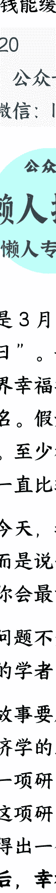

# “钱能缓解痛苦，但不能制造快乐”

2026 年 3 月 20 日

整理：公众号懒人搜索，懒人专属群精选

懒人微信：lazyhelper1



今天是 3 月 20 日，联合国设立的“世界幸福日”。每年这一天，联合国都会发布《世界幸福报告》，给全球各国的幸福指数排名。假如你感兴趣，可以去网上搜索一下。至少根据往年的情况看，排行榜的位次一直比较稳定，很少有大幅波动。

因此今天，我们换个角度，不聊国家排名，而是说一个更切身的问题：年薪多少钱，你会最幸福？

这个问题不光困扰普通人，就连诺贝尔奖级别的学者，也为它争吵了十年。

这个故事要从 2010 年说起。2010 年，行为经济学的流派宗师，丹尼尔·卡尼曼发表了一项研究，是关于钱和幸福感的关系。这项研究覆盖了 45 万美国人的数据，得出一个结论：年收入超过 7.5 万美元之后，幸福感就不再明显增加了。

这个数字，后来成了著名的"7.5 万美元天花板”。

为什么是 7.5 万美元？卡尼曼的解释是：这笔钱可以帮你解决基本的生活问题，房租、账单、医疗、孩子教育。当这些问题都解决了，钱的“基础”功能就用尽了。之后再多赚的钱，对幸福感的提升都非常有限。这就好比一个人吃饱之后，再吃任何东西也不会觉得有多美味。

当年，这个结论影响很大。被媒体大量报道，也被无数人引用。还有很多人据此得出一个人生智慧：别太拼命赚钱了，够用就行，7.5 万美元以上的部分都是“无效努力”。不如把时间省下来陪家人、发展爱好、享受生活。

这听起来也很有道理，对吧？但 2021 年，有人站出来说：不对。

2021 年，沃顿商学院的研究员马修·基林斯沃斯发表了一篇论文，直接挑战卡尼曼的结论。

基林斯沃斯用了一种新方法：他开发了一个 App，在一天中随机时间询问用户“你现在感觉如何”。通过这种方式，他收集了 33000 多人的实时幸福感数据，而不是传统问卷调查那种回忆式的数据。

在一番调研之后，基林斯沃斯得出了一个新的结论，就是赚钱的心理效用，并不存在什么天花板。收入越高，幸福感越高，没有上限。

年薪 10 万美元的人，就是比 7.5 万的更幸福，20 万的就是比 10 万的更幸福，50 万的就是比 20 万的更幸福。这条线一直往上走，没有拐点。按照基林斯沃斯的研究，即使是黄仁勋、马斯克、比尔·盖茨这种级别的富豪，他们多赚一些钱，也会感觉到比以前更幸福。

你看，分歧出现了，卡尼曼和基林斯沃斯，两位学者，两个研究，结论完全相反。

这在学术界引发了激烈讨论。有人支持卡尼曼，有人支持基林斯沃斯。

争论持续了两年。直到 2023 年，转折出现了。卡尼曼和基林斯沃斯决定坐下来，一起做一项新研究。

要知道，这在学术界是比较少见的。很多学者通常倾向于捍卫自己的立场，而不是跟“对手”合作。但这两位选择了合作，并且请了一位中立的第三方学者来协调，重新分析双方的数据。

这项研究的成果，后来发表在《美国国家科学院院刊》上。

注意，重点来了，这项研究的最新结论是，两个人都对，但他们说的是不同的人群。

具体是这样的：对大多数人，大约 80%，基林斯沃斯是对的。收入越高，幸福感确实持续上升，没有明显的天花板。而对最不幸福的那 20% 人群，也就是本来幸福感就很低的那部分人，卡尼曼是对的。当年收入超过 7.5 万美元，他们的幸福感增加就很有限，超过 10 万美元后，幸福感就几乎不再增加了。

## 为什么会这样？

研究者发现，那 20%“本来就不幸福”的人，不幸福的原因往往不是钱，可能是糟糕的人际关系、没有人生意义感，或者某些难以解决的心理问题。

对这些人来说，钱能做的有限。钱可以减少他们因为“穷”带来的痛苦，但没法解决他们“本质上不幸福”的问题。所以到了一定收入水平，10 万美元，钱的作用就到顶了。

而对另外 80% 的人来说，他们的不幸福大多是“境遇性”的，比如工作压力、生活不便、选择受限。对于这些问题，钱确实能帮上忙。所以收入持续提高，幸福感也持续提高。

> 对于这个现象，两位研究者有个很精辟的总结，“钱能缓解痛苦，但不能制造快乐”。

这里的 7.5 万美元、10 万美元，都是美国的数据。假如按这项研究发表的 2023 年的汇率和购买力平价计算，7.5 万美元相当于人民币 40 万到 50 万，10 万美元相当于人民币 55 万到 70 万。当然，这些数字不能直接套用到中国，毕竟，美国研究的样本背景、消费结构、社会保障体系都跟我们不一样。把"7.5 万美元”机械换算成"40 万人民币”，然后说“年薪超过 40 万幸福感就不增加了”，这明显是不严谨的。

但有一个判断原则是通用的，就是先问自己，我现在的“不幸福”，是钱能解决的吗？

假如一个人的不幸福是因为“缺钱”，比如，付不起房租、买不了 PS5、没机会去旅游，那么，钱确实能直接解决问题，他的幸福感会明显提升。但如果一个人的不幸福是因为“其他原因”，工作没意义、婚姻不和谐、找不到人生方向，那钱就像创可贴贴在骨折上，作用有限。

而且卡尼曼和基林斯沃斯的研究，也为学界提供了一个思路，这就是，假如把两个截然相反的研究结合在一起，也许会有更新的发现。

2025 年，《自然》子刊上发表了一篇论文，叫《通向个性化幸福的方法》。这篇论文就做了类似的事，它把前人争论不休的两个对立观点，放置在了同一个研究体系里。而且这个研究，正好还可以作为卡尼曼研究的补充。

关于“幸福从哪里来”，心理学界一直有两派争论。一派叫环境派，另一派叫性格派。

环境派认为：你的幸福取决于你的生活境遇。工作好不好、婚姻幸不幸福、收入高不高。环境好，你就幸福；环境差，你就不幸福。

性格派认为：你的幸福取决于你天生的性情。有些人天生乐观，有些人天生悲观。环境只是涟漪，性格才决定水位。

这两派争了几十年，各有数据支撑，谁也说服不了谁。

2025 年这篇论文的突破在于：它发现，两派都对，但每个人身上这两种因素的配比不一样。

研究者通过大规模追踪研究，发现人群中普遍存在两类“幸福体质”。

第一种叫环境敏感型。这类人的幸福感，主要受外部环境影响。升职、加薪、中彩票这些好事，会让他们明显更幸福。同样，坏事会让他们明显更痛苦，而且恢复很慢。

第二种叫性格稳定型。这类人的幸福感，主要由内在性情决定。他们的特征是：升职加薪会开心，但开心程度有限，过几天就回归常态。遇到挫折会难过，但恢复很快。情绪波动小，很难大喜大悲。

两种体质没有好坏之分。环境敏感型的人，容易感受到快乐，但也容易感受到痛苦。性格稳定型的人，不容易大喜，但也不容易大悲。各有各的活法。而且大多数人是混合型，只是偏向程度不同。

怎么判断自己更偏向哪种？论文里没有给出标准化测试量表，但根据研究描述，我们或许可以做一个简单的自我判断。

这个判断方法是，回想过去一年，你经历的最大一件好事和最大一件坏事。

然后问自己三个问题：第一，好事发生时，你的幸福感提升了多少？这种提升持续了多久？第二，坏事发生时，你的情绪低落了多久？多久恢复到正常水平？第三，在既没有明显好事也没有明显坏事的“平淡期”，你的基础幸福感大概在什么水平？

假如你的回答是：好事让我挺开心的，但过几天就淡了，不会反复回味。坏事让我挺难过的，但过几天也就缓过来了。平淡期我也挺稳定的，不会因为“什么都没发生”而焦虑。那你大概率是偏向性格稳定型。

如果你的回答是：好事让我特别幸福，经常回想，幸福感能持续很久。坏事让我特别痛苦，很难走出来，反复回想。平淡期我会不安，觉得“什么都没发生”反而是个问题，担心是不是自己不够努力，那你大概率是偏向环境敏感型。

假如你是环境敏感型，“钱”对你的作用比较大。外部境遇的改善，能显著提升你的幸福感。对这类人来说，不要羞于追求物质改善。买更大的房子、换更好的工作、提升收入，真的能带来持久的幸福感提升。

说白了，你值得为自己折腾。

假如你是性格稳定型，“钱”对你的作用有限。超过一定水平后，收入增长带来的幸福感提升很小，那么，接受“差不多就行”可能更明智。可以把精力放在其他维度：深度的人际关系、有意义的工作、个人成长等等。

回到开头那个问题：赚钱多就一定幸福吗？

现在我们也许可以给出一个更精确一点的回答：取决于两件事。第一，现在“不幸福”的原因是什么？如果是钱能解决的问题，那钱确实有用。否则，钱的作用有限。第二，你是什么“幸福体质”？如果你是环境敏感型，钱能买到更多幸福。如果你是性格稳定型，钱只能买到“不痛苦”，很难买到“更幸福”。两类体质，各有各的特征，各有各的策略。而且因为每个人的“体质配比”不同，这就更让幸福这个事，很难有放之四海而皆准的答案。

罗曼·罗兰曾经说过一句话，用来总结今天的研究，似乎再合适不过，叫做，“没有一个人是完全幸福的。所谓幸福，是在于认清一个人的限度而安于这个限度。”

---

绝大多数人只盯着眼前的工资，却不知道一次远在中东的冲突、一次降息的决议，就能在一夜之间洗牌普通人的财富。

看懂宏观，是为了在周期切换时，不被当作代价。

如果你认同这种“抬头看路”的长期主义，欢迎围观我的个人情报智库：【懒人专属群】。

圈子已稳定运行 7 年。我们每天过滤全网最顶级的政经内参、大 V 付费研报，剔除情绪噪音，只保留能指导资产配置和商业决策的真实信号。做你最冷酷的“外部大脑”。

⚠️⚠️ 查阅圈子最新宏观内参目录：

```
https://hk57gvlx7u.feishu.cn/docx/H0kRdZbSboIBR0xkaXtcuVE0nTg
```

拒绝伸手党，只识有缘人。扫码加我微信，备注：【破局上车】


微信：lazyhelper1