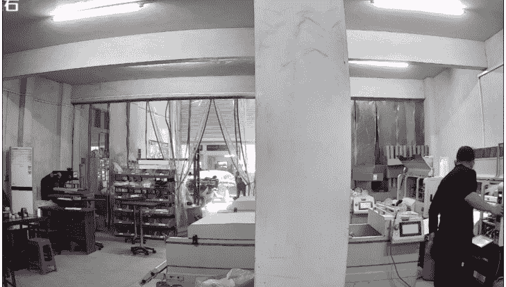
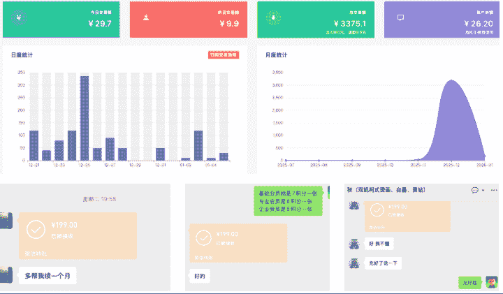
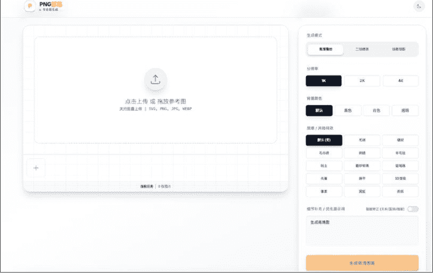
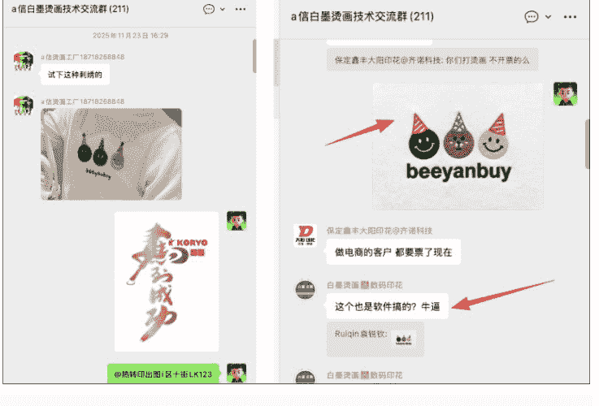

### 公众号懒人搜索，懒人专属群分享

# 上线 1 个月，没投流却变现 5K+：一个传统行业老板用 AI 编程破局的完整复盘

### 260320 副业 SC 精华

公众号懒人搜索，懒人专属群独享

懒人微信:lazyhelper1


文章摘要：没学过编程的小老板，如何用 AI 做出赚钱的产品？这篇文章是我用 AI 编程开发 AI 生图网站的完整复盘：需求发现→技术选型→开发上线→运营变现，每个环节都有实战细节和真实数据。希望给同样想尝试 AI 编程的朋友一份可参考的行动指南。

## 一、一个 all in AI 的连续创业者


我是那种“不安分”的人。

2014 年，高中毕业后入伍，在部队文职岗位期间自学了设计和社群运营。

2019 年退役后，我基本什么能赚钱就做什么：奶茶店创业（亏损了）、玻璃幕墙工程、插画教学、自由职业、电商......

2022 年，我开始接触 Midjourney，那时候这玩意儿刚出来，我就敏锐感觉到这玩意儿能改变设计行业，于是开始开发相关课程。

2024 年，跟朋友一起开了一家白墨烫画打印加工厂。因为工厂需要大量图案设计，我开始深入研究 AI 编程——不是为了别的，就是成本太高扛不住。3 个美工，每个月工资 1.8 万。美工画不出的图，找别人代画一张要 5-20 元，质量还一般。

我算了一笔账：如果能用 AI 替代一部分人工，每个月能省多少钱？

答案是：每月节省 1.2 万，两个美工的工作量。

这就是我 ALL in AI 编程的起点。

## 二、痛点发现：每个工厂都在为高清图案花冤枉钱

### 我的真实痛点

自己的打印厂日常需要大量高清图案设计。以前靠 3 个美工，每个月工资 1.8 万。而且美工画不出的图，找别人代画一张要 5-20 元，质量还一般。



### AI 带来的技术突破

豆包 4.0 出来后，我开始用它制作高清图片。后来阶跃 AI 的 Step-2 模型（Step-2）发布，那个能力真的让我直呼牛皮！

一张图才 0.3-0.7 元，质量还更高。

这意味着什么？

-   以前：1 张图 = 5-20 元（人工）
-   现在：1 张图 = 0.3-0.7 元（AI）

成本下降了 90% 以上。

### 从内部工具到产品化的决策

一开始我只是想开发个内部工具自己用用。后来发现：同行也有同样的痛点。

我这才做了一年多的小工厂都有这个需求，更别说那些做了好多年的大厂了。他们的人工成本更高，对这个的需求更强烈。

> 商业洞察：从“内部工具”到“SaaS 产品”的决策关键点：不是“我觉得别人可能需要”，而是“我自己每天都在用、而且别人也在问我”。刚需 + 高频 + 可复制 = 产品化的前提条件。

于是我就把这个工具做成了产品，对外的名字叫 PNG 部落（这是自己注册了几年的一个商标）。

## 三、项目成果：上线 1 个月的真实数据



项目成果：上线 1 个月，无投流变现 5K+。

说实话，这个金额不算多，但对我来说意义挺大的——这是我第一次用 AI 编程做出来的产品，而且真的有人愿意付费。

| 指标 | 数据 |
| --- | --- |
| 变现金额 | 5K+ |
| 注册用户 | 约 230 人 |
| 付费转化率 | 约 70%（注册→付费） |
| 投流费用 | 0 元 |
| 开发周期 | 1 个月 |
| 团队规模 | 1 人+AI |

### 定价策略

我是这么设计定价的：

#### 会员制度：

| 会员等级 | 价格 | 说明 |
| --- | --- | --- |
| 基础会员 | 9.9 元 | 适合个人小量使用 |
| 专业会员 | 49 元 | 适合小批量使用 |
| 企业会员 | 249 元 | 适合大批量使用 |

#### 积分充值：

-   1 块钱 = 10 积分
-   1K 分辨率 = 20 积分/张
-   2K 分辨率 = 30 积分/张
-   4K 分辨率 = 40 积分/张

#### 成本核算：

-   单张图片的 API 成本约 0.4 元
-   会员定价覆盖了 API 成本，还有利润空间

#### 获客渠道

说出来你可能不信，我只发了 2 个行业群和朋友圈，其他全是自然流量——用户介绍用户来的。

#### 我的获客路径：

-   1.行业群：只发了 2 个群，主要是精准的打印行业群
-   2.自然增长：用户觉得好用，主动推荐给同行
-   3.朋友圈 + 社群：持续发布更新内容

运营洞察：对于垂直领域的工具产品，精准渠道 > 泛渠道。2 个行业群的转化效果，比发 100 个泛流量群都强。

### 用户画像

我的用户主要有三类：

-   1.设计师：需要快速生成素材，提升工作效率
-   2.白墨打印厂美工：跟我一样的同行，需要大量高清图案
-   3.电商行业：需要产品图、主图、详情页素材

用户洞察：这三类人有一个共同点——和时间赛跑。设计师要赶稿，打印厂要赶工期，电商要赶上新。AI 出图快、便宜，对他们来说就是刚需。

## 四、技术选型：为什么选择这套"AI 编程全家桶”

### 开发工具

| 工具 | 用途 |
| --- | --- |
| Google AI Studio | 谷歌的 AI 开发平台，用于快速生成初始版本代码 |
| VSCode | 代码编辑器 |
| Claude Code | AI 编程助手，主要开发工具 |
| npx zcf | 脚手架工具，快速生成标准化项目模板 |
| GitHub Desktop | 可视化代码管理 |

### 第三方服务

| 服务 | 用途 |
| --- | --- |
| 302.ai | API 聚合平台 (国内访问稳定) |
| apimart.ai | API 聚合平台 (价格有优势) |
| evolink.ai | API 聚合平台 (备用) |
| z-pay | 支付接入服务 |

### 部署平台

| 平台 | 用途 |
| --- | --- |
| Vercel | 前端部署 |
| Zeabur | 后端、数据库、Redis |
| Cloudflare | 储存桶 (R2) |

技术选型心法：技术选型不是选“最火的”，而是选“最合适的”。核心逻辑：

-   1.前端:Vercel 免费额度够用，部署简单
-   2.后端:从 Railway 切换到 Zeabur，核心考量是成本和运维复杂度
-   3.API:多平台备份，避免单点故障

## 五、开发步骤：从 0 到 1 的 13 步实操

### 第一步：生成初始版本

使用 Google AI Studio 快速生成第一个版本。它会根据你的需求描述生成基础代码框架。

### 第二步：下载并编辑代码

-   1.下载生成的代码文件
-   2.使用 VSCode 打开项目，把下载的文件拖进一个临时文件夹
-   3.使用.gitignore 隐藏下载的临时文件，避免同步到 Git
-   4.这个临时文件可以随便命名，比如：.临时文件

> 避坑提示：这一步看似简单，但我当时踩了坑——没有及时.gitignore，差一点把临时文件同步到仓库。AI 生成的东西质量参差不齐，一定要先隔离测试。

### AI 编程的常见问题

用 AI 编程这段时间，我遇到最多的问题是：

-   1.硬编码：AI 喜欢把配置直接写死在代码里，比如把 API Key、域名等直接写进去
-   2.忘记组件化：同一个功能复制粘贴好几处，修改时要改好几个地方
-   3.逻辑不连贯：AI 写的代码片段很好，但拼在一起就容易出问题

经验总结：AI 编程不是甩手掌柜，你得自己理清楚业务逻辑，然后清晰地告诉 AI 要做什么。AI 是执行者，你是架构师。

### 第三步：使用 Claude Code 开发

结合 VSCode + Claude Code + npx zcf 进行开发。

Claude Code 配置：使用 zcf 的工程师专业版角色模式（遵循 SOLID/KISS/DRY/YAGNI 原则）

给非技术创业者的 AI 编程心法#1：如何向 AI 描述一个业务功能？不要说“帮我做一个用户系统”，要说“帮我做一个用户系统，包含注册、登录、积分三个功能。注册需要手机号验证码，登录支持微信和账号密码，积分用于兑换会员等级。”越具体，AI 理解越准确。

### 第四步：模板化开发

下载模板，比如 Supabase 集成的模板，在 AI 对话中直接@临时文件，让 AI 整理内容并集成到模板中。

给非技术创业者的 AI 编程心法#2：不要从零开始搭建项目结构。GitHub 上有大量开源模板，AI 可以帮你快速集成。与其自己写基础代码，不如站在巨人的肩膀上。

### 第五步：版本管理

用 GitHub Desktop 推送代码到 Git，方便版本管理和回滚。

说实话，这个工具比命令行友好多了。可视化操作对非技术出身的人非常友好。

### 第六步：本地测试

本地运行项目，检查并解决问题。

避坑提示：这一步真的很重要，不然问题会堆积到后面。我当时有点着急上线，结果后面花了更多时间填坑。

### 第七步：解决 API 权限问题

使用 Google AI Studio 的付费模型时，部分文件会要求填入 API Key，需要结合 AI 调整并正确配置。

### 第八步：接入第三方 API 测试

依次测试了以下平台：

-   1.302.ai - 国内访问稳定
-   2.apimart.ai - 价格有优势
-   3.evolink.ai - 作为备用

> 给非技术创业者的 AI 编程心法#3：API 多平台备份非常重要。单点依赖风险极高，一旦某个平台涨价或宕机，你的业务就可能中断。

### 第九步：开发核心功能

开发会员系统、用户系统、积分系统、管理后台。

> 避坑提示：一定要先理清楚业务逻辑，不然后期改起来会很麻烦。我就是有点着急，后面花了不少时间重构。

### 第十步：接入支付功能

-   1.使用 z-pay 支付服务
-   2.下载 demo 放在项目的 docs 文件夹内，让 AI 参考调用
-   3.本地测试可能无法测试回调，直接部署到线上再测试

> 支付踩坑：z-pay 需要绑定域名才能正常接收回调通知！如果你没绑定域名，支付成功后系统收不到通知，用户钱花了但会员没到账会很麻烦。一定要先配置好域名绑定！

### 第十一步：部署上线

部署到线上服务器，配置域名，开始测试支付功能。

### 第十二步：内测阶段

开启免费内测，邀请用户试用并收集反馈。

### 第十三步：迭代优化

### 我踩过的服务器坑

这是本文最值钱的经验之一。

一开始我使用的部署方案是：

```
前端：Vercel 后端：Railway 数据库：Neon.tech 储存桶：Cloudflare（R2）Redis：Upstash
```

> ⚠️ 重要提示：公测两天后，服务器就不够用了，直接开付费模式。结果半个月收到两张信用卡账单，分别是 20 美金和 20 美金——后端和数据库各扣了 20 美金。

现在我用的是：

```
前端：Vercel 储存桶：Cloudflare（R2）后端、数据库、Redis：Zeabur
```

具体的费用目前还不知道，不过管理起来方便多了!!目前用了 3 天，才 1 美金。

给非技术创业者的 AI 编程心法#4：成本意识要贯穿始终。很多平台有“免费额度”，但一旦用户量上来，收费是很凶猛的。从 Railway 切换到 Zeabur，核心考量就是：同样的能力，更低的成本，更简单的管理。

储存桶还可以设置图片数据定期清理~别忘了。

## 六、Claude Code 使用技巧：我是怎么提高开发效率的

### 1. 使用 npx zcf 脚手架

终端输入 npx zcf，如果是首次使用，建议直接输入 | 回车使用默认配置。这是一个 Claude Code 的脚手架脚本，就是先帮你预制好一些编程角色之类的，以及安装一些 MCP 啊等等。

### 2. 使用 CCMate 插件

CCMate 是一个 Claude Code 中转服务插件。我之前用三家中转的 CC，每月约 1800 元费用。CCMate 切换很顺畅，最近改用 GLM-4.7 模型，强烈推荐！便宜大碗！

### 3. 使用指令加快开发速度

在对话中使用明确的指令，可以大大提高 AI 的开发效率。

### 4. 多窗口并发开发（高级技巧）

这是提高开发效率的神器！

提示词模板：帮我看下项目还有哪些列出来的计划，然后还没开发的。全部列出来，然后帮我看下怎么并发开发比较好。

给我具体的提示词。我要多开几个 ai 窗口一起开发。

然后新建多个窗口，分别发送对应的任务提示词，虽然烧钱，但效率真的爽！

给非技术创业者的 AI 编程心法#5：多窗口并发开发是 AI 编程的核武器。当你的功能模块之间相互独立时，完全可以让多个 AI 同时帮你写代码。但前提是：你得先理清楚功能模块的边界，不然 AI 之间可能会“打起来”。

## 七、产品迭代历程

### V1：初始版本

第一版，基础功能能用。



### V2：洗衣机版本

参考 tools.dverso.io 的灵感优化，增加了去背景等功能。


### V3：当前版本

发现好看但不实用后，继续优化界面和交互。


## 八、运营流程：我是怎么冷启动的

### 1. 员工内部测试

让员工实际使用，优化工作流程。


运营心法：这是第一层验证——连自己都 用不爽，别指望对外推广。

### 2. 行业群免费测试

在行业内相关群免费帮忙做图，收集反馈。



> 运营心法：免费是最贵的获客方式，也是最便宜的验证方式。帮别人做 10 张图，比发 100 条广告都有说服力。

### 3. 逐步透露项目

在社群中逐步透露自己在开发 AI 生图项目。


image.png

> 运营心法：不要一上来就“我要卖东西”，而是“我正在做一个有用的东西”。让潜在客户参与你的产品成长，他们会成为最忠实的用户。

### 4. 朋友圈推广

添加好友、拉群、朋友圈发布更新内容。


image.png

### 5. 社群运营策略

-   内测积分赠送：鼓励早期用户试用
-   提交 bug 积分赠送：收集问题反馈
-   邀请好友积分赠送：扩大用户规模
-   定期赠送积分和会员：提高用户粘性

### 6. 引导邀请返利

当用户反馈积分太贵时，直接引导使用邀请返利制度。

### 7. 用户筛选

> 提醒：不要跟事多的人聊太多，这种人一般非常抠，转化价值不高。

## 九、后期维护技巧

### 1. 每日查看 bug 反馈

后端查看用户反馈的问题，及时响应。


### 2. 快速修复问题

复制报错代码直接发给 Claude Code 处理。

### 3. 谨慎部署更新

> ⚠️ 重要：不要修改一点就提交推送!一定要观察后端服务器，看是否有用户使用。

如果有用户在使用，推送代码可能导致服务器崩溃，严重影响用户体验。建议本地测试没问题后再提交推送。

### 4. 优化前端部署时间

如果使用 Vercel 部署前端，可以优化部署时间。我目前优化到 50 多秒。


### 5. 持续优化

-   优化前端显示效果
-   优化交互细节
-   排查问题，测试细节功能

## 十、项目反思总结

### 问题 1：邀请制度不够清晰

没有利用好种子用户传播，应该加大邀请奖励力度。学习大厂前期邀请制度，开通账号时减少免费白嫖次数。

### 问题 2：会员积分制度混乱

用户反馈看不明白会员和积分的区别。着急上线导致说明不清晰，很多用户不敢充值。

### 问题 3：项目开发不够规范

-   很多代码写得不够好
-   存在大量硬编码
-   没有组件模块化
-   修改同一个功能要改好几个地方

最近一直在疯狂补充和重构。

> 升维思考：这些”问题”其实是所有 AI 编程创业者的必经之路。AI 能帮你快速写出代码，但不能帮你快速写出好代码。随着业务增长，代码重构是必然的。关键是要快速验证想法->小步迭代优化，而不是一开始追求完美。

### 下一步规划

目前的核心任务是收集用户反馈，继续优化产品：

-   1.功能优化：根据用户反馈迭代功能
-   2.体验升级：优化前端显示效果和交互细节
-   3.代码重构：逐步规范化代码，减少硬编码
-   4.用户增长：等产品更稳定了，再考虑投流推广

> 长期主义：不急着放大，先把产品打磨好。用户愿意付费是认可，活下来比跑起来更重要。

## 十一、可复用的路径框架：传统行业老板用 AI 破局的三个步骤

看完我的故事，如果你也想尝试，核心路径是：

### 第一步：找到自己的“真痛点”

不是“别人可能有这个需求”，而是你自己每天都在为这个问题付钱/花时间。

### 第二步：用 AI 快速验证

不要一上来就投钱做产品，先用 AI 工具验证：

-   现有工具能不能解决？
-   解决到什么程度？
-   用户愿不愿意为此付费？

### 第三步：产品化放大

验证成功后，再考虑：

-   技术选型（成本优先，复杂度可控）
-   冷启动（从身边圈子开始）
-   迭代优化（先上线，再完善）

AI 编程不是让普通人变成程序员，而是让有想法的人更容易把想法变成产品。

## 十二、写在最后

这个项目从想法到上线只用了一个月时间，目前虽然没有投流推广，但已经实现了 5K+ 的变现。

作为一个没有编程背景的设计师，我深刻体会到 AI 编程的力量。只要思路清晰、勇于尝试，每个人都可以用 AI 工具把自己的想法变成现实。

希望我的实战经验能给想用 AI 编程做产品的朋友一些参考和启发。项目链接：https://www.pngtrid.com

编者结语：这篇文章的核心价值不在于 PNG 部落这个项目本身，而在于展示了一个传统行业老板如何用 AI 思维解决真实商业问题的完整路径。从“每月省 1.2 万人工”到“每月赚 5000+ 产品收入”，中间的思考过程和踩坑经验，对所有想用 AI 创业的人都有借鉴意义。

行动建议：如果你也想用 AI 编程做产品，记住三个关键词：痛点真实、验证先行、小步快跑。

## 分割线

  看完这篇 SOP，你觉得你懂了。但 90% 的人一到实操就会卡在第一步。

  工具和教程只是最低级的壁垒，真正的壁垒是“立刻动手”和“圈层信息差”。

  如果你想看全网最新的变现玩法，并且和一群执行力极强的极客一起下场拿结果，欢迎围观我的核心私域：【懒人专属群】。

  我们不聊虚的，只做商业闭环的拆解与 AI 效率的压榨。系统内已沉淀 1000+ 跑通的套利实战局。

⚠ 查阅圈子最新搞钱实操记录：

https://hk57gvlx7u.feishu.cn/docx/H0kRdZbSbolBR0xkaXtcuVE0nTg

认同价值、准备好下场干活的，扫码加我微信

备注：【实操上车】


微信：lazyhelper1