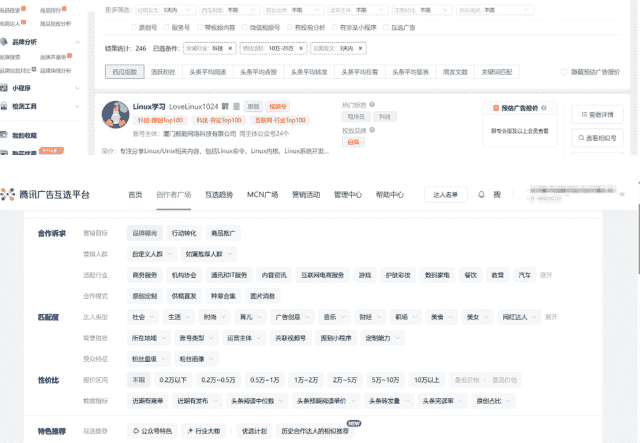
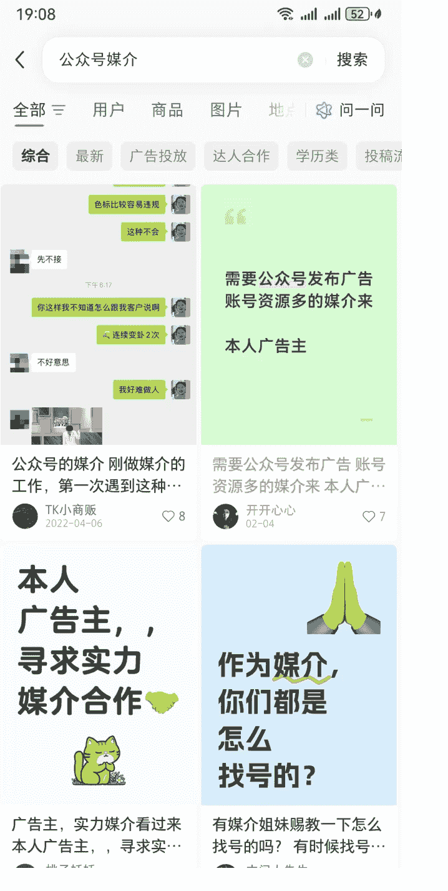
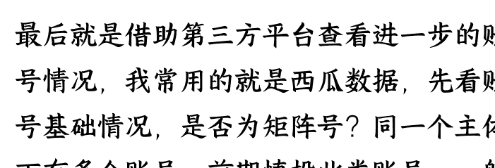
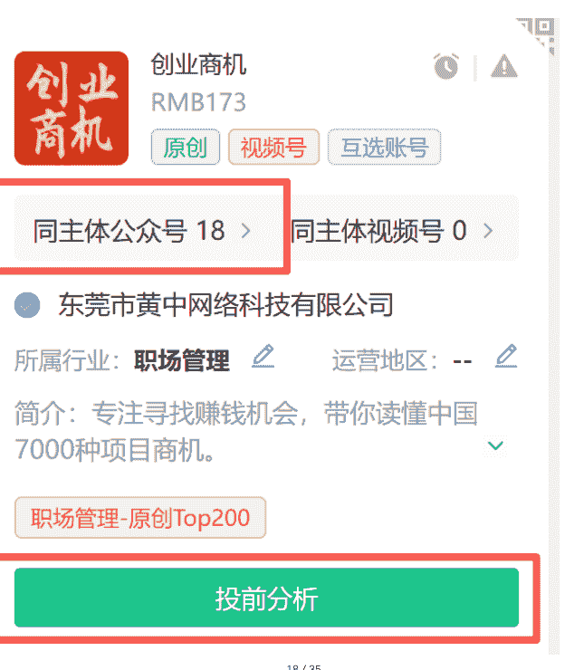
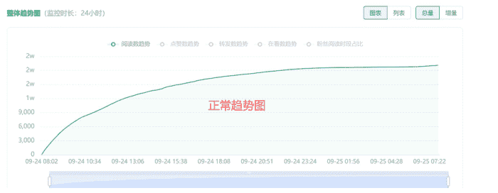
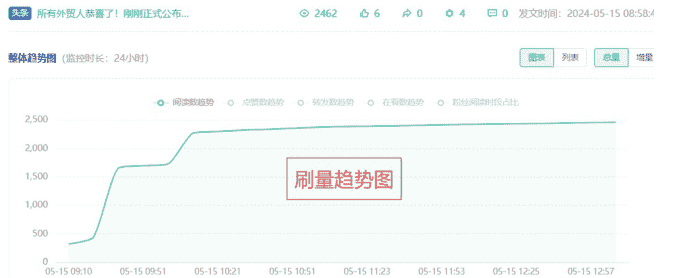
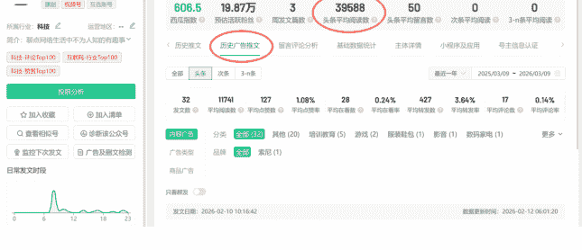

# 春节 7 天 42 万，最高 ROI 25:AI 产品在公众号的投放实操

## 260320 副业 SC 精华

公众号懒人搜索，懒人专属群独享

懒人微信:lazyhelper1

微信:lazyhelper1

大家好，我是胜前 Vic，多年来因为这里受益匪浅。

这次的项目机会是从生财联合办公每周的分享活动中获取到的信息，当时在活动中听到一个圈友说他通过公众号自然流卖某个工具，弄了一批矩阵号，每天能稳定进线上百人、月利润有 6 位数。

我回去后就去搜索了下相关的产品，发现有类似的 Ai 工具在做投放，我就找了一家产品做的最好、但是投放量并没有那么大的，聊了下贴牌的想法（因为我第一桶金是干淘客的，就总想把流量留在自己私域），贴牌没聊下来，后面就聊成了帮他投。

这篇文章主要讲什么？

首先不涉及 Ai 相关技术，因为我也不懂技术。

分享的是公众号的投放玩法，但不是信息流，而是门槛更低的“公众号派单”形式，直接找公众号博主给我们发广告。

我差不多 1 月份入局，前期也在摸索阶段，春节期间接住了春晚带来的 Ai 热度，也由此开始大量投号，正文中我将毫无保留地晒出春节 7 天的真实数据。

我将从以下五个维度拆解这套“淘金”方法论：

- ①底层逻辑：为什么 AI 产品在公众号里能产生“信用溢价”和“定价洼地”？
- ②选号玄学：如何一眼看穿高质量账号？
- ③实战 SOP：投放前后全链路拆解
- ④避坑指南：真金白银换来的经验
- ⑤适合哪些人：有没有产品都能做，关键是你适不适合？

☆□你能从中获得什么价值？

- ①我的项目实操经验
- ②一种跨赛道的套利思维
- ③一套成熟的派单 SOP：如果你有产品缺增量，或者有流量经验想做 CPS 代理，这套方法论可以让你少交几万块的学费。

公众号投放无论是走官方的互选平台还是直接和号主/商务建联，变现数据都是不易监控的，因此大多都是“闷声生财”，我在接触这行的时候，为了更加快速地上手，就想着先来星球搜索下相关内容，发现相关的分享比较少，希望此文可以作为此类内容的补充，给大家带去一些启发。

ps:由于该产品还在投放中，这里就不公开产品名称了，肯定有小伙伴刷到过投放内容或者已经猜到具体产品，请知晓的伙伴不要在评论区讨论产品名，望理解。

我先分享一组很有价值的数据，春节 7 天，投放账号 43 个，广告费用 121950，产出 426330（产品客单价 298），单账号最高 ROI25，综合 ROI3.5(1.5 即可保本，低于 1.5 的数据标绿)。我过去是做淘客 CPS 的，接触的多为信息流投放，这样的投入产出比在信息流里简直是种奢望。

| 账号昵称 | 粉丝量 | 广告费 | 销售额 | ROI |
| :--- | :--- | :--- | :--- | :--- |
| 财* | **25 万** | 1300 | 297 | 0.23 |
| 弥* | 2.1 万 | 400 | 887 | 2.22 |
| h* | 5.9 万 | 1000 | 1480 | 1.48 |
| 深* | 16.92 万 | 2500 | 3540 | 1.42 |
| 数* | 15 万 | 500 | 2662 | 5.32 |
| H* | 3.9 万 | 300 | 887 | 2.96 |
| 漫* | 6.7 万 | 700 | 2655 | 3.79 |
| * | 37 万 | 3800 | 13275 | 3.49 |
| b* | 3.9 万 | 900 | 1475 | 1.64 |
| 写* | 52 万 | 9400 | 17130 | 1.82 |
| 数* | 23 万 | 2800 | 7092 | 2.53 |
| Q* | 2.4 万 | 2800 | 7092 | 2.53 |
| 只* | 1.8 万 | 2800 | 7092 | 2.53 |
| 黑* | 1.8 万 | 2800 | 7092 | 2.53 |
| 硕* | 33 万 | 3800 | 28666.00 | 7.54 |
| 信* | 14 万 | 3800 | 28666.00 | 7.54 |
| 小* | 7552 | 3800 | 28666.00 | 7.54 |
| 材* | 6.2 万 | 3800 | 28666.00 | 7.54 |
| C* | 26 万 | 6400 | 18917.00 | 2.96 |
| 乔* | 4.3 万 | 6400 | 18917.00 | 2.96 |
| 地* | 39 万 | 53750 | 176393 | 3.28 |
| 唐* | 622 万 | 53750 | 176393 | 3.28 |
| 留* | 9.6 万 | 53750 | 176393 | 3.28 |
| 留* | 9.6 万 | 53750 | 176393 | 3.28 |
| C* | 5.4 万 | 53750 | 176393 | 3.28 |
| O* | 5.6 万 | 53750 | 176393 | 3.28 |
| 晓* | 7.5 万 | 53750 | 176393 | 3.28 |
| 中* | 5 万 | 700 | 4142 | 5.92 |
| 植* | 6.6 万 | 2300 | 7683 | 3.34 |
| 渗* | 2.4 万 | 800 | 1478 | 1.85 |
| B* | 7.6 万 | 1500 | 37585 | 25.06 |
| i* | 23 万 | 3000 | 5145 | 1.72 |
| 月* | 2.2 万 | 600 | 7519 | 12.53 |
| R* | 2.2 万 | 1000 | 5538 | 5.54 |
| 九* | 1.5 万 | 600 | 4349 | 7.25 |
| 曹* | 3.5 万 | 3000 | 5144 | 1.71 |
| 期* | 4.6 万 | 1000 | 396 | 0.40 |
| 寒* | 16 万 | 3500 | 9099 | 2.60 |
| 算* | 22 万 | 1500 | 791 | 0.53 |
| 飞* | 48 万 | 9000 | 39561 | 4.40 |
| 模* | 12.5 万 | 800 | 6726 | 8.41 |
| 常* | 4.6 万 | 1000 | 9491 | 9.49 |
| T* | 6.7 万 | 800 | 2373 | 2.97 |
| 财* | 8w | 3300 | 3954 | 1.20 |

## 第一章：Ai 产品在公众号“套利”的底层逻辑

我们为什么不上信息流投放，转而选择了更加传统的投放方式？

这是因为在公众号投放采买的不仅仅是“流量”，更是博主用数年时间沉淀下来的“IP 信用”。

经过这段时间的投放，发现了公众号流量的两大优势:

### ① 信用溢价：号主常年长文输出建立的 IP 信用为产品形成一定的背书。

相比于抖音、小红书那种算法驱动、刷完即走的流量，公众号是相对深度的长文阅读，粉丝对号主信任感极强、铁粉含量极高，哪怕是所谓的营销号、哪怕粉丝一眼都能看出来号主今天发的这篇是广告，ta 们的粉丝也会觉得“我经常看 ta 发的内容，写的挺好的，ta 推荐的东西应该靠谱”。

Ai 工具的变现方式多为订阅费，但大部分国内用户对线上应用是没有付费习惯的，对于这种高感知成本、低实物感的数字化产品，用户在付费时极度依赖信任背书，这个时候你想通过一个他偶然刷到的“信息流广告”对他完成转化是很难的。

而在微信生态里，部分公众号博主通过数年的深度长文，已经与粉丝建立了一种“类师生”或“朋友”般的信任关系，当号主帮你发文推荐时，某种程度上是把积累数年的一部分 IP 信用 抵押给了你的产品，这种信用背书能减少用户对你产品的陌生感和对订阅制的防备心。

### ② 定价洼地:跨赛道的“认知套利”,Ai 产品在公众号是一个新品类，非垂类号主还无法清晰定价。

Ai 是大热点，水涨船高，各个 Ai 博主对广告的收费也高，公众号里知名的 Ai 垂类博主，头条广告的报价大概在 2-12 万这个区间，但是 170w 粉的周国平老师，不到 2 万就可以给 Ai 产品发一个保留 3 天的头条文章，且潜在用户很多。

在和号主交流的过程中我发现很多非 Ai 垂类的账号，如法务、科研、工业设计、情感类的博主，他们并不太了解 Ai 产品的商业变现情况，还没意识到自家粉丝（高知、中产）其实是 Ai 产品的超精准受众，也无法预判到其粉丝群体对切中痛点的 Ai 产品的付费冲动，再加上相比于公众号投放的主力军课程、培训、流浪猫狗或寺庙捐款、电商、金融等，Ai 产品的交付风险更低，他们更乐意接受此类广告。

同时，公众号里传统的投放品类（如理财课、保险）已经投了 10 年左右了，每一个阅读单价、每一万粉丝的市场价、每一个进线成本，在行业里都有透明的参考值，极其内卷。

但对于 Ai 产品来说，目前市面上还没有形成所谓的“参考价”，这也就意味着不那么内卷，我们在定价洼地里还能挤出更多的利润空间，比如表格里我投的账号 B*，只花了 1500 元广告费，却跑出了 37585 元的销售额，Roi25，这种数据，在那些价格透明、极度内卷的传统类目里几乎不可能出现。

## 第二章：如何选出高质量的账号？

首先我们明确一点，选账号就是选人群，搞清楚自己产品的用户画像很重要，潜在用户喜欢看哪些内容？账号的粉丝分布结构是否和产品匹配，包括男女比例、年龄分布、城市分布，可以通过腾讯广告互选平台查询或者直接找号主提供。

### 数据统计

#### 全部发表 | 单篇发表 | 用户统计

用户概况 用户趋势 用户画像

数据类型 性别分布 年龄分布 地域分布

男 82.59%

女 16.95%

未知 0.46%

##### · 数据详情 ·

| 性别 | 用户数 | 占比 |
|---|---|---|
| 男 | 329.1 万 | 82.59% |
| 女 | 675,242 | 16.95% |
| 未知 | 18,287 | 0.46% |

#### 用户统计

用户概况 用户趋势 用户画像

总人数 3,984,222 人

- 26 岁到 35 岁 47.39%
- 36 岁到 45 岁 27.85%
- 18 岁到 25 岁 14.87%
- 46 岁到 60 岁 8.98%
- 60 岁以上 0.7%
- 18 岁以下 0.17%
- 未知 0.05%

##### · 数据详情 ·

| 年龄 | 用户数 | 占比 |
|---|---|---|
| 18 岁以下 | 6,650 | 0.17% |
| 18 岁到 25 岁 | 592,489 | 14.87% |
| 26 岁到 35 岁 | 188.8 万 | 47.39% |
| 36 岁到 45 岁 | 111.0 万 | 27.85% |
| 46 岁到 60 岁 | 357,680 | 8.98% |
| 60 岁以上 | 27,805 | 0.7% |

#### 全部发表 | 单篇发表 | 用户统计

用户概况 用户趋势 用户画像

数据类型 性别分布 年龄分布 地域分布

| 城市 | 用户数 | 占比 |
| :--- | :--- | :--- |
| 上海 | 160,670 | 4.03% |
| 北京 | 145,358 | 3.65% |
| 深圳 | 143,036 | 3.59% |
| 广州 | 127,961 | 3.21% |
| 成都 | 112,020 | 2.81% |
| 苏州 | 103,052 | 2.59% |
| 重庆 | 95,432 | 2.4% |
| 杭州 | 93,445 | 2.35% |
| 武汉 | 84,826 | 2.13% |
| 东莞 | 78,421 | 1.97% |
| 西安 | 75,428 | 1.89% |
| 佛山 | 64,643 | 1.62% |
| 南京 | 62,091 | 1.56% |
| 郑州 | 59,604 | 1.5% |
| 天津 | 58,680 | 1.47% |

我热衷于投放两类账号，一是 IP 属性强的账号，包括个人 IP、名人、品牌 (例如生财有术),通过他们公众号的简介、写作风格、评论区的互动情况可以看出来，这类账号对粉丝的号召力更强、更容易帮我们投放的产品建立信任，转化自然也更强。

二是近期在流量池里的“垂直小号”，这类账号的特点就是粉丝少，可能就一两万，但是他们的阅读量很高且比较稳定、经常出现爆款，这说明该账号近期在微信的推荐池里，能更高概率的触发推荐流量。因为基础粉丝有限，一般这类账号的广告报价都不会太高，常常会带给你“开盲盒”式的惊喜感。

在选号的时候，我最看重的数据就是基础粉丝量、账号调性 + 点赞/转发/留言互动（读者是否对它有信任）、近期头条的平均阅读量，一旦转化路径跑通、对账号的感觉建立后，要敢于投大号，经过在小号里的不断测试、交学费，你会发现大号里的坑更少、效率更高、ROI 更稳定。

## 第三章：实战步骤

## （1）准备投放素材

篇幅有限，营销文案的写作技巧这里就不展开了，关键点就是标题要用爆款、图文上突出使用场景、价格上限时优惠、开头带上号主推荐的口吻、文末设计互动（比如设置抽奖活动，留言区抽 3 个送会员）。

标题是重中之重，广告的标题不是为了预告文章主题，和正文的相关性可以弱一些，它是为了最大化的增加文章的打开率，是一切的基础，不要自己想，直接抄其他广告的，只要和你的目标人群贴切就能用。

同时不要长期使用同一个标题，一是容易被系统检测、被同行盯上恶意投诉，二是爆款标题用的人多了容易“烂大街”、打击用户的阅读兴趣，在投放的过程中不断收集好的标题，投喂给 Ai，让 Ai 帮你不断更新高转化的标题、帮你蹭热度，比如最近"OpenClaw"很火，投放 Ai 产品时在标题上就可以蹭它的热度。

文章开头一定要以号主的口吻进行叙述，哪怕有些号主比较介意这点，用委婉的语气描述也行，比如“今天给大家推荐一款 XX 神器”，这既是为了减轻粉丝对广告的厌恶、增加阅读兴趣，也是为了借用号主的信任背书。

文末的互动设计，一是为了诱导互动数据、更好的触发平台推荐；二是评论区我们自己也可以用水军做补充，进一步的促进下单转化。

## ( 2 ) 寻找可投放的账号

找号的方式主要分为两种，一是自己去西瓜数据、新榜、极致了等平台搜索关键词或者根据平台分类进行筛选，或者直接在公众号搜索相关内容，通过内容找到相关账号。

一般接广告的账号都会在公众号底部导航栏或者文末留商务的联系方式，或者发送关键词“商务合作”看号主有没有设置自动回复，这三处都没找到的话，说明号主一般不接广告或者只接品牌广告，若账号和产品匹配度很高、还不想放弃的话，可以通过公众号私信/留言给号主描述清楚需求，等待号主的回复。

二是找媒介公司给你推文，媒介的优点是手上账号多、找号效率更高、少部分账号走媒介的价格比号主报价还低（号主为了和媒介建立长期关系、持续接到广告），缺点是有中介费（大部分账号在媒介渠道都会加价，加价幅度凭良心）、新手极容易踩坑。

手上没有媒介资源的可以直接通过小红书找到各媒介公司的业务员，最好找那种几年前发帖如今还在做媒介的，这种相对靠谱一些，且手上积累的账号资源更多。投放需求比较大的也可以直接通过 BOSS 直聘等平台找找自己周边城市的媒介资源，直接去和媒介公司老板聊合作。

前期阶段不建议直接找媒介，媒介作为公众号和投放方之间的中介，有些利益点和我们投放方是冲突的，有些媒介会在推号的过程中给我们埋雷、夹杂私货（优质号中夹杂一个不易识别的劣质号），我们需要一段时间去建立自己的“号感”，能相对清晰地预判出投放账号对自己产品的转化效果，再去借助媒介放量。

等到需要媒介的阶段，说明产品在公众号的转化路径已经跑通了，这个时候建议直接找一些靠谱的媒介公司签合同、建立长期的合作关系，同时约束对方不要给你随意推号，只推符合你要求的账号（粉丝男女比例？年龄？哪些类目？），媒介推号后我们负责审号，觉得账号合适可以进一步和媒介谈价格，一定要敢于杀价。

### (3) 审号

审号就是判断一个账号的质量如何，值不值得投？

首先就是去微信上找到该账号，看“号皮”：

**原创度如何？** 警惕转载号（内容以转载其他账号为主），这类账号看着阅读都挺高、挺稳定的，但是多为公司批量做号，水分很大、前期不建议尝试；

**最近的平均阅读量如何？**可以根据平均阅读量判断账号是否被限流，这类账号的特点是近期阅读量相比之前要低很多，觉得账号优质的话，可以记录一下，等它账号限制解除后再跟进投放；

**文章互动数据如何？**主要看转发量和评论，这两个指标最能体现账号的内容价值和粉丝粘性。

**阅读量与点赞、评论数对比如何？**正常文章的阅读量与点赞、评论数存在一定比例关系。若阅读量较高但点赞、评论数异常偏低或长期稳定，与阅读量增长不匹配，可能存在问题。例如，阅读量数千的文章点赞数却高达数百，或阅读量波动较大但点赞数始终不变，需警惕账号刷数据。

其次，无论是媒介推号，还是我们自己找的号，只要你有投放意向的，都先找号主或者媒介提供一下公众号后台的粉丝量、用户画像 + 近期某篇爆款的阅读来源分布。

粉丝量一个基础指标，作为出价时的一个参考数据，需要注意的是有些号主提供的粉丝量截图存在 P 图、修改网页数据的情况，不能轻信号主和媒介提供的数据，一定要自己去极致了或者腾讯互选广告平台核实下粉丝量；

用户画像是为了判断投放账号是否和自己的产品相匹配；

阅读来源主要是看“公众号消息”的占比，例如截图中的原文阅读量是 26w，公众号消息占比 23.7%，说明该账号能调动的粉丝阅读量大概在 6.1w 左右，这也是出价时的一个重要参考。

最后就是借助第三方平台查看进一步的账号情况，我常用的就是西瓜数据，先看账号基础情况，是否为矩阵号？同一个主体下有多个账号，前期慎投此类账号，一般为批量做号，账号水分大。

### 然后根据投前分析里的整体趋势图，进一步判断账号是否存在刷数据的情况：

正常曲线：正常阅读总量曲线呈光滑上升趋势，发文后几小时内因订阅者及时查看形成陡坡，随后阅读人数减少，曲线逐渐平缓，最终趋于稳定。若公众号夜间发文，曲线在凌晨 12 点后会短暂平缓，次日上午可能出现小幅度上升。（右上角 - 增量位置可查看夜间阅读情况）

异常曲线：若曲线在短时间内急速上升接近垂直，随后戛然而止形成水平直线，或在趋于平稳后出现断崖式增长，以及夜间非高峰时段突然暴涨，均可能为刷量迹象。

确保账号没问题后，再看账号的头条平均阅读、历史广告推文，账号过往广告的阅读量如何？是否有广告主复投？这些都可以作为投放出价时的参考。

### (4) 议价

公众号目前常见的计价模式是 CPT 和 CPS。

**CPT**：一口价，和号主商定保留时长，1 天、3 天、7 天或者永久保留，无论文章发出后实际效果如何，均按商定的金额结算。

**CPS**：费用和实际转化情况挂钩，根据用户通过广告链接完成购买或成交的金额，按一定比例支付广告费用。少部分号主会接受此方式进行结算，如果产品已经跑通公众号的投放路径且大量需要投放，可以把媒介和投手发展成代理，以 CPS 的方式给代理结算，以此实现快速放量。

CPT 是主要合作方式，号主和媒介会给我们一个报价，有些账号既接水下广告、也接腾讯互选平台的广告，这种会有两个报价，互选价格 < 水下，我们要根据自己的产品、经验综合去判断这个价位是否可以投放？

有些优质大号为了降低违规风险，只支持通过腾讯广告互选平台下单，官方平台对投放素材有严格要求，文案需要规范、脱敏，派单流程也比较麻烦，所以前期测试建议走水下就好，等产品在公众号投放跑通、需要放量的时候，再花时间注册互选平台、测互选的专用文案。

一般来说，为了节省投放成本，大部分账号我都会进行砍价，媒介提报的账号我选中后也会让他们去找号主砍价，我的习惯是看粉丝量和近期头条的平均阅读量，得出一个心目中的理想价位，然后找一些理由尽量往这个价位砍，比如基础粉丝量太少了、近期阅读波动大、公司不批这个预算、效果好我会安排多次复投等等。

这个心理价位因人而异、因时而异，我的经验是，IP 属性强的优质账号，号主一般很难让价，我们奔着成交去、小刀即可；

非 IP 属性的账号，可以用两个指标作为简单参考"100 元/万粉”、“头条平均阅读量*0.5”，我的这两个指标是比较严苛的，对于不同行业，具体的参数标准是不一样的，需要大家自行测试，投放预算要先紧后松，前期还在测试、找感觉的阶段，投手的预算卡紧一点总归是好的，以这两个指标为参考可以避掉很多坑。

这是我目前投放 AI 产品估算的阅读单价，仅作参考：

| 类型 | 阅读单价 | 逻辑 |
| :--- | :--- | :--- |
| 垂类账号 (必投账号) | 0.6-0.8 元 | 账号所处赛道和用户画像是你产品高度契合的垂类账号，经你测试转化高的账号类型，溢价高一点也没关系； |
| 职场/资源/副业类 | 0.4-0.6 元 | 非产品垂类，但经测试转化效果不错的账号类型，可以让投手参考这个区间报价； |
| 泛生活/情感/娱乐/新闻资讯类 | 0.3-0.4 元 | 粉丝虽多但不够垂直，无法预判账号粉丝对产品的付费意愿。 |

☆ 技巧：如果想压缩投放成本，就不要急于成交，对号主要像一个“渣男”一样、时冷时热，对于很多以接广告为主要变现的账号来说，空档期对他们是一种浪费，有时候你砍价后的价格号主虽然当时不接受，等过段时间他广告淡季、没接到广告的时候，可能会反过来联系你。（我经历过 1.5w 的报价，号主被上个广告鸽掉后，临时主动降价到 1.2w，最终和我 1w 成交的）

### (5) 做预览 + 定时群发

价格和发文档期谈好后，就可以安排时间做发文前的预览了，为了方便灵活调整投放文案，我一般是发文前一天约号主核对预览。

预览就是把我们的文案、标题、封面、文中的营销素材发给号主，让他在自己公众号生成预览文章，然后转发给我们投放方进行核对。

一般就是检查发文账号和约定的是不是同一个、文案排版有没有错、文中的二维码能否正常扫描/付款路径是否正常，其次就是发文设置，一般会要求关闭所有广告、留言由作者精选公开（防止有负面留言影响转化）。

这些都没问题后就可以要求对方定时群发了，具体的发文时间根据投放的内容和产品而定，对于一些 IP 号，他们可能有固定的发文时间、粉丝也养成了阅读习惯，就尽量遵循对方的时间。

这里需要重点核对下号主是否选择的是群发“全部用户”，以防号主分组群发、影响投放效果。

### (6) 费用结算

和号主：一般有 3 种结算方式，预览核对完毕、定时群发后打款 > 发文前 1 小时打款 > 群发定时后打定金 + 发文后结算尾款 (少部分号主接受)；

和媒介：媒介大多是公司主体，一般有 2 种结算方式，签合同周结/月结 > 群发定时后打定金 + 发文 3 天后结尾款；

发文后还需要媒介和号主沟通文章的后续维护，所以不建议发文前给媒介结算全款，对媒介方的约束可做如下参考：

- 1、发文后发现文中广告，关键词广告，留言区广告，任有一条没关，扣效力金额的 20%。
- 2、发文后 10 分钟内不超 15 分钟，要手动精选放第一波留言，后期两小时内间断放完所有优质留言，若延迟操作，扣尾款的 40%。
- 3、发文后，30 分钟内还未放留言，扣效力金额的 80%；发文后 2 小时内还未放留言，扣效力金额的 80%，还要追责媒介发布价 20% 的罚款处理。

| 发布价区间 | 对应效力金额 |
|---|---|
| < 500 | 100 |
| 500 ≤ 价格 < 1000 | 200 |
| 1000 ≤ 价格 < 2000 | 300 |
| 2000 ≤ 价格 < 3000 | 400 |
| 3000 ≤ 价格 < 5000 | 500 |
| 5000 ≤ 价格 < 8000 | 800 |
| 8000 ≤ 价格 < 10000 | 1000 |
| 10000 ≤ 价格 < 30000 | 3000 |
| 30000 ≤ 价格 < 100000 | 8000 |
| 100000 ≤ 价格 | 20000 |

无论是对号主本人还是媒介，能走对公打款都尽量走对公，这样税务上既能更合规，也能筛选掉一些骗子。

### (7) 发文后的维护

投放账号多了后要做好排期表，到了发文时间一定要保持跟进，检查文中的二维码/链接是否正常，最好在做一些留言数据，促进转化；和媒介合作的，要要求对方在文章发出后转发给你，方便你监测、核对。

### (8) 投后复盘

文章发出后的隔天，一定要统计一下前一天各个账号的数据，主要看阅读量、进线/转化，然后建立表格记录下来、沉淀出投放的数据资产，帮投手建立“号感”、指导后续投放。

AI 产品目前赚的主要是订阅费，这种情况对于优质账号，复投的时间尽量间隔一个月以上；其他产品可根据自身需要进行调整，可以乘胜追击，比如工作日投放好的号、周末再复投一次，上午投放好的账号、隔段时间挑一个晚上的时间再投一次（如果赛道竞争较大的，尽量减少优质账号的复投时间间隔，以防被竞品截胡）。

## 第四章：经验与教训

## (Ⅰ) 越晚付钱、掌握的话语权越多

不考验人性，对于号主不确定发文不打钱，对于媒介能压款就压款，以防出现打款后不配合后续工作的情况。

这里给大家送三张图，希望大家永远用不上：

对于一些号主，如果产生纠纷，可以把这三张图发给他，说要在圈子里曝光他、找人举报他的账号，一般会有一定的威慑作用。

- 公众号懒人搜索，懒人专属群分享
  - 媒介
  - 取消
  - 人人脉品牌方交流 3 群 (374)
    包含：辰 (古星 - 晓晨 - 媒介)
  - MCN 公关媒介推广开心群④
  - U 客直谈 | 品牌媒介公关合作群 9
    包含：皮蛋瘦肉粥 (媒介 kk)
  - 美博会化妆品品牌交流群 (231)
    包含：皮蛋瘦肉粥 (媒介 kk)
  - 索离离商务精英交流提升群 (286)
    包含：胡一万 (媒介胡一万)
  - 快乐的品牌 (346)
    包含：盈美媒介美子
  - 公关资源 5 群 (217)
    包含：盈美媒介美子
  - 给力品牌商家群 (342)
    包含：晃晃🍒 (冲榜版媒介)
  - 微信自媒体交流 (禁广)(99)
    包含：美颂科技 - 媒介
  - MCN 机构接单群三号 (197)
    包含：过客 (媒介)
  - U 客直谈 | 品牌媒介公关合作群 7
  - 品牌方交流群 (343)
    包含：上海灵智媒介
  - pr 交流群 (禁广)(498)
    包含：学习努力向前进 (众媒汇 媒介 天天)
  - 品牌.公关.Pr 交流群禁广 (387)
    包含：朱朱女孩 (青瓜传媒 - 二代 - 媒介)
  - MCN 禁广②群 (464)
    包含：安愉~(AE 媒介 阿青 18620504747)
  - 威武霸气的 MCN 们 (499)
    包含：ZJK(JSC-品牌媒介-ZJK)
  - 某不知名 MCN 交流群 (禁广)(294)
    包含：葛馨 (媒介和商务)
  - 国际品牌 pr 群 (298)
    包含：不凡 (媒介晓晓)
  - 公关避雷群 (禁广)(243)
    包含：不凡 (媒介晓晓)
  - pr 小群 (废话无广版)(471)
    包含：Alex(媒介-)
  - 优质诚信公众号资源交流 (478)
    包含：阿狸-(媒介~阿狸)
  - 禁广&甲方乙方摸鱼聊嗨 (429)
    包含：...張張張張張哪吒 (酸碱度媒介哪吒)
  - MCN 相互勾兑群 (禁广)(375)
    包含：不凡 (媒介晓晓)
  - 润花 - 品牌公关交流群 (禁广)(179)
    包含：超超 (原数护肤媒介超超)

### (2) 坚持数据复盘

投多了会出现两个情况，一是觉得自己“号感”无敌，看一眼账号就能预估出效果，二是陷入自我怀疑，觉得数据再详细也分析不准，这两者都是正常的，但投放就是有概率的，只有坚持沉淀数据、坚持复盘，才能增加我们的盈利能力，同时也建立公司的数据库、培养出更多优秀的投手。

### (3) 选账号就是选人群

不要盲目相信账号的历史广告数据，一是你只能看到前端的阅读量、并不知晓后端的转化情况；二是 AI 在公众号投放领域算是个新产品，不要觉得某个账号接了很多广告、效果都不错，就一定适合你的产品。

一定要弄清楚自己产品的用户画像，你越了解你的用户，你投放起来越轻松，从文案到选账号都要围绕你潜在用户的画像进行！

### (4) 评论区是转化的“第二战场”

评论区能进一步的强化信任，发文后不维护评论区是巨大浪费，对于 AI 这种新事物，用户会有大量疑虑，比如：真的好用吗？怎么操作？能不能解决 XX 问题？

这些可以在评论区用水军做一些预埋，同时对真实粉丝的评价也要积极回应，不要怕麻烦，让号主把产品相关的留言同步给你、你给他编写文案进行回复。

### (5) 素材是撬动流量的最大杠杆

一旦投放起量后一定要多准备几份内容素材，一是防止投放量太大引发平台风控，二是不同类型的账号适合的文案是不一样的，一篇好的内容能自动筛选出精准人群，而一个平庸的内容，投再精准的号也是浪费。文章的每一个转化点都要站在用户角度进行反复推敲，高转化的文案，都是用无数个‘同理心推演’换来的。

## 第五章：这个看似“弯腰捡钱”的机会，到底适不适合你入局？

虽然我这套方法论在公众号是通用的、公众号也适合很多产品的投放，看完我 7 天 42 万的战绩，你可能也热血沸腾，但这个路径不是一蹴而就的，真想从中赚到可观的钱，入局前还需冷静思考一下。

### 谁适合入局？—— 拥有“成熟产品”和“流量嗅觉”的操盘手

- 产品成熟且已验证需求需要增量的人：如果你有自己的产品，很清楚你付费用户的画像，也觉得公众号场景下适合去销售你的产品，那就抓紧找几个目标账号测试一下吧，祝你好运、等报喜!
- 懂流量套利的人：如果你有淘客、外卖红包或任何 CPS 上的投放经验，你会发现 AI 产品在公众号的投流简直降维打击、“念头一转，黄金万两”。

我们做 CPS 本来就是帮卖逻辑，不要怕没产品，我也在积极测试拓展其他产品，如果觉得自己能做，直接去找你熟悉的、甚至你看到的正在其他平台投放的产品，去谈谈能不能代理。

ps：就比如咱们的大佬圈友@玉伯老师的“YouMind”，我没具体聊过，但是感觉应该挺适合在公众号投放的，投放的广告就可以用 YouMind 生成，这本身就是一个很有说服力的营销点。

### 谁不适合入局？——追求“一劳永逸”和“暴力收割”的投机者

- 对风险极度厌恶的人：公众号投流不是稳赚不赔的，前期需要一个测试过程。正如我本文表格里展示的，也有 ROI 只有 0.23 的“翻车”记录，如果你不善沟通，不能接受文章突然被删、号主突然变卦或风控拦截，这个波动的赛道会让你非常疲惫。
- 不重视交付的短期主义者：千万不要有“割一波就走”的心态，一旦产品有问题，对于粉丝来说可能维权困难，但是号主和媒介一般都是公司化运营，你利用了他们的信任背书，他们也会帮助粉丝走法律渠道维权的，并且博主们一般也是有自己的同行圈子的，你这个品会迅速被公众号的号主们拉黑。

看完这篇 SOP，你觉得你懂了。但 90% 的人一到实操就会卡在第一步。

工具和教程只是最低级的壁垒，真正的壁垒是“立刻动手”和“圈层信息差”。

如果你想看全网最新的变现玩法，并且和一群执行力极强的极客一起下场拿结果，欢迎围观我的核心私域：【懒人专属群】。

我们不聊虚的，只做商业闭环的拆解与 AI 效率的压榨。系统内已沉淀 1000+ 跑通的套利实战局。

### ⚠️ 查阅圈子最新搞钱实操记录：

https://hk57gvlx7u.feishu.cn/docx/H0kRdZbSbolBR0xkaXtcuVE0nTg

认同价值、准备好下场干活的，扫码加我微信

备注：【实操上车】

微信：lazyhelper1