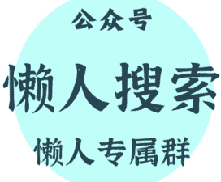

# 古巴，快撑不住了

260320 文/卢克文工作室嘉宾 风雨如歌

整理：公众号懒人搜索，懒人专属群精选

懒人微信:lazyhelper1


2026 年 3 月 16 日，古巴副总理奥斯卡·奥利瓦宣布，古巴将实施彻底的改革。

比如，允许海外流亡者回国投资、持有企业。

比如，简化外资审批流程。

比如，允许美元部分流通等等。

这是古巴建国以来，力度最大的改革，改革背后，是古巴快撑不住了。

## 01

古巴本次改革，最重磅的有三点:

- 允许海外流亡者回国投资企业，持有 100% 股份，拥有完整的经营控制权，领域覆盖旅游、制造、金融、零售、电商、基建、矿业等等;
- 外资/侨资企业可依法获得农业用地使用权，并可按商业规划变更用途，用地可抵押、可转让、可继承;
- 允许古巴侨民在古巴境内开设外币账户，不需要强制结汇，外币可在涉外超市、外汇商店和经济特区流通。

此前，海外流亡者，尤其是美国古巴裔，很难在古巴境内投资开设企业，要经过层层审批不说，即便投资开设，也不能拥有控制权，顶多持有 49% 的股份。

剩下 51% 的股份，必须由古巴国企或者合作社持有，且经营过程中，古巴侨民没有决策权，除了不能投资，也不允许侨民持股境内企业。

之所以这么严格，与古巴的国情有关。

古巴海外侨民主要有两拨人，一拨是 1959 年革命前统治古巴的权贵。

比如特朗普的好友、顶级富豪小阿方索·范朱尔，他父亲老阿方索就是独裁者巴蒂斯塔的亲信，古巴革命前，老阿方索是古巴糖业的掌控者。

另一拨，是 1959 年革命成功后，不认可古巴政府、选择离开的人。

对于上述两拨人，古巴政府向来警惕，实际上将他们视为敌人。但 3 月 16 日改革后，允许侨民控股境内企业，等于宣布他们不再是敌人。

第二项改革措施更是炸裂。

改革前，古巴土地归国有或集体所有，土地使用性质锁定，尤其是农业用地，外资企业只能租赁，租期最多 25 年，不能随意变更使用性质，不能抵押、转让。

以前种甘蔗的农用地，就只能一辈子种甘蔗，想改成旅游酒店、商业园区这类盈利性项目，根本想都不用想，土地价值完全被固化。

但改革后规则变了。

租赁期限不止 25 年，可以申请延长，相当于给投资者长期稳定的保障，还能变更土地用途，只要符合商业规划就能灵活调整。

不仅如此，土地还能当作抵押物融资，或是转让出去，甚至可以继承。

第三项改革措施，是承认经济部分美元化。

古巴实行严格的外汇管制，个人手里的外币要么换成古巴比索，要么只能藏在家里，不能正常流通，外汇完全由国家管控。

外币没法流通，那么市面上流通的货币，只能是古巴比索。

改革后，侨民不仅能持有外币，外币还能在涉外超市、外汇商店和经济特区流通，在这些地方，不需要古巴比索也能买东西了。

由于美元的强势地位，允许外币部分流通，会挤压古巴比索的流通份额。

上述改革措施属于炸裂级别。

旧势力回流，容易搅动本土政局；
土地制度放开，可能让外资蚕食核心资源；
承认经济部分美元化，会打击比索。

古巴政府不是不知道弊端，纯粹是没办法了。

## 02

古巴最大的危机，是能源短缺。

古巴每日能源需求约 12.5 万桶石油，低于这个数字，社会就无法正常运行。古巴自身的石油产能仅为 3 万桶，大部分得靠进口。

而古巴最大的石油进口来源，是委内瑞拉。

委内瑞拉有石油，缺教师、护士等基层服务人员；古巴的教育水平不错，每年能培养大量的教师、护士，但本国没有多少石油产量，因此双方存在互补的空间。

2000 年，查韦斯和卡斯特罗开始合作，古巴派医护和教师去委内瑞拉的贫困地区搞医疗、办教育，作为交换，委内瑞拉向古巴供应石油。

巅峰时，委内瑞拉每天向古巴供应 10 万桶石油，是古巴石油进口的最大来源，古巴向委派遣 3 万多名医护，建了上千个免费医疗中心。

2015 年后，双方合作的领域大幅升级，由单纯的民生交换扩展到敏感领域，古巴为马杜罗提供情报、安保等支持，帮他稳住政权。

马杜罗被绑走的过程中，委内瑞拉军队几乎没反应，古巴的安保人员倒是忠诚履行了职责，坚决开枪还击，三十多名古巴特工阵亡。

2019 年，两国的合作遭遇了巨大困境。

当年，特朗普大幅加强对委内瑞拉的制裁，禁止任何美国公司给“委内瑞拉国家石油公司”(PDVSA) 卖设备、卖零件、给技术支持。

委内瑞拉的油田设备老旧，很多设备都是上世纪 70 年代 -80 年代的产物，还能维持运转，全靠进口零部件，美国一断补给，油井就减产。

特朗普还宣布，哪个公司敢帮委内瑞拉运石油，就会被列入黑名单。许多航运企业，因此不敢承接委内瑞拉的石油运输订单，原油就算开采出来，也运不出去。

美国还切断了委内瑞拉的美元结算渠道，导致委没法正常收款和付款。

在美国制裁下，委内瑞拉石油产量大幅下滑。

2018 年，委内瑞拉石油产量平均 150 万桶/天，2020 年跌至 40 万桶/天。这 40 万桶不可能全部出口，因为国内有 30-35 万桶的需求。

从 2020 年起，委内瑞拉对古巴的石油供应，减少到每天 3 万桶左右。

古巴电网依赖石油发电。石油不足，发电量随着下降。

2021 年之前，古巴就算有停电，也多是局部短时故障，大规模、全国性的大停电极少，生活、生产还算正常。

2021 年后，停电频率急剧攀升，从区域性短时停电，慢慢演变成多地同步断电，再到全岛电网瘫痪，停电时长也从几小时拉长到数天。

尤其是 2024 到 2025 年，大停电成为常态。

2024 年 10 月至 12 月这短短三个月内，古巴接连发生了 3 次全国性大停电。

2025 年，全国性大停电多达 5 次，停电时间最长的一次，超过了 72 小时，首都哈瓦那九成区域陷入漆黑，交通、通信、供水全面停摆。

停电有电网老化的因素，但主要还是石油不足。

持续停电不仅打乱民生，更重创了古巴的工业。

作为古巴的金字招牌，雪茄生产全程离不开电力：烟叶烘干、发酵、卷制车间控温控湿、成品仓储保鲜等每一环，都需要稳定的供电。

大规模停电后，烘干炉停摆、发酵室温湿度失控，上等烟叶极易发霉变质；卷制工厂断电停工，流水线瘫痪，订单无法按期交付。

《路透社》报道，进入 2026 年，古巴雪茄工厂的开工率已不足 50%。

每年 2 月末，古巴都会举行“雪茄节”，这是雪茄行业一年一度的盛会，但 2026 年的“古巴雪茄节”，组委会宣布因燃料不足，无法举办。

古巴比索，在能源危机下也贬值严重。

2021 年，古巴货币改革后，规定比索和美元的汇率，为 24:1。五年后的今天，比索在黑市兑美元的汇率，已经跌到了 400:1。

经济危机导致人口外流，2021 年至今，已有超过一百万人离开古巴。有人说，委内瑞拉石油供应不足，古巴不能开辟其他进口来源？

放心，特朗普早已预判了这个预判。

不管古巴开辟什么进口来源，都得付钱，其他国家很难像委内瑞拉一样，同意“服务换石油”。

所以，古巴得有足够的外汇。

2019 年，特朗普启动了《赫尔姆斯 - 伯顿法》的第三条（后面简称：第三条）。

1959 年古巴革命后，古巴政府没收了一批美国企业/个人在古巴的财产。“第三条”针对的就是这一点，任何个人或公司，只要使用、投资、经营这些财产，或者从中间接获益，美国人就可以起诉，并进行索赔。

## “第三条”有多狠？

举个例子。

2015 年，奥巴马政府放宽对古巴的制裁措施，缓和与古巴的外交关系。嘉年华、皇家加勒比、诺唯真、地中海四家邮轮公司看到了机会，进军古巴市场。

可特朗普上台后，推翻了奥巴马的对古政策，2019 年更是启动了“第三条”。

四家邮轮公司停靠的哈瓦那码头，1959 年革命前，是一个美国公司的资产，这下直接撞了枪口。2023 年，美国佛罗里达联邦法院判定四家公司违法，每家都被罚了一亿美元。

法院的依据，就是“第三条”，虽然你们四个公司，没有运营码头，也没有获得股份，但你们停靠了，停靠就是间接从中受益。

按这个判决范围，外资几乎没法在古巴做生意。

你和古巴做个生意，买古巴的产品，说不定美国人也要起诉你。毕竟，给工厂供电的电力系统、运输的道路，当年美国人修过不少。万一美国人说你间接从中获益，咋办？

“第三条”导致许多外资不敢进入古巴，也不敢和古巴做生意，古巴经济受到重创，外汇储备不断减少。

古巴前经济部长何塞·路易斯·罗德里格斯透露，2019 年古巴外汇储备为 115.28 亿美元，两年后的 2021 年，下降到 25 亿美元。

到 2026 年，外界普遍预计，古巴外汇不足 5 亿美元，仅能支付一到两个月的进口（古巴不公布外汇储备数字，外界只能猜测）。

外汇枯竭，就无法进口太多石油。

2026 年 1 月，马杜罗被美国绑架，委内瑞拉变天，来自委内瑞拉的石油，中断了。一个月后，古巴另一个石油来源地墨西哥（占石油总进口的三成），也在美国压力下中断了对古巴的石油供应。

这下，古巴的能源进口，彻底被切断。

## 古巴现在窘迫到了什么地步？

3 月 13 日，古巴领导人迪亚斯·卡内尔在全国电视讲话中透露，2026 年，古巴总共只收到两船的燃料。

没错，就两船。

3 月 15 日，古巴又又又又爆发了大规模停电，受影响的人口超过一千万。推出三项重磅改革，就是被逼得没办法。

- 放开侨资控股，吸引海外古巴裔回国建厂；
- 99 年租期的土地政策，吸引海外古巴裔回国搞开发，换来真金白银投资；
- 放开外币流通，让侨民敢把外币带进古巴花。

这一切，都是为了搞到外汇，哪怕动摇国本，也顾不得那么多了。

3 月 16 日，特朗普表示，将以某种形式接管古巴。

这意味着，古巴很可能要变天了。

## 03

古巴能硬扛美国几十年封锁，本就是个奇迹。

冷战时期，靠着苏联撑腰，这个紧挨美国的小岛，奇迹般生存了下来。可苏联解体那一刻，古巴政权的生命就进入了倒计时。

能苟延残喘至今，还得感谢委内瑞拉和墨西哥。有人会为古巴感到惋惜，但现实就是如此残酷。

古巴的死穴，是离美国太近，近到美国想施压、想制裁都不费吹灰之力；古巴离其他大国又太远，远到援助古巴需要付出极高的成本。委内瑞拉的遭遇同理。

南美是美国后院，美国奈何不了万里之外的伊朗，但收拾自家后院的本事，还是有的。

这不是单纯的溃败，而是地缘政治的规律。

## 分割线

绝大多数人只盯着眼前的工资，却不知道一次远在中东的冲突、一次降息的决议，就能在一夜之间洗牌普通人的财富。

看懂宏观，是为了在周期切换时，不被当作代价。

如果你认同这种“抬头看路”的长期主义，欢迎围观我的个人情报智库：【懒人专属群】。

圈子已稳定运行 7 年。我们每天过滤全网最顶级的政经内参、大 V 付费研报，剔除情绪噪音，只保留能指导资产配置和商业决策的真实信号。做你最冷酷的“外部大脑”。

⚠️□ 查阅圈子最新宏观内参目录：

```
https://hk57gvlx7u.feishu.cn/docx/H0kRdZbSboIBR0xkaXtcuVE0nTg
```

拒绝伸手党，只识有缘人。扫码加我微信，备注：【破局上车】




微信：lazyhelper1