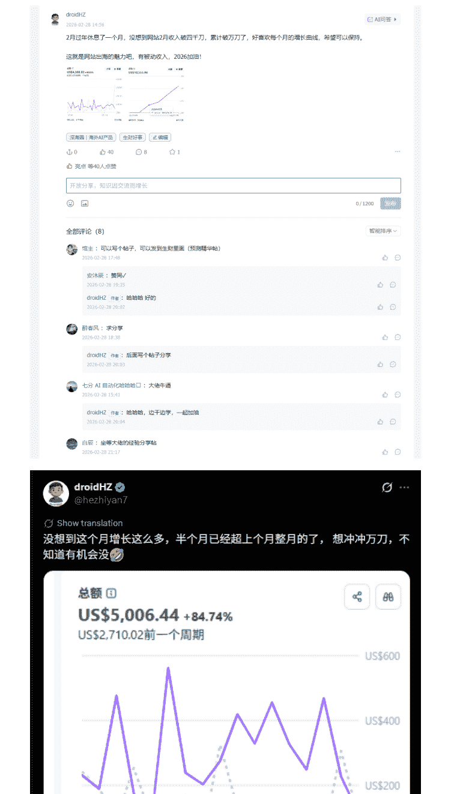
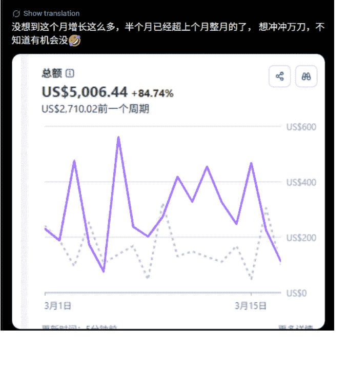
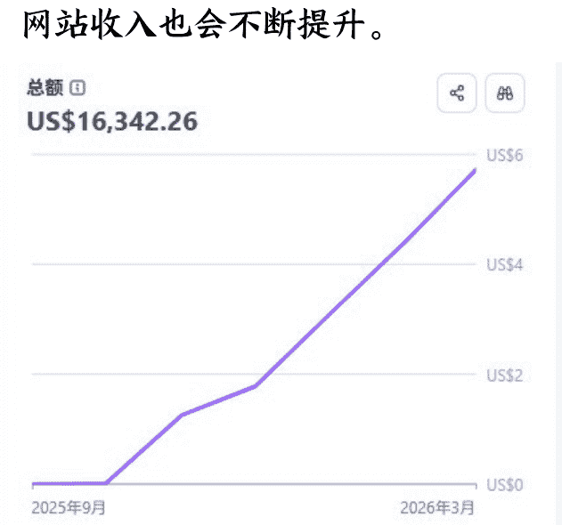

# 从焦虑到跑通：我如何靠 AI 网站出海赚到第一个 1 万刀

20240323 副业 SC 精华

公众号懒人搜索，懒人专属群独享

懒人微信：lazyhelper1

## 一、目前的进展

大家好，我是赫兹！

去年 5 月份参加小排老师的深海圈海外产品，正式开始了 AI 网站出海之旅，目前是 AI 网站出海了 10 个月，前半年基本没什么收入，非常的焦虑，在出海半年的时候是终于赚到了第一个 1000 刀，后续每个月也在增长，目前累计是破万刀了，二月的时候有在生财好事报过喜，看大家建议我写一篇帖子分享，所以就来分享一下我的网站出海复盘。

如果你正在考虑 AI 出海，或者已经上路但还没拿到结果，希望我的经历能让你少走一些弯路。

## 二、为什么选择 AI 网站出海

在爱奇艺做了几年 App 开发，技术能力够用，但一直有个念头：想做自己的产品。

离职后想清楚了几件事，让我选了"AI + 海外"这条路:

AI 降低了个人开发者的门槛。以前一个人做产品，从前端到后端到设计，怎么也得几个月。现在借助 AI，开发上线一个站的时间大幅缩短。而且 AI 本身也在创造新需求——很多老网站、老工具，都值得用 AI 重新做一遍。

海外市场更适合小产品。用户习惯了订阅付费，Google 生态好，网站依然是主流入口。而且海外物价高，同样的工具定价空间更大，赚的是汇率差。

软件的边际成本几乎为零。只要找到一个持续有人用的需求，一个人维护一个站，理论上可以“养站防老”——这是我最心动的一点。

## 三、我的心路历程，充满希望->焦虑迷茫->终于跑通->持续优化

### 第一阶段 (5-7 月): 一切都充满希望

刚开始那三个月，每天都像打了鸡血。

报了小排老师的深海圈和哥飞老师的社群，每天都有新认知输入。学选品、学 SEO、学建站，感觉到处都是机会。那时候的心态很简单:"AI 出海形势一片大好，我肯定能行。”

这个阶段做的事主要是打基础：跟着社群高强度学习、学方法论、熟悉工具链、试着上第一个站。

### 第二阶段 (8-10 月): 焦虑和自我怀疑

转折从第四个月开始。

好的方面是，参加了深海圈的黑客松，2 个项目进入决赛，一个是表情包一键制作，一个是 Wan 视频模型的新词网站，表情包网站拿了奖，也零星出了一些单，绝大部分还是国内的用户。但坏的方面更扎心：大多数项目毫无反响，偶尔的出单也不持续。

那段时间的情绪，大概是这样的：

- 明明每天都在努力，却看不到任何成果
- 看到别人出海月入几千几万刀，越看越焦虑
- 很怕自己做的是伪需求，但又不甘心放弃
- 甚至怀疑自己是不是不适合做产品
- 每天在"应该坚持"和"是不是方向错了"之间反复横跳

记得有天晚上 10 点，发现一个新词的需求，加班加点 5 个小时上线了，满心欢喜地期待第二天，结果第二天看没什么数据，突然就很心累，很迷茫，颓废了好几天，同样的时刻那段时间有太多了。这种迷茫不是"我不知道怎么做"，而是"我照着方法做了，却没有结果。"

### 第三阶段 (11-12 月): 终于跑通了

虽然焦虑，但有些事我一直没停：每个月还是会一些新站，办了香港银行卡给 Stripe(海外收款工具) 做准备，为了推广产品，我跟着生财的推特航海，把我的推特账号做起来，这个账号也给我带来了接近 2 万的商单收入，也为了倒逼自己学习，跟着生财的垂直小号航海，把公众号做起来。这 2 个账号加起来也上万粉了，也完全是网站出海相关的内容，主要是为网站出海赋能。

11 月初转机出现了，终于跑出来一个网站。它开始有用户了，而且有人付费了，这个不像之前表情包那个网站的付费，大部分是国内的用户，是实打实的海外用户，我赶紧围绕这个站继续做优化：

去看 Clarity 上用户的录屏操作，他用到那里他就不去使用了，就思考用户为什么不使用了，发现了一些 BUG，也提升了一些体验。

刚好也有推特的商单，我就把商单收入也买付费外链了，后续网站订单的收益也去买付费外链了。没想到那个月网站收益就破千刀了。

### 第四阶段（24 年 1-3 月）：持续优化，稳步上升

网站跑出来了，我就想办法不断去获取流量。

- 首先是投流，我去看找了和我网站契合的一堆关键词，然后试着每天投个几十块钱，开始投流也同样煎熬，钱白花花的流出去，没有收益，但是大家都说初期是学习期，是要花钱，有了这个预期我就坚持下来了，没想到真的过了一段时间收益就打正了，然后我就慢慢的加大投流的预算。
- 然后是不断加内页，加外链的策略，SEO 的流量会慢慢多一些，而且有些外链本身也自带流量。
- 尝试社媒推广，我又学着去发 YouTube，注册了英文推特去进行推广，也带来了一点点流量。

**随着用户的积累和流量的增加，网站收益也稳步提升，还挺喜欢我网站的增长曲线的。这个阶段我觉得比较重要的是转化率和留存。**

- 关注用户各个环节的转化指标，比如 访问->登录->成功体验功能->付费，然后找到转化率高的流量渠道，想办法去扩大。
- 做好用户留存，用户留下来了，即使流量规模不怎么变，不断有新用户进来，你的网站收入也会不断提升。

## 四、对 AI 出海门槛的真实感受，需要哪些能力

想对还没拿到正反馈的朋友说一句：AI 出海的门槛，真的比看起来高很多。

一个人要做产品、写代码、搞运营，每件事都不简单。

你没拿到结果，不代表你不行——这条路本来就没那么快，也没那么容易。

在这段迷路期，我慢慢理解了一个道理：出海不是学一次就会，而是做一次失望、做十次焦虑、做百次才看见一点点希望。

我把这半年的体会总结成两个层次：基本功和内功。

基本功是别人已经总结好的方法论，照着做就能少走弯路。内功是在实战中踩坑、复盘、沉淀出来的判断力。

拿产品举例：

- 基本功：找到用户需求 → 理解动机 → 做出功能 → 梳理 UI。这些有框架可以学。
- 内功：判断这个需求是不是"伪需求"、是不是投入产出比很高的需求、找到用户真正愿意付费的点、做减法让产品更聚焦。这些只能靠实战积累。

一句话总结就是——从"会做功能"进化到"会做让用户付费的功能"。

开发和运营也是同理：

- 开发的内功不是把技术做复杂，而是用技术把事情做简单。
- 运营的内功不是做很多事情，而是做对事情。

### 再谈一个很实际的门槛：很难挣到第一块钱

不像很多其他项目，网站出海挣到第一块钱，很不轻松，我知道很多朋友就是因为长时间没有正反馈，而放弃的。

所以我建议大家尽可能想办法提速挣到第一块钱的过程，挣钱=流量*转化，想要挣到钱，首先就需要一定的精准流量。

流量不是被动的等待 SEO，可以考虑的方式有：

- 去找到这个需求的用户人群在哪里，尝试让你的产品去触达到他们，可以是推特、YouTube、TikTok、Reddit 推广宣传等
- 试着花钱买一些有流量的付费外链，不仅能带来 SEO 的提升，也可以带来一些实打实的付费用户
- 尝试低成本的投流，每天投几十块钱，看一段时间时间内能不能有用户付费。

这个过程尝试去花一下钱、省下你的时间，花钱=省时间=省钱，不要让你在漫长的等待中放弃。为了挣到第一块钱，可以探索各种方式获取流量，和你网站相关性越相关越好，当后续验证了很多方式之后，找到效果比较好的方式加大力度的投入，ROI 低的方式就暂时放弃投入。

想要提升转化，需要拆分到流量和产品的优化。

- 流量端：尽可能是去挖掘精准人群，比如有这个需求的用户需要搜索什么词，这些人群一般在哪里讨论，人群越是精准，转化率也会越高。
- 产品端：多研究对标网站，他们的交互设计是经过验证的，这个也是属于我们的后发优势。要花时间去查看用户在 Clarity 上的录屏操作，用户是否能够很丝滑地使用你的产品，产品是有 BUG 之类的。增加上 Crisp 客服聊天框，用户遇到问题也可以很方便的反馈。

## 五、整个网站出海流程是什么样的

我是做网站出海，我老婆做小红书电商，但是感觉我们的底层逻辑是差不多的，是一个"选、看、测"的流程。

### 第一步：选——找需求

需求从哪里来？四个方向：

#### 搜索即需求。

用户的搜索解决方案就代表着他有这方面的需求，可以基于词根找到很多的搜索词

- Google Trends 基于词根找到最近飙升的词根
- Similarweb 的关键词生成器找到新的搜索词
- Google 搜索下拉词，相关搜索词
- AITDK 插件查看一些网站的 top 搜索词

#### 从痛点找。

- 自己遇到的卡点，你自己本地就代表着一群人。
- 身边人重复抱怨的问题
- Reddit 和 Twitter 上的吐槽帖。能让人抱怨的，通常是有需求的。

#### 从市场找。

- 去 Fiverr、Upwork、闲鱼看别人在卖什么服务——能不能用 AI 实现？
- 看榜单上已经赚钱的产品 (经过市场验证的真需求)。
- 然后去看它们的差评——差评就是你的切入机会。
- 还有一招“暗影复刻”：复刻大产品 20% 的核心价值，补上用户一直想要但大厂没排期做的功能。

#### 从技术突破找。

- 每次 AI 模型升级都会带来新场景。
- GitHub 上新开源的项目，也可以包装成产品。
- Hugging Face 的新模型，也可以监测第一时间发布这些消息的信息源

公众号懒人搜索，懒人专属群分享

- 迁移需求：某个平台有这个需求（比如 YouTube 有视频下载器），新平台出现后（比如 TikTok），很可能有同样的需求。

找到需求后，问自己五个问题：什么人？什么场景？愿意花多少钱？解决什么问题？我需要多久能做出来？

### 第二步：看——分析对标

找到方向后，别急着动手，先看三样东西：

- 搜索量：用 Semrush、Similarweb、Google Trends 看这个关键词有多少人搜。搜索量太小，说明市场太小。
- 竞争度：关键词难度（KD 值）高不高？排名前几的网站实力如何？如果前排都是大站，新站很难挤进去。可以用 `allintitle:` 搜索语法（在 Google 搜索框输入 allintitle:你的关键词），看有多少网站在标题里用了这个词，数量越少竞争越小，可以用 KGR 公式去评估一下竞争度。
- 竞品产品：看对手的功能怎么实现的，想清楚自己哪里能超过他。也可以通过他的流量大致估算收入，判断值不值得做。

KGR = allintitle 搜索结果数 / 月搜索量

### 第三步：测——上站看效果

初期不用太纠结完美需求。找一个差不多的方向，先把站上了，边做边学。

我日常用 MkSaas 模板建站，流程大概是：

- 1. 复制模板 → 推到 GitHub → 本地跑起来
- 2. 配好环境变量 (数据库、登录)
- 3. 先部署上线 (用 Vercel，这步要尽早做——避免功能做了一堆，部署时才发现服务端跑不通)
- 4. 改落地页 (围绕核心关键词生成文案，注意关键词密度)
- 5. 接统计 (Google Analytics + Plausible + Clarity)
- 6. 绑域名，提交搜索引擎 (Google/Bing/Naver 等。域名早上线可以早拿排名)
- 7. 打磨功能 (接入 API，参考竞品，在首页加上 AI 能力)
- 8. 接支付 (设定价格策略，测试环境跑通后再提交审核)

我现在这样一套流程下来 3-5 小时可以上线一个网站，我看有人可以做到十几分钟上线，现在像小夏提效这么多，我后续也有考虑慢慢更自动化一些。

## 六、AI 出海网站变现模式和变现效率

网站出海常规的变现方式有 2 个，广告、订阅。

广告变现一般是接入 Google AdSense，靠用户的浏览和广告的点击获取到收益。订阅是靠给用户提供服务，让用户在产品内购买服务，可以使用 Stripe、PayPal 这些方式去进行收款。

### 不同的变现模式，需要的流量差异比较大

一个比较直观的例子是网站出海想要月入万刀，通过广告变现可能要百万的流量，通过订阅可能只要几万的流量，我有一个朋友的产品，2000 左右的月访客，几千刀的月收入，不同的变现方式，所需要的流量是完全不一样的。

#### 泛流量 vs 精准流

不只是网站开发，很多领域也是这样的，可能几百万的大博主还没有几万的博主变现多，大多情况应该就是泛流量和精准流量的差异。有些朋友可能会去追大词，比如：free ai tools 这种词流量很大，但转化率通常很低。而比如 ai image to video generator，用户是带着需求来的，是精准流量，转化率会高很多。

#### 看 cpc(广告点击成本)

一般来说：CPC 越高，商业价值越高。比如：

- free 类关键词 → CPC 低 → 转化低，如果你赠送积分，可能还会让你亏更多的
- generator 类关键词 → CPC 高 → 转化高

#### 定价策略

有些时候，需要多研究一些定价的策略，看看对标的定价，对提升收入也有帮助，而且定价这个东西可能有些矛盾，需要自己去多实践

- 高定价，更少的客户可能带来更高的收入，低定价，可以吸引更多的用户，也可能带来更多的收入。
- 多赠送积分，让用户体会到产品的 Aha 时刻，用户可能会下单。少赠送积分，让用户不得下单。
- 通过一些页面展示，让用户心里有锚点，可以让用户选择价值更高的套餐或者年费套餐。
- 通过限时折扣，促进用户下单。
- 联盟分销，吸引用户去帮你宣传推广。

## 七、出海工具分享

半年下来积累了一些常用工具，按用途分类列在这里：

| 用途 | 推荐工具 |
| :--- | :--- |
| 域名查询/购买 | • 查看是否注册 instantdomainsearch.com query.domains • 域名黑历史查询 virustotal.com • 域名购买 namecheap spaceship，购买时可以搜索或者问 GPT 要优惠码 |
| 建站/部署 | GitHub + Vercel + Cloudflare |
| 数据库 | Supabase、Neon |
| 邮箱 | Resend |
| 支付 | Stripe、PayPal |
| AI 模型平台 | https://fal.ai/ https://replicate.com/ https://openrouter.ai/ https://evolink.ai/ https://apimart.ai/ https://kie.ai/ https://zenmux.ai/ |
| SEO 分析 | Semrush、Similarweb、Google Trends - https://ahrefs.com/free-seo-tools - https://ahrefs.com/traffic-checker/ - https://ahrefs.com/keyword-difficulty - https://ahrefs.com/keyword-generator/ - https://ahrefs.com/backlink-checker |
| SEO 插件 | AITDK、Ahrefs Toolbar、Trends Bar、Sitedata |
| 外链聚合网站 | https://mkdollar.com/backlinks https://directories.bestaitools.com https://bestdirectories.org/ https://directoryfame.com/ https://www.aidirectori.es/ https://egolinks.online/@backlinks https://aimaker.dev/directory https://sopilot.net/zh/submitdir https://airtable.com/app6WsYicEr5MkkHk/shrEUi0XaQo45mtW5/tbl6p2LCcADKDnm0P https://potent-measure-3lf.notion.site/l4368f418f50804ba419d3ce7a333fa8?v=l4368f418508191a695000c6fcd329a |
| 数据分析 | Google Analytics、Plausible、Clarity、GSC |
| 客服 | Crisp |

## 最后

种一棵树最好的时间是十年前，其次是现在。

网站出海就是种树——多种、多浇水、多施肥，时间到了自然有果实。

还有一句话送给和我一样还在路上的人：

人不是慢慢赚到钱的，是突然赚到的。但那个“突然”，建立在之前所有看不到回报的积累之上。

## 分割线

看完这篇 SOP，你觉得你懂了。但 90% 的人一到实操就会卡在第一步。

工具和教程只是最低级的壁垒，真正的壁垒是“立刻动手”和“圈层信息差”。

如果你想看全网最新的变现玩法，并且和一群执行力极强的极客一起下场拿结果，欢迎围观我的核心私域：【懒人专属群】。

我们不聊虚的，只做商业闭环的拆解与 AI 效率的压榨。系统内已沉淀 1000+ 跑通的套利实战局。

👉 查阅圈子完整数字资产与上车门槛：

https://lazyso.com/insider/

认同价值、准备好下场干活的，扫码加我微信（lazyhelper1）

微信：lazyhelper1

### 备注：【实操上车】，不闲聊