# 从累计九千万播放到月均百亿播放：和大家在 YouTube 做 AI 视频的这一年

## 260323 副业 SC 精华

公众号懒人搜索，懒人专属群独享

懒人微信：lazyhelper1


大家好，我是 Gary，和波妮一起担任生财 YouTube 深海圈的总教练，也是过去 5 次 YouTube 航海的航海教练。

不知不觉间，和大家在 YouTube 走过了一年多的时间，去年 3 月 YouTube 深海圈启动，到现在刚好一年整，是时候来做一个年度复盘了。这篇文章带大家回顾这一年里 YouTube AI 内容创作的跌宕起伏，也会对大家感兴趣的问题给出答案，比如：一年过去，圈友们到底赚了多少钱？现在做得怎么样？

这么多人进场，YouTube 红海了吗？听说最近同质化与限流严重，AI 内容还能做吗？

2026 年，YouTube 还有什么机会？AI 视频还有什么机会？深海圈接下来的重心在哪里？

当然更重要的，还是承前启后，对过去一年的经验做好总结，并对未来这一年的方向与机会做一轮梳理，为在做或对 YouTube、AI 视频创作感兴趣的圈友提供一个更全局的视野与参考，为一直在持续深耕 YouTube AI 内容创作的圈友提供一点心力支持和思路上的引导。

### 1. YouTube 深海圈年度成绩汇报

首先，想和大家分享，优秀的深海圈友们在这一年里取得的成绩：

- 1100+ AI Video 创作者，500+ 账号已加入 YPP（YouTube Partner Program）
- 银奖频道 (10 万 + 订阅) 超过 100 个、金牌频道 (100 万 + 订阅) 超过 10 个
- 日均总播放量 5 亿 +，月均播放量 100 亿 +，收录在册的单视频播放量最高作品超过 12 亿播放，长视频最高超过千万播放
- 来自圈友的作品多次登上 ViewStats（YouTube 权威数据榜单）Shorts 月榜与周榜前十名，多次占领 YouTube 泛娱乐类热门关键词榜首
- YouTube 带货 GMV 超过 200 万美金，YouTube 变现超过 100 万美金
- 在生财发布的 YouTube 相关精华帖近百篇，4 篇超级术

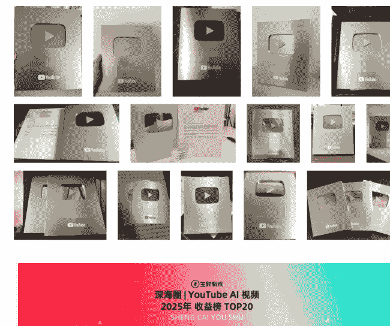

| 排名 | 星球昵称 | 星球编号 | 收益 (单位：美元) | 收益 (单位：人民币) |
|---|---|---|---|---|
| 1 | 鬼哥 | 137230 | $6.0 万 | ¥41.8 万 |
| 2 | Zero | 80974 | $5.0 万 | ¥34.8 万 |
| 2 | Ace | 153832 | $5.0 万 | ¥34.8 万 |
| 4 | 张小铺 | 104187 | $4.4 万 | ¥30.6 万 |
| 5 | 猫大人 | 62949 | $4.1 万 | ¥28.5 万 |
| 6 | 李香君 | 123239 | $4.0 万 | ¥27.8 万 |
| 6 | 四水年华 | 195233 | $4.0 万 | ¥27.8 万 |
| 8 | 六只猫 | 155804 | $3.4 万 | ¥23.7 万 |
| 9 | 张九月 | 25336 | $3.0 万 | ¥20.9 万 |
| 10 | Geektao | 3228 | $2.7 万 | ¥18.8 万 |
| 11 | 明媚 | 55112 | $2.2 万 | ¥15.3 万 |
| 12 | 清清又雨声 | 33217 | $2.0 万 | ¥13.9 万 |
| 12 | 【昵称隐藏】 | 【编号隐藏】 | $2.0 万 | ¥13.9 万 |
| 12 | Do_no | 137726 | $2.0 万 | ¥13.9 万 |
| 15 | 晓元 | 30161 | $1.8 万 | ¥12.5 万 |
| 16 | 波哥 | 18907 | $1.5 万 | ¥10.4 万 |
| 16 | 海洋 | 26083 | $1.5 万 | ¥10.4 万 |
| 18 | 木子先生 | 59653 | $1.2 万 | ¥8.5 万 |
| 19 | 翔哥 | 29631 | $1.2 万 | ¥8.4 万 |
| 20 | 【昵称隐藏】 | 【编号隐藏】 | $1.0 万 | ¥7.0 万 |
| 20 | 【昵称隐藏】 | 【编号隐藏】 | $1.0 万 | ¥7.0 万 |
| 20 | 【昵称隐藏】 | 【编号隐藏】 | $1.0 万 | ¥7.0 万 |
| 20 | 【昵称隐藏】 | 【编号隐藏】 | $1.0 万 | ¥7.0 万 |
| 20 | 【昵称隐藏】 | 【编号隐藏】 | $1.0 万 | ¥7.0 万 |
| 20 | 【昵称隐藏】 | 【编号隐藏】 | $1.0 万 | ¥7.0 万 |

今年 1 月，我们举办了首次万刀圈友闭门会，现场波哥、六七、明媚的三篇分享文稿都获评精华帖。

### 生财深海圈

### >>>> YouTube 万刀闭门会

一起生财有术，一起 YouTube 赚美金

深圳·南山

### 大会议程

#### 2 月 1 日

下午场

- 13:30 签到
- 14:00 总教练 方波妮 主持人开场
- 14:15 总教练 Gary 曹淦
    分享主题：2026 年 YouTube 新趋势&深海圈规划
- 15:50 万刀收益 明媚
    前 UI 设计师，现全职 Youtuber
    分享主题：从模仿爆款到设计爆款：历时 5 个月，获 8 亿 + 播放量 两个银牌，2.5w 美金收益
- 16:40 万刀收益 Agnes.
    前武汉高校老师 现全职 Youtuber
    分享主题：原创 IPX 亿播放：半年获 5 亿 + 播放量 1w+ 美金收益
- 17:20 大合影

公众号懒人搜索，懒人专属群分享


**Agnes · 02-09**
精华原创 IP 油管跑出 5 亿播放，我在深海圈交出的第一份“万刀”答卷
大家好，我是六七。2024 年 11 月加入生财，2025 年 7 月加入油管深海圈，之前在武汉一所高校工作，现在全职做油管半年。目前有 3 个高级 YPP。在深海圈里，我没有过人的天赋，也没什么爆棚的创意。这半年累计 1 万刀的收益，在各位月入万刀的大... 7 199 17 64 YouTube 自媒体 IP

**杨爽@生财有术 · 02-06**
精华过年期间悄悄赚钱的项目实操分享：千问拉新、视频号特效分成、YouTube ...
这阵子掀起了一阵风，说是现在都流行“年后再说吧”，但如果从项目的视角来看，反而是现在这段时间，冒出来的机会特别多。元宝分 10 亿、千问分 30 亿、支付宝在那边集福、各家平台都在上红包... 7 154 16 33 视频号 YouTube 官方活动

**明媚 · 02-06**
精华从 0 到 8 亿播放量、2.2w 刀收益，我的 Youtube AI 视频创作起步转折复盘
大家好！我是明媚，一个全职做 Youtube AI 视频的自由职业者。从 2 月份开始摸索 AI shorts，9 月份开通收益，到目前共达到 8 亿多的播放量，总收益 2.2w 刀。非常感谢生财、感谢亦仁的超级标、感谢深... 39 198 27 72 YouTube AI 视频 出海

**波哥 航海家 · 01-09**
精华 1 年 9 次迭代:YouTube 长视频终破 1000 万播放
大家好，我是波哥。5 月份开始做长视频，此视频从 8 月中旬发布到 12 月底跑了 4 个多月达成千万播放。感谢生财，感谢亦仁老大的超级标，从最开始的迷茫选项目到坚定的要出海 YouTube! 感谢@... 35 224 36 34 YouTube 出海 龙珠暴富

而在一年前的 1 月份，从一百位参与私教陪跑的圈友中收集上来的 70 多份问卷，加起来一共 9000 万播放。

| 人数 | 频道数 | 初级 YPP 数量 | 高级 YPP 数量 | 订阅数 | 播放量 | 人均播放量 |
|---|---|---|---|---|---|---|
| 75 | 138 | 4 | 3 | 307422 | 90106262 | 1201417 |

还有这些大家也许很熟悉的圈友与精华帖：

**关于 AI shorts:**

- @四水年华 语言类 AI shorts，单频道月收益超过 2 万美金

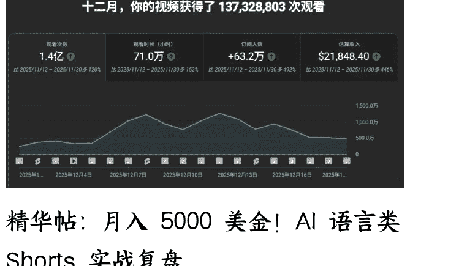

### 精华帖：月入 5000 美金！AI 语言类 Shorts 实战复盘

https://scys.com/articleDetail/xq_topic/22811822251121221

- @Tugo 两个月收获 2 亿播放，我如何确定工作流，复盘拆解。

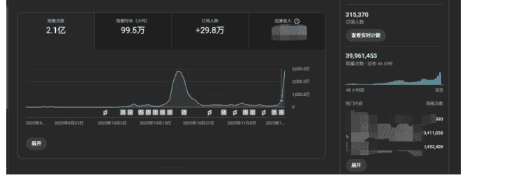

### 精华帖：

https://scys.com/articleDetail/xq_topic/45811845844822418

**关于长视频：**

- @波哥 深海圈波哥教练 单条 AI 长视频千万播放，接近 6000 美金收益

### 精华帖：1 年 9 次迭代：YouTube 长视频终破 1000 万播放

https://scys.com/articleDetail/xq_topic/82811258484841252

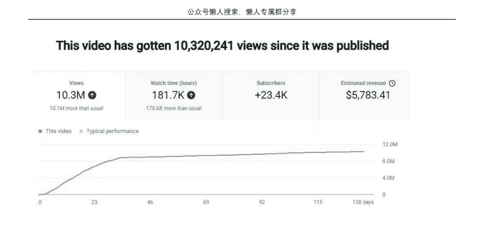

- @怅惘 深海圈怅惘教练 弱画面长视频矩阵频道，单频道 2500 美金月收益

精华帖：如何让每个人都能通过 AI 傻瓜式模仿一个 Youtube 频道？

https://scys.com/articleDetail/xq_topic/8852445442481842

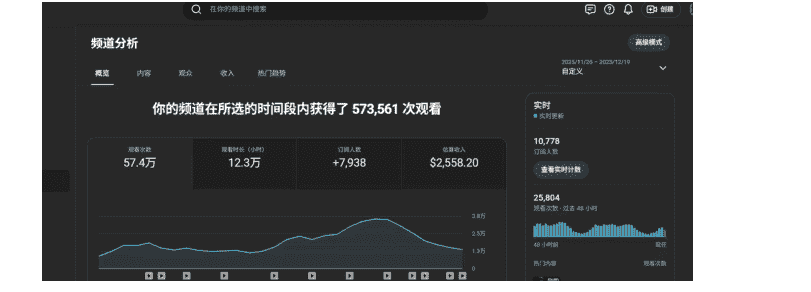

- @运气选手走得远 深海圈运气选手走得远
圈友 220 万播放 AI 长视频，收益 4000 美金

精华帖：

https://wx.zsxq.com/group/l824528822/topic/l524115488251212

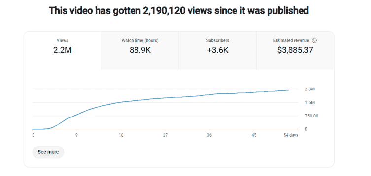

公众号懒人搜索，懒人专属群分享

### 关于带货:

- @四水年华 圈友，单月 GMV19.3 万美金，佣金 4429 美金，活动激励 1400 美金


- @张九月 圈友，单月 GMV5 万美金，佣金超过 800 美金


更多案例与数据，大家也可以在生财官网的生财好事、精华帖中了解，完全公开透明，篇幅所限这里只能贴出一部分。可以自信地说，这一年下来，生财有术 YouTube 深海圈，毫无疑问是全网在 YouTube AI 内容这个细分赛道里信息密度与信息价值最高的社群，你能在这里看到最多、最前沿的真实案例与干货分享，如果看到这里的圈友也曾从中受益，可以留下你的评论，是哪一篇文章、哪一次分享、哪一位圈友或教练带给你的启发最大，期待看到更多属于大家的故事。

## 2. 跌宕起伏，一年间的风口与挫折

在过去一年里，我们确实幸运地踩中了不少风口，但同时，这一路上遭受过的挫折与困难，也远比各位想象的要更大。分享完成绩与喜悦，想带大家回顾一下，过去这一年里，我们一起经历过的风口与挫折。

#### 2025 年 1 月（春节）：第一次风口，直播量产 YPP。

春节期间，当时我和波妮在机缘巧合下开发出了 YouTube 直播玩法，并且测试后发现通过直播完全可以低成本量产 YPP，于是快速整理出 SOP 分享给了当时私教陪跑的圈友，从一月中旬到二月底，私教陪跑的 104 人里跑出 107 个 YPP，除了当时的劳模【达人秀】和【动物示警】赛道，很大一部分功劳，都要归功于直播。

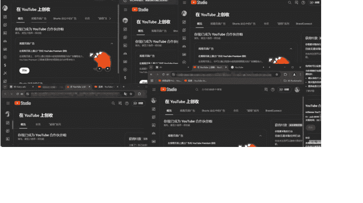

#### 3 月：深海圈启动，从开 YPP 到拿收益的艰难过渡

在 3 月，虽然很多人开通了 YPP，但走了捷径，大家普遍还是缺乏做爆款的能力，流量起不来，收益就上不去。

这是深海圈的艰难起步期，很多方向都只能靠摸索，所以 3 月，我们一边进一步验证 YPP 量产的方法论，一边探索 shorts 和长视频的更多方向，也确实发现了一些新赛道。

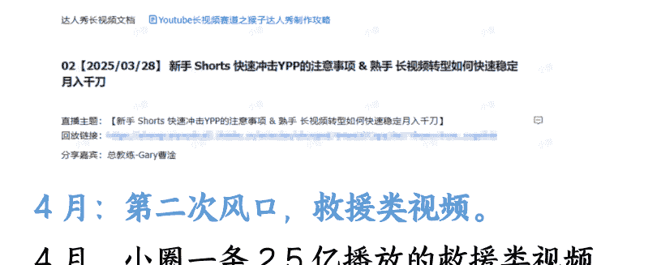

#### 4 月：第二次风口，救援类视频。

4 月，小圈一条 2.5 亿播放的救援类视频震惊了圈子内外，单视频收益 1850 美金，大家开始把重心转向短视频，摸索兼容不同赛道的爆款方法论。各种玩法开始被验证——哪些方向能跑，哪些方向是坑，慢慢有了轮廓。

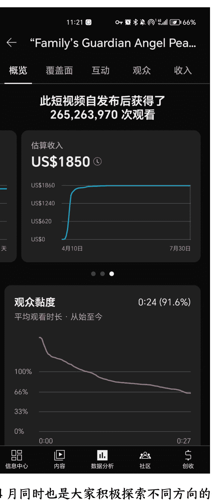

4 月同时也是大家积极探索不同方向的一个月，四周四场直播覆盖了 4 个不同方向，从短视频的爆款方法论，到 AI 微电影、AI 自媒体、AI 数字人，随着 shorts 赛道的认知变得成熟，4 月的问卷统计，和 1 月相比，大家的播放量已经有了巨幅的增长——收益仅 3 万多刀，用现在的眼光来看，这仅仅是现在语言类赛道单账号一个月的收益，可见当时多么不容易。

### 03【2025/04/11】爆款元素重组打法斩获多个千万爆款

直播主题：【爆款元素重组打法斩获多个千万爆款 & 油管 xx 申诉攻略 & AI 应用推广】
直播回放：https://meeting.tencent.com/cw/KPGEMO7W3b
分享嘉宾：总教练-Gary 曹淦; 总教练 - 方波妮; 教练-ISland

### 04【2025/04/18】十倍回报 AI 商业微电影项目落地分享

直播主题：【AI 或将颠覆传统电影制作：我的 10 倍回报 AI 商业微电影项目落地分享】-上 https://shengcaiyoushu01.feishu.cn/minutes/obcnx182858js1p9pvxrp2s4?from=from_copylink
直播主题：【AI 或将颠覆传统电影制作：我的 10 倍回报 AI 商业微电影项目落地分享】-下：https://meeting.tencent.com/cw/2jgw4vVbfa
分享嘉宾：裘裘笔记

### 05【2025/04/25】AI 自媒体从 0 到 1 入门分享

直播主题：【海外 AI 自媒体市场现状解读&AI 自媒体从 0-1 入门分享@贺小波@汤姆 cc】
直播回放：https://shengcaiyoushu01.feishu.cn/minutes/obcn3sjae6w99o5148gz7436?from=from_copylink
分享嘉宾：贺小波、汤姆 cc
直播文档：【YouTube】从 0-1 做一个 AI 自媒体视频

### 06【2025/04/29】数字人赛道新玩法分享

直播主题：【JOGGAI 功能讲解与演示&数字人赛道新玩法分享&如何傻瓜式复刻爆款视频】
直播回放：https://meeting.tencent.com/cw/UR8EE7819
分享嘉宾：优秀圈友 - 邢冬冬; 教练 - 李香君
直播文档：
- 深海圈直播 - 数字人玩法分享 (第一期) 深海圈 0429 直播 - 数字人玩法分享 (第一期)
- 0429 直播思维导图 深海圈直播 0429
- 李香君教练：如何傻瓜式的进行油管爆款视频复刻 如何傻瓜式的进行油管爆款视频复刻

### 深海圈成员洞察报告

基于 116 份 有效成员问卷 | 最后更新：2025 年 5 月 3 日

### 数据概览

| 总运营频道数 | 总开通 YPP 频道 |
| :--- | :--- |
| **777** | **204** |
| 平均 6.7 个/人 | 平均 1.8 个/人 |
| 开通 YPP 人数占比 | 总订阅数 |
| **65.5%** | **523.9 万+** |
| 76 / 116 位成员已开通 | 平均 4.5 万+/人 |
| 总播放量 | 收益总额 (USD) |
| **22.9 亿+** | **$33,242** |
| 平均 1977.3 万+/人 | 来自已开通 YPP 的 76 位成员 |

注：平均值受极值影响可能较大。

#### 5 月：第三次风口，美国山海经、鱿鱼游戏与真人复刻；第一次 YouTube 大清洗：未成年有害内容

这个月发生了很多事情。

一面，我们结合爆火的美国山海经，开发出真人复刻玩法。这套打法对纯 AI 内容形成了降维打击——做 AI 内容的同行甚至都不知道你的脚本是哪来的，爆款开始量产，涌现出了深海圈优秀圈友谷梓超这样的优秀圈友，他的频道在三个月里通过鱿鱼游戏 + 真人复刻的方法，拿到了 10 亿流量。

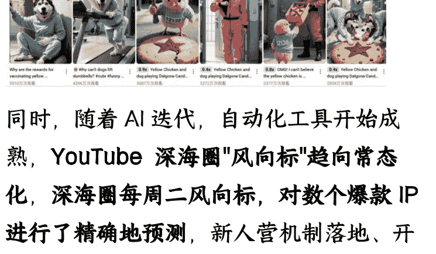

同时，随着 AI 迭代，自动化工具开始成熟，YouTube 深海圈"风向标"趋向常态化，深海圈每周二风向标，对数个爆款 IP 进行了精确地预测，新人营机制落地、开营，百万长视频也有了突破。

### 07【2025/05/08】深度复刻，打造你的第一个百万爆款长视频

直播主题：【达人秀惨故事第一季：深度复刻，打造你的第一个百万爆款长视频】
直播回放：https://meeting.tencent.com/cw/2VRo3k7Oac
分享嘉宾：教练 - 酷拉皮卡；教练 - 运气选手走得远
直播文档：
- 团达人秀惨故事第一季：深度复刻，打造你的第一个百万爆款长视频

### 08【2025/05/15】YouTube 魔法女孩虚拟 IP 打造分享

直播主题：【YouTube 魔法女孩虚拟 IP 打造分享（赚到第一千美元）& 深海圈手册迭代说明】
直播回放：https://scys.com/t/BOA7hhdD
分享嘉宾：总教练-Gary 曹法；教练 - 图因
直播讲解文档：
- Gary：《深海圈手册优化说明&视频制作工具及技巧介绍》团 5 月 15 日直播 - 深海圈手册优化说明&视频制作工具及技巧介绍
- 图因：《YouTube 魔法女孩虚拟 IP 打造，赚到第一千美元》YouTube 魔法女孩虚拟 IP 打造，赚到第一千美元


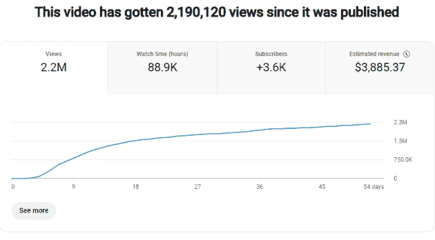

但第一次大的清洗也来了：未成年有害内容审核突然变严。之前很多靠“小朋友坠落悬崖、飞机，被动物救援”这类内容起量的频道，一夜之间被取消 YPP，当然，死的其实也并不冤枉，因为儿童相关的内容准则，清清楚楚地写在 YouTube 官方的规则条款中。也是从这时候开始，我们更加重视内容准则上的红线，将未成年有害内容等重要规则写在了手册最显眼的地方。

#### 6 月：线下聚会与第二次 YouTube 大清洗：达人秀版权警告

6 月，油管虐我千百遍，不如线下见一面，我们开始组织线下聚会，先在深圳和北京办了两场。线下聚会的反响出乎意料的好，每次线下结束，都会有不少参与聚会的圈友报喜：视频爆了；截止目前已在开二十多场 YouTube 深海圈线下聚会。

6 月再做问卷，人均收益到了 800 美金，数十位圈友播放量破亿，虽然还是有很大的上升空间，但相比 4 月，又有了不错的进展。


### 10【2025/05/29】从 Youtube 生财深海圈【风向标】挖掘并复刻赛道

直播主题：【如何从 Youtube 生财深海圈【风向标】挖掘并复刻赛道】
直播回放：https://scys.com/t/BOA7flvO
分享嘉宾：总教练-Gary 曹淦; 方波妮; 教练-ISLAND; 教练 - 轻舟
直播讲解文档:
- 轻舟教练：猫咪疗愈长视频拆解&频道运营技巧
- ISLAND 教练：美国山海经赛道分享&【Youtube 深海圈风向标挖掘】美国山海经赛道分享
- 方波妮教练：深海圈小组成立&YPP 申请近况 5.22 直播分享 (6.5 更新)

### 11【2025/06/05】用 n8n,从 0 到 1 打造自动化生图工作流

直播主题：【新人营结营仪式&自动化第二期直播：《用 n8n,从 0 到 1 打造自动化生图工作流》】
直播回放：https://scys.com/t/BOA7w3XO
分享嘉宾：教练 - 李香君
直播讲解文档:
- 李香君教练：零基础 n8n 教学: https://t.zsxq.com/z4IGm

### 12【2025/06/12】深海圈不同人群的【变现路径】

直播主题：【深海圈不同人群的变现路径】
直播回放：https://meeting.tencent.com/cw/2qvL6BMg5a
直播讲解文档:
分享嘉宾：总教练-Gary 曹淦; 总教练 - 方波妮
0612 深海圈直播——不同人群的【变现路径】推荐

| 项目 | 数据详情 |
| :--- | :--- |
| 报告名称 | 深海圈成员洞察报告 |
| 问卷样本 | 基于 123 份有效成员问卷 | 最后更新:2025 年 6 月 30 日 |
| 总运营频道数 | 974 (平均 7.9/个人) |
| 总开通 YPP 频道 | 233 (平均 1.9/人) |
| 开通 YPP 人数占比 | 66.7% (82/123 位成员已开通) |
| 收益总额 (USD) | $85,059 (来自已开通 YPP 的 82 位成员) |

同样是六月，是私教陪跑也是我个人的发家赛道：达人秀赛道开始了极其严厉的版权清洗。原本对版权监管十分宽松的达人秀版权方一夜之间升级了对于 YouTube 达人秀类内容的版权打击，禁用任何评委原片，不少早期达人秀账号吃到了版权警告，也是自这一次版权打击后，达人秀赛道基本算是退出了历史舞台，而我们，又一次上了一课，更加重视版权，不再使用任何形式的版权原片——实际上也是真的不需要，那些用 AI 评委制作的达人秀账号还活的好好的。

## 7 月：第四次风口，印度赛道与真人复刻；第三次清洗，715 政策与垃圾内容

7 月，真人复刻的方法论趋于成熟，做了数次直播分享，7 月风向标多次提及真人爆款复刻推荐，越来越多的圈友通过真人复刻拿到结果——甚至当时我们工作室的大一实习小朋友，也做出了好几条爆款；

> 【0708 风向标】

本周新增单独的一个板块：

**真人爆款复刻推荐**

【建议】复刻真人爆款，最好选择故事性更强的，而不是更重表现和外在形式的，因为 AI 并不擅长表现活灵活现的细节，比如表情、小动作、精细的场景交互等，相反，故事性更强的往往是因为脚本内核有爆点，复刻出来的细节哪怕不到位，也依然能吸引用户观看下去

- https://www.youtube.com/watch?v=TTVbph1KLg8 3 个月前 6 亿播，蛮搞笑的，镜头不复杂，闺蜜吵架的小故事，属于时间短但是故事性很强冲突感很强的爆款，相较于时间短、故事性不强、表现力很强的视频，故事性强的更适合用 AI 复刻
- https://www.youtube.com/watch?v=JBpha_ug78M 3 个月前 5.3 亿播，一看就是混剪搬运的，浑身难受的背景音乐跟特效，但是即便是这样，也能爆到 5 亿，实际上整体的脚本并不复杂，人物表现也并不好，就是单纯的脚本好，很适合用 AI 复刻
- https://www.youtube.com/watch?v=dCJZtWwyyvs 两周前 1.4 亿播放的一个影视切片，什么电影不清楚，但是这个 shorts 的故事线跟内核很清晰，妥妥的是一个爆款故事脚本，可以用 AI 来做一做
- https://www.youtube.com/watch?v=nAUAvLpoLhA 上周发过，这个 dingdong 的视频，虽然时间非常短，但其实属于有故事性的视频，人物表现细节等等都不太重要，重要的是这个“等着开门恶作剧”的悬念留给观众，让观众重复看很多遍，我们复刻的一条在 YouTube 目前跑了 50 多万，还在推流，在小红书、视频号都小爆了，各位可以换场景、换元素，再做一做，还是贴上我们做的给大家参考 https://www.youtube.com/shorts/SiUSKh5kPQA

### 13【2025/07/10】YouTube 内容准则条款与 715 新政解读

直播主题：【YouTube 内容准则条款与 715 新政解读&连续千万爆款印度故事赛道 - 复刻与微创新分享】
直播回放：https://meeting.tencent.com/crm/NAmbBder39
分享嘉宾：总教练-Gary 曹淦; 优秀圈友 - 加绒
直播文档：连续千万爆款印度故事赛道 - 复刻与微创新分享

### 14【2025/07/25】Youtube AI 长视频赛道 200 万播放经验分享

直播主题：【Youtube AI 长视频赛道 200 万播放经验分享】
直播回放：https://meeting.tencent.com/crm/N14955R348
分享嘉宾：教练-Nana

### 15【2025/08/01】打开上帝视角，到底怎么做出爆款，多位亿播圈友案例讲解

直播主题：打开上帝视角，到底怎么做出爆款，多位亿播圈友案例讲解
直播回放：https://meeting.tencent.com/crm/KnW5r5v148
分享嘉宾：总教练-Gary 曹淦
直播文档：0801 深海圈直播——YouTubeAI 赛道的宏观趋势和微观方法

### 【2025/07/04】

【YouTube 深海圈实战小组阶段汇报与视频复刻量化因子解读】
https://meeting.tencent.com/crm/2k0bzEYp67

直播文档:
- 【深海圈】视频对标影响因子评估表: [icon] 【深海圈】视频对标影响因子评估表
- 1 组：[icon] 1 组 - 赛道测试 宝宝播客长视频、山海经
- 2 组：[icon] 二组 - 故事号实战数据汇报 山海经 + 爆款故事、耶稣复活动物
- 3 组：[icon] 3 组测试阶段汇报 山海经复古赛道 - 长视频
- 4 组：[icon] 印度故事赛道 - 测试结果分享 印度故事，一个月 1.8 亿播
- 5 组：飞书链接：[icon] [icon] 组 - 山海经赛道 - 测试数据 密码：53#r8264
- 6 组：[icon] 6 组 - 赛道测试情况
- 7 组：[icon] 小组汇报

### 【2025/07/17】

【YouTube 深海圈实战小组阶段汇报 3】: https://meeting.tencent.com/crm/Nxjm91jMde

直播文档:
- 2 组：[icon] 二组 - 故事号实战数据汇报
- 3 组：[icon] 3 组测试阶段汇报
- 5 组：[icon] 5 组测试分享

以及印度赛道以其巨大的流量引起了大家的关注，虽然众所周知印度单价低，但极大的流量也孕育出了深海圈优秀圈友翔哥这样通过印度赛道月入近万刀、月播放量超过十亿的圈友。

### ◎精华 6 个月：新手小白从 0 到 150 万订阅，获 YouTube 金牌奖，单号收入 1.5 万美金

大家好，我是翔哥，一个即将迈入 40 岁的中年双胞胎爸爸，现在是一名全职 YouTube 创作者，擅长爆款脚本的创新和重组。

2025 年 3 月航海开始进入 AI 内容出海的 youtube 赛道，从航海开始一个月才做出一个视频的新手小白，到半年时间拿下单号 150 万订阅，获得 youtube 金牌创作者。

目前的一些成绩:
- 3 个 YPP(3 个银牌，1 个金牌)
- 累计播放量 30 个亿 (其中金牌账号专注印度赛道，目前累计超过 20 亿播放)。
- 9 月份 3 个账号合计收益 9600 刀左右。
- 单金牌账号 6 月 15 日开通 ypp 至今累计收益过 1.5 万刀。

这篇文章涵盖了我我是如何通过一个新手小白慢慢成长起来的心路历程，也重点分享了我金牌号的内容方法，期待与大家一起多多赚美金。

关注 YouTube 的圈友应该也知道，这个月还有一件大事：715 政策上线——2025 年 7 月 15 日前后，YouTube 发起了一轮大规模的内容审查，对当时盛行的分屏、混剪等搬运类内容，以及简单粗暴自动化生产的 AI 模版类内容进行了清洗，不是取消 YPP，是直接移除频道，比如这样的内容，当时我也第一时间做了解读。

### 如何看待 YouTube 715 新政策？对 AI 内容有何影响？创作者要如何应对？

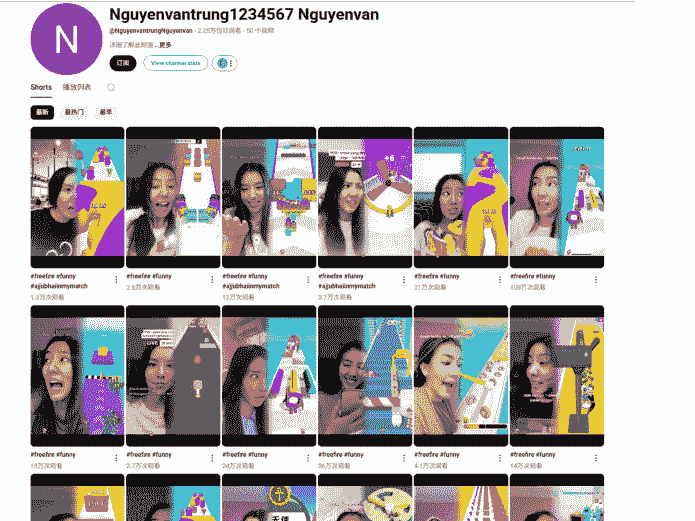

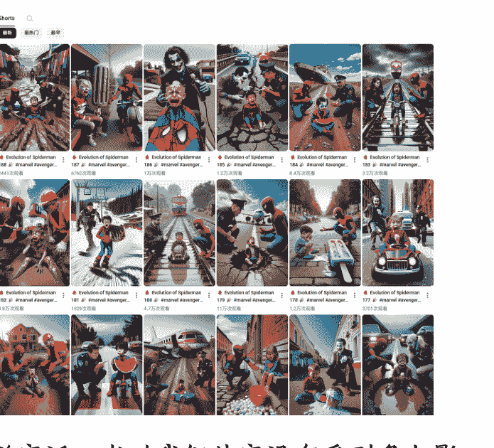

说实话，当时我们其实没有受到多大影响，大家制作的内容还是偏向精品化，没有多少自动化量产与搬运的频道，但是，715 政策为 5 个月后的同质化与限流问题埋下了伏笔。

## 8 月：第五次超级风口，KPOP 猎魔女团;
第四次 YouTube 大清洗，未成年有害内容再收紧

通过 YouTube 上异常的流量和 Google trends 暴涨的搜索指数，我在风向标多次分享了 kpop 猎魔女团的机会，只是当时我们并没有想到，kpop 猎魔女团竟然会超越过去的鱿鱼游戏和美国山海经，成为 YouTube2025 年名副其实的第一 IP。

前几天，2026 奥斯卡最佳动画长片出炉，《K-pop 猎魔女团》英文名《K-pop Demon Hunters》实至名归，我们靠它拿下数百亿 YouTube 流量; 片中歌曲《Golden》同时也获得了 最佳原创歌曲奖。

这是 2025 年 8 月初，我们在 YouTube 深海圈社群【风向标】发布的有关 kpop 猎魔女团的最早记录，分别在【0812】和【0819】连发两周; 最早的 Google trends 截图是【0804】。

### 【0819 风向标】

### 羊毛信息

https://aic.iq.com/ (文少分享 中标) 在这个爱奇艺的 AI 视频创作网站申请创作权限，提交你的频道和视频链接就好，文少和我都申请成功了，申请成功之后在 9.30 以前貌似是可以无限使用 veo3 和即梦，冲起来吧，知道的人应该不多，动得多可能早就关入口了 (我是挂魔法，用 gmail 申请的，据说要用魔法才 veo3，不然就只有即梦)

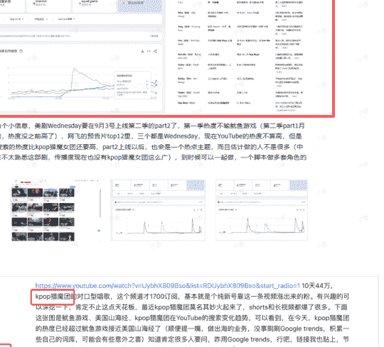

以及，给个小信息，美剧 Wednesday 要在 9 月 3 号上线第二季的 part2 了，第一季热度不输鱿鱼游戏 (第二季 part1 1 月初更新的，热度没之前高了)，网飞的预告片 top12 里，三个都是 Wednesday，现在 Youtube 的热度不算高，但是 Google 搜索的热度比 kpop 猎魔女团还要高，part2 上线以后，也许会是一个热点主题，而且估计做的人不是很多 (中国人应该不太熟这部剧，传播度现在也没有 kpop 猎魔女团这么广)，到时候可以一起做，一个脚本做多套角色的故事

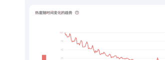

- 【0819 风向标】
- 羊毛信息
- 非 AI shorts
- AI shorts
- 长视频
- veo3
- 其他
- 【0805 风向标】
- 非 AI shorts
- AI shorts
- 长视频
- 直播
- 【0729 风向标】
- AI shorts
- AI shorts
- 长视频

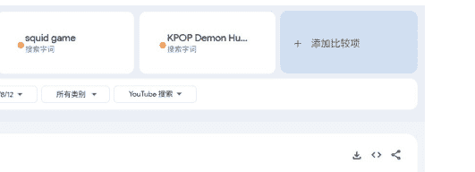

### 当时的 Google trends 截图:

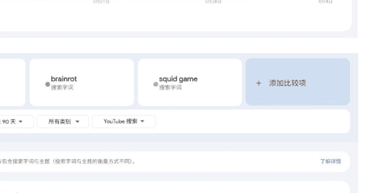

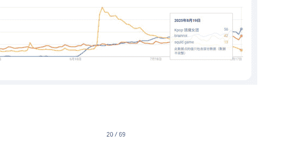

在 8 月，一卒教练分享了一套基于 Gemini 2.5 Pro 的高效脚本拆解与生图的提示词模板，这套模板强到让一卒在群里收了 5000 块的红包，也彻底降低了爆款复刻的门槛，让圈友后续几乎彻底占领了 YouTube 上 kpop 猎魔女团这个 IP 下的绝大部分爆款。在 8 月的问卷调研，无论是播放量还是收益，都有了质的飞跃，146 问卷居然达到了夸张的人均亿播，多位圈友借着 kpop 这个超级 IP 实现了月入万刀。

- 15【2025/08/01】打开上帝视角，到底怎么做出爆款，多位亿播圈友案例讲解
  - 直播主题：打开上帝视角，到底怎么做出爆款，多位亿播圈友案例讲解
  - 直播回放：https://meeting.tencent.com/crm/KnW5r5v148
  - 分享嘉宾：总教练-Gary 曹淦
  - 直播文档：🔗0801 深海圈直播——YouTubeAI 赛道的宏观趋势和微观方法
- 16【2025/08/14】告别手撸：提示词让 AI 视频制作提效 3 倍全流程！
  - 直播主题：AI 视频脚本制作提效
  - 直播回放：https://meeting.tencent.com/crm/KDR6qRwefa
  - 分享嘉宾：优秀圈友 - 一卒
  - 直播文档：🔗《告别手撸：提示词让 AI 视频制作提效 3 倍全流程！》-深海圈版
- 17【2025/08/21】如何用 AI 原创故事？赛道流量下滑怎么办？
  - 直播主题：如何用 AI 原创故事？赛道流量下滑怎么办？
  - 直播回放：https://meeting.tencent.com/crm/l6eQ5360b0
  - 分享嘉宾：总教练-Gary 曹淦；优秀圈友-S.Z
  - 直播文档：🔗8.21 直播分享
- 18【2025/08/28】Youtube 直播带货&语言类故事分享
  - 直播主题：Youtube 直播带货&语言类故事分享
  - 直播回放：https://meeting.tencent.com/crm/2Bzaj4pkaO
  - 分享嘉宾：优秀圈友 - 露筱²
  - 直播文档：🔗带货思路 | 语言类故事分享 - 露酱

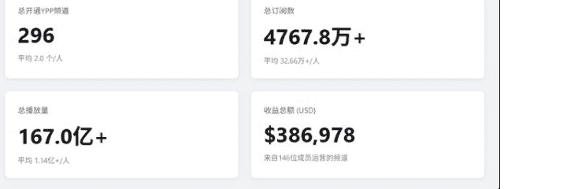

但也是 8 月，未成年有害内容审核进一步收紧。不只是真人未成年，未成年形象的动物与拟人动画角色也不可出现危险内容，这又是一批频道中招，好几位圈友的几千美金收益一夜归零。心痛之余，整个深海圈也愈发重视内容的合规性，不鼓励任何形式为流量而在规则红线擦边的行为，对内容风险的强调，每次周四直播都反复重申。

## 9 月：第六次小风口，脚本与矩阵的放大方法论、YouTube 带货起步

9 月 20 日，YouTube 作为专场分享登上了航海家大会，多位来自深海圈的圈友与教练上台进行了分享。在大会上，我分享了深海圈在带货、脚本放大方法论上的探索结果，提出了爆款内容=好形式 X 好脚本 X 低卷度的理论，从 9 月到现在，已经有非常多的圈友在这条路上走了很远，做出了自己的矩阵账号，甚至成立了自己的小工作室。

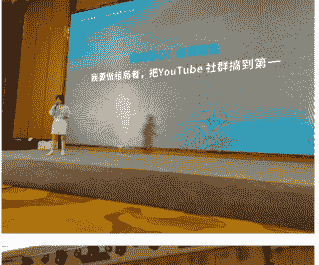

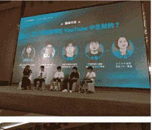

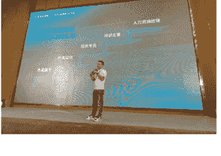

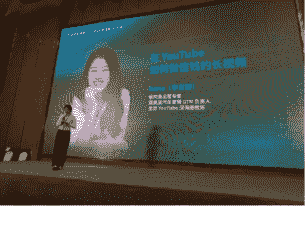

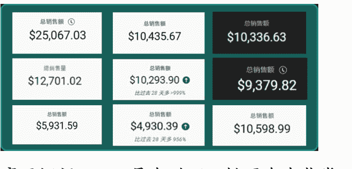

毫无疑问，S.Z 是当时那一圈友中非常具有代表性的案例，通过自动化的杠杆放大了自己对爆款的理解，一个人运营十余个频道，吃掉了一整个细分赛道。

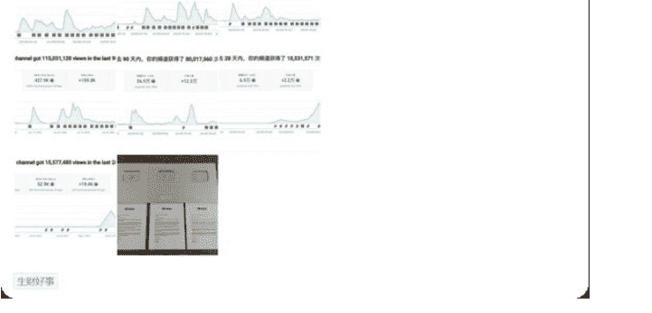

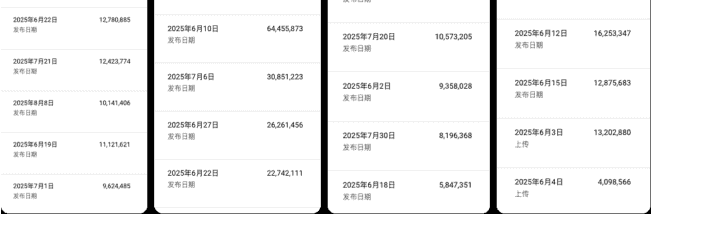

## 10 月：第一套 YouTube 视频课程上线、作品点评上线、工具普及

10 月，深海圈友突破了千人大关，更多的圈友也意味着更大更宽的赛道需求与更体系化的运营框架优化，于是在 10 月上线了第一套视频课程，并在同期新人营落地了作品点评的机制，尽可能地把我个人以及教练团的近一年来积累的认知与判断同步给深海圈的每一圈新老圈友，通过作品点评孵化出的优秀圈友，我们又邀请在周四直播进行回流分享，为圈友提供更深度更具体的经验与指导。

公众号懒人搜索，懒人专属群分享


### 课件:

#### ⑬【深海圈】课程使用材料汇总

1. 10 分钟从 0 到 1 学会最简单也是最先进的 AI 视频制作流程
视频教程：https://ncnmu5q1eqm9.feishu.cn/minutes/obcnCy6ix21qp7x8ul434x91
2. 10 分钟理解 YouTube AI 内容出海的價值
视频教程：https://ncnmu5q1eqm9.feishu.cn/minutes/obcnCyzeIvruDNfe443137f8
3. 10 分钟完成谷歌账号注册与 YouTube 频道创建
视频教程：https://ncnmu5q1eqm9.feishu.cn/minutes/obcnC1q45v4651t185p71kC
4. 10 分钟了解 YouTube 工作室常用功能
视频教程：https://ncnmu5q1eqm9.feishu.cn/minutes/obcnC1d9e2204762625589b4
5. 10 分钟了解深海圈及配套交付体系
视频教程：https://ncnmu5q1eqm9.feishu.cn/minutes/obcnC1q66l89gJ814u3Izv33
6. 10 分钟心力提升：新手阶段的正确预期与规划
视频教程：https://ncnmu5q1eqm9.feishu.cn/minutes/obcnfICcwA313fQ163cp5er8

### 内测反馈:

#### ⑭ 深海圈视频反馈

(敬请期待) 基础篇：修练基本功，开通 YPP，做出爆款

1. 现阶段 YouTube 主流 AI 赛道解析：形式爆款与脚本爆款
https://ncnmu5q1eqm9.feishu.cn/minutes/obcnf58fhg91stiyqgtvy24s
2. 有门槛的内容上最大的杠杆：脚本爆款赛道推荐与通用制作教程
配套图文指引：⑬【深海圈】课程使用材料汇总

第一部分，脚本爆款简介&即梦 agent 与批量出图、出视频工具操作 讲解:
https://ncnmu5q1eqm9.feishu.cn/minutes/obcnhkdx2w885p5s23zv21f1

第二部分，即梦 agent 生成的印度故事与批量出图出视频工具生成的 kpop 故事剪辑 讲解:
https://ncnmu5q1eqm9.feishu.cn/minutes/obcnhl519bewepd4ng95268y

## 11 月：龙珠悬赏：AI 语言类 shorts & AI 长视频

随着对 AI 无语言内容开发趋于成熟，我们把视角转向了潜力更大、收益更高、方向更多的 AI 语言类 shorts 与长视频。通过对传统语言类内容的观察以及 AI 创作工具的不断迭代，我判断过去积累的无语言内容这些经验，完全能够迁移到语言类内容上，而与此同时，传统的语言类内容在脚本、表现力上几乎完全不具备竞争力，于是我们发布了针对深海圈的第一次龙珠悬赏，并邀请了在语言类方向拿到了初步结果的 Geektao 圈友进行首场语言类直播分享。

## 深海圈龙珠悬赏：YouTube 语言类 shorts&长视频

Gary 曹淦 方波妮 2025 年 12 月 23 日修改

目前，深海圈已经基本打通了无语言的 shorts 赛道，爆款方法论基本成熟，然而无语言 shorts 的赛道容量有限，实际上无语言内容在 YouTube 占据的市场份额是比较小的，语言类 shorts 和长视频有更高的 RPM、更强的变现能力和更多的垂类拓展能力，而 AI 的多语言能力恰好也非常适配语言类内容和长视频，在新赛道的红利期，信息的互通往往能带来更快速的发展，为鼓励圈友开拓新赛道、强化信息交流互通、进一步放大各位目前的创收体量，现针对语言类 shorts 和长视频发起龙珠悬赏：

- 悬赏奖励：第一名一颗龙珠，第二到第八名瓜分一颗龙珠。
- 投稿时间：2025 年 11 月 6 日至 2025 年 12 月 15 日
- 投稿表单：https://scys.com/form/z27VzvoS
- 评选时间：2025 年 12 月 16 日至 2025 年 12 月 22 日
- 评选结果公布：小鹅通直播、生财发帖/公告

投稿要求：

- 1.对标赛道可以是非 AI 内容，但要求用 AI 进行内容制作，可以是 AI 完成部分环节，如画面、音效、音乐、配音、文案、脚本等；
- 2.跑通了基本的 0-1 闭环，如已开通 YPP，需要在 1 个月的时间内实现了 100 美金以上的收益；如未开通 YPP，需要在一个月内实现语言类 shorts 100 万以上的播放量或长视频 10 万以上的播放量；
- 3.需要对赛道、对标、制作流程、内容优化等基本环节进行拆解，梳理变现模式与投产情况；
- 4.发帖时，加上 #深海圈 | YouTube 龙珠悬赏# 以及具体方向标签： #YouTube 语言类 shorts#、 #Youtube 长视频#

截止到 12 月 15 日晚 24:00。

解释一下 YouTube 语言类 shorts&长视频两个方向。

### 什么是用 AI 做语言类 shorts？

### 21【2025/11/20】语言类 + 搞笑赛道：制作流程&变现拆解分享

直播主题：语言类 + 搞笑赛道：制作流程&变现拆解分享

直播回放：https://flv5.xetslk.com/sl/3chihb

分享嘉宾：Gary 曹淦、优优秀圈友-GeekTao

直播文档： [语言类 + 搞笑赛道：制作流程 & 变现拆解分享 | 新人入局语言类推荐](https://...) (链接图标)

### 首次 YouTube 深海圈龙珠悬赏榜单：


| 排名 | 星球昵称 | 星球编号 | 赛道 | 标题 | 奖励 |
| --- | --- | --- | --- | --- | --- |
| 1 | Geektao | 3228 | 语言类 | 语言类 + 搞笑赛道：制作流程 & 变现拆解分享（新人入局语言类推荐） | 半颗龙珠 |
| 1 | 四水年华 | 195233 | 语言类 | 月入 5000 美金! AI 语言类 Shorts 实战复盘 | 半颗龙珠 |
| 2 | 亿豪 | 130975 | 语言类、长视频 | 1.8 万字分享「Youtube 新人如何突破千万播放&提高 RPM 单价」 | 一颗碎片 |
| 3 | 雨文 | 5751 | 长视频 | 初学者从 0 到 1 制作 AI 短视频全流程 | 一颗碎片 |
| 4 | Zero | 80974 | 语言类、长视频 | 【月入万刀】2 天速通高级 YPP——亿播放量的语言类 Shorts 探索心得 | 一颗碎片 |
| 5 | 金鱼 | 60563 | 语言类 | 《Youtube 语言类 Shorts 月入万刀秘籍》——金鱼的火爆指南 | 一颗碎片 |
| 6 | 波哥 | 18907 | 长视频 | 1 年 9 次迭代：YouTube 长视频突破 1000 万播放 | 一颗碎片 |

## 12 月、1 月：第七次大风口，AI 语言类 shorts；第五次 YouTube 大清洗，同质化内容审查与限流

12 月，深海圈迎来了第一次年会，年会邀请嘉宾：四水年华圈友在语言类 shorts 实现单频道月入近三万刀，带货 GMV19 万美金。这个数字震惊了所有人——证明了语言类的天花板远超我们的想象，是的，我也没有想到，于是圈友们开始了轰轰烈烈的语言类转型，来自深海圈的 AI 语言类内容，在未来的几个月几乎占领了 YouTube 的 AI 语言类赛道——直到现在。

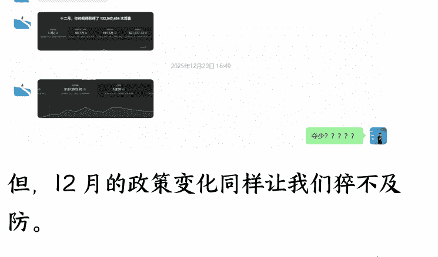

但，12 月的政策变化同样让我们猝不及防。

从 12 月初开始，大量账号由于“同质化内容”被取消 YPP 资格或毫无征兆地被限流，这一轮清洗不仅针对 AI 内容，甚至大量 3D 账号、原创动画、游戏频道都受到严重影响；715 政策的回旋镖现在到来了。


### 你的频道目前无法启用创收功能

对你的频道综合运用自动和人工审核之后，我们发现它未遵循 YouTube 的频道创收政策。

我们的审核人员发现你的频道包含以下内容：

同质化内容 疑似为增加观看次数而大量生成或重复呈现的内容，这些内容并未额外带来有意义的教育价值或其他价值。了解详情

注意：我们可能会依据相关规定扣留未支付的收入，包括《YouTube 合作伙伴计划条款》和适用政策。

#### 选项 1

#### 通过发送视频提出申诉

如果你认为我们的处理有误，可以提交申诉告诉我们原因。我们会审核你的申诉，并在 14 天内告知你我们的决定。只有满足以下条件才能选择申诉：自你的频道被暂停创收后，你未删除过任何视频。

如果未能申诉成功，使此频道恢复正常，你运营的其他频道也可能会被暂停参与 YouTube 合作伙伴计划。

了解详情

| 日期 | 观看次数 |
| :--- | :--- |
| 2026 年 1 月 26 日<br>发布日期 | 18 |
| 2026 年 1 月 24 日<br>发布日期 | 3 |
| 2026 年 1 月 22 日<br>发布日期 | 2 |
| 2026 年 1 月 20 日<br>发布日期 | 16 |
| 2026 年 1 月 16 日<br>上传 | 11 |
| 2026 年 1 月 15 日<br>上传 | 46 |
| 2026 年 1 月 14 日<br>上传 | 40 |
| 2026 年 1 月 7 日<br>上传 | 19,302 |
| 2026 年 1 月 7 日<br>发布日期 | 14,649 |
| 2026 年 1 月 6 日<br>发布日期 | 39,239 |
| 2026 年 1 月 5 日<br>发布日期 | 27,831 |
| 2026 年 1 月 4 日<br>发布日期 | 12,929 |

过去大量复刻爆款脚本重复分发的方法不再可行，对内容的改编、微创新幅度提出了更高的要求。我们也在第一时间做出了响应与警示，有需要回顾的圈友可以查看这份直播文稿 [l223 航海直播——近期 YouTube 风险警示与机会解读](l223 航海直播——近期 YouTube 风险警示与机会解读)；从此开始，对于同质化、未成年危险等问题的提醒几乎成为了 YouTube 深海圈内部直播的每周必聊。

## 2 月：第八次风口，Seedance 2.0 上线；同质化审查持续

2 月，过年前，Seedance 2.0 发布，字节杀了所有人一个措手不及，在体验之后，我在当周 YouTube 深海圈风向标中写到：我不得不承认 Seedance 2.0 几乎杀死了游戏，截止到现在，sd2.0 就是毫无争议的视频模型断档第一（不考虑现在降智和风控严重的情况下）。

> 【0211 风向标】
>
> **本周最重磅：即梦 2.0**
>
> 这周我想传递的有且仅有一个点，就是即梦 2.0，都给我去买，太夸张了。
>
> 没什么好纠结的，直接用就完了，现在不用过半个月肯定会后悔的，即梦 2.0 带给我的震撼，大概和去年 veo3 发布的时候差不多，甚至还更强，这真的是划时代的迭代，内容市场又要迎来一次大洗牌了，AI 再次突破原来的边界，更多类型、更高质量的视频能够被更低成本制作出来，不客气的说，很多二流及以下的真人博主、动漫、影视公司，都要被一波干死，应证了那句话：消灭你，与你无关。
>
> 那当然，大家更关心的肯定是即梦 2.0 怎么用，首先推荐你们去看下即梦的官方文档，写了非常多的 case：👇🏻 [即梦 Seedance 2.0 使用手册 (全新多模态创作体验)](https://mp.weixin.qq.com/s/...)
>
> 然后推荐看下卡兹克今天这个推文，给了不少使用场景上的参考：https://mp.weixin.qq.com/s/HlX7YiLRFTwhjk6mCzxCDA
>
> 再推荐生财友饼干干这个推文，对带货场景的开发很丰富，YouTube 带货指日可待（高手或许能做出带货视频，但我请问到了 YouTube，你有 YPP 账号吗）： https://mp.weixin.qq.com/s/jTWvtkM790JuPHMBTMADQA?scene=1
>
> 好了，别人的教程推荐完了，更重要的当然是对我们做 YouTube 来说，即梦 2.0 真的能用了吗，能提效吗，能出爆款吗，难用吗？
>
> 事实就是，即梦 2.0 杀死了比赛，即使是在 YouTube。先感谢 zero、金鱼、天才老师、Lueyow 等圈友贡献的数据图，都是用即梦 2.0 做出来的视频：

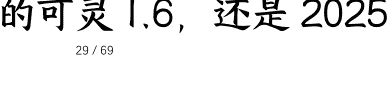

为什么在 2025 年一整年里的回顾里，我几乎没有提到模型的迭代？不论是 2025 年 1 月惊艳众人的可灵 1.6，还是 2025 年 5 月引爆新玩法的 veo3，又或者是 10 月刷屏 tiktok 的 sora2，实际上都没有改变我们的工作流程，AI 内容创作无非就是脚本、提示词、生图、生视频、剪辑而已，核心还是你对内容的理解、对提示词和分镜的把握。

但是 Seedance 2.0，让原本的流程能够直接简化成截图脚本（如下图所示）扔给 Seedance 2.0，然后结果也在下面，其他步骤在偷懒情况下可以完全抛弃。中间是 Seedance 2.0 一次直出的效果，最右的视频是姜洪涛圈友半年前 sora2 复刻相同脚本反复抽卡留下的比较好的一条，大家可以对比感受下。


### 换灯泡搞怪视频

下面这条对经典影视片段的复刻来自 YouTube 深海圈邵先森教练的分享，放在 Seedance 2.0 之前，还需要相当高的分镜设计能力才能复刻出来，而且还很容易反复抽卡，但现在的门槛已经非常低，基本是口喷内容就能实现很好的效果。

### 周星驰电影原片片段


以@图片 2 为首帧，镜头切换到右眼黑掉的男人的脸部特写，他愤怒地用舌头舔了一圈嘴唇，然后镜头拉远，他斜看向女人，生气地“哼”了一声。

场景切换到客厅的另外一角，在餐桌旁边的椅子上，黑发男人@图片 3 坐着，他左手抓成拳头，右手则紧紧包着左手的拳头，他俯着身，一只眼眯上，另一只眼紧贴到右手和左手拳头的洞洞上面，他兴奋地说：“I've never seen anything like that!”

这时女人疑惑地半弯曲身体悄悄走到男人身后，她对男人说：“what's that? Let me take a look!”然后男人侧身护着双手，他反问女人：“You really wanna see?”女人连忙笑着点头 (带着可爱的卡通点头声音)。

这时特写男人上半身 (女人不在画面中)，男人说:Taste it Rumi!然后他把握着拳头的手，用力打向女人刚才所在的方向，他的拳头最终完全在屏幕以外 (只看到手臂)，然后男人突然仰头持续惨叫。

这时镜头不切换仅拉远，在男人拳头的方向，男人的拳头完全在女人的嘴里面，手臂则在女人的嘴外面，女人面无表情，而男人则非常痛苦地惨叫，非常滑稽。

### 用 Seedance 2.0 复刻周星驰电影片段

在国内，Seedance 2.0 对 AI 短剧、漫剧以及广告影视行业的冲击大家都感受到了；而在 YouTube，原本还有一定制作难度的大量真人实拍类视频被彻底打平门槛，2 月初的风向标，我的篇幅全部都给了 Seedance 2.0，年后邀请了徐徐和邵先森两位教练进行 Seedance 2.0 分享，直播分享文档发布到生财，也拿下了两篇精华帖:

徐徐教练精华帖:

https://t.zsxq.com/3Fyiz

邵先森精华帖:

https://t.zsxq.com/WVBOK


## 一起第一时间和深海圈圈友共创了 Seedance 2.0 的信息文档，当圈外还在吐槽排队问题、真人无法别人等问题，我们文档已经有圈友一起共建的经验分享。

而 Seedance 2.0 也确实不负众望，让一大批最早去应用的圈友吃到了螃蟹，由 Seedance 2.0 制作的爆款视频几乎在一周内就取代了原本所有传统 AI 工作流制作的版本。

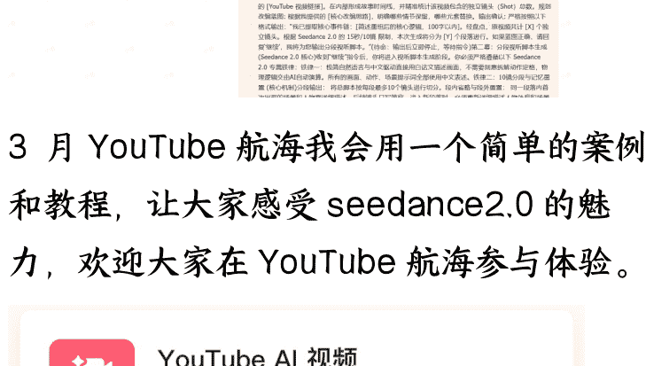

3 月 YouTube 航海我会用一个简单的案例和教程，让大家感受 Seedance 2.0 的魅力，欢迎大家在 YouTube 航海参与体验。

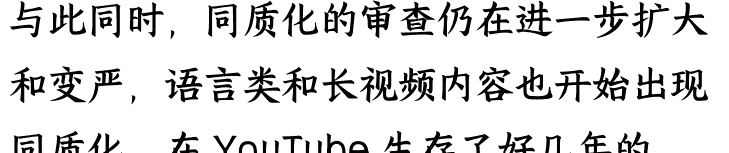

与此同时，同质化的审查仍在进一步扩大和变严，语言类和长视频内容也开始出现同质化、在 YouTube 生存了好几年的 Reddit 赛道也在一夜之间几乎全军覆没。面对平台这样系统性的调整，我们作为创作者也必须对自己的变现思路进行系统性的改造：不能总是用同样的内容薅同一群人的羊毛，不能把鸡蛋放在一个篮子里——具体指什么，后文会聊到。

### 当我们回头看这一年，会发现:

- 或大或小的机遇总在不断地涌现，但风险也一直如影随形
- 没有不变的赛道、频道与方法论，不变的是对内容理解能力，以及不断精进的制作能力。
- 尽管遭遇了各种困难与挫折，但大家建立起了庞大的 YouTube 创作者与内容生态，光是精华帖就沉淀了近百篇，收录风向标视频与拆解超过 3000 条，各个不同赛道与方向的直播回放超过 50 场，这些都是宝贵的、让我们穿越周期的经验。

## 3. 既求革命，何来稳定？

看完上面这一年来的经历，不知道大家对 YouTube AI 内容是怎么看的？

> “太不稳定了，赛道总是变，打击一轮接一轮”

> “变化这么快，对人的要求也太高了吧”

> “门槛太高了，要会那么多东西”

> “都一年了，已经红海，非常卷了吧”

我知道，很多圈友，不管是不是参与了 YouTube 航海和深海圈，都会想象:

## 是不是在 YouTube 做内容很稳定？

是不是维护好自己的账号，用心做内容，就能慢慢积累粉丝，拿到持续稳定的收益？

哈哈，我不会说漂亮话，现实就是不可能。

由于大家可能对 YouTube 生态缺乏基本的认知，我给大家分享几个小案例，对齐一下认知。

以 YouTube 平台 27 亿月活、几乎 4 倍抖音的体量，下面这张图是过去一年 YouTube 所有视频的播放量排行，排名第 13 的视频播放量是 12.6 亿，这是啥概念？YouTube 掌管流量的神，粉丝量第一，4.7 亿关注的 MR.Beast，也没能挤进这张图里，而有趣的是，这张图里唯一的 AI 视频——甚至还可以说是唯一的来自国人创作者的视频，正是第 13 名，出自 YouTube 深海圈优秀圈友拾风（这条视频在后面会给大家展示）；还有非常多 YouTube 深海圈圈友上过 viewstats 周榜月榜，篇幅有限不一一列出。

| Rank | Video | Video Views | Uploaded | Channel |
|---|---|---|---|---|
| 1 | who loves FROZEN? #frozen | 2,339,586,083 | a year ago | Taylor R... |
| 2 | Baby Im Bauch: Das süßeste Familien!... | 2,115,736,355 | 10 months ago | Baby Be... |
| 3 | Kashvi bahut dar gayi | 1,704,306,932 | 8 months ago | Cute Ka... |
| 4 | WOW Tube DRAWING! Easy Art... | 1,624,863,866 | 9 months ago | Fizzle W... |
| 5 | diy mini tractor video mini water pump ... | 1,557,544,136 | 6 months ago | MiniWor... |
| 6 | Tanya ko cake cut karna nahi aata ... | 1,497,930,521 | 4 months ago | The Iam... |
| 7 | جاحد الأسدي الدنيبة عنتمة انتام | 1,456,078,237 | 5 months ago | Ahmad... |
| 8 | Come On Kids, Let's Learn Shapes ... | 1,418,552,816 | a year ago | LearnTo... |
| 9 | مرسى دسارنورثى جبلة | 1,370,228,577 | 2 months ago | 2 道 1 | |
| 10 | पाणपे, सुंदर और सीधी बने पत्नी एसआईए ... | 1,360,105,207 | 9 months ago | Udit Pra... |
| 11 | Independence Day Craft #shorts #yout... | 1,322,361,201 | 7 months ago | Mom an... |
| 12 | Teaching Hygiene Rules Visually Mak... | 1,298,537,604 | 10 months ago | BlippyBop |
| 13 | Jimu Tries to Save Baby Rumi From the ... | 1,267,206,855 | 4 months ago | | |

而更有趣的是，这条视频的原型来自风向标的分享，同时也在深海圈作品点评中多次讲解，原视频不过几千万播放。

| 链接 | 日期 | 圈友 | 内容描述 | 点评 |
| :--- | :--- | :--- | :--- | :--- |
| https://www.youtube.com/watch?v=DkNe5_VfOq0&list=PLz8H_cUoZmkPQhRG89KUPR99mT-1rcO-&index=56 | 2025/10/30 | do 小鱼 | Kpop 二维动画 (33M): zoey 在娃娃机里面求食，她对应的 cp 路过，按币抓娃娃，按错了方向结果 zoey 自己卡在了出口，萌萌。 | 很搞笑的一个 2d 动画，蛮可爱的，可以做；这个夹娃娃的元素拓展性也挺强，改成故事也可以，大家自由发挥吧 |

是的，AI，让我们这些非专业出身甚至是门外汉的内容创作者，有了和 YouTube 最顶尖博主甚至是公司、机构掰手腕的机会，这一年里在深海圈友中诞生了数十个百万订阅频道，数百个十万订阅，数不清的亿播爆款视频。

但是，YouTube 没有永恒的流量，跟不上迭代的速度就是死。

下图这个 4000 万订阅的超级大博主，是我们去年 5、6 月的重点对标对象，当时这位真人博主提前布局鱿鱼游戏，视频可以说是做一条爆一条，条条亿播，一个月拿了几十亿流量，也正是从这位博主借鉴来

## 这是为何？

的灵感，有了前面谷梓超圈友 3 个月的 10 亿流量。

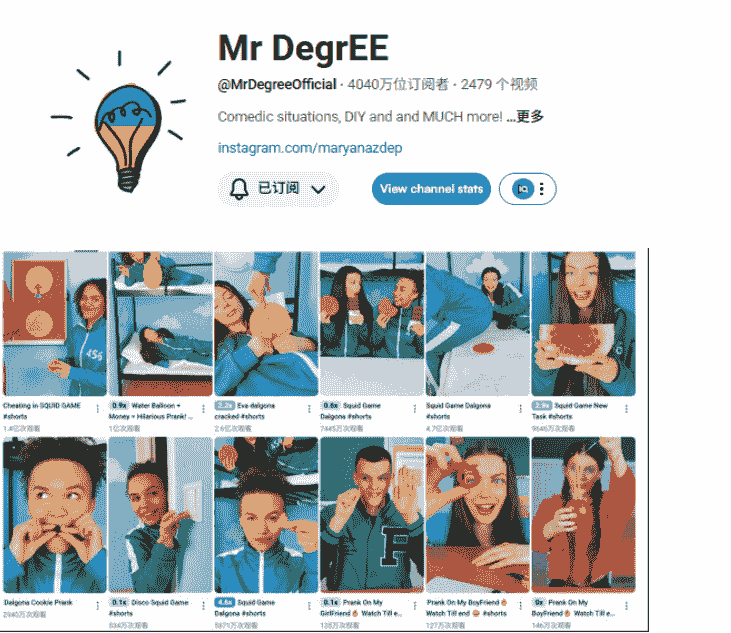

而现在呢？只看数据，已经沦落到平均数十万播放，千万都是稀客。

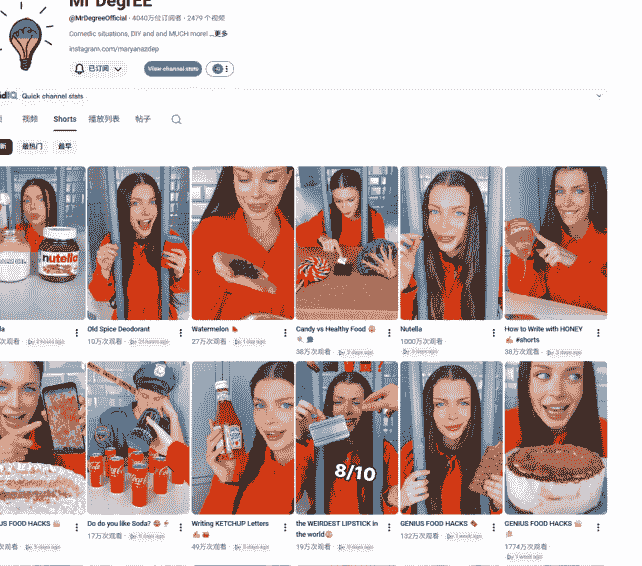

因为这个博主在近半年的时间里，对 K-pop 猎魔女团这样的热点视而不见，并且再也没有抓住像鱿鱼游戏那样的机会，现在她做的内容，与一年前并无二异。

而另一个案例，则是韩国排名第一、甚至也是去年整个 YouTube 涨粉第一的大博主，KIMPRO。

虽然她坐拥 1.3 亿粉丝，但是看到拾风圈友那条 12 亿播放的夹娃娃视频，作为一个真人博主，她居然用自己的形象做了一条 AI 版的来复刻。而这也是 KIMPRO 这个账号日久弥新，持续运营多年，并且常年排行流量榜第一名的的重要原因——与时俱进，她会不断地寻求新的热点、形式、脚本，并加以改造成符合自己频道调性的演绎。

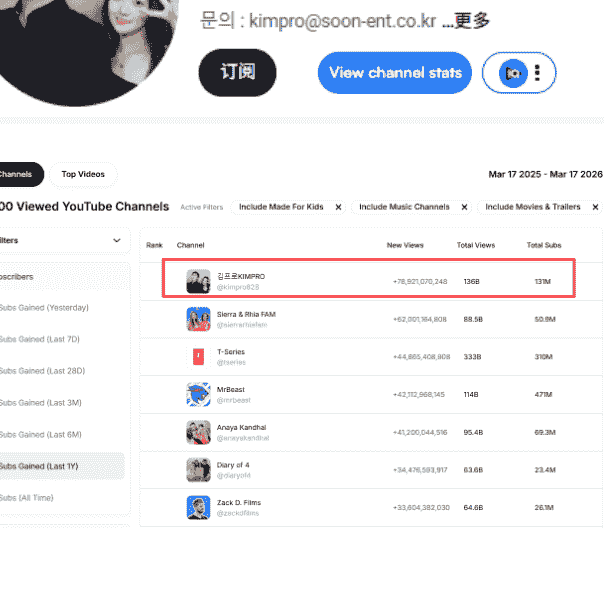

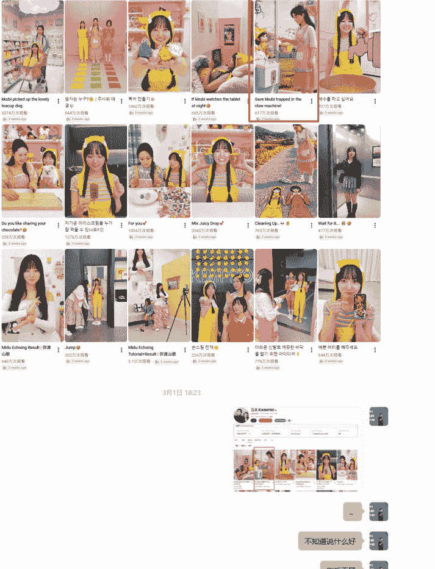

3 月 1 日 18:23

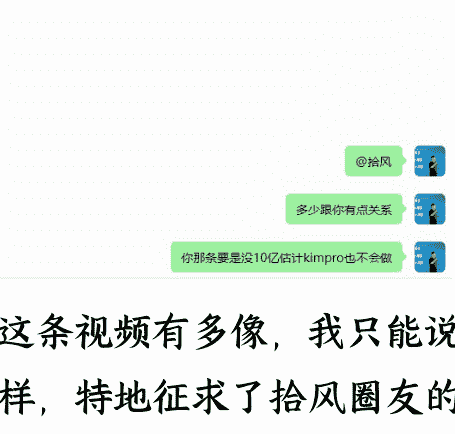

至于他们俩这条视频有多像，我只能说音频都一模一样，特地征求了拾风圈友的同意，大家可以观赏一下。

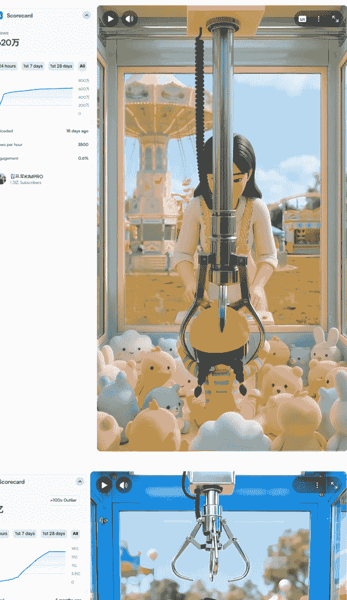

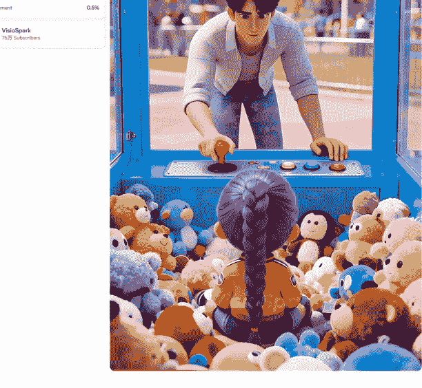

头部的顶尖博主们，都已经想尽办法来应对 AI 内容对行业的颠覆，或是自己用 AI，或者与 AI 融合对内容做改造，或是转向 AI 无法制作的内容类型，而那些落后于时代的博主，早已经被淘汰掉一批又一批了。

在行业深耕了那么多年的博主尚且如此，那么我们作为新兴的 AI 内容创作者，作为革命者，又凭什么认为自己可以一成不变地、稳定地享受 AI 带来的好处呢？

所谓未成年有害内容、同质化、限流等等问题，即便不叫这个名字，也会以其他的名称从天而降，打击不符合平台规则的内容，而这些规则，很可能是随着革命诞生，在过去不存在的——否则岂不是只要一个创作者 + 足够大量的算力，产出垃圾、低质量视频，就直接能让 YouTube 这个全球第一、年营收 400 亿美金的内容平台完蛋？

时代的趋势势不可挡，红利有窗口，等尘埃落定，AI 对传统内容行业的颠覆完成之时，确实，一切都会走向正规、走向规范、走向稳定，不会再有莫名其妙的限流、不会再有突如其来的违规，但那时，真的还有你我这种普通人的机会吗？

混乱是阶梯，是我们普通人向上的阶梯，看你如何识别与把握。

亦仁老大的超级标 02 (YouTube) 之前，我们都不敢想有如此多的普通人，借助 AI 能做油管博主，能拿到十万，甚至是百万订阅，且能赚到一千美金、一万美金，甚至是十万美金。

YouTube 红海了吗？不，尘埃未落之前，你我都有机会。

何况，套用涛哥在去年深海圈年会的一页分享 PPT，即便抛开自己得到的播放量与收益不谈，投身时代的最前沿，难道就没有其他收获吗？


回头看，轻舟已过万重山，你我已是局中人。

## 4. YouTube AI 内容赛道现状如何？还能做吗？

道理都懂了，那么现在 YouTube AI 内容到底要怎么做？是什么样的一个现状？新人还有没有机会？

这么多人进场，YouTube 红海了吗？同质化与限流严重，AI 内容还能做吗？

YouTube AI 内容，仅仅只是 AI 内容分发的渠道之一，在聊 YouTube 之前，不妨看看 AI 内容现在是什么情况。

去年 9 月，我做了这样一张图（左图），半年后的今天，我认为是这样（右图）。

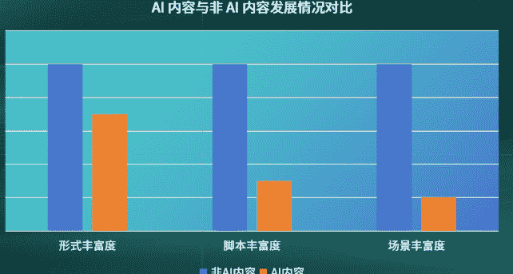

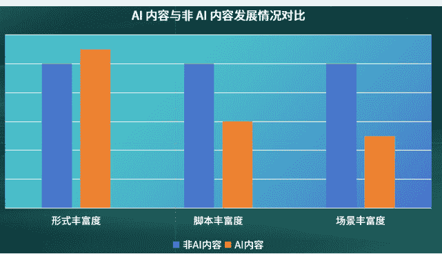

从 Veo 3、Sora 2 到 Seedance 2.0，创作者关注的问题已经从“这个内容形式（vlog、第一人称讲解、猫猫恶搞等）AI 能制作出来吗”，变成了“用户可能会喜欢看什么”，而用户关注的问题，也从“这是不是 AI"变成了“这条视频是否有趣/有用”，特别是近两个月，各种不同玩法、不同类型的 AI 视频层出不穷，天天刷屏霸榜各大平台、地铁公交上随处可见刷着 AI 短剧 AI 漫剧与 AI 段子的年轻人，人们开始意识到，我们不是抗拒 AI 内容，我们只是抗拒垃圾内容。

B 站，算是国内形态与内容调性最接近 YouTube 的平台，这是 B 站最近一期（0313）的每周必看榜单，首屏的 14 条视频，有 4 条都是完全由 AI 制作的视频，放在过去，没有背景新人 UP 主基本没有任何可能杀入这个榜单。


```
https://www.bilibili.com/video/BVIDFNTzPEAk/?spm_id_from=333.934.0.0&vd_source=f224fe3780ce928dc9e7466c64c78a40
```

这条日语老电影风格的短片，大家可以欣赏一下，如果视频没有带上“AI 创作大赛”的标签，恐怕我们只会以为这又是哪位大神闭关几年憋出来的大招。

事到如今，我想根本没有必要去讲 AI 有多大潜力，也已经不再需要把"AI 内容”和“非 AI 内容”分开讨论，我们只需要关注内容本身，关注用户需要的到底是什么内容。

那么 YouTube 呢？

自然也是一样。

这是 2026 年 3 月 18 号，YouTube 的播放量周榜，前 10 名里，有 6 条都是 AI 视频，其中也有我们圈友的频道。


要知道 1 年前的这个时候，前 100 里都不见得有几条 AI 视频。

那现在是到头了吗？看看这些排行榜上 AI 视频有多简单，而国内的 AI 视频质量有多高，我如果说现在 YouTube AI 内容已经红海了，没有机会了，你信吗？

如果要给一个宏观的、大的现状，实际上毫无意义，去年 4 月我说，AI 内容至少将占据内容市场的半壁江山，在当时这看起来还那么遥远，但是今天再看，很可能马上就要实现了，甚至远不止一半市场。

但然后呢？这样的结论，对于我们每一个一线的创作者、普通人来说，是没有落地价值的，所以具体要做什么才能变现？才能参与到 AI 的浪潮中来？

具体到赛道，目前 YouTube AI 内容的发展，仍处于前中期，还有大量的传统赛道亟待改造，AI 内容虽然声势浩大，但实际上仍然只在 YouTube 的变现生态里占据了一小块版图：

- 泛娱乐化的无语言 shorts 与语言类 shorts
- 以及极少的长视频内容

还有很多水面下的赛道，由于受众所限，没有被大众所看见，不被大家所认知。就像去年我们刚开始起步做 AI 视频的时候，很多局外人还会问我们"AI 内容能开通 YPP 吗”"AI 内容能赚钱吗”，而现在，这些问题我相信已经不会再有人问了，大家只会关心什么样的 AI 内容更好变现。

那这里也分享一些 YouTube 深海圈风向标中有趣的小赛道：

### AI 赛道分享：

- ### AI 俄语历史故事


- ### 3D 风格英语科普故事

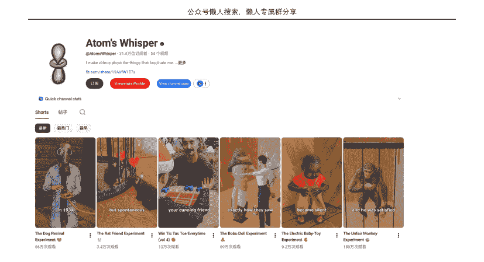

- ### AI 西语耶稣圣经故事

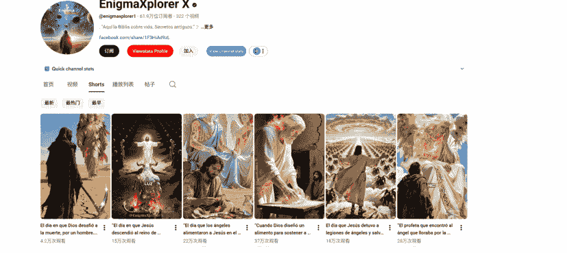

- ### AI 植物大战僵尸上下对比

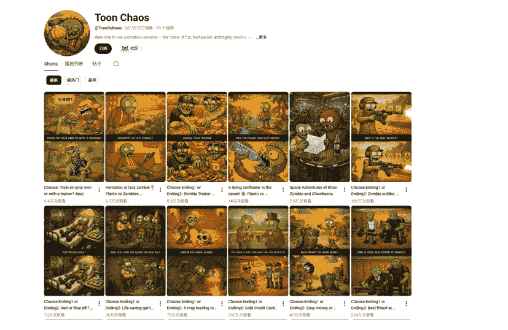

- ### AI 汽车配件卡通英语科普

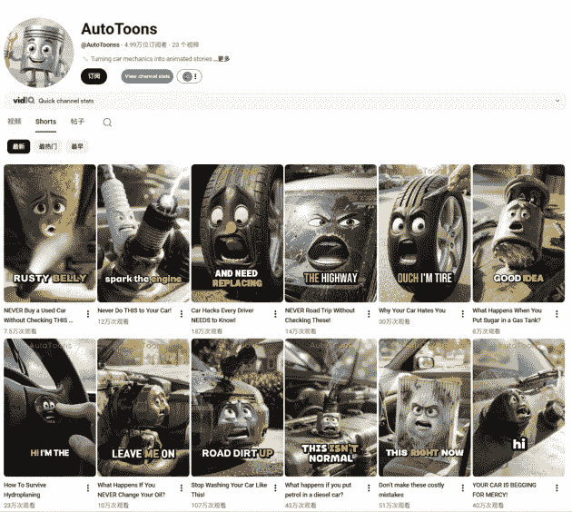

### AI + 真人实拍赛道分享：

https://www.youtube.com/@YoungEmperors/shorts 这个号可以多说两句，不知道大家是否有感受到，国内外现在很多真人博主早就在倒反天罡用 AI 来拔高自己的创作上限了，下面这个博主就是个有趣的例子，所有视频都是一段视频 + 一段 AI 续写

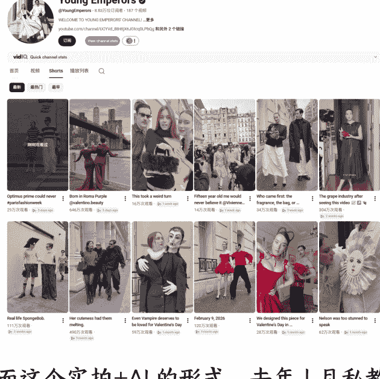

而这个实拍 +AI 的形式，去年 1 月私教陪跑、3 月航海的时候我都做过分享，现在已经成了很多 YouTube 真人工作室的标配。

### 1.2.3 AI 内容能够轻松复刻的爆款底层要素是什么？

- 色欲：美女、性感、擦边、XP
- 好奇/猎奇：没见过的物种、没看过的表演、想不到的变化、没听过的故事
- 恻隐之心：可爱的动物、感人的情谊
- 普及度/背书/从众：名人形象、达人秀评委、节目品牌、动漫电影等

短期内用 AI 模仿 AI，熟悉工具使用，培养网感
长期一定是 AI+ 人来重构重组爆款要素，对纯 AI 和纯人工内容形成降维打击


https://www.youtube.com/shorts/nCitam1e0uY 1.9 亿播放 真人实拍+AI 转绘

这样“不卷”的新赛道，如果想找，还有很多很多，哪怕"AI 语言类 shorts"只是众多变现方式中的小分支，但也仍然还有非常大的挖掘空间。更别说 AI 长视频还在更早期的阶段。

关注内容本身，不要再把目光放在同质化严重的 K-pop 猎魔女团等“传统 AI"赛道了，虽然只有半年历史，但真的已经可以称之为传统赛道。

那具体可以往哪些方向去调整，让我们进入机会分享部分细聊。

## 5. 2026 年，YouTube & AI 内容的机会与趋势

年初和亦仁哥交流时，他提出，目前深海圈的 YouTube AI 视频，应该拓展为 AI 视频，不应该把内容的价值与变现的路径局限在 YouTube，要发挥 AI 视频、乃至 AIGC 的能量，这个判断我深度认同，这也是今年所有机会的底层逻辑。当然，YouTube 是我们的基本盘，所以下面分享的这些判断，都是围绕 YouTube 的主阵地向更深、更广的方向拓展。

### 1. 未来半年的超级机会 = 垂类内容/真人复刻 × 多语种 × 多 IP × AI 杠杆

同质化审查是平台的自救，不是针对你我，也不是针对 AI。同质化打击的是用同样的内容薅同一批用户的行为。

目前存在严重内卷的就是 YouTube 上的传统 AI 故事、泛娱乐内容，包括 K-pop：一样的剧本、一样的角色、一样的剪辑手法、甚至一样的台词，这样的内容凭什么能被平台和用户认可呢？

### 从垂直度出发

现在做的都是 AI 故事、都是泛娱乐化的内容，但垂类难道不能做吗？

科普？教育？游戏？音乐？


前面也展示了不少。垂类赛道还有非常巨大的空间。

不要对前人走出来的道路形成路径依赖。

### 从脚本出发

还有巨量的真人脚本没有被 AI 滥用——YouTube 20 年的积累都在最近几个月被抄完了吗？还是说 TikTok、抖音、快手、视频号上的爆款脚本不够我们模仿？

### 从语种出发

YouTube 有 27 亿月活，其中英语原生用户占比不到一半，西班牙语、葡萄牙语、印地语、阿拉伯语、日语、韩语、德语、法语——这些语种的 YouTube 用户体量巨大，但 AI 视频创作者并不多。同样的脚本制作成小语种，在对应市场可能获得远超英语市场的竞争力。

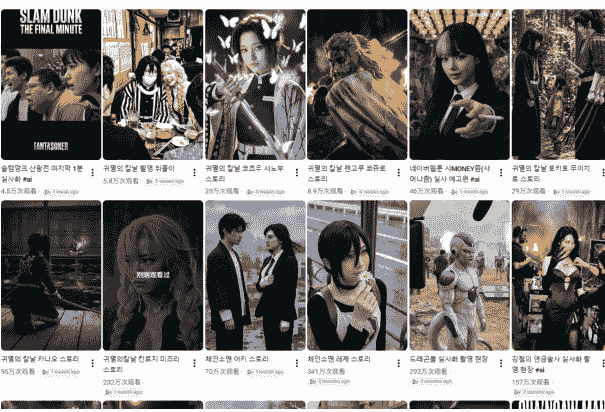

多语种的矩阵还真被市场验证过，此前国人靠多语种分发在 YouTube 赚大钱是短剧出海，把国内的短剧直接翻译成不同语种分发，爆款脚本在任何国家都是爆款，就这么简单，并且由于你覆盖了完全不同的受众，平台没有任何理由要判定你同质化。

### 从 IP 出发

不同国家有不同的本地化 IP，如果你就只知道一个 K-pop 猎魔女团，那当然会不知道做什么。像 Roblox、Minecraft、龙珠、火影等等，都是在 YouTube 有数十年历史的经典 IP 形象，这样的形象也是两只手抓不过来，不同 IP 又有不同的受众，怎么会不够用呢？

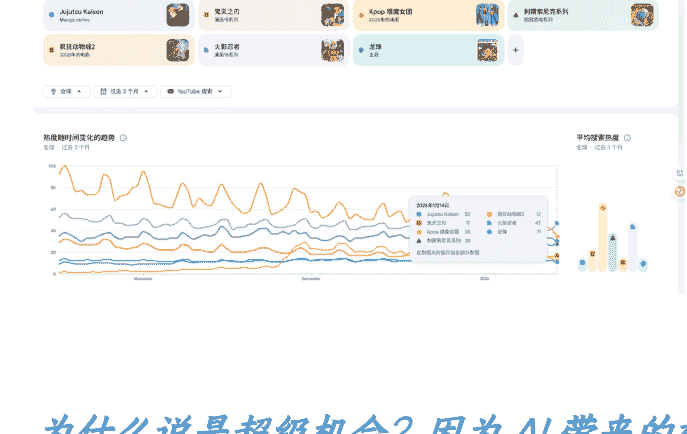

为什么说是超级机会？因为 AI 带来的杠杆。

现在 OpenClaw 又把 AI Agent 的能力推向了新的高峰，最快挖出赛道、最快用 AI 把工作流固化成 AI 员工 skill 的人，毫无疑问能够做到月入万刀甚至十万刀的规模。

但光有 AI 实际上还不够，你的赛道不够多呀，内容产能大于赛道容量也是白瞎。

但是上面垂类内容、真人脚本、多语种、多 IP 的矩阵策略，能够让一个创作者、用一套内容生产模式，覆盖到非常多的赛道，我举个容易理解的例子：

下面这三个频道是深海圈之前收录过的风向标，分别是讲英国、美国、澳大利亚养老金和各种补助政策的频道。

公众号懒人搜索，懒人专属群分享

| 频道名称 | 订阅者 | 视频数 | 简介 | 近期热门选题 |
| :--- | :--- | :--- | :--- | :--- |
| **UK Pension Guide** | 7160 订阅者 | 148 | Welcome to UK Pension Guide – Your Trusted Source for UK Pensions & Senior Benefits. | - DWP CONFIRMS £562 PAYMENT CHECK IF YOU QUALIFY<br>- Confirmed: 2026 DWP Pension Changes – What UK Pensioners Should Know!<br>- New DWP Pension Review Could Change Payments for Some Born Before 1961!<br>- Attention UK Drivers 60+ New 2026 DVLA Rules That Could Affect Your Licence!<br>- DVLA's 2026 Licence Shake-Up for UK Drivers 70+ – What Could Stop You From...<br>- UK State Pension Shakeup 2026: What Every Senior Must Do Now!<br>- £1,781 DWP One-Off Payment Starts Tomorrow | Check If You Could Be Eligible!<br>- Over 60s in The UK: Why Thousands Miss Up to £3,900 a Year Without Realising!<br>- Born Before 1961? Urgent: State Pension Review Underway – Check Your Payments... |
| **Seniors Benefits** | 4970 订阅者 | 458 | Welcome to Seniors Benefits – your trusted source for the latest updates on Social Security... | - Social Security Update: Approved Relief For Low-Income Seniors & Veterans<br>- Social Security Increase March for March: Big Update For Seniors, Veterans, Retirees<br>- SSA Payments Today for Seniors & Retirees<br>- SSS & SSDI Payment Date Surprise: Early Checks For Seniors, Veterans, Retirees<br>- Social Security Change Finally Hits Seniors & Veterans – Big March 18 Update<br>- Social Security Payment Alert: Breaking Sunday Deposits for Seniors & Veterans<br>- SNAP Benefits Eligibility Rules – Big News for Seniors, Retirees & Veterans<br>- Social Security Update: Big News on $5,181 Payments for Seniors and Retirees |
| **Aussie Pension Update** | 3990 订阅者 | 160 | Welcome to Aussie Pension Update – your trusted source for the latest Australian pension... | - BREAKING: Centrelink Rule Changes Hit Age Pension & DSP – Full Impact Explained<br>- 10 Australia Laws Every Senior Must Know in March 2026 | Pension, Driving &...<br>- NEW AUSTRALIA Driving Rules 2026 Take Effect 9 MARCH 2026 – Seniors 65+ Alert<br>- Age Pension Bombshell: Australia Drops Age 67 Pension Rule – What Retirees Must Know<br>- BREAKING: Centrelink Double Blow for Pensioners – New Rules Explained<br>- Centrelink Age Pension 2026: $1,600 Increase Explained – Who Qualifies & When...<br>- Driving After 70 in Australia: What the 2026 Licence Rules Mean for Seniors<br>- Age Pension Shock: Australia Scraps the Age 67 Rule – What It Means for Retirees<br>- Australian Age Pension Travel Rules 2026 – March Payment Changes Every... |

看到这三个频道的第一眼，我相信你已经懂了。

既然养老金能讲，那教育补贴是不是也可以？就业政策是不是也可以？

英国美国澳洲可以，日本可不可以，德国可不可以？

只要在细分赛道下摸索出了一套成熟的 SOP，就很快能够用 AI 复制到其他地区、其他领域，当然其实过去借助自动化工具也可以做到，但 AI agent 进一步降低了这条路径的门槛、提高了自动化的上限。

今年，深海圈一方面会加大在不同赛道、不同玩法、不同变现模式下的分享与引导，另一方面也会和生财打造 AI 亦仁一样，把 AI 的能力更深度的嵌入社群运营与内容创作中，将沉淀下来的几千条爆款视频脚本、几十万字的经验分享与方法论工具化，赋能大家更高效、更低门槛地完成内容创作与变现。

### 2. 收益多元化的机会 = 国内外多平台分发+AI 自媒体

### 关于多平台分发

过去，由于不同平台的调性不同，用户偏好不同，多平台分发的投产可能并不高。但随着 AI 工具的迭代和 AI 内容的进化，优质内容的国界越来越模糊，我们会发现越来越多 YouTube 的 AI 爆款内容，发布到国内，也是爆款，甚至 YouTube 没爆，在国内爆了。去年 1 月 NANA 教练就分享过，YouTube 爆款赛道分发到国内，甚至更爆，多个平台都拿到了不错的收益，实现了一鱼多吃。

于是我在去年 12 月便参加了 Youtube 大航海，成功发布第 1 条 Shorts，今年 1 月中旬又参加 Youtube 实战陪跑至今，春节后尝试了@方波妮和@gary 曹淦两位教练摸索出来的油管新玩法，截止目前已达标开通高级 YPP 门槛（数据本周会更新），在整个过程中识别了很多坑、培养了扛住起起落落的心态，同时国内无心插柳柳成荫，成功赚到了超过 3000+ 的收入、全网涨粉 10w+，累计播放量 5 千万+。 🤟方波妮 教练一直鼓励我做分享，她说:“你已经很棒了，越分享越幸运”。真是，谁不想幸运伴呢，感谢这篇帖子的最大推手，在此鞠躬亲爱的波妮教练。

| 平台 | 启动时间 | 内容数 | 粉丝数 | 累计播放量 | 累计获赞 | 累计收入 |
| :--- | :--- | :--- | :--- | :--- | :--- | :--- |
| 抖音号 | 2024.12.18 | 27 | 2.37 万 | 350 万 | 7.1 万 | 33.8 |
| 快手号 | 2024.12.22 | 24 | 2.7 万 | 240 万 | 7.5 万 | 44.9 |
| 小红书 | 2024.12.18 | 39 | 2604 | 20 万+ | 1.8 万 | 0 |
| 视频号 | 2024.12.18 | 45 | 9.8 万 | 4400 万+ | 129 万 | 3000+ |

截至 2025.02.16

### 海外平台
YouTube、TikTok、FB/Instagram、Shorts、X。

### 国内平台
视频号、抖音、小红书、B 站等等。

这些平台都有创作者分成计划，同样的 AI 视频内容，一次制作，多平台收益，本就是理所应当，这才是创作者的逻辑。

### 关于 AI 自媒体

再者，去年底徐徐教练也给了一个很典型的案例，她发布在 YouTube 的视频，发到了视频号，不仅爆了，而且吸引了很多机构与甲方的合作，顺理成章地启动了 AI 自媒体的第二曲线，一边制作 AI 内容，一边作为 AI 自媒体博主分享自己的创作经验，将创作能力进一步商业化。

随着 AI 编程的普及与进化，越来越多国内团队与个人开发的 AI 产品在出海的浪潮中占据了世界范围内的领先地位，而这些出海的 AI 产品，天然就与 AI 内容的创作者 IP 调性相合，这也意味着，AI 自媒体与 AI 内容一样，是国内外通吃的生态位，一般来说，海外的 AI 产品商单，即便是小博主也基本可以达到 200 美金/条以上的报价，而且还往往供不应求，没有足够的 AI 自媒体博主能够投放。

所以后续我们会通过工具与分享引导大家先从分发开始，逐步打造属于自己的内容 IP，建立属于 AI 时代的创作者的核心壁垒。

### 3. YouTube 联属营销带货

YouTube 带货的生态正在成熟，平台在主动降低门槛、增加工具、推动创作者参与。今年关于 YouTube 带货已经有好几个大渠道的合作新闻：shopee&台湾市场、速卖通&韩国市场、乐天&日本市场，而最早启动的美国已经合作了包括沃尔玛、Bestbuy、Etsy 等电商平台和 nike、adidas 等大品牌在内的 3000 多家商户。

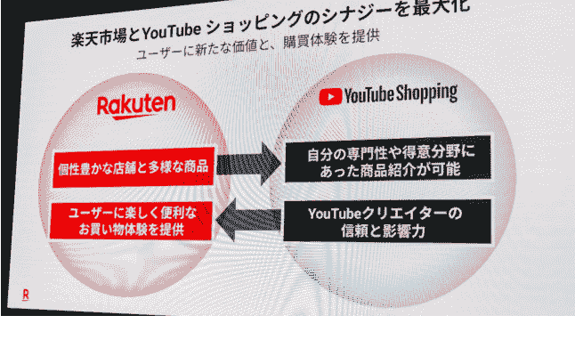


这是 YouTube 已经明牌在推的方向。

TikTok Shop 在 2025 年仅美区电商销售额就约 158 亿美元。像 YouTube 这样的大平台，哪怕只是从 tiktok 撬过来一小块蛋糕，也足够喂饱我们这些小玩家了。

就像四水年华圈友在 12 月一个频道带货 19 万 GMV，是怎么带货的？仅仅只是在毫无带货引导的 AI 视频里，加入了沃尔玛的 T 恤，而后用户跳转至沃尔玛完成了其他商品的购买，再产生 GMV 与佣金，这里还有很大的想象空间。


过去联署营销（类似 tk、抖音的精选联盟和视频号橱窗）需要高级 YPP + 1 万粉丝，门槛相当高。

而最近 YouTube 将联署营销的门槛调整为初级 YPP + 1000 粉丝，这是我们一个一千多订阅的 YPP 频道，过去没有带货功能，现在已经开通了联属营销带货权限。


至于如何跟电商出海的玩家们形成合力，一起探索 YouTube 带货的更多可能，我想这会是水到渠成、可预见的未来。

### 4. YouTube 信息套利

众所周知，当下越来越多的品牌、企业与 IP 选择出海——当国内的产品各方面都领先于世界，把市场拓展到海外就成了自然的选择。围绕出海需求的服务也是未来的超级机会，但目前，这和我们普通人还没有特别大的关系，入场时机尚未完全成熟，后续有时间我专门写篇文章给大家讲讲。

那么什么和我们有关呢？

实际上很多国内无人问津的内容，在海外存在很大价值；在海外习以为常的信息，在国内千金难换。

比如说，即便 YouTube 已经存在了 21 年，但到今天为止，搬运国内的特定内容去 YouTube，仍然能享受原创的待遇，开通 YPP，拿到创作者分成（这里只是举例：我们不鼓励搬运，并且也存在风险）。

比如说，YouTube 看起来高大上遥不可及，直播看起来跟普通人更是毫无关系，但是去年，我们带着一批圈友在 YouTube 直播会说话的汤姆猫、地铁跑酷这样的微信小游戏和手机小游戏，开了上百个 YPP。

比如说，在闲鱼、小红书等平台，一个普通的 YPP 账号贵的可以卖到几千块，但是买回来之后很可能连售后都没有，还没开始产生收益就被封号，甚至更多的情况是作为想要快速入局的普通人，想购买一个账号却找不到渠道。像去年 4 月做出 2 亿播放爆款的圈友小圈，作为 00 后，在下半年切入了 YPP 账号交易这条赛道，做到了六位数的月流水，高峰期每月出售 200+YPP 账号。

比如说，一个有年份的 YouTube 频道，更容易运营起号，同样是几年的历史，有些号商卖 100 块一个，有些号商卖 10 块一个，它们可能并没有任何区别。

上面这样的案例，还有不少，想了解下次可以再写一篇专题，分享我们围绕 YouTube 搞过的那些骚操作。

## 结语：

我常说，靠 YouTube 赚钱，不一定要靠 YouTube 发钱；

同理，靠 AI 内容赚钱，也不一定靠 AI 内容拿创作者分成。

道理都懂，但大家的视野往往都在长时间里囿于非常小的利益窗口，这也和我们过去引导大家侧重 YPP 收益有关。但眼下，许多我们过去埋下的种子，在慢慢生根发芽，长出新的枝叶。

我们会继续带领大家，未来 YouTube 深海圈会有更多的圈友在各细分赛道拿到结果。

帮助圈友真正跨过 AI 内容与 YouTube 的门槛，让圈友可以借助 YouTube 以及 AI 内容拿到结果

真的很感慨，这一路能有生财有术，特别是亦仁老大和欢欢团队作为强大的后盾，

我们在 YouTube 深海圈发生的任何事，在运营了九年的生财有术看来，都是家常便饭，我们可以安心做好圈友的交付。

### 具体会分为三个主线：

- 1. 围绕 AI 内容进行更深度的沉淀，将我们过去积累的方法论与案例**课程化、工具化**，让新圈友能够借助工具与课程快速入门并制作出符合市场需求的内容，让老圈友能够借助工具、方法论实现对自己产能的放大，让大家能够高效地完成创作、变现的全流程。
- 2. 围绕 YouTube 变现进行更深度的探索与开发，站住 YouTube 内容出海与流量渠道的**生态位**，为大家提供更多样的变现路径与指导，比如带货、直播、AI 自媒体等。
- 3. AI 视频并不只能在 YouTube 变现，本文中提到的国内外平台以及大家熟悉的商单、漫剧等商业化方向，依然有巨大的开发空间，这是亦仁老大给我们 YouTube 深海圈指出来的十倍成长路线。

聊了这么多，最后再对深海圈友们说点真心话。

做 YouTube，做 AI 内容，做用户需求，真的不容易。

要学习 AI 工具、学习内容创作、学习平台规则、学习账号运营、学习矩阵策略、学习赛道玩法....

然后好不容易做出爆款了，赚到钱了，
YouTube 送你个同质化。

咋说呢，我们只做社群不做项目？对一线问题毫无体感？

但实际上，我们工作室从去年成立至今也运作了一年多了，大家一路上踩过的坑，我们一个没少踩，甚至踩的更多——然后分享出来让大家不要踩；今天可以分享一部分心路历程给大家看个乐子。

去年 2 月 YouTube 直播能开 YPP，非常有流量，是我们自己春节期间测出来的玩法，反复验证可行、安全后，就第一时间分享给了大家。

去年 4 月的救援类赛道——当时还没有未成年有害内容的问题，也是先让 YouTube 深海圈圈友小圈去跑跑，确认他大爆特爆并且还没有违规之后，就马上在风向标和直播里分享给了大家。

去年 5 月的达人秀版权警告，YouTube 深海圈小芬教练和波妮自己的账号都是第一批受到打击的账号，为了尽快确认有没有余地，减少对圈友的影响，波妮拉了我们几个人的小群，和小芬用 3 个 YPP 账号被取消的代价，验证了达人秀版权警告基本没有申诉的可能性，然后我们才公开同步达人秀赛道的变化，让大家对自己的视频做马赛克或隐藏处理。

去年 6 月的真人复刻，虽然我 5 月就在风向标分享过思路，但真正推广，是在梓超用真人复刻的思路做出爆款后真诚地分享给我并且不介意我公开，然后我们自己安排实习生小朋友复刻，连大一的小朋友也做出了几百万的爆款，才马上在 YouTube 深海圈风向标里分享给大家。

去年 8 月的 KPOP 猎魔女团，虽然风向标连续两周都贴了，有了爆火的势头；但大力推广是因为 YouTube 深海圈教练大臣给我发了一张截图，告诉我 KPOP 猎魔女团，流量不仅大，单价还很高，我们就自己安排工作室的小伙伴测试，发现这个机会真的能够复现，才激动地在风向标和深海圈内部直播分享，一直到现在火了大半了 [2026 奥斯卡最佳动画长片出炉，有人靠它拿下 YouTube 百亿流量](#)；包括现在市面上有非常多人写 YouTube 公众号，60% 以上都曾写过 KPOP 猎魔女团，甚至如今还在继续写。

去年 6-9 月的未成年有害内容审查，一次比一次升级，写在明面上的规则一定会模棱两可，审判权在平台官方；我们从不做儿童危险，到不做未成年危险，到不做拟人化的卡通幼崽危险，到现在不做任何形式的面向未成年人&不利于未成年人身心健康的内容，这个边界的明确和拓展，都是踩坑的圈友和波妮博哥教练组织的 YPP 审核教练一次次用血的经验换来的。

我们不可能在最开始，大家流量爆火的时候，就一刀切，这个钱放在那里不让大家赚？不做没流量，做就能爆，就能创收，真正是刀口舔血的经验；我们只能从风险把控和事后复盘的角度，尽早测出边界情况、尽快通知最新消息、尽量控制损失最小；在一线才有战绩，历史上的长胜将军之所以广为流传，是因为少；普通人人的人生就是容易跌跌撞撞，吃一堑，长一智；一个人可以被打倒，不能被打败。

去年 11 月的龙珠悬赏，为什么我笃定地相信语言类有大机会，不只是一何时机成熟，而是当时我接了孤山老师一起测试欧美 YouTube 海外产品营销的合作需求，想看泛娱乐化的 AI 语言类内容，是否能够实现对产品的有效曝光和转化，然后我才招募了一批做语言类的圈友测试 (包括 Geektao 圈友在内)，不过海外营销没跑通，但是发现了非常简单的语言类视频就

能做出爆款，而且拿到不错的收益，然后就有了 Geektao 圈友的语言类赛道直播分享和精华帖：https://t.zsxq.com/vli4b；
然后我们在 YouTube 深海圈发起了 11 月的龙珠悬赏，才有了大家对语言类的大范围探索，12 月四水年华震惊圈内外的月入两万刀：https://t.zsxq.com/ungTy。

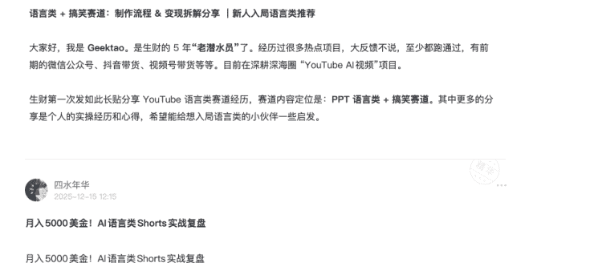
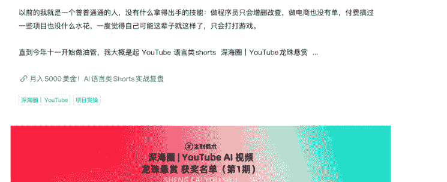

| 排名 | 星球昵称 | 星球编号 | 赛道 | 标题 | 奖励 |
|---|---|---|---|---|---|
| 1 | Geektao | 3228 | 语言类 | 语言类 + 搞笑赛道：制作流程 & 变现拆解分享 (新入局推荐) | 半截龙珠 |
| 1 | 四水年华 | 195233 | 语言类 | 月入 5000 美金！AI 语言类 Shorts 实战复盘 | 半截龙珠 |
| 2 | 亿豪 | 130975 | 语言类、长视频 | 1.8 万字分享「Youtube 新人如何突破万播&提高 RPM 单价」 | 一颗碎片 |
| 3 | 雨文 | 5751 | 长视频 | 初学者从 0 到 1 制作 AI 短剧全流程 | 一颗碎片 |
| 4 | Zero | 80974 | 语言类、长视频 | 【月入万刀】2 天速通高级 YPP+ 一亿播放量的语言类 Shorts 探索心得 | 一颗碎片 |
| 5 | 金鱼 | 60563 | 语言类 | 《Youtube 语言类 Shorts 月入万刀秘籍》——金鱼的选爆指南 | 一颗碎片 |
| 6 | 波哥 | 18907 | 长视频 | 1 年 9 次迭代：Youtube 长视频冲破 1000 万播放 | 一颗碎片 |

12 月至今的同质化，规则也是逐步递进，层层加码的，为什么我说不是针对 AI，传统赛道一样遭殃，不是因为我们只做 AI，我们也有做 Reddit 故事号这样的传统赛道——6 个账号挂了 5 个，为啥还剩一个没挂？是为了做测试，看看把视频全删除是

否会被判同质化，测试结果就是就它苟活下来，其他 5 个号全挂；

而 AI 内容的同质化频道，我们也有上十个，也损失了上万刀的收益，我们不心痛吗，但心痛没用啊，那我们能做的是什么呢？

和圈友们同在第一线，尽可能地扩大风向标赛道、安排风向标专场直播、常态化运营悬赏机制，引导大家尝试不同赛道；

通过一个接一个地申诉来试探审核的边界和整理 SOP、

和大家一起测试删视频换绑 ads 主动退出 YPP 到底什么策略能够保住更多账号和收益、

不厌其烦地每周直播讲风向标，让大家做好内容整改和赛道调整、

给大家整合风险案例开发内容审查工具。

为什么直到今天，我才一刀切让大家尽量别去做 KPOP？是因为虽然挂了一批账号，但活着的 KPOP 仍然给我们贡献了不少收益。但随着审查越来越严格，高手也许知道如何规避风险，以及高手承担风险能力更强，但大部分圈友很可能无法判断风险高低，从而面临巨大的同质化风险，我们账号多，死了也还有顶替的，但新手基本没有，所以我才在这篇文章里一刀切，让

## 新手别去做 KPOP 赛道了，而不是它真的做不了了。

近期 Seedance 2.0 的发布颠覆了内容生态，我也是第一时间自己去体验了，发 YouTube 了，爆了，才兴奋地找更多圈友分享案例、再进一步整合信息，在当周的 YouTube 深海圈风向标给圈友们分享。

> 完全没有剪辑或者做任何调色变速等处理，直接发布到了视频号流量如下，一天就 25 万播放了，YouTube 是账号限流，不然大概率也爆了


过去，这些话我从来都没有拿到台面上来说过，因为我觉得这些是我们作为社群的总教练、作为 YouTube 深海圈教练团该做的，那做就行了，没必要说。

时至今日，我看到很多新圈友甚至老圈友比较迷茫，我觉得有必要在这里给大家打打气：

既然深海圈能带大家在过去的一年里踩中这么多次风口，就一定有更大的底气在未来一年里和大家踩中更多、更大的风口，我们最大的底气并不是我自己，而是深海圈里的每一位圈友，以及每一位教练团成员，是我们一群优秀的人共建了整个 YouTube 深海圈社群。

- ——如果没有木辞、邵先森教练去年分享的工具，就算有了直播的玩法，大家也不可能把直播规模化；
- ——如果没有怅惘教练、酷拉皮卡教练、小芬教练对达人秀赛道的深度开发和无私分享，达人秀这个赛道不可能有长达半年的生命力；
- ——如果没有小圈超强的执行力，救援类的赛道很可能被我们错过最佳的入场时机；
- ——如果没有梓超告诉我他那条真人复刻的视频爆了，真人复刻的优先级可能还要晚几个月才会进入大家的视线；
- ——如果没有一卒教练分享他的提示词模板、S.Z 分享他的自动化思路，可能大部分圈友还停留在手搓视频的阶段；
- ....

这样的优秀圈友，实在是太多太多了，大家在生财有术官网搜 YouTube 相关的精华帖就能明白我在表达什么；说这么多废话，其实只是想表达，我、波妮、教练团的每一位教练，都一直并且会永远和大家站在同一战线；而大家每一个人，一起构建了深海圈核心价值——社群的价值、人的价值，这是 AI 时代不可替代也是最珍贵的东西，因为只要有人在，就一直会有新的希望与机会涌现。

最后，祝大家月入万刀，去年，我们成为了全国最牛逼的 YouTube AI 视频社群；今年，让我们成为全球最牛逼的 YouTube AI 视频社群。

———分割线———

看完这篇 SOP，你觉得你懂了。但 90% 的人一到实操就会卡在第一步。

工具和教程只是最低级的壁垒，真正的壁垒是“立刻动手”和“圈层信息差”。

如果你想看全网最新的变现玩法，并且和一群执行力极强的极客一起下场拿结果，欢迎围观我的核心私域：【懒人专属群】。

我们不聊虚的，只做商业闭环的拆解与 AI 效率的压榨。系统内已沉淀 1000+ 跑通的套利实战局。

📎 查阅圈子完整数字资产与上车门槛：https://lazyso.com/insider/

认同价值、准备好下场干活的，扫码加我微信（lazyhelper1）

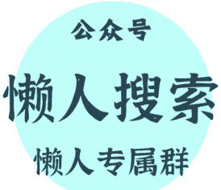


微信：lazyhelper1

备注：【实操上车】，不闲聊