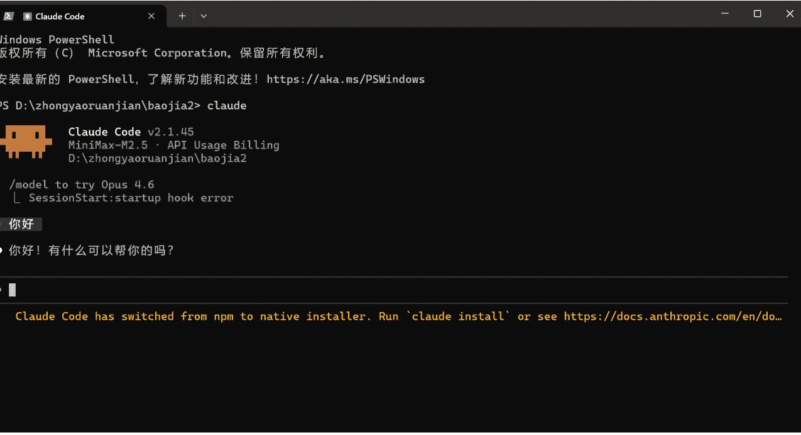
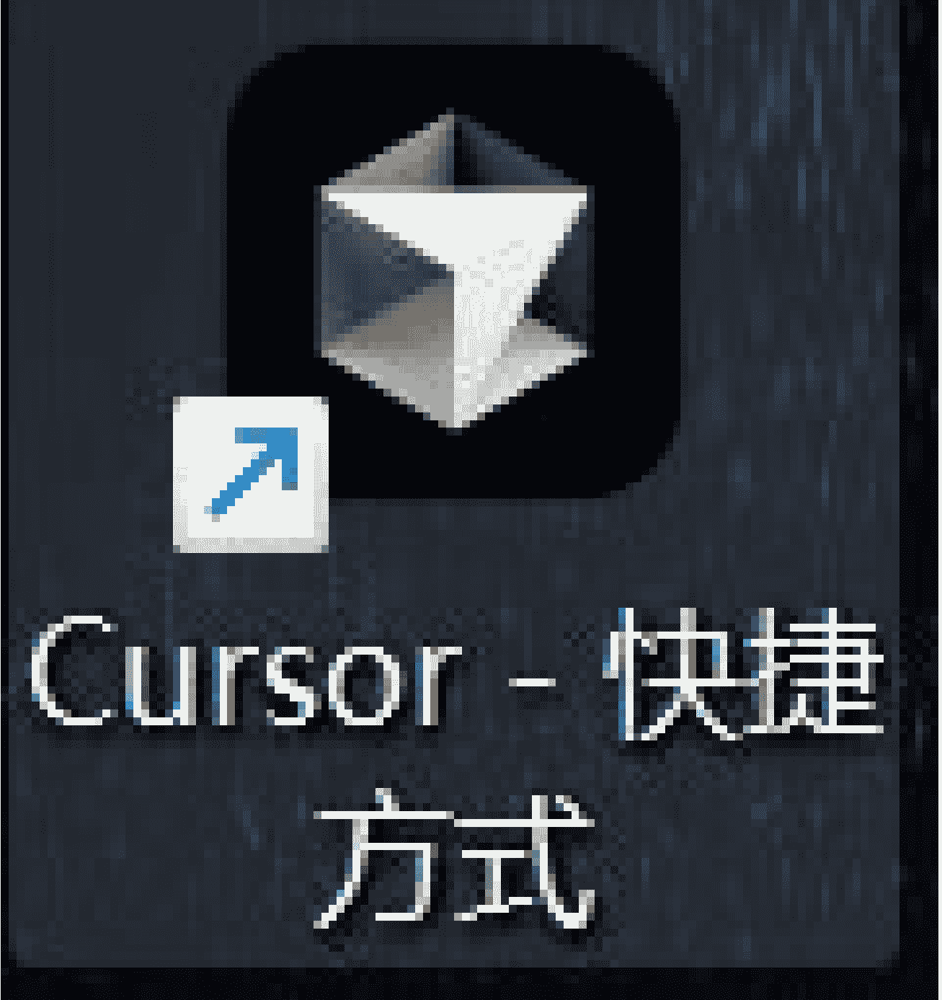
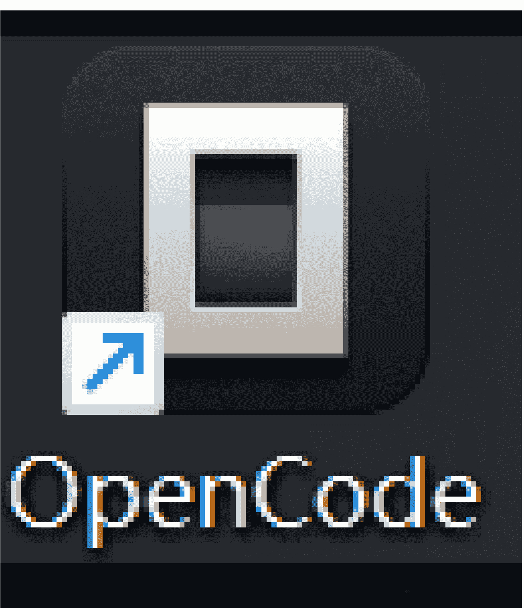
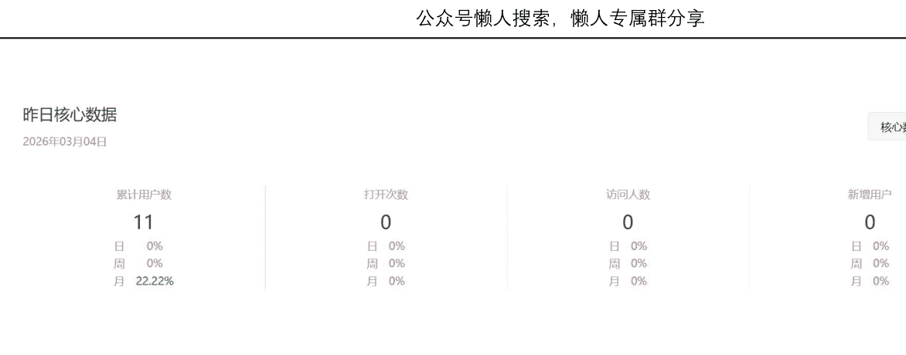
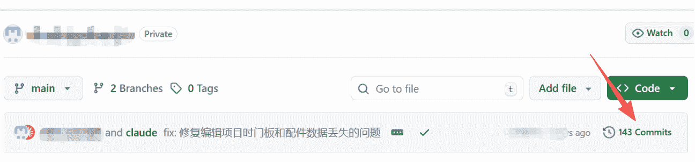
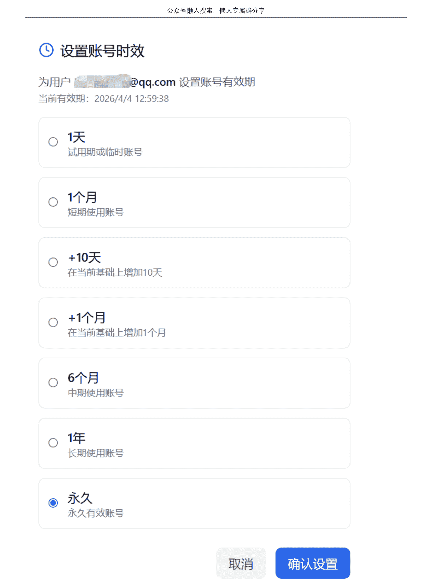
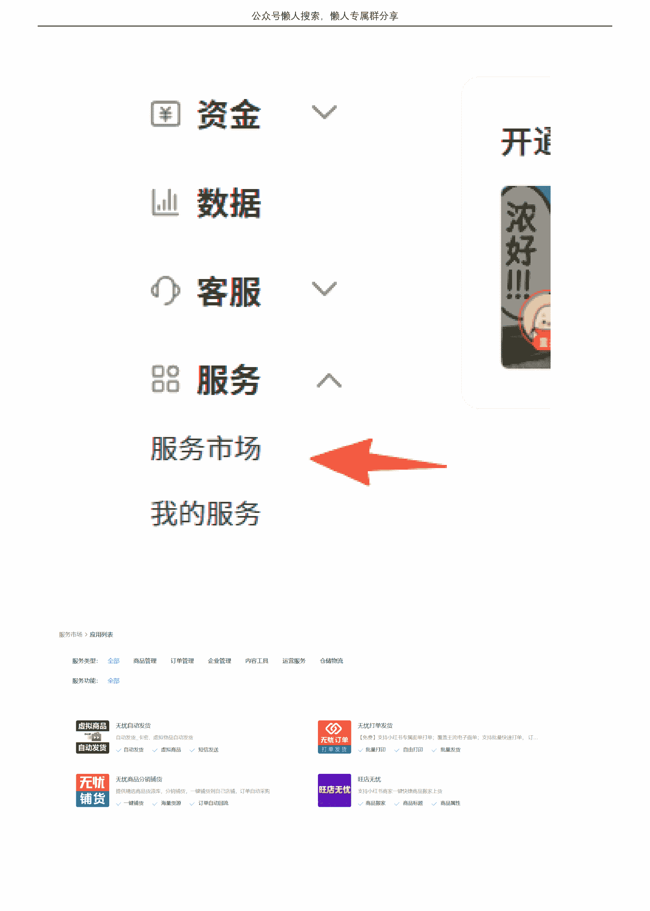

# 从身边的需求出发，普通人靠 AI 编程 + 小红书，从 0 到 1 做产品到变现的方法论

## 260323 副业 SC 精华

公众号懒人搜索，懒人专属群独享
懒人微信：lazyhelper1


各位好，我是现实太美。

我目前还是一个：

- 在职社畜，主要职业是全屋定制设计督导，类似导师一类的职务。
- 编程新人，设计了一个基于自己职业演化而来的 SaaS 工具，全屋定制报价系统。


到目前为止一个月左右积累了四十几个付费用户，但是这对我一个编程新人来说，已经算是比较大的鼓舞了。


目前小红书的收益，线下也有一些额外的收益，私域转化之类的。


那么废话不多说，本次主要分享我目前在做的项目，AI 编程与小红书相互结合的变现思路以及落地方案。核心思路就是解决产品 + 流量两大问题，这个路径相对普通人来说可能更加容易落地一些。

本文主要有以下几部分：

- 一、核心技能铺垫：AI 编程的认知与实践
- 二、产品实践起步：从练手到聚焦核心需求
- 三、转型突破：借助小红书虚拟赛道，激活产品价值
- 四、流量运营：用 AI 编程高效搞定小红书运营
- 五、总结

感兴趣的，大家就往下看吧！

## 一、核心技能铺垫：AI 编程的认知与实践

### 为啥我觉得 AI 编程是必备技能？

我目前的一些思路，也都是基于 AI 编程这项技能去围绕展开的。我还记得前段时间亦仁还发过帖子说，AI 编程应该成为我们这辈人的基础技能之一，我是很认同的——因为真的没有多难！但真的十分有用！

### 我在用的 AI 编程工具 (低成本 + 免费可选)

我目前在用的编程组合是 Claude Code + MiniMax 2.5 的编程套餐，整体来说十分便宜，我现在用的是 49 元一个月的套餐，我觉得对于我们非重度使用的人来说，也完全够了。

如果你希望不花钱白嫖，也是有的，这边推荐 OpenCode，里面内置了好几个开箱即用的免费模型，包括 GLM5 和 MiniMax 2.5，这些都是国内一线的编程模型了。当然你用国外的模型更好，但是比较麻烦，需要“魔法”，这部分这里就不展开讲了。



### 我的 AI 编程自学路径 (新手可参考)

其实我本身也没有系统性的学习 AI 编程，都是自己摸索来的，也没有找人教我。现在市面上的免费教程一抓一大把，其实只要沉下心去学习，真的可以很快学会。

如果你对 CLI 命令行工具一开始不适应，我推荐你可以按照我的使用路径来一步步使用下来。我的使用路径是：Trae → Cursor → OpenCode 桌面版 → Claude Code CLI，使用难度是从简单到难的，但是“聪明程度”也是从简单到难的。






当你感觉上一个工具带给你一种瓶颈的感觉，你就可以尝试向下一个工具拓展了。我的判断标准很简单，就是这个工具对我的问题反反复复修复不好，出现好几次，那我就认为它可能到瓶颈了，就考虑更换工具了。

目前我用得最久的，就是 Claude Code + 国产 SOTA 编程模型的组合（因为个人很不喜欢使用“魔法”，虽然这不是一个很好的习惯，哈哈）。

Claude Code 安装指引，航海手册链接：https://scys.com/course/detail/109?chapterId=4517

### 核心提醒：动手比选工具更重要（也是新人起步最核心的困难：不敢动手）

总之，工具只是一方面，更关键的是现在就开始使用它，制作出你的第一个想法、第一个需求，哪怕你现在拿它做个简单的贪吃蛇小游戏也好！

## 二、产品实践起步：从练手到聚焦核心需求

### 做报价工具的初衷 (源于我自身行业需求)

我做报价工具，源于自身全屋定制行业的需求——经常要帮设计师、导购报价，就想做一个提效工具。在这之前，我用 AI 编程做过一个家庭点菜小程序练手，没什么人用，但是却也积累了基础经验。

你来下呗

我有个报价不知道咋做了


我不是随便的人，但是今天的菜我随便

一次偏好设定，每日自动生成个性化菜单

开始设置偏好

### 📖 使用说明

- 1. **设置偏好**
   告诉我们您的口味喜好和饮食习惯
- 2. **生成菜单**
   AI 智能推荐个性化的每日菜单
- 3. **生成清单**
   自动生成采买清单，便捷购买所需食材
- 4. **开始烹饪**
   跟随详细步骤，轻松制作美味佳肴



### 核心产品：定制柜报价 SaaS (纯自用起步)

这个定制柜报价 SaaS 系统是我的第二个产品，花了一个多月打磨，一开始只供自己使用，完全没想着变现。后来参加生财大航海（热词快站、YouTube），虽没跑出成果，但让我明确了流量的重要性，也开始尝试产品 + 流量的变现思路，只是当时还没赚到钱。



目前回想做的最对的事就是基于自己和周边人的需求开发产品，明确目标人群，这也为后续推广变现打下了基础。

## 三、转型突破：借助小红书虚拟赛道，激活产品价值

### 心力耗尽寻新径：从大航海迷茫到小红书虚拟赛道入局

之后我参加了生财两次大航海，慢慢意识到流量比做产品更重要，于是选了热词快站和 YouTube 两个偏流量的项目。

但两次航海都没拿到正反馈，心力一点点耗尽，对这两个方向的投入也越来越少。

我想这也是很多普通人的通病，在生财里看到一个词很贴切——心力，没有正向反馈，人就很难坚持下去。

但我本身闲不下来，这两个方向跑不通，就想换个项目试试，刚好看到生财里小红书虚拟赛道很火，便决定入局尝试。

### 选品破局 + 产品落地：从短板规避到订阅制测试见效

刚开始自己刷帖摸索，一直没摸透选品逻辑，当时很多人说小红书虚拟已经进入原创时代。但我本身文笔一般，让我像大佬一样输出几万字知识库，就算有 AI 辅助也很吃力。

这时我突然想到，自己天天在用的报价系统，不就是现成的产品吗？我日常高频使用，身边也有不少人有需求，只是我脸皮薄没主动推荐，完全可以直接产品化。

想清楚后我立刻动手改造：用热词快站学到的知识，把系统部署到 Vercel，后端用 Supabase 管理，绑定域名，再改成账号有时效性，本质就是订阅制（这些知识都来自生财航海教程）。

Vercel：主打前端/全栈应用一键部署的云平台，Next.js 母公司，零配置、全球 CDN、Serverless 函数，专注“部署即服务”。（就是可以免费部署你的网站的网站）

Supabase：开源后端即服务（BaaS），基于 PostgreSQL，提供数据库、认证、存储、自动 API，常被称为“开源版 Firebase”。（就是可以免费托管后端的网站）

接着我拆分出多个 SKU 上架：月度 9.9 元，永久使用 199 元，覆盖从低到高的价格段，同时也上架了一些别人卖得好的搬运类资料包一起测试。

实测发现：资料包虽然也能出单，但一旦被别人搬运低价售卖，流量立刻下滑；而报价系统却一直稳定出单，更关键的是，它在小红书虚拟赛道里是独家产品，天然防搬运，别人想抄也要花很大成本。



## 四、流量运营：用 AI 编程高效搞定小红书运营

### 类目危机：慌了一阵，找到解决办法

我的小红书虚拟商品，一开始是上架在其他电子资源类目的。但是中间经历过一次小红书虚拟类目的调整，当时说实话，把我吓的半死。

因为对于小红书来说，我确实是个新手，也不知道它到底会怎么改。如果真的不能上架虚拟类目的话，我可能只能转做私域运营了，但其实当时我没有任何私域运营的经验，所以心里还是很担心的。

但是最后结果还好，其实你可以上架到其他类目，也可以找供应商开通电子类目。事实证明，办法总比困难多，所以还是那句话，不要多想，先干再说！

### 怎么选类目？

- 其他免费可选类目：艺术品及周边 > 艺术定制 > 绘画类定制（或者其他可以无物流发货的类目都行，然后可以通过无忧发货或者阿奇索之类的虚拟商品自动发货平台进行发货）
- 花钱可以开通的类目：成人教育、儿童教育、还有原来的电子资源类目（某鱼上有很多提供此类服务的商家，大概在开通一个店几十元不等，总的来说是比较值得的，开通上架商品之后也是通过无忧发货或者阿奇索之类的虚拟商品自动发货平台进行发货）

自动发货平台有很多，大家可以在店铺服务里面的服务市场里面找找，我目前在用的就是无忧发货，主要是因为可以免费试用一年，阿奇索也是很有名的平台各位也可以使用。



### 上架技巧：学会用 AI 提效吧！

### 1、封面

封面我一开始是直接在系统的 UI 界面截了一张图当做封面的，但是在经过一段时间之后我进行了修改，因为用户无法在这样子的截图封面上看到任何信息，他最多只能看到你的系统的 UI 界面，这样子用户的下单欲望就很低，后来我就改成小红书比较主流的封面款式，就是有截图、有卖点文字的类型，这样子更加美观，客户也更加有下单的欲望。工具可以考虑试用美图秀秀，也可以考虑直接使用 Nano Banana 2 直出，我个人喜欢用香蕉 2 直出，更加快捷（我发现我真挺懒）。

#### 小钟家装避坑指南全套攻略

装修全流程·知识图集·施工工艺·预算表·验收标准·视频课·合同模板

#### 家装避坑装修全流程

#### 家装预算表


#### 装修避坑知识图集大全

#### 装修验收标准

#### 新手装修避坑课视频

#### 施工流程及工艺要求

#### 装修合同模板


### 2、标题

标题就尽量覆盖商品的关键词，如果你不知道怎么写，可以看我下面的商品详情如何写的，同理。

### 3、商品详情

商品详情一般是最花费功夫的地方，你要图文并茂，还要讲清楚你这个东西到底是什么，但是这里我也有更加快捷的方法，就是通过 Claude Code 来写商详，具体方法就是在你的商品文件夹（可以是放代码的文件夹、如果你是资料包就在放资料包的文件夹中打开 Claude Code），然后和 Claude Code 说：这是我即将上架小红书的虚拟商品，现在你要帮我制作一个商品详情，要求完善，图文并茂。

然后你的小牛马就会开始干活了，效率肯定比我自己干更高！（一般来说 Claude 会帮你把截图截好放在一个文件夹里，文案写好，然后你就复制粘贴或者上传一下就可以了）

然后写标题同理，稍微改下提示词就可以了，Claude Code 他会读懂你的代码或者文件夹，然后给你一些个标题让你选择，你选择一个最符合的使用即可，如果你不会选，你就告诉 Claude Code，我不会选，你帮我选一个！


### 笔记创作：依旧 AI 编程搞定！

然后是关于笔记的问题。说实话，我个人其实挺懒的，你叫我每天坚持手搓笔记，我一开始可能还能坚持，时间久了，可能真的坚持不了，更何况我还有本职工作要做。

所以我想了个办法，还是用 AI 编程。我把我手搓笔记的工作流，写成了一个系统 + 插件的组合，主要流程如下：

1. 插件从小红书批量抓取高赞笔记存入飞书表格等待取用


2. 笔记改写

我自己写了个小红书改写智能体，通过上面飞书表格的高赞笔记丢入这个系统自动进行仿写，我这个智能体主要的也是内置我的自己的一整套工作流的，他的主要工作流程是这样子的：

我先放入小红书的文案、标题、封面 + 选择商品 → 系统自动并且模仿原文案结构进行改写文章（基于我选择的商品、基于我内置的个人 IP 内容） → 生成爆款标题（系统从多个标题中自动选择最符合 SEO 关键词的标题） → 基于文案和标题输出封面图（调用生图模型 + Canva 自动图片输入文字） → 和封面图同理输出层图 → 完整输出内容等待发笔记（可以多线程并行，也就是说可以一次输出多篇笔记）


其实各位也可以把自己的工作流封装成系统，也可以使用 N8N、扣子等拖拽式工作流来组成你自己的工作流，都很好用，我觉得最主要的还是各位要把自己的个人 IP 内容融入你的笔记吧，这样子你的笔记才能有些血有肉！

这中间我也测试了使用 Claude Code 配合 Skill 进行笔记输出，其实也是可以的，这里 GitHub 上也有很多小红书的 Skill 直接可以使用，但是我个人使用下来，总觉得 Skill 还是有一点跑偏的概率，所以我最近选择吧我的工作流沉淀成为一个系统，这样子相对来说我觉得更加稳定。我说这些其实就是想说方法很多，你擅长什么就用什么，主要是把你的手搓的工作流的流程沉淀下来，最终变成自动化！

以下是我推荐你使用的宝玉老师的开源的 SKILL，各种场景的都有很好用！

## baoyu-skills

English | 中文

宝玉分享的 Claude Code 技能集，提升日常工作效率。

## 前置要求

## 小白推荐

对于新手小白，你可能不知道 Claude Code 怎么用，不知道 Skill 怎么用，但是没关系，你可以先学会手搓，你的对标笔记怎么做的你就怎么做，对标笔记如果是大字报的，你就用美图秀秀做大字报。你的对标笔记是实拍的，那你就打开电脑打开文件，用手机实拍。对标文章太长了，你就找文章很短的笔记对标，小红书优质笔记只要求你 80 个字以上，80 个字写写应该不累吧。不管技术如何变化，手搓是永不过时的！任何时候手搓才是最底层的逻辑，一些的工作流，系统，智能体，他的底层或者说他最初的开始也是一套手搓的工作流程，只是最终他被封装起来了，仅此而已！

## 五、总结

### Q：为什么我认为这是个好项目？

A：我觉得这是个号项目，核心是它简单好操作、门槛低还对新手友好。首先模式核心很清晰，就产品 + 流量，不用额外做销售，小红书商铺已经帮我们搞定销售环节，咱们只需要输出产品、获取流量就行；其次门槛极低，不用专业代码基础，AI 能搞定大部分开发，不用多花钱，几十块甚至免费工具就能起步（小红书开店保证金可等赚钱后再交），小红书流量对普通人也友好；最关键的是，获取到的用户都是付费用户，不用操心免费转付费的转化率，整体靠谱又好落地。

### Q：新手如何复用这一套流程？

A：这套流程完全可以照搬复用，等你下次洞察到好的用户需求，就能再次用这套系统变现。想复制我这套模式，总结下来就 3 点：一是有自己熟悉的行业或本职工作，能找到真实的小痛点；二是愿意学一点基础 AI 编程，会用 AI 写工具、改一改、测一测就行；三是能坚持做出至少一个产品，接受头几个产品没找对方向、没收益，沉住气坚持就好。这里提醒下，唯一真正的门槛不是技术，而是找到自己的垂直小需求，做一个解决具体痛点的工具。

### Q：如何做好用户留存？

A：用户留存的关键就是靠反馈持续优化系统，我目前是这么做的：在系统里面留下我自己的微信号，让用户有任何问题都能随时反馈，我再根据用户的反馈，不断对系统进行迭代维护。系统嘛，肯定是越改越好用，用户用着顺手、能真正解决他们的痛点，自然就愿意一直留存下来、继续订阅了。

系统公告

**小红书好评送好礼！**

小红书带图 10 字好评，额外送 10 天使用时间，通过页面最下方的微信二维码添加客服，领取额外赠送的时间

**一次设置长期用 | 自定义模板代建公告**

自定义模板是本系统里相对复杂的功能，不过它只需要设置一次，就能长期重复使用。

如果您不想自己花时间制作公司专属的自定义模板，可以通过页面下方的客服二维码添加客服微信，我们提供 49 元/次代建服务（需人工耗时制作，成本较高）。

您只需把日常在用的模板发给客服，我们会按照您实际使用的表格格式，帮您完成自定义模板的搭建。


### Q：做这个项目，新手最容易踩的坑是什么？该如何规避？

A：最容易踩两个坑：一是不敢动手实践，纠结选工具而不落地，规避方法就是先行动，哪怕做简单练手产品，动手比选工具更重要；二是过度脑补，你不需要把你的系统完善的非常好，你可以先上架持续优化，一个品不行就抓紧做另外一个品，不需要纠结，白耗心力，快速测试快速迭代；另外，遇到小红书类目调整不用慌，办法总比困难多，先干再说。

### Q：市面上有很多这种小红书系统，为什么要自己手搓？

A：市面上在售的小红书系统毕竟使用的人很多，内置的工作流也是完全黑盒的，他很有可能一堆人都用的同一套提示词，所以还是会有影响账号的可能性，但是你自己手搓的系统，提示词、工作流程都是用的自己归类的，那就完全不存在和别人撞车的风险，并且还可以根据自己的认知不断进行迭代，不断提升自己的认知的同时，不断提升自己的系统，是相辅相成的。

### Q：产品起步该怎么做？推荐从什么方向入手？

A：建议从自己熟悉的行业或自身需求入手，先练手再聚焦核心需求。我一开始用 AI 编程做了家庭点菜小程序练手，积累基础经验后，结合自己全屋定制设计督导的职业，开发了定制柜报价 SaaS 系统，从纯自用起步，后续再尝试变现，这样能明确目标人群，为后续推广打下基础。

## 六、一些可以被复用的方法论以及心得。


### 1、把你的工作流固化下来

其实我发现，不管做什么样子的工作，都有它可以被 SOP 化的部分。我的习惯就是把这部分能够 SOP 化的东西固化下来，它可以是文档、表格、系统、SaaS、skills 等等任何形式。

比如上面讲到的很多，报价系统就是基于我的日常工作 SOP 固化为 SaaS 了，然后小红书改写也是基于我发小红书笔记的 SOP 进行的系统化封装。

这样子做我认为至少有 2 个好处：

- 第一个就是减少执行损耗，因为凭借身体记忆或者说脑部记忆去天天执行一个动作，动作是很容易走样的。还有就是固化下来的好处就是自己没空的时候别人也能帮你做，甚至你以后找员工，是不是也可以直接复用。
- 第二个就是，这个被固化下来的东西就是你平时场景的经典痛点，同时也可能是别人的。那么是不是一个产品就这样子出现了？甚至是不是都可以打磨一下拿出去卖？也许别人也很需要呢！

### 2、小红书流量的心得

建议一开始还是手搓，然后固定好方法之后再考虑自动化。但是我还是建议至少保留一个号在手搓，这样子你可以把你的 SOP 不断的迭代优化，你可以知道到底哪些笔记更容易产生流量。

### 3、善用 AI 解决知识盲区

什么东西不知道就去问 AI，你有知识盲区，AI 几乎没有。但是对于 AI 的答案，你也天然的要存有怀疑的心态。我的做法是，找两个 AI 进行互相验证，如果两家都说没问题，那么基本上问题不大，你可以直接相信或者使用。同时我也刚刚从小排老师那里学习到了一个新的方式，就是下载一个 AI 浏览器，AI 浏览器的 AI 是内置的，它可以沉浸式的帮助你学习你不懂的东西，它不会打断你学习或者做东西的心流状态！尝试了下真的很不错。

### 4、产品源于自身痛点

产品来源于你自己的痛点，你自己或者你身边人，是痛点以及产品需求的第一来源！

---

看完这篇 SOP，你觉得你懂了。但 90% 的人一到实操就会卡在第一步。

工具和教程只是最低级的壁垒，真正的壁垒是“立刻动手”和“圈层信息差”。

如果你想看全网最新的变现玩法，并且和一群执行力极强的极客一起下场拿结果，欢迎围观我的核心私域：【懒人专属群】。

我们不聊虚的，只做商业闭环的拆解与 AI 效率的压榨。系统内已沉淀 1000+ 跑通的套利实战局。

🎯 查阅圈子完整数字资产与上车门槛：

```
https://lazyso.com/insider/
```

认同价值、准备好下场干活的，扫码加我微信（lazyhelperl）


备注：【实操上车】，不闲聊