# 小红书虚拟资料每天 1 小时单日破千，我是如何做到选品出单率 85% 的

## 260323 副业 SC 精华

公众号懒人搜索，懒人专属群独享

懒人微信:lazyhelper1

大家好，我是柠檬，4 年短视频流量操盘手，之前也一直在潜水看到很多优秀圈友的分享。之前主业一直很忙，过年前刚好裸辞，手上没有项目，想着试试小红书虚拟资料，从 0 开始做。一个月的时间成交额从 0 到 100+ 到 200+，直到现在每天 1 小时做产品 + 做笔记，成交额 300+，单日最高 1000+

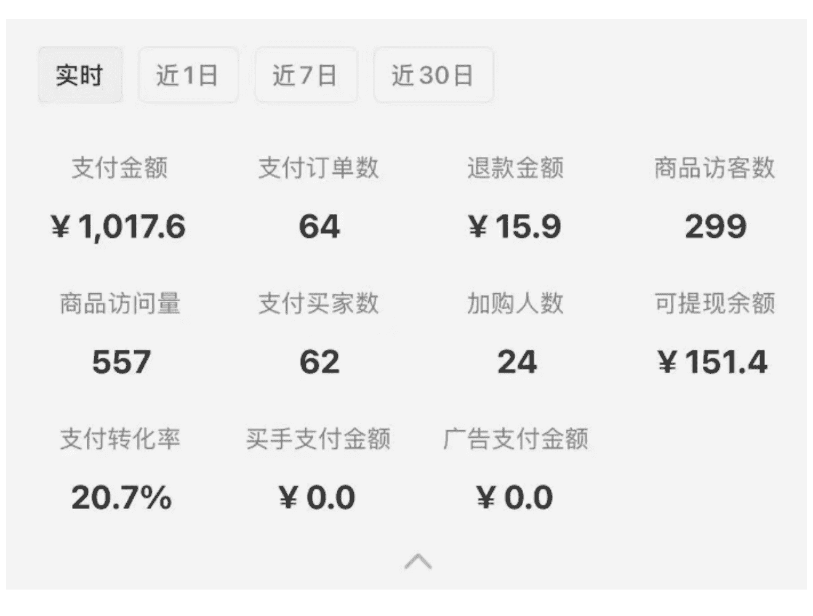

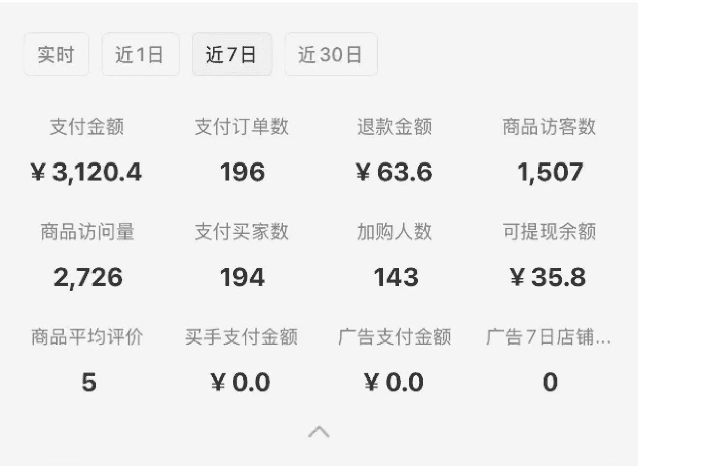

这篇帖子主要分为这 3 个部分：

- 第一部分：如何选出能转化的爆品
- 第二部分：如何塑造高转化的产品
- 第三部分：我的一点心得

## 一、如何选出能转化的爆品

之前在跟其他圈友聊，发现不少小伙伴采用的是百货店的模式，出单率不高，很好奇我是怎么做到出单率 85% 的，所以今天重点分享选品的经验。下面是我截取后台最近 10 天的数据，包含上架时间以及销售产品的数量，今天是 20 号，昨天晚上 19 号上架的 1 个品，今天也是有出单。

| 近 30 天销量 | 商品笔记 | 渠道品 | 商品状态 | 上架时间 |
| :--- | :--- | :--- | :--- | :--- |
| 0 | 已发布：0 设置精选笔记 | 0 | ● 售卖中 | 2026-03-19 21:57:51 |
| 1 | 已发布：0 设置精选笔记 | 0 | ● 售卖中 | 2026-03-19 10:37:25 |
| 2 | 已发布：0 设置精选笔记 | 0 | ● 售卖中 | 2026-03-18 23:59:35 |
| 0 | 已发布：0 设置精选笔记 | 0 | ● 售卖中 | 2026-03-18 16:57:24 |
| 12 | 已发布：0 设置精选笔记 | 0 | ● 售卖中 | 2026-03-17 13:32:07 |
| 4 | 已发布：0 设置精选笔记 | 0 | ● 售卖中 | 2026-03-16 21:37:36 |
| 4 | 已发布：0 设置精选笔记 | 0 | ● 售卖中 | 2026-03-16 19:29:04 |
| 8 | 已发布：0 设置精选笔记 | 0 | ● 售卖中 | 2026-03-13 20:30:56 |
| 10 | 已发布：0 设置精选笔记 | 0 | ● 售卖中 | 2026-03-13 19:47:27 |
| 15 | 已发布：0 设置精选笔记 | 0 | ● 售卖中 | 2026-03-12 23:06:44 |
| 4 | 已发布：0 设置精选笔记 | 0 | ● 售卖中 | 2026-03-12 22:31:48 |
| 0 | 已发布：0 设置精选笔记 | 0 | ● 售卖中 | 2026-03-12 22:28:11 |
| 9 | 已发布：0 设置精选笔记 | 0 | ● 售卖中 | 2026-03-12 16:11:28 |
| 52 | 已发布：0 设置精选笔记 | 0 | ● 售卖中 | 2026-03-11 21:26:13 |
| 4 | 已发布：0 设置精选笔记 | 0 | ● 售卖中 | 2026-03-11 12:01:38 |
| 4 | 已发布：0 设置精选笔记 | 0 | ● 售卖中 | 2026-03-10 23:29:29 |
| 13 | 已发布：0 设置精选笔记 | 0 | ● 售卖中 | 2026-03-10 23:24:45 |

我之前工作经历偏向于做流量，其实对于选品没有太多的经验，所以下面的内容属于完全实操出来的个人经验，也欢迎大家补充。

选品我认为是做小红书虚拟资料最重要的部分，一个好的品你不用花啥时间做笔记产品很粗糙也能出单，一个差的品花费了很多时间做笔记还是不出单。所以选品之前一定要大量的刷，让自己对于虚拟资料有足够的了解。

我在做之前每天花零碎的时间至少 1 小时，连续一周的时间都在刷小红书的虚拟资料。这里也提醒大家不要局限在个别词语，可以搜索的词特别多，看完很多产品你真的会觉得刷新了自己的认知，在这里把我搜索的词分享给大家：

知识库、模版、计划、笔记、攻略、SOP、指南、工具、评估、咨询、诊断、测试、问卷、PDF、PPT、逐字稿、飞书、多维表格、急救包、手把手、效果、话术、批注、指导

搜完你会发现很多意想不到的选品，比如下面的这些：

### 审计师博主的独家精华装修索引笔记

2 个月啃完上百份资料 + 装修书

提炼成纯业主视角的
实操工具手册

内行人万字避坑笔记 + 各阶段必做项和参考文档 + 全套装修资料库，相当于... 请个审计师帮你做一遍功课

送 9.9 元的全套装修资料 不满意直接退款

已售 5553

### 审计师博主独家精华装修索引笔记资料 (任何疑问请通过客服戳我)

- 7 天无理由
- 100+ 人好评
- 900+ 人加购
- 200+ 人收藏

承诺 24 小时内发货，晚发必赔 | 上海 包邮

7 天无理由退货 | 晚发必赔

¥19.9

已售 609

判断大小脸，脸歪的原因，以及改善。

200+ 人加购

100+ 人收藏

承诺 48 小时内发货，晚发必赔 辽宁沈阳 包邮

晚发必赔 不支持无理由退换

商品评价 100+

品质 4.7

娜美米

我的问题比较复杂，但老师完全不会因为套餐价格便宜而随便应付。反而很负责任的听我描述后，看完片子才给出诊断，在两...

贾***方

客服小姐姐超级耐心细致，恢复锻炼中

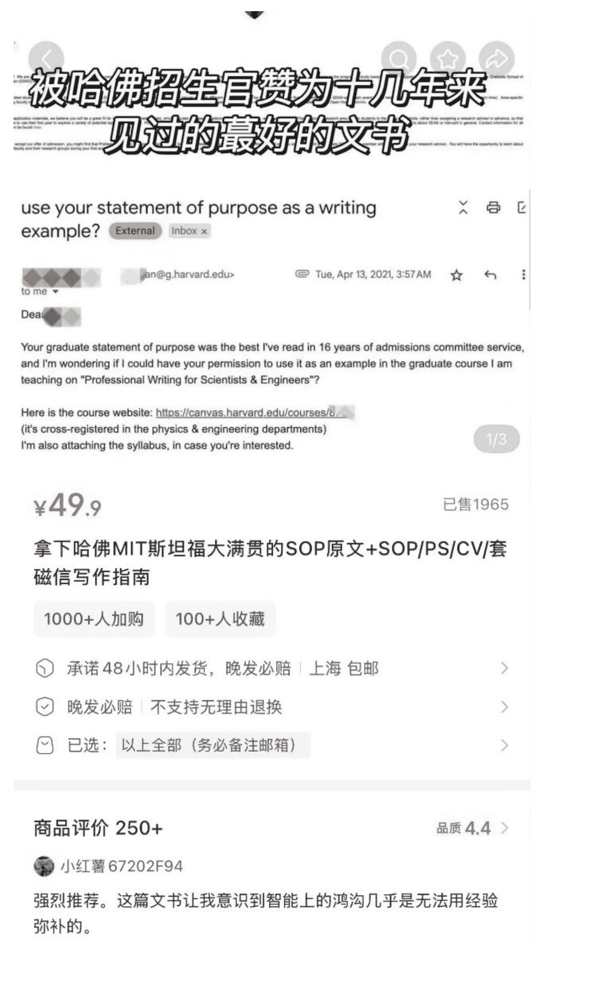

我选择方向一般是这 2 个方向，供大家参考：过往有过相关经验、或者是自己感兴趣的方向，因为这代表你比别人更懂这个行业。（当然如果都没有合适那就找你看到有红利好入门的方向）

比如你是一名装修行业的运营，现在想基于自己过往经验做虚拟资料，其实装修行业和运营行业就是你可以选择的方向，但是平台上运营这个方向已经很卷了，除非是自己有比较出众的技能，否则会建议选择装修方向，比如装修预算表就在小红书虚拟资料上卖的很好。

因为我之前做的是求职赛道，所以对于求职用户的痛点心理状态还是比较清楚的，所以我选择的是求职赛道的资料。

但是求职赛道其实可以选择的方向也很多，比如职业规划、求职信息表、简历模板、笔试资料、面试经验，甚至还可以延伸到入职以后度过新手期的、转正述职的、晋升、高情商说话的等等都可以，核心是去思考你的优势以及用户更愿意为哪种买单。

咱们就拿求职的来说，其实里面还可以再次按照表格细分：

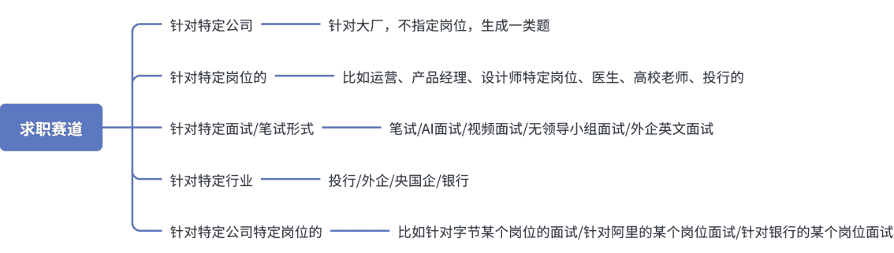

我的建议是不要做大而全，核心要做细分，尤其是对于新手小白。

比如你有过大厂的经历，其实就可以针对这类大厂去做，甚至还可以导流到私域升单，做 1v1 的培训;

比如你有外企经历，可以针对外企专门做英语的求职资料，因为英语面试是很多人的痛点，有痛点就有用户需求，且用户愿意付费。

比如你在体制内待过，也可以定向针对体制内资料，面试的、笔试的、甚至入职以后的都可以；

当我想做这类产品的时候如何判断是否对新手友好？最直接的办法直接搜索这类产品，看对应的账号销量，销量是基本都集中在头部账号，还是说有不少的新号也在做。比如我做的求职赛道，既有大几万的老账号在做，也有不少粉丝量几百甚至几十的，但是销量也是大几百甚至过千的账号，这就意味着新人是有机会的。

选定了大方向以后如何判断这个产品需求，不要只看已售，因为你也不知道别人是啥时候开始卖的，或者有没有刷单。大家可以参考这几个指标，加购人数、3 个月内购买人数（如下图）、账号粉丝数量、开店时长、商品上新时间这代表了用户的需求。

公众号懒人搜索，懒人专属群分享

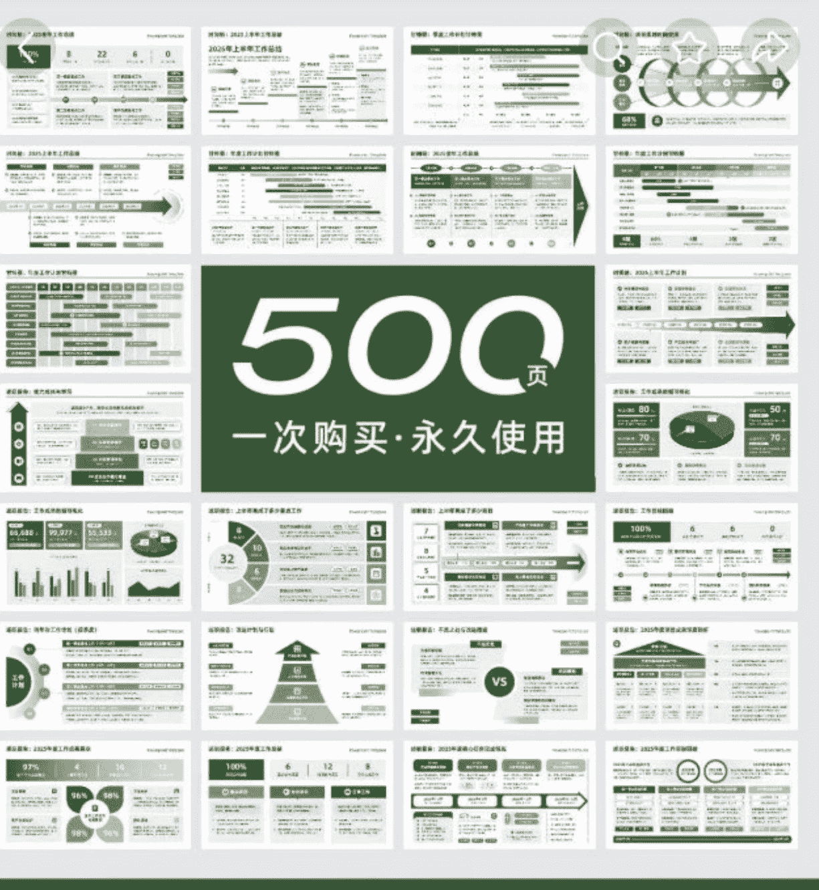

年终述职 | 年中述职 | 时间轴 | 甘特图 | 流程图 | 数据图 | 图文排版 | 逻辑图形 一杯咖啡的钱，拿下能永久使用的 PPT 素材库 1/10

¥59.9 到手价¥39.9 已售 1.2 万+

满 40 减 20

## 500 页 - 领导喜欢的工作汇报 PPT 模版 | 年终述职 | 时间轴 | 图文排版

好评 7000+ 人加购 3 个月内 2000+ 人购买 500+ 人收藏

付款后自动发货

不支持无理由退换

9/24

公众号懒人搜索，懒人专属群分享

¥29.9

到手价 ¥19.9

已售 9106

商家券 满 20 减 10

## 公孙羽装修宝典 | 避坑指南 | 预算清单（100+ 文档，持续更新）

3000+ 人加购 3 个月内 1000+ 人购买

400+ 人收藏

付款后自动发货

不支持无理由退换

## 商品评价 3500+

品质 4.7

Allzeros

买过起码十份装修资料，公孙先生的是逻辑最合理，表类最全的。非常适合我这类想自己参与的人，装修是一种修行，公孙...

公众号懒人搜索，懒人专属群分享

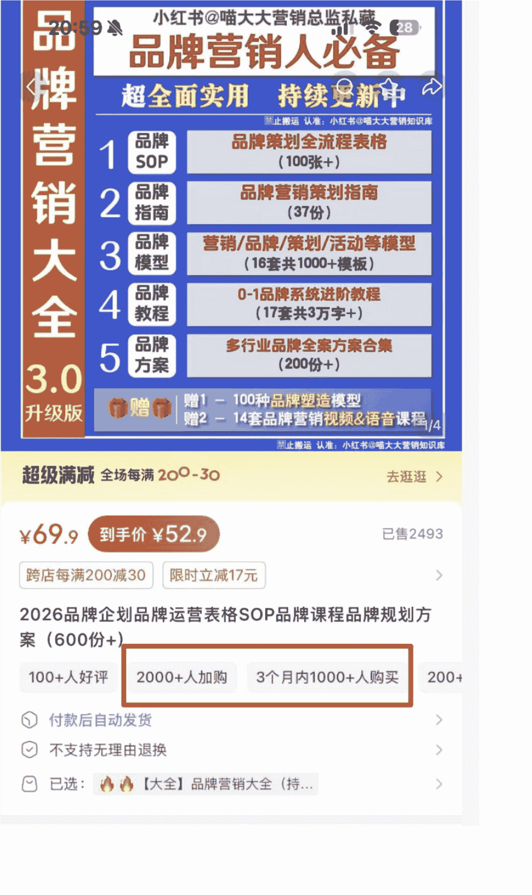

如何看开店时长：账号对应店铺页面点击极速退款，基础信息里面会显示开店时长；像这个账号开店时间为 1 年 287 天，时间已经比较长，其实作为小白不是太建议对标。

公众号懒人搜索，懒人专属群分享

## 序言职场 PPT

4.7 已售 1.2 万

粉丝 2.5 万 昨天更新 10 篇笔记

极速退款 好评率 100% 客服平均 23 秒回复

- 综合 销量 新品 价格

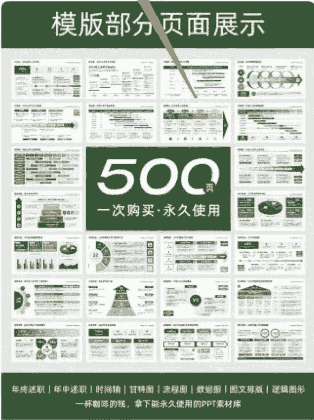

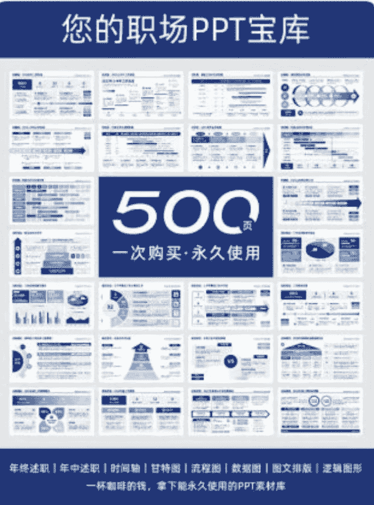

年终述职 | 年中述职 | 时间轴 | 甘特图 | 流程图 | 数据图 | 图文排版 | 逻辑图形
一杯咖啡的钱，拿下能永久使用的 PPT 素材库

年终述职 | 年中述职 | 时间轴 | 甘特图 | 流程图 | 数据图 | 图文排版 | 逻辑图形
一杯咖啡的钱，拿下能永久使用的 PPT 素材库

当月热销第 2 名 满 40 减 20

500 页 - 领导喜欢的工作汇报

¥39.9 已售 1.2 万+

当月热销第 1 名 满 40 减 20

500 页 - 高级感工作汇报 PPT

¥39.9 已售 387

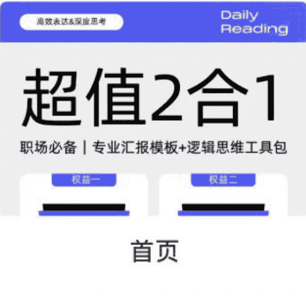

首页

上新

12/24

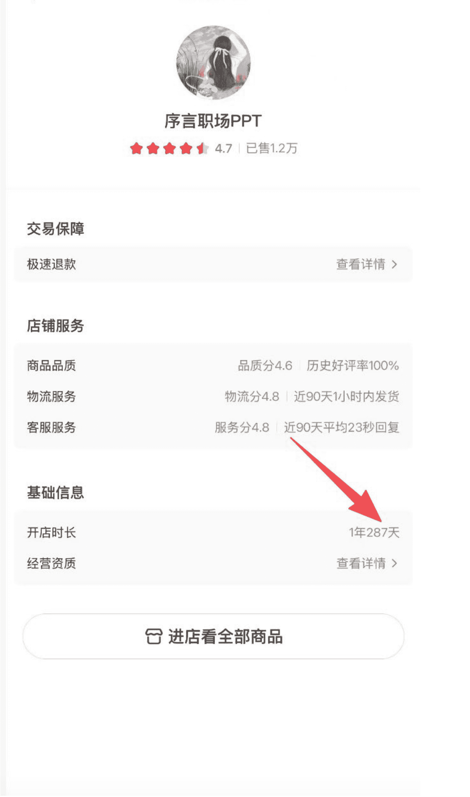

建议大家优先参考粉丝量级 1000 以内，最近 3 个月开店的。

当然还可以直接看对标账号最近上架的产品，看他上架的时间以及售卖的数量。

我选择的这个求职赛道里面其实有很多类型的账号，有做有 1V1 线上辅导、社群辅导的、有卖资料的，客单价基本上是 10 倍递减的，这其实都是用户的需求，只是看咱们以什么样的产品作为交付，而且这也能侧面说明大家是愿意为求职这件事花钱的，毕竟大几百的培训都有人花钱，何况是几十块的呢。

### 那如何选择对标以及如何选品:

- 第一类：跟我一样卖求职资料的，我会看他们 2 方面，1 内容侧：每天更新几条笔记、笔记的数据。2 产品侧：每天上新几个产品，新产品的销量如何，尤其是每天上新不超过 3 个，但是出单的品就有 2 个的这种账号，这代表别人有不错的选品能力，而不是一堆品里面去博概率。也可以关注当月销量第一的产品、当月加购第一的产品【这些都可以在他们的店铺里面直接看到】

这类账号：强烈建议大家重点关注最近上新就立马出单的，以及最近发笔记数据很好的，这其实也在反应用户需求。

如果对标发了 10 条笔记，有数据好的数据差的，但是一单都没出，可能要慎重商品。【当然也可以拿到平台上再去验证，有可能是他的商品不打动人】。

- 第二类：以量取胜的账号，每天更新 5 个品以上，甚至是 10 个品的，基本上单个品只有 1-3 篇笔记，也可以作为对标，他在帮你选品并且验证用户需求，你核心要看的是他出单的品，再去平台上验证需求。以量取胜里面还有一类是单品，但是每天 5 篇笔记以上的，这种情况要看笔记内容的质量以及自己是否可以模仿。

- 第三类：高客单价的账号，比如做 1v1 辅导/小班培训的，这类账号他们其实对于求职的相关内容信息获取会更加全面一些，毕竟高客单价还是要展示账号的专业性，所以这类账号也是优先关注最近发布的笔记里面数据比较好的笔记，也可以作为你选品的方向一。而且这类账号的内容其实也是可以作为你的对标，因为这样你就能在跟你一样卖资料的竞争对手里面比他们做的更好。

### 有了对标账号以后如何选品：

其实以上的对标已经能够帮你筛选出一部分品了，但是在我做了这个求职赛道 1 个月以后，我发现只抄对标是不 OK 的，因为跟品尤其是遇到前面讲的第一类账号，盯着他的竞品也很多，她如果懂运营出了爆品，一大波人去抢这部分用户，很卷。这个时候更好的方法是挖掘用户需求，判断用户需求，自己把这个品拿到先发优势。

### 如何挖掘用户需求并判断，可以用以下几种方法：

- 1.关注各个渠道的招聘信息，比如可以自己在小红书上买招聘信息表，里面会每天更新哪些公司开始招聘了，你就可以开始重点关注这里面的重点企业，比如：阿里、字节、腾讯···；注意建议关注招聘岗位数量多的岗位，因为这代表了覆盖的用户群体更多，毕竟一个只招聘 1 个人的岗位和 20 个人的岗位，前期简历通过的人选数量就不是一个量级的。

这个是我买的信息表，小红书上很多，9.9 可以买到，作为一手资源的：

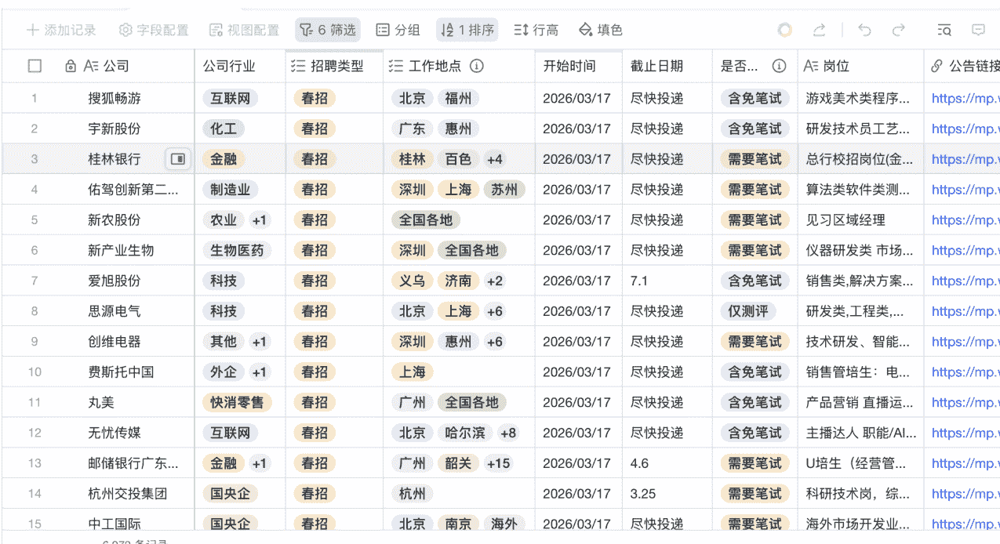

- 2.这个方法跟第一个类似，关注重点企业的招聘信息，比如字节的、腾讯的、或者是专门针对招聘的网站牛客网等等，下面是一些相对知名的企业招聘的公众号，他们发布招聘信息基本上代表找工作的人即将开始行动：

- 百事中国招聘
- 百威中国招聘
- 立白集团招聘
- 美的集团招聘
- 腾讯互娱招聘
- 腾讯音乐招聘
- 舒客电商招聘
- 苏宁易购招聘
- 贪玩游戏招聘
- 高途高端校园招聘
- 网易游戏互娱校园招聘
- 网易游戏雷火伏羲招聘
- IBM 招聘
- TCL 招聘
- 中建招聘
- 中海招聘
- 华帝招聘
- 天华招聘 TIANHUA

- 宝洁招聘
- 强生招聘
- 融创招聘
- 鼎信招聘
- 龙旗招聘
- TP-LINK 招聘
- 亚马逊招聘
- 娃哈哈招聘
- 毕马威招聘
- 苏宁易购招聘
- 融创校园招聘
- 新希望地产招聘
- 欧莱雅校园招聘
- 碧桂园集团招聘
- MINISO 名创优品招聘
- 信永中和集团招聘
- 先声药业集团招聘
- 美的置业集团招聘

- 3、重点关注小红书上素人博主的吐槽，比如你主要做的是某些大厂，那就可以不定期的搜索这类大厂是不是有素人博主分享自己的面试经验，以及要面试了问流程或者是吐槽面试官的帖子，这代表了这类岗位开始面试了，这个时候上品是最容易出单的

- 4. 关注一些记录自己求职经历的帖子，有些素人博主会更新自己今天投递了哪些公司，这就是你的重要信息来源，比如下面这个博主：

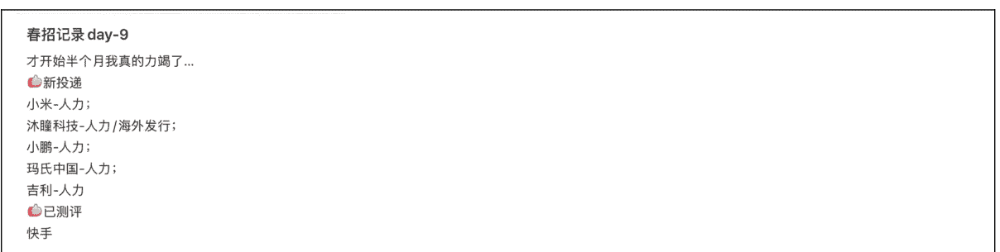

其实这个选品思路适用于大部分的小红书虚拟资料赛道。比如说你是做教师课件 PPT 的，那除了去看对标以外，也是要去基于用户的需求去发现老师们他们即将或者是正在面临的一些问题，然后去做出来对应的解决方案的 ppt。

## 二、如何塑造高转化的产品

想要在小红书卖的好，选好品以后，一定要差异化：别人比你早进入这个行业，如果卖相同的产品我没有先发优势那我的优势是什么？这也是决定这个品能不能好卖的核心因素，接下来详细举例：

- 5. 产品比别人多一些功能？（比如别人卖的是 ppt，我额外赠送对应的海报【宣传 ppt 的海报】或者是教案）
- 6. 还是更具时效性？（比如别人的产品是下半年的，但是我的是今年上半年最新的。或者比如针对某些行业有新政策，别人都是政策之前的，而你是最新的政策之后的，这个时候大家都需要的是最新的，你就很有机会爆单。就像之前小学的教材改版，做对应老师资料的，这就是一波机会，）；
- 7. 还是功能更全面？（比如用户买考试资料，别人卖的就是普通版本有 100 页，我卖的在 100 页的基础上增加了一版速记版本的，可以 1 个小时快速 get 所有的知识点；）

为什么要加速记版本，这个时候就一定要代入用户思维，用户为什么要买这个产品，尤其是临时抱佛脚的用户他们的想法就是快速的把这些知识点记住，然后去考试。虚拟资料卖的是资料，但卖点往往是“省心”“省时间”或“确定感”。

所以这里的核心是找准用户购买时可能影响决策的因素。

再举一个例子，有些产品用户购买的时候就是需要最快发货，尤其是夜间下单的用户其实是会顾虑发货时间的问题，那是不是可以在页面标注清楚比如 3 分钟发货，让用户在多个产品中选择到你。

分享几个小技巧如何发现用户需求：

- 1.把自己当成用户，去买同行的产品，在搜索页出来多个差不多产品的时候哪个产品最吸引你，记录下来。
- 2.关注后台客户的私信，用户来私信你问得最多的问题是什么？
- 3.看同行商品的评论区，笔记的评论区，用户问的最多的问题是什么？

## 三、我的一点心得

建议大家都下载手机版本的千帆工作台，前面的 100 条成交的订单，后台都会有提示，尤其是前面几单，大家可能还不清楚用户可能会遇到什么问题，所以尽量及时的回复用户；后续可以针对共性问题在产品主图或者详情页对应的优化。

我出第一单的时候，其实场面一度非常慌乱。当时手机提示有订单，但是当时我产品其实还没有 100% 的做好 (因为我其实想测试一下商品是否能卖出去)，然后我就联系用户约定好 2 个小时以后发给他并且额外赠送他另外一个资料，好在用户人也还不错，半个小时以后发给他也没说啥。

### 所以我想告诉大家：“烂开始”也好过“不开始”。

我的第一个产品现在回头看，其实有很多缺陷。但正是这些缺陷，让我在用户的反馈中知道了该往哪里优化。

- 不必纠结：哪怕产品上的很仓促，这也是成长进步的必经之路。
- 先跑起来：只有跑在路上，你才知道该如何调整姿势。
- 快速迭代：所有的闭环都是在跌跌撞撞中修补出来的，这比完美准备后再出发更重要。

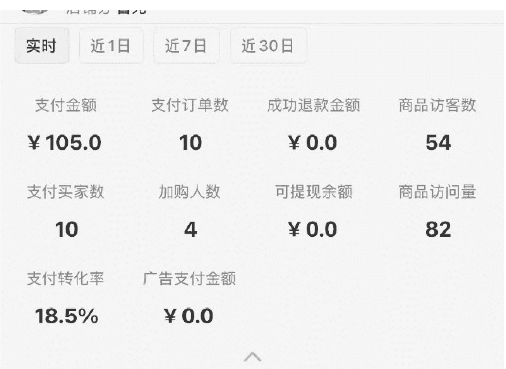

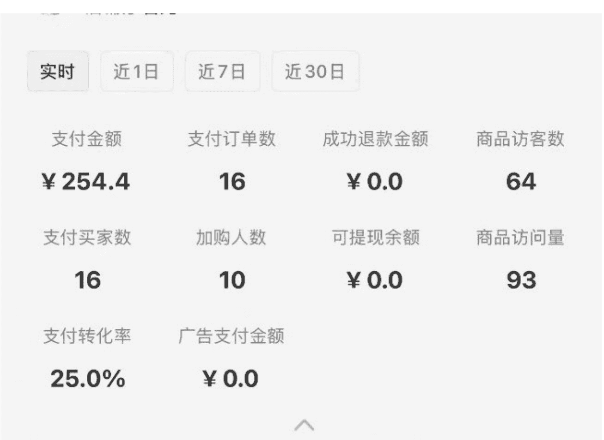

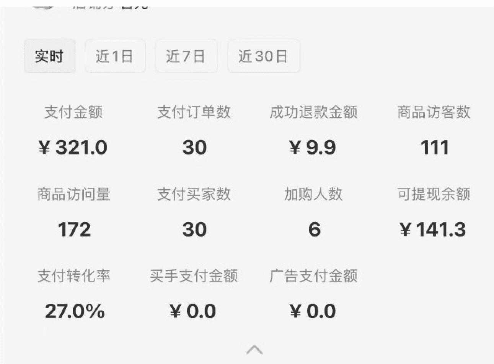

这些是我单日破 100、破 200、破 300 的截图，我相信我可以，大家也一定可以。

最后再自我介绍一下，我是柠檬，4 年求职赛道的流量操盘手，后端有高客单的圈友（尤其是做教育赛道、咨询师）需要流量合作的可以找我。

第一次发帖，感谢观看～

——————分割线——————

看完这篇 SOP，你觉得你懂了。但 90% 的人一到实操就会卡在第一步。

工具和教程只是最低级的壁垒，真正的壁垒是“立刻动手”和“圈层信息差”。

如果你想看全网最新的变现玩法，并且和一群执行力极强的极客一起下场拿结果，欢迎围观我的核心私域：【懒人专属群】。

我们不聊虚的，只做商业闭环的拆解与 AI 效率的压榨。系统内已沉淀 1000+ 跑通的套利实战局。

- 查阅圈子完整数字资产与上车门槛：
  https://lazyso.com/insider/

认同价值、准备好下场干活的，扫码加我微信（lazyhelper1）

备注：【实操上车】，不闲聊