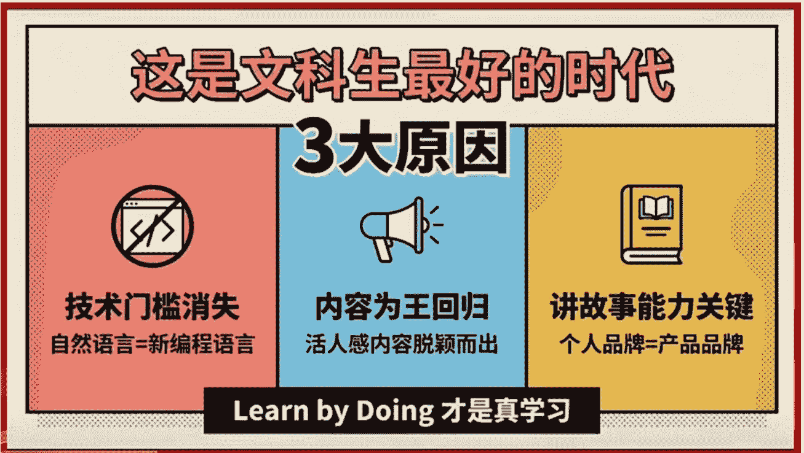
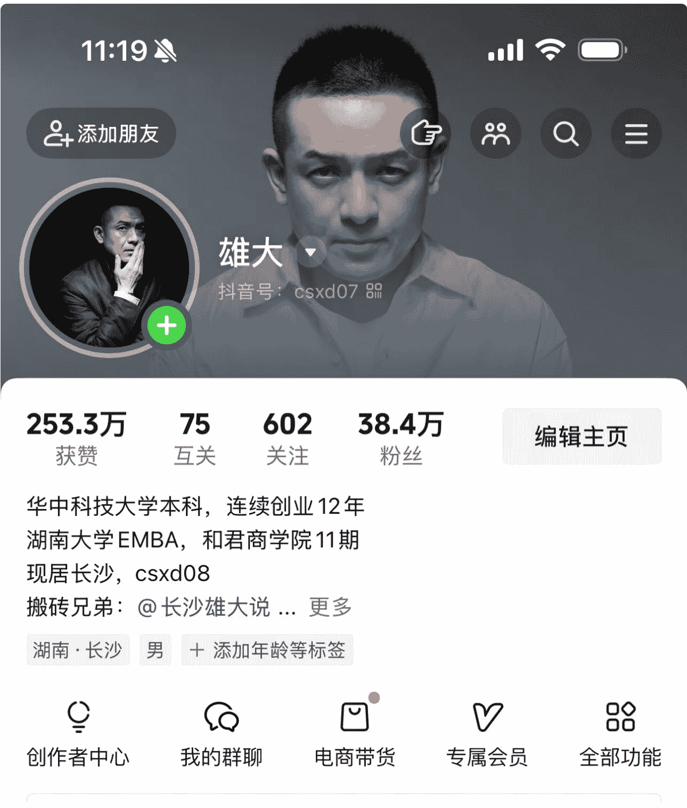
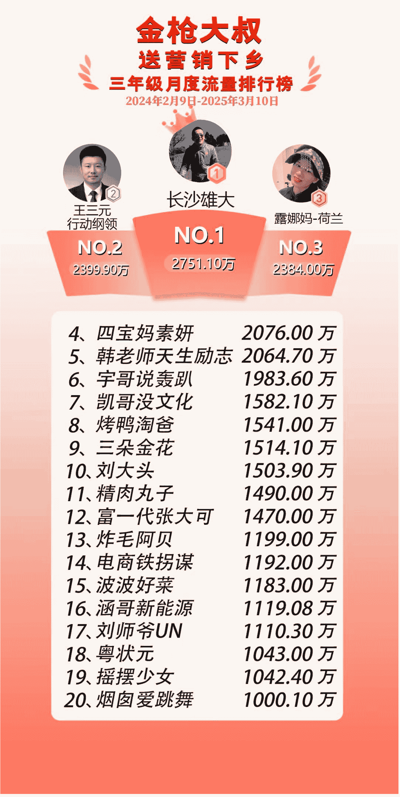

# 素人小白做抖音口播，1 年 3 个月涨粉 38 万，业绩翻几倍，我总结了 4 个底层认知

一年 3 个月抖音涨粉 38 万，业绩增长几倍，揭秘素人小白如何迅速洞穿抖音算法，调整思维意识，让自己的动作契合算法，快速实现涨粉与 IP 打造。

大家好，我是雄大（抖音同名），从事金融 14 年，通过抖音这个史上最大杠杆，短时间内起号成功，且拿到结果。今天分享的是老雄这一年多来把抖音往死里干的心路历程和完整方法论。干抖音不是技术问题，本质是个思维问题，是意识流问题，是文科生长袖善舞之地。所以这篇帖子着重于改造思维。

能轻易检索得到的技术，比如讲如何剪辑，几点发，每天发几条之类的问题，不是决定命门的核心点。这个我想不需要我来说，大家搜各种技术帖就好。

AI 的如火如荼之势迅速让知识变得没有价值，知识随处可见，唾手可得，技术门槛在消失，自然语言即编程语言，活人感的内容势必将占据更高的权重，内容为王再次回归，讲故事的能力成为我们拿流量的关键，所以我们要去积极拥抱文科生思维。某种程度上放弃理科生思维。

## 前言：

抖音口播是必须要去尝试的，它不是你的可选项，它是你的必选项。我花了一年半的时间，素人小白 0 粉起步做到现在抖音单平台 38 万粉。缘起于 24 年在生财刷到抖音做短视频的航海手册，彻底被激发，然后一发不可收拾到现在，目前至少在我们这个行业内，已到顶流程度。

加入生财刚好整 3 年，昨天和大魔聊起，近期准备出一本该怎么做法抖音视频口播的书，大魔反手就邀约我，不如先在生财出一个系列帖，以测试市场，我觉得挺好，于是就有了这个系列。

至少在抖音单平台做短视频，我已形成一套自己的完整方法论，任何东西都是有规律的，也是有窍门的，你不要觉得你学不会，你只是还没有行动而已。或者只是你现在尚且能够苟活，没有深刻感受到生存危机，然后一直在自己线性的思路下，延续过往并不怎么挣钱的路径，不愿意去做尝试和突破，又或者对抖音口播只是浅尝辄止，稍遇挫折就偃旗息鼓。

我只是一个中年老登，其实真正进入抖音赛道已经是 24 年底，属实相当晚了，当时基本上赛道红利已尽，日活已满，那当时为什么能一头扎进去而义无反顾，归根结底是源自生存危机。

我们这个行业比较特殊，之前是传统的广告投放加电销模式，我们之前一直在湖南 91.8 交通频道和湖南金鹰 955 频道做大量广告投放，2017 年交通频道给我们的价格是年广告费 420 万，当时能活的很好是因为传统媒体是奏效且唯一的，客资进线是疯狂的，且行业处于跑马圈地的上升期，收益是暴利的，所以看起来几百万广告费是高成本，但对于我们而言，实则是快速圈地的最佳路径。

然天有不测风云，经过以抖音为代表的短视频新媒体连续数年的爆锤下，传统媒体全面没落，现在还有人看报纸吗？现在还有人听广播吗？现在还有人看电视吗？

注意力在哪，钱就在哪。这个道理谁能不明白呢？没有人看不懂，不去做的原因只是未曾濒临死亡。

到 24 年上半年，不光是我们公司，而是全行业业绩一落千丈。因为过去的方法统统失灵，过去累积的所有经验全部失效。我深知再不求变就得死。在死和不要脸之间，我坚定地选择了不要脸。

于是 24 年上半年四处找活路，我当时和同在长沙的大魔和辰风互动比较多，那个时候我真白纸一张，啥啥不懂，两位兄弟给了我很多指引，帮助和和鼓励。

公众号懒人搜索，懒人专属群分享

当时大魔跟我讲一句话，至今印象深刻，他说 IP 是不可复制的，要干就干 IP，干的就是 IP。

辰风兄弟非常热心，帮我组局，介绍人脉，普及常识，我当时甚至连垂和泛都不知道什么意思。

所以想在抖音杀出一条血路，在口播界打一番江山，先决条件就是不要脸。如果你要脸，你可以不用接着往下看了。

不得其法，不着边际且痛苦不堪的摸索了几个月之后，24 年的 12 月，刷到了金枪大叔这条视频，感觉被狠狠抽打了，一巴掌扇醒。

遂下定决心按金枪大叔（以下简称大叔，作为徒弟，我们都这么喊）讲的，赶紧滚出去卖。然后我就加入了大叔当时组织的送营销下乡活动。大叔一共建了 60 个群，每个群 500 个人，一共是 3 万人。然后分为三个层级，为一年级、二年级、三年级，按大叔的说法是只筛选不培养。然后这 3 万人就每日厮杀，进到二年级估计就几百个人，然后最终沉淀到一年级的，目前还剩 200 来号人，且这 200 来号人，基本都 10 万粉以上。这就是我的来时路。

基于大叔的理论以及一年来的反复熏陶，目前应该已得真传，叠加自己不要命的执行力，且 25 年全年平均每个月出差 1 至 2 次，四处付费学习，花了超过 20 万学费，然后就爆了，一条接一条，粉丝也一路涨到现在的 38 万。

38 万粉丝绝对值不算多，但放到某一个具体的垂直赛道就不得了，再放到某一个城市，比如长沙，这就是第一名。目前整个湖南所有我们这个行业做抖音赛道的第 2 名到第 30 名，这些人的所有粉丝加起来估计没我多。

这就是行业影响力，全国同行几乎没有人不知道我，然后就成为行业 KOL，然后各种资源疯狂向你集中，你会变成交通枢纽，不管是渠道、行口、客户，各种资讯、各种组织，疯狂堆积。所以做抖音不是单纯地做抖音，不是单纯为了带个货，卖个广告，更核心的是做到行业 KOL。钱自然来找你，而不用你去找钱。

回想一年前的至暗时刻，濒死的团队和奄奄一息的公司，很庆幸当时刷到大叔这条视频，庆幸自己关于彻底将脸皮撕碎的这一决策。

所以你要不要做短视频呢？首先取决于你是不是一个要脸的人。愿不愿意如大叔所言，滚出去卖。

想在抖音上拿钱结果，语言逻辑要和日常中反着来。日常中，你让别人滚出去卖，别人会两巴掌扇你。但你在抖音上这么讲，你就哗哗来流量，且不违规，因为大家都明白，这只是一种艺术性表达，而非人身攻击。语不惊人死不休，是在抖音生存的法宝。

近期大火的陈昌文，你觉得他的核心是什么？那就是极致暴论 + 高频触达，也可能很多人并不喜欢他，或者并不认同他的言论，但是有什么关系？拿到结果搞到钱才是最重要的。

做抖音有很多反常识的诀窍，我很想写几十万字来全面阐述我的思维体系以及整套方法论。但最核心的就以下两点。

- 死不要脸
- 滚出来卖

接下来慢慢聊，可能我会言语犀利，充满攻击性，但我希望能以这种攻击性来带动你的尖锐度，不然的话做不好抖音。

平铺直述的语言，严谨的逻辑，白开水一般的索然无味，八面玲珑谁都不得罪的表达，骑墙的观点，中规中矩的文风，是干抖音的大忌讳。你一切跟我刚才讲的这些反着来，就是对的。

抖音就是需要重油、重盐、重口味，强观点、强批判性，爆发式的情绪宣泄，你的观点永远只能站一方，哪怕得罪另一方，也在所不惜。

所以其实我是在用抖音的语言体系来写这篇帖子，应该会很吃亏，可能呈现的并非最佳文章效果，但我希望能让大家体会到我想演绎的这种情绪和攻击性，以及偏执和尖锐度。只有对这一点有深刻洞察和理解，才有可能把抖音干好。

## 一、为什么你一定要做短视频？

对很多普通人来说，短视频很可能已经是改命的最后机会之一了。

为什么这么说？

社会发展到当下这个尴尬无比的阶段，资源、机会，早就被既有利益者牢牢占据。普通人能直接拿到的机会少之又少，你想靠传统路径去翻身，已是难之又难。

恰恰是因为很多人现实处境并不轻松，很多路越走越窄，所以才会开始认真思考：自己是不是应该抓住一个新的机会。

短视频绝对是这样一个机会。且虽然红利消失，但是我的判断是至少没走下坡路，难度确实在上升，因为更多的人冲进这个赛道。但并不绝对意味着没机会了。

### 1、短视频让草根有了机会

你去看抖音上的博主，不管是几万粉、几十万粉，还是上百万粉，绝大多数其实都是草根出身。真正原本就已经非常成功、非常有资源的人，反而是少数。像雷军、周鸿祎这样的人，当然也在做短视频，但他们不是主体。

因为抖音这个赛道，本质上改变了很多东西。

它打破了原来那种信息传播和资源分配的旧逻辑。以前，很多话语权掌握在少数人手里，很多资源也集中在少数人手里。普通人就算有能力、有特点、有表达欲，也没有好的出口，没有好的渠道，没有被大范围看到。

但短视频不一样。短视频创造了一种新的模式：你可以通过内容，让更多人在很短的时间内认识你、喜欢你、记住你。只要你的内容能够打动别人，别人就会愿意关注你、传播你。

一旦你被更多人看见，流量就会往你身上聚集；流量聚集之后，你就有机会把流量变现，从而赚到以前根本不敢想的钱。这就是短视频的底层逻辑。

### 2、为什么以前做不到的事，现在能做到

拿我自己来说，我的基础能力其实并不是最近一年才突然有的。但为什么以前很难拿到巨大结果，中小结果拿了一堆，但是巨大结果确实不多。

之前我团队虽然做的不错，营收也比我现在要高很多，但传统媒体动辄几百万的投放，能吞掉你一半的利润，而现在我做短视频几乎零成本。一镜到底的口播方式，我甚至没有组建短视频团队，就一个人干到现在这个程度，我连剪辑都不需要，因为我只需要配字幕。编导，随拍啥的对我而言也是多余，我就坐在车上口播，一个人活成一支团队。

虽然前期学习阶段投入比较大，但是跟最终结果比，这点开支毛都不算。按 ROI 来讲的话，说一本万利是过分了，但一本十利或者一本百利毫不夸张。

普通人第一次拥有了一个可以低成本、大范围展示自己的平台。你现在发一条短视频，它的流量以前可能本来只会流向那些大导演、大明星、大机构，或者掌握话语权的人。

短视频重构世界，抖音重构中国。

理解成一次对旧秩序的冲击。就对了。

只要不违规，你就可以在平台上讲你想讲的话，展示你想展示的东西。而每一个普通人，其实都有自己的故事，也都有自己的特点。

甚至有时候，你的缺点都可能成为你的特点。

我在我的 n 个视频里，讲自己贪财好色。这有什么问题呢？你的缺点才能吸引别人关注。你一天到晚讲自己高大上，如何优雅，那是搞不来流量的。极致的自嘲带来的是疯狂的流量，承认自己好色。可能很多人做不到，但是是否会引发强大的共鸣？有没有 get 到这个点？

你如果实在是怕丑，当然我的建议仍然是你优先选不要脸。我是说如果你实在怕丑，这条视频涨个 2000 粉，就把它隐藏嘛，我就是这么干的。而这个干法其实是不对的。事实证明，我还是摆脱不了读书人臭老九的坏毛病。这可能也是目前还没到 100 万粉的根本原因。

希望我这篇帖子发出去之后，抖音上不会出现一大波自称贪财好色之徒的圈友。你要理解的是底层逻辑，而不是照搬。

你去看平台上很多火起来的人，有的人靠讲段子，有的人靠讲经历，有的人靠卖惨，有的人靠反差，有的人靠夸张的形象，有的人靠一个很鲜明的记忆点。

我甚至还刷到一个卖菠萝的小伙子，把自己的头发做成菠萝的样子，结果火了。这种事情放在以前，你敢想吗？

在旧时代的逻辑里，这样的人根本没有机会。所以永远不要觉得自己做不起来，永远不要前置自我否定，短视频不是神，它就是个工具，就是个道场，首先必须去魅。有句老话说得好，叫先相信，再去看见。

你得行动，得执行，得持续输出，得不断迭代。很多东西不是慢慢磨出来的，而是在抓住窗口期之后，快速进入、快速试错、快速调整、快速拿结果。

现在有句话特别流行，叫做一年挣十年的钱，然后其他九年其实根本挣不着钱，我认为这话是有道理的。

这个窗口，是在慢慢收缩的。因为像老雄这样，原来鄙视抖音、后来突然意识到这个赛道价值的人，会越来越多。而且这类人往往本身就有一定能力，也善于学习。他们一旦进来，就会带来更强的内容竞争。这意味着，平台上的优质创作者会越来越多，内容只会越来越卷，流量只会越来越贵。

你越早进入，越容易抢到位置；你越晚进入，越要付出更大的代价，才能追赶前面的人。这一点，其实和很多行业的早期红利都很像。就像当年的电商。如果你在 2005 年、2006 年，甚至 2010 年前后进入电商，很多人都赚得盆满钵满，因为当时竞争还没那么激烈，红利还很大。

抖音很像一班末班车，你要做的是尽可能且尽早的挤上车，现在虽然有点晚，但还不算太晚。

### 3、看不见，看不起，看不懂，来不及

讲我自己痛彻心扉的经历。真的痛啊，错过无数个 100 万。仅仅是因为自己曾经傻逼的所谓高认知。

以前我非常鄙视抖音以及整日沉浸刷抖音的人。还曾经在团队里要求全员 100 多号人卸载抖音，一旦发现罚款。为什么？因为我以前很相信一个理论，叫“奶头乐理论”。

这个理论的核心是：大量娱乐化、碎片化、低门槛的内容，会不断给普通人提供短期刺激，让人沉浸在轻松、上头、即时满足的多巴胺分泌里，失去更深的思考和行动力。所以当年傻乎乎的我对手抖是不屑一顾的。

孤芳自赏般的，带着傲慢与偏见，觉得自己认知更高，看得更远，刷抖音的人是被这种奶头乐牵着走的。

这其实是韭菜和镰刀的角色定义问题。你如果以消费的角度、以娱乐的角度每天刷几个小时其实没有啥营养的视频，那你无疑就是韭菜。就会被我这样的镰刀所收割，而你如果是镰刀视角的话，你去创作内容，让别人当消费你所产出的内容，那抖音就是一个极其好的创收利器。

一体两面，看你怎么进行角色扮演。本身也没有对错。

偏见让我错失前几年最大的风口，我在接近末班车的时候上车，虽然凭一己之力再加气运也做起来了，但假设一下，如果我提前 3 年做呢？是不是可能一两百万粉丝了？

而像我这样的人，不会只有一个。很可能你就是。世人皆醒而你独醉。

2017 的我，起先是看不见，2020 年的我，是看不起，小杨哥这样的网红无非就是扮个小丑，博出位而已。我一个名校毕业生怎么能干这么 low 事呢？2022 年的我，是看不懂，这怎么能挣钱呢？出洋相能挣钱？然后到 2024 年，仿佛一切都来不及了。还好在生财刷到航海手册，又遇到大魔，辰风，大叔，这才搭上末班车。

2026 必然还会有更多原本看不起短视频、忽略短视频的人，逐渐醒悟过来，开始进入这个赛道。他们一旦进来，也会带来更大的竞争。只会卷出天际线，所以如果你刷到这篇帖子，并且戳中你的内心，别犹豫，别像当年傻逼的我，立即拿起手机，赶紧拍。

且，不要总觉得短视频是别人才能做起来的东西。

前几年做起来的人，现在可能已经有几十万、几百万粉丝。你想追上他们，不是完全不可能，但你需要付出远超他们当年的努力。

是继续观望，还是尽快入场，尽快开始，尽快试错，尽快建立自己对抖音的内容体系和认知体系。

为什么你一定要做短视频？不是因为它轻松，不是因为它没有门槛，也不是因为它能保证你成功。而是因为在今天，它仍然是普通人少数还可以低成本入场、靠自己去争取结果的机会之一。

它能有什么成本呢，无非就是一台手机，一个麦。其他的你全部不要搞，不要请人，不要上设备，不要做装备党，就往死了怼内容。

当下为数不多的一个可以被看见、被喜欢、被放大的机会。

## 二、做短视频，先做泛流量，而不是先做垂直流量

### 1、垂直流难于登天，而泛流量易如反掌。

做抖音，必须想清楚一个最核心的问题：到底是做泛流量，还是做垂直流量？这不是一个小问题，而是方向性战略性的选择、原则性问题。我的结论很明确：前期一定要先做泛流量，而不是一开始就做垂直流量。

为什么这么说？因为对于绝大多数普通人来说，垂直账号想做起来，难度非常大（几乎不可能）。成功概率太低，这个世界上当然有天纵英才，天赋异禀之人，能把垂直账号迅速做起来，但那绝对不会是你我。你想想，你是马斯克吗？你是雷军？你是周鸿祎？你是董明珠？

对大多数普通人而言，更应该选择大概率正确的路径，而不是把希望寄托在小概率事件上。

接下来，我详细解释一下，为什么要优先做泛流量。

先以我自己为例。大家关注我，归根结底，并不是因为我做的行业，也不是因为我讲了多少行业知识。虽然我的视频里有一部分内容会涉及行业，但大家真正关注我的原因，不是某一条垂直内容本身，而是我持续不断地输出了普罗大众感兴趣的内容。

到目前为止，大约一年三个月时间里，我公开发布了 2000 多条视频，最终隐藏了 500 余条，目前你能看得到的应该是将近 1600 条，这还仅仅只是我的大号，小号被封禁无数次，加起来也应该发了几千条。大家之所以会关注我，不是因为我只讲某一个专业领域，而是因为我做的是泛话题内容：讲各行各业，讲负债，讲行业，讲搞钱，讲情感，讲子女教育，讲八卦，讲新闻，讲热点等……也讲自己在生活和工作中的真实经历。

这些内容之所以有效，是因为它们更容易引发共鸣。人们愿意关注一个账号，往往不是先被行业吸引，而是先被这个人吸引。也就是说，很多关注我的人，并不是我的垂直流量，而是因为我的流畅的表达、尖锐的观点和松弛的状态，先对我这个人产生了兴趣，这些就是我的泛流量。

那么，泛流量有没有价值？当然有，而且价值很大。因为对于我来说，在全部粉丝里，只要有很小一部分人是真正有贷款需求的，就已经足够了。

比如，大号有 38 万粉丝。即便按一百个人里只有一个人有需求来算，我也已经拥有了 3,800 个精准客户。这个数量其实已经非常可观。更何况，按照我的实际体感，这个比例不止 1%，实际能接近 4-5%。因为我的私域只有一年就加了将近 2 万人。所以，泛流量并不妨碍转化，反而更容易放大转化结果。

所以，这个问题必须在开篇时就先讲清楚：前期一定要做泛流量。因为如果方向不对，极易走入死局，而一直缺乏正反馈的情况下，普通人很难坚持。

如果你一开始就做垂直流量，往往很难拿到足够的自然流量。我的 n 个小号，专门讲行业内容，属于比较典型的垂直账号。那个账号只有 2.9 万多粉丝，而且这些粉丝基本都是通过投流获得的。

当时我的投流方式很简单：大致是每条视频投一百元，差不多能涨 10-30 个粉。这样算下来，ROI 非常低，当然，从最后的变现结果来看，这笔投入未必不划算，因为我后续的变现确实高于这笔投入。那是因为我们这个行业客单价高的原因，换成别的行业，极可能就是亏损。所以，这显然不是大多数人理想的起号方式。

而我现在这个大号，在没有依赖同样投流模式的情况下，已经做到了 38 万粉丝体量。两者之间的差距是非常明显的：一个天上，一个地下。

所以，在起步阶段，我们最核心的目标就两个字：涨粉。至于这些粉丝来自什么行业、什么年龄层、男女比例如何，这些都不是抖音创业初期应该过度关切的问题。那是属于后期精细化运营的范畴。刚开始做账号，先把事情简单化，不要一上来就搞得太复杂。

你不用急着学一堆技巧，也不用急着研究特别细的运营方法。先让认知提前抵达即可。

### 2、接着说第二层意思：泛流量的本质，其实是做人设；垂直流量的本质，是做专业。

也就是说，我们往往是先通过泛流量让别人认识你、记住你、信任你，再通过专业能力去承接垂直领域里的精准客户。先有人设，后有专业承接，这才是更符合抖音传播规律的路径。

我相信，大多数人做抖音，都是带着目的来的，不会只是单纯为了给平台贡献内容。既然有目的，最终就一定希望实现某种转化。既然要转化，就不能只把自己局限在一个很小的圈层里，而应该尽可能扩大自己的曝光范围。

说得更直白一点，你既然选择出来卖，那当然是卖给更多人，而不是只卖给极少数人。卖给十个人也是卖，卖给一万人也是卖，那么为什么不先让更多人看到你？先被更多人认识，后面才有机会从更大的流量池里筛选出真正对你有需求的人。

### 3、偶发性刚需。

第三层意思，和很多行业本身的需求特点有关。以我这个行业为例，我用五个字来概括它的需求特征：偶发性刚需。也就是说，客户对贷款的需求不是每天都存在，而是在某一个具体时点突然爆发出来。

比如，一个客户今年6月13日可能需要一笔钱，但他在4月份刷到你的时候，不一定会立刻联系你。为什么？因为那个需求点还没有真正到来。这个时候，如果你做的是纯垂直账号，他未必会持续关注你，更未必会记住你。他刷到的永远是跟你一样做垂直流的同行，而这些同行，无一例外都是脸谱化、无特征、无人设、无 IP、无信任。

但如果你做的是泛流量账号，情况就不一样了。你先通过更广泛的话题吸引他，让他对你这个人产生兴趣，慢慢关注你。之后，他可能会在接下来的几个月里不断刷到你的视频。在这个过程中，他不仅会逐渐熟悉你，也会逐渐知道你是做什么的。

等到真正有需求的那一天，他更有可能优先想到你，而不是临时去找一个当天刚刷到、既不了解也不信任的同行账号。

换句话说，泛流量的价值，不只是让更多人看到你，更重要的是让你提前进入客户的心智。等需求真正发生时，客户首先想起的人，很可能就是你。

从这个角度看，对于具有“偶发性刚需”特征的行业来说，尤其我们行业，泛流量的优势会更加明显。因为它能够提前建立认知，提前构建信任，也提前部署了情感链接。到了真正转化的时候，你的胜算相较于同行自然会大得多。

### 小结:

综合以上三点，这个问题的答案其实已经清楚了。第一，泛流量更适合绝大多数普通人起号，成功概率更高；第二，泛流量的核心是先建立人设，再承接专业；第三，对于具有偶发性刚需特征的行业来说，泛流量更有利于提前占领客户心智。

所以，开篇最重要的结论只有一句话：前期一定要先做泛流量。

当你把这个问题想明白以后，后面的选题方向也就自然清晰了。既然你面对的是更广泛的人群，那么你讲的内容，就不应该只局限于狭窄的行业知识，而应该尽量去讲那些能够引发大众共鸣、能够调动情绪、能够让更多人愿意停留和关注的话题。

也就是说，前期选择做泛还是做垂，不仅仅是内容风格的问题，它还会直接决定你后续整个账号的选题逻辑。做账号本身就是一个环环相扣的过程：先有方向，再有选题；先有方向，再有方法。

先帮你先把认知建立起来。做抖音，最重要的不是一开始就追求复杂技巧，而是先把最基础的方向判断。最现实也最有效的路径，就是不断试错、不断获得反馈，再不断优化迭代。正反馈也好，负反馈也好，都是成长的一部分。只要你愿意在试错中持续调整，账号就一定会越来越成熟。

## 三、关于定位的问题

定位这个问题很重要。因为它关系到，你到底想把账号做成什么样，你想把账号放在什么位置上。但是，很多人一上来就讲定位，其实是错的。

我甚至想重复三遍：不要急着定位，不要急着定位，不要急着定位。

为什么这么说？

定位理论本身是西方商业理论的一部分，传到中国也很多年了。相关的书我也看过不少，这套理论当然有它的价值。但任何理论都有适用前提。定位理论成立的前提，是市场仍然处在高速扩张阶段，是商品能够比较顺利地找到对应购买者的阶段。

可我们今天所处的环境，完全和过往几十年的发展逻辑反着来。今天更大的现实是：生产严重过剩，需求极度不足。战天斗地已经不足以形容，卷生卷死可能贴切一点。

在这样的环境里，很多人还在一上来就想着“我该怎么定位”，其实意义并没有那么大。对大多数普通人来说，尤其是在账号刚起步的时候，最重要的不是定位得多精准，而是先有流量，先有人看。

做抖音，我更愿意把它理解成什么？我更愿意把它比喻成：出来摆摊。

大家都是出来摆摊做生意的，我也是出来摆摊的。既然是摆摊，你首先要思考的问题，不是“我要卖水果，还是卖小龙虾，还是卖预制菜”，而是：我能不能先占到市场里一个最好的位置。

这才是关键。

比如在长沙，如果你能把店开在黄兴路口那样的位置，很多时候你卖什么都不会太差。因为位置足够好，流量足够大，天然就有人来。

但如果你把店开在自家楼下一个很普通的小区门口，那生意空间就会小很多。不是说完全做不起来，而是难度会大很多。

抖音同理。我们真正要抓住的，首先是流量，而不是一上来先考虑“我要怎么定位”。

比如你是做贷款中介的，你天天讲贷款、月月讲贷款，真的会有人愿意看吗？别人现在一定有这个需求吗？未必。既然别人当下没有这个需求，你偏偏只围着这个点讲，那没有即时性当下需求的人必然是一秒划走，怎么可能把流量做起来？

### 先有流量，再谈定位。

先去找到那个“黄金铺面”，找到那个“黄金码头”，先把流量拿到手，再去想接下来卖什么东西。这个前后顺序千万不要搞反。

我觉得，市面上至少 99% 的同行，在这件事上都弄反了。

普通人最容易出现的固化思维方式是：

> “我是做什么的，我就只讲什么。”“我是开餐饮店的，我就天天讲我的菜炒得多好。”“我今天生意多好，客户怎么夸我，评价多高，大众点评分数多高。”

这些内容不是不能讲，但那都是后面的事。

前提是，你得先有流量，先让大家喜欢你，先让你周边十公里范围内的人愿意认识你，愿意关注你，甚至愿意专门开车十分钟、二十分钟来找你。只有到了这一步，你的流量才真正起来。而不是说，一上来就不停地讲自己。

你要考虑的是：他们喜欢什么？他们喜欢看什么？他们喜欢听什么？他们喜欢讨论什么样的话题？他们平时会关注哪些新闻？会刷哪些热点？你又该怎么去承接他们的兴趣和需求？真正重要的是这个。

迎合受众需求，才是你此时此刻最应该做的事情。绝对不是先考虑你自己想讲什么，而是先考虑别人愿意听什么。

先让这个城市里相当一部分人喜欢你、认识你、记住你，你做什么才更容易赚钱。

这里还有一点也很重要：

不要一开始就把自己局限在同城。

我的建议是：先做全国流量，再做所在省份，最后再做同城。

以我自己的账号为例，我这个号真正起量，其实也就三个月左右。但前面两个月，我几乎完全不讲行业，也不主动讲自己是做什么的。我只是持续发大家爱看的内容，努力塑造“老雄”这个人设，努力让自己变成大家愿意关注的样子。

如果你仔细去翻我之前的视频，尤其是老粉去看那些更早的内容，你会发现，在很长一段时间里评论区，很多人一直在问：
“你到底在是做什么的？”
我通常也不急着回答，就让大家先猜。

前期不要急着把业务标签贴到脸上。等到粉丝量突破几万之后，很多事情就开始顺了。

行业与专业是诅咒，它天然就窄，天然就不容易被更多人接受。

你真正应该先想的是：你擅长讲什么？你适合讲什么？你想覆盖的人群是谁？

比如我们这个行业，想覆盖的人群，大概率是 25 岁到 55 岁这个区间，这通常是主力人群。再进一步细分，男性客户占比 80-90%，当然女性客户偏少。那你做内容的时候，就要从这些人群的兴趣出发。且你的观点要取悦男人而非女人。

你想覆盖的人群，他们所感兴趣的一切话题，就是你的选题库。

所以，做内容不是没有方向，而是要先从“人群兴趣”和“流量入口”出发，再回到业务承接。

至于更具体的方法，比如怎么做选题，怎么筛选热点，怎么做二次加工，怎么把一个热点变成适合自己的内容，这些都属于更细的方法论。真正展开讲，会非常细，也会很系统，不是几句话能讲完的。

## 四、被看见决定一切

你可以想一想，老雄这个账号，从零粉做到 38 万多粉，也就一年三个月左右的时间。那你觉得，这期间我的专业能力有本质上的提升吗？

这里说的能力，是我本行业的能力，是我在这个领域里为客户提供持续服务的能力。

如果认真讲，一年之前的老雄，和现在的老雄，在做单水平上有本质区别吗？其实没有。也许会有一点点迭代，但不会是质变。

再往后看，假设到今年年底，我这个账号能做到 100 万粉，那你觉得我的做单能力、谈单能力，博弈水平，我为大家提供服务的能力，到那个时候会和现在有特别大的区别吗？

也不会。

因为这种能力，其实在很早之前就已经基本定型了。

但为什么现在我的业务会出现爆发式增长？为什么营收会翻几倍？且将成本由原来的几百万打到接近于 0。

你可以自己想一想。

核心原因，并不是因为我的能力突然增长了，所以大家才来找我。不是的。我的能力并没有发生本质变化，最多只是有一些细节上的优化和迭代。

真正的原因只有一个：以前的老雄，没有被看见。

我的目标客户、那些真正有需求的人，以前根本找不到我。他们不知道有我这个 人，也不知道长沙有这么一号人物。既然不知道，他们上哪儿来找我？难道要依靠我请一堆的电销员进行触达？或者在传统媒体上动辄数百万的投放？

答案就这么扎心和简单，因为我被看见了。

大家知道长沙有这么一个人，知道我每天都在发内容，知道我一直 在持续出摊，日更 不辍会不断刷到我，也会间歇性地刷到我 讲一些行业知识。刷着刷着，会觉得：这 个人讲得好像有点东西，讲得还有点用。

那如果我刚好有需求，是不是可以先找他咨询一下？

至于最后做不做、能不能合作，那是后面的事。但至少，我可以先去咨询，可以先建立联系。而且咨询又不要钱，我为什么不先问一下？

所以你会发现，很多事情就是这么发生的。

同样是面对需求，和一个完全陌生的人比起来，你更愿意相信谁？是一个突然打来骚扰电话的人，跟你说“先生您好，我们这里是某某渠道，请问您有没有资金需求”；还是一个你已经反复刷到、已经有印象、已经觉得他讲得有点道理的人？

其实很多事情一旦看透了，往往一句话就能讲明白。你之所以觉得它难，是因为那层窗户纸还没有被捅破。

做抖音同理。

你现在会觉得一天涨一千粉很难，好像根本不可能。但如果你真的经历过，你就会发现，这件事情并没有你想象中那么神秘。

我现在一天涨一千粉，我觉得一点都不难。

但一年前，我根本不敢相信这件事。我当时一天可能只涨两个粉，甚至还要投流，一百块钱才能换来十个粉。在那个阶段，你跟我说“一天涨一千粉”，我根本不会信。

为什么不信？

因为人没见过的东西，天然就不信。

你没经历过，你就会觉得那是一座高山，根本翻不过去。而你的成见就成为你心中的一座山，所以你就被一叶障目。

你去看那些做得比较好的短视频博主，几十万粉、上百万粉的也好，拿到结果的也好，你真的觉得他们每一个都知识储备特别深、每一个都是行业专才、每一个都是业内顶尖人才吗？

不一定。

他们未必在专业上是最顶尖的，但他们有一个共同点：他们被大家看见了。

大家看见了他们，关注了他们，流量就会不断涌向他们，他们的曝光度就会越来越高。

比如老雄现在，一个月的曝光量接近三千万。也就是说，全中国每个月大概有三千万人次刷到我。

如果我的主体粉丝又集中在湖南，那就意味着，在湖南范围内，会有非常大量的人持续刷到我。假设我一直这样坚持下去，日复一日、月复一月、年复一年，那么将来某一天，当你真的有需求的时候，你会不会想到我？

大概率会。

所以，抖音这件事，本质上是一个长期工程，是一种长期主义。它不是打一枪换一个地方，不是今天试一下、明天就不干了。它更像是一个会伴随我们很多年的工具和赛道。除非未来某一天，短视频这个赛道真的发生了根本性变化，进入了另一个时代，那我们再去适应新的环境，再去切换新的方向。

但至少在当下，这个逻辑没有变，而且肉眼可见的短期内也看不到它会变。

so，再重复一遍，你必须先被看见。

### 整个过程，大概就是这样几个步骤:

- 先被看见;
- 再被点赞;
- 再被收藏;
- 再被转发;
- 最后被喜欢。

这就是短视频传播最基本的路径。

所以我才会说，抖音这个赛道有无限可能。它就像一把万能钥匙，可以打开很多你原本想象不到的空间。

那问题来了，怎样才能被别人看见？核心就是内容要足够好。

你现在随便发一条视频，抖音可能先给你两百左右的播放。以前可能还会给到五百，但现在按照我的体感，很多普通内容大概就是两百左右。

也就是说，一开始只有两百个人能看到你。

如果这条视频没有引发共鸣，没有人点赞、没有人停留，那它基本就不会突破更大的流量池。

抖音算法是最公正公平且客观的无情判官。流量起不来，只有一个解释，就是内容不行。说啥都没用。

算法一旦将你这条评估为优质，那就是一层一层往上推。一旦某条内容真正起飞，你就火了。你就真正被更多人看见了。

所以，短视频的增长逻辑，从来不是简单的一加一等于二。它往往是几何级、指数级的增长。

这也是为什么我一直觉得，抖音这个平台上的结果通常很分化：要么你起不来，几乎没人看见你；要么你一旦上去了，增长快得超出你想象。流量会几何级指数级放大。

中间层当然不是完全没有，但整体逻辑就是这样。

你能搞到大钱和搞不到大钱，中间其实只隔着几条爆款。

所以你会发现，抖音和我们过去做传统行业很不一样。传统行业里，一个人的产能就是一个人的产能；十个人就是十个人的产能；你必须不断加人、加投入、加时间，才能把结果一点点累积出来。

抖音反之。在抖音的场域，一个人有可能打过 100 个人。一个人如果内容跑起来了，曝光量上去了，真的可以一个顶一个万个。

它不是线性增长，它是脉冲式爆炸。

先思考你如何被看见，不要想得太复杂。

## 五、总结:

这不是一个实操帖，而是一篇认知撕裂帖。我觉得希望能通过看几篇帖子就得到实操方法论，是不明智的。实操更多是自己通过实操去习得，而不是百分百复刻别人的每一个具体动作。至少在抖音这个板块进行学习。抖音的实操不难，无非就那么几百个知识点。而真正让认知提前抵达，思维上要跟抖音同频，撕碎原来那个自己，才是最重要的。

生财是个极其好的优质社群。我去年 9 月参加了深圳航海家 AI 大会，今年 1 月参加了上海小红书大会，本月末也会去杭州再次参加 AI 大会。每次都是刷新认知。

## 第一章完

## 注:

- 1.感谢生财，感谢航海家，感谢首波撕裂我认知的那份航海手册，感谢大魔，辰风等给予我帮助的生财兄弟，感谢恩师金枪大叔。老雄认为，加入一个优质社群是当下必做的选择动作，和聪明人共舞是最明智决策，找准引路人，兄弟姐妹们共勉。
- 2.因为原本是打算写本书的，所以篇幅会比较长，事实上，我已码了 20 万字，先发一个小章节，大家如果喜欢请点赞，点赞多的话，我再把后续逐步发上来。
- 3.有具体问题可以在评论区打出来，有问必答，充分沟通。

## 分割线

看完这篇 SOP，你觉得你懂了。但 90% 的人一到实操就会卡在第一步。

工具和教程只是最低级的壁垒，真正的壁垒是“立刻动手”和“圈层信息差”。

如果你想看全网最新的变现玩法，并且和一群执行力极强的极客一起下场拿结果，欢迎围观我的核心私域：【懒人专属群】。

我们不聊虚的，只做商业闭环的拆解与 AI 效率的压榨。系统内已沉淀 1000+ 跑通的套利实战局。

👉 查阅圈子完整数字资产与上车门槛：

https://lazyso.com/insider/

认同价值、准备好下场干活的，扫码加我微信 (lazyhelper1)

备注：【实操上车】，不闲聊