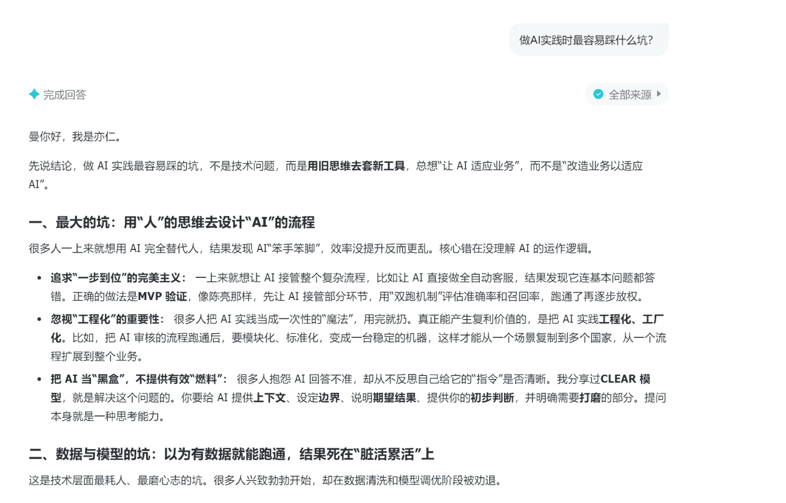
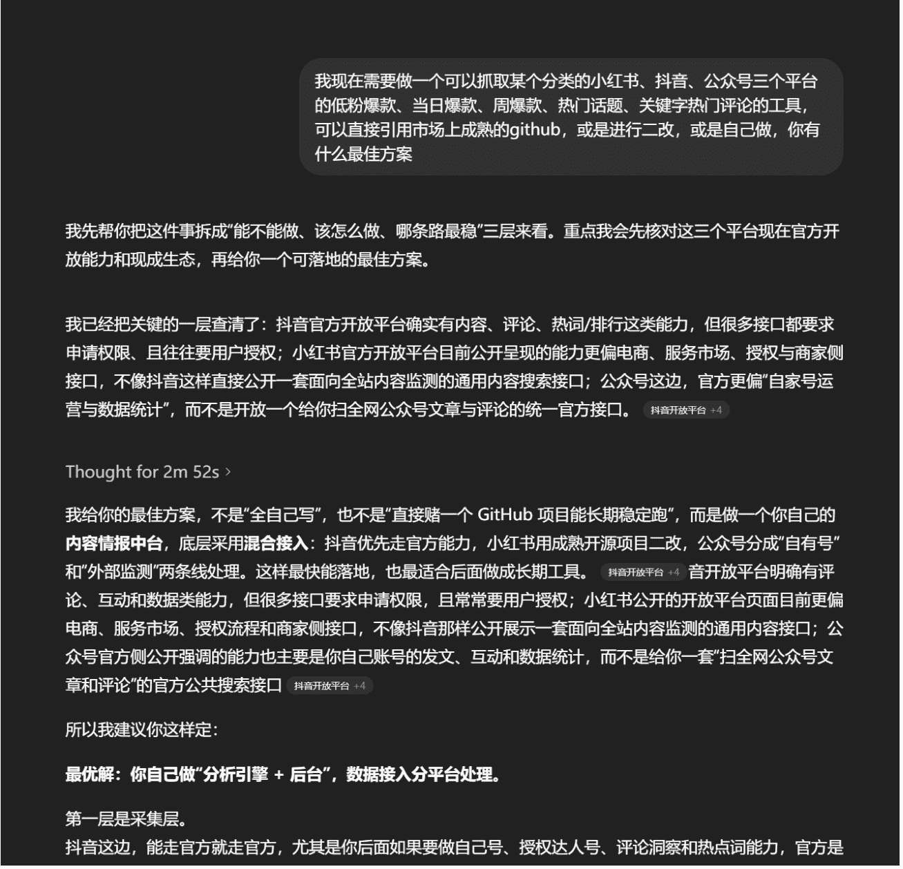
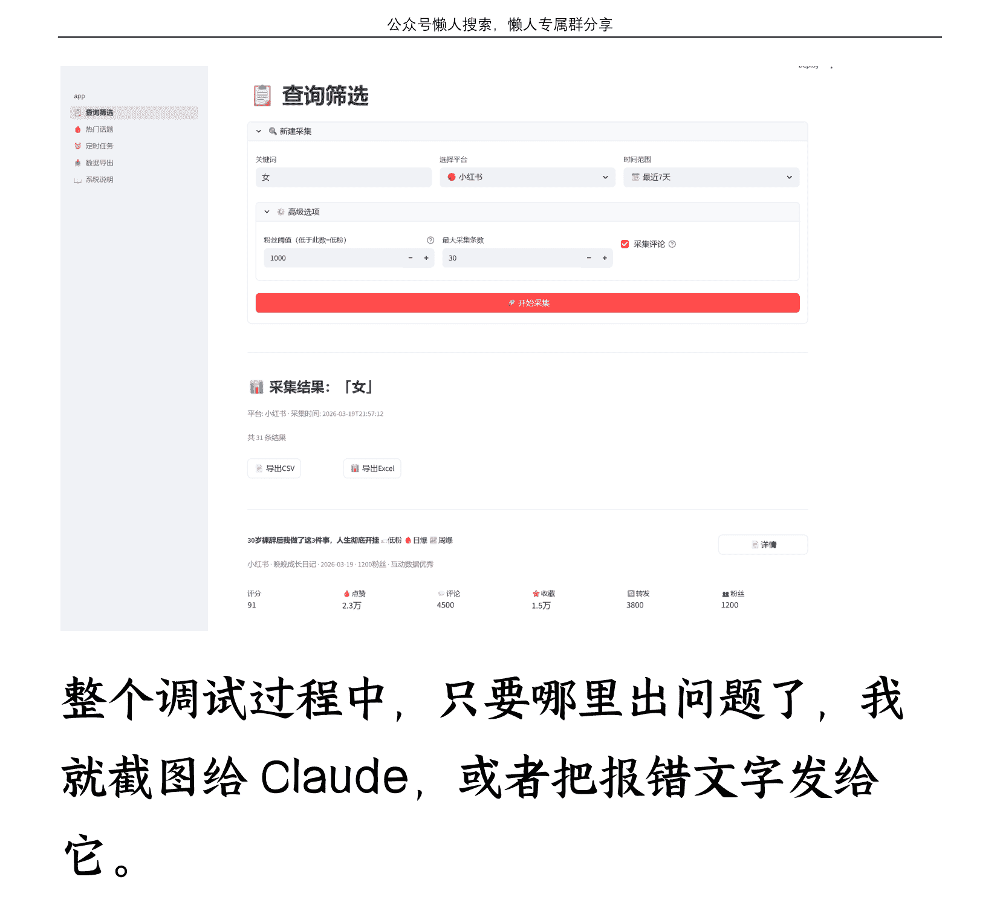
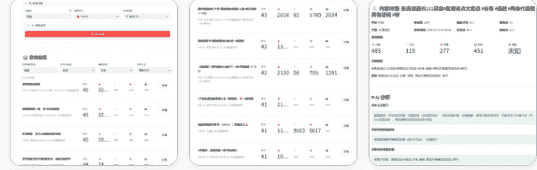

# AI 时代真的来了，代码小白半天做出爆款采集工具

## 260324 副业 SC 精华

公众号懒人搜索，懒人专属群独享
懒人微信：lazyhelper1


> 我一直留在生财，不是因为勤奋，而是因为舍不得离开机会

2020 年加入生财，我算是生财的老会员了。

这些年里，因为各种原因，我其实并没有特别认真地在里面实践。

一年到头也打开不了几次。

但每次到了续费的时候，我又总舍不得退圈。

对我来说，只要还在这个圈子里，就像手里一直留着一个“搞钱百宝箱”——也许我眼下没空折腾，可只要哪天我想开始了，它就在那儿，随时能派上用场。

### 唯一一个副业收入是生财给我的

我真正意义上实践过的一次，是前两年参加生财航海，做小红书虚拟资料。

因为这次航海，我做了一个小红书 AI 壁纸号，一直做到现在。

最好的时候，我还挤进过小红书壁纸头像类目的 Top5。每个月能有几千上万的小副业收入，我其实已经挺满足了。

但今年年初，我被小红书 AI 内容清洗狠狠干了一下。所有 AI 生成的账号都受影响，我的壁纸号被判严重违规，直接被关进小黑屋一个月。

那段时间挺受打击的。与此同时，全网都在聊“养龙虾”和“AI 自动化”，热度一波接一波。

也就是在这个时候，我又一次认真打开了生财。

结果这一打开，我真有种“妈耶，发现新大陆了”的感觉。

### 被打击之后，重新认真看见了 AI 自动化

但这次再进生财，我觉得发生了翻天覆地的变化。

我在生财里看到很多厉害的人，已经在用 AI 把很多事情做起来了。

不会的，就问 AI；不懂的，也问 AI。

连要直接连线亦仁这种曾经想都不敢想的，也可以让亦仁 AI 帮我拓宽思路：



亦仁说的真的太对了：技术层面最耗人，最磨心志。

以前我对很多创业方向其实不是没兴趣，而是总卡在同一个地方：

时间不够、精力不够，再加上未知领域太多。

很多东西光是学就已经很耗心力了，碰到不懂的地方，硬啃半天也未必能弄明白。

到最后，往往是还没做出结果，刚燃起来的那点创业劲头就先被消耗没了。

久而久之，我干脆不去碰“搞钱”这件事，因为一想到过程就累。

现在有了 AI 工具，以前拦住我的那些技术门槛、学习成本、试错压力，好像突然之间都没有那么吓人了。

说得直接一点，就是：用魔法打败魔法。

### 先盯上的，不是全部流程

我当时就冒出一个念头：像我这种本来就没太多时间、也没太多精力的人，如果能把每一个环节尽量自动化，那是不是就不会再被“时间和精力不够”这件事卡住了？

我顺着这个思路继续看下去，发现 AI 自媒体运营自动化，大体就是这样一条链路：

抓取爆款 → 提取爆款 → 分析爆款 → 二创 → 审核 → 发布。

那我就想，既然这样，第一步肯定是先把“抓取爆款”这件事搞定。

我也看到生财里有不少圈友提到过一些现成工具，但说实话，我根本不知道那些工具该怎么用、去哪里下载、怎么安装、怎么跑起来。

既然如此，那我不如直接试试看：能不能自己做一个“抓取爆款”的 agent?

我当时的想法特别朴素：

如果这一步都能做出来，那后面的其他环节，理论上应该也有机会一个个做出来吧？

最神奇的是，我真的是一个完全没有代码基础的人。

就这种水平，我只是看了几篇生财精华帖，居然就敢自己动手搞 AI 工具了。

你敢信？说真的，我自己一开始都不太信。

但结果是，我还真就在半天之内把它做出来了。

而且，真的很好用。

## 详细实操

第一步，先把自己脑子里那些乱七八糟的想法，尽量梳理出来丢给 ChatGPT。

我的思路其实很乱，很多东西只有一个模糊感觉，自己根本说不清楚。但 ChatGPT 有个很大的好处，就是你真的不用跟它客气。哪怕你表达得乱，它也能帮你一点点理顺，最后整理成结构很清晰的东西。

ChatGPT 不仅听懂了我要做小红书、抖音、公众号多平台爆款监控的需求，还帮我拆解了一份长达几千字的、极具落地性的最佳方案，他告诉我别傻呼呼地地去“造轮子”写代码，而是要用现成的开源项目二改。



它当时给了我一大段回复，长到离谱，估计有几千字。

老实说，前面很多内容我其实看不太懂，但我看懂了最后一句：

它可以继续帮我把这个方案，落成一份可以直接交给 Claude 或 Cursor 的完整 PRD、技术架构说明和 MVP 功能清单。

我一看到这句，立刻就明白下一步该怎么走了。

拿来做研究型辅助可以，但别把商业 MVP 建在这上面。

所以最终结论很明确：

你的最佳方案是：

做一个你自己的“跨平台爆款发现后台”，

不是全自己造采集轮子，

而是用 MediaCrawler 二改做小红书/抖音采集底座 + 抖音官方能力补稳 + wechatpy 负责自有公众号 + 外部公众号先走轻监测/合规数据源。

核心研发资源，放在统一数据模型、爆款评分引擎、分类系统、评论洞察和可视化后台上，而不是死磕每个平台的底层对抗。

你要是愿意，我下一步可以直接帮你把这个方案继续落成一份可交给 Claude/Cursor 的完整 PRD + 技术架构说明 + MVP 功能清单。

> 好的，我是技术小白，请把你以上的想法生成一个可以交给 Claude 完成的直接指令

我给你整理成一份“直接复制给 Claude”的版本，目标是让它不要只讲方案，而是直接按可运行项目来做。为了更适合你这种技术基础不强的情况，我会把要求写得很死，尽量减少它跑偏。

Thought for 1m 26s

下面这段你可以直接复制给 Claude，尽量不要改。它的目标不是只给方案，而是直接给你做出一个可运行的 MVP 项目。

```
你现在是一个“高级全栈架构师 + Python 自动化工程师 + 数据产品经理 + 本地部署助手”，请你直接为我生成

【项目名称】
内容爆款雷达（MVP）

【我的身份与要求】
我是技术小白，希望你直接帮我完成一个可以本地运行、尽量简单、尽量稳、尽量少折腾的工具。
请你默认我的目标是：
```

### 第二步，用好 Claude 这个特别靠谱的技术搭子

我直接切到 Claude 的窗口，把 ChatGPT 整理好的那份 MD 文件扔给了 Claude。

对我这种代码小白来说，Claude 真的特别像一个超级靠谱、又非常贴心的高级技术员工。

你把需求交给它，它不会跟你空谈一堆没用的东西，而是直接开始干活。

我把 ChatGPT 整理好的 PRD、技术架构说明和 MVP 功能清单给它之后，它几乎没什么废话，很快就东西做出来了：

```
你现在是一个“高级全栈架构师 + Python 自动化工程师 + 数据产品经理 + 本地部署助手”，请你直接为我生成一个**可运行的完整项目**，不要只讲思路，不要...

PASTED
```

Unable to provide summary: user prompt is empty

这是一个大型项目，我来为你完整构建。先读取相关技能文档，然后逐一创建所有项目文件。

### 第一部分：项目理解与默认假设

#### 关键假设：

- 前端使用 Streamlit (最适合小白，无需前端知识)
- 后端使用 FastAPI 提供 API + Streamlit 做界面
- 数据库默认 SQLite，通过 SQLAlchemy ORM 保留切换兼容性
- 爬虫基于 Playwright，需用户手动登录后复用登录态
- AI 分析先用规则引擎占位，预留大模型接口
- 公众号外部监测仅支持手动录入链接
- 评论采集默认关闭，可手动开启

开始创建项目文件：

The user prompt is empty, so there is no primary language established. However, I'll provide a summary...

对小白最友好的，不是它会写代码，而是它会带着你走。

这一点对我来说，真的太重要了。

因为我是真的不懂。

像“打开终端”这种事，对很多人来说可能是基础操作，但对我这种代码小白来说，完全就是陌生世界。

可 Claude 很厉害的一点是，它不会嫌你基础差。

它会从最基础的地方开始，一步一步教你，甚至会细到告诉你按哪个键、先点哪里、看到什么界面算正常。

> 我把文件包存在以下目录：cd C:\Users\HUAWEI\Desktop\自动化流程\爆款抓取工具\content-radar，以后每次要运行的时候要如何操作终端，请将详细的步骤一步步告诉我

整理了项目路径并准备逐步运行指南。

好的，你之前依赖已经装在 C:\Users\HUAWEI\Desktop\content-radar 那个路径了。中文路径虽然装依赖会有问题，但运行一般没问题。

有两个方案供你选择：

方案 A：继续用桌面那个英文路径（推荐，最稳）
方案 B：用中文路径（可能遇到编码问题）

我建议你用方案 A，把中文路径当作备份存储就好。下面是每次启动的完整步骤：

#### 每次启动操作（共需打开 3 个终端窗口）

##### 窗口 1：启动后端

按 Win + R，输入 cmd，回车，然后逐行输入：

```bash
cd C:\Users\HUAWEI\Desktop\content-radar
venv\Scripts\activate
python main.py
```

看到 Uvicorn running on http://0.0.0.0:8000 就说明后端启动成功了。这个窗口不要关。

##### 窗口 2：启动前端

再按 Win + R，输入 cmd，回车，逐行输入：

```bash
cd C:\Users\HUAWEI\Desktop\content-radar
```

## 当工具真的跑起来的那一刻，我是有点被震住的

我按着 Claude 教的步骤操作，不需要很复杂就完成了。

当浏览器自动打开那个“爆款笔记收集器”的时候，我真的有点被震住了。

那个页面简洁、清爽、直观，逻辑也很清楚。

说实话，我完全没想到，一个我这种水平的人，居然真的能在半天里，从一个模糊想法走到一个能跑起来、还能实际使用的工具。

那一刻我是真的惊呆了。

也真的发自内心地，为自己感到骄傲。



整个调试过程中，只要哪里出问题了，我就截图给 Claude，或者把报错文字发给它。

它每次都会给我非常详细、非常具体的说明和排查步骤。

那种感觉不是“你去试试看”，而是真的像有个人坐在你旁边，一步一步带着你把问题解决掉。

这里我特别想强调一点：

Claude 是直接给你最终代码文件的，那就尽量不要发现一个问题就发一次。

最好的方式，是自己先完整跑一遍，把问题尽可能集中整理好，再一次性发给它。

这样它思考和修改的效率会高很多，也更容易一次改到位。



> 1. 运行时，抖音平台登陆需要点击图形验证确认，二次采集需要我验证手机短信。
> 2. 采集出来数据了，但是因为字号太大，我看不完整（图 1）。
> 3. 点击详情，并不会跳转到对应的页面。
> 4. 我采集完小红书后，再重新选择抖音采集，采集结果抖音会和之前采集的小红书的数据混合（图 2）。希望第一次采集完后进行的第二次采集，在查询结果下面，将原来的采集数据清空，完整生成第二次采集的内容，不要混合显示。
> 5. 在查询结果边上，有一个一键导出的按钮，可以导出当次的查询内容，导出字段和数据导出里下载的一样。
> 6. 在采集结果的尾部，有一个分析，但是这个分析的标题，我在查询的结果里没有找到对应的内容，不知道这条视频单独拿出来做详情分析是什么理由？
> 7. 数据导出页面，数据导出最经常用的是一键导出当天所

分类整理九项反馈，规划三个文件的重点修改方案。

非常好的反馈！你说的每个问题我都修复。我重写几个核心页面文件：

组织了九个问题的解决方案和文件更新指导。

下载这个 zip 解压后里面有 3 个文件。按以下步骤更新：

## 更新步骤

- 1. 先停掉两个终端窗口

窗口 1 和窗口 2 分别按 Ctrl + C 停止。

- 2. 替换文件

把解压出来的 3 个文件复制到这个文件夹里，替换掉旧文件：

更让我意外的是，因为前面 ChatGPT 在做技术架构说明的时候，已经替我考虑得很周全了，所以这个工具不仅能收集爆款笔记，还顺带做了一层 AI 分析。

## 内容详情

## 30 岁裸辞后我做了这 3 件事，人生彻底开挂

关闭详情

平台：小红书
粉丝数：1200
爆款评分：90.6
增速分：100.0
作者：晚晚成长日记
发布时间：2024-03-19T02:37:43
互动分：76.5
低粉分：100.0

点赞
2.3 万
评论
4500
收藏
1.5 万
转发
3800
播放
一

### 内容摘要

去年 30 岁裸辞，很多人说我疯了。但一年后的今天，我的收入翻了 3 倍。分享我的蜕变过程...

标签：女性成长 · 裸辞 · 30 岁 · 人生转折

### AI 分析

### 为什么它爆了：

> 数据表现：互动数据优秀、增长速度极快、低粉高互动 (1200 粉丝)；标题策略：使用了数字型手法；内容引发了大量讨论 (评论/点赞比高)；高收藏率说明内容实用价值高；仅 1200 粉丝却获得高互动，说明内容本身质量过硬

### 可模仿的标题结构：

> 使用具体数字增加可信度 (如'5 个方法'、'3 步搞定')

### 可模仿的话题策略：

> 使用了标签：女性成长，裸辞，30 岁，人生转折；话题领域：成长/蜕变；话题领域：赚钱/副业

而且对每条筛选出的内容都做了一个“爆款评分”。

再回头去看 ChatGPT 当初写的技术架构说明，我才意识到，它其实已经提前帮我把一套更精准的“爆款引擎”思路定义出来了。

```
【评分与判定逻辑】
请你不要把“爆款”停留在概念层，必须实际实现可运行的判定逻辑。
请设计一个可配置的爆款评分引擎，至少包含：
1. 互动分
    - 点赞、评论、收藏、转发等指标综合
2. 增速分
    - 越新且互动越高，分数越高
3. 低粉权重
    - 粉丝数越低但数据越好，加权越高
4. 平台兼容
    - 某些平台缺少某些字段时，自适应降级
5. 最终输出：
    - explosive_score
    - is_low_fan_hit
    - is_daily_hit
    - is_weekly_hit
```

## 这件事真正打动我的，不只是工具做出来了

以前我总觉得，“做工具”“写代码”“搭系统”这些事，离我特别远，像是只有技术人才能做的事。

但这次，我一个彻彻底底的代码小白，居然真的只用了半天，就手搓出了一个能满足自己需求的爆款笔记收集器。

这件事让我第一次特别真切地相信：

在 AI 时代，很多以前看起来“不可能”的事，真的已经变成了“只要你敢想，就有机会实现”。

很多时候，真正困住我们的，不一定是能力，而是旧时代留下来的限制性思维。

总觉得自己不会、做不到、门槛太高、成本太大，于是连尝试都不敢尝试。

但 AI 时代，真的是一个重新洗牌的时代。

别再把 AI 当成敌人，也别一边焦虑一边抗拒。

它不是来替代你的，它更像是你想法的延伸，是你行动力的放大器。

很多你以前做不到的事，不是因为你不行，而是因为你过去没有这样的工具。

现在有了。

所以，真的可以大胆一点。

## 分割线

看完这篇 SOP，你觉得你懂了。但 90% 的人一到实操就会卡在第一步。

工具和教程只是最低级的壁垒，真正的壁垒是“立刻动手”和“圈层信息差”。

如果你想看全网最新的变现玩法，并且和一群执行力极强的极客一起下场拿结果，欢迎围观我的核心私域：【懒人专属群】。

我们不聊虚的，只做商业闭环的拆解与 AI 效率的压榨。系统内已沉淀 1000+ 跑通的套利实战局。

## 查阅圈子完整数字资产与上车门槛

https://lazyso.com/insider/

认同价值、准备好下场干活的，扫码加我微信 (lazyhelper1)


微信：lazyhelper1

备注：【实操上车】，不闲聊