# 【AI+ 小绿书】2 个月获客 1112 人，签单 5.9w：高客单流量的喂饭 SOP

2026/03/24 副业 SC 精华

公众号懒人搜索，懒人专属群独享

懒人微信：lazyhelper1

大家好，我是些些怡，00 后，主业在体制内给人民群众当泥腿子，副业一直做小红书获客：海外医美/ 研学基地/reddit 营销等等。

去年 12 月，我切入了一个对我来说完全陌生的青少年厌学赛道。

靠一套 AI 自动化的内容生产线，2 个月在小绿书 + 视频号引流 1112 个精准高客单粉，签单 5.9w。

小绿书是一个效率很高的渠道：同样的内容发到小红书只有 30 小眼睛，小绿书可以到 1500 阅读，获客效率差 10 倍。

以前被小红书封得头皮发麻，哪过过这样的日子呀。

希望把项目全流程分享出来给圈友们一点帮助！

这篇文章适合这样子的圈友：

- 被小红书封麻了，想找低成本、高效率获客新渠道的朋友（本文主讲小绿书的流量杠杆）
- 做高客单产品（教育/养生/医美/法律等），苦于搞不到精准客户的老板
- 有极强执行力，但不知道怎么搭建 AI 内容流水线的操盘手
- 照抄了一堆爆款模板，天天发笔记但就是洗不出有效客资的朋友

本篇（上篇）你将带走的交付物：

- 一套通用的高客单 AI 知识库搭建 SOP（附提示词）
- 小绿书 24 小时冷启动与撬流量的实操
- 一套安全的小绿书引流技巧
- 适合新手的小绿书另外 4 种变现方式

这篇文章会跟大家分享的目录是：

- 一、小绿书流量是什么？为什么比小红书高效 10 倍？
- 二、怎么 24h 破局冷启动、持续拿到大流量？
- 三、怎么用 AI 搭建能出客资的内容流水线？（高客单怎么定制文案）
- 四、小绿书怎么引流不违规？怎么配合长文章打 IP？
- 五、哪些类目适合小绿书？小绿书还可以怎么变现？

## 六、写在最后：草根操盘手的破局法

好了，那么咱们开始吧！

### 【开头】

## 一、数据结果

先看看数据：

- 总引流 1112 人，1 个月签单 5.9w(我的后端是青少年厌学陪跑产品，客单 3-5 位数不等)
- 小绿书 770 人 (占 69%)
- 视频号 342 人
- 转化 1.8%，成交 20 人

| 签单日期 | 引流端/归属 | 客户微信 | 客户 (家长) | 签约服务项目及周期 | 签单金额 | 实际结算基数 | 渠道分佣比 | 渠道应结分润 |
| :--- | :--- | :--- | :--- | :--- | :--- | :--- | :--- | :--- |
| 2026/1/3 | 微信小绿书-IP 图文 | | | | 399 | 399 | 30% | ￥119.70 |
| 2026/1/5 | 微信小绿书-IP 图文 | | | 评 | 399 | 399 | 30% | ￥119.70 |
| 2026/1/6 | 视频号 - 前端短视频 | | | | 399 | 399 | 30% | ￥119.70 |
| 2026/1/8 | 微信小绿书-IP 图文 | | | 平 | 399 | 399 | 30% | ￥119.70 |
| 2026/1/9 | 微信小绿书-IP 图文 | | | | 399 | 399 | 30% | ￥119.70 |
| 2026/1/10 | 视频号 - 前端短视频 | | | | 12800 | 12800 | 30% | ￥3,840.00 |
| 2026/1/12 | 微信小绿书-IP 图文 | | | | 399 | 399 | 30% | ￥119.70 |
| 2026/1/14 | 公众号 - 干货推文 | | | | 399 | 399 | 30% | ￥119.70 |
| 2026/1/15 | 微信小绿书-IP 图文 | | | | 399 | 399 | 30% | ￥119.70 |
| 2026/1/17 | 微信小绿书-IP 图文 | | | 度评 | 399 | 399 | 30% | ￥119.70 |
| 2026/1/18 | 公众号 - 深度案例拆解 | | | 重 | 26800 | 26800 | 30% | ￥8,040.00 |
| 2026/1/20 | 微信小绿书-IP 图文 | | | | 399 | 399 | 30% | ￥119.70 |
| 2026/1/21 | 视频号 - 前端短视频 | | | | 399 | 399 | 30% | ￥119.70 |
| 2026/1/23 | 微信小绿书-IP 图文 | | | 平 | 399 | 399 | 30% | ￥119.70 |
| 2026/1/24 | 微信小绿书-IP 图文 | | | | 399 | 399 | 30% | ￥119.70 |
| 2026/1/26 | 公众号 - 深度案例拆解 | | | | 12800 | 12800 | 30% | ￥3,840.00 |
| 2026/1/27 | 微信小绿书-IP 图文 | | | | 399 | 399 | 30% | ￥119.70 |
| 2026/1/28 | 视频号 - 前端短视频 | | | | 399 | 399 | 30% | ￥119.70 |
| 2026/1/29 | 微信小绿书-IP 图文 | | | [A 估 | 399 | 399 | 30% | ￥119.70 |
| 2026/1/30 | 微信小绿书-IP 图文 | | | | 399 | 399 | 30% | ￥119.70 |
| 本期合计 | | | | | 59183 | 59183 | | ￥17,754.90 |
| 结算说明：每月 25 号统一下发账单核对，双方对账无误后，3 个工作日内通过微信/支付宝/银行卡直接转账结清。(大额单笔结清可随时沟通) | | | | | | | | |

## 二、为什么做这个项目？

### 为什么是小绿书平台？

同样的内容 (划重点，模板都一样)，

小红书只有 30 小眼睛，发到小绿书能到 1500 阅读 (如下图)：

刚做项目时拿小红书测试只引流到 5 个客资，其他大部分是水军来凑热闹的；获客效率上跟小绿书差了 10 倍。

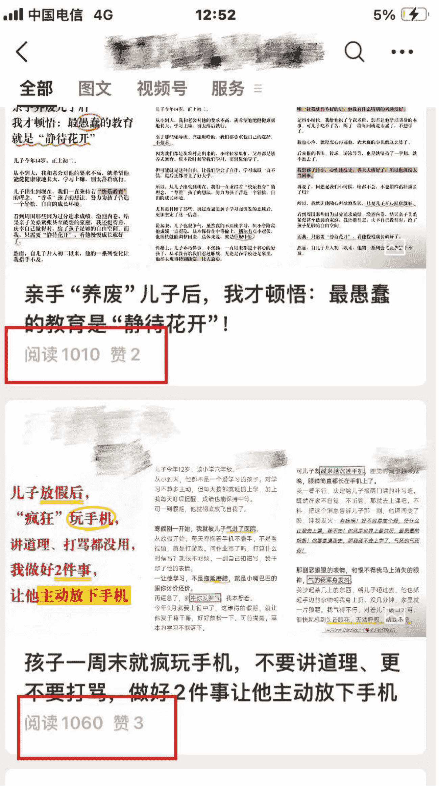

## 数据统计

全部发表 单篇发表 用户统计

共 32 篇文章

- ### 做对这 3 件事，把女儿从厌学磨蹭变得主动
  阅读次数 1,107
  2026/01/05
- ### 没有“能量”的厌学孩子，永远学不会努力
  阅读次数 1,100
  2026/01/07
- ### 跟厌学孩子讲道理是下策，真正的上策是？
  阅读次数 1,099
  2026/01/09
- ### 女儿厌学后我才懂，最愚蠢的是“过度尊重”
  阅读次数 1,084
  2026/01/08
- ### 给爸妈的一封信：我的叛逆，不是故意的
  阅读次数 1,064
  2026/01/06
- ### 学会做婴儿式父母后，女儿的厌学懒惰消失了
  阅读次数 1,073
  2026/01/05

## 有没有做厌学教育的老板？

第一，情绪化严重，顶撞父母，欺骗父母，因为一点小事就生气发火。第二，生活懒散，自以为是，从不听父母的话，认为自己永远都是对的。第三，沉迷手机，日夜颠倒，晚上不睡，早上不起，逃避现实。第四，不懂得感恩父母，不体谅父母的辛苦，大肆挥霍。你家孩子中了几条？如果你家孩子也这样，留言“47"，我给你一个方法，坚持去做，一个星期后就能看到效果。

## 这种家庭，最容易养出厌学孩子

## 孩子厌学，竟是你“打”出来的？别等他彻底废掉才后悔！

“打死我也不去上学！”
儿子红着眼，像一头困兽一样被他爸堵在门口，浑身都在发抖。起因是他物理只考了 30 分，他爸气得撕了卷子吼他“猪脑子”；数学考 58 分，我抄起扫帚打他，骂他“丢人”，完全没看见他绝望的泪水和他小声的辩解：“我明明复习了...”。
就在我们为儿子的事焦头烂额时，女儿也用同样的方式，锁紧房门，把自己变成了家里的另一个孤岛。看着两扇死寂的门，我被气到胸口发闷，差点晕倒。我和丈夫坚信“不打不成器”，可为什么换来的却是仇恨和厌学？那一刻，我感觉自己像个彻底失败的母亲，心凉到了底。

转向小绿书后，效率立刻不一样（发的也都是小红书火过的同样的模板）：

- 小红书：10-100 阅读
- 小绿书：1500 阅读（85% 推荐流量，打得准的话发 2-3 篇就入池了）

杨 留言 1 次 · 新的关注 02/23 14:58

> 333

庄心茶语 留言 1 次 02/21 07:55

> 你们估计理解错了无条件接纳，无条件接纳不是没有要求，不是没有边界

黄建用 留言 1 次 02/07 21:07

> 333

清水芙蓉 留言 1 次 01/24 10:49

> 我的女儿和你说的有点相似，有什么好的建议吗

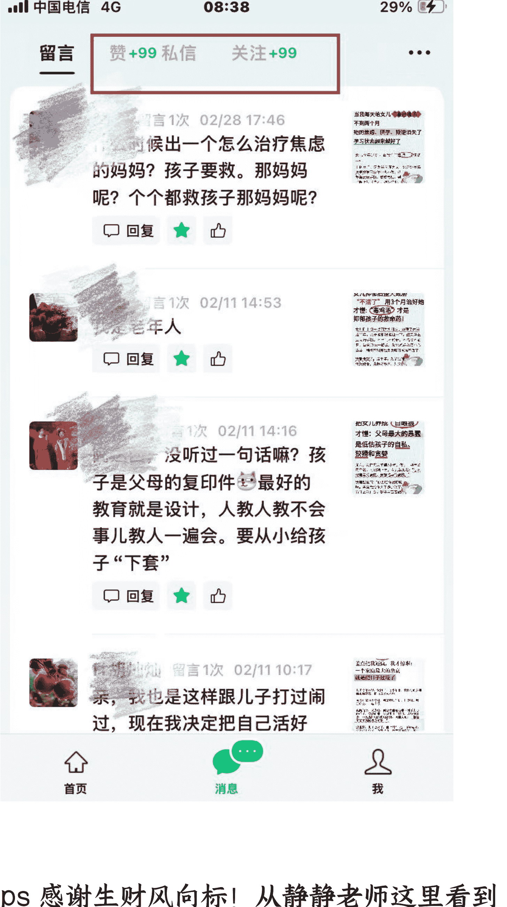

PS 感谢生财风向标！从静静老师这里看到小绿书的机会，实践有正反馈就做下去了。

(做项目过程中向静静老师学到很多，静静老师的解答非常仔细和热情，指路帖子：46 岁中年小白，8 个月靠生财有术公众号副业翻身：《公众号流量主项目做到收入 6 位数的实操心得》)

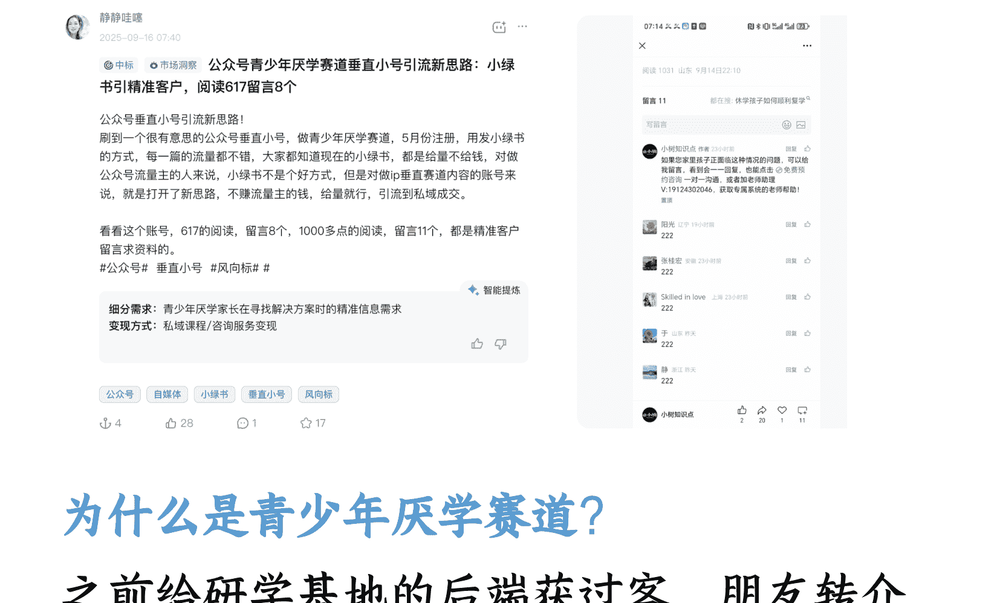

## 为什么是青少年厌学赛道？

之前给研学基地的后端获过客，朋友转介绍下进入这个赛道。

我主要是调研了这 3 点：

- 需求大（小红书评论区真实客资多，不过水军和截流也很多）、
- 产品好（盈利品 4-5 位客单有利润空间）、
- 我可以干（这些模板我单兵作战去复制的难度不大；以前我也真实厌学过懂家长心理）

## 【第一部分：小绿书获客全流程】

### 一、小绿书拿流量的原理

小绿书推荐跟小红书完全不同，

小红书靠算法，公众号靠社交，所以小绿书是可以快速上杠杆的：

50 个人点赞你的小绿书就代表

- →50 个人的好友都能在“看一看”看到你
- →每人朋友圈 1000 好友，假设实际看到人数是 1/10=100 人
- →50×100=5000 曝光

相当于你投放 1 个人的朋友圈，获得 100 倍的曝光，这就是小绿书的杠杆效应。

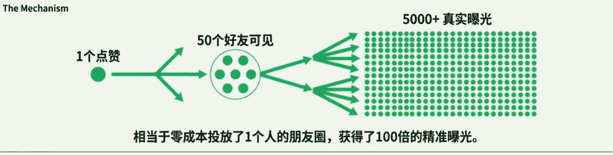

如果没有私域客户，内容够好的话，直接发也会有很强的公域推荐（推荐能到 80% 就已经能曝光给很多目标客户了）：

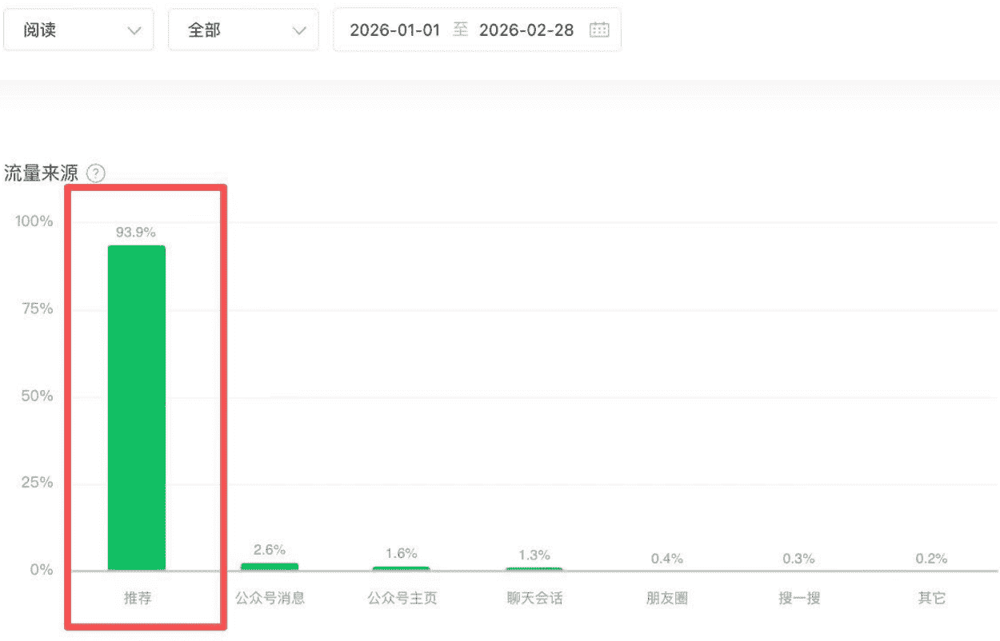

### 二、两个从 0 迅速冷启动的方法

**方式 1：私域冷启动（这个效果最好，需要后端配合）**

我合作的后端本身就有老客户，可以谈一谈直接用他们的私域。

同行的大哥是这样操作的：文章发到后端客户群（50 个群×200 人），48 小时 200 个点赞，推荐流爆发。

阅读量可以 24h 从 500 涨到 2.5 万。

**方式 2：微信群点赞**

我的方法是在宝妈群、家长群，发个红包请大家点点赞；像圈友有做养生茶这种大健康赛道的就更加的方便的。

到线下广场舞基地跟爷爷奶奶混个脸熟，请他们拉进群帮忙发红包点点赞，也是 0 成本净增几万曝光。

这里要特别注意两个点：

- 第一，你首批冷启动的用户就得是你的目标客户，不然的话小绿书标签会乱的；比如做家庭教育但是都是创业粉点赞，那就没啥用；
- 第二，时间节点。你先判断你的客户在什么时候出没？比如我的客户是上班族家长，我们就早上 11 点和下午 17 点发动群友点赞，刚好在家长客户们吃饭和下班摸鱼的路上可以投放到朋友圈，就比较精准；

## 看一看

独家 | 对话黎群：当银行遇见组织韧性，如何让文化“长”在业务里？

现代商业银行杂志

实用信息 | 送给 2026 新同学们的爱丁堡住宿选择小帖士

留学在爱丁堡

621 名！江苏省 2026 年省属事业单位公开招聘公告

中国无锡

### 三、怎么用 AI 生产能出客资的内容？

**方法 1：利用 Coze 工具直接一键搬运小红书的**

我把方法放上来供大家参考，感谢圈友哈默老师的文章！做了 30 天小绿书实操复盘：抓住红利，新手也能多篇 10W+，每月被动收入 1000+，卖课成交 120 人 +

前期靠这个方法我也是获客成单了的，后期我还是搭建了知识库来做长久之计哈哈。

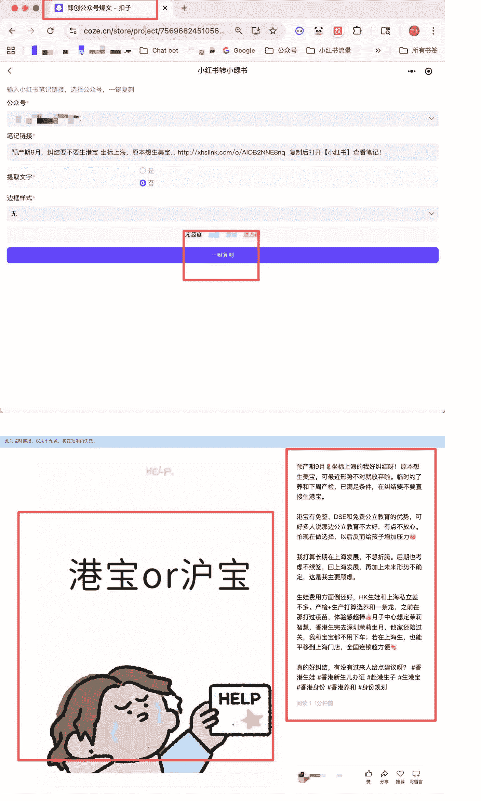

我做的家庭教育赛道就是长篇故事模板，或者轻动画配音，核心都是以家长的身份去讲一个故事。

**方法 2：创建行业知识库，在此基础上 AI 写笔记**

上一个版本我的方法其实是老旧了的，就是把所有素材放进 Gemini 智能体中 (包括我们后端的客户案例、小红书差评语料库、手搓的痛点合集、手搓的爆款正文结构等等),像大杂烩，然后靠人脑来选择每篇的重点，去调用素材创作。

这样的缺点是 AI 处理十几万字太烧脑了，同质化严重。

新的方法也分享给大家，一句话总结就是用 ImA 知识库的方式，加上 Claude Code+skill 就嘎嘎好使了。

感谢珍妮老师的方法，下面是珍妮老师的文章，大家有机会一定要把 2025 年 10 月 27 日 -2026 年 2 月 10 日的看一下，我拜读完感觉五体投地了。

### 避雷群 2025-2026 目录列表

### （2025.03.31-2026.03.31）

### 26. 红海赛道厮杀攻略：博士留学

- 2025 年 10 月 27 日 - 红海赛道厮杀版：博士留学赛道获客方案优化（附全程调研思路版：第一集）
  https://articles.zsxq.com/id_aa6ad4ulzxwa.html
- 2025 年 10 月 29 日 - 红海赛道厮杀版：博士留学赛道获客方案优化（附全程调研思路版：第 2 集）
  https://articles.zsxq.com/id_imm2u9bihaab.html
- 2025 年 10 月 31 日 - 红海赛道厮杀版：博士留学赛道获客方案优化（附全程调研思路版：第 3 集）
  https://articles.zsxq.com/id_sswwervqpt3t.html
- 2025 年 11 月 3 日 - 红海赛道厮杀版：博士留学赛道获客方案优化（附全程调研思路版：第 4 集）
  https://articles.zsxq.com/id_f4xpbhm7fp4l.html

### 第一步：三端素材收集

是分成三端去收集素材（包括销售、交付、运营端）：

销售端收集客户的百问百答和优秀案例，

交付端收集我们公司的产品优势，

运营端收集爆款选题/爆款结构/关键词（小绿书的可以直接跨平台收集小红书的，咋找爆款圈友分享也特别多，我就不赘述了）等等。

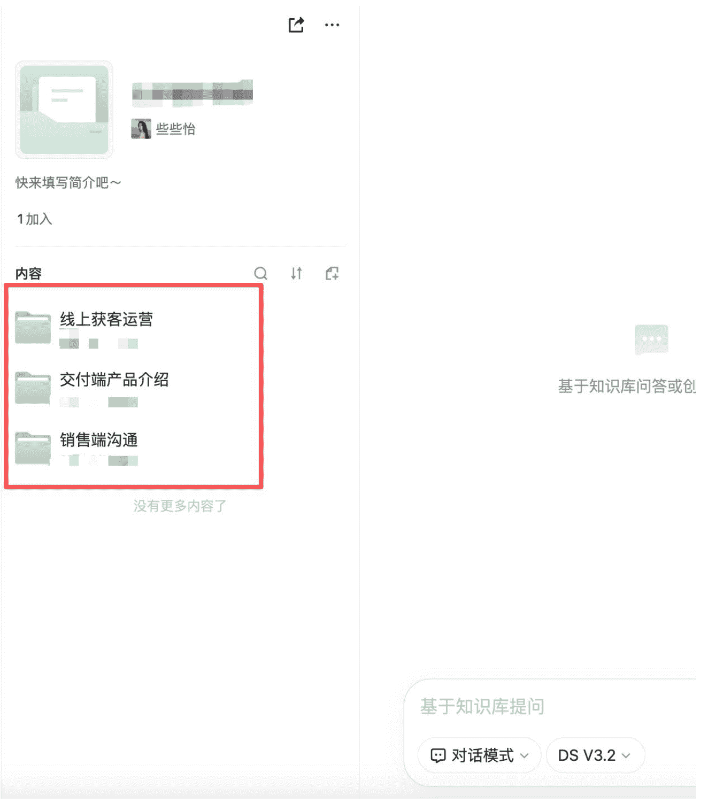

搜集素材的提示词模板如下：（具体关键词大家自己更换。比如你做的是医美就改成：医美项目介绍、客户变美案例、面诊科普知识库）

【任务】为青少年厌学咨询项目建立知识库，需要从三个端口收集素材：

**销售端素材:**

- 收集客户咨询过程中的高频问题 (百问百答格式)
- 整理成功案例：包括客户背景、具体问题、解决过程、最终结果
- 案例要求：真实具体，包含细节场景描述

**交付端素材:**

- 梳理我们产品/服务的核心优势和差异化价值
- 收集专家老师的方法论、理论框架
- 整理咨询过程中的关键话术和解决方案

**运营端素材:**

- 收集小红书同赛道的爆款选题 (标题 + 阅读量 + 互动数据)
- 拆解爆款内容结构 (开头、痛点、案例、解决方案、结尾)
- 整理高频关键词库 (如：青春期叛逆、厌学、亲子关系、母女矛盾等)
- 可跨平台收集小绿书 (视频号) 的爆款内容

请按照这个框架，帮我梳理现有的 [具体素材/文档],并分类整理成结构化的知识库。

### 第二步：知识库清洗与分类

第二步是对这些庞大的知识库清洗，分类打标签。

比如我们家庭教育赛道的客户案例可以分为：孩子日夜颠倒、家长婚姻破裂等等。

清洗知识库的提示词模板如下：

【任务】对以下青少年厌学项目的知识库素材进行清洗、分类和打标签

**分类维度参考:**

- 客户案例分类 (按问题类型):
  - 日夜颠倒/作息紊乱
  - 沉迷手机/游戏
  - 亲子冲突/家庭关系破裂
  - 学习动力丧失
  - 情绪问题 (抑郁/焦虑倾向)
  - 早恋/人际关系困扰
  - 家长婚姻破裂影响孩子

- 客户画像分类:
  - 按孩子年龄段 (初一、初二、初三、高中等)
  - 按家长类型 (焦虑型、控制型、佛系型等)
  - 按家庭结构 (完整家庭、单亲、重组家庭等)

- 内容选题分类:
  - 案例故事类
  - 方法干货类
  - 情绪共鸣类
  - 家长自我成长类

请对以下素材 [粘贴具体内容] 进行清洗，去除重复信息，按上述维度打标签，并整理成表格形式输出。

### 第三步：AI 学习对标签记优点 (核心)

第三步是手搓一遍对标签记的优点，

把口喷的过程全部丢给 AI，让 AI 知道什么是好的。

(实测我们亲手搓一遍超级重要，因为 AI 对内容背后人的幽微的情感还是捕捉不到的；但你每一类笔记都教他一遍，他学得非常快)

口喷就行了，要把信息量给 AI 堆得多多的，

你给他 8000 字让他写 2000 字他写的很好，但你给他 100 字让他写 2000 字一定很烂。

AI 是放大器，不是创造器。它产出的上限，取决于操盘手喂给它的认知边界。

推荐使用豆包输入法，识别中文的准确度已经达到 90%。

拆解对标的提示词模板如下：

我是一个小红书操盘手，我要为我的家庭教育项目做小红书营销，你先学习我的分析思路。

【对标笔记我的口喷】

首先看语言风格，他很口语化、接地气，像是家长聚在一起聊天，不是专家的说教；他的用词画面感很强，很具体，不是空话套话，比如## 【你的任务】

形容孩子“往沙发上一瘫耳机一戴”，或者收化妆品时的“劈头盖脸一顿训”，这些像读《意林》小故事很能吸引人。

我们再看他的目标客户：家里有青春期女孩的母亲，特别是孩子在 14 岁左右，原本乖巧听话突然变得叛逆、爱打扮的阶段。

再看它切中的痛点，是分层的。表面上是行为失控了：孩子迷恋穿衣打扮画眼线、成绩一塌糊涂。然后家长管教迎来了反弹，结果孩子不想上学了。

实际上我认为更深一层的痛点是家长自我价值的匮乏感，母亲的控制欲是因为小时候也被苛责不够努力，最终解决方案其实是母亲和自己的内在小孩和解。

情绪线变化自然，先是困惑愤怒，然后委屈，我们老师点拨下进入震惊自责，然后开始愿意改变和释然。

———

现在，请基于以上我口喷的分析思路，学习我分析对标时的方法论并总结给我，你接下来创作要延续这些思路来：

要求：
- 1. 严格遵循我描述的语言风格：口语化、画面感强、像《意林》小故事
- 2. 模仿我拆解的痛点分层方式（表层行为→中层关系→深层心理）
- 3. 按照我说的情绪线设计：困惑愤怒→委屈→震惊自责→愿意改变→释然
- 4. 绝对避免 AI 腔调和专家说教口吻
- 5. 每个场景都要像我举例的那样具体生动（比如“往沙发上一瘫耳机一戴”）

### 第四步：分层调用数据写文章

这一步根据标签来分层调用数据，让 AI 写文章。

创作的提示词模板如下：

你是 xxx 的公众号专家，我的客户群体是 xxx，我现在要写一篇小绿书的文章。

从【痛点库】调用：学业类痛点 1(孩子闭门不出，日夜颠倒玩手机)

从【爆款库】调用：正文结构 5(场景故事类：具体痛点 + 激烈对话开头)

从【案例库】调用：案例 3(海淀家庭于妈妈)

按我们刚刚分析的对标的文章，模仿他的选题爆点、语言风格、痛点分层、情绪设计，生成 800 字文章：
- 第一句：周日晚 11 点 + 具体对话
- 痛点分析：3 层递进 (表象/原因/后果)
- 解决方案：给 1 个可执行建议
- 案例：100 字转折故事
- 结尾：不要 hard sell，自然引导

关键有两个：一是素材库要丰富，二是要能充分地分层调用素材，AI 才能写出有深度的内容。

现在用 claude code+skill 就更加方便了。

（这部分易芝同学的方法论已经迭代的非常牛逼了，获客的内部知识库已经基本打通 AI 做图 + 写文案自动化，指路这里向他学习👉【2.0】1 个月用小红书 IP+ 蓝 V+ 自然流的方式快速跑通海外生活服务赛道 0 到 1

### 补充：内容小技巧

小绿书和公众号一样，标题和第一句话定生死。

小绿书标题不查重，大家直接搜最近半年的你同赛道最火的文章标题，一字不落的 copy 下来发就好了。

> （甚至你可以去小红书搬，小红书的内容质量领先小绿书一大截，搬过来是嘎嘎乱杀）；

进阶版是像我上面知识库的方式去建立爆款标题库，手搓调教 AI 生成新的。

开头第一句话也是同理，基本上就是制造冲突、制造悬念、数据抓眼、用户代入等等，下面给大家分享几个比较有效的开头模板：

- 1. 互动式开头，比如“一个逃学的孩子是怎么被毁掉的？”
- 2. 有争议/反认知的开头，在客户息息相关的痛点上吸引他看下去，比如“最愚蠢的教育，就是静待花开。”
- 3. 痛点场景的开头，适合在公众号的前 3 秒拉住客户。“家里那面贴满奖状的墙，现在成了女儿最怕的催命符。”
- 4. 引发用户好奇的开头，这个要对卖点进行独特包装。“学霸和学渣之间，还有一种孩子叫学酥：捏一捏勉强能成型，但一放松就立刻垮掉。”

## 【第二部分：小绿书怎么引流不违规？】

- 一、免费版 (评论区挂表单/自动关注弹窗):

免费版里最推荐的评论区是挂表单。

比如金数据表单是可以挂链接到评论区的，

高客单行业可以让客户自己留下联系方式，比较安全稳妥。

# 当我学会给儿子灌迷魂汤，他的内驱力爆发了

# 青春期教育 # 青春期 # 如何与青春期孩子相处 # 家长必读 # 学习内驱力培养

我是陪孩子走出厌学的菊妈，我花了 5 年时间，帮助了 2000 多个家庭。我把所有踩过的坑，总结成了一套【厌学复学指南】。如果您家孩子也有类似问题，可以点击📞预约咨询，我们会安排专家 1 对 1 免费沟通一次，每天限量 8 个名额

点击我，陪你解决孩子厌学问题

阅读 20 广东 2 月 3 日 19:30

# 留言

写留言

取消
允许

点击我，陪你解决孩子厌学问题

阅读 20 广东 2 月 3 日 19:30

# 留言

### 厌学问题咨询申请表 (A3)

请您花 30 秒留下信息及联系方式，我们将为您安排 1 对 1 咨询

| 字段 | 选项/内容 |
| --- | --- |
| 您家孩子所处阶段 | • 小学 • 初中 • 高中 • 其他 |
| 微信号 | (留空) |
| 孩子目前让您困扰的问题 | 多选 • 躺平 • (其他选项) |

第二种方法是单独辟一篇文章放二维码，在小绿书文末把二维码文章的蓝链挂在评论区。

# 当我学会给儿子灌迷魂汤，他的内驱力爆发了

# 青春期教育 # 青春期 # 如何与青春期孩子相处 # 家长必读 # 学习内驱力培养

我是陪孩子走出厌学的菊妈，我花了 5 年时间，帮助了 2000 多个家庭。我把所有踩过的坑，总结成了一套【厌学复学指南】。

如果您家孩子也有类似问题，可以点击预约咨询，我们会安排专家 1 对 1 免费沟通一次，每天限量 8 个名额

点击我，陪你解决孩子厌学问题

阅读 20 广东 2 月 3 日 19:30

# 留言

老生常谈的方法还有自动关注弹微信等等。

### 如何 1 对 1 分析？

### 二、付费版（微信小店卖资料）：

开微信小店挂 9.9 元资料包，既筛选人群又赚钱。

### 三、不推荐的引流方法：文末放二维码

这里有一个要注意的地方：

文末放二维码、或者文章底部跳转带有二维码的另一篇文章，都容易触发人工审核导致死号。

小绿书审核机制和小红书不太一样，有时我们没被制裁是因为审核大大还没有看到。

我有一个账号就是从平均 2000 阅读跳到 5 了。总之为了稳妥的话不建议这么干。

## 【第三部分：小绿书怎么配合长文章打 IP】

### 为什么要打公众号长文章？

一方面原因是：高客单价赛道的信任很重要。

像我后期做的号会定位这种素人形象“70 后陪孩子复学的海淀妈妈”,

标题和内容会做成系列，去铺设关键词，

比如这种“教育就是，xxxxx"

搜索
教育就是

**1. # 教育就是——让花成花，让树成树**
真正的教育，是尊重不同的生长节奏，接纳不一样的生命形态。德国...
忠义的教育碎思 11 个月前
阅读 10 万 +

**2. # 教育就是，形成仪式习惯，让孩子天天有盼头**
你说这是教育吗？是。它教会孩子：生活有规则，也有惊喜；付出会被...
教育本色 7 个月前
阅读 10 万 +

**3. # 教育就是，除了习惯，还是习惯**
具体要养成哪些习惯，之前已写过文章，请阅读：《教育就是，培养习...
教育本色 11 个月前
阅读 7.9 万

**4. # 教育就是，关键时托举，平常时守望**
七 教育就是，关键时托举，平常时守望。平常时保持“适度的远”，胜过...
教育本色 11 个月前
阅读 3.8 万

**5. # 教育就是，左手抓习惯，右手抓态度**
教育，说到底，就是两只手的事。一只手，稳稳地抓住孩子的学习习惯...
语嫣妈妈 7 个月前
阅读 3.1 万

### “人均确诊 ADHD”，ADHD 到底是个什么病

“人均确诊 ADHD”？ADHD 到底是什么？

人均确诊 ADHD，年轻人的新晋时尚单品

长文章是 IP 的基础。原理就是小红书的素人种草搬到公众号来做了，这种获客 IP 复制起来都是比较轻量的。

(这里想要安利一来老师的公众号轻 IP 获客帖子，向一来老师请教了帮助真的非常大，指路帖子
https://scys.com/articleDetail/xq_topic/1524885212245512(垂类公众号的新思考：垂直于“人”!)

### 原因二是：小绿书的流量不稳定。

因为图文和长文章在公众号里是两个分开的推荐池。长久来做要两条腿走路。

### 怎么一篇带一篇，把整个号的权重拉起来？

发完一篇小绿书后，往下滑都是瀑布流，如果你做系列文或者同类封面，很容易就把你自己的文章也推起来了;

此外，文章底部也可以挂自己其他优质帖子，

家长看完一个故事还会再想看看咱们机构是个何方神圣，衔接比较丝滑。

### 过年别再说“收收心”！用“动作指令”代替“模糊焦虑”，我用这套“拆解法”，帮休学儿子迈出了复学第一步

> “呕——"
>
> 大年初七的晚上，家里还贴着红窗花，但空气却冷得像冰窖。
>
> 距离明天返校，只剩下不到 10 个小时。
>
> 休学半年的儿子，像只惊弓之鸟一样缩在被窝里。
>
> 我把洗干净的校服叠好放在他床头，努力压抑

# 我用这套拆解法帮休学儿子迈出了复学第一步

# 孩子休学怎么办 # 家庭教育 # 亲子关系 # 厌学 # 青春期 # 开学 # 指令拆解法 # 模糊焦虑 # 不白博士 # 催眠

不白博士 + 关注

## 【第四部分：哪些赛道适合做小绿书？小绿书怎么变现？】

这套 AI+ 小绿书，不仅能做教育咨询。它同样适用于本地同城业务（比如线下门店、餐饮），或者橱窗带货。

### 一、3 种赛道类型

#### 1. 高客单的服务产品（教育/养生/医美/法律）

把小绿书作为一个分发渠道。

如果你是教育咨询类目，或者养生健康、留学申请、法律咨询、美业同城等等类目，都可以尝试。

像宠物医疗、旅游这种高客单服务，我了解到年复购率 30%，人效在 6-8 万上下的，能在小绿书上获客还蛮香的。

#### 2. 素人种草逻辑（白酒/本地生活/工厂尾货）

可以走素人种草逻辑的一切类目。

如果你是卖白酒品牌的、本地生活获客的、工厂尾货清仓的，换着关键词搜搜，可能你的好多同行已经在跑了。

大家可以搜搜下面这种号，是不是跟小红书的玩法非常类似？连评论区打广告都是一样的。反正我看到的时候又熟悉又好笑，哈哈，比小红书的卷王程度还要低很多。

卖几块钱

江西

更多资料 >

已关注公众号

2025 酒友们投票评选的，最好喝的白酒排名，

2025 酒友们投票评选的，最好喝的白酒排名，

2025 酒友们投票评选的，最好喝的白酒排名，

#### 3. 公认最好喝的白酒

2025 酒友们投票评选的，最好喝的白酒排名，看看你爱喝的上榜了没？

| 排名 | 酒名 |
| --- | --- |
| 一 | 飞天茅台 |
| 二 | 梦之蓝 M6 |
| 三 | 赖家庆 |
| 四 | 汾酒青花 |
| 五 | 水晶剑 |
| 六 | 习酒窖藏 |
| 七 | 黄盖玻汾 |
| 八 | 海之蓝 |

阅读 8 江西 2025 年 12 月 31 日 17:52

留言 1

七合沐 河南 2025 年 12 月 31 日 回复

前段时间我们公司聚餐就采购了 5 箱赖家庆，这酒口感不错喝着跟茅子味道很像，我也在某東弄了两箱，在家小酌美滋滋

更多相关贴图

#### 我们找一个素人小绿书号做例子。

点开看他的主页，就是做素人的日常：大部分都是发发生活，像一个真实的村民；

但是偶尔穿插 1-2 条白酒广告，数据特别好（小绿书赞 80 左右阅读已经 5w 了）；

我们点开看，发现他白酒的模板就是直接从小红书抄过来的，

#### Mr.郭 8851

山东

太优秀，这里面无法表达 >

#### 三星洞职业技术学院
😎 # 道家系毕业照
赞 1

#### 海边渔港风光 # 渔民生活一瞥

#### 城市生活瞬间 # 高楼林

😎今年生意不好做，必须要振兴乡村 # 乡村生

#### 城市生活瞬间 # 高楼林立的城市
赞 1

#### 不同酒局白酒推荐 # 白酒价格对比
赞 80

直升飞机送上船
赞 10

#### 汉口火车站 # 旅行出发点 # 武汉地标建筑
赞 3

再点开评论，他也是做了很多层楼的。

类似新小红书大家爱做的爆款种草广告，然后在评论区进行潜在客户的吸引。

他在评论区做的素人假评论也是比较初级的了，甚至没有分出 A 号和 B 号相互扮演。但是小绿书能出客资。

#### 体制内私下喝的白酒

#### 白酒排行 # 纯粮酒 # 中国名酒排行榜

阅读 277 河北 22 小时前

# 留言

波澜不惊 河南 19 小时前

这些我都喝过👍👍最有发言权，毕节赤源这个酒，印象比较深，我实在京东上入手的，是我喝酒这么多年，第一款最接近茅台的，没喝过的可以试试，真的很不错

原浆酒价格表一览表

玉伴小七

+ 关注
赞
分享
推荐

更多相关贴图

(百威啤酒，... 广东 1 月 1 日

你这些酒是批发价吧，

Mr.郭 8851 作者 1 月 2 日

😅我只是搬运工

后知后觉 河南 1 月 3 日

基本上就是这个价

7 条回复

举杯邀月 上海 1 月 1 日

首先排除茅台紫迎宾

阿喆 海南 1 月 2 日

不好喝吗？

Mr.郭 8851 作者 1 月 2 日

回复 阿喆：还可以

2024&加油 陕西 1 月 2 日

哪里能拿到 300 的汾 20，我请她吃预制菜

Mr.郭 8851 作者 1 月 2 日

回复 周 萱：😁😂都是爱酒的

1 条回复

168 上海 1 月 1 日

青花汾酒 30 年停产了吗？

安稳。山西 1 月 1 日

没有停产。

Mr.郭 8851

公众号懒人搜索，懒人专属群分享

(百威啤酒，...广东 1 月 1 日 回复 16

你这些酒是批发价吧，

Mr.郭 8851 作者 1 月 2 日 回复 12

😁我只是搬运工

后知后觉河南 1 月 3 日 回复 13

基本上就是这个价

7 条回复

举杯邀月上海 1 月 1 日 回复 5

首先排除茅台紫迎宾

阿喆海南 1 月 2 日 回复 1

不好喝吗？

Mr.郭 8851 作者 1 月 2 日 回复 3

回复阿喆：还可以

2024&加油 陕西 1 月 2 日 回复 4

哪里能拿到 300 的汾 20，我请她吃预制菜

Mr.郭 8851 作者 1 月 2 日 回复 2

回复周萱：😁😶都是爱酒的

1 条回复

168 上海 1 月 1 日 回复 1

青花汾酒 30 年停产了吗？

安稳。山西 1 月 1 日

没有停产。

浓香型白酒排名

Mr.郭 8851
80
243
68
36

### 橱窗带货 (女装/快销品)

文章底部挂购物车赚佣金或直接卖货。

如果你本身有货源或者做视频号带货，可以尝试小绿书。

比如这个女装电商的，真人实拍和 AI 生成的都有，每篇都是 1 万阅读，哇真的很香，主页直接挂她带货链接了。这种复制起来也没啥难度的。

朵儿 8790
湖南郴州女

两家品牌实体店的主理人，自己代言，实拍图片是本人，也是店里刚上的新款，每天变着生图的身术在生... >

视频号：桂东朵以熙兰雅飞飞
1 个朋友关注
朵以熙兰雅
进店

轻薄羽绒服，穿的季节行很长，很...
¥599
贴图
视频号

158/50 红色毛衣➕白裙子，分享穿搭
赞 5

158/50 分享穿搭，新年穿红
赞 6

#### 158/50 分享穿搭，枫树下拍照的大集合

羽绒服大集合 #秋季拍照姿势大全 #枫树下的秋日穿搭 #自然风光摄影技巧

阅读 1.0 万 湖南 2 月 6 日 23:03

我们点开看她其他的笔记，
甚至衣服都是 AI 换的，
比起重美感的小红书电商要轻巧很多，小白也可以上手。

#### 158/50 分享穿搭，枫树下拍照的大集合

羽绒服大集合 #秋季拍照姿势大全 #枫树下的秋日穿搭 #自然风光摄影技巧

阅读 1.0 万 湖南 2 月 6 日 23:03

朵儿 8790

#### 158/50 分享穿搭，枫树下拍照的大集合

羽绒服大集合 #秋季拍照姿势大全 #枫树下的秋日穿搭 #自然风光摄影技巧

阅读 1.0 万 湖南 2 月 6 日 23:03

朵儿 8790

### 二、进阶版：矩阵打粉怎么做？

这块变现原理和获客一样的，主要是私域卖流量，只是粗放和精细的差别。

1000 阅读带来 10 个流量，对应 1000 块收益 (高的类目 1 阅读=1 块钱)。

### 一个精准粉价值约 60 块销售额，利润 20 块左右。

热门拼豆段位排行榜

内行人建议：乱用拼豆只会害了你

热门拼豆千万别乱选！做好功课少走弯路

#### 更多相关贴图

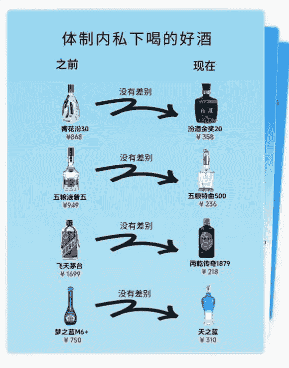

#### 高端白酒推荐

188.9 万人看过

参与话题

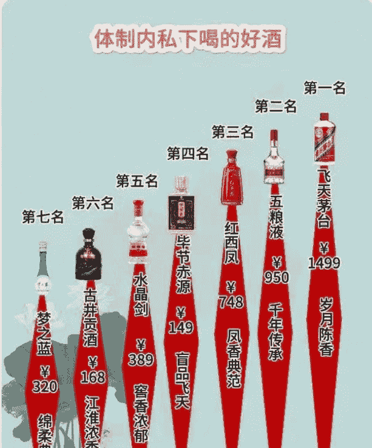

体制内私下喝的白酒
玉伴小七

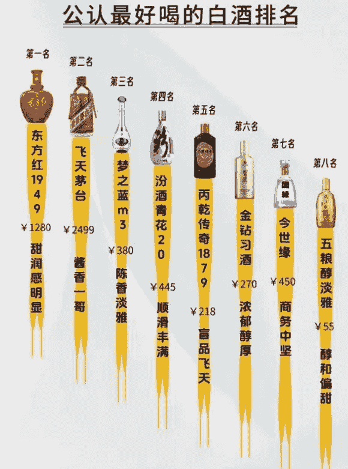

公认最好喝的白酒排名
猕猴桃 2346

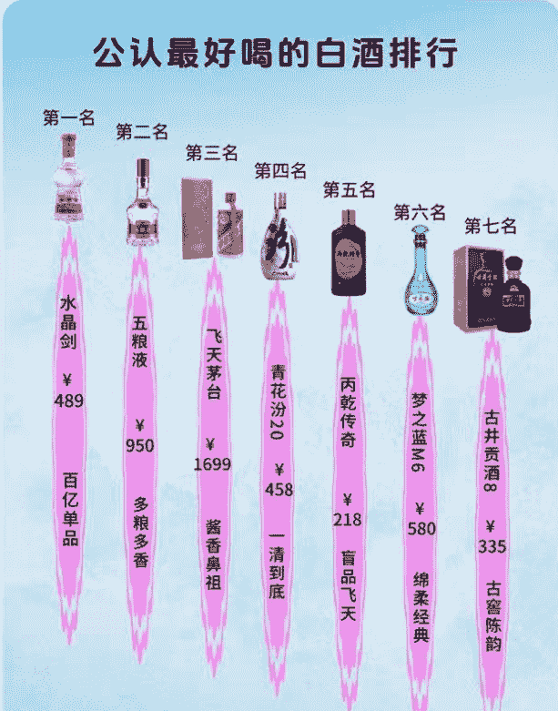

公认最好喝的白酒排行
幸福小木屋的宝藏箱

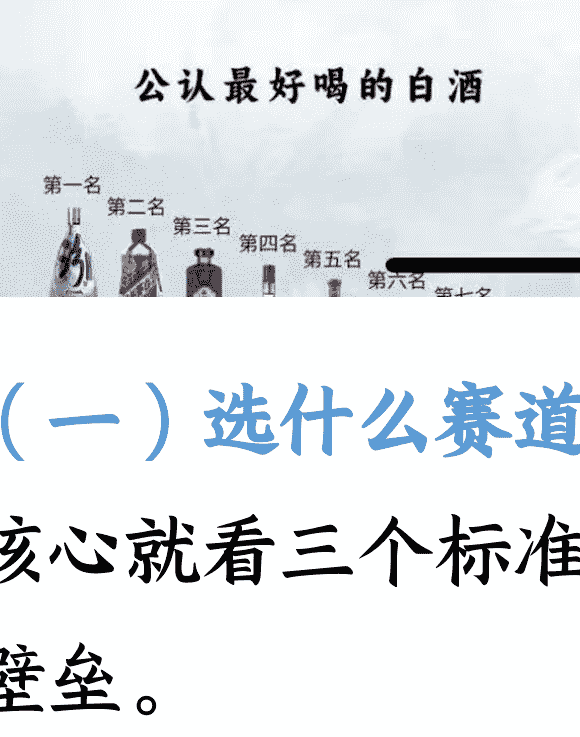

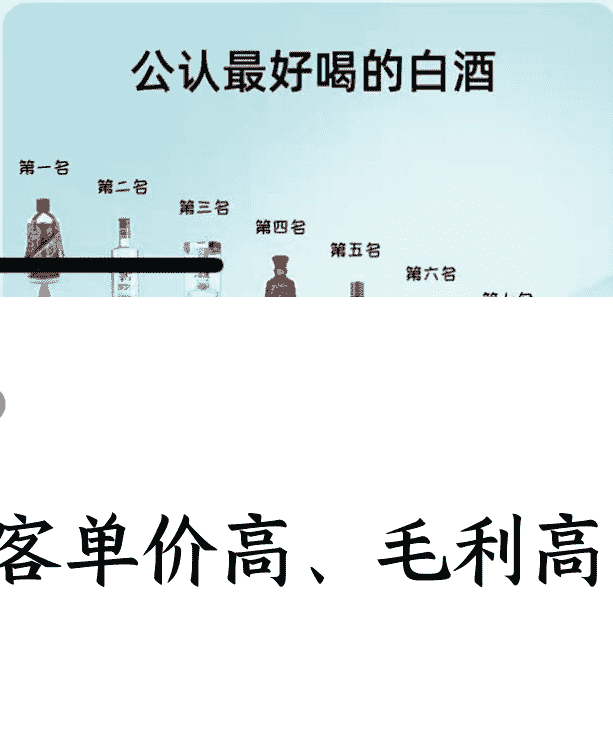

#### (一) 选什么赛道？

核心就看三个标准：客单价高、毛利高、有壁垒。

具体来说：
- 白酒类目，阅读单价能到 1 块钱，粉丝价值 100-300 块一个，私域变现都比较厉害。这个赛道风险会比较低一些。
- 旅游类目，阅读单价 0.7-0.8 块，服务变现客单价高，就是风险稍微高一点。
- 文玩珠宝也行，高客单高毛利。
- 家庭教育可以做，虽然白嫖粉多，但资料引流能转化。

粉丝价值排序的话：宝妈 > 中老年 > 宠物 > 男性。男性流量不是很推荐了，搞不好还亏本。

避坑：谨慎碰比如精酿啤酒、普通水果、沙县小吃、螺蛳粉店、白牌化妆品这种低价值品类。

#### (二) 账号怎么搞？

可以直接上个人服务号，不用企业号认证，成本比较低。

一个微信号注册一个公众号，1 万粉以下的话连实名都不用的。

如果是矩阵，自己根据预算上号，每 10-20 个号分一组，分散风险。废了一批还有另一批可以顶上。

设备的话二手手机 200-300 块一台就够了。

IP 要独立，挂服务器避免冲突 (这个我们特指的矩阵情况！10 个号以内获客的用独立流量卡就好了)。

#### (三) 内容怎么批量生产？

1 个号一天要发 2 篇文章，实际得生产 6 篇去筛选，所以总体是比较粗放的。

AI 工具用 DeepSeek、豆包这些，内容同质化没关系 (有效模板比如白酒排名、旅游攻略这种）。微调一下规避平台检测就 OK 了。

#### 去重技巧:

- 图片：百度/小红书/pinterest 找背景图+AI 混排换背景
- 文案：AI 生成后微调一下肉眼不可见的细节，比如语序、用词之类
- 标题公式：地域 + 痛点 + 解决方案 (小绿书的标题公式和小红书也是一模一样的)

新号一天发 4 篇启动流量，靠搜索流量 (这个也是小红书关键词布局的原理)。每个类目搞 5-8 个内容模板就够了。

2026 年公众号公域流量还不错，是合适的入场时机。用"傻瓜式照搬"内容，流量甚至比原创更大。

#### (四) 数据怎么盯？

一般就看这几个核心指标：
- 内容上：平均阅读、涨粉、完读率 (低于 30% 就该淘汰了)
- 转化上：私域转化率、客单价、复购率

优化机制：A/B 测试标题、封面、内容形式，每天更新流量模板，测出高互动内容就一直复制它。

#### (五) 怎么防封号？

单账号日更≤3 条，不要一天发 100 多条，也不要用第三方软件去发。

核心原则是：只要我们干正事就不会封号，流量价值覆盖账号成本就可以了。无脑复制，批量操作去放大效果。

#### 参考我调研同行的数据:

2 人团队管 100 个号，按特定方式操作，单人月收入三五万。

(这一块要感谢小伟哥，小伟哥的风向标总是又准又及时，我愿称他为生财弄潮儿)

## 【第五部分：草根操盘手的心法】

聊到这里小绿书聊得就差不多了，
坦白说，家庭教育是个超级吃"专家 IP"的赛道，很多头部同行都是像复旦沈奕斐老师这样的资深大神;
我只是个 00 后，没结婚没生娃，没有心理学教授的背景，也没有 20 年的个案咨询经验，
在那些真正的大佬面前，我的综合能力系数可能只有 0.2.

但这并不意味着普通人不能在创造价值和需求的空间里贡献出自己的一点力量，毕竟术业有专攻。

正因为我没有自带光环，才反推着找到了这套穷人打法——用 AI 构建工业化的内容，用小绿书这个侧翼战场去撬动流量。

我们主席也说过，游击战就是你打你的我打我的，弱或小一般都有灵活的优势。简单粗暴的方法有时也可以帮助我们在红海里先撕开一道口子，先进来再修炼的。

前端流量搞定了，后面还有更升阶的一道道关卡要破。

比如怎么让内容更高效、更精细：让用户看完我们的内容，就愿意前置下单，而不用给销售老师增加很大的工作量？

又比如私域部分：当我们真的引流来了 1000 多个高质量的客户，作为没有专家光环的操盘手，怎么用比较正规运营动作促进转化？

(这个有机会下篇再写吧!)

最后搞流量都是从粗暴到升阶的，我也一直都是很菜鸡地入门，然后乱七八糟地解决问题、乱拳打死老师傅。但是大家只要迈进窄门就会自然往前推的。

其他的没啥了，
感谢珍妮，珍妮是 AI+ 获客百事通，毫无保留地向我分享了很多锦囊妙计;
感谢一来哥，想学公众号流量的朋友，一定要看一来哥的深度拆解;
感谢 yeye 同学，yeye 在写文章上给了我很多好建议。

感谢生财！大家顺风顺水顺财神！！

## 分割线

看完这篇 SOP，你觉得你懂了。但 90% 的人一到实操就会卡在第一步。

工具和教程只是最低级的壁垒，真正的壁垒是"立刻动手"和"圈层信息差"。

如果你想看全网最新的变现玩法，并且和一群执行力极强的极客一起下场拿结果，欢迎围观我的核心私域：【懒人专属群】。

我们不聊虚的，只做商业闭环的拆解与 AI 效率的压榨。系统内已沉淀 1000+ 跑通的套利实战局。

☝️ 查阅圈子完整数字资产与上车门槛：

https://lazyso.com/insider/

认同价值、准备好下场干活的，扫码加我微信 (lazyhelper1)

微信：lazyhelper1
备注：【实操上车】，不闲聊