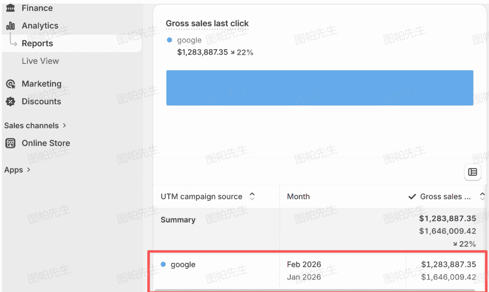
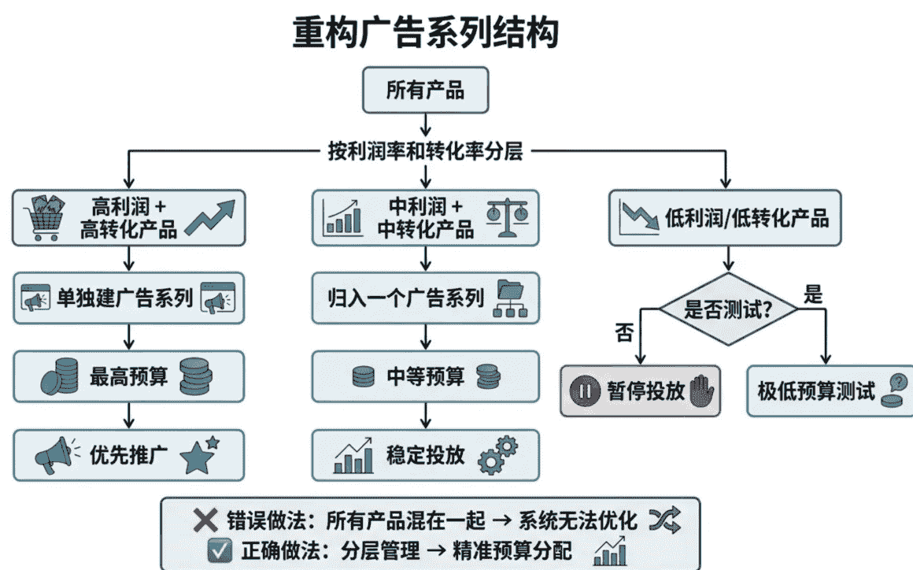
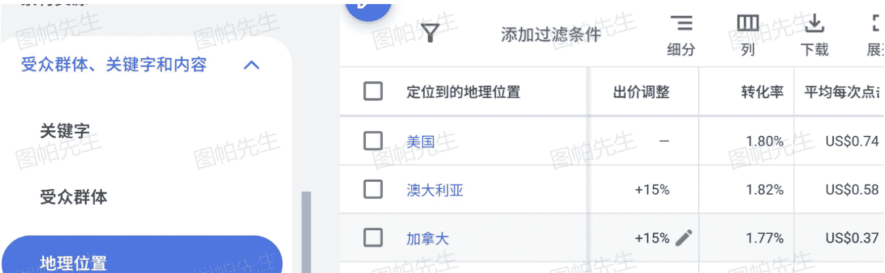
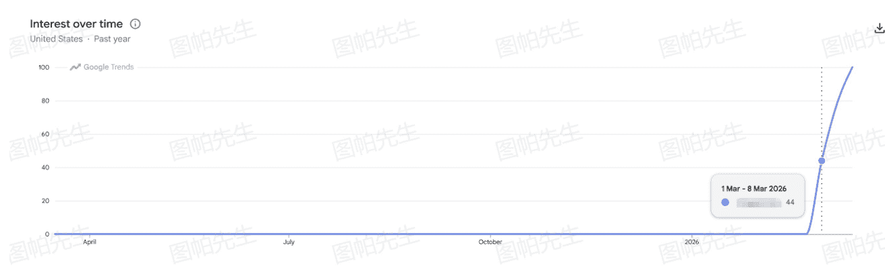
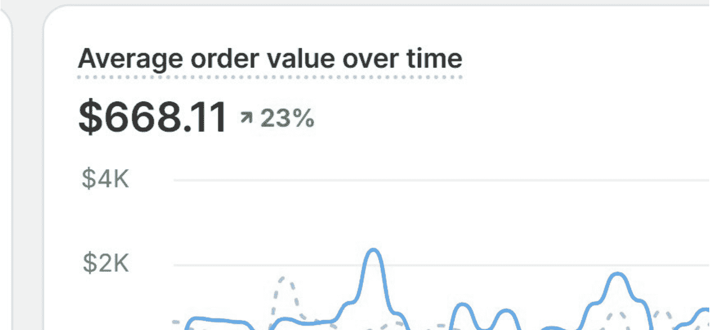
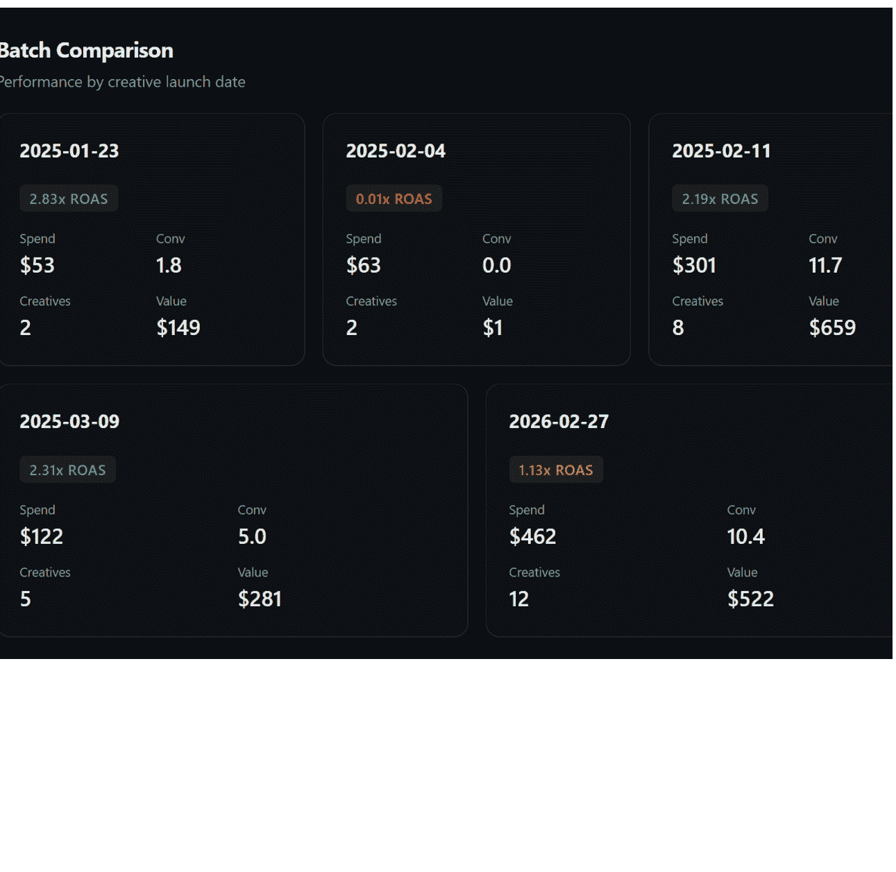
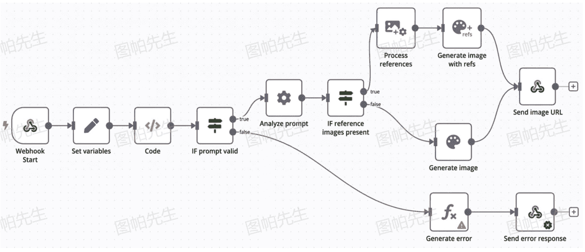
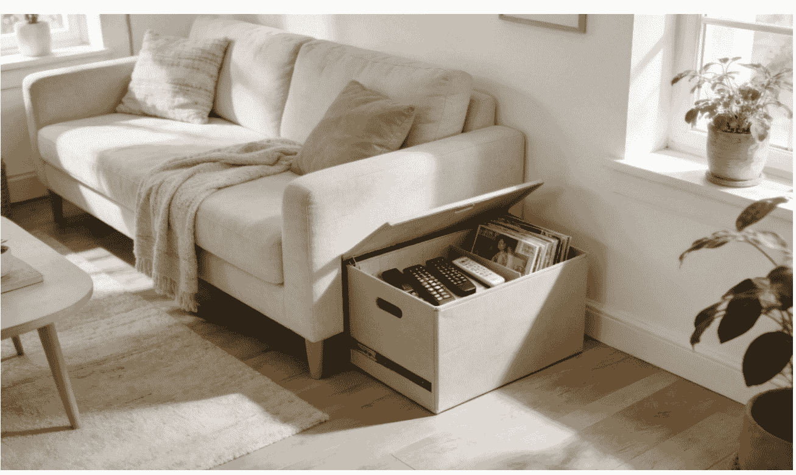

# 我是如何用 AI 赋能谷歌广告，把独立站月销售额做到 128 万美金

260324 副业 SC 精华
公众号懒人搜索，懒人专属群独享
懒人微信：lazyhelper1

大家好我是专注跨境出海的图帕先生，今天跟大家分享一下我是如何通过谷歌广告，把一个 Shopify 独立站做到月销 128+ 万美金的。

先说结果。

这个 Shopify 独立站上个月通过谷歌广告归因带来的销售额，做到了 128 万美金。

不是总 GMV，不是把自然流量、邮件营销、联盟全部揉进去的大数字。

而是，在店铺后台里对得上的那部分谷歌广告销售额（实际总 GMV 先保个密）。

> [今年 1 月份销售更高，但写这篇文章的时候是 3 月，就截最近一个月的图吧]

## 对行外的朋友解释一下什么是 utm：

在广告、EDM 里放的每一条链接后面加几段参数，那网站后台就能识别这次访问/下单是从哪儿来的、属于哪个渠道，甚至哪个素材。这里我勾选的是谷歌广告的数据。

很多人看到这个数字，第一反应通常是两个：
- 一种是，“是不是类目特别好，产品特别强，运气特别好？”
- 另一种是，“是不是预算够大，团队够强，直接砸出来的？”

说实话，都不是。

这个结果背后，没有什么玄学。

也不是突然某一天，PMax 良心发现，开始疯狂给你送钱。

真正发生的事情，其实很朴素：

我只是把一个很多人“会投流”，但不会“算账”、不会“分层”、不会“放量”的独立站广告系统，重新做了一遍。

你要说这里面有没有运气？
当然有。

任何广告平台、任何市场环境、任何节点爆发，都有运气成分。

但如果把结果长期归因给运气，那是对操盘的侮辱。

因为你会发现，真正能把一个站从几十万美金拉到上百万美金的，从来不是某一条爆掉的广告，而是一整套能反复复制的系统。

就像乔布斯说的那句很经典的话：

> You can't connect the dots looking forward; you can only connect them looking backwards.

很多动作在当下看只是小修小补，回头看，才发现它们连成了一条增长曲线。

这篇文章，我尝试把我的经历尽量讲清楚。

首先，

## 两种思维模式的差距

投放有点像开餐馆。

## 第一种老板：凭感觉经营

觉得某道菜好吃就推，觉得某个时段人多就多备料，全靠直觉，赚钱了不知道为什么赚，亏钱了也不知道为什么亏。

## 第二种老板：用数据经营

每道菜的食材成本、人工成本、翻台率、毛利率全部算得清清楚楚。哪道菜该推、哪道该砍、什么时段上什么套餐，全部有数据支撑。

你猜哪种餐馆活得更久？答案不言而喻。

Google Ads 也是一样。当你能把每一个关键词的 CPC、每一个广告组的转化率、每一个产品的 ROAS 都算得明明白白的时候，你就不再是在赌博，而是在经营一台可预测的赚钱机器。

我给自己定了一个原则：Google Ads 里花出去的每一分钱，都必须有数据追踪、有归因分析、有优化方向。

我不是那种只会在后台调几个按钮，然后靠平台吃饭的投手。

这几年，我一直在做 Shopify 独立站的增长，长期盯的是更底层的东西：
- 产品是不是值得推
- 利润是不是扛得住
- 流量质量到底好不好
- 页面能不能接住
- 复购能不能回本
- 预算能不能健康扩

说白了，我不是把谷歌广告当一个“投流工具”，而是把它当成一个增长引擎的一部分。

而这也是很多人做不起来的根源。

这两者的差距，会直接决定你是月销 10 万美金，还是 128 万美金。

## 起步阶段：

## 选品：找到搜索需求强 + 竞争密度低的甜蜜区间

做 Google Ads 和做 Facebook 广告最大的区别在于：Google 是需求拦截，用户已经在主动搜索了，你只需要出现在他面前；Facebook 是需求创造，用户本来没想买，你要用内容激发他的欲望。

这意味着，做 Google Ads 选品的第一要素不是好不好看有没有创意，而是——有没有人在 Google 上搜索这个东西。

## 我的选品三步法：

## 第一步：用 Google Keyword Planner 挖需求

打开 Google Keyword Planner，输入你的大品类关键词，重点看两个指标：月均搜索量和竞争程度。我的筛选标准是月搜索量 50000-150000 之间，搜索量太大意味着巨头扎堆，搜索量太小意味着市场不够大。

比如，dog collar 这个品类就符合我的标准

| 关键字（按相关性排序） | 平均每月搜索量 |
| --- | --- |
| 您提供的关键字 |  |
| dog collar | 90,500 |

## 第二步：用 Google Shopping 验证商业价值

在 Google Shopping 里搜索这个关键词，看看有多少商家在投广告。如果 Shopping 广告位上只有 3-5 个商家，说明这是一个竞争适中、有商业价值的品类。如果一搜出来满屏都是大品牌的 Shopping 广告，那就需要谨慎了。

同时要关注价格带——如果现有商家的售价集中在 50-150 美金之间，这是一个非常健康的区间。客单价太低（低于 30 美金）很难覆盖获客成本，太高（超过 300 美金）则决策周期太长，转化率会很低。

## 第三步：去 1688 和速卖通找供应链

确定品类后，马上去 1688 和速卖通找货源。我的标准是采购成本不超过售价的 20%-25%。这样即使加上广告费（通常占售价的 25%-35%）、物流费、平台费，还能留出 15%-25% 的净利润空间。

## Google Ads 实战：从 0 到 128 万美金的 4 个阶段

接下来是核心部分。我把整个 Google Ads 的增长过程分成了 5 个阶段，每个阶段的目标、策略和踩过的坑都不一样。

### 阶段 1：冷启动测试期（月销 0-5 万美金）

**目标：验证产品 - 市场匹配度，找到能出单的关键词**

刚起步的时候，不要想着赚钱，先想着验证。你的产品在 Google 上有没有需求？哪些关键词能带来转化？你的落地页能不能承接住流量？

**我的起步策略：**

只开两种广告类型：Google Shopping 广告和品牌搜索广告。Shopping 广告是独立站 Google Ads 的基本盘，用户搜索产品关键词时，你的产品图片、价格、标题直接展示在搜索结果顶部，所见即所得，转化效率最高。

每日预算从 30 美金起步，不要一上来就砸大钱。这个阶段的核心是收集数据，而不是冲销量。

前两周我几乎每天都要花 2-3 小时在 Google Ads 后台看数据：哪些搜索词触发了我的广告？哪些搜索词点击了但没转化？哪些产品的点击率最高？

#### 关键动作：搜索词报告是金矿

每周导出一次搜索词报告，做三件事。第一，找到能出单的精准词，记录下来，后续单独建广告组重点投放。第二，找到花钱但不出单的垃圾词，加入否定关键词列表。第三，找到搜索量大但和你产品不太相关的词，也加入否定关键词列表。

而且我没有先加预算，而是先把利润模型算明白。

我当时先拉了一张表，把几个核心数字全部捋了一遍：
- 产品售价
- 产品毛利
- 履约成本
- 物流成本
- 支付手续费
- 退款率
- 折扣成本
- 首单客单价
- 加购率

然后算两个关键指标：

1. Break-even CPA

就是你最多能接受花多少钱买来一单，还不至于亏。

2. Break-even ROAS

就是你的广告至少得跑到什么水平，生意才有继续放大的资格。

很多人做谷歌广告时，只知道自己“想要 ROAS 多少”。

但不知道这个数字到底是拍脑袋拍出来的，还是利润模型推出来的。

这是两回事。

举个例子。

假设一个产品卖 95 美金，看起来不低。

毛利率也不错，看起来能打广告。

可一旦把运费、支付手续费、仓储、售后、退款、折扣全部扣掉，最后真正留给广告的空间可能只有二十来美金。

那这时候你再去看账户，就不是“这个系列有没有单”了。

而是：

这个系列拿单成本能不能压住

压不住的话，AOV 能不能做高

AOV 做不高的话，后端复购能不能补

如果都不成立，那这个量根本不值得扩

### 阶段 2：优化打磨期（月销 10-50 万美金）

#### 目标：提升 ROAS，找到盈利的广告结构

冷启动跑了一个月之后，你手上已经有了一批数据。这个阶段的重点是优化广告结构，让每一分钱都花在刀刃上。

#### 核心操作 1：重构广告系列结构

很多新手犯的错误是把所有产品塞进一个 Shopping 广告系列里，让 Google 自己决定展示哪个。这就像开一家便利店，把薯片、洗衣液、安全套全部堆在同一个货架上——系统根本不知道该优先推什么。

我的做法是按照产品利润率和转化率把产品分成三个层级。高利润高转化的产品单独建广告系列，给最高预算。中利润中转化的产品归入一个广告系列，给中等预算。低利润或低转化的产品暂停投放，或者只保留极低预算做测试。

#### 核心操作 2：Product Feed 优化

Google Shopping 广告的展示效果，90% 取决于你的 Product Feed 质量。标题、描述、图片、价格、类目——每一个字段都会影响你的广告是否能匹配到正确的搜索词。

我的 Feed 优化原则是标题里一定要包含核心关键词，放在最前面。比如不要写型号，比如 xxx Pro 2000，而要写 Pet Training Collar with Remote – Pro 2000 – WiFi Dog Collar。很多品牌站犯的错误是标题里只写品牌名和型号，用户搜索的时候根本匹配不到你。

产品图片要用白底图，主体占画面 80% 以上，不要花里胡哨加一堆文字。Google Shopping 的图片展示面积很小，越简洁越好。

#### 核心操作 3：出价策略的切换

冷启动期我用的是手动 CPC 出价，因为我需要精准控制每个关键词的花费。但当数据积累到一定程度（通常是 30 天内有 50 个以上转化），就可以切换到 Target ROAS（目标广告支出回报率）智能出价了。

这里有一个非常重要的经验教训：不要一上来就用智能出价。Google 的智能出价算法需要足够多的转化数据来学习。数据不够的时候用智能出价，系统会乱跑，ROAS 会非常不稳定。

我的切换标准是过去 30 天内至少有 50 个转化事件，且 ROAS 稳定在 2 以上。满足这两个条件后再切到 Target ROAS，设定目标值为当前 ROAS 的 80%（比如当前 ROAS 是 4，就设定 Target ROAS 为 320%）。留出 20% 的余量，让系统有空 间去探索更多的流量。

#### 核心操作 4：扩展关键词

很多人会忽视长尾词。

因为它们搜索量不够大，看起来不像能撑起一个大盘。

但我后面越做越发现，长尾词里藏着大量高质量订单。

尤其是那些带有这些特征的词：
- 场景词
- 问题词
- 对比词
- 规格词
- 用途词

“best / for / vs / review”这类带决策意图的词。

这类词的共同点是：

用户还没下单，但已经很接近下单。

你只要把广告文案、产品页和信任状铺好，它的转化质量往往会比大词好得多。

### 阶段 3：规模扩张期（月销 40-80 万美金）

#### 目标：在保持 ROAS 的前提下，大幅提升广告支出

这个阶段是最考验心态的。因为你需要花更多的钱，但花钱多了 ROAS 很可能会下降。很多人在这个阶段缩手缩脚，不敢加预算，结果销售额就停在一个天花板上下不来。

Elon Musk 有句话我很喜欢："When something is important enough, you do it even if the odds are not in your favor." 扩量这件事，就是明知道 ROAS 可能会短期下降，但你知道这是正确的方向，所以必须要做。

#### 扩量三板斧：

##### 第一板斧：加预算的节奏

不要一次性把预算从 500 美金加到 5000 美金。Google 的算法需要时间适应。我的做法是每 3-4 天加一次预算，每次加幅不超过 20%。比如今天预算 500 美金，3 天后加到 600 美金，再 3 天后加到 720 美金，循序渐进。

##### 第二板斧：开辟新的广告类型

当 Shopping 广告的量跑到一定程度后，单靠 Shopping 很难继续增长了。这时候我开始加入搜索广告（Search Ads）和 Performance Max 广告。

搜索广告我主要投竞品词和长尾需求词。比如用户搜 Furbo alternativepet camera cheaper than Furbo 这类词，说明他已经了解了竞品，正在寻找替代品。这种用户的购买意愿极强，转化率非常高。

Performance Max（PMax）是 Google 的全渠道智能广告，它会自动把你的广告分发到搜索、Shopping、YouTube、Gmail 等所有 Google 渠道。

##### 第三板斧：拓展新的市场

我最早只投美国市场。当美国市场跑稳之后，我开始测试加拿大、英国、澳大利亚。这些英语市场的用户行为和美国很相似，投放策略几乎可以直接复用，但竞争程度低了很多。

加拿大市和澳洲市场给了我一个惊喜——CPC 只有美国的 60%，但转化率几乎一样——所以我专门把这两个地区的出价提高 15%。同样的预算，ROAS 比美国高了 40%。后来我又陆续测试了德国、法国等欧洲市场，效果也不错。

### 阶段 5：品牌壁垒期（月销 100 万美金+）

#### 目标：从买流量升级为建品牌，构建长期竞争力

当月销突破 100 万美金的时候，我们发现一个残酷的事实：单纯靠 Google Ads 买量，增长是有天花板的。因为关键词就那么多，竞争对手也在不断进场，CPC 只会越来越高。

这时候必须要做品牌了。

我做的几件事：
- 第一，加大品牌搜索词的投放。当用户直接搜索你的品牌名时，CPC 极低，转化率极高。所以我开始在 YouTube、社交媒体上做品牌曝光，目的就是让更多人记住我的品牌名。
- 第二，启动 YouTube 广告。YouTube 是 Google 生态里的视频平台，非常适合做产品展示和品牌故事。我录了一系列产品使用场景的视频，投 YouTube In-stream 广告，虽然直接转化率不高，但显著提升了品牌搜索量和网站的直接访问量。

布局了一个多月，在今年 3 月份初，就能看到我们的品牌搜索趋势开始上升了。

第三，做私域和邮件营销。Google Ads 带来的每一个客户，都要想办法留住。我用 Klaviyo 搭建了完整的邮件自动化流程：新客欢迎邮件、弃购挽回邮件、老客复购邮件、交叉销售邮件。这些邮件每个月能贡献 15%-20% 的营收，而成本几乎为零。

同时，我也加大了品牌词搜索广告的投入。

很多人看不上品牌词，觉得这是“本来就会来的人”。

这种想法，在实战里很危险。

因为品牌词的意义，从来不只是“捡现成订单”。

它还有三个作用：
- 第一，它通常是账户里最稳定的底盘。
- 第二，它能防止竞品拦截。
- 第三，它能持续给账户喂高质量转化信号。

品牌词不一定是扩量核心，但它是账户稳定性的核心。

时间是品牌的朋友。当你的品牌建立起来之后，你的获客成本会越来越低，竞争对手要复制你的成本会越来越高。这才是真正的护城河。

## 网站优化

以前我也有点迷信广告技巧。

总觉得问题出在关键词、出价、结构、预算、归因。

后来我发现，很多时候这些都只是表层。

因为你花钱把用户买进来之后，真正接住他的，不是谷歌，是你的 Shopify 页面。

如果页面接不住，那前面再漂亮的广告数据，最后也只是把用户更快地送走。

所以那段时间，我们狠狠干了一轮页面优化。

### 我们主要做了 5 件事：

#### 1、首屏不再自嗨，而是直接回答“为什么买你”

很多独立站首屏看着挺高级，拍得也不差，但有一个共同问题：

说不清楚。

用户进来 3 秒钟，还不知道：
- 你卖的是什么
- 适合谁
- 为什么你值得买
- 为什么要现在买

后来我要求所有落地页首屏，必须把这几个问题讲明白。

#### 2、少讲参数，多讲结果

参数当然重要。

但参数不是成交理由，结果才是。

用户真正想知道的是：
- 这东西到底能帮我解决什么问题
- 为什么它比别家更省心
- 买了之后，我的生活会发生什么变化

这时候我会不断提醒团队一句话：

**不要把页面写成产品说明书，要把它写成成交说明书。**

#### 3、把信任状前置

独立站天然没有平台信任背书。

所以用户脑子里会有很多小问号：
- 靠谱吗
- 发货快吗
- 质量稳吗
- 售后行吗
- 会不会踩坑

后来我们把这些信息全部往前提：
- 评价
- UGC
- 时效
- 退换说明
- 支付方式
- FAQ
- 媒体或第三方背书

这一步做完之后，转化率提升非常明显。

#### 4、移动端速度必须优化

这件事太多人知道，但做得不够狠。

你买进来的流量，大量来自移动端。

页面慢、首屏重、信息层级混乱，这些都会直接吃掉转化。

所以我们做了很多减法：
- 压图
- 删冗余插件
- 减少无效动画
- 把最重要的信息提前露出

#### 5、同步抬高客单价

很多人只盯转化率，但真正把月销售额从几十万拉到上百万，不可能只靠“多来点订单”。

你还得让每个订单更值钱。

于是我们加了：
- 套装
- 捆绑
- 加价购
- 满减
- 购物车推荐

最后不只是 CVR 变好，AOV 也被一起抬起来了。

## 血泪教训：这些坑我帮你踩过了

### 坑 1：盲目追求低 CPC

很多人把 CPC（单次点击成本）当成最重要的指标。CPC 越低越好对不对？不对。

低 CPC 可能意味着低质量的流量。用户搜一个和你产品似是而非的词，点了你的广告，CPC 很低，但他根本不会买。你的 ROAS 反而更差。

真正重要的指标是 ROAS 和 CPA（单个获客成本）。只要 ROAS 是盈利的，CPC 高一点完全没关系——因为高 CPC 往往意味着高购买意向。

### 坑 2：频繁改动广告设置

Google Ads 的智能出价算法需要学习期。你每做一次重大改动（比如调整预算超过 20%、改变出价策略、添加或删除大量关键词），系统就会进入重新学习期，通常需要 7-14 天才能稳定。

### 坑 3：忽略竞争对手的动态

如果你每天都在做改动，系统永远在学习，永远不稳定。我的原则是除非数据出现严重异常，否则至少等 7 天再做调整。

Google Ads 是一个竞价系统，你的表现不仅取决于你自己，还取决于你的竞争对手。如果某一天你的 CPC 突然飙升、排名突然下降，很可能是有新的竞争对手进场了，或者老对手加大了投入。

我每个月会用 SEMrush 或 SpyFu 检查一次竞争对手的广告策略：他们在投哪些关键词？广告语怎么写？出价大概在什么范围？有没有新的竞争者加入？

知己知彼百战不殆，这句话在 Google Ads 里同样适用。

## 我的 AI 使用清单:AI 如何贯穿整条链路

写到这里，就不得不提 AI，毕竟现在是 AI 大时代。

很多朋友、博客和公众号来的读者问过我：你做独立站和广告投放到底怎么用 AI 的？这里做一个完整的汇总。

这里我要先说清楚一个边界。

很多人一听 AI，就容易走两个极端：

- 一个极端是神化，觉得有了 ChatGPT，广告就能自己赚钱；
- 另一个极端是看不上，觉得这玩意最多写写标题，没什么实战价值。

我的看法是：

它既不是神，也不是玩具。

它更像什么？

更像一个反应很快、执行力很强、永远不会嫌麻烦的助理。

前提是，你得先知道自己要它干什么。

这点很像我在做谷歌广告时的一个核心认知：

不是系统替你赢，而是你先把问题定义清楚，再让系统帮你放大。

### 选品阶段

关键词拓展：用 ChatGPT 基于核心词拓展长尾搜索词，效率提升 5 倍，关键词库从 50 个扩展到 500+。

| 相关关键词 (Related Keywords) | 预估月搜索量 (Est. Volume) | 竞争难度 (Difficulty) | 搜索意图 (Search Intent) |
|---|---|---|---|
| dog collar | 100,000+ | 极高 (85+) | 商业/交易 |
| personalized dog collars | 50,000 - 80,000 | 高 (75) | 交易 |
| flea and tick collar for dogs | 40,000 - 60,000 | 高 (80) | 商业调查/交易 |
| leather dog collar | 20,000 - 40,000 | 中高 (65) | 交易 |
| led dog collar / light up | 15,000 - 30,000 | 中等 (45) | 商业调查/交易 |

### 投放阶段

我用 ChatGPT 帮我拆搜索词，不只是看“词”，而是看“用户脑子里在想什么”

后来我会经常让 ChatGPT 帮我做一件事：

不仅仅机械分类搜索词，而是识别这些词背后的购买意图。

比如同样是一个品类词，有些用户是在找最低价，有些是在对比材质，有些是在担心适配问题，有些已经在找“best”“review”“for xxx”的决策型答案。

这些词表面看都是同一类流量，实际上购买阶段完全不同。

这时候，ChatGPT 很适合做第一轮语义整理。

我会让它帮我标记：

- 哪些词偏强购买意图
- 哪些词偏研究阶段
- 哪些词偏对比阶段
- 哪些词适合单独出一版广告文案
- 哪些词更适合写进 FAQ、集合页或博客内容里

#### B. 最值得优先抢的商业词组

这批词我会排在最前，因为用户意图更清晰，转化更近：

- personalized dog collar
- custom dog collar
- embroidered dog collar
- engraved buckle dog collar
- name plate dog collar
- waterproof dog collar
- biothane dog collar
- reflective dog collar
- leather dog collar

这样做的好处是，我不只是“管广告”。
我是在把广告数据反向喂给站点运营和内容运营。

也就是从“投流”变成“理解需求”。

还有我用 ChatGPT 帮我写广告文案。
但我不会直接复制粘贴。

这一点很重要。

ChatGPT 当然可以帮我写 RSA 标题、描述、促销文案、附加说明、站点链接说明。

但我几乎不会让它“自由发挥”。
因为 AI 一旦没边界，就很容易写出一堆正确但没力量的话。

我真正的做法是：
先把产品卖点、用户痛点、竞品差异、禁用表述、品牌语气全部喂给它；

然后让它在明确约束下，批量生成多套不同风格的版本。
比如：

- 一套偏直接转化型
- 一套偏信任背书型
- 一套偏痛点触发型
- 一套偏节日促销型
- 一套偏高客单用户更能接受的表达方式

然后我再从里面挑、改、拼。

所以 ChatGPT 在这里的价值，不是替我完成文案。

而是替我完成文案的第一轮扩写与发散。

这能让我少很多从 0 到 1 的空转时间，把更多精力留给真正重要的事：

- 判断哪种表达更贴近用户，
- 哪种表达更适合这个国家，
- 哪种表达会带来更高质量的点击。

##### Prompt 示例：

> "你是一位 Google Ads 资深文案专家。请为以下产品生成 20 个英文广告标题和 8 个广告描述。产品信息：[产品名称、核心卖点、目标人群、价格区间]。标题要求：每个不超过 30 个字符（含空格），包含行动号召词，突出差异化卖点。描述要求：每个不超过 90 个字符，要激发用户的购买欲望，包含促销信息或信任背书。请标注每个标题/描述主打的卖点角度。"

### 分析阶段

做谷歌广告最累的一件事，不一定是调账户。

而是每天、每周都有大量零碎信息涌进来：

- 搜索词报告
- 广告系列数据
- SKU 维度销售数据
- 站内热图
- 加购与结账数据
- 客服聊天记录
- 用户评价
- 退款原因
- GA4 页面路径
- 不同国家、设备、时段的转化差异

这些信息单独看都不算难。

难的是：太碎、太多、太杂。

以前很多时候，我脑子里明明知道“哪里不对”，但要把它完整地梳理出来，再转成具体动作，挺耗精力。

后来我就会把一部分结构化数据和现象描述丢给 ChatGPT，让它先帮我做第一轮整理。

比如我会这样给它任务：

> “下面是过去 14 天的搜索词报告，请按这几个维度帮我分类：
>
> 1) 高意图且有转化
> 2) 点击多但浪费明显
> 3) 适合新建广告组的长尾词
> 4) 应该加否词的低质量词
> 5) 能反向指导落地页优化的用户表达”

它的答案不一定 100% 对。

但它通常能帮我先把一锅粥，整理成几盘菜。

这一步非常重要。

因为很多投手不是不会优化，而是被信息淹没了。

AI 可以针对不同的关键词生成类似的报表。

### 运营阶段

我用 ChatGPT 帮我把产品卖点，翻译成“用户听得懂的话”

这一点，对 Shopify 独立站特别有用。

因为很多独立站页面最大的问题，不是没有信息，而是信息的表达方式太“卖家视角”了。

比如：

- 写一堆参数
- 写一堆材质
- 写一堆功能
- 写一堆自己觉得很厉害的词

但用户不关心这个。

用户关心的是：

这玩意对我有什么用？

它能解决我什么问题？

为什么我要相信你？

为什么我现在就该买？

后来我经常会把产品参数、用户评价、客服问答、竞品页面一起丢给 ChatGPT，然后让它帮我做几件事：

- 第一，把“工厂语言”改写成“消费者语言”；
- 第二，把卖点重新排序，先讲用户最关心的；
- 第三，把常见疑虑提炼成 FAQ；
- 第四，给我输出不同页面模块的初稿，比如首屏卖点、对比模块、评价引导、结账前信任说明。

这一步对页面转化率帮助很大。

因为很多时候，页面转化差，不是产品不行，而是你没有把产品讲明白。

我见过最多人犯的错误——直接把供应商给的产品参数翻译一下就贴上去。这就像一个推销员见到顾客，张口就说“我们的产品采用 304 不锈钢材质，重量 385 克，尺寸 15x8x3cm”——顾客听完只会一脸懵。

我用的是经典的 PAS 文案框架（Problem-Agitate-Solution），让 ChatGPT 按照这个框架来写产品描述：

#### Prompt 示例:

> "你是一位 Shopify 独立站的资深文案专家。请用 PAS 框架为以下产品撰写英文产品描述:[产品名称和基本信息]。要求:1) Problem 部分要精准打到目标用户的痛点;2) Agitate 部分要放大痛点，制造紧迫感;3) Solution 部分要展示产品如何优雅地解决问题。语言风格要像朋友推荐好物，不要像广告文案。字数控制在 300 词以内。"

用这个方法，我为店铺里的 50 多个 SKU 全部重写了产品描述，整个过程只花了两天时间。而修改后的效果非常明显——产品页的转化率从 1.2% 提升到了 3.8%。

### 运营阶段 -2

#### AI 自动流做图，批量制作产品素材

产品图的质量直接决定了用户的第一印象。但请专业摄影师拍一套产品图，动辄几千上万。我的解决方案是用自动流做图工具来辅助：这是我用 n8n 做自动工作流

这个工作流不仅节省时间，还省钱——设计、拍摄都省了。

我还会用 Midjourney 生成产品的生活场景图。比如卖家居收纳盒，我会让 Midjourney 生成“一个温馨的北欧风客厅，沙发旁的收纳盒里整齐摆放着遥控器和杂志”这样的场景。

经过多次调试自己的风格和模型，现在出来的效果非常逼真：

图片用 Midjourney+Canva，视频用 Runway ML+CapCut，文案用 ChatGPT。

所以你要问我，AI 到底有没有直接帮我把谷歌广告做到月销 128 万美金？

## 我的答案是:

它没有直接替我赚这 128 万美金。

但它显著提高了我分析、整理、提炼、协同和迭代的速度。

而在独立站增长里，速度本身就是竞争力。

因为你比别人更快看见问题，

更快写出初稿，

更快整理数据，

更快把用户语言翻译成广告语言和页面语言，

你就更有机会把同样一份流量，做出更高的产出。

说到底，ChatGPT 不是那个替你打仗的人。

它更像是你身边一个永远不喊累的参谋、助理和初级分析师。

真正拍板的人，还是你。

但有了它，你能把更多时间花在高价值判断上，而不是埋在大量重复劳动里。

## 给还在做 Shopify 独立站谷歌广告的人几句实话

第一句。

谷歌广告不是救命药。

产品不行、利润不行、页面不行，广告只会让你更快知道自己不行。

第二句。

不要只盯 ROAS。

ROAS 重要，但它不是全部。

新客占比、退款率、AOV、毛利、复购率，同样重要。

第三句。

最贵的不是点击，而是买错流量。

一个错用户，不只是浪费一次点击费，还会污染你的信号、吃掉你的预算、拖慢你的学习。

第四句。

真正能把独立站做大的，不是“跑出一次好数据”，而是把一次成功做成可重复发生的系统。

这件事，听起来很慢。

但它恰恰是最快的路。

因为当别人还在赌广告爆不爆的时候，你已经在搭一台能持续出单的机器了。

## 结尾

很多人问我，月销 128 万美金难不难。

我觉得，难。

但它难的，不是某个按钮不会点。

也不是某个广告格式不会开。

更不是因为谷歌广告本身有多神秘。

它真正难的地方在于：

你能不能忍住，不在还没算清账的时候就开始猛冲；

你能不能接受，不是所有流量都值得要；

你能不能把“会投广告”，升级成“会做增长系统”。

Peace out!

---

看完这篇 SOP，你觉得你懂了。但 90% 的人一到实操就会卡在第一步。

工具和教程只是最低级的壁垒，真正的壁垒是“立刻动手”和“圈层信息差”。

如果你想看全网最新的变现玩法，并且和一群执行力极强的极客一起下场拿结果，欢迎围观我的核心私域：【懒人专属群】。

我们不聊虚的，只做商业闭环的拆解与 AI 效率的压榨。系统内已沉淀 1000+ 跑通的套利实战局。

### 👉 查阅圈子完整数字资产与上车门槛:

https://lazyso.com/insider/

认同价值、准备好下场干活的，扫码加我微信 (lazyhelper1)

备注：【实操上车】，不闲聊