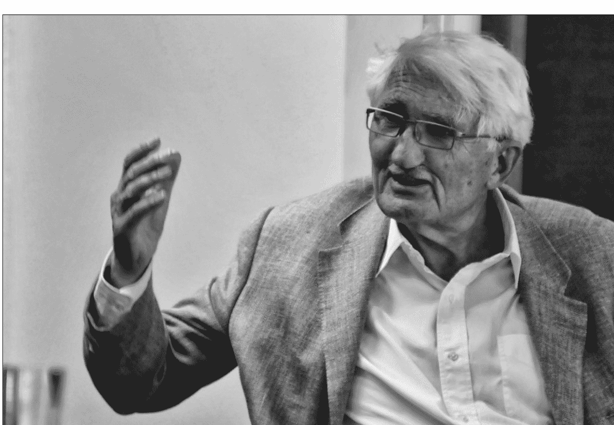

# 哈贝马斯

## 260324 新闻实验室

整理：公众号懒人搜索，懒人专属群精选

懒人微信：lazyhelper1

> 更好的民主应该从对话开始，而不是从选票开始。

2026 年 3 月 14 日，德国哲学家、公共知识分子尤尔根·哈贝马斯 (Jürgen Habermas) 在慕尼黑西南的施塔恩贝格辞世，享年 96 岁。

对于新闻实验室来说，哈贝马斯是一个不可能不写的人物。因为他的思想精髓，就在于对话、沟通、传播。

### 从希特勒青年团到民主捍卫者

从意识形态的坐标来看，哈贝马斯是一名左派。更具体来说，是民主社会主义者，他支持自由民主制度、宪政、欧洲一体化，但与更偏左的马克思主义保持距离（马克思主义者也经常批评哈贝马斯只注重话语、忽视资本主义的剥削）。他强调理性、对话、启蒙，对更加激进的行动表示怀疑。

这种意识形态的形成，和他的人生经历有直接关系。

哈贝马斯 1929 年 6 月 18 日出生在杜塞尔多夫，在科隆以东约五十公里的一个小镇长大，是一个中产阶级新教家庭中三个孩子中的第二个。他天生患有唇腭裂，童年时经历了多次手术，但只取得了部分成功。这使他终身带有言语障碍，也让他对语言沟通的媒介产生了异常敏锐的感知——他后来说，没有这种媒介，“个体的存在也将是不可能的”。

和他那一代的许多德国人一样，哈贝马斯 10 岁时便被征入希特勒青年团，其父则加入了纳粹党并在国防军中升至少校军衔。1944 年秋天，年仅 15 岁的他收到一封征召前往西线的信件。1945 年 2 月宪兵前来寻找他的那个晚上，他恰巧不在家中。盟军数周后抵达德国，他得以幸免于兵役。《卫报》的讣闻中提到，他是所谓的“高射炮一代”（Flakhelfer-Generation）——其中还包括小说家君特·格拉斯、社会学家拉尔夫·达伦多夫和尼克拉斯·卢曼，这些知识分子在少年时期曾被迫为希特勒政权服务。

很快，二战结束。纽伦堡审判和纳粹集中营的纪录片彻底震撼了他。“我们突然看到，我们一直生活在一个政治犯罪体制中，”他后来写道。他将同胞德国人“集体实现的非人性”称为“那第一道裂缝，它至今仍在张开”。正是这道裂缝，塑造了他此后一生的哲学与政治关怀，也奠定了他作为公共知识分子的基础。他毕生想要回答的问题是：在威权主义之后，民主究竟应该如何生存？

1953 年，在研究了四年海德格尔的哲学思想后，年仅 24 岁的哈贝马斯向他发起了挑战——当时，海德格尔仍在世。哈贝马斯挑战的点在于：海德格尔 1935 年的著作《形而上学导论》再版时，保留了关于纳粹运动“内在的真理和伟大”的表述。哈贝马斯质问道：“难道有识之士的首要职责不是澄清过去应受谴责的行为，并使人们对这些行为的了解永存吗？”

然而，海德格尔从未回应。这让哈贝马斯确信德国哲学在其关键时刻已然失败。

1956 年至 1959 年间，哈贝马斯在法兰克福大学的社会研究所（即著名的法兰克福学派的大本营）担任阿多诺的第一助手。在那里，一群新马克思主义知识分子们正试图将哲学思想应用于社会问题，以重建他们对世界的理解。然而，哈贝马斯并不认同阿多诺和霍克海默（研究所所长）发展出的那种悲观主义批判理论。战争使这群知识分子对现代性持怀疑态度，但哈贝马斯依然希望肯定启蒙、理性、现代性的价值。

在阿多诺和霍克海默看来，启蒙运动的过程伴随着对人类的控制不断扩大，它不是通往自由的历史进步，而是对人民的统治权力的延伸，是一场无意中将人类引向死亡集中营的行进。

但是，哈贝马斯并不认为启蒙运动破坏了人类争取解放的努力。他在教授资格论文 (获得教授职位之前所需的博士后研究) 中论证说，存在着另一种理性形式，这种理性旨在推动理解，而非追求手段和目的的成功；它不是我们弊病的根源，而是可能的解决之道。

霍克海默拒绝接受哈贝马斯的资格论文。哈贝马斯于是离开法兰克福，转至马尔堡大学，在战后德国最重要的社会主义知识分子 Wolfgang Abendroth 指导下完成论文。

这篇论文于 1962 年以《公共领域的结构转型》为题出版，奠定了哈贝马斯作为重要社会理论家的声誉，也是他最重要的作品。

此后，他于 1964 年回到法兰克福大学接替霍克海默的教席，1971 年至 1981 年担任位于 Starnberg 的马克斯·普朗克研究所所长，其间完成了巨著《交往行为理论》。1983 年他重返法兰克福任教，直至 1994 年退休。

哈贝马斯晚年仍笔耕不辍。2019 年，他出版了堪称第二部巨著的三卷本《这也是一部哲学史》。《雅各宾》杂志指出，在这部最终的宏大著作中，早年较为乐观的哈贝马斯已经消失，他明确表示这是一次最后的、最大的努力，旨在挽救和捍卫现代性的理性、进步和包容，以抵御日益强大的反动力量。

### 咖啡馆里的民主实验

要理解哈贝马斯留给我们的思想遗产，最好的方式或许是走进 17-18 世纪伦敦的一间咖啡馆。

1652 年，伦敦的第一家咖啡馆开业。在此后的一个多世纪里，这种弥漫着异国饮品香气的新型社交空间迅速蔓延，成为英国社会一个令人瞩目的现象。在咖啡馆里，原本不可能相遇的人出现在了同一张桌子旁边。正如专门研究咖啡馆的历史学家 Markman Ellis 所记述的：“走进咖啡馆的顾客被要求坐到下一个空位上，紧挨着先到的任何人。没有座位可以预留，没有人可以拒绝你的同座。这一入座规则向所有人表明，在咖啡馆里人人平等。”贵族与商人、牧师与律师学徒、大学里腼腆的年轻人与衣衫褴褛的翻译匠，都挤在一起。在 Will's 咖啡馆，英国第一位桂冠诗人 John Dryden 主持着文学沙龙，12 岁的 Alexander Pope 被带去聆听 (他后来也成为著名诗人); 日记作者 Samuel Pepys 则常来搜罗新闻和八卦。人们花一便士买一杯咖啡，便能听到当时最博学的人——天文学家克里斯托弗·雷恩、自然哲学家罗伯特·胡克、哲学家大卫·休谟，甚至伏尔泰——的高谈阔论。咖啡馆因此得名“便士大学”。

哈贝马斯在《公共领域的结构转型》中提出，这些咖啡馆 (以及法国的沙龙) 正是资产阶级公共领域的诞生地。在他的定义中，公共领域是一个包容性的社会空间，私人聚集在一起公开分享意见，围绕共同关切的议题进行理性而批判的辩论，由此催生了一个独立于国家的“公众”(public)。在这里，起决定作用的是更好的论据和论证，而非发言者的社会经济地位。

正如 Hartmut Wessler 在《哈贝马斯论媒介》一书 (被认为是关于哈贝马斯和媒体这个话题上最好的一本书) 中所言，说哈贝马斯“发现”了公共领域作为现代社会中一个独立的社会领域，这绝非夸张。这一发现“与自然科学中的发现具有同等地位”(Wessler 引述哲学家 Nancy Fraser 语)。

然而，哈贝马斯描绘的这幅图景是否过于美好了?

Jeff Jarvis 在其著作《The Gutenberg Parenthesis》中指出，其实当时的咖啡馆并不是什么彬彬有礼的场所，墙上甚至张贴着行为规范：不准骂人 (违者罚款 12 便士)、不准发起争吵 (否则请每人喝一杯以赔罪)、不得大声吵闹、不得触碰神圣事物或以不敬之舌论及国事、不许打牌赌博……这些规则读起来，活像是为今天的社交媒体量身定制的社区准则。上文提到的诗人 Alexander Pope 就曾在 Will's 咖啡馆门外被一帮“对他最新的诗歌讽刺不满的恶棍”袭击。

更严重的问题在于，哈贝马斯所谓的“包容性”有着致命的盲点，只包含有产者、受教育者，而且只有男人，将女性、穷人和无数“不受欢迎的人”排除在外。当时的女性曾发表过一份讽刺性的《妇女反对咖啡请愿书》。正如 Nancy Fraser 批判的：“我们不能再假定资产阶级的公共领域概念仅仅是一个未实现的乌托邦理想; 它同时也是——个男权主义的意识形态概念，其功能是使一种新兴的阶级统治形式合法化。......简而言之，公共领域的理念究竟是一种统治工具还是一种乌托邦理想？”

还有学者指出，公共领域不应该是单一的，而是应该由复数的 publics 构成。公众并非只在咖啡馆和新闻报刊周围形成——马丁·路德选择用德语白话写作时，他就在用自己的思想召唤和塑造一个公众; 当观众在环球剧院观看《哈姆雷特》时，莎士比亚就构建了一个公共领域; 公众还可以围绕肖像画和地图形成，因为特定地域和文化背景的人们能够借此理解自己在世界上的位置; 公众群体还能围绕印刷的民谣和布道形成，围绕语言、法律和思想形成。正如 Craig Calhoun 所言：“一个公共领域包含了不确定数量的或多或少相互重叠的公众，有些转瞬即逝，有些持久存在，还有些是在与其他主导性的公众的斗争中形成的。”

虽然受到许多批评，但哈贝马斯的理论依然极具价值，因为他指出了对话沟通的意义，那些批评的声音更多是在他的理论基础上做出发展和补充。

### 当公共对话遭遇极化与假新闻

如果说咖啡馆的故事让我们看到了公共领域理想与现实之间的裂缝，那么把目光投向当代，这道裂缝已经变成了一道鸿沟。17、18 世纪咖啡馆所面临的几乎每一个问题——虚假信息的传播、政府的管控冲动、商业利益对公共空间的侵蚀——都在互联网时代以放大了千百倍的规模重新上演。

哈贝马斯本人在 2022 年终于对互联网发表了看法，称之为“人类媒体发展史上一个堪比印刷术的断裂”。他承认，“起初，新媒体似乎预示着资产阶级公共领域那平等主义—普遍主义的主张终于要实现了——平等地纳入所有公民。”这里面的“起初”和“似乎”都意味深长。

要理解这个“至少起初”背后的失望，我们需要看看当代媒体系统发生了什么。学者 Lewis A. Friedland 和 Thomas B. Hove 的研究揭示了三个层面的深刻危机。

- 第一重危机是媒体系统丧失了独立性。哈贝马斯的模型有一个核心前提：如果媒体要代表公民社会监督政治和商业权力，它就不能被任何一方俘获。但在现实中，这一前提正在瓦解，新闻业越来越深地卷入党派政治，且由于自身商业模式的崩溃，更容易受到其他商业利益的收买。这就好比咖啡馆不再是一个各方可以坐在同一张桌旁辩论的空间，而是变成了各派势力各自经营的俱乐部。
- 第二重危机是公众的政治极化。沿着地域、文化、意识形态和种族的断层线，社会分裂正在固化。大量的虚假信息和阴谋论几乎在根本上消解了“基于事实的讨论”这个理念本身的正当性。
- 第三重危机来自互联网和社交媒体本身。随着公共舆论越来越多地通过社交媒体传播，信息不再沿着从精英到大众的线性路径流动，而是在一个网络中自由弥散。人们倾向于选择与自己相似的人组成网络，个人定制的网络内容剥夺了公众共同的集体经验，以及与不同信息和世界观意外相遇的机会。

Friedland 与 Hove 的分析还揭示了一个更根本的问题：哈贝马斯假设人们在日常生活中提出和质疑观点的常规能力，可以自然地转化为对公共议题进行理性判断的能力。但是，社会学家的研究表明，面对不确定的问题时，人们并不是在进行理性推理，而是依赖各种心理捷径和认知偏见。认知道德心理学研究则揭示，自由派和保守派之间存在根深蒂固的世界观差异：前者在认知上偏向自由和开放，后者偏向安全和秩序。人们面对矛盾信息时，往往不是去推理这些矛盾，而是根据情境在不同的习惯性话语之间来回切换。

Wessler 在其著作《哈贝马斯论媒介》中对不同媒体类型的对话质量进行了实证比较，结果发现，最传统的媒体——优质报纸——展现出最强的对话潜力，尤其在论证的充分性和交流的文明性方面。电视新闻虽然总体文明，但在制造对立立场之间的实质性互动方面相当薄弱。而网络媒体的辩论结构不平等性非常突出，缺乏专业新闻的中介，意味着讨论可能强烈地集中在少数占主导地位的发言者身上。

Friedland 与 Hove 提出，哈贝马斯的公共判断模型仍然重要，因为它提供了关于深思熟虑的公共舆论如何产生的不可替代的洞见。但他们同时警告：在网络化公共传播时代，产生这种深思熟虑的公共意见所必需的条件，可能已经不复存在。

### 噪音中的民主与对话的未竟使命

如果理性对话只是公共对话中的冰山一角，那么充斥着我们的媒体和网络的其他一切：讽刺、抗议、谩骂、叙事、表演、情感宣泄——是否对民主毫无价值？

已故哥伦比亚大学教授 James Carey 曾说：“共和国需要对话，往往是嘈杂的对话，因为它们本该是喧嚣的地方。”这句话非常贴近公共生活的真实质地。

让我们回到咖啡馆。哈贝马斯笔下的理想公共领域是一个理性辩论的殿堂，但如上文提到的，真实的咖啡馆远比这丰富和混乱。牛津和剑桥颁布规定，禁止学生在没有导师陪同的情况下光顾咖啡馆。1673 年的一本小册子将咖啡馆比作诺亚方舟，接纳各种各样的动物，无论洁净的还是不洁净的。咖啡馆不仅是辩论的场所，也是传播谣言、煽动性诽谤和政治组织的主要阵地。

然而，这种混乱、喧嚣、不完美的对话，比起哈贝马斯那个经过粉饰的版本，可能更有力量，里面可能诞生出更有价值的东西，尤其是被主流群体忽略的东西。

从学术层面来看，这种对“不完美的对话”的辩护有着坚实的理论根基。比如，Nancy Fraser 提出了“从属反公众”（subaltern counterpublics）的概念，形容那些被排斥在主流公共领域之外的社会群体（工人阶级、女性、少数族裔），他们创造了自己的平行话语竞技场，在其中发明和传播反抗性质的话语。Michael Warner 则从修辞学角度指出，有些公众“恰恰是通过它们与更大公众之间的张力来定义自身的”——一个酷儿反公众可能是一个“投射阴影、炫耀、贬损、闹事、渴望、幻想、发脾气、哀悼”的场所，它 以自身特殊的“诗意世界创造”方式构成自身的存在。

Nancy Fraser 早就指出，在资产阶级公共领域旁边，“从一开始就涌现出大量相互竞争的反公众——包括民族主义公众、平民农民公众、精英女性公众和工人阶级公众。因此，从一开始就存在着相互竞争的公众，而不是像哈贝马斯暗示的那样，只是到了 19 世纪末和 20 世纪才出现。”

哈贝马斯从纳粹德国的废墟中走来，毕生致力于捍卫一个或许从未完美实现过的理想。他设定的标准也许太高，他对咖啡馆的描述也许太美，他对理性的信念也许太执着。但其实，在追求社会进步的道路上，他并不是一个完美主义者。正如他在最后一本访谈录《事情应该变得更好》中所说：“试图让世界哪怕只变得更好一点点，甚至仅仅是努力抵御我们所面临的、无处不在的倒退威胁，都是一种极其值得钦佩的动机。”

这位思想家留给我们的不仅是一套理论体系，更是一个朴素的信念：对话，是我们所拥有的最好的东西。更好的民主应该从对话开始，而不是从选票开始。他之后的其他学者则提醒我们：对话不完美、很嘈杂也没关系，因为共和国需要噪音，咖啡馆从来就不安静。有声音，就有希望。

---

绝大多数人只盯着眼前的工资，却不知道一次远在中东的冲突、一次降息的决议，就能在一夜之间洗牌普通人的财富。

看懂宏观，是为了在周期切换时，不被当作代价。

如果你认同这种“抬头看路”的长期主义，欢迎围观我的个人情报智库：【懒人专属群】。

圈子已稳定运行 7 年。我们每天利用 Python 爬虫与大模型算力，过滤全网最顶级的政经内参和搞钱风向标，做你最冷酷的“外部大脑”。

查阅圈子完整数字资产与上车门槛：

认同价值的。扫码加我微信，备注:【进群】

认同价值的。扫码加我微信，备注:【进群】

微信：lazyhelper1