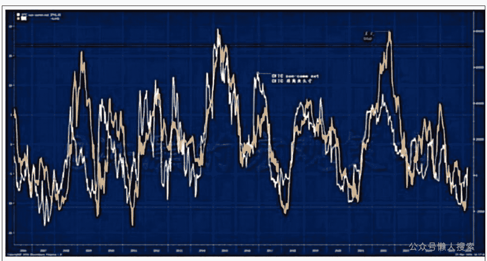

公众号懒人搜索，懒人专属群分享

# 最关键的问题

2024 年 03 月 24 日 洪灏

整理：公众号懒人搜索，懒人专属群精选

懒人微信:lazyhelper1

周一开盘，全球市场进入了特朗普宣布的 48 小时最后通牒的最后半天的倒计时，全球金融与地缘政治格局正悬于千钧一发的状态，其紧张程度鲜有近年先例可堪比拟。特朗普在其社交媒体上发出的四十八小时最后通牒，不仅为霍尔木兹海峡的重新开放设定了最后期限，更实质性地为当前的中东局势是否会进一步升级按下了倒计时。

此刻的周一下午，亚洲市场承受抛压，韩国股市熔断，日本股市也一度暴跌了 5%。而黄金连跌 9 天到了 4400 之下。这九根连续的阴线，应该是近四十年来前所未有的技术走势，也让黄金技术上进入了极度超卖的状态。白银的跌势则更甚，继续创出近年来最大的单天跌幅之一。

在上一篇报告中，我们继续认为黄金白银的长期配置逻辑不变，但也指出了”短期技术盘面比人强”。如果交易员在短期内希望大幅增加现金以抵御市场波动，那么没有什么比黄金白银这样的在过去一年已经翻了一两倍的资产类别更好的品种。许多量化基金的模型也应该触发了程序化止损的信号。一个全球最大的白银 ETF 在上月刚刚最大单月增持了大量的白银仓位。这些都是交易中潜在的卖方。尽管如此，交易数据显示，有人买了行权价为 20,000 美元以上的黄金看涨期权。

全球市场现在面临的悖论是：由于美股交易员坚信特朗普会 TAKE A STEP BACK 临阵退缩、见好就收，因此美股的表现相对于其他地区更稳定；然而，如果美股不熔断，那么特朗普就不会 TAKE A STEP BACK。如是，究竟是美股先熔断，还是特朗普先 TAKE A STEP BACK？这个是一个鸡和蛋的问题。当然，主要的美股指数已经在上周五收跌到了 200 天均线之下。有道是，“200 天线下没好事”。

其实，在市场关注特朗普是否会 TAKE A STEP BACK 这个重要的问题的时候，还有一个更关键的问题：即便是特朗普 TAKE A STEP BACK，这个行为可以挽回市场的信心，并把油价乃至全球经济从悬崖的边缘拉回来吗？

特朗普希望通过专门针对伊朗电网——且从最大电厂入手——其目的不仅是军事上的瘫痪，更是追求其国内的全面失能。其逻辑残酷而直白：若伊朗无法为国民提供基本的电力和水源，其镇压持续不断的抗议活动、维持军队凝聚力的能力便将会被大幅度地削弱。然而，这种 Scott Bessant 所谓的“以升级求降级”的策略，其前提是对手是一个理性的主体。在当前的伊朗权力交接之后，观察家认为现在的当权者可能还需要时间树立威信和领导地位。随着美国以色列军队的狂轰滥炸，对手逐步形成了一种“地堡心态”，导致理性的谈判可能性大幅降低。伊朗方面则以硬制硬，誓言要“摧毁”海湾地区的海水淡化和信息基础设施，这为海湾地区的生命维持系统制造了一场两败俱伤的困局。如果特朗普霸王硬上弓坚持不 TAKE A STEP BACK，那么全球面临的将不仅仅是石油产量的下滑，而是现代中东地区广大居民的饮水甚至是生存的安全。

这种军事风险已将石油市场变为了地缘政治恐慌的抛物线形晴雨表。布伦特原油在每桶 110 美元上下的徘徊，反映出的市场虽已计价了封锁，但仍对外交解决的霍尔木兹禁运该问题还抱有一丝残存希望。然而，一旦导弹呼啸而至，这丝希望便将破灭，而目前估计至少每桶 30 美元的“地缘政治风险溢价”，在保险公司了撤销对地区承保的情况下，油价继续飙升亦非难想象之事。

卡塔尔液化天然气枢纽与伊朗气田已遭受的结构性破坏，意味着即便今夜取得“胜利”，价格也难以重回到冲突前的 70 美元区间。我们很可能正步入一个“永久性稀缺”的阶段，其它地区必须竭力替代波斯湾的供应。2026 年“美联储政策困境”的定义是：如果美联储进一步加息以控制已经开始攀升的通胀预期，便可能压垮已因高能源成本而疲软的全球经济；若果美联储货币政策暂停或转向，则可能导致通胀预期彻底脱锚，演变为持久的工资 - 物价螺旋式上涨。最终，这种价格失控的局面将开始压抑终端需求，导致通缩。如果美联储不得不再次 QE，那么美国乃至全球经济都很可能进入衰退的局面。这将是一个更差的情景。

当前由阿曼和国际海事组织牵头的、让霍尔木兹事态降级的努力，是抵御这场滞胀深渊的、在最后通牒的窗口关闭之前的一道防线。国际海事组织提出的“人道主义走廊”方案，或许是一条可以让特朗普挽回颜面、就坡下驴的务实的退路。通过将海峡重新开放包装成并非向特朗普屈服，而是为被困海湾的两万名海员进行的“平民撤离”，德黑兰理论上可在保持其对抗的姿态，同时允许船只通行。

同样，特朗普的女婿库什纳提出的一个和平框架则试图将冲突重新定义为一场商业谈判。通过提出“地区重建基金”而非“战争赔款”，美国的秘密沟通渠道为伊朗提供一条、以长期冻结核能力而换取资助重建其破碎基础设施的途径。这堪称“交易的艺术”在战区的应用：将敌对对手转化为一个商业伙伴，使其在全球市场投入过多利益而不敢冒险导致全面断联。同时，市场也不可忽略中国在中东地区、尤其是对于伊朗的巨大影响力。这些场景，都让人不至于在全球市场承受抛压的今天完全绝望。

然而，伊朗国内的政治格局，为外交努力平添了一层难以预测的变数。有关伊朗正规军与伊斯兰革命卫队之间分歧扩大的报道，表明伊朗军队内部也不稳定，而这反而可能使其更不可能妥协。在走投无路的情况下，与美国直接开战反而可能可以成为凝聚人心的力量。近期，伊朗对于迪戈加西亚岛 4000 公里打击已证明了伊朗的军事能力并未被完全摧毁，甚至还具备了远程精准打击的能力，整个海湾地区的美军战略设施都在伊朗的远程导弹的覆盖之下。对海湾地区海水淡化厂的威胁并非空言，这是同归于尽、玉石俱焚的战略。

此刻，全世界失眠。全球的地缘政治格局从“基于规则的秩序”向“基于现实的秩序”的转变，正在我们的屏幕前实时上演。无论特朗普是否最终 TAKE A STEP BACK，还是最后一刻达成某种形式的协议，2026 年的全球经济已然被永久重塑。我们不再生活于效率第一的世界，而是活在一个以防万一的求存时代。低成本、稳定的能源供应与可预测的美联储作为市场最后贷款人的时代已然终结。取而代之的，是一套弱肉强食的丛林法则，我们在共情中东人们苦难的同时，也必须以冷静、专业的分析直面冰冷的市场现实。在这个以热战为特征的新宏观时代面前，要么适应，要么消亡。

短期，如果特朗普 TAKE A STEP BACK，那么毋庸置疑，全球金融市场将技术反弹，但这也只是第一层逻辑。以上，我们讨论了特朗普的再次 TAKE A STEP BACK 是否能够拯救美国市场乃至全球经济。美联储正处于一个两难的境地，由于油价飙升而导致的通胀预期升温限制了美联储货币政策的选择空间。如果高油价导致美国经济进一步放缓，而美联储由于通胀压力而迟迟不能降息甚至加息，那么美国经济和市场的运行压力是可想而知的；如果美联储不顾通胀压力而降息，那么势必导致通胀失控和美元大幅贬值，同时美债收益率暴涨美债价格暴跌。由此而导致的需求压抑最终还是会导致美国经济衰退。两害相权，美股市场当前的位置依然没有计入其中的任何一个情景。

在二月初的线下读者见面会上，我和现场观众分享了我的流动性模型。我的量化模型显示全球流动性已经进入了拐点并开始下行。我们在三月初万得的公开讲座中再次分享了这个结论。当前从 CFTC 的仓位数据看，美元非商业净头寸开始从低位上行，预示着美元汇率很可能将进一步上升，美元流动性将进一步收紧 (下图)。因此，风险资产还会有更好的买点。

---

绝大多数人只盯着眼前的工资，却不知道一次远在中东的冲突、一次降息的决议，就能在一夜之间洗牌普通人的财富。

看懂宏观，是为了在周期切换时，不被当作代价。

如果你认同这种“抬头看路”的长期主义，欢迎围观我的个人情报智库：【懒人专属群】。

圈子已稳定运行 7 年。我们每天利用 Python 爬虫与大模型算力，过滤全网最顶级的政经内参和搞钱风向标，做你最冷酷的“外部大脑”。

查阅圈子完整数字资产与上车门槛：

https://lazyso.com/insider/

认同价值的。扫码加我微信，备注：【进群】

