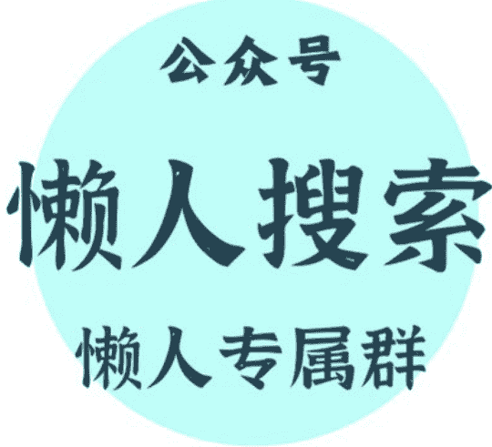

# 253 | 阿里战略调整：押注 Token，重写阿里

20260325

整理：公众号懒人搜索，懒人专属群精选

懒人微信：lazyhelper1

欢迎打开《蔡钰·商业参考 4》，我是蔡钰。

3 月份，除了 Kimi，最值得提醒你留意的 AI 商业变化，我认为是阿里巴巴的又一次非常激进的战略重组。它调的都不只是业务和架构了，简直像在重写自己的基因。

3 月 16 日，阿里宣布成立全新的事业群，起名叫 Alibaba Token Hub，简称 ATH，由阿里 CEO 吴泳铭亲自管理。

## ATH 新事业群

这个新事业群，核心目标被定位成“创造 Token、输送 Token、应用 Token”。它在阿里内部获得了极高的战略权重，收拢了原本集团分散的各种 AI 业务，在事业群之下再分成 5 个事业部：

- 第一个，通义实验室，继续负责 Qwen 大模型的研发；
- 第二个，MaaS 业务线，也就是“模型即服务”业务线，提供云端模型服务，代表产品是阿里云的 MaaS 平台百炼。
- 第三个，千问事业部，面向 C 端的个人 AI 助手。
- 第四个，悟空事业部，这是一个面向 B 端的 AI 工作平台，你可以简单理解成阿里的“龙虾”，我们后面再详细讲它。
- 第五个，AI 创新事业部，探索 AI 创新应用。

这五大事业部的更底层，又是阿里云和平头哥芯片在提供支撑。

为什么要设立这个 ATH 新事业群呢？阿里 CEO 吴泳铭在全员信里是这么解释的：

> 「当下正处于 AGI 爆发前夜。大量数字化工作将由数以百亿计的 AI Agent 来支撑，而这些 AI Agent 将由模型产生的 Token 支撑运行，成为人类与数字世界交互的主要载体。面向这一历史性机遇，集团决定正式成立 Alibaba Token Hub ( ATH ) 事业群，建立以“创造 Token、输送 Token、应用 Token”为核心目标的新组织。」

你看，谜底就在谜面上、就在 Alibaba Token Hub 这个名字里的 Token 里。

## Token 经济

Token，在 AI 领域指的是“最小语义处理单元”，又被翻译成词元。模型的算力消耗靠它来衡量，智力也要靠它来进化。105 讲（《黄仁勋的 2025：布局英伟达的 10 年前途》）我们说，英伟达的下一代雄心，也是兴建 Token 工厂，把数据分解成 AI 能读懂的词元。

而进入 2026 年，全球 AI 产业对 Token 的消耗加速了。你可能记得，2026 年 2 月份，中国模型一周的 Token 调用量就达到了 4.12 万亿，成了全球第一。在民间，近期的“Kimi"狂潮里，最让用户们心疼和下头的，也是太费 Token、太烧钱。

市场对 Token 需求强烈，而这对阿里来说，却是好消息，因为它拥有一条现成的 Token 供应链。

我们在 225 讲（《阿里 AI2026：狂推千问，整合“通云哥”》）介绍过，它有“云+AI+芯片”的全栈自研能力；也在更早的 175 讲（《阿里转战消费级 AI》）讲过，阿里云的 AI 算力供不应求，行情好到，它认为 AI 泡沫三年内不存在。全栈技术优势和背靠中国的电力成本优势，在今天的阿里身上正在快速体现。

等到了 2026 年 3 月，阿里云的 AI 相关产品收入，已经连续第 10 个季度实现三位数增长了。最夸张的是它的 MaaS 业务。百炼平台上，公共模型服务市场的 Token 消耗规模三个月涨了 6 倍。为啥？很大原因是，Qwen 在全球开源市场占据了主导份额。

阿里云的收入结构也因此发生了质变。AI 和 MaaS 收入占比不但在大幅提升，还在快速拉升整个阿里云的收入规模。

快到什么程度呢？阿里放话说，未来五年，云和 AI 商业化的年收入能突破 1000 亿美元。这可就意味着，阿里云的收入将在 5 年翻 7 倍，接近当前整个集团的体量了。

无独有偶的是，阿里成立 ATH 事业群的同一天，英伟达的黄仁勋也在自家大会上喊出了“Token 工厂经济”的概念。

老黄的逻辑是，Token 正在成为 AI 竞赛的核心燃料，而随着模型越来越大、上下文越来越长，AI 会变得更聪明，但 Token 的生成速率会降低。所以，专门生产 Token 的工厂会受到欢迎。Token 工厂的吞吐量和 Token 生成速度，将直接转化为工厂收入。

他还预测说，未来科技公司招聘工程师时，除了给薪酬，还会另给一份“Token 配额”。这事儿估计你倒不会惊讶，因为专栏去年 170 讲 (《“一人公司”即将加速涌现》) 已经预言过了。

你看，在产业共识里，Token 正在成为 AI 时代的水电油。如果能抢先成为全球最大最稳定的 Token 供应商，相比之下，春节红包大战给千问留存了多少用户，也就没那么重要了。

这是吴泳铭喊出“历史性机遇”，阿里火速变阵，把“创造 Token、输送 Token、应用 Token”确定为 ATH 事业群核心目标的原因。

那么，这个 ATH 事业群，打算怎么创造 Token、输送 Token、应用 Token 呢？

通义实验室是发电厂，负责创造最强模型，生产 Token 这种 AI 电力。

百炼 MaaS 是电网，把 Token 用 API 调用、模型服务等不同形态，提供给企业和开发者。

千问和悟空是用电终端，类似于汽车和地铁，分别面向 C 端和 B 端，消耗 Token 来生成客户需要的答案和行动。

AI 创新事业部，是给 Token 探索新的应用场景。

## 钉钉的“同事”

好，接下来，我们讲讲“悟空”到底是什么东西。

就在 ATH 事业群成立的第二天，阿里正式发布了这个叫“悟空”的 AI 助手。阿里给它的名头也很大，说它是“全球首个企业级 AI 原生工作平台”。

你肯定知道，阿里的智能办公平台叫钉钉。简单来说，悟空是钉钉的“同事”。

在交互界面上，悟空跟 Kimi 很相似，都是在聊天窗接收任务，消耗 token 来替人打工。但区别有三个：

- 第一个，它是钉钉研发了大半年的产品，不是拿开源 Kimi 做的二创。阿里原本计划在 4 月正式发布它，没想到被 Kimi 打乱了节奏，只好让它提前现身。
- 第二个，它工作起来更有“家教”，不会搭理那么多的恶意指令和木马病毒。
- 第三个，也是最重要的，悟空背靠着钉钉，而钉钉干了 11 年的工作协同平台，已经在全国连接了 2700 万家中小企业和 8 亿工作用户，积攒了大量的工作能力和业务数据。

所以，钉钉这次还直接给出了用悟空搭建“一人团队”的解决方案，首批方案覆盖了十个工作场景，包括电商、跨境电商、知识内容、开发、门店、设计、制造、法律、财税、猎头等等。你看，很多都是阿里生态里原本就有的生意能力，被打包成了悟空的技能组合和工作流。

## 为 AI 打造工具

那天我也看了钉钉发布“悟空”的那场直播。一开始只是想瞄一眼，简单了解一下“阿里和 Kimi”的战略战术，没想到意外听到了一组非常有趣的见解，结果一路听完了 2 个多小时。

这组见解，来自钉钉的负责人陈航。

陈航说，自己想明白了一件事：AI 时代，最大的变革，是互联网的操作主体，从人变成了 AI。既然如此，整个互联网的结构，文件系统、操作界面、软件架构、硬件形态，全部会围绕 AI 的需求变化。

他这话一说，我非常有同感。

举个例子：

你可能知道，最近还有一个术语很流行，叫 CLI，命令行界面。过去几十年，电脑和互联网是按照人类的趣味来演化的，所以我们有了窗口、图标、鼠标，有了触摸屏、短视频，我们喜欢的这叫 GUI，图形界面。

但是，AI 的偏好跟人类截然不同。它不需要用鼠标点开浏览器，不需要滑动屏幕，不需要敲键盘。它跟软件们直接用字符指令交流，最快，也最节省 token。

所以，如果 AI 助手成为工作主力，那么给 AI 用的计算机，就会从人类喜欢的 GUI，回归到 AI 喜欢的 CLI。互联网的结构和形态，也会向 AI 的需求倾斜。

人类当然还在工作流里，但人类只负责向 AI 提出目标，而具体的执行路径、工具调用、资源调度，都将在系统内由 AI 完成。这一旦成立，今天无数围绕人而设定的产品逻辑，都需要为 AI 重写。

陈航说，想明白了这件事，他也就有了重构钉钉的思路：把钉钉过往所有的、服务于人类的办公协同能力，全部拆碎，重组成一个服务于 AI 的新产品。

技术细节我们就不讲了，总之，基于这个思路，大半年下来，如今的钉钉，已经是一个给 AI 用的钮祜禄钉钉了。在这套服务 AI 的全新协同环境里，悟空负责浮到水面上，跟人类沟通，再把人类指令翻译成 CLI 指令，推动水面之下的钉钉干活。

再简单点说，悟空专注与人的协作，钉钉专注于连接资源。

你看，一套专为 AI 打造的工具和系统，成型了。

## 总结

好，这一讲，我请你关注了阿里在 2026 年 3 月的两个 AI 动作，一个是成立 ATH 事业群，一个是推出工作助手“悟空”。

如果我小小地抱怨一句，我挺希望它叫个别的名字。象征自由英雄的“悟空”，被用来称呼一个能干的超级牛马，让我多少有点意难平。

但这不是重点，重点是，请你注意，阿里正在押注 Token 经济，立志成为 Token 的生产、输送和消耗的全生态服务商。同时，它已经开始把 AI 当作用户，为 Agent 重新设计工具和环境，准备做硅基牛马们的生意了。

一个大时代的开端，就是这么眼睁睁出现的。

## 再见。

- 1. 阿里正在押注 Token 经济，立志成为 Token 的生产、输送和消耗的全生态服务商。
- 2. 阿里已经开始把 AI 当作用户，为 Agent 重新设计工具和环境，准备做硅基牛马们的生意了。

分割线

绝大多数人只盯着眼前的工资，却不知道一次远在中东的冲突、一次降息的决议，就能在一夜之间洗牌普通人的财富。

看懂宏观，是为了在周期切换时，不被当作代价。

如果你认同这种“抬头看路”的长期主义，欢迎围观我的个人情报智库：【懒人专属群】。

圈子已稳定运行 7 年。我们每天利用 Python 爬虫与大模型算力，过滤全网最顶级的政经内参和搞钱风向标，做你最冷酷的“外部大脑”。

## 查阅圈子完整数字资产与上车门槛：

https://lazyso.com/insider/

认同价值的。扫码加我微信，备注：{[进群]}

微信：lazyhelper1