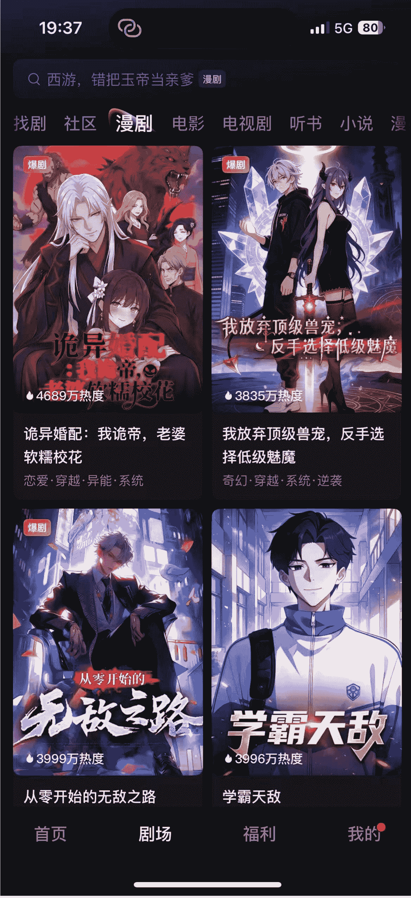
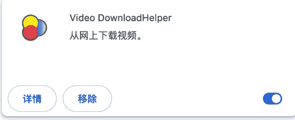
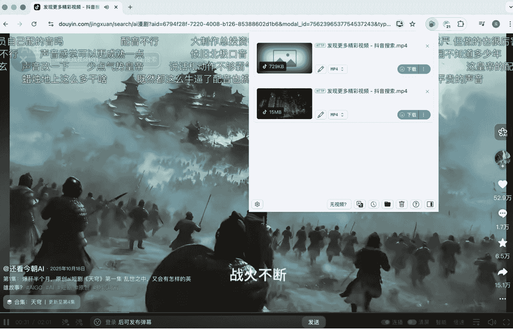
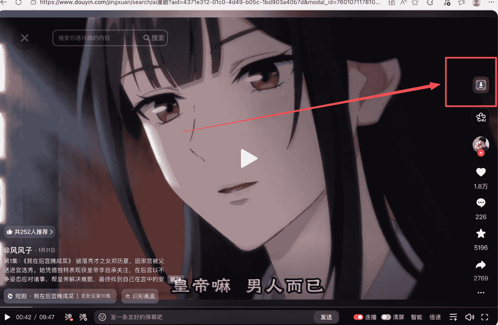
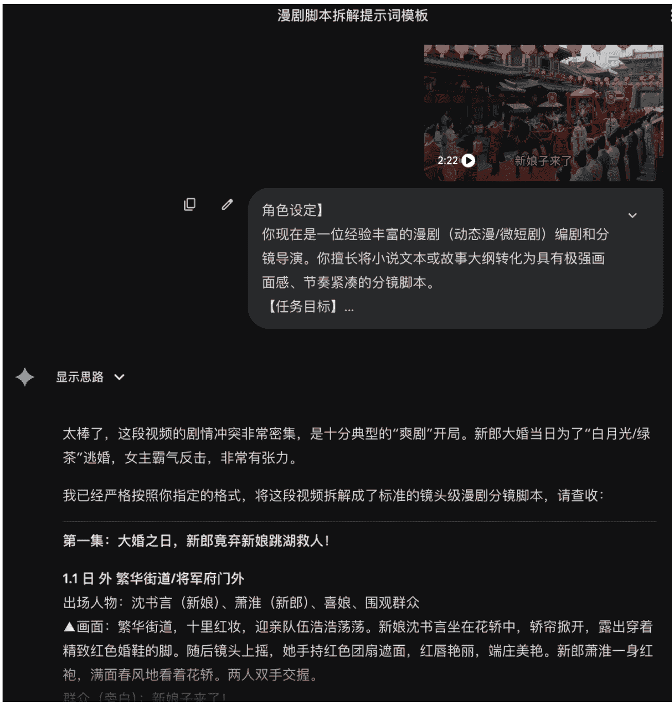
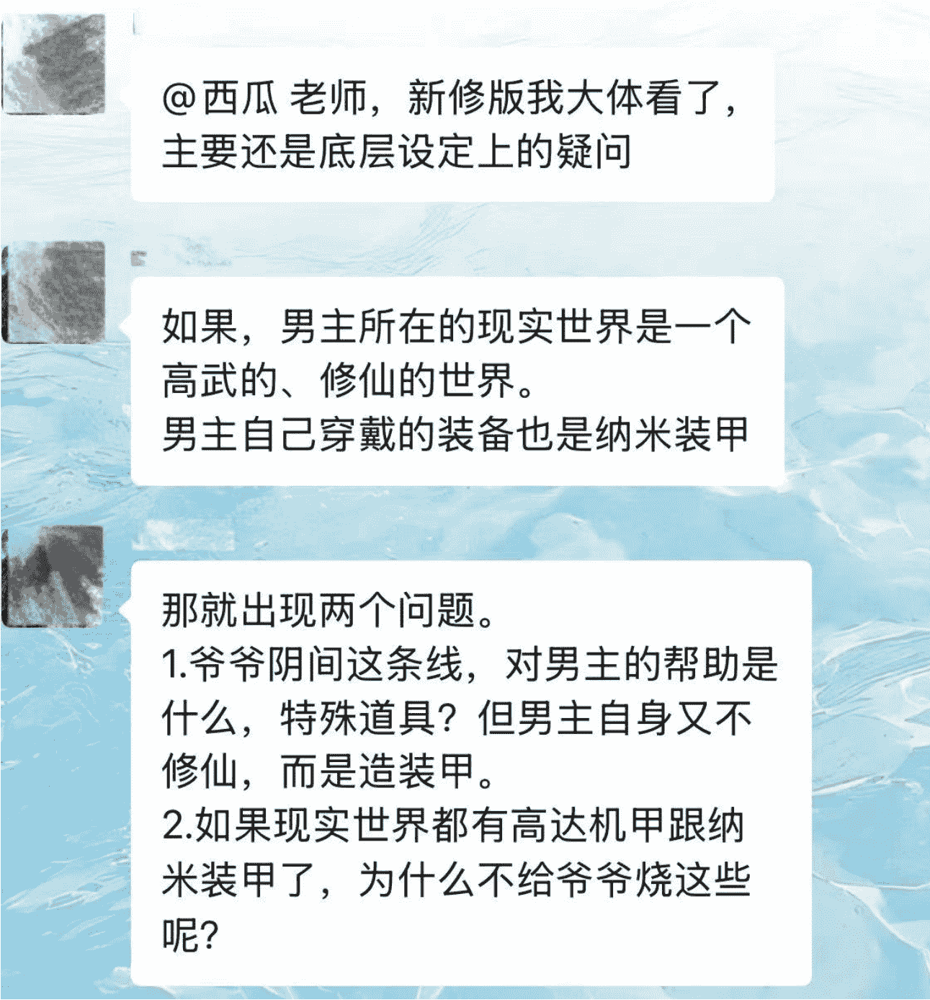
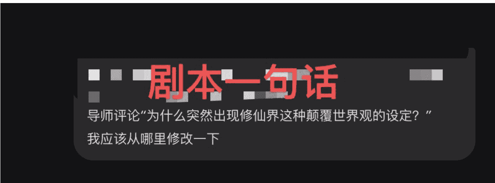
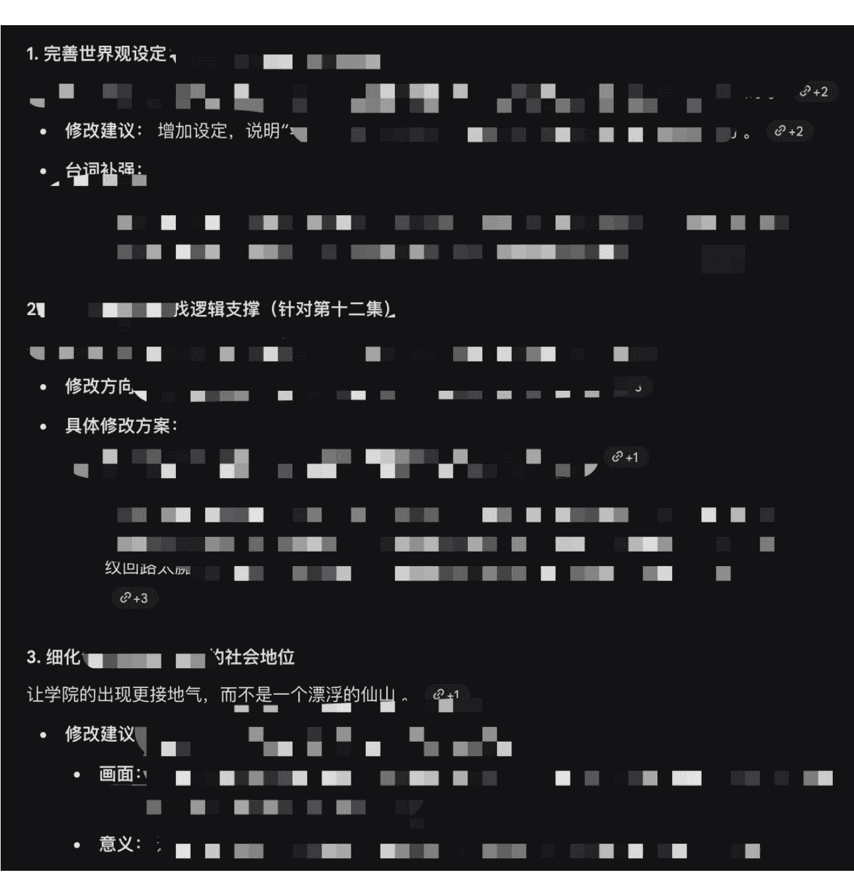
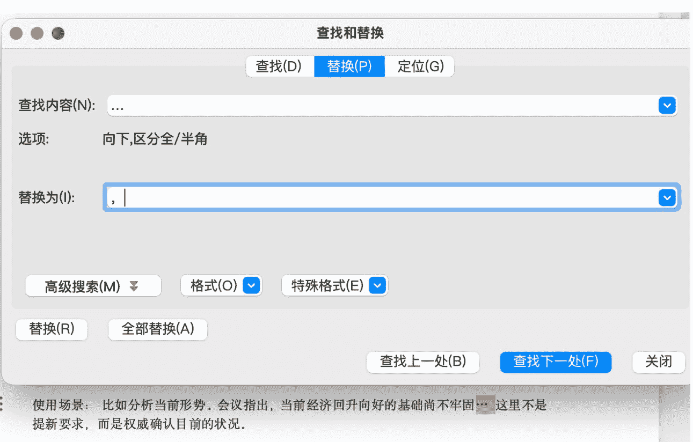

# 我用 Gemini 写漫剧剧本，跑通了第一笔稿费：单本到手四位数的实操复盘

## 260325 副业 SC 精华

公众号懒人搜索，懒人专属群独享

懒人微信：lazyhelper1

大家好，我是西瓜，00 后大学生～目前在做 AI 代写，也一直在摸索 AI 写作里真正能交付、能变现的细分方向。

我作为计算机大类的专业，没有系统学过编剧。最开始做这件事，只是想趁还在大学的时候，尽快跑通一个能拿结果的项目，给自己多一段真实的实操经历。漫剧剧本属于 AI 代写分支，看到苗头后也尝试去做，并在今年年初，完整交付了第一本剧本，跑通了从写稿、修改到验收的 0 到 1 闭环。

这个过程中，我遇到的难题其实比写普通短文复杂得多。中间熬过夜，也踩过不少坑。虽然第一笔稿费金额不算特别大，但对我来说，这笔钱最重要的意义是，它证明了这条路径是可以走通的。

今天这篇复盘，把从以下方面把自己整体大概流程分享下，有不足之处，也请各位圈友前辈多多指教。

- 1. 我为什么会盯上漫剧剧本这个方向
- 2. 我是怎么从 0 到 1 跑通第一本漫剧剧本的可复制 SOP
- 3. 写本实操遇到的困难点
- 4. 认知复盘

希望这篇能帮助你拆解一部喜欢的漫剧，完成自己的第一本漫剧剧本。

## 一、我为什么会盯上漫剧剧本这个方向

### 在当下，漫剧剧本仍是普通人的切入口

我会关注这个方向，主要有几个原因。

第一，AI 把漫剧制作门槛拉低了（指路生财的 AI 视频航海）。以前做高质量漫剧，往往离不开原画师和一整套制作流程。现在 AI 视频越来越成熟，普通人也有机会做出完成度更高的内容。制作端变容易了，市场对好剧本的需求反而更大了。

第二，它符合当下内容消费趋势。现在大家刷短视频，更倾向于开局即高潮、节奏极快的视频，不再有耐心看节奏慢的长篇电视剧。而漫剧本本身就很适合这种内容形态～

第三，从 AI 写作变现角度看，剧本是长期需求，而且相对稳定合规。在闲鱼、小红书这类平台，也比一些容易违规下架的品类更适合长期做。（不像网文，在平台易违规下架链接）凡事标准先行，稳定合规是基础。

最后，这个赛道的客单价不低。漫剧剧本通常有分级，A 级本大概在 5000 到 8000 元，S 级本能到 1 万到 3 万元。

所以综合看下来，我会觉得，漫剧剧本是一个还值得普通人切入的细分机会。

## 跑通 0-1：我拿到了什么结果

### 稿费

### 交付周期

第一本，稿费到手 3k，分成前大概 7k 左右，这依然是一个下行风险极低、能快速变现的项目

## 1 条通知

交易提醒

交易时间：2026 年 2 月 13 日

交易类型：收入

交易金额：3000.00（人民币）

全部通知

是跟甲方对接后，修改次数周期，除去一卡十集 (先投稿)，周期是 24 天，但只有修改意见过来时才去修改。每次改版，主动工作的时间是 2-4 小时左右，共改版 8 次，即 16-32 小时左右，(这只是大概时间，仅供参考)，其余时间就是等待甲方反馈。正常是 15 集/审，由于时间问题，我的提前交稿较多，也导致后面有设定问题全文重写（修改难点见下文）。

## 交付全流程

2026 年 1 月
- 1 月 31 日：集 (1.30).docx (西瓜)
- 1 月 30 日：(1.28).docx (西瓜)
- 1 月 28 日：(1.28).docx (西瓜)
- 1 月 26 日：(1.16).docx (西瓜)
- 1 月 24 日：(1.16).docx (西瓜)
- 1 月 20 日：(1.16).docx (西瓜)
- 1 月 16 日：集反馈 (1.16).docx
- 1 月 14 日：修改 (1.12).docx (西瓜)
- 1 月 12 日：修改 (1.12).docx (西瓜)
- 1 月 12 日：(西瓜)
- 1 月 7 日：第一版
- 1 月 9 日：第二版
- 1 月 12 日：反馈意见
- 1 月 12 日：第三版
- 1 月 14 日：一卡验收
- 1 月 14 日：交付完稿 (第四版)
- 1 月 16 日：反馈意见
- 1 月 20 日：第五版
- 1 月 24 日：第六版
- 1 月 26 日：第七版 (字数调整)
- 1 月 26 日：1-30 集验收
- 1 月 28 日：第八版 (30-60)
- 1 月 30 日：反馈意见
- 1 月 31 日：第八版验收

## 二、我是怎么从 0 到 1 跑通第一本/可复制 SOP

### 第一步：找爆款

1. 根据榜单来找当下爆款，推荐公众号：
   - 漫剧有数
   当时根据榜单扒对标《地狱模式：你能活到第几集》

2. 红果 app
   也可以根据热度来找

### 漫剧有数

### 10 月 | 漫剧飙升榜

TOP 50 统计时间：10.1-10.30

| 排名 | 剧名 | 账号名称 | 发行方 | 承制方 | 类型 | 新增播放 | 累计播放 |
|---|---|---|---|---|---|---|---|
| 1 | 我在末世当老板，员工全是 S 级变异体 | 迷妹动漫剧场 | 漫潭 | 待确认 | AI 漫剧 | 2.27 亿 | 2.27 亿 |
| 2 | 地狱模式，你能活到第几关 第一季 | 巨巨番剧 | 巨有趣 | 待确认 | 动态漫 | 1.37 亿 | 1.37 亿 |
| 3 | 无限返还：我买爆了诡异末日 | 迷妹动漫剧场 | 漫潭 | 待确认 | AI 漫剧 | 1.36 亿 | 1.36 亿 |
| 4 | 从娘胎开始逆袭【第一季】 | 琉璃动漫短剧场 | 中文在线 | 待确认 | AI 漫剧 | 1.08 亿 | 1.08 亿 |
| 5 | 星际兽世：雌主她觉醒了神豪系统后杀疯了 | 良辰动漫剧场 | 花生 | 待确认 | AI 漫剧 | 8888.6 万 | 9177.2 万 |
| 6 | 神文时代：神文竟是汉字 | 小星动漫放映室 | 酱油 | 待确认 | AI 漫剧 | 8044.4 万 | 8044.4 万 |
| 7 | 西游：举报就能升级 | 小月沙雕动漫 | 待确认 | 待确认 | 沙雕漫 | 7814.0 万 | 9179.2 万 |
| 8 | 我能贩卖时间 | 漫时代动漫剧场 | 待确认 | 待确认 | 动态漫 | 7543.4 万 | 1.08 亿 |
| 9 | 末日走私商：我用辣条换金砖 | 龙王动漫剧场 | 奇想文化 | 待确认 | AI 漫剧 | 7329.2 万 | 8300.5 万 |
| 10 | 寒门公子 | 阅阅动画 | 书宸科技 | 待确认 | 沙雕漫 | 6921.1 万 | 6921.1 万 |
| 11 | 漫夏联盟第一季 | 漫游者 | 待确认 | 待确认 | 小说剧 | 6863.5 万 | 6863.5 万 |
| 12 | 退隐三年，我不小心成仙帝啦 | 宁宁沙雕动画 | 宣百文化 | 待确认 | 沙雕漫 | 6668.4 万 | 6668.4 万 |
| 13 | 人在都市：绑定末日求生系统 | 塔尔西斯动漫小剧场 | 塔尔西斯文化 | 待确认 | AI 漫剧 | 6636.2 万 | 6636.2 万 |
| 14 | 离婚分修为，我成大帝你哭什么 | 小星动漫放映室 | 酱油 | 待确认 | AI 漫剧 | 6260.5 万 | 6260.5 万 |
| 15 | 无敌炼气期 | 灵矩动漫 | 剧点 | 待确认 | AI 漫剧 | 6224.8 万 | 6224.9 万 |

### 第二步：下视频

下载完视频后整理到一个文件夹即可，这里推荐 2 个浏览器下载视频的方式。

### 谷歌浏览器

推荐两个插件

浏览器搜索对标漫剧名字，一集一集下载即可，当然可能有（更快）的方式，例如工作流，小龙虾等，个人认为没有必要（要扒的对标不多的情况下）。

### Microsoft Edge 浏览器

### 推荐下载视频的插件

### 第三步：扒对标

【扒对标的步骤】根据提示词把每一集分别投喂 gemini，最终把前十集整合成如下文档。

### 具体步骤如下：

### 直接问 gemini 如何拆解对标

⚠️ 上图【任务目标】中【原始文本/大纲】改为视频

#### 漫剧脚本拆解提示词模板

【角色设定】你现在是一位经验丰富的漫剧 (动态漫/微短剧) 编剧和分镜导演。你擅长将小说文本或故事大纲转化为具有极强画面感、节奏紧凑的分镜脚本。

【任务目标】请将我提供的视频，严格按照我指定的格式，拆解为镜头级别的漫剧分镜脚本。

【格式规范】(必须严格遵守!) 请按以下结构输出，不要遗漏任何层级:

第 X 集:[集数标题，概括本集核心看点][场景编号][日/夜][内/外景][具体场景名称](例如:1.1 日内封闭仓库/陷阱区)

出场人物:[列出本场出现的角色，可带简短特征，如：慕飞 (白发)、红色吉祥物]

【正文拆解规则】: 必须交替使用“画面描述”和“台词/音效”, 按镜头顺序推进:

画面描述：必须以“▲画面:”开头，括号内或冒号后详细描述人物动作、表情、场景细节或特效 (如：镜头特写、震动、流血等)。

台词格式：角色名 (情绪/动作，发声方式): 台词内容。发声方式说明：正常说话不标注，内心独白标为 (os)，画外音标为 (旁白)。

> 【参考示例】第一集：游戏降临，生死智斗开启! 1.1 日 内 封闭仓库/陷阱区 (跷跷板)

出场人物：慕飞 (白发，暂无名)、红色吉祥物

▲画面：一个倾斜的金属板悬在半空中。慕飞躺在上面，脖子上有一个发红光的“000”项圈。另一端，一个穿着红色吉祥物服装的角色正努力保持平衡。

慕飞 (痛苦呻吟，os): 头好痛...

▲画面：红色吉祥物 (焦急，脖子上的项圈闪烁“000”)。红色吉祥物 (大声): 醒醒！醒醒!

复制下面的【第一集：大婚...】到 word 中，以此类推，即可得到对标漫剧剧本。

我的第一部漫剧对标剧本如下

地狱模式，你能活到第几集.docx

第一集：游戏降临，生死智斗开启!

1.1 日 内 封闭仓库/陷阱区 (跷跷板)

出场人物：
慕飞 (白发，暂无名)、红色吉祥物

▲画面：一个倾斜的金属板 (跷跷板) 悬在半空中。慕飞躺在上面，脖子上有一个发红光的“000”项圈。另一端，一个穿着红色吉祥物服装的角色正努力保持平衡。

慕飞 (痛苦呻吟，os): 头好痛...

▲画面：红色吉祥物 (焦急，脖子上的项圈闪烁“000”)。红色吉祥物 (大声): 醒醒！醒醒!
慕飞 (迷糊): 谁在叫我...
红色吉祥物 (急切): 醒醒啊！我快坚持不住了!

▲画面：慕飞眼睛睁开，眼神从迷茫到警觉，看到脖子上的项圈。
慕飞 (惊愕): 这是什么鬼？

▲画面：慕飞猛地坐起，平台剧烈晃动。他发现自己身下和地板上有血迹。
慕飞 (os): 什么情况啊？

▲画面：慕飞低头查看。
慕飞 (os): 脖子上的是什么？

▲画面：红色吉祥物，保持平衡姿势很吃力。
红色吉祥物 (焦急): 你终于醒了！别乱动啊！快一起稳住这个跷跷板!
慕飞 (愤怒): 什么跷跷板？穿成这样，你谁啊？
红色吉祥物 (惊恐): 帮帮我！帮帮我！

▲画面：平台剧烈倾斜，慕飞抓住边缘，红色吉祥物失去平衡，向下猛地滑去。
红色吉祥物 (惨叫): 啊啊啊啊啊!

▲画面：慕飞 (惊恐), 低头向下看，手臂青筋暴起。
慕飞 (os): 搞什么啊？这到底是什么？

▲画面：镜头转至跷跷板下方。一排排巨大的刀片正在高速运转，是一个大型破碎机。
慕飞 (os): 这下面是...我刷视频看到过。这东西...这不是大型破碎机吗？

▲画面：红色吉祥物 (特写), 最终坠落被破碎机碾碎，血水飞溅。
红色吉祥物 (最后一声惨叫): 这到底是什么鬼地方啊!

1.2 日 内 封闭仓库/监狱长廊

出场人物：
慕飞 (vo)、众受困者 (vo)、警察 (黑发，暂无名)、嫌犯 (戴头套，黄国明)、猪头面具 (三万)

### 第四步：AI 生本

- ●【学习对标】先把对标漫剧剧本喂给 Gemini，让它先学会这类本子大概是怎么写的，并让它总结给你
- ●【方向确定】然后让它多出几个剧本方向，出完之后就要靠自己感觉了，自己读起来有没有感觉，爽不爽，抓不抓人。这个判断力，平时多刷爆款漫剧会很有帮助。
- ●【剧情大纲】方向定了以后，先让 Gemini 出剧情大纲。
- ●【生成正文】大纲顺了，再一集一集去生成正文。

这里我的建议是，一定要一集一集盯着看。AI 有时候也会“掉线”，写着写着就容易跑偏，所以别指望它一次性稳定输出完整成品。

## 三、写本实操遇到的困难点

总结一句话：遇事不决，问 AI

正常修改过程如下：

甲方会在要修改的地方标注，直接复制这一段剧本，以及意见反馈，一起交给 ai，ai 会分析哪里出了问题，并给出修改方向，修改哪一集，再让他重新生成这一集。

### 困难点 I

Gemini 输出长度有限，聊到后面还容易因为网络问题中断，导致原对话没法继续用。

### 解决方案

这两个问题，本质上可以看成同一个问题：对话断掉了，但剧本还没写完。重新开一个新窗口，AI 又不知道前面的设定、人物关系和剧情进度，很容易接不上。

我的处理方式是，把已经完成的剧本内容整理到 Word 里。新开对话后，先把这部分发给 AI，让它补齐上下文，再继续往后生成。

### 困难点 2

甲方一旦改到底层设定，基本就不是局部修改，而是整篇联动调整。

### 解决方案

因为世界观、人物关系、能力逻辑这些底层设定一变，前后很多情节都得跟着重写。看起来只是改一个点，实际常常是牵一发而动全身。这个时候最重要的，不是单独修某一段，而是重新梳理整篇逻辑，保证前后设定一致。

### 用户的反馈如下

这时候，我会直接把甲方提出来的疑问丢给 Gemini，让它先帮我定位：这些问题具体出在哪，应该从哪里补逻辑。

补逻辑会导致一个新问题——比如我把漏洞补在第一集，第一集原本 1000 字，补完可能直接超标达到 2000 字。

我的避坑经验是：先不管字数，先把所有逻辑漏洞补齐！等到全篇定稿、甲方对逻辑没有异议后，我再去统筹删减，把每一集的字数压缩到合理范围内。

### ⚠️注意点

gemini 生成内容，会带很多“”......

可以在 word 里统一替换

省略号可以替换为，

双引号直接去掉

⚠️不要十集全部生成后再看剧本，最好一集一集看，避免浪费时间精力 (可能整体走偏)

去符号可以十集一删

## 四、认知复盘

当然我也只写完交付一本，经验没有很丰富，还请各位大佬轻点批评。也特别感谢在这个过程中给予我指导和启发的所有老师们。

### 做的最对的一件事是什么？

在看到 AI 漫剧苗头的时候，先把手弄脏，积极去做，即使面临可能花费时间精力也投不中一本的情况，以及过程困难重重，但跑通 0-1 的那一刻是非常开心的。带来的不仅是稿费，更让我沉淀了自己的经验和 SOP。

当时或许是因为运气，碰到了好的甲方，所以较为容易完稿。现在投稿审核越来越严格，要人工参与，但这恰恰也是一个机会，门槛越高，留给实干者的利润空间就越大。

### 下一步计划

当下继续深耕 AI 写作，继续写本，尝试自己 AI 视频，发布平台。

### 给新手的建议

如果你还在观望，不妨先去扒一个你最喜欢的漫剧。在这个过程中，你不仅学会了用 Gemini，更学会了如何拆解爆款、如何理解用户情绪。下行风险有限，跑通了，你就多了一项可以赚钱的技能。

分割线

看完这篇 SOP，你觉得你懂了。但 90% 的人一到实操就会卡在第一步。

工具和教程只是最低级的壁垒，真正的壁垒是“立刻动手”和“圈层信息差”。

如果你想看全网最新的变现玩法，并且和一群执行力极强的极客一起下场拿结果，欢迎围观我的核心私域：【懒人专属群】。

我们不聊虚的，只做商业闭环的拆解与 AI 效率的压榨。系统内已沉淀 1000+ 跑通的套利实战局。

- 👉 查阅圈子完整数字资产与上车门槛：

https://lazysso.com/insider/

认同价值、准备好下场干活的，扫码加我微信 (lazyhelper1)

微信：lazyhelper1

备注：【实操上车】，不闲聊