## 公众号懒人搜索，懒人专属群分享

# 新手入局小红书虚拟电商，如何用矩阵实现稳定变现

260325 副业 SC 精华

公众号懒人搜索，懒人专属群独享

懒人微信：lazyhelper1

![bbox=[124, 217, 764, 329]]

感谢邀请，前几天在青岛，做了一场 Ai 项目沙龙的线下分享。分享的主题是“新手入局小红书虚拟电商，如何用矩阵实现稳定变现”。

这次分享的内容是我们团队，运营上百家店铺和账号沉淀下来的，最真实有效的实战经验，本次分享能带给大家的收获：

- 1、2026 年虚拟项目有哪些机会
- 2、新人入局虚拟项目应该怎么做
- 3、最有效的选品方式和标准
- 4、如何用 AI 实现十倍速提效
- 5、0-1 稳定出单的核心逻辑

以下为本次分享的完整内容，以及现场圈友问题的答疑。

1/45

## 一、项目介绍

### 过往经历

- 在正式分享实操之前，先简单做个自我介绍，我的主营业务就是小红书虚拟店群项目，目前自营店铺 80 家，到现在做了大概一年的时间，累计营收 100w+

- 在做虚拟项目之前，做过 3 年多的视频号电商，包括短视频自然流、短视频投流、混剪、实拍、口播、短引等等，基本上视频号的变现模式都做过，拿到过一些结果，也积累了很多电商经验

- 但是了解视频号电商的朋友应该都知道，上面说的这些模式，都有一些对抗平台的行为在里面，再加上视频号这个平台变化特别快，所以导致营收不稳定，好的时候一星期能赚十几万、20 万，差的时候一两个月都不赚钱，甚至亏钱都是常事，这种极强的波动性，对团队和个人心力的消耗是非常大的

- 但创业初期我们没得选，只能抓住什么做什么，什么项目能让团队活下去就做什么。好在我入局视频号的时候，正好赶上了平台红利期，也赚到了第一桶金

- 做了几年之后，我们在资金和能力上都有了一定积累，也有了选择项目的底气。正好去年 2 月底、3 月初，视频号又迎来一波规则大调整，很多老模式直接失效

- 我们团队就决定借着这个机会完成转型，经过几年的项目折腾，我们深知选择大于努力这句话的分量，所以没有盲目启动新项目，而是专门拿出时间做项目调研

- 我们前后对比了抖音电商、淘宝、美团、闲鱼、公众号等十几个项目，在不断筛选淘汰的过程中，逐渐形成了我们自己的选项目标准

- 也是在形成这套标准之后，我们突然发现，做事情变得井井有条，再也不像之前那样忙忙碌碌却不得其法

所以今天想跟大家分享的第一个核心观点，就是凡事标准先行。

这件事非常重要，有了标准，做事情就有了判断和衡量的依据。也能牢牢抓住事情的核心，排除所有干扰判断的无效选项，把精力集中在最重要的事情上。没有标准，就只能像无头苍蝇一样乱撞，很难把事情做好。

看到这里，大家可以暂停思考一下：你现在做的事情，有没有明确的执行标准？如果有，是依据什么制定的？如果没有，建议你尽快建立自己的标准，这才是科学创业的第一步。

最终我们确定了当下阶段，选项目的四个核心标准。

- 第一，确定性强，我们不再追求波动性强的高收益项目，而是把确定性放在第一位。可以没有超高的收益，但只要按流程做，就一定能拿到正反馈、拿到结果、赚到钱。不符合这个标准的项目，直接淘汰

- 第二，能够批量复制，创业这几年，我们发现一个规律：所有做内容电商、追爆款的老板，基本都和我们之前一样，不断归零、不断换模式换项目；而那些做店群、模式可批量复制的老板，生意都极其稳定。第一年认识他的时候做这个，收入稳步提升，第二年、第三年、第四年还是如此，其他人项目换了一茬又一茬，人家始终稳扎稳打。所以我们一定要找能批量复制的项目

- 第三，稳定合规，在对抗平台的项目里，所有的精力都要用来找平台漏洞、和平台斗智斗勇，根本没心思放在真正的业务增长上，更别说让业务实现十倍百倍的增长。所以我们确定，绝不再做对抗平台的项目

- 第四，有门槛，这个标准排在最后，如果项目有门槛，而我们又能够符合条件，那是最好的。如果没有，但符合前三个核心标准，也完全可以接受

这四个标准有明确的优先级排序，确定性是我们的 1，其他三个都是后面的 0，没有这个 1，后面的一切都毫无意义。

### 为什么把确定性看得这么重？这是今天想给大家分享的第二个核心点，不同阶段做不同的事

这句话听起来很普通，却是我们踩了无数坑、交了无数学费之后，总结出来的最有用的底层原则。

创业初期，最重要的事情是保证生存，保证团队能活下去、不下牌桌。之前我们算是运气好，误打误撞在红利期进入了视频号，否则大概率撑不到三年就倒闭了。

但运气不会永远站在我们这边，此时我们依然处于创业初期，远没有资本去好高骛远、做大项目赚大钱，所以确定性必然是我们的第一准则。

看到这里，大家也可以对照一下：你现在处于创业的哪个阶段？正在做的事情，是否适配你当下的阶段？

确定好这四个标准之后，能选的项目就已经很少了，我们又花了大概两个月的时间，对剩余项目做了深度调研，包括跟踪对标账号每天发布的内容、节奏、数量，出单情况。同时通过各种渠道找到正在做项目的同行，发红包、打电话、深度请教，了解项目的真实情况。

最终选择了小红书虚拟店群这个项目。

### 虚拟店群的优势

- 第一确定性强，项目流程非常简单，只要按步骤实操，基本都能拿到正反馈，非常适合作为新手的第一个项目

- 第二成本低，因为卖的是虚拟产品，不需要囤货，也没有实物产品的采购成本，项目试错成本非常低

- 第三可复制，项目流程中，所有核心动作都是可标准化的重复性操作，完全可以大规模批量复制，确定性强 + 可复制，本身就是王炸组合，完全可以作为小团队的长期基本盘项目

- 第四合规且有积累，目前整个项目的全流程操作，都完全符合平台规则，我们要做的只是把有效动作不断重复。更重要的是，这个项目有极强的积累性，半年前发的笔记，今天依然能持续出单，这种长期复利的感觉，真的非常爽

- 第五平台扶持，小红书专门给虚拟资料开设了电子资源类目，支持站内成交，官方自动发货，以前自动发货需要用第三方工具，一年一个店 140 元，现在这 140 块钱也省了，现在这笔成本直接省了，对做店群的我们来说，能省下一笔不小的开支。同时，类目准入门槛的提高，也帮我们拦截了一大批同行，关于类目开通的应对方案，后面会完整分享给大家

- 第六覆盖面广，万物皆可虚拟资料，每一个行业都有能做成虚拟资料的内容，如果做实物电商，想做多类目，就要对接无数供应链、处理各种规格、承担库存压力，流程极其繁琐；但虚拟产品，只需要做出一份资料，就能无限次售卖，优势极其明显

### 变现方式

- 主要变现方式，站内直接卖资料，如下图所示，直接在笔记中挂链接
- 具体路径是：开店--选品--发笔记--成交发货，以自然流为主，可以配合少量的投流
- 其他变现方式，资料内留微信，引流到私域，持续变现，这个不在今天分享范围之内

公众号懒人搜索，懒人专属群分享

笔记 商品 收藏

![bbox=[80, 92, 433, 280]]

### 中国共产党的领导

#### 01 历史和人民的选择

一、中华人民共和国成立前各种政治力量

(一) 近代中国的基本国情和主要矛盾

近代中国的基本国情

(1) 原因：西方列强的入侵打断了中国从封建社会向...

(2)...中国逐步成为...

![bbox=[122, 141, 385, 214]]

近代中国的:

国一切社会

史任务 (2) 历史任务：争取民族独立、人民解放，实现国家富强、人民幸福。

(二) 各种...

1.中国共产党

现实 背景

阶级 基础

1919 年五四运动后，工人阶级成为反帝反封建的新民主主义革命的领导力量

意 义

初心 使命

中国共产党一经诞生，就把为中国人民谋幸福、为中华民族谋复兴确立为自己的初心使命

主心骨

中国人民在斗争中有了主心骨，看到了解决中国问题的出路和希望

2.三种建国方案

| 类别 | 政治主张 | 实践结果 |
|---|---|---|
| 第一种 | 极力维护地主阶级和买办资产阶级统治，让中国继续走半殖民地半封建的道路 | 被中国人民抛弃了，其代表者的统治也被推翻了 |

### 2026 高考政治 - 晨读晚练

Dora 老师的资料库

![bbox=[456, 87, 838, 281]]

### 中考英语

2026 总复习

一轮 + 二轮 + 备考

### 预测卷

(精准对标考点)

无水印 Word 文档 网盘发货

### 2026 中考英语最后冲刺，预测资料来助力

Dora 老师的资料库

![bbox=[72, 337, 446, 530]]

### 2026 中考英语总复习

2026 中考英语预测.pdf

2026 中考复习英语

2025 中考复习资料

2024 年中考复习资料英语

### 2026 中考英语预测卷，精准对标考点

Dora 老师的资料库

![bbox=[457, 342, 838, 530]]

【全国通用】

### 三年 2026 适用中考英语真题分类汇编

原卷版 + 解析版

>>> 三年 (2023-2025) 中考真题分类汇编<<<

专题 35 短文填空 考点 3 杂糅型填空

原卷版 (只有试题无答案解析)

专题 35 短文填空 考点 3 杂糅型填空

解析版 (包含详细的答案解析)

### 2026 中考英语真题分类，刷题超省心

Dora 老师的资料库

![bbox=[74, 592, 446, 778]]

【全国通用】

### 三年 2026 适用中考地理真题分类汇编

原卷版 + 解析版

![bbox=[457, 599, 838, 778]]

### 中考地理

9 / 45

### 高一英语

### 寒假衔接讲义

### 预习 + 复习 + 提优

（教师版 + 学生版）

word 文档 可编辑可打印

### 高一→高二英语 | 外研党必看衔接

高二英语难度飙升，寒假就是最好的弯道🌿 外研版适配款，补基础、铺台阶，开学不慌

# 高中英语老师 #外研版英语 #高一英语 #寒假备课 #寒假衔接 #英语衔接 #衔接讲义 #寒假衔接讲义 #高中英语 #高中英语讲义

![img/9df20a832eae614c4fb4f8a5a8d99364_9_0.png]

外研版高中英语寒假衔接 ¥10.8

整个项目的流程非常简单，只要实操，基本都能拿到正反馈，从发笔记开始算起，1~3 天就能出单，当天就能出单，最慢 7 天以内也一定能出单

难点在于如何让出单保持稳定，而且能够大规模复制，解决方案就是用数量换概率，也就是店群矩阵的逻辑。通过开更多店，上更多的品，发更多笔记，覆盖更多的人群、产品和搜索关键词，在这个过程中不断积累，出单会越来越稳定，规模也会逐步扩大

要实现这些大规模的重复动作，必须要借助 AI 和各种工具，目前我们 80% 的流程都是用工作流操作，100% 的笔记都是 AI 生成，极大地解放了人力，之前纯人工操作，单人最多管理 7-8 家店铺，现在单人可以轻松 30+ 店铺，而且是在没有新增成本的前提下，实现大规模的复制

接下来我就把项目从零到一，从开店到复制的完整流程，全部分享给大家，今天分享的内容，是经过我们大量测试跑通，最简洁最有效的流程，只要按照分享的流程操作，百分百能拿到结果，也是最适合新人的方式

## 二、如何开更多的店

### 账号准备

- 基础准备：一个小红书账号，对应的是一个手机号和一个实名（可以是任何人的实名，但是每个人只能实名一个账号）
- 开店入口：用账号去小红书千帆页面，扫码登录注册开店
- 开个人店，提交身份证信息，可直接开通
- 开个体店，需要个体工商户营业执照 (最好用注册满一年的营业执照)
- 个人店和个体店在流量层面没有区别，核心差异在于部分类目的权限和审核规则
- 核心重点：小红书的账号和店铺，是关联且相互独立的，账号可以用 A 的实名信息，但是店铺用 B 的实名信息。每个人只能实名一个账号，但可以实名无数个店铺。这就完美解决了开多店的问题，只需要找多个人来实名账号，就可以用同一个人的资质开很多个店，资金也结算到同一个人的账户里
- 入场节奏：前期建议准备 1-3 个账号，对应 1-3 个店铺，先跑通流程，一般 15-30 天就能完全跑通，跑通之后，再复制更多店铺，后期店铺数量越多，收益天花板越高
- 基础设置：店铺开通之后，按照系统提示绑定银行卡、设置微信和支付宝收款方式、设置物流模版和发货地址，同时开通电子资源类目或成人教育类目，用于上架商品
- 个人无限开店的完整流程，大家可以看我之前的帖子，里面有详细介绍【小红书免 600 开店方法】首次揭秘--生财杭州联合空间线下分享文稿

### 开通电子资源类目

- 今年 2 月 10 日，小红书正式执行电子资源类目新规，类目从开放申请改为定向邀约模式，很多新人都没办法再自主开通电子资源类目。我们经过大量测试，找到了免费开通的完整方法，分享给大家：

- 首先在店铺管理--品牌类目资质--新增资质；点击选择--找到电子资源--选择自荐提报

![img/9df20a832eae614c4fb4f8a5a8d99364_12_0.png]

![img/9df20a832eae614c4fb4f8a5a8d99364_12_1.png]

- 在自荐提报窗口，按要求填写公司名称、规模、信用代码、主营平台（写无）和经营资质

- 经营资质上传：小红书首页截图（要求粉丝满 1000）、承诺函照片（要求营业执照满一年）、25 年任意月份流水截图（要求流水满 6000）

- 承诺函首页按要求填写信用代码、店铺名称、经营地址、联系人、电话
- 承诺函尾页商家签字 (个体店需加一句：个体店无公章)、法人签字

经营类目：电子资源

公司名称*：请输入公司名称 (个人可直接填报个人名称)

公司团队规模*：请输入公司人数

公司介绍：请输入公司介绍 (选填)

社会信用代码*：请输入社会信用代码 (准确填写可提升审核效率，个人店铺可填无)
准确填写社会信用代码可提升审核准入效率，个人店铺类型本项可直接填无

主要经营平台*：无

经营资质*：点击上传
最多上传 8 张，仅支持 png，jpg，jpeg 格式，大小 5M 内

联系电话*：请输入手机号码，平台可能会通过该手机号联系您

联系微信：请输入联系微信 (选填)

提交

## 合规经营承诺函（电子资源）

小红书电商平台（以下简称“平台”）：
本商家（统一社会信用代码：[个人写无/个体写执照代码]，店铺名称：[某某资料的店]，经营地址：[个人随便写/个体写营业执照注册地址]，联系人：[法人姓名]，联系电话：[法人电话]）作为平台电子资源类目的入驻商家，实际经营品类（可多选）：☑PPT/简历/其他模板 ☑课件/教案/手抄报 ☑头像壁纸，
为严格遵守《中华人民共和国著作权法》《信息网络传播权保护条例》《电子商务法》等相关法律法规，保障消费者合法权益，维护平台内容生态与经营秩序，郑重就实际经营品类作出如下合规经营承诺：

#### 一、资质与知识产权合规承诺（按实际经营品类对应承诺）

1. 本商家对所售卖的全部电子资源拥有合法权利，确保无知识产权侵权行为：
   若经营 PPT/简历/其他模版：承诺模版为商家原创、取得著作权人书面独家授权或属于公有领域资源，无抄袭、剽窃他人作品（包括文字、版式、设计元素、图片素材等）行为；模板中使用的字体、图片、图标等素材，均已获得合法授权（如商用字体授权、正版图片版权），不包含侵权素材。若经营课件/教案/手抄报：承诺内容为商家原创整理、取得教育机构/原创作者授权，或基于公开合规教育资源合理改编，无侵犯他人著作权、署名权、修改权的行为；不售卖未经授权的教材电子版、教辅资料原版扫描件，不泄露学校、教师的专有教案及未公开课件。若经营头像壁纸：承诺头像、壁纸为商家原创、取得创作者授权或合法采购的正版资源，无盗用他人画作、摄影作品、动漫形象（含版权方专属 IP）等侵权行为；不售卖涉及明星、公众人物肖像却未获授权的头像壁纸，不使用违规素材进行二次创作后售卖。

2. 向平台提交的营业执照、著作权登记证书（如有）、授权文件（对应经营品类）等入驻材料均真实、完整、有效，无伪造、变造、过期或隐瞒授权范围、期限等关键信息的情况；若授权文件到期、变更或终止，将在变更/到期前 30 个工作日内向平台更新提交，确保经营资质与权利来源持续合规。

3. 不售卖任何侵犯第三方知识产权的电子资源，若收到版权方投诉或平台侵权告知，将第一时间配合核查，对确认侵权的资源立即下架，主动与版权方及平台有权向监管部门（如市场监管局、版权局、公安机关等）举报，本商家自愿承担相应的法律责任。

本承诺函自签署之日起生效，有效期与本商家在平台的经营合作期限一致；若合作期限延长，本承诺函自动延续有效。本商家自愿接受平台、消费者、版权方及监管部门的监督，若违反针对实际经营品类的承诺，愿意承担相应责任。

实际经营品类确认（商家勾选后盖章/签字）：
☑PPT/简历/其他模板
☑课件/教案/手抄报
☑头像壁纸

承诺商家（盖章）：法人签字 (个体店加一句话：个体店无公章)
法定代表人/经营者（签字）：______法人签字_____________
签署日期：______年______月______日

![img/9df20a832eae614c4fb4f8a5a8d99364_15_0.png]

- 自荐审核周期相对较长，快的话 3-4 天，慢的话 7-14 天才能通过
- 如果资质不满足，开不了电子资源类目的话，还可以开成人教育类目，可以找第三方开通，目前价格是一个店铺 13 元
- 关于开类目的更多细节，大家可以看我之前的帖子小红书虚拟资料新规应对方案（自营店铺已全部开通电子资源类目）
- 类目开通之后，就可以进入选品上品环节了

## 三、如何上更多的品（适合新手的选品方式）

- 最适合新手的选品方式，就是跟品，没有其他。看同行什么品卖的好就做什么品，才能更快的拿到正反馈

- 在这个过程中，慢慢沉淀对选品的理解和认知，有一定积累之后，再去做原创、做差异化，才是合理的路径
- 新手入场一定是跟品，没有其他。切记，这是成功率最高的方式（不同阶段做不同的事）
- 目前主要的跟品方式有两种，一种是淘宝跟品，一种是小红书跟品，下面分别给大家讲清楚

### 淘宝选品

- 选品流程：在淘宝首页搜索商品名称或类目名称，在搜索结果中筛选符合选品标准的产品，点击进入店铺，按销量排序，将有销量或销量高的产品，复制链接，通过软件上架到小红书店铺
- 定价标准：采购价 9.9 以下，统一卖 9.9；9.9 以上统一卖 19.9；19.9 以上按原价上架

![img/9df20a832eae614c4fb4f8a5a8d99364_16_0.png]

### 选品标准

- 图片质量高、资料内容新：比如下图优先选 2025 年、2026 年的新资料，2020 年、2021 年的老旧资料直接放弃

### 2026 年新版

### 中考数学

### 提分专项训练

Word 电子版 / 可编辑修改打印 / 教师版 + 学生版

- 题型归纳
- 核心考点
- 真题训练
- 强化培优


### 2026 新版 - 小班/中班/大班

### 幼儿园获奖公开课

教案 + PPT 课件 + 视频
5200 节课程
2026 年 3 月更新

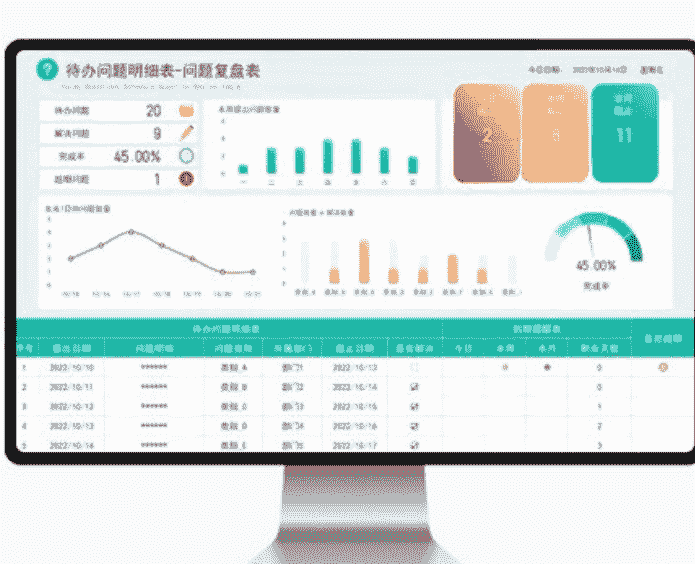

永久使用 每周更新 不满意可退

## 2026 新版

### 工作学习复盘表格

每日复盘 工作复盘 数据复盘

- 工作问题
- 学习复盘
- 项目活动
- 直播复盘


电子表格 永久使用 免费更新

- 优先选老店、高销量产品：这类产品已经在市场上卖了很久、销量稳定，基本都是无版权风险的商品，能最大程度避免版权违规问题。
- 规避违规风险：图片不带淘宝水印、二维码、他人肖像、明星名人姓名等违规元素的产品，才能上架

### 健康知识

#### 科普文案

青鸟办公素材
qingniaosucai

精选文案

健康常识

2800 份

日常护理

注意事项

9.9 元加入
永久会员

电子版
续更新

脚本设计

24 小时 在线发货

点击看目录

#### 2025 年整理 终身包更新

1200 套合集

#### 电商公司

全套资料

薪酬绩效/人事管理/客服培训

直播培训/岗位职责/图表模板

不喜欢不满意全额退款

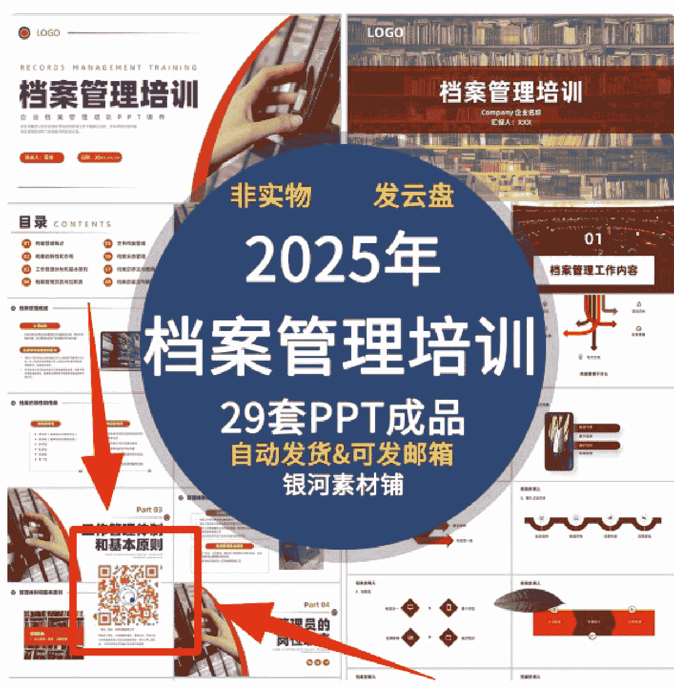

- 爆品裂变：运营一段时间后，看店铺里哪些品出单多、销量好，就拿着这个品的标准和所属类目，去搜索裂变更多同类产品上架，放大收益
- 很多人对选品有误解，总想找一些高效技巧、骚操作，纵观整个电商发展史，骚操作每年都有，但过段时间就会失效，需要不停更换；而那些把店群做长久的大佬，从来都是朴实无华地批量上品、日积月累，反而经久不衰。这就是最好用的方法：固定核心动作，追求不变的底层逻辑，把最有效的方式不断重复

#### 推荐类目

- 学科类，毫无疑问就是小红书平台卖的最好的类目。需求最大，细分类目众多，不同学科、不同年级、不同版本，都有持续的需求，也最容易出爆品，是做虚拟资料绕不开的类目
- 但这个类目的竞争也是最大的，要做好心理准备，能出单，但前期单量不会很稳定

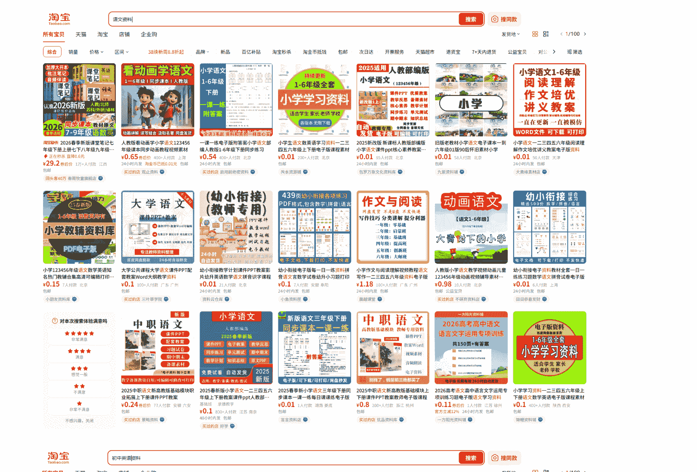

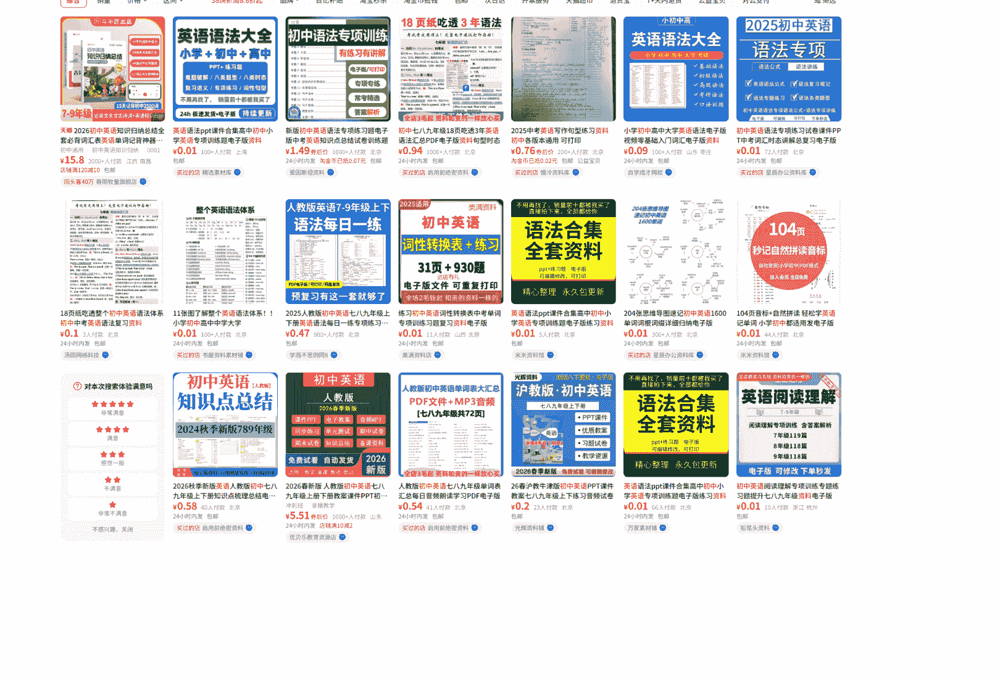

- 课件类，和学科类逻辑类似，以 PPT 类内容为主，除了学科课件，还包括家长会 PPT、年会 PPT，各种活动 PPT，学生会 PPT，社团 PPT 等，也是需求量比较大，细分足够多的一个类目

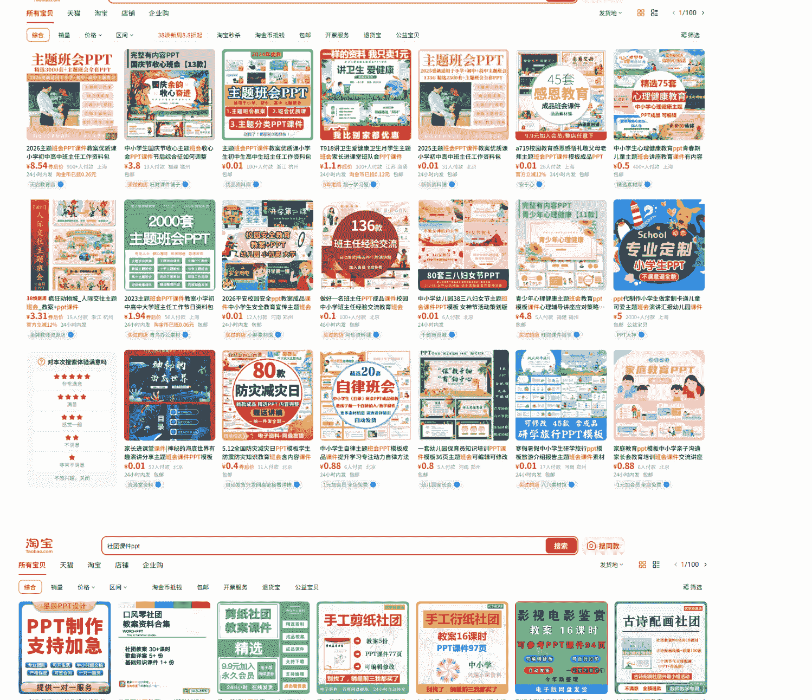

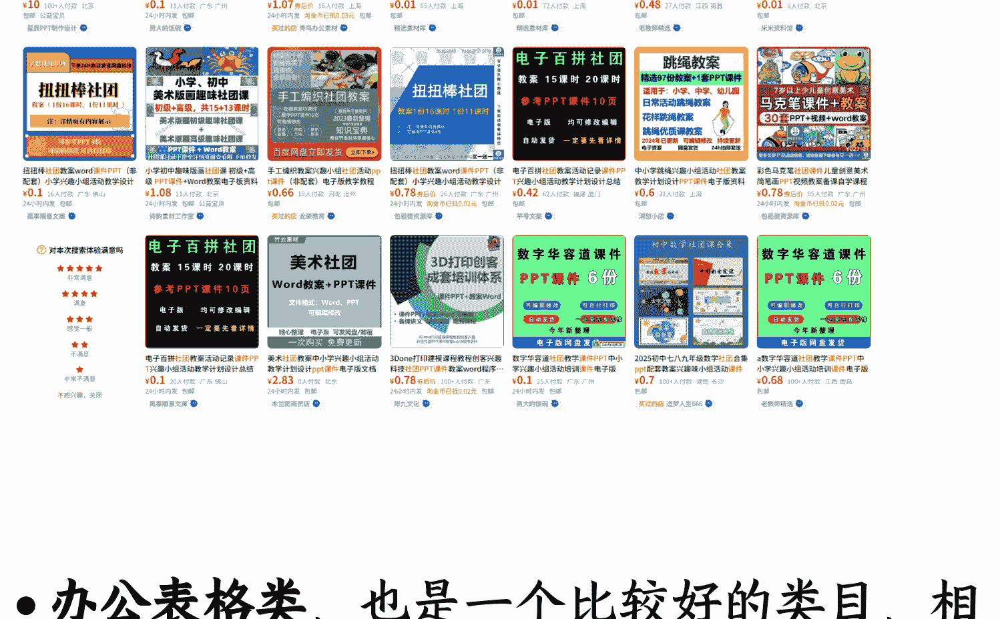

- 办公表格类，也是一个比较好的类目，相较前面两个竞争会小一些，但是需求也不少，比如合同台账、保险表格等等，都是出单不错的产品，能够覆盖行业比较广，适合铺量


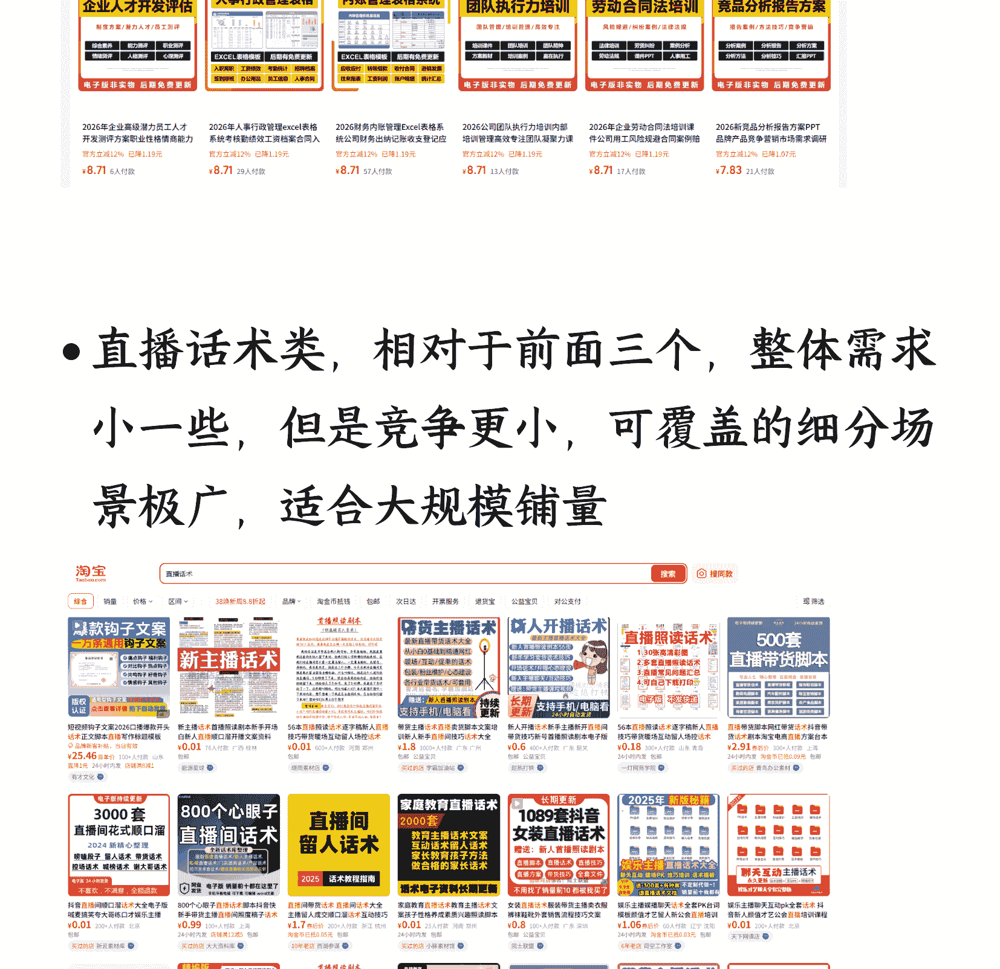

- 直播话术类，相对于前面三个，整体需求小一些，但是竞争更小，可覆盖的细分场景极广，适合大规模铺量


- 其他参考，考试面试类、培训类、营销策划类、运营管理类
- 我们大量店铺数据验证，最终能够持续、大量出单的还是大类目，那些偏门的小众类目本身需求就很少，它能出单，但既不稳定又不持续。即便是大类目，也不是每天都能稳定出很多单。而店群模式的核心优势就在于：品类足够多，今天这个品类出的好，明天那个品类出的好，整体收益就能保持稳定
- 所以给新人的建议是：不要挑类目，多搞几个号，堆量绝对是最适合普通人的模式
- 有人会问，上来就做原创、做精品，能不能出单？能，也有成功案例。但是你去做能不能出单，不一定，多久能出单，不一定。我们现在也在做原创品，但是我们有稳定的营收基本盘，支撑我们去做原创试错，但如果你没有，非常不建议一上来就做原创
- 还是那个原则，不同阶段做不同的事。在你赚到 100w 之前，没必要做原创，市面上赚钱的方法，抄都抄不完。如果要做原创，还是用店群的方式去做伪原创。很多人有抄袭羞耻症，老电商人哪管你这个，就是抄，实在难受去看看小米 su7，你比雷神强在哪

#### 禁售品类

- 影视剧、音乐、小说、软件等强版权产品
- 医美、医疗、养生等涉及医疗效果的产品
- 涉黑、涉政、涉黄等违反法律法规的产品
- 带有名人肖像或姓名的产品
- 法律类、金融类产品需要资质，无资质不可售
- 涉及私域、引流、招商、兼职、其他平台推广的产品
- 这些是我们通过几万个品测出来的禁售品类，千万不要做，轻则限流，重则封号，很严重

### 小红书选品

小红书跟品，它本身已经经过平台的筛选了，但是要判断一下，比如说人家卖音乐的小说的，可能人家有版权，但是你没有版权，那就别上，还是规避一下上面说的禁售类目

官方提供了两个跟品途径

- 一个是千帆的商品商机页面，潜力商品搜索电子资源，可以查看近期热度最高和货源最稀缺的产品
- 另一个是乘风的数据页面，商品洞察，选择电子资源类目，可以查看不同月份的成交排行、趋势热度、推广热度等产品，支持数据下载到本地
- 挑选销量高的和适合自己的产品上架即可


### 店铺上品

#### 从淘宝上品

- 上品的方式有很多种，用付费软件直接上品是最快的。目前市面上的付费软件有很多，包括红麒麟、羽悦助手、雷霆上货、小红书助手等等，效果都差不多
- https://www.kdocs.cn/l/coH9jgdtmG84
- 链接内有各类上品软件的下载地址，和教程链接，大家可以从闲鱼购买卡密，安装使用即可

N5 | https://www.kdocs.cn/l/cfdL26eViBS5

| | A | B | C | D | E | F | G | H | I | J | K | L | M | N | O |
|---|---|---|---|---|---|---|---|---|---|---|---|---|---|---|---|
| 1 | 【恭喜发财】无货源软件大全 | | | | | | | | | | | | | | |
| 2 | | 注意 - 注意 - 注意 - | 按住键盘【Ctrl+F】之后右上角 | 出现搜索框 | 输入软件名称 | 点击“查找” | 即可快速找到对应软件（一次没找对的继续点击查找，有重名的软件） | | | | | | | |
| 3 | 1 | 抖音软件 | 软件下载地址 | 软件教程地址 | | 2 | 快手软件 | 软件下载地址 | 软件教程地址 | | 4 | 小红书软件 | 软件下载地址 | 软件教程地址 |
| 4 | 1-1 | 小抖助手 | https://wwc.lanz | | | 2-1 | 羽悦快手 | https://www.kdoc | https://www.kdoc | | 4-1 | 红麒麟上货 | https://wwrf.lanzo | https://www.kdoc |
| 5 | 1-2 | 王者上货 | http://36.134.177 | https://m.ixigua. | | 2-2 | 快传管家 | https://wwrf.lanzo | https://wwtj.lanzo | | 4-2 | 羽悦小红书 | https://qingyuwan | https://www.kdoc |
| 6 | 1-3 | 一刻抖店 | https://www.kdo | | | 2-3 | 快小店 | https://wwrf.lanzo | | | 4-3 | 小红书助手 | https://wwqxhs.la | https://www.yuqu |
| 7 | 1-4 | 福星抖店 | https://wwbp.lan | https://www.yu | | 2-4 | 机器猫动销 | https://www.kdoc | https://wwrf.lanzo | | 5 | 1688 软件 | 软件下载地址 | 软件教程地址 |
| 8 | 1-5 | 龙澄上货 | https://wwrf.lanz | https://www.kd | | 2-5 | 财神动销 | https://wwrf.lanzo | https://wwrf.lanzo | | 5-1 | 1688 采集大师 | https://wwmp.lan | https://www.kdoc |
| 9 | 1-6 | 抖财神/炎品狮 | https://cetenet.l | https://www.yu | | 2-6 | 快采集 | https://wwrf.lanzo | https://wwrf.lanzo | | 5-2 | 小马过河 1688 版 | https://wwmp.lan | |
| 10 | 1-7 | 六个团自动回复 | https://www.kdo | https://www.kd | | 2-7 | 快手回复 | https://www.kdoc | | | 5-3 | 1688 搜款大师 | https://wwmp.lan | 🌐打开链接 |
| 11 | 1-8 | 抖秘书 | https://www.kdo | | | 2-8 | 天梯 | https://www.lanzo | https://www.lanzo | | 5-4 | 1688 蓝鲸选品 | https://wwmp.lan | |
| 12 | 1-9 | 小云朵 | https://wwrf.lanz | | | 2-9 | 小马过河快 | https://wwmp.lan | | | 5-5 | 1688 打标 | https://wwmp.lan | |
| 13 | 1-10 | 小尊宝抖店 | https://zzbtool.c | https://wwmp.la | | 2-10 | 快手管家 | https://wwrf.lanz | | | 6 | 京东软件 | 软件下载地址 | 软件教程地址 |
| 14 | 1-11 | 抖商助手 | https://wwmp.la | https://m1y6ku | | 2-11 | 叮当助手 | https://www.lanz | 密码:8888 | | 6-1 | 京老虎 | https://wwbw.lanz | https://www.kdoc |
| 15 | 1-12 | 抖商选品 | https://www.lan | | | 2-12 | 快精灵 | https://wwmp.lan | https://www.kdoc | | 6-2 | 京狐 | https://wwmp.lan | https://www.kdoc |
| 16 | 1-13 | 抖小鱼客服 | https://wwmp.la | https://docs.qq. | | 2-13 | 晨飞采集 | https://www.lanz | 密码:8888 | | 6-3 | 蘑菇助手 | https://wwmp.lan | |
| 17 | 1-14 | 抖小鱼工具箱 | https://wwmp.la | https://docs.qq. | | | | | | 6-4 | 小马过河京东 | https://wwmp.lan | |
| 18 | 1-15 | 抖霸采集 | https://www.kdo | https://v.youku. | | 3 | 微信小店 | 软件下载地址 | 软件教程地址 | | 6-5 | 云上货京东 | https://wwmp.lan | |
| 19 | 1-16 | 抖店截流大师 | https://www.kdo | https://www.yu | | 3-1 | 微信小店客服 | https://wwmp.lan | | | 6-6 | 黑小马 | https://wwmp.lanzout | https://www.hxmds.cn |
| 20 | 1-17 | 小球上货 | http://47.105.109 | | | 3-2 | 灵犀微店 | https://wwbpf.lan | https://dcngfrhpt | | 7 | 多平台综合软件 | 软件下载地址 | 软件教程地址 |
| 21 | 1-18 | 李四 | https://wwmp.la | | | 3-3 | 福星微店 | https://wwaob.lan | https://www.yuqu | | 7-1 | 雷霆工具箱 | https://www.kdoc | 教程在软件上 |
| 22 | 1-19 | 快小猫采集 | https://docs.qq.c | | | 3-4 | 羽悦微信 | https://cs- | | | 7-2 | 黑鲸鱼 | https://www.kdoc | 邀请码 BT0794 |
| 23 | 1-20 | 抖盟 | https://wwmp.la | | | 3-5 | 晨飞微信 | https://wwbsw.lan | 密码:8888 | | 7-3 | 群英会 | https://wwhd.lanz | |
| 24 | 1-21 | 云上货抖店普通 | http://dy2.yunsh | | | 3-6 | 灵宝上传助手 | http://124.221.147 | | | 7-4 | 破军星 | www.pjx666.com/t | |
| 25 | 1-22 | 考拉工具箱 | https://wwmp.la | | | 3-7 | 灵光微信上货 | https://www.kdoc | | |
| 26 | 1-23 | 抖店长 | https://wwmp.la | | | 8 | 淘宝软件 | 软件下载地址 | 软件教程地址 | |
| 27 | 1-24 | 抖博士 | https://wwmp.la | | | 9 | 拼多多软件 | 软件下载地址 | 软件教程地址 | |
| 28 | 1-25 | 布丁采集 | https://wwhg.lan | https://wwhg.la | | 9-1 | 星智拼上拼 | https://share.feijip | https://ecn1cop8rk | 邀请码：qingqing666 | 10 | 视频软件 | 软件下载地址 | 软件教程地址 |
| 29 | 1-26 | 脱壳抖店下单 | https://wwrf.lanz | | | 9-2 | 懒狗上货 | https://www.kdoc | https://www.kdoc | | 10-1 | 无极助手 | https://wwmp.lan | |
| 30 | 1-27 | 抖音上货 | https://wwbpf.la | https://www.kd | 教程必看 | 9-3 | 神笔 | https://www.kdoc | https://www.kdoc | | 10-2 | 飞云视频 | http://fyspsz.com; |
| 31 | 1-28 | 店群管家 | https://wwxg.lan | https://o0c3kplp | | | | | | |
| 32 | 1-29 | 一刻网页版本 | https://dy.1kup.c | | | | | | | |
| 33 | 8 | 淘宝软件 | 软件下载地址 | 软件教程地址 | | 9 | 拼多多软 | 软件下载地址 | 软件教程地址 | | 10 | 视频软件 | 软件下载地址 | 软件教程地址 |
| 34 | 8-1 | 冠军 | https://www.kdo | https://www.kd | | | | | | | | | | |
| 35 | 8-2 | 店淘 | https://www.kdo | https://m.ixigua. | | | | | | | | | | |
| 36 | 8-3 | 叮咚淘 | http://www.didio | https://www.kd | | | | | | | | | | |

#### 从小红书上品

- 在小红书服务市场搜，稿定商品、妙手商品等，根据工具提示设置商品信息，上传即可

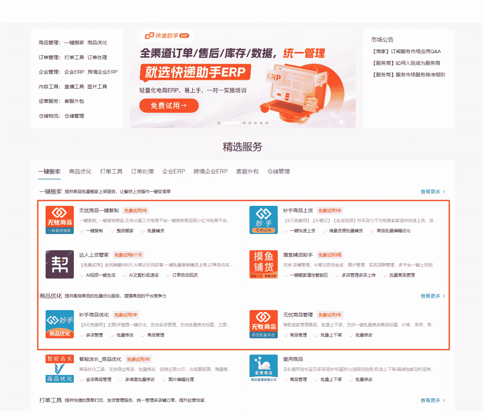

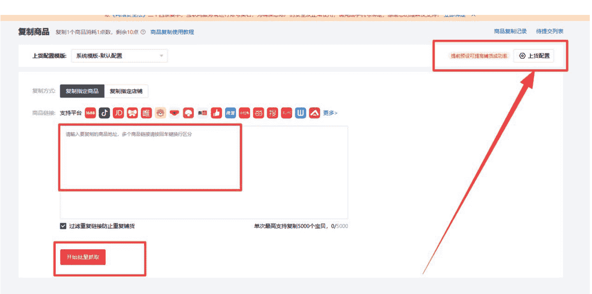

小红书限制单店铺每天上品数不超过 100，超过会限制上品 24 小时，大家要注意控制上品节奏

## 四、如何发更多的笔记（AI 批量制作笔记并发布）

### 笔记生成

- 最早的笔记生成主要靠人工手搓，效率很低，现在我们通过飞书多维表格的 AI 功能，可以直接大批量的生成笔记文案和图片，效率提升了几十倍
- 只需要在飞书多维表格里配置好 AI 字段，然后输入商品的标题和 id，AI 就会按照配置的要求自动生成笔记的标题、正文、话题以及图片
- 同时配置了发布状态字段，所有未发布的笔记都是“待发布”状态，发布成功后会自动变更为“已发布”状态
- 飞书多维表格，也是我们目前测试下来，性价比和实用性最好的笔记制作方式

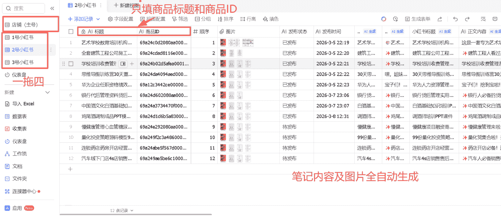

### 笔记发布

+ 笔记的发布，用的是浏览器插件
这个插件是跟 cloudcode 聊了 3 天做出来的，全程没写一行代码（强烈推荐大家都学习一下 AI 编程）
在配置模块，绑定账号和飞书多维表格，需要填写多维表格的 id、密钥等
发布模块，设置发布任务，发布数量、发布时间、间隔时间等参数
点击开始发布后，插件会自动从飞书对应表格调取待发布的笔记，按照设置的参数自动发布，发布成功后自动把笔记状态改为已发布
每个浏览器的插件可以同时运行

连接成功！飞书表格可以正常访问

请先配置飞书多维表格连接信息，用于获取发布任务

| 配置项 | 值 |
| :--- | :--- |
| 飞书 App ID | cli_a9387f6258f89cd1 |
| 飞书 App Secret | 表格 Token (App Token) |
| 数据表 ID (Table ID) | R21fbilFgadXP8suxQicixEVnWh tblh5sGPdxXnbzOd |

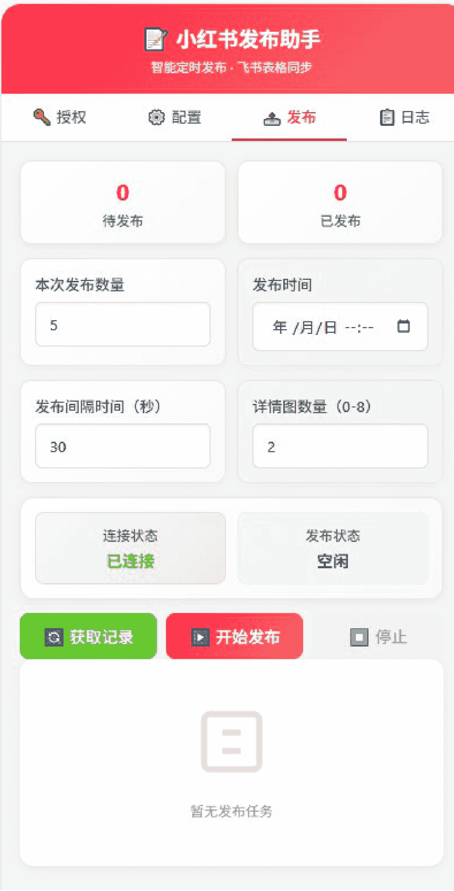


### 字段映射配置

| 字段 | 映射内容 |
| :--- | :--- |
| 标题 | 小红书标题 |
| 正文 | 正文内容 |
| 话题 | 话题 |
| 图片 | 图片 |
| 发布时间 | 发布时间 |
| 发布状态 | 发布状态 |
| 商品 ID | 商品 ID |
| 详情图 | 详情图 |

- 测试连接
- 保存配置

### 出单发货

- 发完笔记之后就是重复这个过程，然后等出单，去采购对应的资料，给用户发货
- 出单后，复制出单品标题，到淘宝搜索同款商品
- 优先选择低价，其次选择出单多的商品
- 找不到资料的可以去闲鱼、百度搜索


+ 目前出单流量中，80% 是来自于笔记搜索的流量，20% 来自推荐流量和商品搜索。因此项目的重点就是笔记搜索
+ 其他的包括投流、刷单、系统活动等等都是次要的，一定要把精力放在最重要的事情上
+ 基于这个判断，我们把项目流程做了大量删减，只保留了最有效的核心动作，就是围绕上面说的内容，开更多店，上更多的品，发更多笔记，不断重复

## 五、如何让出单更稳定 (0-1 阶段运营的底层逻辑)

很多新人跑通了首单，但单量一直不稳定，核心原因就是没抓住 0-1 阶段的运营底层逻辑，下面给大家讲透四个核心方法，照着做，就能实现稳定出单

### 一、提高数量，用规模换确定性

+ 根据我们跑通几十家店的经验，0-1 阶段拿到结果的底层逻辑就是堆量，不管做店群还是做精细化，一定是以量为基础，才能更确定性的拿到结果
+ 所以新人入场一定要先建立堆量意识，尽可能借助现有的 AI 工具降本增效，先拿到正反馈，有了稳定基本盘之后，再研究原创、研究精细化
+ 先做胜率高做的事情，再做赔率高的事情
+ 提高数量，看似是最笨的方法，却是确定性极强、可无限复制的一套方法论

+ 在有足够数量的基础上，每提高一点胜率，都会带来巨大的收益增长，因此让出单更稳定的第二个方法，就是提高单店产出
+ 我们开了很多店之后，发现同样的操作，有些店铺数据很好，有些店铺却始终跑不起来，我们测试了很多变量之后，终于确定一件事，小红书的号和店，是两个独立的主体，有相关性，但本质上是分开的

+ 实际开店的时候也体现了这一点，我们的账号和店铺可以是不同的实名人。而我们的流量 80% 来自于笔记搜索，所以一个店跑不好，核心问题是账号不行，跟店关系不大
+ 确定这个问题之后，我们测试了子账号，小红书每个店铺可以绑定 3 个子账号，也就是大家常说的 1 拖 3。我们给两个之前数据不好的店铺，各绑定了 2 个子账号，然后用子账号发笔记测试效果，一段时间后，这两个店铺的出单数据，在子账号带动下，有了非常明显的提升
+ 之后又给其他店铺做了同样的测试，最终确定，1 拖 3 的账号布局，能显著提高店铺的产出，这是提高胜率的绝对有效方案
+ 子账号绑定路径，手机版千帆我的页面--全部工具--账号关联--关联邀请
+ 要求子账号没违规、没开店

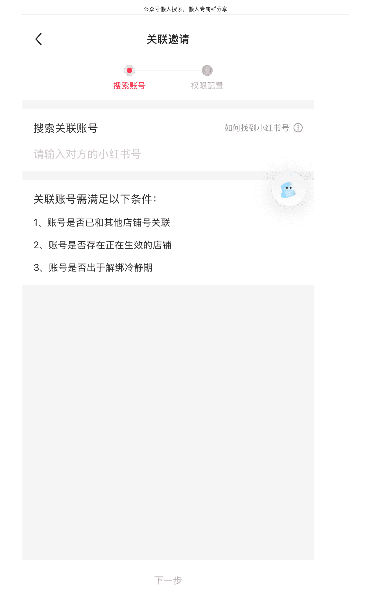

### 全部工具

- 全部订单
- 任务单
- 售后订单
- 售后助手
- 物流设置
- 售后纠纷
- 在线寄件
- 运费宝
- 物流拦截
- 电子面单
- 打单发货

### 资金

- 账户资金
- 货款账单

### 成长

- 数据中心
- 用户资产
- 任务中心
- 薯条推广
- 热搜词
- 账号关联

### 营销

- 优惠券
- 单品特价
- 满减打折
- 赠品
- 直播间秒杀
- 活动报名
- 核销管理

### 更多工具

- 电脑端

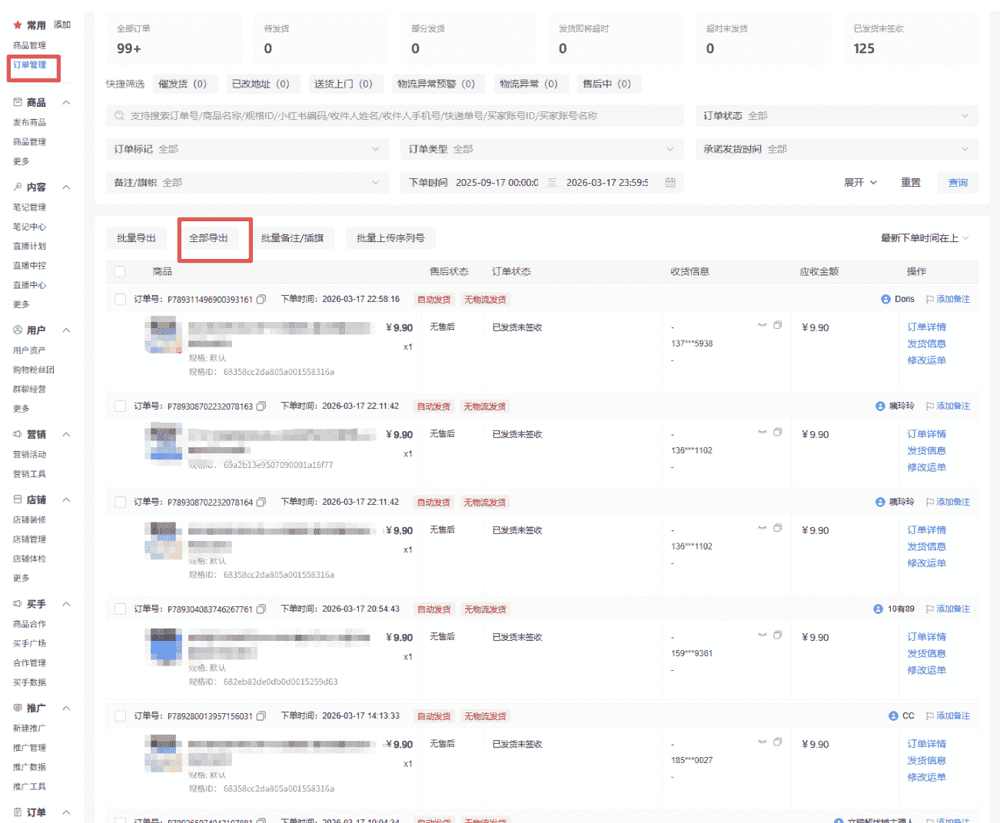

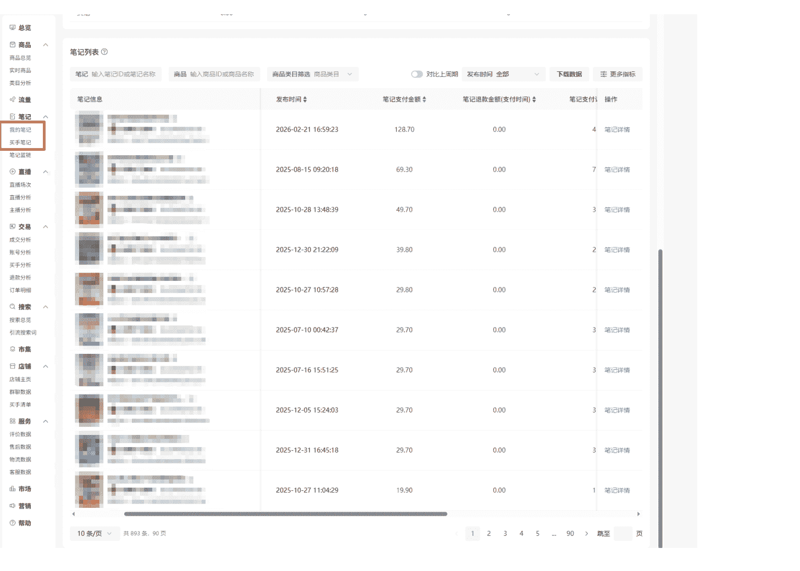

### 三、持续迭代，让店铺保持流量活力

#### 上品迭代

- 初期是建议每个店上 300 到 500 个品，完成基础铺量
- 之后每个月固定上新 100 个品，新品有流量扶持，很多品上架后没发笔记就能自然出单

- 三个月之后，把第一批 300 到 500 个品里，不出单的品删掉
- 核心逻辑：只筛选不培养，让店铺的品流动起来，围绕出单的品，裂变的更多同类目、同类型的品
- 重要提醒：商品没有查重，笔记有查重

#### 笔记迭代

- 每天每店发布 20-40 篇笔记，主账号 + 3 个子账号，每个账号每天发布 5-10 篇即可
- 图片质量方面，目前最稳妥的方案，就是自己做原创模板，批量套版
- 持续迭代优化图片模板，积累优质的模板图库

### 四、持续积累，尊重时间的长期壁垒

- 这是一个有极强积累属性的项目，我们现在的很多出单，都是 7-8 个月以前发的笔记在出单
- 但同时，这也是一个慢项目，大部分人进入这个项目，都想着快速拿到结果，而积累型项目的特点，是越往后收益越高，可惜大部分坚持不了两个月就放弃了，核心原因就是没拿到正反馈，没有一套科学体系的操作方法。
- 当我们找到一个长坡厚雪的赛道，唯一要做的就是坚持。时间才是最大的壁垒，一定要尊重时间

到这里，项目从零到一的完整流程就全部讲完了。从开店到选品，从出单到稳定运营，只要你按照上面的流程一步步操作，基本都能跑通，甚至可以说是百分之百的结果。

## 六、项目方法论总结和避坑指南

### 方法论总结

+ 抄作业永远是最有效的方式
+ 堆量是拿正反馈最快的方式
+ 做确定性最强的事情
+ 善用 AI 和工作流，把人力从重复动作中解放出来
+ 用数据驱动决策，持续迭代优化
+ 凡事标准先行
+ 什么阶段做什么事
+ 只筛选不培养

### 避坑指南

+ 不要一上来就做原创，先抄后超，先活下来再谈发展
+ 不要上来就搞精细化，先把基本盘跑通，再谈优化升级
+ 不要在低效动作上耗费精力，永远聚焦核心动作
+ 闭门造车是最蠢的行为，多交流、多学习、多看同行怎么做的
+ 不要心急，慢就是快，尊重项目的积累属性
+ 追求完美是创业路上最大的陷阱，先完成再完美

## 七、问题答疑

### 1、网络还有设备是怎么搞

因为项目流程是完全合规的，所以从一开始就没有把精力放在 IP 隔离这些事情上，我们的账号就用摩托罗拉手机，开六个分身挂六个账号，店铺的话是一台电脑挂 15 个号，然后都是用的同一个 IP，到现在这么多店铺，IP 方面没有出现任何问题

你问的这个问题，背后的隐含逻辑是我可能会违规，那怎么规避平台的关联处罚，但我们的逻辑是只要我不违规平台就没有干我的理由，那我就不需要花精力去搞那些东西

实际上只要你在对抗平台，不管 IP 有没有隔离，平台都能找到你，譬如同一个法人，同发货地址，同手机号。只要是有任何关联的，它都能查找，所以最好的方式就是不对抗平台

### 2、笔记没有流量，怎么判断是不是被限流了

如果平台没有给你发明确的违规通知，告知你账号违规、被限流了，那你的账号就没有被限流

笔记发出来之后小眼睛少，核心原因就是这个笔记本身质量不行，就应该只有这点流量。只要没有官方明确通知，就完全不需要考虑是不是限流的问题

去优化笔记图片，提升笔记质量

### 3、很多店都推同一个品，发的笔记内容会不会雷同

现在的笔记文案都是 AI 写的，每次生成的都会有不一样

核心是把图片做好差异化，就完全不用担心内容重复的问题

### 4、笔记数量重要，还是保质量重要

在保证 60 分笔记质量的基础上，去追数量

60 分是底线，在运营过程中也是要持续迭代笔记质量的

### 5、目前制作虚拟资料时，投入的时间和收获不成正比，主要问题在于课件内容厚重或长或时过长，很多内容无法完全依赖。人工创作的时间成本过高，如何让付出与收获尽量成正比

这就是目前大部分做原创、做精细化的人遇到的问题。吭哧吭哧憋半个月一个月，做一个原创品，结果出个 3 单 5 单，甚至不出单

做精细化就是追爆品，它本身就是一个概率的问题，就不是百分之百的逻辑，没办法让你付出和收获成正比。最好的模式就是像我们现在这样，先有稳定的基本盘，再拿出一部分精力去做原创试错，不会影响整体收益

+ 另外，如果你觉得做原创很累，是因为这个事情超出能力范围了，更适合大部分人的是做伪原创

### 6、小红书新规下，ai 托管类账号该如何规避违规

+ AI 托管主要检测的三个点，发布数量、发布频率、笔记质量。这是跟客服确认过的
+ 数量我们已经降下来了，单账号 5-10 篇，配合 1 拖 3，实际发布数量也不少
+ 发布频率通过插件，设置间隔时间，避免集中批量发布，也没问题
+ 笔记质量就要重点优化图片模板，提升原创度和质量，规避同质化违规

### 7、当您看到一个潜在的虚拟产品选题时，您会从哪些维度判断它值不值得做？具体的验证动作是什么？比如您会看哪些数据、搜哪些关键词、观察竞品的哪些指标？是做流量大的关键词还是蓝海词，如果是蓝海词该怎么挖掘，蓝海词怎么知道用户的付费意愿

+ 我们这个店群模式，核心是做规模、做数量，不会对单个品做精细化的判断和研究，因为这样效率太低了

+ 别人卖的再好，在你这不出单没有用。别人卖的不好，在你这儿能出单，它就是你的好品
+ 重剑无锋，大巧不工，一次几千个品堆上去，出单就留下、放大，不出单的就淘汰，有没有付费意愿，就看出不出单呗

### 8、某个节点的爆品，笔记应该提早多久开始布局。做一个学习网站或者素材网站卖会员，几十个号都推这一个品可行吗？有没有推荐的打法

+ 这又是追爆品的逻辑，一般提前一个月左右就可以布局
+ 几十个号推同一个品，完全可行，推荐走郑州帮的模式，可以发不挂链接的笔记，在评论区留一个蓝链，爆率会高一些

### 9、小红书的哪些环节可以最大化，用 AI 提效

+ 所有重复的环节，都可以用 AI 提效，不止是小红书虚拟电商，其他所有项目都是如此
+ 先把项目流程最简化，然后找到每天反复做的那几个核心动作，把这些用 AI 来代替，可以最大化提效

---

分割线

看完这篇 SOP，你觉得你懂了。但 90% 的人一到实操就会卡在第一步。

工具和教程只是最低级的壁垒，真正的壁垒是“立刻动手”和“圈层信息差”。

如果你想看全网最新的变现玩法，并且和一群执行力极强的极客一起下场拿结果，欢迎围观我的核心私域：【懒人专属群】。

我们不聊虚的，只做商业闭环的拆解与 AI 效率的压榨。系统内已沉淀 1000+ 跑通的套利实战局。

👉 查阅圈子完整数字资产与上车门槛：

```
https://lazyso.com/insider/
```

认同价值、准备好下场干活的，扫码加我微信（lazyhelper1）


备注：【实操上车】，不闲聊