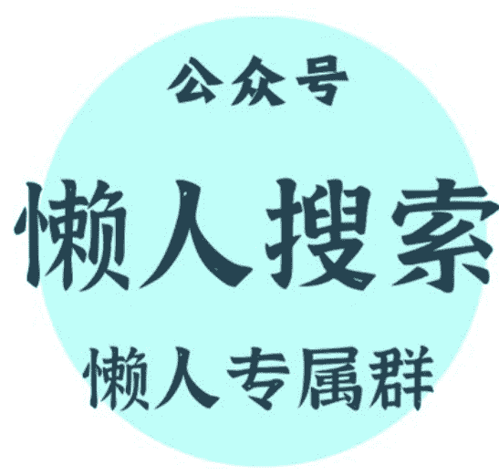

# “梅姨”落网，背后是时代的变革？

2026 年 3 月 25 日文/卢克文工作室嘉宾壹壹壹

整理：公众号懒人搜索，懒人专属群精选

懒人微信：lazyhelper1

广州市公安局 21 日通报，“张维平等人拐卖儿童案”的关键人物“梅姨”已落网，其真实身份为犯罪嫌疑人谢某某。

梅姨落网消息刷屏时，很多人第一反应是：“她居然还活着？”

一个潜逃了 23 年的大活人，究竟是怎么藏的？

## 01

从 2003 年 9 月到 2005 年 12 月，广州增城、惠州博罗等地有多名儿童被拐。

该案被公安部、广东省公安厅挂牌督办。2016 年，张维平等 5 名罪犯落网，交代 9 名孩子都是经中间人“梅姨”转卖。

2023 年 4 月，张维平等主犯被依法执行死刑，9 名被拐儿童也已全部找回，但“梅姨”一直逍遥法外。

这一系列案件，和时代背景密切相关。

2000 年我国加入 WTO 后，沿海的工厂拔地而起，大批云贵川的务工人员拖家带口来到广东，这就给了犯罪分子可乘之机。

2003 年，刚刑满释放的张维平，再次走上拐卖儿童的老路。他是贵州遵义人，专盯着城乡结合部出租屋，找西南老乡下手。这也解释了为什么他人在广州，被拐的孩子却都是贵州、四川户籍。

拐来的孩子，他全都通过“梅姨”卖到广东河源紫金县一带。

张维平第一次交易时，急于将拐来的孩子脱手，便谎称孩子是自己的，无力抚养，只想给孩子找个好人家。买家出价一万二，他从中拿出一千元给“梅姨”当介绍费。

首次合作后，“梅姨”给张维平撂下一句话：“不论男女，只要有小孩，我都要。”至此，一条专业人贩子产业链成型了。

## 拐卖还分专不专业？

没错，八九十年代才是拐卖犯罪的真正高发期，每年案件上万起，远比张维平作案时的几千起要多。

但那个阶段的拐卖，大多是亲戚骗亲戚、老乡骗老乡，没有组织、没有分工，属于松散的熟人式作案，一抓就是一窝。1998 年云南龙七村案中，警方一次就抓了 45 名拐子，涉及 104 名被拐儿童，这就是典型的粗放式拐卖。

2000 年前，国内对于拐卖儿童的打击，偏向于运动式。打一阵，松一阵，风头来了人贩子就躲一躲，过了再出来干活。但从 2001 年起，公安部连续三年集中力量打拐，解救了 4 万余儿童。

对拐卖的打击不再是运动式，而是常态化的高压，资源投入比以往多了许多，还建立了 DNA 数据库，协助打拐。

高压之下，拐卖产业也做出了应对，开始专业化。

原本熟人抱团、拐了还不知道卖哪的粗放作案方式，演变成了“买主下单—拐子诱拐—中介转运—终端贩卖”这一更成体系的黑色产业链。

产业链分工明确，有人负责拐，有人负责转，有人负责卖，一个人被查了，不会牵连到整个链条，降低被一锅端的风险。

而专职中介，是关键的一环。因为产业链专业化后，买家和卖家，通常不再亲自接触，双方的对接，大部分由中介完成。
“梅姨”在产业链中的角色，便是中介人。

“梅姨”的操作极其专业，只和张维平等少数人联系，其他拐卖团伙不轻易接触，因为不熟悉怕出事。拐来的孩子，她会和张维平在特定地点交接。

张维平拐孩子只负责交货收钱，梅姨从不透露孩子卖给谁，也不问来源，两人只在有生意时联系，平时互不打扰。按照行规，张维平也不多问，始终不知道梅姨的真实身份。

梅姨拿到孩子后，会询问平时联系的客户，如果合适，那就迅速交易。过程中她需要担保这些孩子来源干净，没有什么奇怪的疾病。

交易过程由她全程控制，张维平等人不许与客户见面。事成之后，张维平每单会得到 1.2 万元左右，梅姨从中抽成 1000 元。当然，这是 2000 年初的价格，后来逐渐水涨船高。

同时，小灵通的出现，也极大便利了卖拐产业链。

从 2002 年下半年全面推广，到 2004 年前后，卖拐产业链已经在广东这个流动人口大省基本全覆盖了。

很多人不理解：不就是多了个电话吗，为什么能升级拐卖方式？

原因很简单：没有手机的年代，拐卖只能靠熟人圈子，不见面、不信任就不敢合作。但有了小灵通，找买主、拐孩子、转运、交接，一通电话就能搞定。

手机本身买不来信任，但稳定的利益 + 隐蔽的联络方式，足以替代熟人信任，加上小灵通便宜、话费低、不用实名，街边就能买到，随时能换号，几乎不留痕迹，成了人贩子隐蔽合作的最佳工具。

就这样，在高压打击下，拐卖犯罪非但没有消失，反而实现了“转型升级”。“梅姨”们是产业链的重要一环，作为中介，他们需要掌握上游货源和下游买家，确保交易顺利，还得进行担保。

在落网前，外界对梅姨的了解，只有两张流传出来的素描画像。甚至有人猜测，“梅姨”是个男的，或是一个团伙的代称。

那么，“梅姨”为何能藏匿 23 年？

很大程度上，也与时代背景和产业链的专业有关。

## 02

首先，这离不开“梅姨”的低调。

她的大众脸很难引人注意。而她本人反侦查意识很强，在落网前没留下任何一张照片，走到哪都不使用身份证。与她同居近三年的彭老汉，甚至连她真名叫什么都不知道。

2005 年，彭某的女儿觉得村里传闲话不好听，就劝父亲跟“阿梅”领证结婚。“梅姨”一听就神色惊讶，然后假意答应回去拿户口本，结果第二天一早就消失了，电话关机，再也没回来过。

此外，根据产业链的行规，“梅姨”从不亲自拐孩子，只在幕后做中介，对比余华英、陈莲香这类直接拐孩的人贩子，她安全得多。

加上买家本身也涉及违法，肯定守口如瓶。

另外当年户口监管宽松，买家只要花几千块钱托关系，给孩子上户口就能洗白身份，有的甚至直接当黑户抚养，“梅姨”完全没有“售后”的麻烦，交了孩子就能全身而退。

此外，“梅姨”拐卖的 9 个孩子都在 1—3 岁，几乎没有记忆。即便多年后被找回，时隔十五六年，也提供不出有效线索。

比如最早找回的陈前和杨家鑫（均为化名），被拐时只有 2 岁，找到时已经十七八岁，什么都记不起来。

再加当年办案条件有限：2003 到 2005 年，手机还没强制实名，电话卡在报刊亭，小卖部随便就能买到，根本查不到人（实名制 2015 年才强制执行）；

监控也远没普及，城市直到 2008 年才开始逐步完善，农村到 2025 年也才覆盖了主干道。

梅姨当时如果在路边、出租屋完成交易，一点影像痕迹都不可能留下。

等到 2016 年张维平落网，警方再追查“梅姨”时，已过去十几年，现场早已翻新，知情者要么找不到，要么记忆模糊，“梅姨”的行踪更加扑朔迷离。

而这 9 个孩子最终能被找到，靠的不是嫌疑人的口供，而是科技的进步。

2019—2021 年，这几年找回的陈前、杨家鑫、申聪、朱龙、邓云峰、李成青，主要依靠全国打拐 DNA 数据库。警方把失踪儿童父母的 DNA 入库，再对重点区域的适龄人员采集比对。

最后找到的三个孩子刘朋、钟彬、欧阳佳豪，靠的则是大数据人脸识别技术。

南昌铁路公安局的民警汪挺，拿到钟彬和欧阳佳豪一两岁时的照片，利用人脸识别算法模拟他们成年后的长相，在广东范围内筛查。

因为有前期线索指明，孩子被卖到河源紫金县附近，目标范围大大缩小。最后在同一天，分别在紫金县和隔壁的五华县锁定了两个高度疑似对象，DNA 一比对，确认就是被拐的钟彬和欧阳佳豪。

“梅姨”能藏这么久，就是因为没有实名制、没有监控、没有 DNA 库和人脸识别，再加上她的操作极其专业，全程不露面、不留痕迹、不和非必要的人联系，警方多年来无从下手。

如果不是后来科技越来越发达，别说抓到“梅姨”，就连这些被拐孩子的下落，都要永远石沉大海。

当然，如今这套犯罪模式已经行不通。

## 03

回看 2003 到 2005 年，侦查手段还很原始：找线索只能靠走访，画像全凭口述手绘，跨省办案要靠传真和协查函，耽误大量时间。再加上没有全国联网系统，人贩子只要换个地方，就等于彻底消失。

如今的刑侦手段早已翻天覆地，从过去的“人找人”变成了“数据找人”。手机实名、出行住宿、消费记录、社会关系处处留痕，一个人想要彻底隐身，几乎已经不可能。

潜逃 23 年的劳荣枝，就算刻意改名换姓、隐藏过往，最终也被大数据通过轨迹比对、人员信息交叉分析，在厦门商场被精准抓获，这在二十年前是根本做不到的。

而“梅姨”这次落网，同样依靠大数据。

多年来警方始终没有放弃，在公安部统一协调和多地警方联动下，通过系统比对，锁定谢某某的年龄、口音、活动范围及社会关系，都与“梅姨”高度吻合。

锁定目标后，警方秘密固定证据、布控抓捕，采取内紧外松的策略，不打草惊蛇，最终在 2026 年 3 月成功将其抓获。

另外，买卖儿童从“高发犯罪”到“近乎绝迹”：

最直观的就是盗抢儿童案件。以前每年发生数百起，而 2020 年之后，全国每年这类案件已经降到不足 20 起，而且绝大多数都能在几小时内破案。

比如前几年山东、河南发生的几起儿童失踪警情，警方通过天网监控一路追踪，从孩子失踪到成功解救，最长不超过 6 小时，人贩子还没跑出市区就被抓住。这种速度，在梅姨那个年代完全不可能实现。

过去孩子被拐，只能靠家长苦寻、民警走访；线索断了就成了悬案。现在只要家长录入 DNA，全国打拐数据库就会自动比对，不管过去十年还是二十年，只要孩子被采集信息，就能立刻比对上。

梅姨案中的 9 名孩子，全靠 DNA 与人脸识别找回，并非人贩子主动交代。

梅姨式犯罪，依托的是低监管、弱技术、信息闭塞。如今这些条件不复存在，拐卖成本极高、暴露概率接近百分百，再狡猾的人贩子也不可能像她一样逍遥法外几十年。

不用空洞口号，只看现实变化就足以说明：中国很难再有第二个“梅姨”，那种孩子一丢就是半辈子的悲剧，已经真正成为过去。

——————分割线——————

绝大多数人只盯着眼前的工资，却不知道一次远在中东的冲突、一次降息的决议，就能在一夜之间洗牌普通人的财富。

看懂宏观，是为了在周期切换时，不被当作代价。

如果你认同这种“抬头看路”的长期主义，欢迎围观我的个人情报智库：【懒人专属群】。

圈子已稳定运行 7 年。我们每天利用 Python 爬虫与大模型算力，过滤全网最顶级的政经内参和搞钱风向标，做你最冷酷的“外部大脑”。

查阅圈子完整数字资产与上车门槛：

https://lazyso.com/insider/

认同价值的。扫码加我微信，备注：【进群】

微信：lazyhelper1