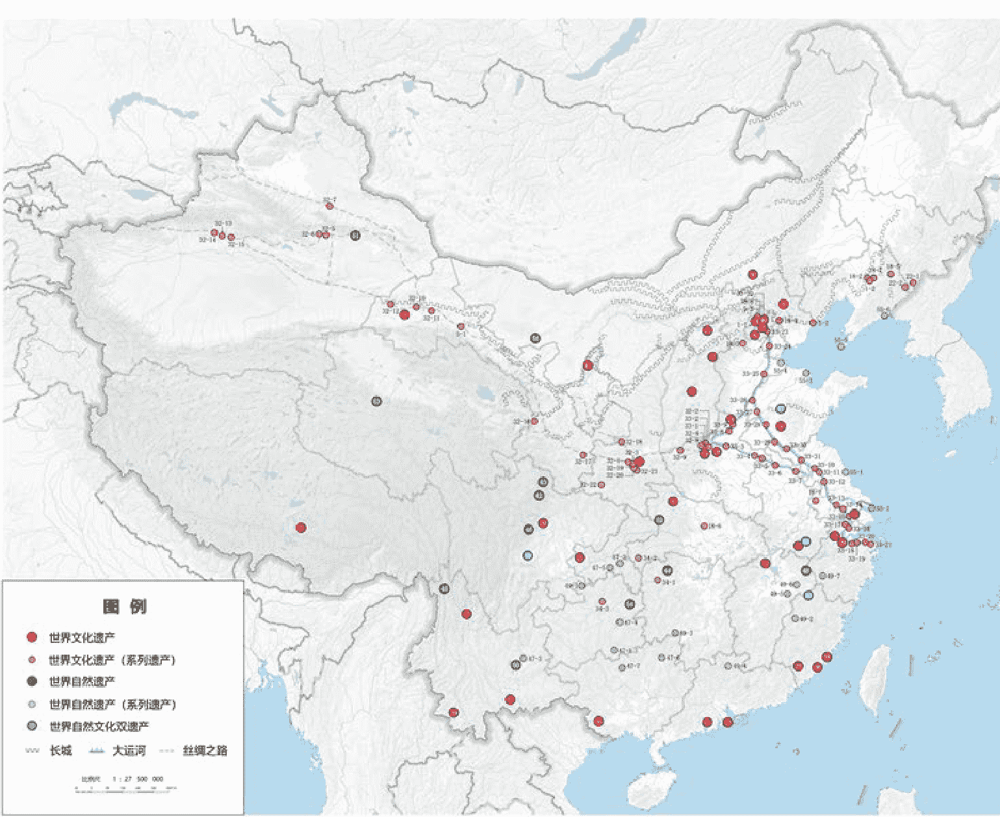

# 《“十五五”规划》普通人的事业与生活机会

260326

整理：公众号懒人搜索，懒人专属群精选
懒人微信：lazyhelper1


欢迎打开《蔡钰·商业参考 4》，我是蔡钰。

中国 2026 年发布的《“十五五”规划纲要》里，有三件事，跟我们普通人的事业与生活机会强相关。我想要请理科生、文科生和无论文理的你，分别重点关注。

## 理科生的三张表

首先，理科生要关注的是三张表格。

《纲要》明确说，未来五年，中国要重点提升六个领域的基础研究能力和竞争力，分别是高端新材料、基础零部件和元器件、基础软件和工业软件、工业母机、高端仪器仪表、重大技术装备。

### 专栏 2 产业基础能力和竞争力提升

| 序号 | 领域 | 内容描述 |
|---|---|---|
| 01 | 高端新材料 | 加快高端特殊钢、高品质高温合金、超高纯金属、先进陶瓷、高纯生物基材料、先进高分子材料、高性能纤维及复合材料、结构功能材料等创新突破，推进稀土功能材料、稀有金属材料、超硬材料、贵金属等提质升级，加强超导材料、超材料等前沿材料研究应用。 |
| 02 | 基础零部件和元器件 | 加快高速精密轴承、高参数齿轮与传动装置、高可靠性液压气动元件、高性能电机及控制系统、高精度丝杠等核心基础零部件攻关。研制一批传感类、功能材料类、光电类等先进通用基础元器件。 |
| 03 | 基础软件和工业软件 | 聚焦国产操作系统、数据库、中间件、编程语言及编译器、开发工具、云计算软件等基础软件，以及研发设计类、生产控制类、经营管理类软件，全链条推动技术攻关和成果应用。 |
| 04 | 工业母机 | 重点研制具备高速、高精密、复合一体化特征的高端数控机床等主机，提升智能数控系统、精密测量、功能部件配套能力。 |
| 05 | 高端仪器仪表 | 加强在线高效智能检测、极端环境调节控制、高性能流量测量等应用仪器仪表研发，推进量子计量、原位计量等新型计量校准仪器研发。 |
| 06 | 重大技术装备 | 推进大型邮轮、大型液化天然气运输船等研发设计制造和 CR450 级中国标准动车组试验应用，推动大型特种冶炼设备、重大石化装备、电子专用设备等研发和产业化，加快谱系化燃气轮机、高水轮发电机组等攻关突破，推进高端智能、丘陵山区适用农机装备。 |

此外，有 8 个前沿科技领域要重点攻关，分别是人工智能、量子科技、可控核聚变、生命科学与生物技术、脑科学与类脑研究、重大疾病防治与创新药研发、深海深地极地探测、深空探索。

### 专栏 3 新产业新赛道培育发展

| 序号 | 领域 | 内容描述 |
|:---|:---|:---|
| 01 | 集成电路 | 做精做细成熟制程，提高先进制程制造能力，加快发展关键装备部件，发展高性能处理器和高密度存储器。加快宽禁带半导体产业，推动氧化镓、金刚石等超宽禁带半导体产业化发展。推进存算一体、光电融合等技术突破应用。 |
| 02 | 具身智能 | 统筹布局具身智能实训场，推进虚实融合的协同训练与进化，深化人工智能，研发大小脑一体化的具身模型与算法，攻关本体及核心关键技术，加速人形机器人等各类形态产品升级和应用落地。 |
| 03 | 生物制造 | 突破酶制剂、生物种质智能设计、智能发酵等关键技术，推进生物化工、生物医药、生物能源等技术创新应用。加快细胞和基因抗体药物、核酸药物、放射性药物等研发应用，提升应急疫苗和制造能力。 |
| 04 | 新型电池 | 加快高容量电极材料、高电导率电解质材料、复合集流体等关键材料研发高精度涂覆、高速叠片等高端制造设备及工艺，拓展高安全电池在新型智能终端、新型储能、电动交通工具等领域应用。 |
| 05 | 商业航天 | 推进大功率能源系统、通用星载计算机和箭体结构轻量化、星箭可重复使用运载等技术攻关，提升星箭产品规模化生产和商业能力。加强太空主动防御、群体智能操控等技术研发应用，提高太空感知和风险防范能力。 |
| 06 | 国产大飞机 | 推进 C919 飞机产能提升和供应链建设，开展 C919 高原型等系列机型、C909 衍生型、新能源飞机研制应用，加快 C929 飞机技术攻关和长江发动机验证应用。 |
| 07 | 低空装备 | 加快大载重固定翼无人机、长航程垂直起降航空器等新型低空装备突破智能飞行、电推进和混合动力系统等关键技术，强化低空运行低成本无人机安全防控技术产品攻关应用。 |
| 08 | 绿色氢能 | 提升可再生能源制氢装备水平，加快攻关验证经济安全的规模技术，优化布局氢能基础设施，推动绿氢产业链向绿色氨醇、可持续方向延伸，拓展氢能在交通、电力、工业等领域应用。 |
| 09 | 脑机接口 | 加快新型电极与专用芯片等基础软硬件、信号编解码算法、汉语识别等关键技术攻关，推动脑机接口产品在脑疾病诊治、运动康复治疗、健康监测等领域应用。 |
| 10 | 高端医疗器械 | 推动超高端计算机断层扫描、高分辨磁共振、放射治疗系统、智能机器人、生命支持设备等新型诊疗装备研发突破和规模化应用，研制康复、神经刺激、心血管和骨科治疗等新型植入介入器械。 |

### 这三大类科技和产业领域，对我们有什么用呢？

我想请你留意一个趋势：10 个新产业新赛道里，8 个是把“十四五”里的科研攻关事项，要么落地、要么细化。比方说，在“十四五”规划里，集成电路、脑科学与类脑研究、基因与生物技术，都还是科技前沿领域的攻关项目。到了“十五五”规划里，就已经变成具体的新产业新赛道。

这给我们的信息是，哪些产业有进展，5 年周期内可能从实验室进入工厂和市场。

所以，如果你是理科生，或者家里有正在备考、择业的理科生，选专业时，不妨重点考虑“十五五”中这三张表格的信息交集。

## 文科生的三张表

文科生要关注什么呢？也是三张图表。

第一张，是 6 个要重点开展的“人工智能+"行动。

人工智能的进化，要依赖理科生、程序员，但是它能“加”的东西，不少就是文科生的机会了。这六项行动是：人工智能 + 科学技术，人工智能 + 产业发展，人工智能 + 消费提质，人工智能 + 民生福祉，人工智能 + 治理能力，人工智能 + 全球合作。

其中，除了第一项，后面五项其实都很考验场景想象和衔接能力，是文科生的机会。理科精英们关心的是 PMF ( Product-Market Fit )，拿着技术产品找场景；而文科生们完全可以反过来，MPF，拿着场景找技术产品。

### 专栏 10“人工智能+”行动

| 序号 | 行动方向 | 内容描述 |
|---|---|---|
| 01 | “人工智能+”科学技术 | 加快探索人工智能驱动的新型科研范式和技术研发模式，推进科研应用，建设科研智能平台和高质量科学数据集，加强人工智能与生命科学、新材料、新能源、6G 等领域技术协同创新。 |
| 02 | “人工智能+”产业发展 | 推动人工智能在工业设计、中试、生产、运营等全环节落地应用系统调控、能源勘探开发、新能源功率预测等场景创新。面向生产管理、疫病防治等场景加快农业数智化升级。在软件信息、金融、交通运输物流等服务业领域，推动智能终端、智能体等广泛应用。 |
| 03 | “人工智能+”消费提质 | 开发提效型、陪伴型等智能原生应用，发展人工智能手机和电脑、机器人等新一代智能终端，探索智能产品新形态。拓展智能服务消费，建设一批人工智能体验中心，打造一体化全场景覆盖的智能交互环境。 |
| 04 | “人工智能+”民生福祉 | 创新智能学伴、智能教师等教学模式，深化精准教学、个性化学习等应用。推广高水平居民健康助手，扩大智能辅助诊疗在基层应用。推动人工智能在文化创作生产传播、旅游服务体验等领域提升住宅设计和居住智能化水平。探索人机协同的新型工作形态，智能在劳动力紧缺、环境高危等岗位应用。 |
| 05 | “人工智能+”治理能力 | 加强人工智能在市场综合监管、安全生产监管、防灾减灾救灾、管理、网络空间维护、生态环境保护等方面应用，探索构建自然人、智能机器人等协同的安全治理体系。 |
| 06 | “人工智能+”全球合作 | 推动成立世界人工智能合作组织，建设“一带一路”人工智能多边国际人工智能应用合作中心，推动各国共同制定监管框架、技术规范。加快构建面向全球开放的开源技术体系和社区生态。 |

第二张图表，是要重点提升功能的 5 类对外开放平台。

分别是，海南自由贸易港，各地的自由贸易试验区，边境合作平台，边境口岸，中欧 (亚) 班列集结中心。

这其中的“边境合作平台”你又可以重点留意，包括了 5 个产业协作园区，广西钦防、云南瑞丽、新疆伊犁、内蒙古满洲里、黑龙江牡丹江，以及 5 个重点开放试验区，黑河、吉隆、丹东、喀什、阿拉山口。

这些边境合作平台，跟“边境口岸”不同的是，边境口岸是承载人员的货物跨境流通的，而边境合作平台是承载与邻国的产业协作和经济合作的。这几年，人人都意识到，探索欧美之外的海外市场是新趋势新机会，但不少人对肉身出海还是心有顾虑。而《纲要》这次列出的 10 个地区，对想做海外市场、又不想离开本国的人来说，就是个折中的选项。

### 专栏 11 对外开放平台功能提升

| 序号 | 平台类型 | 内容描述 |
|---|---|---|
| 01 | 海南自由贸易港 | 实施更加开放的人员、运输、金融、数据等政策，深化重点领域改革。建设世界一流商业航天发射场，提升国际教育创新试验区开放水平。 |
| 02 | 自由贸易试验区 | 优化自由贸易试验区布局范围，结合实际赋予新的改革化探索，推动改革成果复制推广。推动有条件的自由贸易、科技创新、离岸贸易等领域开展更多首创首试。 |
| 03 | 边境合作平台 | 高标准建设广西钦防、云南瑞丽、新疆伊犁、内蒙古满洲里产业协作园区。设立黑河、吉隆、丹东、喀什、阿拉山口 |
| 04 | 边境口岸 | 建成黑瞎子岛、双目峰公路口岸和甘其毛都铁路口岸。二连浩特、磨憨、河口、孟定清水河公路口岸和... |
| 05 | 中欧（亚）班列集结中心 | 支持沈阳、天津—石家庄、济南—青岛、连云港—徐州、郑州、武汉、长沙、广州、成都—重庆、昆明、西安等 (亚) 班列集结中心及节点城市建设。 |

推荐给文科生的第三张图表，是《纲要》在谈到大力繁荣文化事业时，给出的《中国世界遗产分布图》。

### 中国世界文化遗产分布



| 序号 | 名称 | 序号 | 名称 |
| :--- | :--- | :--- | :--- |
| 1 | 明清故宫 | 26 | 福建土楼 |
| 1-1 | 北京故宫 1-2 沈阳故宫 | 27 | 五台山 |
| 2 | 秦始皇陵及兵马俑 | 28 | 登封“天地之中”历史建筑群 |
| 3 | 莫高窟 | 29 | 杭州西湖文化景观 |
| 4 | 周口店北京人遗址 | 30 | 元上都遗址 |
| 5 | 长城 | 31 | 红河哈尼梯田文化景观 |
| 5-1 | 嘉峪关 5-2 山海关 5-3 八达岭 | 32 | 丝绸之路：长安 - 天山廊道的路网 |
| 6 | 武当山古建筑群 | 32-1 | 汉长安城未央宫遗址 |
| 7 | 拉萨布达拉宫历史建筑群 | 32-2 | 汉魏洛阳城遗址 |
| (含大昭寺、罗布林卡) | 32-3 | 唐长安城大明宫遗址 |
| 8 | 承德避暑山庄及其周围寺庙 | 32-4 | 隋唐洛阳城定鼎门遗址 |
| 9 | 曲阜孔庙、孔林和孔府 | 32-5 | 高昌故城 |
| 10 | 庐山 | 32-6 | 交河故城 |
| 11 | 平遥古城 | 32-7 | 北庭故城遗址 |
| 12 | 苏州古典园林 | 32-8 | 新安汉函谷关遗址 |
| 13 | 丽江古城 | 32-9 | 峒函古道石壕段遗址 |
| 14 | 北京皇家园林 - 颐和园 | 32-10 | 镇江城遗址 |
| 15 | 北京皇家祭坛 - 天坛 | 32-11 | 悬泉置遗址 |
| 16 | 大足石刻 | 32-12 | 玉门关遗址 |
| 17 | 皖南古村落 - 西递、宏村 | 32-13 | 克孜尔尕哈烽燧 |
| 18 | 明清皇家陵寝 | 32-14 | 克孜尔石窟 |
| 18-1 | 明孝陵 18-5 清东陵 | 32-15 | 苏巴什佛寺遗址 |
| 18-2 | 清福陵 18-6 明显陵 | 32-16 | 炳灵寺石窟 |
| 18-3 | 清西陵 18-7 清昭陵 | 32-17 | 麦积山石窟 |
| 18-4 | 清东陵 18-8 十三陵 | 32-18 | 彬县大佛寺石窟 |
| 19 | 龙门石窟 | 32-19 | 大雁塔 |
| 20 | 青城山 - 都江堰 | 32-20 | 小雁塔 |
| 21 | 云冈石窟 | 32-21 | 兴教寺塔 |
| 22 | 高句丽王城、王陵及贵族墓葬 | 32-22 | 张骞墓 |
| 22-1 | 国内城、丸都山城及高句丽王陵和贵族墓葬 | 33 | 大运河 |
| 22-2 | 五女山城 | 33-1 | 含嘉仓 160 号仓窖遗址 |
| 23 | 澳门历史城区 | 33-2 | 回洛仓遗址 |
| 24 | 殷墟 | 33-3 | 通济渠郑州段 |
| 25 | 开平碉楼与村落 | 33-4 | 通济渠商丘南关段 |
| | | 33-5 | 通济渠商丘夏邑段 |

| 序号 | 名称 | 序号 | 名称 |
| :--- | :--- | :--- | :--- |
| 33-7 | 通济渠泗县段 | 42 | 黄龙 |
| 33-8 | 卫河 (永济渠) 滑县浚县段 | 43 | 九寨沟 |
| 33-9 | 黎阳仓遗址 | 44 | 武陵源 |
| 33-10 | 清口枢纽 | 45 | 云南三江并流保护区 |
| 33-11 | 总督漕运公署遗址 | 46 | 四川大熊猫栖息地 |
| 33-12 | 淮扬运河扬州段 | 47 | 中国南方喀斯特 |
| 33-13 | 江南运河常州城区段 | 47-1 | 贵州荔波 |
| 33-14 | 江南运河无锡城区段 | 47-2 | 重庆武隆 |
| 33-15 | 江南运河苏州段 | 47-3 | 云南石漠 |
| 33-16 | 江南运河嘉兴 - 杭州段 | 47-4 | 贵州施秉 |
| 33-17 | 江南运河南浔段 | 48 | 三清山 |
| 33-18 | 浙东运河杭州萧山 - 绍兴段 | 49 | 中国丹霞 |
| 33-19 | 浙东运河上虞 - 余姚段 | 49-1 | 贵州赤水 |
| 33-20 | 浙东运河宁波段 | 49-2 | 福建泰宁 |
| 33-21 | 宁波三江口 | 49-3 | 湖南崀山 |
| 33-22 | 通惠河北京旧城段 | 49-4 | 广东丹霞 |
| 33-23 | 通惠河通州段 | 50 | 澄江化石地 |
| 33-24 | 北、南运河天津三岔口段 | 51 | 新疆天山 |
| 33-25 | 南运河沧州 - 衡水 - 德州段 | 52 | 湖北神农架 |
| 33-26 | 会通河临清段 | 53 | 青海可可西里 |
| 33-27 | 会通河阳谷段 | 54 | 梵净山 |
| 33-28 | 南旺枢纽 | 55 | 中国黄 (渤) 海候鸟栖息地 |
| 33-29 | 会通河微山段 | 55-1 | 江苏盐城 |
| 33-30 | 中河台儿庄段 | 55-2 | 上海崇明 |
| 33-31 | 中河宿迁段 | 55-3 | 山东东营 |
| 34 | 土司遗址 | 55-4 | 河北滦州 |
| 34-1 | 老司城遗址 | 55-5 | 辽宁大连 |
| 34-2 | 唐崖土司城遗址 | 55-6 | 辽宁丹东 |
| 34-3 | 海龙屯 | 56 | 巴丹吉林沙漠 |
| 35 | 左江花山岩画文化景观 | | 中国世界遗产 (续) |
| 36 | 鼓浪屿：历史国际社区 | 57 | 泰山 |
| 37 | 良渚古城遗址 | 58 | 黄山 |
| 38 | 泉州：宋元中国的世界海洋商贸中心 | 59 | 峨眉山 - 乐山 |
| 39 | 普洱景迈山古茶林文化景观 | 60 | 武夷山 |

## 这张图表有什么用？

这相当于，国家已经帮我们列出了一组“可以讲给世界听的故事资源”。基于这组资源去做文旅、做游戏、做漫剧、做文创、做 IP，你的冷启动成本会更低，也更容易向更大的势能借力。你还记得前面我们说，文科生可以拿着场景找技术产品吗？这些场景完全可以为你所用。

## 去服务“被投资的人”

除了文理科生的各自三张图表，从《纲要》里提到的“投资于人”出发，我还想跟你讨论一个不太一样的机会视角，这个视角叫做：去服务“被投资的人”。

什么意思？你肯定知道“投资于人”这个词。这个词 2023 年就开始在高层口中出现了。到了这次的《“十五五”规划》，它也在其中。它虽然只被明文提了一次，却几乎渗透进了整份文件里。

比方说，未来五年的发展总目标，每千人拥有的医护人员数量，执业医师要增加到 3.7 人，注册护士要增加到 5.1 人。

第四章讨论传统产业发展，说要培养造就卓越的工程师、大国工匠、高技能人才。

第十一章说，要建设具有全球影响力的教育中心、科学中心、人才中心。

第四十一章提到培训补贴和职工教育经费，还要从制度上让民众获得终身的职业技能培训资源。

这之外，《纲要》里提到的消费、养老、新型城镇化、终身职业技能培训制度，也都是在投资于人。

但这两年的经济环境里，我经常听到两类抱怨：一类说，自己完美躲开了投资于人战略的所有福利，一类人，自己感受到的投资于人只是消费诱惑，让自己多花钱而不是多搞钱。不像那些跟 AI、跟新能源对口的卓越工程师、大国工匠，能作为人才来被国家投资，吃到时代的红利。这次的《纲要》里，虽然也说要积极培育新职业、新岗位，但谁知道什么时候才能有个结果呢。

## 这两类抱怨有道理吗？

其实可以换个视角：不要把被重点投资的人群，当作你的资源竞争者，而要把他们当作潜在客群。

国家在重点投资的人，难道不是市场上最优质的客户吗？

我们需要意识到的是，那些被视为国家战略资产的卓越的工程师、大国工匠，那些世界级教育中心和科技中心里的文理精英，那些能够承接西部生态屏障重大工程、到边境开放平台拓展跨国产业的一线人才，也有喜怒哀乐，也有生活需求，也需要被服务。

换句话说，如果我们的能力和学识没法直接从可控核聚变、商业航天产业直接找到机会，我们也可以去往这些产业聚集的区域，服务那群“被重点投资”的战略人群，围绕他们做产品和服务创新。

这个人群有高度相似的地理位置、生活方式和需求结构，你可能连推敲用户画像都省了。

北京怀柔有重大科研设施平台集群，聚集的人才们有没有花粉过敏的痛苦？中国要对外扩大单边开放的领域和区域，新来的外国友商们，在中国国土上有什么生活不便？

去年，我在江浙见过一个匪夷所思的创新产品：能够探测方向、统计磕头次数的地毯，专门卖给来华留学和经商的特定宗教信徒的。这个产品并没有什么技术含量，但就是得厂商觉察得到这个人群的存在，才能发现机会。

基于这个视角，我们可以再翻一遍《“十五五”规划纲要》，去看它点出的哪些新工程、新产业、新项目是会聚集新的高素质人才、拓展新的产业区域的；这个人群又有什么共性、有什么需求，当地还没能满足。

2026 年，全国一般公共预算支出，首次突破 30 万亿元，其中投向教育、社保就业、卫生健康、住房保障四大民生领域的钱达到 12.4 万亿元，占比 41.3%，也是近年来最高水平。

你看，这个方向上，聚集着相当规模的钱和资源呢。

这样一个视角，也可以帮我们普通人，不分文理，不看 985、211，也能间接从投资于人这个战略里受益。

# 总结

好，我们借着读《“十五五”规划纲要》，其实聊了三群人：第一群用理工科技能，参与硬核产业；第二群用文科思维，给技术找场景；第三群去服务前两群新集结起来的人。

2026 年，国家投向教育、社保、医疗、住房的 12.4 万亿，最终要花在人身上。那群被国家战略选中的工程师、科学家、开拓者，会带着自己的需求、烦恼、预算，出现在《“十五五”纲要》点名的那些重点产业和重点区域里。

现在，就是看谁更早去承接他们的需求了。

这就是普通人的机会逻辑：进不了产业，就进产业所在的城市；服务不了战略，就服务执行战略的人。

管它 AI 时代、大国重工时代还是新全球化时代。再前沿的人才，也需要围着他转的服务供应链呀。

再见。

# 延伸阅读

https://www.news.cn/politics/20260313/085af5de5a4b4268aa7d87d90817df2f/c.html

### 在《“十五五”规划纲要》中找个人发展机会的逻辑：

1. 用理工科技能，参与硬核产业；
2. 用文科思维，给技术找场景；
3. 服务前两群新集结起来的人——进不了产业，就进产业所在的城市；服务不了战略，就服务执行战略的人。

---

绝大多数人只盯着眼前的工资，却不知道一次远在中东的冲突、一次降息的决议，就能在一夜之间洗牌普通人的财富。

看懂宏观，是为了在周期切换时，不被当作代价。

如果你认同这种“抬头看路”的长期主义，欢迎围观我的个人情报智库：【懒人专属群】。

圈子已稳定运行 7 年。我们每天利用 Python 爬虫与大模型算力，过滤全网最顶级的政经内参和搞钱风向标，做你最冷酷的“外部大脑”。

查阅圈子完整数字资产与上车门槛：

```
https://lazyso.com/insider/
```

认同价值的。扫码加我微信，备注：【进群】


微信：lazyhelper1