# 公众号贴图流量可观，联动垂直小号做涨粉，内容曝光，卖货，和私域变现

## 260327 副业 SC 精华

## 公众号懒人搜索，懒人专属群独享

懒人微信：lazyhelper1

大家好，我是辰风。

最近，很多圈内人都在悄悄搞钱，用的就是微信公众号的新功能——“贴图”（也就是大家俗称的微信版小绿书）。

我是辰风，一个 00 后职场自媒体人。这 5 年来，我坚持长文输出，写了上百万字。

今天，我想和大家深度盘一盘“公众号贴图”这个赛道。

这不仅是一篇基础教程，更是我近期实操的经验复盘。

如果你想在 2026 年做引流、做流量变现、快速涨粉，甚至带货卖书、导流私域，这篇文章你一定要反复阅读。

因为我的账号不多，且在测试长文，所以贴图数据有限，这是目前测试几个号之中跑起来的一个，目前据我所知，也有圈内好友做了百万爆款，单号搞了千多的收益，从流量收益层面是小钱，但是流量不容小觑。

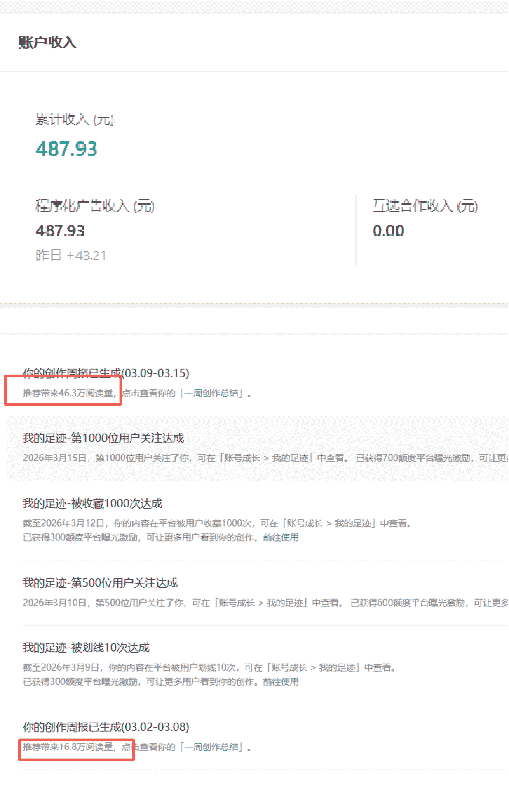

## 一、宏观局势：为什么“贴图”是 2026 年最大的流量红利？

很多人还没看懂微信的动作。微信把“图文”改成“贴图”，并且在看一看、服务号消息页疯狂给入口，本质上是微信在和“小红书”抢夺碎片化阅读的流量。

目前这个赛道正处于“野蛮生长的红利期”，它有几个极其特殊的优势，简直是为普通人量身定制的：

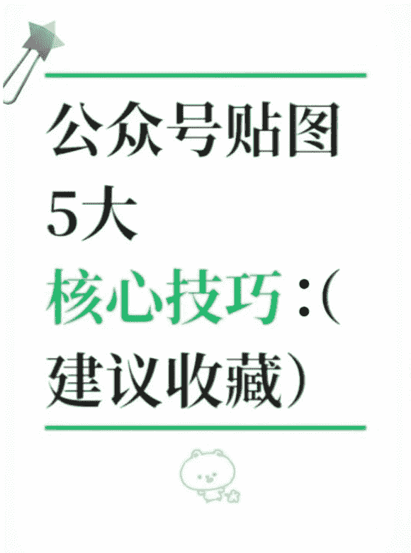

**【公众号配图文案方案】**

星梦的理想

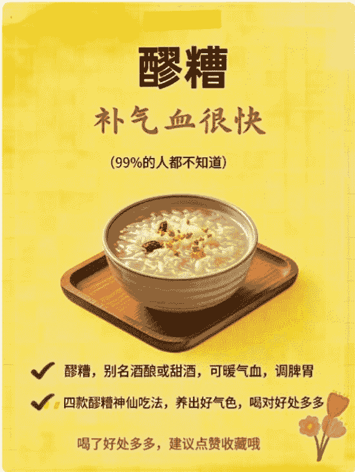

吃出营养和健康
靠自己♡

心之归宿 2025

**服务号**

**贴图**

豆包万能指令·修改要求就能使用

去有光的地方 ing

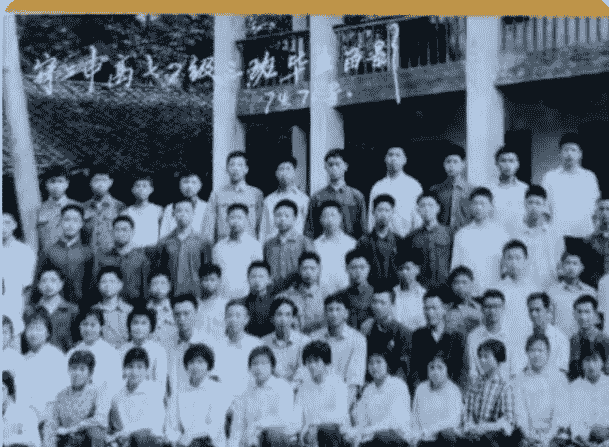

祝我的学生们一切安好！

蓝海知音的自述

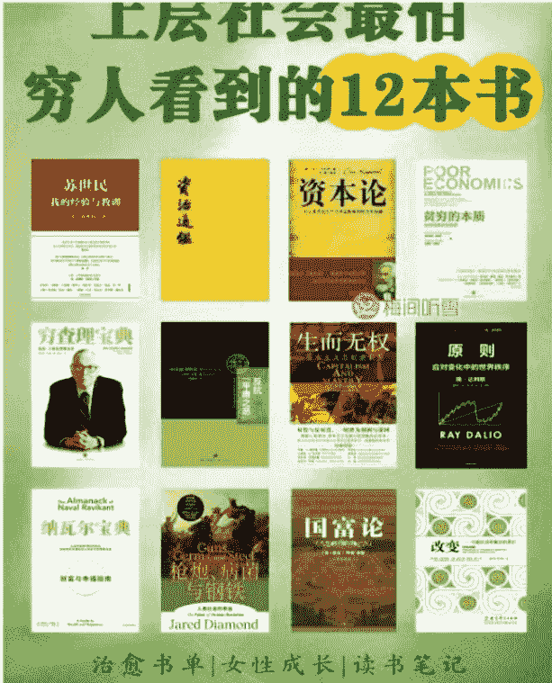

这 12 本书将是你跨越阶层
的开始🔑认知觉醒

32💰03-110 陈林♡

梅间听雪

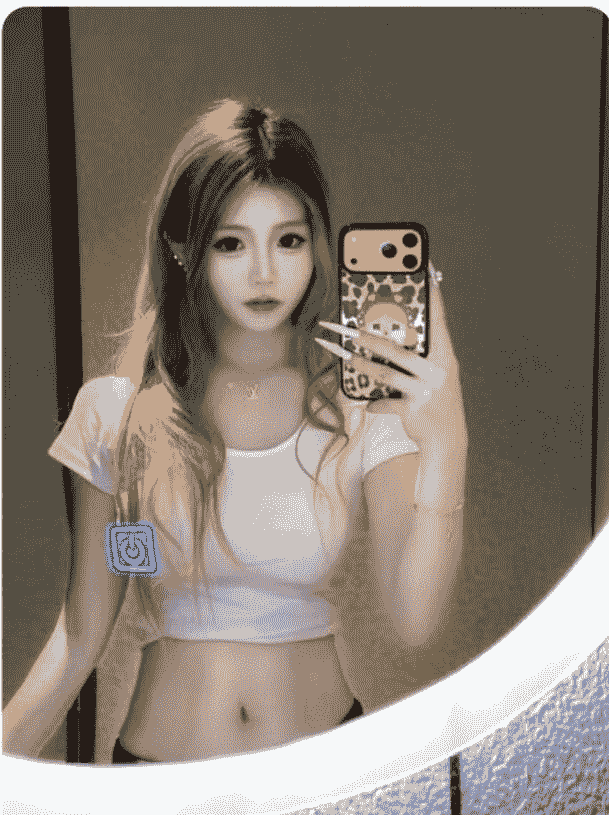

分享图片

茹茹小宝贝

深圳 今年怎么了？

朋友发表

麦子的流量手记

### 1. 巨头未入场，普通人的黄金窗口

目前，大型 MCN 机构和矩阵号玩家并没有大规模入场。为什么？因为贴图目前的单价收益（留言区广告，四条评论激发）相对有限，满足不了大机构动辄几十号人的团队开销。

但这恰恰给了我们普通创作者绝佳的生存空间！没有专业的自动化和内容团队和你卷，你只需要一部手机就能入局。

### 2. 原创要求极低，同质化容忍度极高

现在的贴图生态，对内容的原创度要求远没有长图文那么苛刻。

你完全可以把小红书上的爆款素材，通过简单的“二创”和搬运，直接在微信里实现“跨平台降维打击”。平台现阶段需要的是海量的内容来填充这个新版块，所以对“洗稿”、“搬运”处于睁一只眼闭一只眼的状态。

当然这里所说的，二创，搬运是相对而言的，我们针对于图片做了一层边框滤镜加工处理，针对文案直接采用，或者豆包 ai 稍作改写。

### 3. 独特的“信息茧房”与内容壁垒

在小红书，算法是相对开放的，一个爆款可以迅速破圈，所有人都能看到。这就导致一个赛道一旦火了，无数机构和 MCN 就会像闻到血腥味的鲨鱼一样扑上来，迅速把门槛拉高。

但在微信里，推荐机制是基于你的社交关系链和极度垂直的画像标签的。

我讲个真实的例子。我有个做“中老年养生偏方”矩阵号的朋友。他每天发的内容是什么？“一把花椒加生姜，湿气全跑光”、“每天踮脚十分钟，活到九十九”。配图全是大红大绿的粗糙字体，加上一些不知名的草药图片。

如果你是个一二线的白领，你这辈子在微信里都刷不到他的内容。你会觉得这种东西太扯淡了。

但在下沉市场，在那些四五十岁、有健康焦虑但缺乏医疗常识的中老年人群体里，这些内容就是“神仙秘籍”。他们不仅看，还会疯狂地转发到家族群、点赞、留言。

比如，针对中老年人的“养生偏方”赛道，或者针对下沉市场的“情感语录”赛道，如果你不是这个受众群体，你根本在微信里刷不到这些内容。

而且因为算法的封闭性，他的同行根本发现不了他，他就在那个属于他的“信息茧房”里，安安静静地收割。

这就是微信贴图最可怕的地方。它允许你找到一个极其隐秘的角落，服务一群特定的人，然后建立起一道别人看不见的护城河。

这种相对封闭的算法，形成了一道天然的内容壁垒。很多闷声发大财的细分赛道，外人根本看不见，这就极大地减少了跟风和内卷。

## 二、赛道选择：做离钱最近的细分领域

不要做宏大的主题，一定要细分到人群和痛点。赛道选错了，流量再大也变不了现。

### 1. 结合业务与离钱近的领域

如果你本身有产品或服务，直接做相关赛道。比如减脂减肥、国学、职场规划、学科资料、闲鱼电商等。

这些赛道天然带有“求知”和“解决问题”的属性，后端的变现路径非常清晰。

避坑指南：千万别碰平台严打的灰黑产（如玄学、劣质祛痘等），以及自然流量跑不动的重度内卷行业（这类通常需要花钱投流）。

### 2. 结合优势与兴趣

你擅长的领域，可能就是跟你的身份、兴趣、职业相关的。比如历史地理、讲故事、聊家庭。兴趣是你坚持下去的唯一动力，不感兴趣的领域，你连找素材都会觉得痛苦。

小时候经常挖，却不知道它还能吃呀!

阅读 3.7 万 天津 2025 年 12 月 24 日 13:13

留言 51

写留言

### 3. 极致细分（核心秘诀）

不要做“美食”，要做“适合上班族的 10 分钟快手菜”；不要做“育儿”，要做“让挑食宝宝爱吃饭的营养辅食”。

主题细分 + 人群细分 = 精准的高净值流量。

#### 极简生活，一个月 2000 生活费，根本用不完

不点外卖自己下厨，一周食材 100 元搞定；旧衣循环穿，省下千元置装费：步行 + 公交出行，交通费几乎为零。原来极简不是凑合，而是把钱花在真正热爱的事上。每月 2000 元，竟能存下一半工资，这种掌控生活的感觉太爽了!##极简生活省钱攻略 #极简消费习惯 #极简主义生活方式 #省钱小妙招分享 #如何合理规划开销 #掌控生活的秘诀

醉梦看花开

1 人喜欢

阅读 7.2 万 江西 2 月 2 日 12:03

留言 87

- ### 3. 扔掉花里胡哨的衣服

30 岁之后越来越喜欢黑白灰，饱和度低的色系。款式上更看重面料和剪裁。因为发现越简单越耐看，越有质感越经得起时间考验。

- ### 4. 扔掉工作内耗

不再要求自己做的完美。打工而已不必上头。做好职责范围内的事，不管闲事不瞎打听。

- ### 5. 扔掉复杂的关系

年龄越大，朋友越来越少，留下的几个都是能交心的。不会再费心维持“表面”的人际关系。

👋我是悦安，我正在过一种简单的生活。
🔘关注我，让身体和心灵都不再有负担。

白悦安

喜欢作者

收录于 🗂️ 极简生活

作者提示：个人观点，仅供参考

阅读 2.4 万 湖南 2025 年 12 月 31 日 11:01

+ 关注 191 294 61 19

### 4. 大流量赛道方向

目前在影视剧评赛道，比如说最近热火的一些热播影视剧，还有最近的时事热点，娱乐明星这一类一直都是流量的重灾区，流量数据非常庞大，这个可以用短视频和小红书图文做内容的逻辑，来去确定赛道领域方向，去做大流量爆款话题，主要的目的就是薅平台流量。

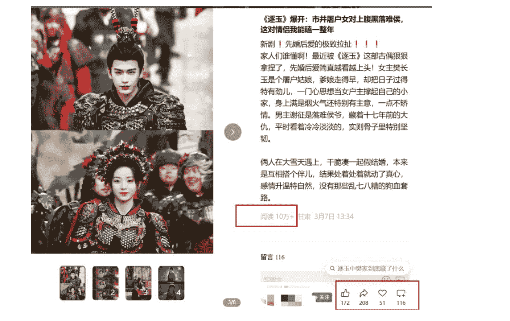

## 三、流量打法：如何利用“自然流”建立爆款素材库？

不要自己闭门造车，去小红书找已经被验证过的爆款。我们的核心逻辑是：通过系统推荐查找内容，将小红书的高热度内容搬运到公众号。

说到怎么做内容，很多人第一反应是“我不会原创”。

如果你现在做贴图还在苦哈哈地憋原创，那我只能说你太老实了。这个阶段的微信贴图，本质上就是一个“跨平台的信息差套利”游戏。

小红书上已经被验证过几百遍的爆款，你把它搬到微信里，换个背景，改动一下文案的语序，它大概率还会再爆一次。为什么？因为人性是相通的，但在不同平台上的用户群体是有重叠也有差异的。

我看到很多所谓的大 V 在痛斥这种行为，说这是抄袭，是劣币驱逐良币。

商业的早期，哪一个不是野蛮生长的？平台现在缺内容，它需要海量的贴图来培养用户的阅读习惯，所以它对“搬运”和“轻度二创”的容忍度极高。等平台生态成熟了，它自然会开始收紧规则、打击搬运。

但那是以后。作为普通人，你现在要做的，就是在规则允许的边缘，最大化地获取流量红利。

不要有道德洁癖。你去小红书搜“职场沟通技巧”，找到那些点赞过万的图文。把它的核心观点提炼出来，用你自己的话再说一遍，配上几张用 Canva 或者醒图随便套个模板做出来的图，这就叫你的“原创”。

核心不是你创造了什么新知识，而是你重新包装了旧知识，并把它分发到了一个新的流量池里。

### 第一步：训练小红书算法（深度行为）

以“女性成长”为例，在小红书搜索“女性成长”。不要只看一眼就划走，你需要进行“深度行为”：

- **深度阅读**：图文停留 10 秒以上，视频播放 30 秒以上。
- **深度互动**：点赞、收藏、截图、保存图片、看评论区。

在每个关键词下至少阅读 20 篇笔记，让系统彻底打上你的兴趣标签。

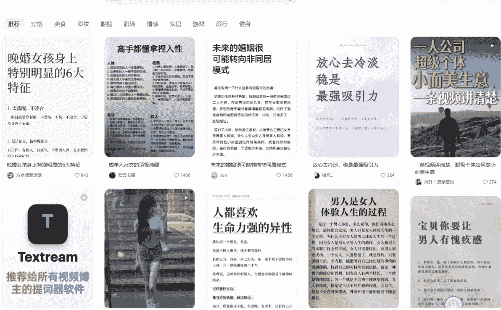

### 第二步：挖掘“低粉爆款”

返回发现页刷新，系统会疯狂给你推同行的爆款笔记。重点关注那些粉丝量很低，但某篇笔记点赞极高的账号。大 V 的爆款可能是靠粉丝基数堆起来的，但小号的爆款，绝对是因为选题和内容本身击中了人性！这就是你要搬运和二创的顶级素材。

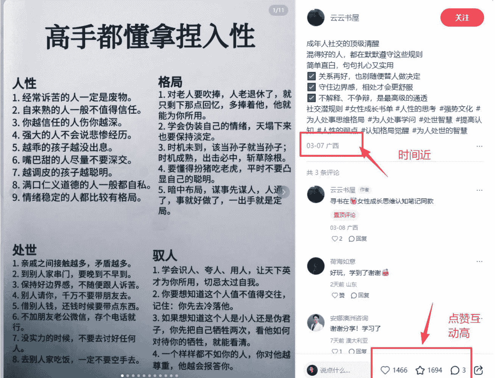

## 四、内容制作：3 分钟一条的“流水线”工程

贴图能不能爆，90% 取决于封面和标题。在这个碎片化时代，没有人会透过你糟糕的封面去了解你优秀的灵魂。

### 1. 封面的“五大铁律”

- 字数要少，直击痛点。
- 标题要简单，不要绕弯子。
- 关键词明确（如：搞钱、减脂、搞定男人）。
- 颜色凸显，高饱和度，字体要大。
- 一张图展示完全，看完标题就知道内容是什么。

实操：找到小红书的爆款图，用无损去水印工具处理，换个背景板，套用它的爆款文案结构。

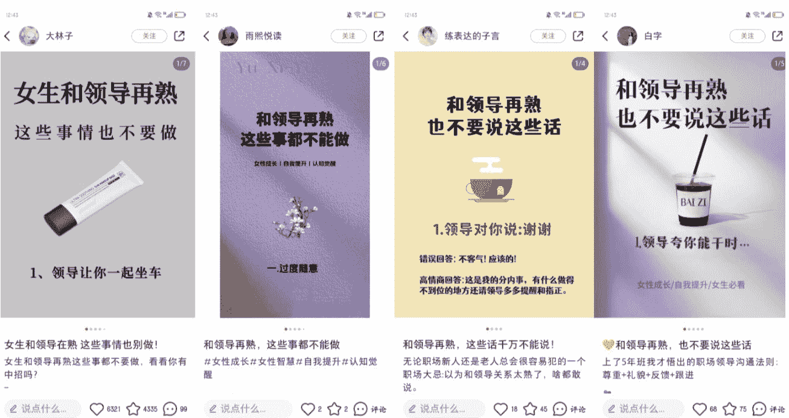

### 2. 标题的“人性公式”

标题必须包含这些要素之一：性、金钱、权利、反差、悬念、对比、数字锚点。

- 换形容词：把“聪明的女人”换成“高情商的女人”。
- 换谓语：“高情商的女人，从不因为别人感到焦虑” -> “高情商的女人，懂得断舍离”。
- 蹭流量：减肥蹭贾玲，养生蹭倪海厦。自带流量的关键词，能让你的曝光率翻倍。

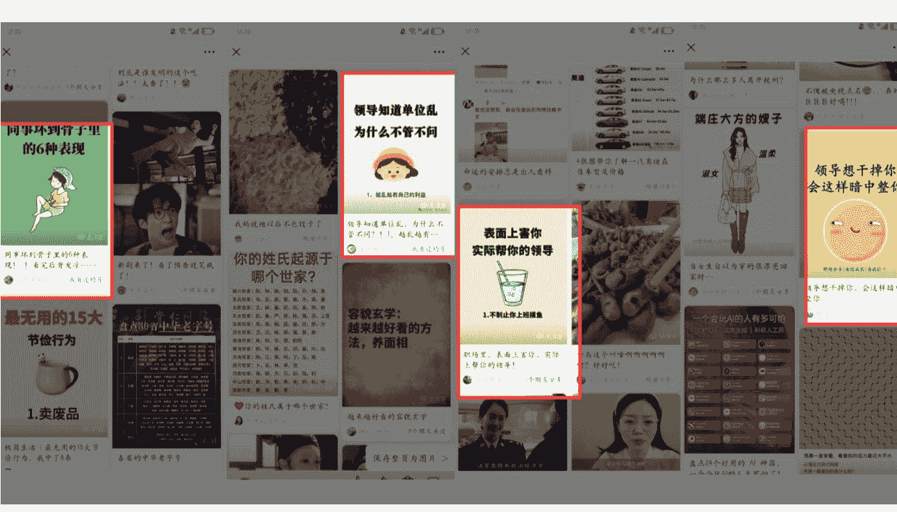

### 3. 文案与发布设置（决定收益的关键）

- 正文不需要长篇大论，3-5 句话即可。但一定要提供一点“信息增量”，比如加上你自己的真实感受、吐槽或者避坑指南。有“人味儿”的内容，读者才愿意互动。
- 结尾留钩子：用设问或开放式问题引导评论（如：“你们觉得呢？”“如果是你，你会怎么选？”）。
- 最重要的一步：发布时，点击【更多设置】，务必确保“平台推荐”和“留言功能”是打开的！不开留言，就没有底部的广告收益！

#### 赛道参考

##### 职场赛道：

##### 旅游赛道：

##### 美食赛道：

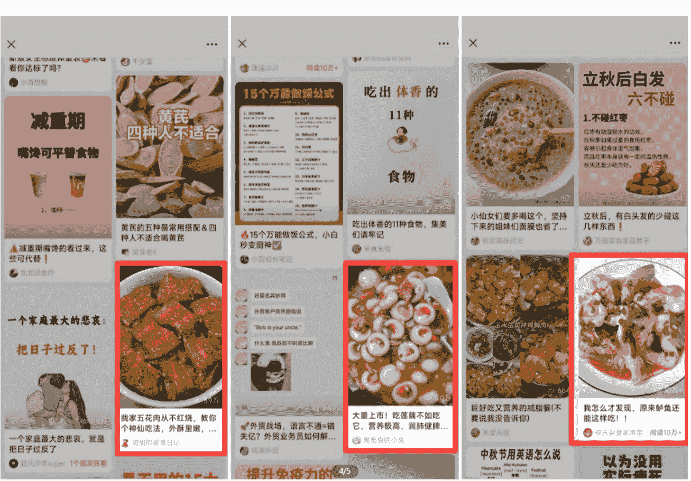

##### 女性气运：

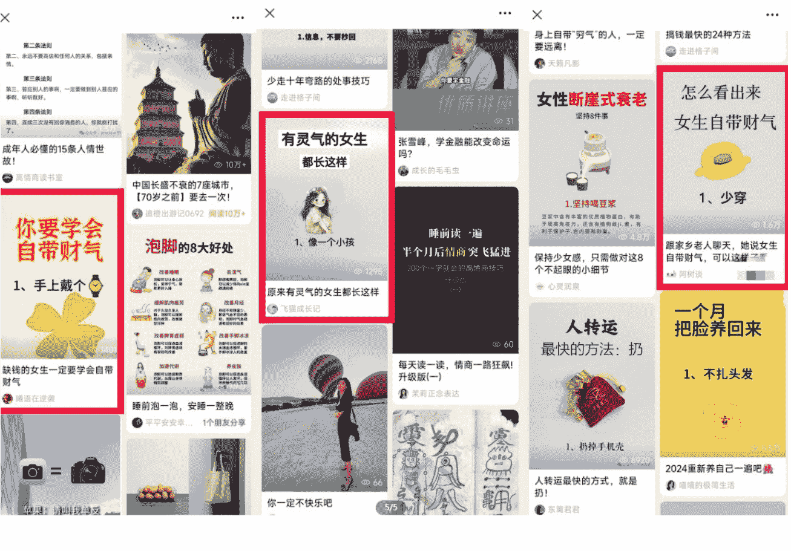

## 五、拆解一个案例

说实话，前段时间我们内部跑通了一个测试，我们当时盯上了一个极度下沉、甚至在年轻人看来有点矫情和年代感的赛道——“老年情书”与“岁月来信”。这个文案你说它有没有很过的地方？其实也没有，就是一些追忆青春、抚慰大半辈子辛劳的暖心话，或者以同龄人的口吻写一封“致渐渐老去的我们”的信。但是，当文章底部的“打赏”按钮出现之后，人性的匮乏感就开始暴露无遗。

当一个排版简单的图文一天就收了小几百打赏的时候，我们确实有点被整蒙了。即便在测试结束准备注销账号的前一秒，大家还是有点不舍得，因为这钱来得实在太容易了。

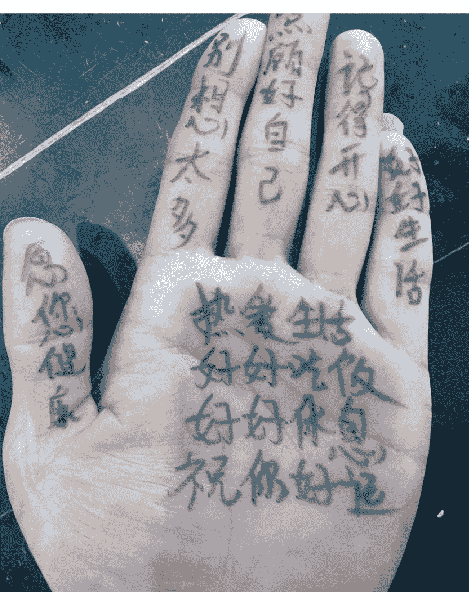

再忙也要记得心疼自己，累了就歇一歇，别硬撑，开心最重要。

五十岁以后最大的清醒
不再为任何人委屈自己
身体好世界才属于你
心态好快乐才是你的
冷暖自知，累了就歇一歇

一切皆不完美，人生总有缺憾#生活小确幸#人

> “谢谢您给我的鼓励”

> 喜欢作者

> 4 人喜欢

阅读 1.0 万 江苏 3 月 9 日 17:19

留言 200

写留言

白军英 浙江 3 月 18 日

> 感恩遇见，感谢老师关心，照顾好自己，我爱自己🙏🙏🙏🙏🙏🙏🙏❤️❤️❤️❤️❤️❤️

世荣 四川 3 月 18 日

> 哇手掌心上的祝福※我都收下了！感恩师傅的指点迷津！谢谢！感恩有你！！！

### 亲爱的宝，对不起，我错了，我欺骗了你，我对你撒谎了

2020 年 3 月 6 日 05:58 广东 45 人

> 这句“对不起”我憋了很久。错了就是错了，我不找借口，也不甩锅。撒谎那一刻也许是怕你生气，可后来才明白，谎话最伤的不是事，是信任。你可以怪我、骂我，我都认。只求你给我一个改的机会，我用行动把你失去的安全感一点点补回来。感情里最贵的不是承诺，是说错后敢认、认错后真改。

阅读 1288

> 没事的没事的真没事谢谢你的陪伴，谢谢你的关心和大爱谢谢你一路来的保护和关怀，有你的陪伴我喜欢亲爱的，真的没事是的我们放开一点就好了不用计较什么知道了吗

> 这还得人面前认错很坦率真诚错了就改

> 宝，事过去不翻篇，好好爱自己，保重自己，活在当下，祝你马年大吉万事如愿！。❤️❤️❤️❤️❤️❤️❤️❤️🌹🌹🌹🌹🌹🌹🌹🌹🧧🧧🧧🧧🧧🧧🧧🧧

> 你没有错，错的是我，你要好好生活，照顾好自己

一开始，我们根本没想过做私域引流，也没搞什么复杂的商业闭环，就单纯地想测试一下微信图文笔记（小绿书）的“打赏”功能。结果呢？当我们真正把脚迈进这条河里，才发现水底下的世界有多么疯狂。

我们原以为自己是发现了新大陆的哥伦布，但一搜才发现，这个隐秘的角落里，早就盘踞着无数个闷声发大财的同行矩阵号。

恭喜靳东！首摘白玉兰视帝，感言真诚动人

> “从业三十多年，第一次拿电视剧最佳男主！”靳东在第 30 届白玉兰奖上哽咽致辞。

靳东凭《西北岁月》中革命家角色斩获最佳男主角，这是他首次捧起视帝奖

> 6 人喜欢

阅读 7002 广东 2 月 27 日 19:42

留言 396

写留言

韩喜玲 河南 3 月 4 日 回复 6👍

> 晚上好！恭喜靳东获得白玉兰奖。靳东获得成功多种奖励。靳东是凭着自己坚持不懈的努力。靳东靠自己创作好视频的能力。祝靳东新年快乐！万事如意。工作一帆风顺。事业蒸蒸日上。一切都很好。开心快乐每一天。时间不早了。您早点休息吧。晚安！棒👍👍👍👍👍👍👌👌👌👌👌👌

善良 黑龙江 3 月 5 日 回复 4👍

> 你好东先生您、祝贺你、🙏🙏🙏❤️

女神妈妈 北京 3 月 4 日 回复 5👍

> 恭喜阳光帅气，才华横溢，最好最优秀的老师，你太优秀了，你真是一个大智慧优秀人才，恭喜你获得白玉兰大奖你获奖真的不容易，都是经历过很艰苦，努力奋斗而获得，老师非常优秀，人品好，演技超人，智慧更是聪明过人，能文能武，样样精通，高人一等 🔍 靳东说过的最经典的话 老师自豪和骄傲走到今天，付出的努力获得成

这里是敏敏 + 关注 1 个朋友关注

775 64 705 396

#### 为什么绝大多数人根本不知道这回事？

因为它的入口藏得太深、太隐晦了。如果你不是一个极度焦虑、深夜在微信里搜索“转运”、“还阴债”或者“菩萨保佑”的边缘用户，如果不是算法把你死死地打上了“易感人群”的标签，你这辈子都不会在你的信息流里刷到这些内容。这就是我前面说的“信息茧房”的终极形态。

而当我们扒开这层茧房，看到的是什么？是赤裸裸的人性提款机。

那些图文笔记粗糙得令人发指。一张 AI 生成的泛黄老照片、一辆二八大杠自行车，或者一杯冒着热气的清茶，配上一段“致 50 后/60 后的你：这辈子为了儿女辛苦了，余生请好好心疼自己”的 AI 洗稿文案。就这种放在一二线城市白领群里会被当成废话甚至笑话的内容，底下的打赏数据却让人头皮发麻。

不是一块两块，而是几十、上百，甚至有人直接拉满打赏上限。

你能想象吗？一篇从作图到文案全靠 AI 生成、成本不到一毛钱、耗时不超过三分钟的煽情图文，靠着收割那些迷茫的、孤独的、极度渴望被理解和看见的老年人群体，单篇就能拿到几百上千的纯利润。没有售后，没有发货，这是真正意义上的“零本万利”。

但资本和平台的嗅觉永远比普通人敏锐。当这种“赛博赛钱箱”开始疯狂吸金，甚至引发了灰产的狂欢时，微信的铁拳砸下来了。

最近的政策你们应该也看到了，简直是精准的“定向爆破”：

第一，新号别想玩了，必须注册满三个月以上才能开通打赏功能，直接掐断了批量起号的源头；**第二，打赏门槛被大幅度拉高，各种风控机制全部上线；**

**第三，也是最狠的——秋后算账。** 先前那些靠玄学祝福、靠煽动极端情绪、以及专门针对老年人孤独感进行“打赏收割”的矩阵号，迎来了史无前例的大清洗。无数个日入斗金的账号在一夜之间灰飞烟灭，全部永久封禁，连申诉的入口都没有。

很多同行在群里哀嚎，说赛道死了，红利没了。

但我看着那些被封的账号，心里只有一个念头：**别去心疼那些被封的号，去敬畏那些被验证过的人性。**

**平台封杀的是“煽情打赏”这个违规的壳，但它能封杀掉老年人深夜的孤独吗？能封杀掉他们无处诉说的委屈和对陪伴的渴望吗？**

**根本不可能。**

情绪的缺口永远都在，痛点永远都在。这波封号潮，只是把那些吃相太难看、踩了红线的人踢出了局。对于真正懂流量、懂人性的玩家来说，这反而是一次清场。

刻意煽情要打赏不能碰了，那“中老年心理疏导”能不能做？“岁月故事会”能不能做？直接打赏被封了，那通过免费送电子版《怀旧金曲合集》把人洗到私域，卖几十块钱的“岁月怀旧日历”、“中老年养生听书机”或者定制的“回忆录相册”，是不是一条更安全、更长久的变现路径？

## 流量的尽头是情绪，商业的本质是填补匮乏。

放下一个人最好的方式
感情的散场
就像两个人一起走到了路的分叉口
不必责怪谁改变了方向
只是脚下的路不同了

放下心里的那个人
不是你不再想他了
痴情的人一旦清醒
脚步是留不住的
爱或许还没消失
只是骄傲让自己到此为止

自己已经尽力了
没有保留退路
该给出的诚意
你都给了
所以遗憾的不该是你

故事总都会有结局
这次就安静地走吧
泥泞与沧桑
都将留在身后

而你收拾好自己
往前走的路

依依 Ease
“ 感谢你，成为我世界里温柔的微光 ”

喜欢作者
4 人喜欢

阅读 10 万 + 广东 2025 年 12 月 27 日 21:38 已修改

留言 146

当你看到别人被封号而感到恐慌时，你应该看到的是：在这个隐秘的下沉市场里，有着多么庞大、多么饥渴、多么愿意为“情绪价值”买单的人群。

不要去对抗平台的规则，但一定要去吃透规则背后的那群人。这，才能真正让你在这个圈子里活下去，并且活得很好。

## 六、全链路变现矩阵与未来机会

如果说做贴图就为了赚评论区广告收益的话，那这个如果没有大爆款，其实它的收益是微乎其微的，但是如果能够通过贴图加垂直小号和电商带货，这一整个全流程能够全部打通，那它带来的收益和价值就比较可观。

通过贴图做涨粉，有精准的粉丝的用户，通过贴图的流量来做内容的曝光，或者是做一个特定的垂直赛道来贡献优质内容或者差异化内容，我觉得也是一种思路和方式。

私域变现，引流于无形，因为无人关心，无人在意。

我看到一个做虚拟赛道的案例。

怎么做的？

她的贴图内容全是“某某名校历年真题易错点汇总”、“小学数学三年级下册核心知识点导图”。文章最后留一句话:“完整版高清 PDF,关注回复【资料】领取。”

就这一个动作，把公域的精准宝妈粉，全部洗到了她的个人微信里。

到了私域，那就不是几毛钱的生意了。卖实体教辅资料，一单利润几十；卖线上辅导课程，一单几百；甚至做付费的家长陪伴社群，一年收个几千块。

贴图只是个钩子，私域才是你的鱼塘。

当你还在为一篇贴图有没有人点赞而焦虑时，别人已经在思考这个点赞背后的人，到底有什么痛点，我能卖给他什么产品。这就是认知的降维打击。

很多人对微信里的图文笔记（小绿书）和视频号有一种致命的刻板偏见——“这不都是中老年人看的东西吗？太土了，根本没商业价值。”

如果你这么想，那你注定接不住这波红利。

你眼里的“老龄化、下沉市场”，在懂行的人眼里，是全网最后一块拥有极高粘性、极强信任度、且有充足支付能力的流量处女地。他们有闲、有积蓄（退休金）、且对微信有着天然的依赖。更重要的是，微信生态的变现逻辑，早就从单一的流量分成，进化成了多维度的商业闭环：

1.  前端：流量主变现（赚零花钱）

只要满 100 粉丝开通流量主，文章评论区就会自带广告。这是最基础的收益，核心在于通过争议性话题或提问，拉高评论区的互动率，从而提高广告曝光和点击。

2.  中端：带货与卖书（赚快钱）

不要以为贴图只能卖几块钱的便宜货。结合微信视频号的流量大爆发，图文和短视频正在形成极强的电商矩阵。

比如你做养生或居家赛道，一篇贴图分享“春季祛湿小妙招”，可以直接在文章里插入视频号小店的商品卡片，卖几十上百的泡脚包、养生茶。为什么转化率出奇的高？

因为微信生态的底层逻辑是“社交与信任”，用户在微信环境内下单的防备心，远低于其他纯电商平台。借着视频号算法现在的极速推流，一篇爆款图文配合视频号带货，单日爆单的利润也十分惊人。

### 3. 后端：导流私域（赚大钱，做长期主义）

把公域（视频号、看一看、搜一搜）的爆款贴图流量，通过巧妙的钩子（如：“关注回复【资料】，送你一份内部减脂食谱/定制岁月相册”），源源不断地洗到个人微信或企业微信里。

一旦进入私域，你就从一个“发帖的账号”，变成了一个“有温度的 IP"。

微信私域生态的恐怖价值，在于它的“免费且无限次的精准触达”。通过朋友圈的长期价值输出、社群的氛围烘托、甚至一对一的私聊问候，你与用户之间建立的是极强的信任羁绊。

这时候，你卖的就不再是 9 块 9 的电子书或几十块的辅食工具了。你可以卖几千块的高阶陪伴营、一对一的心理/情感咨询、客单价极高的滋补品，甚至招募代理做分销。在私域 IP 的加持下，一个精准粉丝的终身价值，远超你在公域里薅到的 10000 个阅读量。

## 总结来说：

不要再用傲慢的眼光去看待那些看似“土味”或“年代感”的内容。流量的尽头是私域，私域的尽头是 IP 和信任。

当视频号的公域流量池彻底向图文打开，这套“前端爆款引流 + 中端小店变现 + 后端私域 IP 收网”的组合拳，才是当下最稳固、最暴利的商业模式。

## 避雷点

但是，看懂了商业模式是一回事，能不能安稳把钱赚到口袋里又是另一回事。

### ⚠️ 避坑雷点一：在平台红线边缘疯狂试探（合规问题）

微信生态的封控力度是全网最严的，没有之一。特别是针对中老年群体，平台极度反感“割韭菜”行为。

-   医疗养生类：绝对不能出现“包治百病”、“降三高”、“祖传秘方”等绝对化医疗承诺，哪怕是擦边暗示也不行，轻则限流，重则永久封号。

-   诱导行为：文章里千万不要出现赤裸裸的“点击关注”、“转发到相亲群”、“不转不是中国人”这种强制诱导分享的文案。现在系统的 OCR（文字识别）和语义分析极其强大，一旦判定诱导，直接封禁流量主和打赏功能。

### ⚠️ 避坑雷点二：私域变现吃相太难看 (透支信任)

很多人把人加到微信后，第一天发问候，第二天就开始疯狂群发商品链接、刷屏朋友圈卖货。这是大忌!

中老年人加你，是因为你的内容给他们提供了“情绪价值”，他们把你当成了一个“懂他们的小友”或者“有智慧的老师”。如果你立刻暴露微商嘴脸，他们会产生极强的被欺骗感，不仅会拉黑你，还会反手一个举报。

正确做法：刚加上的前一周，只做人设输出 (发发生活日常、早安问候、有价值的免费干货)，先建立信任，再通过朋友圈的点赞互动，顺水推舟地进行软性转化。

### ⚠️ 避坑雷点三：无视售后，导致小店评分崩盘 (电商死穴)

如果你结合视频号小店带货，一定要注意中老年群体的特殊性。他们很多人不懂怎么发起退款，不懂怎么查物流，一旦遇到问题，他们最直接的反应就是——向微信官方投诉。

如果你的客服回复慢，或者产品质量差导致退款纠纷多，你的小店 DSR(店铺评分) 会迅速暴跌。在微信的电商规则里，评分一旦跌破及格线，直接停止推流、限制提现，甚至清退店铺。卖给这个群体的货，质量必须过关，客服必须极度耐心。

### ⚠️ 避坑雷点四：纯 AI 无脑搬运，毫无“人味”(IP 大忌)

现在很多人用 AI 批量生成文案和图片，一天发几十篇。短期内可能能撞上几个爆款，但长期来看，这种毫无“人味”的账号根本做不起私域 IP。

中老年人虽然容易被感动，但他们不傻，那种干巴巴的机器生成文案，看多了也会免疫。AI 只能作为提高效率的工具（比如帮你润色句子、生成配图），但核心的“痛点洞察”和“情感注入”，必须由你自己来把控。没有真实人设的账号，粉丝再多也只是一具空壳，毫无后端变现价值。

记住一句话：在这个赛道，慢就是快。用做公域的野心去搞流量，用做私域的良心去交付价值。

## 写在最后：执行力才是唯一的护城河

做自媒体，特别是抓住像“微信贴图”这种转瞬即逝的红利，你需要的不是什么高深莫测的理论，而是极度的务实和粗暴的执行力。

放下你那点可怜的自尊心和对“高质量”的执念。去研究那些让你觉得“这也能火？”的内容，去拆解他们的标题，去模仿他们的情绪，去小红书的泥潭里打滚，把那些沾着泥巴但闪闪发光的金币捡起来，扔进微信的流量池里。

说实话，我当时最开始是有点看不起这个图文笔记的，我觉得不过如此、

但是等我做了小红书之后，我才能够真正意识到图文笔记的价值，也因此我错过了上一次，也就是去年小绿书通过流量主就能够变现的情形，那时候的图文笔记底下是有流量主广告的、

我们当时也做到过单号，一个月能够做到 2k~3k，就是在暴力的搬运小红书的笔记到公众号去发内容，然后就有大量的流量，并且爆款。（这个持续周期半年左右，之后就只有评论区广告了）。

2026 年了，别再做那个在岸上指点江山、评判别人姿势好不好看的看客了。跳下去，哪怕姿势再难看，先游到对岸，把钱揣进兜里再说。

我是辰风，一个只谈商业价值，但真心希望你能赚到钱的自媒体人。

最后，见帖欢喜，一起生财有术。

分割线

看完这篇 SOP，你觉得你懂了。但 90% 的人一到实操就会卡在第一步。

工具和教程只是最低级的壁垒，真正的壁垒是“立刻动手”和“圈层信息差”。

如果你想看全网最新的变现玩法，并且和一群执行力极强的极客一起下场拿结果，欢迎围观我的核心私域:【懒人专属群】。

我们不聊虚的，只做商业闭环的拆解与 AI 效率的压榨。系统内已沉淀 1000+ 跑通的套利实战局。

👉 查阅圈子完整数字资产与上车门槛:

https://lazyso.com/insider/

认同价值、准备好下场干活的，扫码加我微信（lazyhelper1）

![二维码图片]

![二维码图片]

备注：【实操上车】，不闲聊