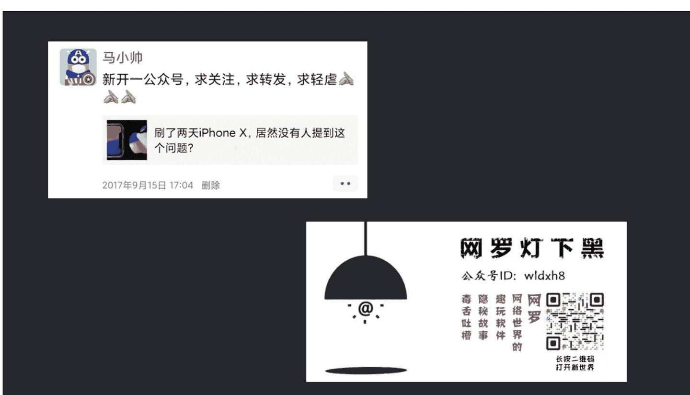
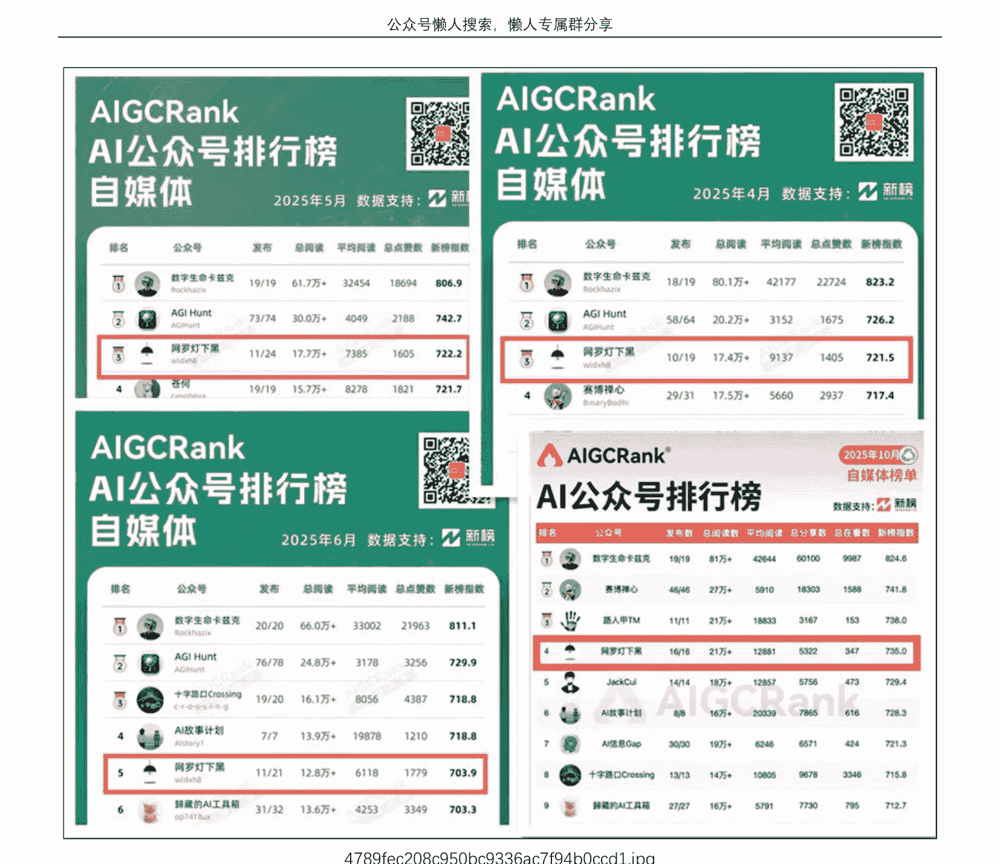
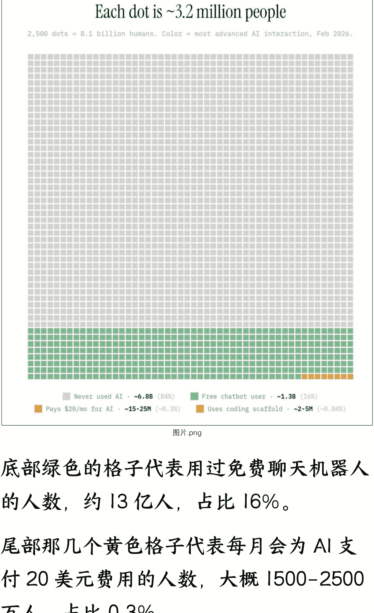
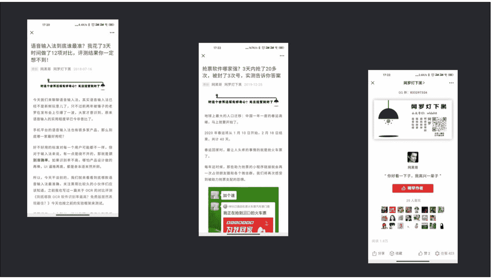
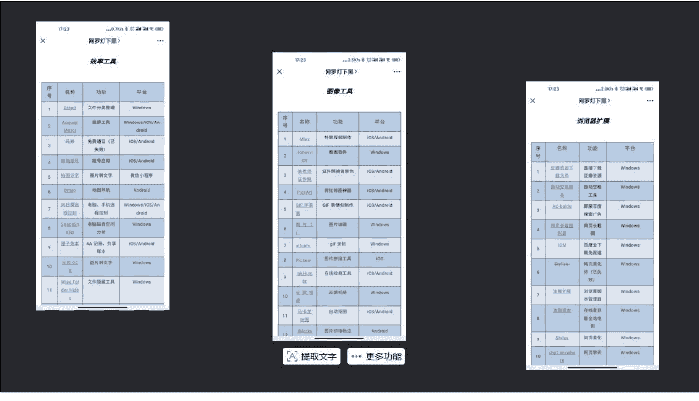
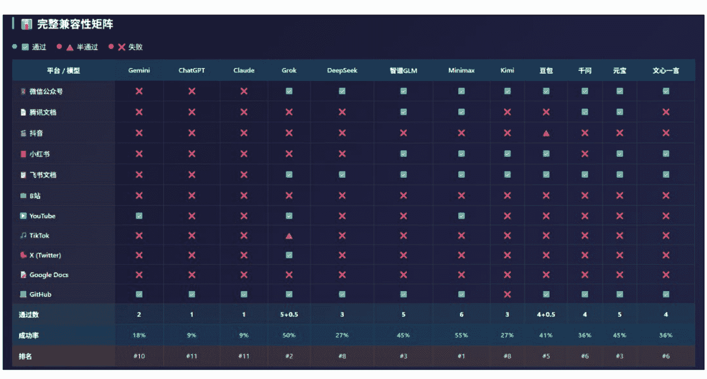
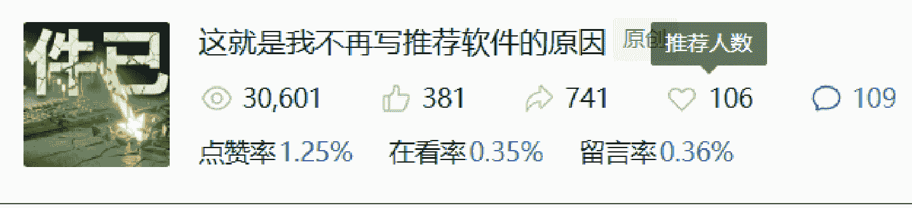
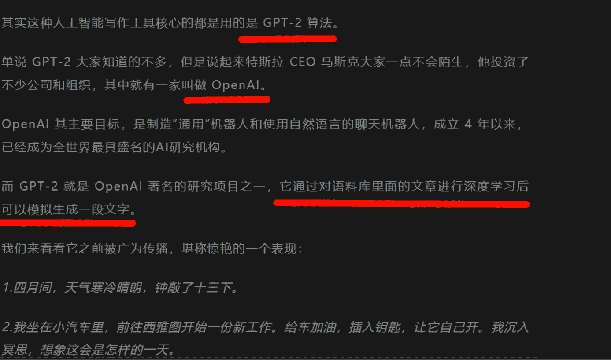
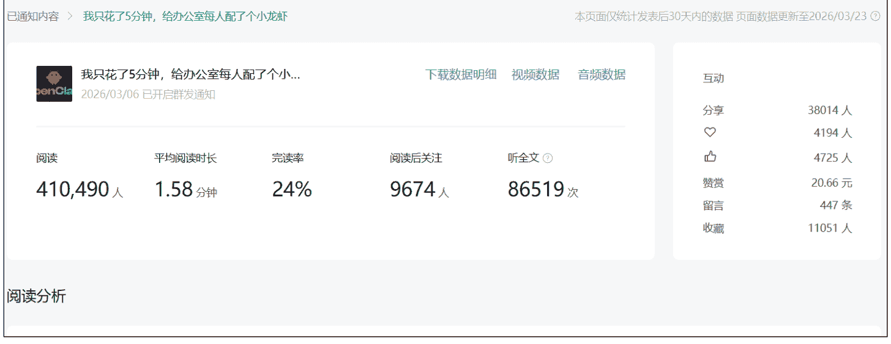

# 持续穿越周期，我做 AI 自媒体的 3 点心得
## ——一个头部 KOL 的十年真实复盘

260327 副业 SC 精华

整理：公众号懒人搜索，懒人专属群精选

懒人微信：lazyhelper1

作者：马小帅

大家好！我是微信公众号网罗灯下黑的创始人，粉丝们都叫我黑哥。

很惭愧，在生财发帖比较少，今天受邀跟生财的小伙伴们聊聊我做自媒体的 10 年心路历程。

在正式开始之前，先简单介绍一下我自己。我目前就职于河南的一所高校，担任学校新媒体工作的负责老师。在此之前，2016 年以前，我在某党报担任新媒体部的产品经理，参与过全国两会的报道工作。也正是因为 在 期间接触微信公众号比较早，当时就负责微信部的内容编辑工作。

那个时候工作很忙，但心里一直有一个念头——我想开一个属于自己的公众号。

后来，2016 年从报社辞职，回到了家乡南阳，进入高校工作。高校的节奏相对从容，时间也多了起来，那个藏在心里的念头，终于有机会落地。于是，2017 年 9 月 15 日，我正式开设了一个微信公众号，名字叫——“网罗灯下黑”。

这个名字，我想解释一句。灯下黑，是说那些就在眼前、却偏偏被我们忽视的东西。而这，恰好就是这个账号一直以来想做的事情——把那些你天天用、却不知道还可以用得更好的工具和方法，翻出来讲给大家听。

屏幕上这张截图，是当年留下的记录。到今天，这个账号已经快走过十个年头了。在 AI 这个赛道里，目前排名稳定在前十左右，有时候能进前五。大家可以看一下我这里的几张排名截图。某种程度上，算是称得上一句头部 KOL 了。

今天，我想用差不多一个小时的时间，围绕三个核心主题，和大家做一次完整的分享：

- 第一，从零起号：结合真实需求，切入细分赛道的实操拆解
- 第二，穿越周期：为什么打造个人 IP 与品味，是你最核心的护城河
- 第三，效率突围：用原创提示词复刻个人文风的高效 SOP

这三件事，是我做了快十年自媒体，走过弯路、穿越过低谷之后，觉得真正重要的事情。不是方法论的堆砌，是真实的复盘。希望对大家有实质性的帮助。

## 第一部分：从零起号
### 结合真实需求，切入细分赛道的实操拆解

### 1. 先说一个现实：AI 自媒体，为什么反而越来越难做？

在讲如何起号之前，我想先说一个很多人没有想清楚的问题。

很多人问我：现在 AI 那么火，做 AI 自媒体是不是很容易？

我的答案是：恰恰相反。

为什么？因为门槛降低了，竞争反而更激烈了。AI 能写文章，这件事人人都知道，也人人都在用。那问题来了——当大家都在用 AI 批量生产内容的时候，你凭什么让用户选择你？

我觉得是这样，你的内容要同时满足三个条件：对用户有价值、对广告主有吸引力、对你自己负责任。三方缺一不可。

所以，真正写出来的东西，还是要有你自己的人的印记在里面。AI 可以帮你写作，但 AI 替代不了你的判断、你的经历、你的视角，和你对用户真实需求的感知。

AI 时代，内容生产的门槛降低了，但内容质量的标准反而提高了。这是这个时代最大的悖论，也是最大的机会。

那机会在哪里呢？

我给大家一组数据。

底部绿色的格子代表用过免费聊天机器人的人数，约 13 亿人，占比 16%。

尾部那几个黄色格子代表每月会为 AI 支付 20 美元费用的人数，大概 1500-2500 万人，占比 0.3%。

最后那个红色格子代表用过代码生成类工具的人，比如 Claude Code 或者 Cursor 这样的产品，占比仅有 0.04%。

剩下的 84%，也就是 68 亿人，从来没有用过 AI。

这意味着什么？意味着 AI 的普及，仍然是一个非常漫长的过程。虽然我们每天被各种 AI 信息轰炸，感觉好像人人都在用 AI，但实际上这项技术向更广泛人群的真正下沉，还需要很长的时间。而在这个过程中，需要有人扮演"翻译者"和"向导"的角色，把复杂的技术用普通人能理解的语言讲出来，一层一层地向外传递、向下传递。

这，就是 AI 自媒体最大的机会所在。

所以我今天想说的，不是如何快速赚钱，而是如何做一个有价值、有内容、能够穿越周期的 AI 自媒体。当你把内容做好了，当你的人设建立起来，用户对你的信任建立起来，打开率会上来，阅读量会上来，涨粉会上来，甲方随之就找上门来了。这确实是一个水到渠成的过程，但前提是，你要在前期耐得住寂寞。

### 2. 起号的底层逻辑：替用户做一件他们没时间做的苦差事

好，说回我自己的故事，说说这个账号当年是怎么做起来的。

我一直以来对数码科技产品有着很深的兴趣，多年积累让我对科技产品比较敏感。当年微信、QQ 新用户排行里，我都是名列前茅的那种人。就是对这一块，一直以来都保持着持续不断的关注。所以当时间充裕之后，开这样一个账号，对我来说顺理成章。

但账号开了，写什么？

这是一个真正的问题。

那个年代，移动互联网正在蓬勃生长，工具和信息的供给量是爆炸式的。当内容供给达到一定量，如何筛选，反而成了用户最大的痛点。

### 我想到了一个方向：你真的会用你的手机吗？市面上同类产品那么多，哪一款才是真正最适合你的？

这是每个人或多或少都有的需求，但大多数人没有时间一个一个去测试。那这件事——我来替大家做。

于是，在账号起步阶段，我开始做一种"堪称论文级别的评测内容"。

举个例子:OCR 识别率测评。

怎么做的？先选定一张图片，然后把这张图片分别喂给市面上所有主流的 OCR 工具进行识别，识别完成之后，再把每一家识别出来的结果与原始文本逐字比对，计算准确率，最终得出一个排名。

听起来简单，但实际操作中你会发现，Word 自带的文本比对功能、各种代码工具，全都没法满足这个需求——因为它们的逻辑是，一行字符里不管错了几个字，就只算作一处错误，但这样是没有办法体现字符级别的精准度差异的。我们想要的是：这家识别了 100 个字，错了几个字，准确率是多少？另一家识别了同样 100 个字，错了几个字？两家对比，谁更准？

这个问题在操作的时候发现，没有任何现成的工具能满足需求。最后，只能全程手动计算，一个字一个字地对。

又比如：语音输入法准确率测评。

这个测评做起来同样不简单。除了基础的识别率之外，我们还加入了方言识别的测试数据，同时还考察了各家输入法在是否规范大小写、是否自动添加空格、标点符号的自动补全等排版维度上的表现，并进行加权计分，最终得出一套尽量贴近真实使用场景的综合评测数据。

类似这样的评测，做起来确实辛苦，每一篇都像在做一篇正式的论文。但每一次发出去，数据都非常好。

那个时候做过一个对比测试：一篇 10 万 + 的普通文章，大概能带来 2000 个新粉丝；而我的文章阅读量大多在 1 万左右，按理说差了一个数量级，但却能带来将近 1000 个精准粉丝。因为在这个垂直领域内，愿意看完我这篇 3000 字评测的用户，都是真正有这个需求的人。精准，比数量更值钱。

同时，我也会把这些内容同步发到知乎，当时知乎上这类评测内容的流量也很不错，两个平台互相导流，完成了早期用户积累的基本盘。

内容即积累，积累即护城河。早期你投入的每一分真诚，都会在未来某个时刻，以你意想不到的方式回报给你。

### 3. 同样的方法论，放在今天依然成立

讲了起号的故事，有人可能会说：这都是七八年前的事了，放在今天的 AI 时代还管用吗？

我来给你讲一个最近刚做完的案例，告诉你这套逻辑到今天依然没有过时。

现在我们用各种大模型处理文档时，经常遇到一个头疼的问题——同一个链接，在 A 模型里能读，在 B 模型里能处理的链接，到了 C 模型里又失效了。作为普通用户，每次遇到这个情况都只能靠猜，猜对了省时间，猜错了就得一个一个试。

我查了很多资料，翻了很多文档，发现市面上根本没有一份权威的基准测试，系统地告诉用户:哪个大模型，能读哪些类型的链接，读取成功率是多少。

既然没有，那还是我们自己来做。

一开始，我想着这是 AI 时代，就用 AI Agent 来跑这个测试。当时用的是 OpenClaw，用 Playwright 去模拟人类使用浏览器的操作，把链接一条一条地喂给各个 Chatbot 对话框，让它们分别去总结，然后比对总结的质量。

听起来很完美，设想得也很好。

但实际操作中，这个测试整整花了 5 天时间，前后跑了六七轮，每一轮都遭遇了完全不同的问题:

第一轮：模型没有建立内容基准。我们让它去测试各个大模型能不能正确总结链接里的内容，但问题是，AI 判断"总结得对不对"这件事本身就是不可靠的——每个链接它都说自己能总结，但总结出来的内容有些简直是风马牛不相及。这就是大模型的幻觉，它自己都觉得它说得对。

第二轮：跑到测试进行到一半的时候，模型突然来了一句——"这个时间不早了，剩下的我来预估一下吧”。好家伙，自己给自己省力气了。

第三轮：尝试换成无头浏览器，绕过一些检测机制，依然不行。

第四轮、第五轮……每一轮都有新的问题冒出来。总之，前前后后跑了六七轮，没有一轮能给出一个 100% 可供验证的测试结果。

最终，还是回到了原点——手动测。

4 家国内大模型、8 家国外大模型，总共 12 个大模型；11 条不同类型的链接。12 乘以 11，一共完成了 132 次内容总结测试，全部手动完成，每一次都逐字确认总结质量，最终生成一张清晰的对比表格，告诉大家哪些模型可以读哪些链接，哪些不能读。

图片.png

这个选题，其实没有什么高深的技巧，无非是做起来比较辛苦。但它解决的是所有人每天都会真实碰到的问题。发出去之后，点赞和转发的数据都很好，因为大家看得出来这份认真。

图片.png

从司空见惯的日常需求里，找到别人还没有下手的切入点——这才是做内容最难、也最核心的能力。

### 4. 选题从哪里来？从你自己的真实生活里来

说到这里，我想重点说一件事：选题，永远比写作更重要。

很多人想做 AI 自媒体，第一个问题就是“我写什么”。然后开始到处找热点，看别人写什么，跟着写什么。这条路，走不长。

首先，热点根本跟不上。AI 这个领域特别喜欢夜里爆出来大新闻，等你第二天起来准备写，可能已经是第三波跟风了，你的内容没有任何增量，就是在给别人做嫁衣。

更重要的是，你跟着别人写，你的内容里就没有“你”了。

我自己写的文章，80% 以上都是来自我真实的生活和工作需求。

图片.png

比如，我给我女儿做了一个 AI 有声广播，把整个制作过程写出来；

比如，我用钉钉新版做了一个自动语音打卡的工作流，把开发思路和实现过程写出来；

比如，我发现大模型读取外部链接存在盲区，就手动跑了 132 次测试，把结论整理出来......

这些选题，没有一个是我"为了写而写"硬凑出来的，全部都是工作和生活中真实遇到的需求，先自己动手用 AI 去解决，解决完了之后，再把整个过程写出来。

这样写出来的东西，有细节，有温度，有只有亲历者才能表达出来的那种真实感。读者感受得到这种真实感，这种真实感是任何纯粹 AI 生成的内容都替代不了的。

我建议大家也这样做——先从解决自己眼前的真实需求开始。

- 你是做工程造价的？那就让 AI 帮你做预算，把整个操作流程和踩过的坑写出来，这种内容流量特别精准；
- 你是做文秘工作的？那就把让 AI 帮你自动格式化公文的过程写出来——字号多少、字体什么、行距多少，给 AI 一个模板，让它自动排好，你把这件事实现了、写出来，每个要写公文的人都会搜到你这篇文章；
- 你是做 HR 的？就把用 AI 批量筛简历的操作过程写出来......

这些看起来很小的需求，但每天要做这件事的人，每个人都遇到过。你不需要专门去创造一个需求，你眼前的工作和生活里，处处都是选题。

### 5. 关于赛道选择：切口越小，挖得越深

说完选题来源，我想单独讲一下赛道选择的问题，因为很多刚起号的人都会在这里走弯路。

现在说"AI 自媒体"，其实是一个非常大的泛概念，这个赛道里可以细分的方向多得是：专门做视频生成的，专门做 AI 绘图的，专门做 AI 音乐的，专门做 AI 写作优化的，专门做 AI 办公效率的，甚至专门教人用 AI 写公文、写论文......每一个细分方向，都能支撑起一个垂直账号。

而且你在小红书、抖音上也能看到，很多做得很好的账号，人家就是只做垂直这一个领域，流量非常精准，粉丝粘性非常强。

我自己的账号，一直以来都是偏“泛 AI"路线，什么热就写什么，什么新就写什么。这条路有它的优势，覆盖面广，但也有它的代价：热点根本跟不上，你要分散大量精力去追不同方向的新动态，而且很容易写着写着就没有了自己的特色。

所以，如果你是从零起号，我的建议反而是：先选一个小切口，做垂直，做精。

我在高校工作，经常跟学生聊写论文这件事。我告诉他们：你找一个特别小的切口，切口越小，你的竞争对手越少，你能挖出来的深度反而越大。

做自媒体也是同一个道理。你专门做"AI 如何帮助工程造价”，受众虽然不如泛 AI 广，但每一个看到你内容的人，都是高度精准的目标用户，他们的留存率高，互动质量高，对你的信任也更深，商业转化自然也更好。

切口越小，护城河越深。做大而全，不如做小而精。等你在小领域建立起足够的信任和口碑，再考虑扩展边界，那时候扩起来也会更稳。

## 第二部分：穿越周期
### 为什么打造个人 IP 与品味是核心护城河

### 1. 第一次变现：四个月，一万用户，飞轮开始转动

好，上半场的第二部分，我来讲一个关键节点——我是怎么在起号仅仅四个月后，就完成了第一次商业变现的。

写了四个月，账号阅读量大概能有五六千左右，同期在知乎也积累了不少粉丝。

有一天，我发现了一款叫网易有钱的产品，它当时有一个特别有意思的核心卖点：能自动同步支付宝和微信的每一笔支付记录，实现全自动记账。

就是说，你不用手动记账，每次支付完，它自动帮你同步进来。对于喜欢记账、又嫌记账麻烦的用户来说，这个功能是相当有吸引力的。

我注意到这个产品的核心差异点，恰好就是“自动同步”这四个字——这就是它和其他记账软件的分野，也就是它真正的卖点所在。

这里我想说一个很关键的能力：你在面对那么多产品的时候，能不能快速锁定一个产品的核心差异是什么，它的真正卖点在哪里，然后从这个点切入，把它当成你整篇文章的突破口。

这个能力，建立在你对大量产品有积累、有了解的基础之上，不是一天练成的，但越练越快。等你练熟了，你面对任何一个产品，都能在很短的时间内找到那个"可写的切入点"。

于是我想：既然准备写这篇文章，能不能主动去联系他们的运营，谈一单商业合作？

在那之前，我从来没有接过商单。但我鼓起勇气发了一封邮件，大意就是：我是一个科技类公众号博主，我觉得你们的产品很不错，我想聊聊合作的可能性。

没想到，对方很快就回复了。

他们说，他们的拉新成本大概是每个用户五十多块钱，他们的预算有限，给了我一个数字——大概是两三千块钱，具体记不清了，毕竟是九年前的事了。他说，你去写，帮我们完成约定的拉新指标就好。

那篇文章的阅读量其实并不算高，但最终为他们带来了相当于一万元拉新成本的新增用户。

第一次合作，非常成功。

那一刻，我心里有一种很清晰的感受：这条路，跑通了。

当时这个账号开号才四个月左右，阅读量也不算高，但就是这么一次成功的合作，给了我非常大的信心。一是基于兴趣，二是拿到了结果，有了这两个支撑，飞轮效应就出现了——你有更强的动力继续写下去，继续积累，继续成长。

能耐住寂寞，无非两个原因：热爱，和看见结果。两者有其一，便能走很远。有了这两者，飞轮自然就转起来了。

### 2. 知识星球的一次弯路：当内容变成 KPI，创作就死了

在讲穿越周期之前，我想先坦诚说一段弯路，因为我觉得这段经历对大家来说更有参考价值。

ChatGPT 兴起之后，知识星球上跟风开了很多 ChatGPT 相关的社群，大家如果有印象的话，应该记得那段时间各种知识星球社群的截图满天飞，各路博主都在开，各种价格都有。我当时也没多想，觉得这个风口不能错过，就拉起团队说，那我们也搞一个吧。

| | 知识星球名字 | 星主 | 价格 | 成员数量 | 运营天数 | 收入预估 |
|---|---|---|---|---|---|---|
| 2 | 粥左罗 • ChatGPT AI 变现圈 | 粥左罗 | 279 | 10,000 | 17 | 2,790,000 |
| 3 | ChatGPT&AI 破局俱乐部 | findyi | 198 | 8,300 | 13 | 1,643,400 |
| 4 | 玩赚 chatGPT | 老罗 | 299 | 5,100 | 25 | 1,524,900 |
| 5 | ChatGPT 掘金 | 阿枫 | 365 | 3,200 | 22 | 1,168,000 |
| 6 | ChatGPT 俱乐部 | 不会笑青年 | 199 | 4,800 | 120 | 955,200 |
| 7 | 比比和 ChatGPT 降临派 | 梓泉 | 699 | 1,300 | 20 | 908,700 |
| 8 | ChatGPT 星球 | 柒 | 299 | 2,000 | 24 | 598,000 |
| 9 | ChatGPT 研究社 | 阿猫/上海/商业能力 | 299 | 1,500 | 15 | 448,500 |
| 10 | ChatGPT 魔法书 | 网黑哥 | 268 | 1,500 | 20 | 402,000 |
| 11 | 玩赚 ChatGPT | 阿水 | 299 | 1,300 | 24 | 388,700 |
| 12 | 曾少 • ChatGPT&AI 高效学习 | 曾少贤 | 249 | 1,200 | 12 | 298,800 |
| 13 | ChatGPT 研究所 | 岳京杭 | 239 | 1,200 | 16 | 286,800 |
| 14 | ChatGPT 赚钱实战圈 | 郭拽拽 | 349 | 560 | 9 | 195,440 |
| 15 | ChatGPT 发展联盟 | 小孟 | 199 | 760 | 20 | 151,240 |
| 16 | chatgpt 赚钱研究院 | 詹伟平 | 598 | 250 | 41 | 149,500 |
| 17 | ChatGPT 基地 | 闪客 | 199 | 620 | 12 | 123,380 |
| 18 | 玩转 ChatGPT | Aufree | 199 | 550 | 7 | 109,450 |
| 19 | AI 大师训练营-ChatGPT,NewBing 等 | K-Render | 699 | 150 | 21 | 104,850 |
| 20 | ChatGPT 就这么玩 | 邓凯 | 168 | 550 | 8 | 92,400 |

### 3. 如何写出有信息增量的内容——同一个热点，你的角度在哪里？

当时卖的效果确实挺好的，一共卖了 30 多万。

但是，这意味着什么呢？这意味着我要用整整一年的时间，来完成这 30 多万的交付。

因为我是一个对粉丝比较真诚的博主，生怕亏待了粉丝，所以每天都要在星球里分享，随笔也好，干货教程也好，每天都要写。这比写公众号累太多了。

你可以想象一下，我本来还有本职工作，写公众号我能保证一周输出三篇已经很不容易了。但在星球里，每天都要有内容，你今天没东西写也要想办法写，你状态不好也要写，你灵感枯竭了也要写。

那一整年，虽然输出了很多东西，但整个过程有一种说不清楚的感觉：我是在背着 KPI 去输出。

这种感觉让我非常不舒服。因为这是第一次把钱直接赚到了粉丝身上，而不是广告主身上。广告主的钱好赚，因为甲方付钱，你交付内容，本质上是一个 B2B 的关系。但粉丝的钱不一样，你对他们是有承诺的，你要每天都给他们价值，这是一个持续的、高强度的交付。

而当你是在背着 KPI 去交付的时候，内容的质量是会下降的，你自己也感受得到。你不是因为"这件事我真的觉得很有价值想分享给大家"去写，而是因为"今天还没更新，要写一篇"去写。这两种状态写出来的东西，差别是很大的。

一年之后，我把这个星球停掉了，还是回到了继续做公众号的轨道上。

这段经历告诉我：当内容变成 KPI，创作就死了。真正能穿越周期的内容，必须是你发自内心的话，而不是你不得不说的话。量可以慢，但质不能妥协。

好，讲完弯路，我来说一个具体的内容写作方法论。

当一个热点已经刷屏了，你这时候再去写，怎么写？

很多人的做法是，把别人写过的东西重新整合一遍，换个标题发出去。这是最没用的做法，因为用户已经看过了，你给他们提供不了任何新的信息，他们打开你的文章，看了两段就关掉了。

我的做法是：一定要有信息增量。

具体怎么找信息增量？

- 第一，翻评论区。那些刷屏的热点文章，评论区里一定有大量读者提出来的问题和困惑。这些问题，就是其他文章还没有解答的地方，也就是你的切入点。你把这些问题整理出来，一一解答，你的文章就有了别人没有的信息增量。

- 第二，找没有人写到的角度。同一个产品，所有人都在讲它能做什么，那你就去讲它不能做什么；所有人都在讲它的优点，那你就去客观地说说它的局限；所有人都在写使用教程，那你就去写普通用户最容易踩的坑是什么。

- 第三，结合自己的真实体验写差异点。你实际用了这个产品，你在真实场景里遇到了什么问题，发现了什么别人没有提到过的细节，这些都是只有你才能写出来的东西，也是读者最想看到的东西。

举个例子，我去年暑假写龙虾那篇之前，市面上已经有一大批龙虾教程了。但我发现评论区里很多人在问的是：龙虾能不能帮我处理我工作里的这个具体需求？那我就把这个角度抓出来，把几个真实的工作场景拿来实测，告诉大家龙虾在这些具体场景里到底能干什么、干得怎么样，这就是信息增量。

同一个热点，信息增量是你和别人之间唯一的护城河。没有增量的跟风，只是在消耗用户对你的注意力。

### 4. 从繁荣到低谷，再到新的繁荣——这就是穿越周期的完整路径

接下来，我想比较完整地讲一下我这十年在商业化上的起伏，因为这对大家理解"穿越周期"这件事，会有比较直观的感受。

#### 第一个阶段：2017 年到 2020 年前后，第一波繁荣

账号做起来之后，商业化进展很顺利，主要收入来源是软件评测和 IT 培训的投放广告。那个时候市场上热钱非常多，IT 培训赛道百花齐放——各种 Java 培训、Python 培训……各种各样的培训机构，都在疯狂投放科技类公众号的广告。

那个年代夸张到什么程度？有些广告主会直接说：我不在乎这次投放有没有转化，我只要把你这个档期占住，让我的竞争对手投不了，我就值了。

来稿直发，链接一套，广告费到手，一个月大概能有十几万的收入。做起来很轻松，也赚得很愉快。

但我心里清楚：这条路走下去是有隐患的。因为这些广告，很多都是直接发给粉丝看的，质量参差不齐，粉丝看多了会觉得这个账号越来越没意思，打开率就会慢慢下降。这是一种饮鸩止渴的做法，短期赚到了广告费，长期消耗了用户信任。

#### 第二个阶段：2020 年到 2024 年初，漫长的低谷

果然，随着大环境的变化，热钱一夜之间消失了。培训广告不见了，疯狂投放的广告主不见了，整个自媒体行业的广告投放萎缩得非常厉害，这大家如果是从业者的话应该都有体感。以前那些铺天盖地投放的广告主，全都不见了。

那段时间，我也做了很多分散精力的事：开了一个公司，组建了编辑团队，做了 B 站的视频创作，前期做得其实也还不错，但做一期视频的时间和精力成本太高，后来也慢慢停了。整体来说，那两三年的收入就很不理想，最后把团队缩减到只留了一个助理。

但在那段时间里，有一件事我没有停，就是对 AI 的持续关注。

早在 2019 年还是 2020 年的时候，我就写过一篇关于 GPT-2 的文章。

当时 GPT-2 是 2.0 版本，它其实已经可以做一些文章生成的工作了，虽然和现在比差了很多，但你已经能从里面看到技术的雏形。而且当时它是开源的，可以跑在本地，在自己的显卡上运行，可以帮你续写文章，大概是这样一个东西。

我当时写这篇文章的时候，完全没有想到这个技术几年之后会变成大名鼎鼎的 ChatGPT，会彻底改变整个世界对 AI 的认知，会让我的账号迎来一次全新的爆发机会。

所以你看，对 AI 保持早期的、持续的关注，不是为了蹭热点，而是让你在真正的大浪来临之前，已经站在了岸边，你知道浪是什么，你知道浪从哪里来，你不会被它打倒，而是借力乘风而上。

等到 ChatGPT 出来之后，我有一种很清晰的感觉：以前我写的那些垂直软件，每一款只能解决某一个特定场景的问题；但 AI 出来了，它的可能性是会把这些软件全部替代掉的。再单纯写某一款软件，没太大意思了，该转型了。

于是我把账号方向全面转向 AI，这个过程对我来说非常自然，因为科技产品和 AI 之间本来就是一脉相承的，你原来积累的对科技产品的判断力和敏感度，在 AI 这个领域里照样用得上。

#### 第三个阶段：2024 年下半年至今，新的繁荣

转型之后，从去年上半年开始，一切又变了。

一夜之间，几乎所有的大模型公司都开始找公众号投放。去年暑假，我曾经连续写了八篇商单，一篇接一篇地连续发出去。

从去年暑假到现在，所有大模型公司、所有做 AI 应用的产品——你们听说过的，没听说过的——基本上全部都投放过来了。而且和之前 IT 培训时代那种批量铺量的打法不一样，现在 AI 广告主的投放更精准，他们更在乎你账号的用户质量，他们愿意为真正有影响力的账号支付更高的单价。

用一句话来描述就是：以前是量价齐跌，现在是量价齐升。

这就是一个穿越周期的完整过程。热钱来了又走，走了又来，行业起伏，冷暖交替。但唯一没有变的是什么？是那些一直在认真做内容的账号，每一次周期切换，都能成为第一批站稳脚跟、重新起飞的人。

内容的护城河，在热钱退潮的时候，才看得出深浅。做好内容，才是真正的长期主义。

### 5. 40 万阅读量的背后：踩中风口从来不是靠运气

说到最近，有一件事让我自己也没完全想到。

前段时间，我写了一篇阅读量达到 40 万 + 的文章，这也是我做公众号以来单篇阅读量最高的一篇。它是一个商单，合作方是扣子编程——也就是大家熟知的那只"龙虾"。

事情的起点是今年 1 月 26 日。那天我第一次看到龙虾这个东西，当天就发了一篇随笔，大意是说：明天你们一定会被龙虾刷屏，但我劝大家先别焦虑，因为它目前还有各种各样的不完善，等等等等，你现在慌着去学，意义不大，等它成熟一点再去研究不迟。

当时我说完这话，其实也没有十足的把握龙虾能持续火下去，毕竟 AI 领域每隔几周就会有一个新的爆点，很多东西火三天就没了。

但后来龙虾不仅活了下来，而且越来越火，这其实已经是它的第三次破圈了。

在之后的一周内，我又连续跟进发了几篇龙虾相关的内容，一直到扣子编程找到我，接了这个商单，把那篇文章发出去。当天到第二天就冲到了 10 万 +；到第三天、第四天，最终定格在 40 万浏览量，单篇涨粉将近 1 万。

这也是我写公众号以来阅读量最高的一篇，而且我完全没有想到一篇纯技术分享的文章能拿到那么高的阅读量。

但我想说的是：这篇文章能拿到 40 万，表面上看是踩中了风口，但实际上背后有几个关键因素。

- 第一，我在 1 月 26 日第一时间跟进，建立了早期关注者的认知；
- 第二，此后持续跟进，让账号在这个话题上积累了一定的权威感；
- 第三，接到商单之后，我没有简单地写一篇使用教程，而是围绕读者真实会问的问题——"龙虾到底能帮我做什么工作上的事"——去设计测试场景，用真实的工作需求来展示龙虾的能力。这种内容，才是真正对读者有用的，也才有大量转发和传播的动力。

踩中风口靠积累，写出共鸣靠真实。长期的积累给了你早发现风口的敏感度，真实的内容让风口来的时候借到最大的力。

### 6. 一篇精华帖的诞生：选题标准对了，结果自然就来了

说到 IP 的积累，我还想分享一个案例，就是我在生财有术上拿到精华帖的那次经历。

先说背景。我在生财其实非常不活跃，因为把大量时间都用在了写公众号上，在生财输出的内容很少，一直觉得有些惭愧。

去年某个时候，DeepSeek 发了一篇新的研究论文，展示了一些新的研究成果。同期，Grok 也发了一个新版本更新，但那消息已经是昨天的事了。

我那天刷微信，刷到了河南日报推送的一条消息。我仔细一看，这篇文章的结构很有意思——你能明显感觉到，他们其实是把整篇文章都提前写好了的，本来是要写 Grok 的，但在发布之前，他们也刷到了 DeepSeek 的新动态，于是临时把 DeepSeek 的内容提到了最前面，把标题也改成了 DeepSeek 相关的。

这说明什么？说明在那个时间节点，连传统媒体的编辑也判断：DeepSeek 的新动态，比 Grok 的更新更具有传播力，更值得放在最显眼的位置。

这就是一个很清晰的信号。我立刻决定：写 DeepSeek。

我把那篇论文扒出来，翻译了一遍，然后用 Gemini 结合我自己的一个提示词去解读了一下。整个技术层面的深度分析，我其实完全不懂，全程交给 AI 完成，我做的只是把它整理成一个读起来比较流畅、能让非技术背景的读者也看得懂的形式。

发在公众号上，同时同步到知乎，找到知乎上那个刚发出来还没多久的相关问题，把我的回答贴上去刷一波存在感。

第二天，那个知乎问题被顶上了热榜第一，我的回答成了热榜第一问题下的最高赞回答。

然后我把这整个过程复盘了一下，写了一篇帖子，起了一个很吸引人的标题：《我是如何在知乎热榜第一下拿到热赞第一的？》，发在生财上，出乎意料地拿到了精华帖。

说实话，我觉得能拿到精华帖是有点意外的。相比之下，我后来发的那篇关于文风提示词的帖子——就是那套可以复刻任意作者 90% 文风的提示词——我个人认为那个含金量其实更高，因为那是真正的方法论干货，但反响反而一般。

但这件事告诉我一个规律：你的选题标准，和平台编辑的选题标准，和用户当下最关注的焦点，三者合一的时刻，就是你踩中风口的时刻。选对了选题，剩下的事情顺理成章。选错了选题，你写得再好也是事倍功半。

## 第三部分：效率突围

用原创提示词复刻个人文风的高效 SOP

### 1. 先说写作这件事：AI 帮我解决了什么，没解决什么

好，进入下半场的第三部分，我来说效率这件事。

先说一个我自己的现状。

我现在写公众号，一周大概输出三篇。一三五各一篇，每一篇都是我主力在写的。像 AI 实测类的教程文章，一天时间写下来是比较累的，再加上我本来还有本职工作，所以三篇我已经觉得是在尽力保证质量的前提下能做到的极限了。

我的核心原则是：保质，而不是保量。

宁愿少写一篇，也不发一篇没有信息增量、没有真实价值的文章。因为每次发低质量的内容，损耗的都是用户对你的信任，而这种信任，是你花了很长时间才建立起来的。

那 AI 对我的写作效率帮助体现在哪里呢？

我来梳理一下我目前的写作流程，给大家一个清晰的 SOP 参考。

### 2. 原创提示词：复刻个人文风的底层逻辑

首先说最核心的一个工具，就是我自己原创的一套提示词——可以复刻任意一位作者 90% 以上的文风和写作风格。

这里我说说背后的逻辑。

具体的做法是这样的：把我之前写过的大量文章喂给模型，数量大概在 10 篇到 20 篇左右，文章类型要尽量多样，覆盖我不同类型的写作场景；然后让模型去分析和提炼这些文章里的写作习惯——包括我的句式偏好、段落结构、开头和结尾的惯用方式、用词风格、信息的组织逻辑……把这些提炼成一套可以反复调用的风格描述模板。

有了这个模板之后，当我下一次写文章的时候，把整理好的素材和这套提示词一起输入给模型，它生成的初稿，读起来就是我自己 的文风，不用我再去大幅修改语言风格。

而且这套方法不只是对我自己的文风有效，它可以复刻市面上任意一位作者 的文风。你喜欢某个作者的写作方式，拿到他的 10 篇文章样本，喂给模型，分析提炼，就能高度还原他的写作风格。这套提示词是通用的，是一个方法论，不是只针对我自己的特定工具。

有了这个工具之后，写作这件事对我来说变得非常轻松。它把我从"怎么把素材组织成一篇文章"这件事上解放出来，让我能把更多的精力放在真正重要的事情上，也就是选题和测试。

AI 降低了写作的门槛，但这反而把选题和测试的重要性凸显出来了。写，已经不是难点了。真正难的，是测。

### 3. 什么是好的"测"？三个维度设计一个有说服力的测试

那测，到底难在哪里？

你要设计一套测试方案，需要同时满足三个条件：

- 第一个条件：场景要真实。就是大家在日常工作和生活中真实会遇到的需求，而不是你专门构造的边缘场景。如果你测的东西普通用户根本不会碰到，那测出来的结论就没有传播价值，你的文章也就没有读者。

- 第二个条件：题目不能太简单。太简单的话，每个产品都能轻松通过，根本看不出差异，这种测试等于白做。你得设计出一个有一定难度的场景，让产品之间的差距自然显现出来。

- 第三个条件：不能为了难而难。如果你故意刁难，设计各种刁钻的边缘情况，读者会觉得这个测试不公平，甚至怀疑你在针对某个产品，这会损害你的公信力。

最理想的测试设计，是这样一种状态：这个测试场景是真实的，这个难度是合理的，而在这个场景下，不同产品的能力差异恰好能自然地呈现出来。读者看完之后的感觉，不是"这个博主在黑哪个产品"，而是"原来这些产品之间真的有这么大的差别，我之前都不知道，我明天就去试试"。

这种设计，才是真正费脑子的地方。

我来用那个 132 次手动测试的案例来说明一下，为什么 AI 做不了这件事，为什么只能手动。

那个测试的核心难点在于，你要判断一个大模型总结某个链接的结果，到底是"真的能读，读出来了"，还是"读不了，但它在编"。

这个判断，对 AI 来说是非常困难的，因为 AI 自己也有幻觉，它有时候无法分辨"内容相关但不准确"和"完全是在编"之间的区别。而人类去看，五秒钟就知道这个总结是真的读出来了，还是在胡说。

所以那个测试，哪怕前期设计得再完善，最后落地执行的时候，还是只有手动才能保证结果的可靠性。

设计测试方案的思路，才是这件事里真正需要人脑去做的部分。一个好的测试设计，能让结论自然浮现；一个差的测试设计，做了半天什么也说明不了。

### 4. 一篇 AI 商单文章的完整 SOP

好，把我目前写一篇 AI 商单文章的完整流程梳理一下，给大家一个可以参考的 SOP。

#### 第一步：选题判断——这个产品值不值得写？

接到一个产品邀约之后，我首先要判断三件事：

- 这个产品有没有值得写的差异点，它和同类产品之间的核心区别是什么？
- 这个差异点对我的读者有没有真实的价值，他们会不会真的用到这个功能？
- 我能不能设计出一个测试场景，让这个差异点清晰地展示出来？

如果这三个问题都能正面回答，我才会接这个单子。不是所有的商单都值得接，你接了一篇读者完全不感兴趣的广告，打开率低、转化差，广告主不满意，读者也在掉，两头不讨好。

#### 第二步：设计测试方案——怎么测才能说明问题？

这是整个流程里最费脑子的一步，也是最重要的一步。

想清楚这篇文章的核心论点是什么，也就是你最终要告诉读者的那一个结论是什么；然后围绕这个结论，反推设计一套测试场景，让测试的过程能自然地引出这个结论。

测试场景要来自真实需求，难度要合理，要能体现产品之间的差异，同时要让读者产生"我也想试试"的冲动。

#### 第三步：执行测试，整理素材——这是最耗时间的一步。

测的过程中，把每一个有意思的发现都记录下来，包括那些意料之外的结果。这些往往是文章中最有价值的内容——因为意料之外的发现，才是读者没有想到过的信息增量。

如果是软件测试，结果比较清晰，能干就是能干，不能干就是不能干；但如果是 AI 能力的测试，情况就复杂很多，因为 AI 的输出质量是有随机性的，你得多跑几次，确认结果的稳定性，才能下结论。

#### 第四步：套入提示词，生成初稿。

把整理好的素材，加上我在测试过程中形成的判断和思考，一起输入文风提示词系统，生成初稿。

这一步通常很快，因为素材准备充分的情况下，模型生成初稿的质量是比较高的，结构也基本是对的。

#### 第五步：修改打磨，加入人的温度——这是不能省的最后一步。

AI 生成的初稿，结构通常没问题，逻辑也说得通，但缺少那种真实的、有温度的细节。

这一步，我会把自己在测试过程中真实遇到的细节、意外的发现、当时的心理活动，手动加进去。

比如那个 132 次手动测试，我会在文章里写到：我一开始是想用 AI Agent 来跑的，结果跑了六七轮都失败了，每一轮失败的原因都不一样，最搞笑的一次是模型自己说"时间不早了，剩下的我来预估一下"......这些真实的过程，才是让文章有"人味儿"的东西，也是让读者相信"这个人真的做了这件事"的东西。

这就是 IP 的积累方式——不是靠更新频率，不是靠数量，而是靠每一次的认真和真实。

## 结语：所有的水到渠成，都有前期耐得住寂寞的积累

今天讲了很多，从起号讲到穿越周期，再讲到效率工具。

如果用一句话来总结：

做好内容，做好 IP，做好你能为用户提供的真实价值。然后，耐心等待水到渠成。

这个过程不会很快，但一定会来。

我做这个账号快十年了，见过热钱涌入，也见过市场萧条；做过培训广告，消耗了用户信任；开过知识星球，背着 KPI 交付；踩中过风口，也走过很多弯路。

但回头看，那些真正帮我穿越周期的，从来都不是某一次的风口，不是某一篇的爆款，不是某个时期的市场红利——而是那些沉下心来，认真测、认真写、认真对用户负责的每一篇内容，它们慢慢堆叠成了一个别人没有办法轻易复制的东西：

叫做信任。

内容可以被批量生产，文风可以被 AI 模仿，热点可以被快速跟进，但你这个人——你的判断力，你的品味，你在内容里投入的那份真诚——是无法被替代的。

这，才是你在 AI 时代做自媒体最深的护城河。

最后送给大家一句话，也是我自己最难熬的那段时期，一直告诉自己的一句话：

耐得住寂寞的底气，无非是两个字：热爱。以及一个字：做。

---

看完这篇 SOP，你觉得你懂了。但 90% 的人一到实操就会卡在第一步。

工具和教程只是最低级的壁垒，真正的壁垒是“立刻动手”和“圈层信息差”。

如果你想看全网最新的变现玩法，并且和一群执行力极强的极客一起下场拿结果，欢迎围观我的核心私域：【懒人专属群】。

我们不聊虚的，只做商业闭环的拆解与 AI 效率的压榨。系统内已沉淀 1000+ 跑通的套利实战局。

☝🏻 查阅圈子完整数字资产与上车门槛：https://lazyso.com/insider/

认同价值、准备好下场干活的，扫码加我微信（lazyhelper1）

备注：【实操上车】，不闲聊