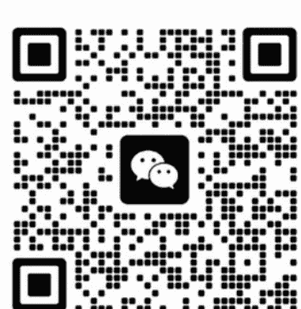

# 当你用“氛围编程”的方式开餐厅

260331

整理：公众号懒人搜索，懒人专属群精选

懒人微信：lazyhelper1

在正式开始之前，请你先想象这么一个场景。假设，你今天决定一个人去下馆子。至于为什么是一个人，可能有很多原因。也许是因为最近辛苦，你想犒劳一下自己。也许是因为心情不好，想一个人静静。又或许是你只是单纯地馋了，想去打打牙祭。总归，你决定一个人去吃饭。

于是，你找了一家当地非常火爆的餐厅，并且痛痛快快地吃了一顿。正当你心满意足，准备买单的时候，服务员突然走过来跟你说：“我们店今天有活动，您正好是第 100 位幸运顾客，今天这顿饭给您免单。”然后服务员就真的给你免单了，没有任何套路。

听到这，有人可能会说，这不就是一个再平常不过的“中彩票”的故事吗？有什么特别的吗？

别着急，真正的反转马上就要来了。假如我告诉你，你中奖这个事，是店家刻意设计的呢？而且不光是你，只要是独自来这家店用餐的客人，店家都会告诉你，“你是本店的幸运顾客，这餐免单”。

而且这家店已经这么做了七八年，就连这套话术都经历过几轮迭代。一开始店家认为一个人来吃饭有些孤单，但后来店家发现，很多客人并不孤单，只是想一个人吃饭。于是，他们又升级了话术，从“怕你孤单”变成了“你很幸运”。

注意，前面这些场景是真实存在的。这家店的名字叫，田小狗，总店位于湖南长沙。以上这些细节，全都来自零售咨询专家黄碧云老师的调研。

前面这个免单的设计，出自田小狗的创始人熊智。据说他最开始只是想提升客人的体验，就像海底捞会给独自用餐的客人对面摆一个玩偶一样。况且一个人单独去吃饭，大概率上不会花太多钱，成本也是可控的。

但是，在我看来，即便抛开用餐体验的维度，这也是个非常高明的叙事设计。没错，是叙事。

你看，叙事跟故事有什么不同？故事是，我说你听。而叙事追求的是，在你我之间建立联系，让我在你的生命中，成为一个特别的角色。

你看田小狗这个免单设计。首先，遇到这种情况，换作任何人，都会觉得自己很走运对不对？而且很多人大概率上会忍不住，发个朋友圈，或者跟周围的人说说这个事。更重要的是，在那一刻，你对这家店的感受也发生了变化。你认为它跟你特别投缘，觉得这家店“风水极佳”，它是你的“福地”，能够狠狠地“旺”你。

这就好比《鹿鼎记》里面，康熙为什么重用韦小宝？假如你仔细统计一下会发现，康熙跟韦小宝说的最多一句话，不是“你很忠心”，也不是“你很聪明”，而是“你真是我的福将”。这就是韦小宝给康熙建立的个人叙事，他让自己在康熙心里成为“福将”这个角色。

什么叫“福将”？就是不需要太多思考，我相信只要把事情交给你，就一定会有出乎意料的好结果。只要你愿意跟着我，就能给我带来好运气。

同样，回到田小狗。假如我觉得一家店能给我带来好运，我大概率会经常去，不光自己去，还带着朋友去，但凡有机会就一定去。

换句话说，田小狗用一顿饭的成本，在我的脑海里打下了一个思想钢印。“这家店能给我带来好运”。

你看，今天提起开餐厅，很多人首先想到都是，装修要独特，要请达人来探店，要在抖音上投流曝光。但是，这些都是“你展现给别人的样子”。而叙事发生在另一个维度，它不是“你本身什么样”，而是“你在顾客心里扮演着什么角色”。

从这个角度看，能做出这种设计的餐厅，也许有着一整套特别的经营方法论。接下来，我们就看看黄碧云老师带回的观察。看完之后你也许会发现，很多看似零散的做法，背后指向的是同一个目标，叫做平均感觉最大化。

什么叫平均感觉最大化？简单说，就是让所有人，都有个“不错的用餐感觉”。很多传统餐厅的思路是，怎么让 VIP 特别爽，怎么让高消费客户有面子，怎么让商务宴请显得高档。而田小狗的思路是，怎么让每个人都舒服。

比如，卖酒。对餐饮业来说，酒水是利润大头。一瓶成本几十块的酒，卖出去能赚好几倍。很多餐厅甚至会专门培训服务员推销酒水。但田小狗不鼓励客人喝酒。不是不让喝，只是不鼓励。店里当然有酒，但服务员不会主动推荐，菜单上也不会把酒水放在显眼位置。理由是，喝酒的人声调会变大，容易起冲突，会影响其他客人吃饭。

你看，这就是在避免少数人影响多数人。

再比如，田小狗没有包间。你看，包间意味着什么？意味着可以收包间费，意味着客单价更高，意味着能接待商务宴请。但田小狗全是开放式座位。不过，店里会用竹帘和木板做轻度隔断，让你不会轻易跟其他桌的客人四目相对。这是在隐私和氛围之间找平衡。

还有一个细节。店里专门设了一个泡茶台，做成灶台的样子，用夯土建造，就放在大堂里。这个泡茶台不是给客人用的，是给服务员用的。服务员可以在那泡茶、准备餐具，有自己的空间，不用尴尬地站在客人旁边，也不用离得太远，让客人叫不到人。

这是让服务员和客人都“感觉舒服”。

类似的例子还有很多。比如，田小狗原本的地砖是黑色的。黑色地砖看起来很高级，但有个问题：哪怕客人甩一滴水在地上，都会非常明显。这意味着保洁员要不停地擦地。后来，田小狗把所有黑色地砖都换掉了。

再比如，田小狗的女洗手间门口，有一排座位。很多女性客人吃完饭需要补妆，但在众人注视下掏出口红补妆，多少有点尴尬。所以田小狗在女洗手间门口设了座位，你可以坐在那，安安心心地补个妆。

再比如下雨天。店里会准备很多伞，客人可以随便拿走。这些伞不是那种几块钱的一次性伞，而是可以重复使用的。

你看，这些设计都不是什么大手笔，但每一个都在解决一个具体的不舒服。

再比如，田小狗也按照这个方式，设计了他们的员工宿舍。按照黄碧云老师的观察，他们员工宿舍的很多设施是亚朵级别的。比如，窗帘用的是静音轨道，让噪声尽可能低。墙上的插座换成了 USB 充电口，方便员工使用。他们的逻辑是，员工不仅要为顾客提供服务，他们也是餐厅最重要的“氛围组”。假如员工住的不舒服，工作中也很难让顾客舒服。

而前面这些设计，都服务于一个最高目标，让顾客的平均感觉最大化。

说到这，你可能会问，平均感觉最大化能带来什么？

- 首先，它带来的是口碑的稳定性。不是让 10% 的人疯狂推荐，而是让 90% 的人都觉得舒适，愿意再来。
- 其次，它带来的是复购的确定性。因为你知道来这里不会踩雷，不会有“这次体验特别差”的情况。你不用担心“今天会不会遇到吵闹的酒桌”，更不用担心“一个人去会不会尴尬”。
- 最后，它也降低了决策成本。你想想，当你约朋友吃饭的时候，是不是经常会纠结：万一他不喜欢喝酒怎么办？万一她想安静吃饭不想被打扰怎么办？万一带着孩子去会不会不方便？但如果在田小狗，你不需要考虑这些。因为你知道，那里不会让任何人特别难受。这种确定性，让你的决策变得简单。

说到这，我想起最近很火的一个词，叫“氛围编程”。这个词说的是，当你用 AI 写代码的时候，你不需要先想清楚每一行代码该怎么写，你只需要先把那个“感觉”说出来，AI 会帮你把感觉变成代码。换句话说，感觉先行。从这个角度看，田小狗做的，或许也是感觉先行。

他们先有一个感觉：不让任何人难受，让所有人都舒服。然后，那些具体的做法，不鼓励喝酒、换掉黑地砖、在女洗手间门口设座位，就自然生长出来了。这些做法看起来很零散，但它们都在服务同一个感觉。

而我们通常的做法是反过来的。我们会先想，我要做什么、怎么做、用什么材料、花多少钱。我们会去参考别的餐厅怎么做，会去学习行业标准，会去计算投入产出比。然后希望这些做法能带来一个好的感觉。

但田小狗告诉我们，这个过程也许可以反过来：先抓住那个感觉，然后让做法自己长出来。

———分割线———

绝大多数人只盯着眼前的工资，却不知道一次远在中东的冲突、一次降息的决议，就能在一夜之间洗牌普通人的财富。

看懂宏观，是为了在周期切换时，不被当作代价。

如果你认同这种“抬头看路”的长期主义，欢迎围观我的个人情报智库：【懒人专属群】。

圈子已稳定运行 7 年。我们每天利用 Python 爬虫与大模型算力，过滤全网最顶级的政经内参和搞钱风向标，做你最冷酷的“外部大脑”。

### 查阅圈子完整数字资产与上车门槛:

https://lazyso.com/insider/

认同价值的，扫码加我微信，备注：【进群】

微信：lazyhelper1