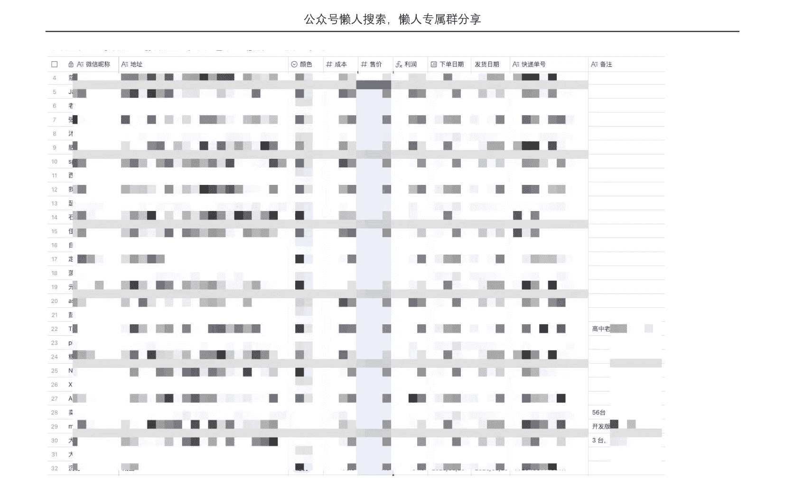
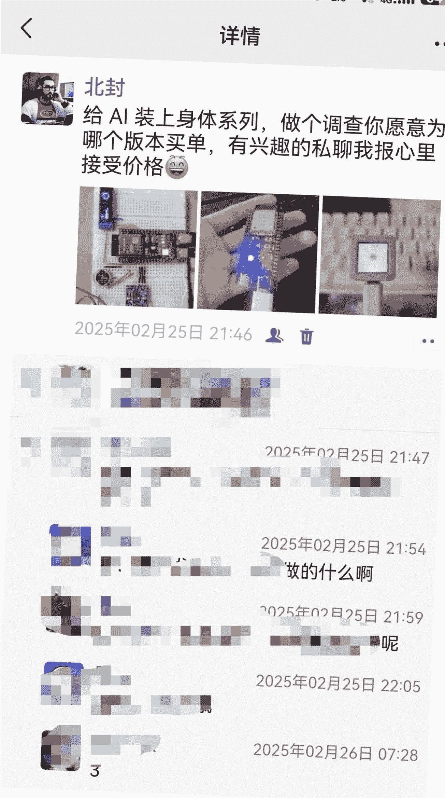
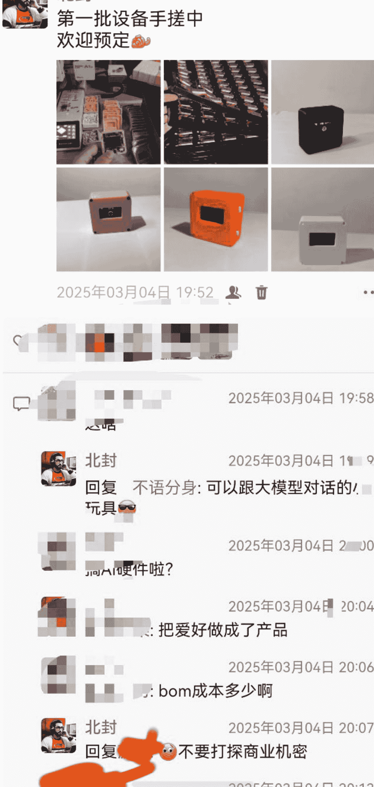
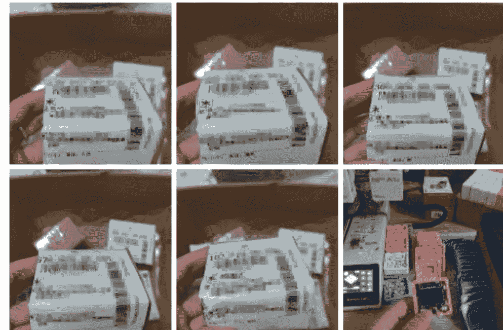
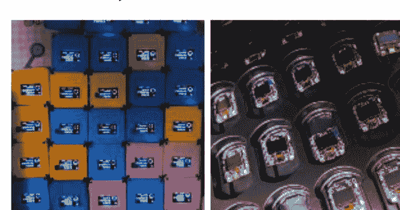
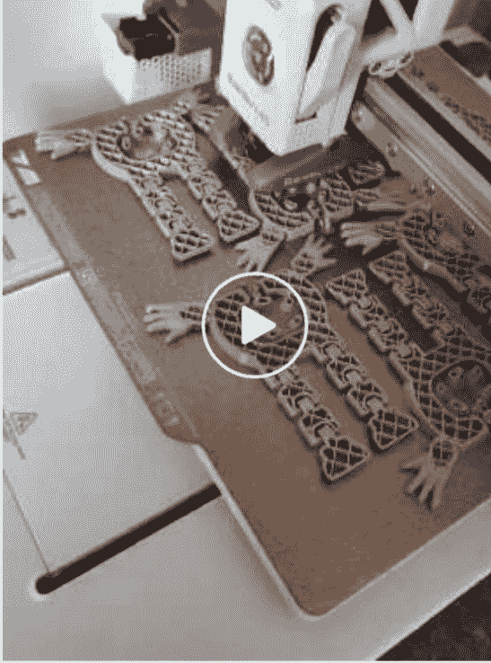
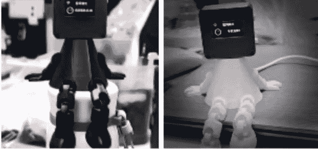
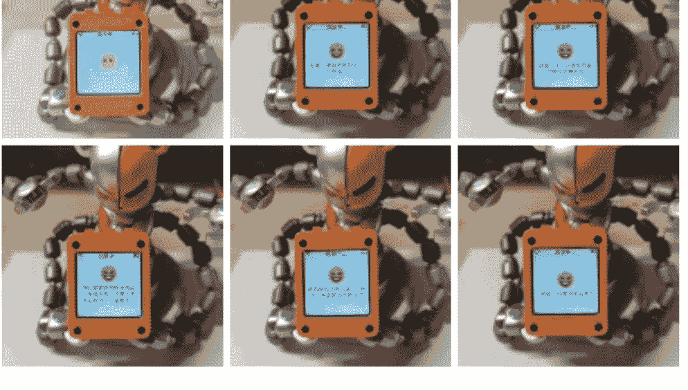
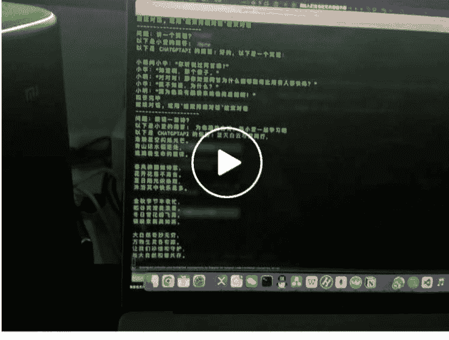
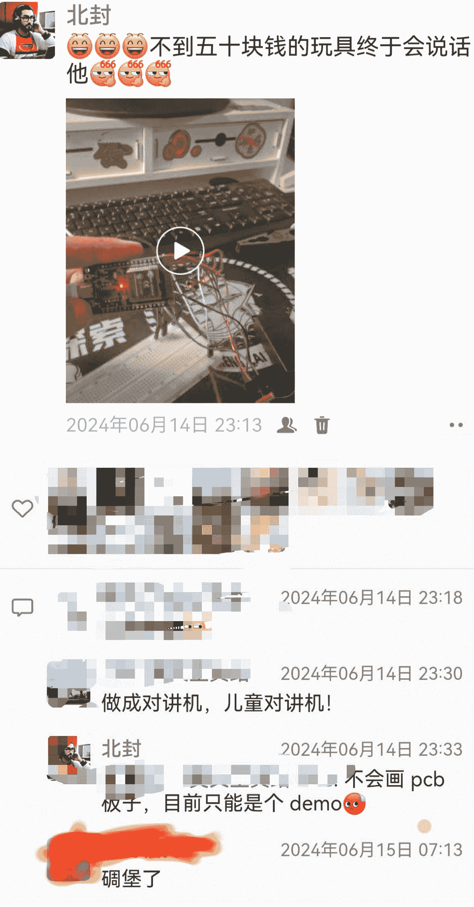

公众号懒人搜索，懒人专属群分享

# 从朋友圈到小红书，我把一个 AI 硬件小项目卖出 1W+ 的完整复盘

260331 副业 SC 精华

公众号懒人搜索，懒人专属群独享
懒人微信：lazyhelper1

## 一、初始化：我是谁，我具体卖的是什么？

大家好，我是北封，「北国风光，千里冰封」的北封。

一个码了 10 年 Java、现在教育公司做技术管理的程序员。

熟悉我的圈友可能知道，我是那个曾经被亦仁加精最快的男人。

最近翻看两年前的朋友圈，我发现有些成功路径，其实是可以反复重载的。

这次我想复盘的，就是我最近实操跑通的一个小项目：AI 硬件小项目变现。

先给非技术圈的朋友解释一下，这个 AI 硬件小项目 -「小智」到底是什么？你可以把它理解成一个装进硬件里的 AI 语音助手。它不是普通的文字聊天框，而是一个能听你说话、能和你实时对话、还能通过 MCP 协议控制设备的小机器人。它背后接的是 Qwen、DeepSeek 这一类大模型能力，前台呈现出来的，则是一个更接近真实使用场景的 AI 硬件入口。

在 AI 硬件热度起来的这波机会里，我用 20 天时间，在不囤货的前提下，跑通了 AI 聊天机器人的变现流程，累计收益 1W+。

我其实没有什么特别高明的资源，核心还是两件事：先用低成本方式验证需求，再靠执行力把每个环节快速补齐。也正因为这样，我觉得这条路径对很多圈友来说，不只是一个故事，更是一条有机会参考和复用的实操路径。

## 在这篇帖子里，你将看到：

- 如何利用朋友圈“低成本”试探真实市场需求。
- 在没有货源的情况下，如何快速与工厂达成“一件代发”。
- 小红书账号精准装修与引流私域的高转化话术。
- 核心洞察：为什么在低价卷死人的市场里，卖“场景”比卖“盒子”更赚钱。

如果你也在关注 AI 硬件售卖、私域成交，这篇复盘应该会对你有一些启发。

自从一月初调整了生财有术星球加精规则后，https://t.zsxq.com/0aaGMabhJ，我的感受是：一时加精一时爽，一直加精一直爽。

我的加精速度从周甚至月，调整到了天，甚至小时，比如刚刚一篇帖子，https://t.zsxq.com/0a9b2lns，发布十分钟后就被我加精了，这样圈友们可以更及时更高频地看到被我加精推荐阅读的内容。

加精数量上也大大提高，从原来几乎是长文，到现在风格多元，不仅仅是长文教程，也有很多鼓舞人心的案例、复盘、认知分享等，还有一些我鼓励更多人去看的可能的机会。

不过，为了避免被加精的圈友没看到一月初规则调整的通知而产生误解，我还是要再划一下重点：从 2023 年一月开始，不是所有被加精的文章都能获得一颗龙珠，区间是 1 颗龙珠碎片到 2 颗龙珠。

另外，我还要提醒一部分阅读分享的圈友，别老是动不动就在评论区要分享者的微信私下交流，评论区的讨论互动有价值的信息，也是龙珠发放数量的重要参考依据，如果真的觉得分享者内容对你有帮助，那么评论区有价值的提问和互动

## 《一条中标风向标让我两周赚了 1.3W 佣金》

关键词找对了，天时地利人和事就成功了一大半。

1.5 号早上 9 点左右发布的第一条小红书硬广文案，从 1.19 号开始就没再发新笔记了。

截止到 1.30 号总共收到私信 240+，涨粉 50；

引流到微信 186 人，成交 16 人
引流到滴滴租车 59 人，成交 5 人，赚取 200 元佣金，滴滴后来把拉新从 30 提高到了 80。

包含押金成交额 10.2W+，不含押金 5W+
累计获得佣金 13360

需求来源于自身，把自身的需求进行放大，获取信息差，赚取差价进行获利。

对于信息的敏锐度，多分析思考，尝试从不同角度分析问题，如果不发风向标、不中标这件事情就没有了。

做事情自信一点，敢于尝试和给自己争取最大的利益，如果我不去跟车行谈，估计也就赚个一两千的辛苦钱。

平时要多学习，多实践，年底最后两周的时间做这么顺手，取决于之前在社群的不断学习和积累。

执行力很重要，在过程中进行改进「比如我的报价单从最开始的文字版到有重点标记 Excel」，结果会越来越好。

https://wcmyxpl8xu.feishu.cn/docx/Sksld318uoO71sxH...

## 二、用数据说话：先看成绩

当时主要是在微信私域成交，厂家支持一件发货，所以自己维护了个发货记录了表，因为涉及到用户隐私、商品进价、商品售价不可公开信息，只能做打码处理了。

为什么我当时是引流到微信私域成交，而不是直接挂店铺？

停留几秒钟想一想。

我可以根据我的沟通成本、客户的意愿度、以及我提供的额外调试服务，灵活调整定价。

挂店铺只能打价格战，而私域卖的是“信任”和“服务”。

## 三、如何跑通：从朋友圈“最小闭环”到规模化放大

### 朋友圈试探：寻找那笔“不经意”的生意

在 2025 年 2 月初的时候，有一天我在刷朋友圈的时候关注到有个 AI 圈好友发了条朋友圈，在卖一个小盒子，竟然对接的是 ChatGPT。

我立刻点开头像，跟他私聊了解这个硬件小智 AI 聊天机器人百科全书是做什么的，什么价格。在对项目有了大概了解后，我并没有急着去进货，而是在朋友圈发了一条带目的性的“压力测试”。

### 发第一条朋友圈 - 试探需求：

给 AI 装个身体系列，做个调查，你愿意为哪个版本买单，有兴趣的私聊我报心理接受价格

这里是带有目的性的：在试探市场，也在调查用户可接受的心理价位

### 开始售卖：谈一件代发，验证可行性

当有人开始询价并且支付了以后，我立刻联系了代工厂的朋友谈好“一件代发”价格，以及批量的价格。

- 验证单：第一台设备我以高毛利成功卖出，这标志着商业路径正式跑通。
- 强化人设：我随后发了第二条朋友圈，展示设备“折腾中”的状态。这告诉潜在客户：我不是简单的二道贩子，我是懂技术的“一手源头”。

公众号懒人搜索，懒人专属群分享

### 过了几天在朋友圈发布了第二条朋友圈：

第一批设备手搓中，欢迎预定。

这条朋友圈的目的是继续强化我的人设：我不是中间随便倒货的，我手里有货源，也真的在动手折腾这个东西。

像写代码一样，用“最小闭环”跑通变现。

我的核心实操逻辑其实就是一个简单的“if-else”判断：

- Step 1：先发朋友圈低成本试探需求。
- Step 2：有人询价确认有市场。
- Step 3：带着需求去谈“一件代发”，实现零库存启动。
- Step 4：第一单高毛利成交，完成闭环验证。
- Step 5：确认生意可行，准备用小红书放大流量。

## 四、小红书放大：打造专业“引流钩子”

### 打造人设：细拆账号装修的关键模块与高转化“钩子”

先放张图看下引流效果，消息都被点过了，当时没有留存小红点 99+ 的喜悦~

在起号阶段，账号的每一个像素其实都是为了建立信任。我总结了这套必须执行到位的“装修闭环”：

- 专业四件套：准备一个看起来很懂的用户名称、专业的头像、具有说服力的背景图以及一眼就能明白价值的简介。
- 引流闭环：直接修改小红书号为微信号，这是吸引强购买力用户主动加好友的最短路径。
- 爆款公式：每天最少发 3 条内容。核心在于“钩子”的拆解：首图和标题决定点击，正文决定留存，而评论区（配合置顶或小号营造气氛）则决定最终转化。
- 组件引流：利用笔记挂载群聊组件，并设置进群欢迎语，再次引导用户进入私域微信。

这里要感谢下「Leeka」我生财路上的贵人，每次遇到什么问题总能帮我解答，这次在小红书账号装修上卡姐也给了很多建议。

### AI 协同：掌握“说人话”原则，低成本打磨全套人设素材

账号的名称、头像和背景图，其实都是我与 AI 对话打磨出来的结果。关于如何用 AI 辅助装修，我的心得只有一句话：“说人话”。

- 具体性：你给 AI 的指令越具体，它的反馈就越具体；描述模糊，答案必然宽泛。
- 实习生心态：像给实习生安排工作一样去表述指令。如果在对话过程中思路乱了，一定要重新开对话窗口，给它一个清晰、整理后的指令，这大概率就是你要的答案。
- 允许犯错：AI 会犯错，错了要不断尝试，而不是选择放弃。

### 反向引流：把同行和上下游变成资源

因为在小红书发布的笔记里，我一直在强化两个标签：我是程序员，以及我有一手货源，直接跟工厂对接。

所以慢慢地，除了普通用户之外，也吸引来了不少同行，以及一些本身就在卖小智周边产品的人主动来找我搭讪。

我主要加了 4 类同行：

- 卖电子元器件的
- PCB 抄板的
- 3D 打印的（多个朋友多条路，这里后面还有故事）
- 纯同行，来卷下线的

其实前两个可以归为一类。

我加这类好友的目的很明确：了解元器件价格，对小智整套产品的成本先建立一个基础认知。

因为这是我第一次接触这个行业，很多东西以前完全没概念，尤其是硬件相关的成本结构、采购逻辑等，基本都是知识盲区。

这时候，借助这些在行业里摸爬滚打过的人，哪怕只是"Maybe 有经验”，也能帮我快速补课。

而且这类人通常都挺愿意聊。原因很简单，大家的目标都差不多，都是奔着赚钱来的。

只要你的问题不太离谱，他们一般都会愿意解答。

对我来说，这种信息密度很高，比自己去网上零散搜资料快太多了。

纯同行的话，更简单粗暴，要么把他卷成你的下线，要么你成他的下线，看你们谁更具价格优势了，甚至还能互通有无，因为小智不止一个品类，谁知道下一个客户会喜欢哪个品类呢。

并且这类好友对市场敏感度很高，也许他的朋友圈信息会成为你下一个赚快钱的项目。

3D 打印单独拿出来说，本意是想缩减成本，因为我拿货的时候带外壳和不带外壳价格是不一样的，想自己找 3D 打印看能不能把成本降下来，跟一个做 3D 打印的老哥聊的很深，因为自己给儿子买了个嘉立创官方的不带电池的「立创·实战派 ESP32-S3」开发版，找这个老哥基于开源的 3D 后壳文件帮我重新改造了下，给立创派加装了电池。

找别人帮忙要有付费意识，这样别人才愿意跟你继续交流，大家时间都挺宝贵的，别抱着白嫖的心态去沟通。

直到到现在做 3D 打印的老哥还觉得我是做嵌入式的，2026 年 2 月份的时候收到了老哥的合作邀请，他接了个打印外壳的需求，内部需要植入可以对话的硬件设备，老哥立马想到了我，我联系了另外一个也是玩小智的时候认识的朋友做了实现，攒了个局收到了定金，目前客户在投标阶段，不确定能不能成，能成的话也是个大单。

我讲这个事，其实是想说：

在圈子里混，最重要的不是认识多少人，而是别人知不知道你能提供什么价值。

很多合作最后能不能发生，本质上还是价值交换。

所以回头看，在小红书发做生意发笔记，吸引来的不只是客户，还有一堆同行和上下游。

这些人不一定马上能给你带来订单，但能帮你更快看懂和融入这个行业。

有的人能让你知道大概成本在哪，

有的人能帮你把一些想法真正落下来，

还有的人虽然是同行，但你看他怎么发朋友圈、怎么卖、怎么报价，其实也能大概感觉到现在市场卷到什么程度了。

某种程度上，这也算一种反向引流。

本来只是想引点客户，结果顺手把同行、供应链、潜在合作方，甚至竞争对手都引过来了。

这些人加进来之后，不是说每个人都能成交，

但只要你愿意聊，愿意问，慢慢筛，很多人最后都会变成你的信息来源。

再往后走，有些人甚至会变成你的合作资源。

一开始你以为自己是在发内容找客户，后来才发现，你其实是在借内容把这个圈子里的人一点点聚到自己身边。

## 五、私域收网：25% 成交率的经营艺术

发笔记的终极目标是微信成交。

### 高效引流话术

小红书用户最懂的一句话：“你发一下地球号给我，我加你。”只要对方肯发微信号，成交就成功了一半。在这个项目中，我的私域转化率稳定在 25% 左右。

### 微信好友打标签

我的习惯是每一个好友都会打上标签，这样我在发朋友圈的时候会选择对哪些人可见，针对这个项目我单独设置了个标签分组，目的是给他们看到我的专业人设。

另一个习惯是微信备注也会单独标记下每个好友是做什么的，这样后续查找也方便

### 朋友圈经营：让信任感“活”起来

北封
今天快递已发出，感谢兄弟们的支持

预定🀄
把 deepseek 装进口袋里去旅行💌

2025 年 03 月 06 日 19:06

北封
调试中，昨天预定的今天陆续发货🤝

2025 年 03 月 10 日 12:28

2025 年 03 月 10 日 13:24

2025 年 03 月 10 日 17:05

北封

3D 打印中 欢迎预定👊

2025 年 03 月 12 日 09:00

2025 年 03 月 12 日 09:22

牛逼

2025 年 03 月 12 日 09:23

火速开单冲冲冲

朋友圈的经营跟小红书的思路大体是一样的，用户加过来基本都会去朋友圈翻一翻，让他能看到有用的信息，再次加强对你的印象，看到的多了信任度也会更高。

在朋友圈时不时的更新点项目进度，发单情况，有什么好玩的场景等等，要让朋友圈活起来。

北封

这个造型蛮可爱的 支持定制 3d 打印各种底座，欢迎有创意的你来创作

2025 年 03 月 11 日 22:17

二代升级版彩色大屏来了 發

飞了。。。炸飞了

如果你是客户看到满屏的都是小智的场景，你会不动摇吗？

### 多品类加成

我的渠道只有第一款的小智，屏幕比较小，去淘宝搜索了下，发现另一个大屏的产品，看着不粗，于是把淘宝店家的图片下载下来，直接发到朋友圈了，果然带来了几单成交，因为手里没有成品，就大胆的开价了，在淘宝店家的基础上加了 100 左右，跟店家沟通能不能一件代发，店家不做。

店家不做一件代发，这时候你会怎么办呢？

我直接用淘宝小号一个个在店铺下单的，填写的客户的收货地址和手机号码。

并且同时用淘宝大号给自己也买了一个，还加价让店家发的顺丰。

为什么要给自己也买一个呢？

咱是做生意的，赚的是信息差，但咱不是骗子，产品怎么用，客户如果遇到问题怎么解决，咱都需要门清，需要自己先把产品玩一遍，用起来，做到心理有谱，哪怕最后你再把手里的处理掉。

做生意一定要真诚，不要做一锤子买卖。

加个微信好友挺难的。

## 六、目标用户是谁？

我简单总结了下买这类 AI 产品的用户主要有下面几类

- 留学生，卖出去四五台拿着出国练习口语了
- 高中生，学校不让用手机
- 宝妈，不希望孩子用手机，但想让孩子接触新鲜事物

## 七、避坑与总结：为什么我劝你不要只卖“盒子”？

先说我为什么放弃了，国内供应链华强北强大到什么程度想必大家都清楚，我零售的时候小 3 位数。

有一天我在拼多多刷到了零售 45 元，这卷不动啊，于是就放弃了。

所以还能做吗？

单纯卖设备不建议做了，价格透明没什么利润。

但如果你卖的不是一个盒子，而是一个具体场景、一个交付结果、一个定制服务，那也许还有机会。

可以结合上面的用户群去卖服务，比如：

- 给宝妈定制专属孩子的故事机器人
  不是单纯讲故事，而是可以把孩子名字、年龄、兴趣爱好都喂进去，做成专属内容。
  今天讲恐龙，明天讲公主，后天讲刷牙洗脸不磨蹭，家长是愿意为这种“省心”买单的。
- 给留学生定制口语练习场景和陪练对话提示词
  比如机场入境、租房、点餐、课堂讨论、小组作业、面试这些高频场景，
  你卖他的不是一个冷冰冰的设备，而是“拿起来就能练”的解决方案。
- 做声音克隆，情感陪伴
- …

说白了，硬件只是个入口。

真正还能赚钱的，不是那个壳子，也不是那块板子，

而是你能不能围绕它，整出一个别人愿意掏钱的使用场景。

以前卖货，卖的是信息差。

现在再往后走，可能更值钱的是理解用户需求的能力，以及你把需求组装成交付方案的能力。

同样一个小东西，

你按“电子产品”卖，大家就会跟你比价格；

你按“孩子的英语陪练工具”卖，按“老人陪伴方案”卖，按“留学生口语场景训练器”卖，

别人看的就不是你多少钱进的货，而是这个东西对他有没有用。

这中间的差价，不一定来自硬件，很可能来自你对场景的理解。

## 八、北封的最后一点碎碎念

我想用亦仁之前在航海里分享过「信息即权利」做个总结。

### 赚钱靠什么

- 信息差
- 执行差
- 认知差
- 资源差

信息的本质是人，你找到厉害的人，你就能找到好的信息，可以从收费社群、公众号等找牛人。

重要的信息是反复出现的，发现异常值要格外关注。

### 信息这么多我该怎么办

信息转化才有价值，只收集不处理，信息就会焦虑，根据现状筛选适合自己的，断舍离

### 怎么处理吸收到有价值的信息

- 信息少，看了就记住了
- 信息多，开始焦虑，做知识管理
- 信息量巨大，信息系统会崩溃，实现目标，目标清晰，需要的信息是很少的，重要信息反复出现；
- 没有目标的时候，第一个目标去找目标，找到之前忽略其他信息

### 赚钱是实践的艺术

赚钱跟编程一样是实践的艺术，遇到问题从实践中解决。

## 九、番外篇：你走的每一步路都算数。

很多人问：你一个写 Java 的，怎么突然想到去卖 AI 硬件？

其实，所有的商机都藏在你的“不务正业”里。

### 兴趣是第一生产力

最初，在大佬「HEXIN」的启发下，我研究过把小爱音箱接入 GPT 的开源项目。虽然当时觉得要一直开着电脑很“鸡肋”，但这让我第一次感知到了"AI 语音交互”的魅力。

## 北京新玩具，当小爱同学接入了 ChatGPT

### 从“厚着脸皮”到“跑通 Demo”

  半年后，我在小红书偶然发现有人用 ESP32 嵌入式设备直连大模型。我不懂嵌入式开发，就厚着脸皮加了作者微信，软磨硬泡让大佬帮我烧录了固件。当我看到那个不到 50 块钱的零件终于“开口说话”时，我意识到：这玩意儿绝对有市场！

### 总结：兴趣 -> 探索 -> 变现

  番外篇想告诉大家的是：

- 认知是流动的：以前觉得鸡肋的东西，换个场景可能就是商机。
- 价值交换：别怕问问题，也别怕付费。
- 人设价值：正是因为我一直在朋友圈展示这些“硬核折腾”的过程，才为后来的私域爆发积累了极高的信任背书。

## ———分割线———

  看完这篇 SOP，你觉得你懂了。但 90% 的人一到实操就会卡在第一步。

  工具和教程只是最低级的壁垒，真正的壁垒是“立刻动手”和“圈层信息差”。

  如果你想看全网最新的变现玩法，并且和一群执行力极强的极客一起下场拿结果，欢迎围观我的核心私域：【懒人专属群】。

  我们不聊虚的，只做商业闭环的拆解与 AI 效率的压榨。系统内已沉淀 1000+ 跑通的套利实战局。

  👉 查阅圈子完整数字资产与上车门槛：

https://lazyso.com/insider/

  认同价值、准备好下场干活的，扫码加我微信 (lazyhelper1)

  备注：【实操上车】，不闲聊