# 夫妻抖音带货 2 年，从月入 3 万到月亏 5000：我踩碎的 3 个大坑与最终止损

公众号懒人搜索，懒人专属群独享

懒人微信：lazyhelper1

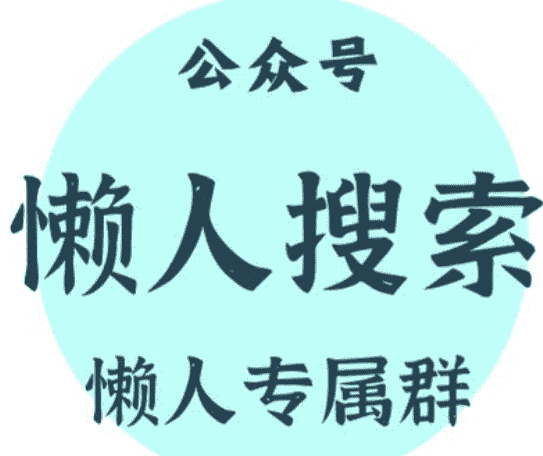

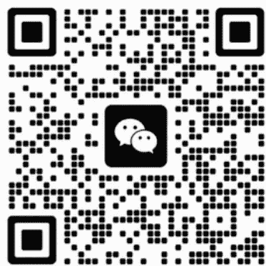

微信：lazyhelper1

## 一位千万级操盘手的血泪复盘

## 第一部分：艰难决定

- 我是谁：知风，99 年，温州人，从小随父母在新疆经商。
- 2018 年大学期间淘宝店月入过万
- 2020-2024 年深耕 CPS，从专员做到经理
- 曾带团队 2 个月从 0 做到 200 万
- 目前在某头部老字号食品企业担任抖音渠道经理，去年完成抖快 1000 万销售额且毛利为正

昨天晚上 Kiki（老婆）一夜没睡，早上 6 点起来给我做了一碗阳春面。就在今天，我正式按下了全职做抖音夫妻创业项目的“终止键”！

家人的提醒、身体的不适，加上 AI 亦仁咨询的一致建议，让我们最终下定决心。放弃不是认输，而是为了活下去。

## 第二部分：高光时刻与“盐碱地”转折

今天写下这篇复盘，把这两年从月入几万到利润榨干的经历剥开，希望能帮圈友避坑。

动笔之前，我想了很久这篇文章写给谁看。这两年我赚过钱，但也踩了无数的坑，甚至差点把夫妻感情搭进去。如果你是以下三类人，我强烈建议你花 10 分钟看完，绝对能帮你省下几万块的试错成本：

- 1. 想拉着老婆/女朋友一起做自媒体带货的兄弟：我会用血泪教训告诉你，为什么把老婆当“合伙人”是一场灾难，以及夫妻店到底该怎么分钱、怎么沟通。
- 2. 正在做抖音 CPS、白牌保健品、靠纯佣金跑量的个体户：我会给你算一笔账，为什么你现在每天累死累活，其实是在给平台和 MCN“打黑工”。
- 3. 一边上班一边焦虑搞副业的打工人（斜杠青年）：我会用我"主业精力被副业大量占用，最后副业还倒亏钱"的亲身经历告诉你，主副业的精力到底该怎么算 ROI？

这个项目是 2024 年年初跟着坤哥（盗坤）的训练营做的。后来坤哥和生财有术官方也进行了合作，提供了生源，我们相当于是最早的一批精致达人。

![bbox=[0.06, 94, 0.84, 493]](img/dd5251b40e7d5664d480adcc1ee97fd5_3_0.png)

现在生财里的这个项目，做的人应该非常稀少了，主要针对行业现在变得非常畸形，小达人比较难存活，但我们算是坚持得比较久的，超过了 80% 的人吧。

- 曾经的高光：
    - 2024 年初初步验证可行，8 月跑通 MVP 后，正式鼓励 Kiki 辞职全职投入
    - 2025 年初做到 L5 级别（素人最高）
    - “五个女博士”单品销量周/月冠军，长期霸榜第一

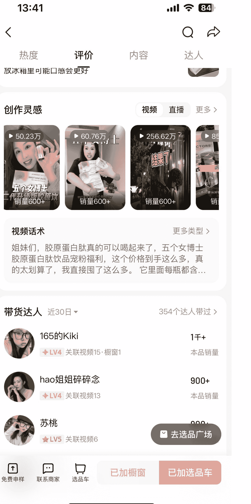

并且也做过直播，单场销量破千，是一个非常健康、高光时刻。

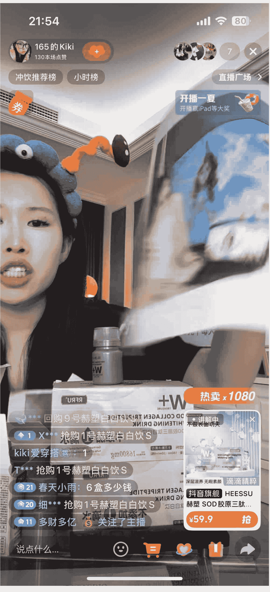

### 【从 0 到 1 的煎熬与“数学期望”的豪赌】

2024 年 8 月，我们其实是先在在职的情况下跑通了最小 MVP（当时单月能拿到 5000 块佣金），才决定放大的。当时我找坤哥聊过，算了一笔极度理性的“数学期望”: 让 Kiki 全职去做这个项目的拍摄，即使这个项目彻底失败，大不了让 Kiki 回去重新找个五六千的行政工作，家庭现金流完全兜得住；但如果跑通了，我们每个月就能多出两三万的收入。下行风险锁死，上行套利空间极大，数学期望绝对为正！于是，我果断推着 Kiki 辞职，全职 All in。

但纸面上的算计，代替不了现实的煎熬。刚起号的头三个月，一天只能卖个一两单，极度痛苦。那时候我每天站在河边看着白鹭，脑子里全靠默念着“大鹏一日同风起，扶摇直上九万里”、“长风破浪会有时，直挂云帆济沧海”的古诗词，来给自己做心理按摩。

我们硬生生靠着人、货、场的不断优化和账号权重的拉升，熬过了量变到质变，终于迎来了月入两三万的高光时刻。

- 【残酷的转折：错失黄金进场时间 + 平台严苛的政策】：
    在“个人事业冲突 + 大行业大降佣 + 冒险播白牌”加持下抖音带货收入下降至被罚。

### 4. 2021 年：高投入的红利期

从 2021 年我刚开始接触抖音的时候，在一家品牌方做抖音达人渠道，整个行业的品牌都有非常大的投入和预算。

我记得那时候，我负责对接达人和投流，通常是 25% 的佣金，我们再去花 ROI 2 倍的广告费用去帮达人砸几十万，把这个达人扶起来。这相当于我们花了 75% 的费用在做这件事。虽然品牌肯定是亏本的，但都有意愿去抢占市场。

清晰的记得当时我花了 20w 的千川广告，将一个配合度特别高，一个月就只有 1w 销售额的达人，做到了 40w 的销售额，这个达人过年给我发了一个 188 的大红包。

之前我给他投流的时候不以为然，觉得自己业绩高，挺好的，但是一领到她的红包，我就开始算账，开始回过味来。一个小达人能赚 10W/月佣金，而我当时还有个淘宝月入 1W 的副业，刚好那段时间又在谈恋爱，也没有买房日子比较舒服，硬生生错过红利期。

### 5. 2024 年：市场遇冷与现状

到了 2024 年我们入局的时候，市场趋势已经冷静，平台、达人与品牌的关系趋于平衡。市面上普通的合作大多是按 10% 进行抽佣，相对来说还算能接受。

受经济大环境的影响，一些新品牌也拿不到太多投资，也开始实实在在的做 ROI，并不只是做销售额做数据了。导致留下的佣金比例降到了 3%-5%。

- 算一笔绝望的账：100 万销售额 -> 5 万佣金 -> MCN 再抽 30% -> 平台各种扣费 -> 到手利润薄如刀片。这根本不是创业，这是给平台打黑工。

我们在巅峰时期，单月销售额曾达到过 50 万，当时的月净利润约有两三万。那时候觉得还不错，认为这件事情是可以坚持做下去的。但到了后来，品牌方开始降佣，我们目前的收益情况就变得不再乐观。从 2025 年 8 月份开始，佣金收入就出现了不过万的情况，单靠短视频已经无法支撑业务。

因此，我们在 8 月底开始尝试直播：

- 6. 货盘选择：我们去找了白牌的滋补保健品，佣金比例能达到 45%。
- 7. 运营成本：我们自己负责投流，投流成本大概在 5% 到 10% 这个区间。
- 8. 盈利空间：扣除成本后，相当于我们至少有 20% 的毛利空间。

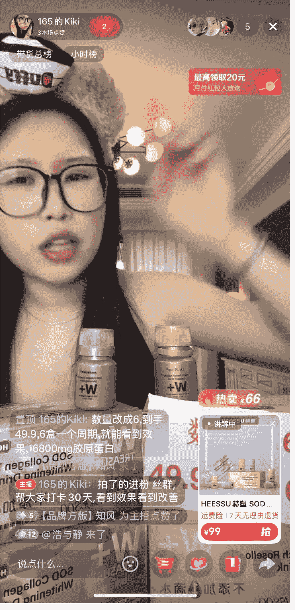

当时那个月又做回了 2 万的利润。但紧接着，因为公司旺季安排，被外派到了产地工厂带公司的直播项目，导致项目短期内停滞。加上这类单品的生命周期非常短，毕竟是白牌，其复购率和效果并不理想，产品本身只能起到一种“无功无过”的过渡作用。

等我们空闲下来想重新投入时，大环境已经变了：
10 月份国家开始整治直播电商税相关内容。
白牌商家也需要补缴电商税。
变相地，白牌商家给到我们的佣金比例再次降低，从原先的 45% 直接降到了 25%。

> **通知消息**
> **时间：** 11:35
> **类型：** 商品橱窗通知
> **详情：** 带货商品佣金率下调通知
> **商家已下调商品【认养一头牛】全脂纯牛奶 200ml×10 盒×3 箱儿童学生营养早餐-sp 8% 的佣金率，调整后的佣金率为 1%，将于 2025-01-1... 全文**

> **通知消息**
> **时间：** 11:16
> **类型：** 商品橱窗通知
> **详情：** 带货商品佣金率下调通知
> **商家已下调商品【认养一头牛】全脂纯牛奶 200ml×10 盒×3 箱儿童学生营养早餐-sp 8% 的佣金率，调整后的佣金率为 1%，将于 2025-01-1... 全文**

> **通知消息**
> **类型：** 巨量千川
> **详情：** 全域推广使用授权申请

### 致命黑天鹅：今年 1 月份被罚款 5000 块钱，彻底把心罚凉了。

2026 年 1 月份，公司旺季做得差不多了，业绩也都顺利完成，并且在目标的基础上翻了三倍。于是我们又开始了带货直播，这次也是卖保健功效相关的产品，对标的是一款卖得非常好的甜甜圈，纯佣 50%。当时算下来，单场销售额破万的话，净利至少在 10% 到 20% 这个区间范围内，所以认为是可以做的。

紧接着我们就按照 SOP 开始执行：

- 9. 先去拍爆款的引流视频。
- 10. 随后开始直播，目标就是为了跑通 MVP（最小可行性产品）。

当时我们的心态是，第一场只要能卖出一个产品就算成功。抱着这样的期待去做，果真卖出去了，这证明我们的能力是没有问题的。但问题随之而来。这个产品具有强功效性，而平台不允许出现减肥、保健相关的暗示内容。平台其实给了我们风控提醒，但我们没有在意，觉得我们这种小直播间才卖一两单，没必要管吧。

于是我们这样连播了三天。到了第三天，直播间被强制下架。当时我们还不以为然，觉得过个十分钟重新开播就好了。结果发现，我们 5000 块钱的保证金被全部扣完，账号也被封禁了三天。

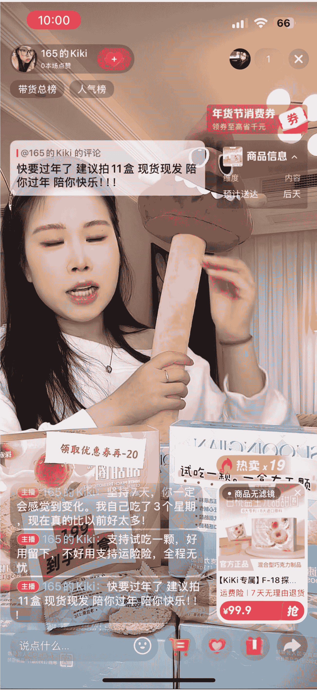

**违规详情表**

| 项目 | 内容 |
| :--- | :--- |
| **状态** | 直播违规 已违规 |
| **判罚时间** | 2026/02/04 20:02:48 |
| **违规类型** | 特殊功效虚假 |
| **情节** | 严重 |
| **再次违规处罚** | 直播间商品下架、冻结违规订单成交额 15%、永久关闭商品分享功能、罚没违约金等 |
| **违规单号** | 7602972665825313066 |
| **处罚对象** | 直播间 (ID: 7602969548672781108) |
| **详细违规点** | 您在直播中，明示或暗示商品实际不具有的减肥/壮阳/丰胸/增高功效 |
| **直播时间** | 02/04 19:47:51 ~ 02/04 19:48:51 |
| **处罚结果** | 关闭商品分享功能 3 天 (2026-02-04 20:02:47 至 2026-02-07 20:02:47) |
| **罚没违约金** | 5000 元 (已处罚) |
| **违规依据** | 《创作者【虚假宣传：特殊功效虚假】实施细则》 |

这对我们半年多来没太多收益的账号来说，简直就是晴天霹雳。眼看马上又要过年了，当时真感觉天都塌了。我作为主心骨，肯定要强撑着，去帮 Kiki 梳理信心。我觉得没关系，我们肯定能赚回来。当然，Kiki 非常难过，还哭了一场。年后回来的时候，我们畅谈了一场，当时记得给她拍了一个视频，说我们再坚持三个月，如果这三个月还赚不到钱，我们就解散。当时我依然选择了踌躇满志，重新出发，开始梳理这个业务。

## 第三部分：深度拆解 3 大核心死局（精华核心）

### 【战术复盘：我是如何跑通直播 MVP 的？】

> (这里先跟鱼丸说句抱歉。其实直播这块我们当时做出了成绩，鱼丸找过我很多次想让我写个复盘，但苦于下半年进入了我们公司某头部老字号食品企业的绝对旺季，实在没空写，今天借这篇帖子一并补上。)

关于直播，我之前汲取了涛哥（杨涛）的观点，总结起来核心就是四个字：“百问百答”。

很多人一上播就发怵，像在读稿子。其实直播间就是解决用户痛点的道场。你把自己当成一个线下卖货的导购，把大家进店大概率会问的问题烂熟于心，这事儿就成了一半。

#### 冷启动阶段怎么做？我的打法是：

- 11. 先去对标的竞品直播间蹲点，把用户最高频的提问全部记录下来。
- 12. 自己开播时，人少没关系。拿两三个小号装作真实用户，在公屏上不断抛出这些痛点问题。
- 13. 当极少量的自然流量进来时，他们看到公屏上的问题正是他们想问的，且主播正在专业解答，停留和转化自然就产生了。

#### 心态上的 MVP（最小可行性）测试法：

每次看到竞品跑出低粉爆款，我们就迅速跟进。为了保护我老婆（主播 Kiki）的情绪电池，我们设定的 MVP 目标极低：只要卖出一单，今天就算胜利。通常只播一个小时，跟她强调“不要有负担，这就是找大家来聊聊天”。

就在 3 月中旬，我们停播两个月后开了一场，依旧还是靠着这个打法，直接卖了 1000 块钱。这个成绩让我们很惊喜，证明这套“短直一体”的底层逻辑我们完全跑通了。但紧接着，就是深深的悲凉——这 1000 块钱的销售额，扣掉极低的佣金率和 MCN 抽成，我们最后只赚了 30 块钱。

现在的抖音，已经全面进入“短直一体”时代：短视频不爆，直播间投流都烧不动。这极大地拔高了普通小团队入场的综合能力门槛。战术上的成功，掩盖不了战略上的利润枯竭。这也是我们最终痛下决心停下来的核心导火索。

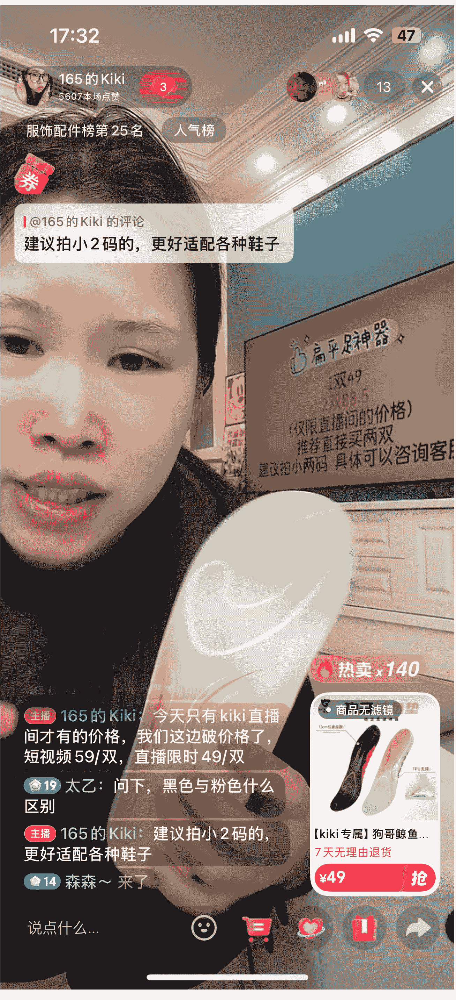

### 死局 I：【商业模式】有闭环无复利的“互联网搬砖”。

- 带的滋补保健品类，全是短平快的千川打品。不违规卖不掉，违规就罚款。去年的成绩对今年毫无帮助，每天都在重头卷素材，彻底陷入死循环。

在这期间，我陷入了极大的内耗。一方面，白牌保健品佣金高，但在功效暗示上游走在违规边缘；另一方面，作为懂点品牌逻辑的运营，我知道这种“无功无过”的高价产品没有复购，完全是消耗流量的一波流。当你对你卖的产品缺乏底气时，你的动作是会变形的。

这让我深刻认识到：做没有品牌背书和复购的白牌，本质上是在透支我的心力，这是一门无法长期积累的劣质生意。

我们带的品类多偏向滋补保健功效类，主要涉及减肥、美白、皮肤状态改善等方面。在操作过程中，我们发现了一个核心问题：

#### 14. 产品的生命周期差异极大

(a) 大品牌（如“五个女博士”）的生命周期非常长，至少能维持一年。早期我们拍出一条爆款视频后，它就能持续出单。针对一个产品拍 30 条素材，就足够支撑好 7-8 个月；甚至去年拍的视频，今年依然在跑量出单，虽然佣金比例不算顶尖，但胜在稳健。

(b) 白牌产品的生命周期维度则非常短，基本是以“周”或“月”为单位。这就导致你必须陷入持续不断的素材拍摄中，工作强度极高。

#### 15. 业务逻辑背后的风险

- (a) 虽然白牌产品的佣金极高，但它们缺乏品牌背书，不靠“暗示”功效就很难卖出去。
- (b) 这种“暗示”策略本身自带违规风险。一旦被平台判定违规，就会面临罚款，这在数学期望上显然是一件负收益的事情。一单一块钱的收益，但是一违规就是 5k 元的罚款。

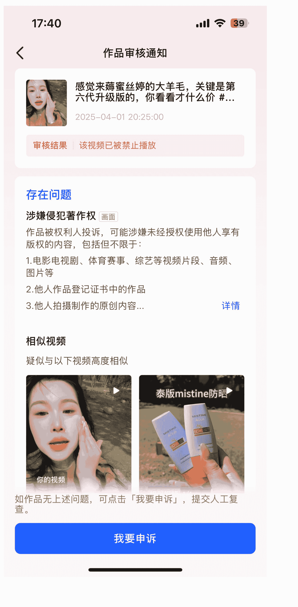

**视频违规详情表**

| 项目 | 内容 |
| :--- | :--- |
| **状态** | 视频违规 已违规 |
| **违规时间** | 2024/12/29 19:53:31 |
| **违规类型** | 功效虚假 |
| **违规单号** | 7453799043350724903 |
| **处罚对象** | 短视频 (ID:7453441596441382196) |
| **违规原因** | 您在 2024-12-29 视频画面中，明示或暗示商品具有减肥相关医疗保健功效 |
| **违规位置** | 视频画面 |
| **处罚结果** | 冻结达人佣金 0 元 30 天，视频购物车违规商品下架 |

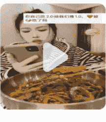
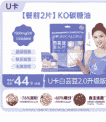

#### 16. 平台的严监管趋势

最近的情况证明了这种模式的不可持续性。即便是选择和白牌商家采用低佣投流，我们行业头部账号近期也因违规出现了问题，甚至连品牌千川投流账户都被封禁了。虽然我没有细问，但估计对方的账号保证金也受到了牵连。

#### 17. 自我内心的左右互搏

我做的时候无数次感觉也都有点良心过不去的感觉，觉得这么贵还无功无过的产品卖出去，这个事情肯定不对的，但是因为自己的现金流紧张，生存压力下，选择闭着眼睛做，觉得我不做别人也会做，不能有道德洁癖。就这样长期的左右互搏，人也变得非常扭捏。与其陷入这种不断重头再来的“无意义卷动”，不如早一点停下来。

#### 18. 压垮底盘的最后一击：保底收入的断崖式下跌

早期我们能活得很滋润，是因为收入结构里有“保底”。2025 年开年时，我们每个月光是“稿费”收入就能达到 5000 元左右，占了总收入的 30%。这笔钱是定海神针。

然而，随着官方推出“星川计划”，平台的政策大洗牌，单条视频的稿费收益直接从 500 元暴跌到了 50 元！这意味着我们的保底安全垫被彻底抽干了。当达人失去了稿费支撑，所有的收入比重被迫压在了“纯佣金跑量”上，抗风险能力直接归零。一旦跑不出量，就是死路一条。

#### ! 反思 1(模式篇):

在依附于大平台的生态里做生意，永远不要把平台的“补贴/稿费”当成常规的商业利润！没有自己掌控的复利私域，你的命脉永远攥在算法手里。

### 死局 2：【合伙陷阱】不要用大厂的 KPI 管理老婆。

- **坦诚自己的错误：**

我是一个理工男，逻辑理性主导型，但我试图把内倾型、情绪主导的老婆变成另一个操盘手。能力模型不匹配，导致沟通成本极高，每天开会复盘最后变成吵架和内耗。

用理性化的思维来管理极其感性的 Kiki，是我遇到最大的问题。作为操盘手最大的傲慢。我妄图用冰冷的 KPI 去要求我的家人，我没有提供足够的情绪价值和极简的 SOP，导致家庭作坊变成了内耗的修罗场。夫妻创业失败，100% 是我这个“自以为是的男一号”管理无能。

理性（追求效率）与感性（追求感受）的错配，导致我们每天沟通成本极高。这也让我明白了一个惨痛的道理：绝对不要试图用大厂的 KPI 和项目管理的语气，去管理你的伴侣。

- **不要用“合伙”的逻辑去搞定“采买”的需求**

我曾经想拉一个产品经理合伙做小红书。涛哥（杨涛）当时一语点醒了我：“你想找人合伙，无非是因为你觉得这事儿风险大，想拉个人分担。如果这事儿是必赚的，你怎么可能把利润分给别人？”

这句话放在我和 Kiki 的夫妻店上，刀刀见血。创业最好的模式，很多时候不是合伙，而是“采买”。在这个抖音项目里...

#### ❗️反思 2(团队篇):

早期创业，能用“采买”解决的劳动力，绝不用“合伙”去绑定。夫妻创业更是如此，如果没有建立绝对的“情绪隔离机制”（工作时间只谈业务，下班后绝不带入情绪），那么业务的低效必将反噬婚姻的和谐。

### 死局 3：【个人价值】脱离了平台和资源的“个体户悲哀”。

- **拿出对比战绩：** 我在公司被派去救火，成功把直播项目带起来了，因为有供应链和团队资源。但同样的经验放在家庭作坊里，因为人手和资金受限，完全跑不通。证明了：操盘手需要土壤，不要盲目迷信个人能力能对抗系统。

- **个人业务：**

当时 8 月份跑得非常好，我们自己的直播场次能卖 1000 单，每一场能赚 1000 多块钱。我就想把这个事情复制下去，去招聘主播。即使是兼职也没关系，我们算过利润模型：一场播 3 到 4 个小时，赚 1000 块钱，那我花 200 块钱去招个兼职主播过来，这件事情完全就是稳赚的，为什么不行呢？

## 公众号懒人搜索，懒人专属群分享

22:07

165 的 Kiki

130 本场点赞

冲饮推荐榜
人气榜

最高领取 20 元

月付红包大放送

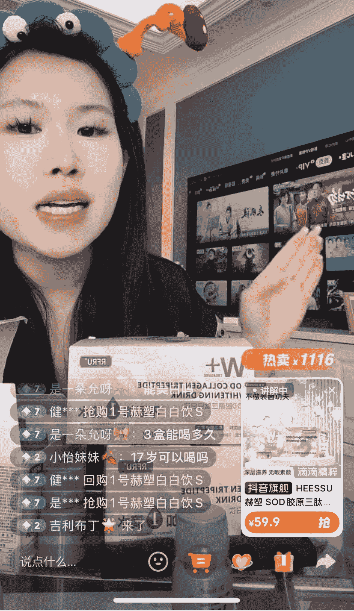

是一朵允呀：能美白吗
健***抢购 1 号赫塑白白饮
是一朵允呀：3 盒能喝多久
小怡妹妹：17 岁可以喝吗
健***回购 1 号赫塑白白饮
是***抢购 1 号赫塑白白饮
吉利布丁来了
热卖 x1116
讲解中

不做表面功夫
抖音旗舰 HESSU
赫塑 SOD 胶原三肽...
¥59.9
抢
说点什么...

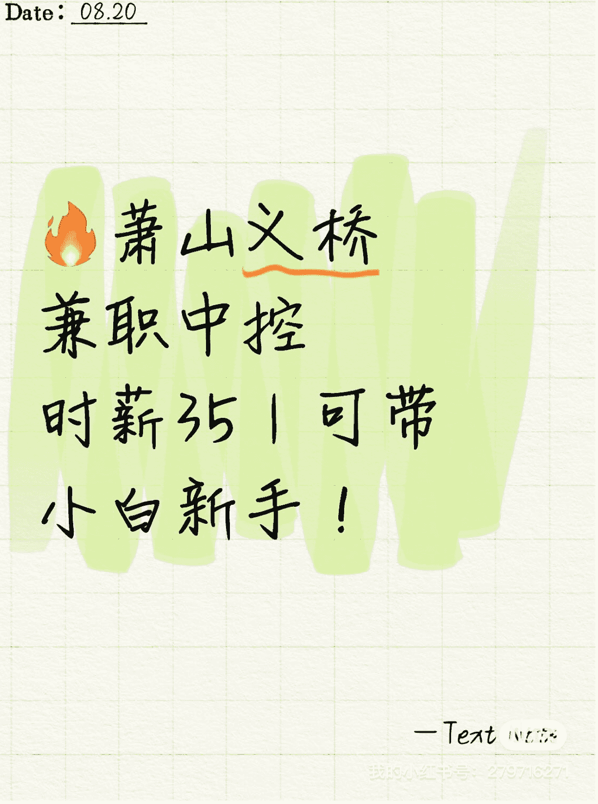

但当时心态过于保守，觉得这事情自己播就好了，没必要招人，反正我们又不是什么大团队。

以及说刚开始还准备招中控弹链接，后来直接用插件替代了。

因为这种过度保守，我们没有做更多动作，就靠着自己一场一场地播。后来发现量开始掉了，竞品也发现了我们的动作并开始快速跟进，导致我们的流量不断受到冲击，ROI 从 10 掉到了 5。

我们也没有像其他人那样跑通流程就卖项目走培训或知识付费教学的路线。

### 强烈的反差：为什么在公司我能成，自己干却黄了？

说实话，我一度怀疑是不是自己能力不行了？但现实狠狠打了我的脸。

去年 9 月，我被“某头部老字号食品企业”(我目前的主业) 派去工厂，全权负责直播项目。

这个项目包给了无数个机构代理，都做不起来，觉得产品有问题，品牌不行，赛道不适合等等原因。

我用的打法，和在家里教老婆的打法一模一样 (也就是我前面说的百问百答和 MVP 测试)。

但结果天差地别：在公司，我快速跑通了 0-1，第一场 150，第二场 1000，第三场直接五千！

最后甚至突破到了单场 5w，让整个公司都为之惊讶，找了无数人做不起来的项目，居然被我做起来了。

在这个过程中，并且对接了“与辉同行”这样的大顶流，拿到了极其亮眼的坑位和战绩。

同样是我这个操盘手大脑，为什么在家里亏钱，在公司却大杀四方？

我总结了两个极其残酷的真相：

- 19. 你以为的能力，很多时候是平台的资源倒影：在公司，我有供应链兜底，有资金投流，有客服善后。我在家里？我只有一个手机和一个快被榨干情绪的老婆。
- 20. 小团队做白牌，抗风险能力等于零：公司试错亏个几万块，那是测试成本；咱们个人做这种低佣金的品，违规一次罚款 5000，直接半年白干。操盘手需要土壤，千万别盲目迷信个人能力能对抗系统规律。

## ❗反思 3（个人价值篇）：为什么同样的打法，在公司能爆，在家里就死？

因为在公司，我有充足的货盘、稳定的客服、不限流的投流预算！而在家里，我们是孤军奋战。这让我彻底清醒：顶级操盘手必须长在有资源、有资金池的土壤里。不要盲目迷信你的“个人战术勤奋”，能对抗大平台的“战略碾压”。这也是我决定回归职场，寻找品牌老板合作的根本原因！

## 第四部分：决策逻辑与心智蜕变

- **为什么是今天停掉？** 不是情绪崩溃，而是基于理性的判断，现金流的枯竭：有房贷现金流非常紧张，公司里即使做了 3 倍于目标的业绩但也不会给涨薪。这个带货项目又是不停就要每月亏 3K，整体下来已经亏了 3~4 万了。

- **收获了什么：** 这两年没赚到大钱，但我跑通了抖音底层逻辑、练就了强悍的数据分析能力和 AI 极速工作流。

### 1、商务谈判的能力

在这个项目中，最关键的其实是达人侧。我早年做品牌方时发现，达人会有不同的喜好，需要根据达人的特性进行配合，包括产出质量和发出效果。

针对这个特性，我早期交出的成绩单是非常亮眼的。即使没有特定需求，我也会根据产品的特性来制定推广逻辑。通过这种高效的匹配，我拿到了早期的成绩，让平台和品牌方更愿意配合。

我的优势主要体现在以下几点：

- 21. 我本身就在这个圈子里，跟商务聊起来会有更亲近感。
- 22. 通过线下的渠道能了解到更多的商业信息。比如去年 7 月份参加展会时，我遇到了一些白牌品牌。他们会更早地把新品上架信息和行业动态同步给我们，让我们能第一时间掌握信息。
- 23. 我当时很早就梳理清楚了这些品牌的产品线和优势产品。虽然我们做的不是相同类型的产品，但我觉得产品的推行逻辑是相通的，经验是可以复制的。

我们直接按照这个过程去做，结果直接就爆了。

### 2、拍摄迭代优化的内容

我忘记是谁说的了，就是说人与人之间的差距，其实就是在迭代里面的差距。如果每天只进步一点点，连续 365 天都坚持，那将来是多少倍的进步？

这个 Kiki 是很棒的，不断的研究迭代，从最开始薄弱的点就是拍摄场景和灯光入手不断的迭代。

这里也要感谢一下狂朝 MCN 在里面的投入。我看着他们一点一点去帮我们优化场景和灯光，优化到非常有网感的环境。

### 3、维护和利用 AI 的能力

去年 9 月份，我们就发现网易严选的一个自播账号一直在盗用我们的爆款视频素材，投流到他们自己的直播间。这直接导致我们自己一直在跑的视频流量大幅下滑，根本跑不动。

于是我们开始采取行动，整个维权路径分为三个步骤：

- 24. 固定取证
- 25. 进行谈判（施压）
- 26. 对簿公堂（当然最后没用到）

在固定取证阶段，我们原本想使用“权利卫士”进行全链路取证，这样在法律上更有效力。但考虑到法律程序和成本，使用公证取证软件需要支付一百多元的取证费，感觉性价比一般。再加上侵权证据非常清晰，对方抵赖不掉，所以我们最后直接选择了录屏取证。

其次是进行施压和谈判。我通过 AI 编辑专业的话术，通过发送正式律师函的方式，向对方释放专业信号。这种正式的处理方式让对方感受到了我们的专业度，压力之下，原本的侵权行为从对抗变成了配合。

最后通过联络和谈话，对方不仅停止了侵权，还交付了相应的款项。整个流程合理合法，成功解决了这次纠纷。后续我们也会将这种处理大公司或长期侵权行为经验，复用到类似的场景中。

## ### 第五部分：最后的心里话：给还在局中的朋友 3 个“劝退”建议

鱼丸让我给正在做这类项目的朋友提点建议。说几句掏心窝子的大实话吧，可能有点逆耳：

### 1、关于模式：没有复利的流量，趁早跑路。

如果你现在带的品，每天都要靠擦边暗示功效才能卖出去；如果平台只要一改规则（比如星图计划降稿费），你的收入就断崖下跌。听我一句劝：你那不叫创业，你就是个高级网络销售。这种一锤子买卖没有复利，你去年积累的粉丝，今年一毛钱都不值。趁早去寻有复购、有品牌沉淀的品类。

### 2、关于合伙（特别是夫妻店）：买劳动力，千万别谈股份。

很多兄弟起盘时，喜欢把亲戚或者好哥们拉进来平分股份。这绝对是最大的坑。如果你觉得这事儿必赚，你根本不会分股份；你分股份，就是潜意识里想找人分担风险。

作为一个操盘手，如果你伴侣的定位只是一个“出镜演员”或“剪辑手”，那就直接给她发“买衣服的工资”或“绩效红包”。千万别用 50% 的股份和冰冷的 KPI 去要求她，这不仅摧毁执行力，还会摧毁你的家庭。

### 3、关于 AI：不要神话技术，AI 的尽头是“业务拆解”。

不要去焦虑别人会写代码会爬虫。咱们是做业务的，AI 对我们来说就是一个“不知疲倦的外包”。你只要能把业务的痛点拆解得足够细（比如：我需要一个不露脸的 27 秒短视频），你用大白话去“喂”大模型，它就能给你出脚本。懂业务的人用 AI，才是真正的降维打击。

## 第六部分：下一步行动与求职名片

- 开放链接：认清现实后，我决定将重心回归职场。本周末，我将带着这套“失败换来的血的教训”，去参加杭州生财 AI 航海家大会。
- 硬核求职：我目前在看新的操盘手/增长负责人机会，专注于有品牌沉淀、高毛利的消费赛道。如果你是苦于有货没流量、需要一个能控投流、能打爆款、懂 AI 提效的操盘手，欢迎私信交流。

## 【致谢】

感谢生财提供一个优质的平台，感谢亦仁不断的推荐使用各种各样的 AI。

感谢坤哥和狂朝 MCN 给了我们成长的机会！

感谢北京的戴哥和他的陪伴分享群内，我一度以为我生财门票的一半要交给戴哥，生财里面太多内容了，戴哥用他的经验帮助圈友高效的获取优质信息，这让我十分受益，因此每天打开生财的时间提高了一倍。

感谢青瓜视频戴总给到我的建议！

感谢 Kiki 一直以来的耐心配合！

最后，感谢你的时间，我是知风，一个仍在前进道路上的奋斗者！欢迎交流链接～

---

看完这篇 SOP，你觉得你懂了。但 90% 的人一到实操就会卡在第一步。

工具和教程只是最低级的壁垒，真正的壁垒是“立刻动手”和“圈层信息差”。

如果你想看全网最新的变现玩法，并且和一群执行力极强的极客一起下场拿结果，欢迎围观我的核心私域：【懒人专属群】。

我们不聊虚的，只做商业闭环的拆解与 AI 效率的压榨。系统内已沉淀 1000+ 跑通的套利实战局。

👉 查阅圈子完整数字资产与上车门槛：
https://lazyso.com/insider/

认同价值、准备好下场干活的，扫码加我微信 (lazyhelper1)

微信：lazyhelper1

备注：【实操上车】, 不闲聊