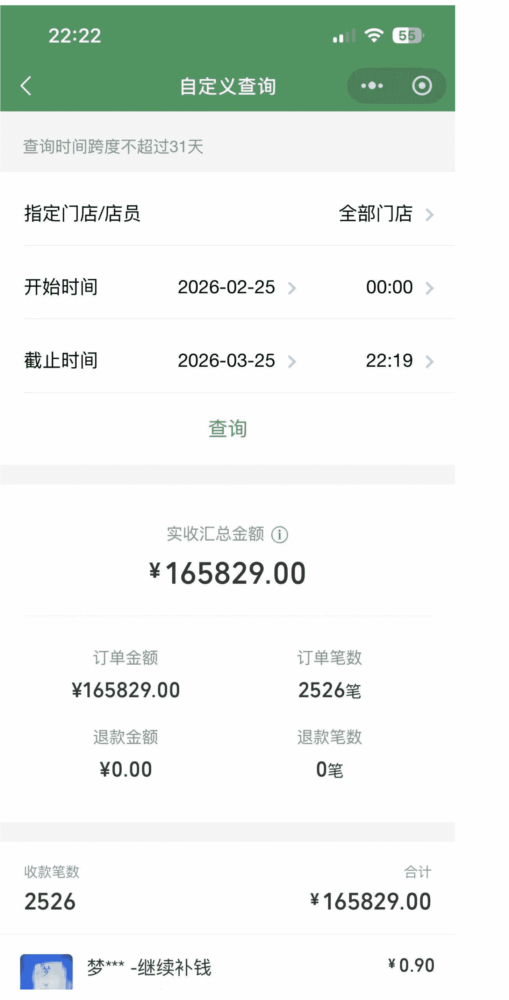
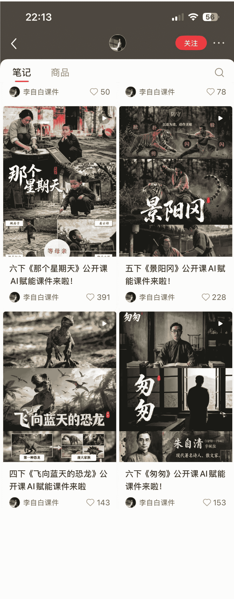
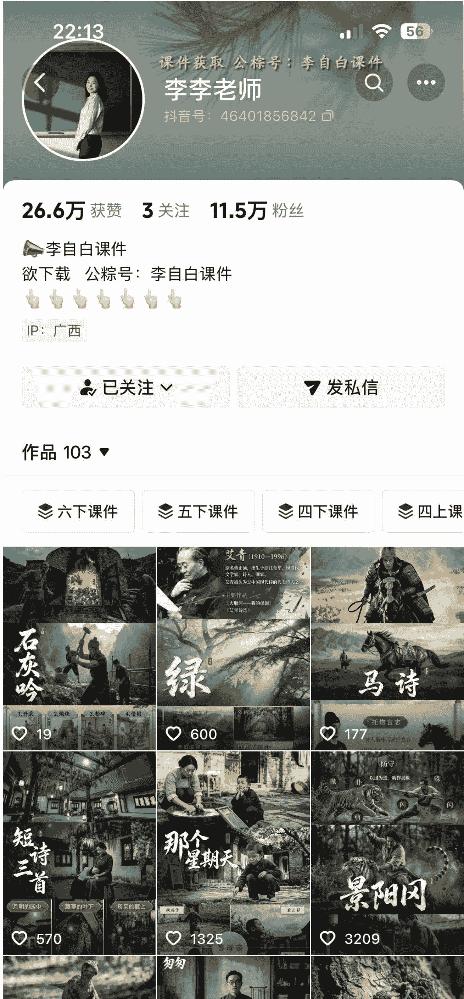
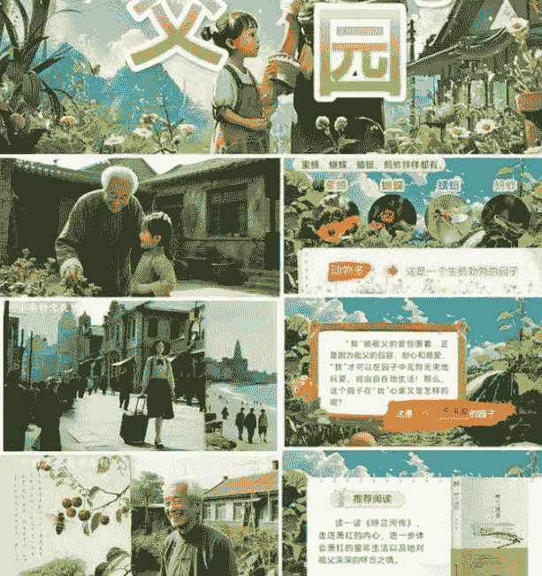
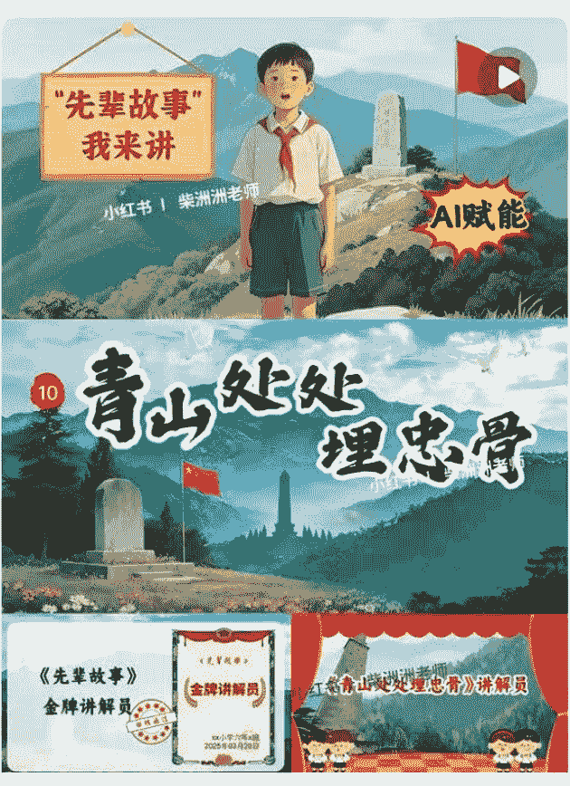
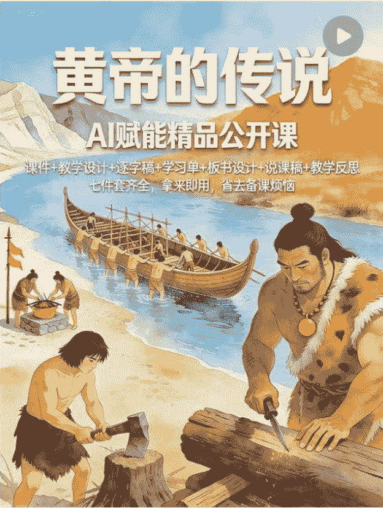
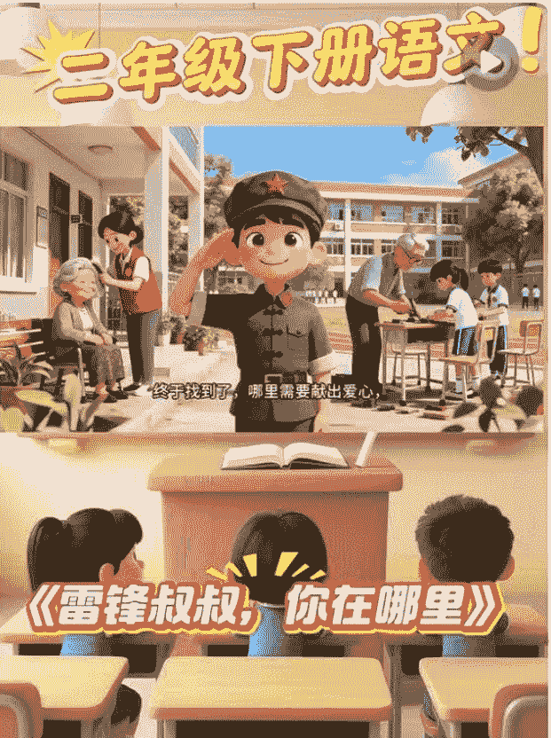
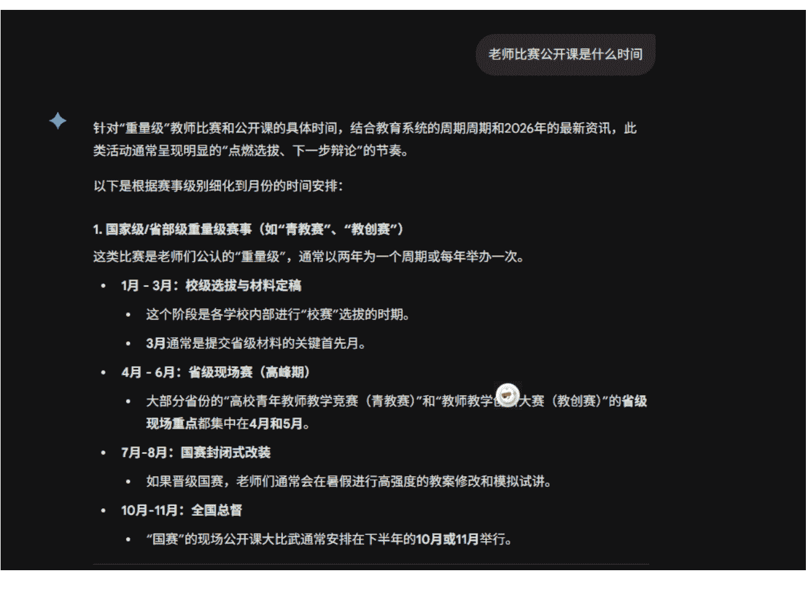

# 教务细分：AI 赋能公开课 PPT，月销售额稳定 10-20W

公众号懒人搜索，懒人专属群独享

懒人微信：lazyhelper1

大家好，我是奇艺。

一直以来，我都是做小红书虚拟资料的。从以前的教辅，到现在的教务细分、老师公开课，都拿到过一些结果。

在教辅阶段，我经历过从一开始搬运，到后面自己做原创、做排版，最后逐渐形成自己的排版风格。那时候平均每天能引流私域 500-1000 人，靠私域卖虚拟资料变现。

也是在那个阶段，我慢慢意识到：小红书上的用户，对视觉呈现非常重视。

同时，因为搬运带来的多次违规，也更坚定了我转向原创的决心。

以下是之前做教辅阶段的一些模板展示：

## 二年级语文下册期末 1-8 单元考点归纳

## 第一单元知识点归纳

## 一、看拼音写词语

- 古诗  村居  儿童  碧绿  格外
- 裁出  剪刀  春天
- 冲出  寻找  姑娘  吐出  爷爷
- 眼睛  柳枝  桃花
- 杏花  鲜花  植树  野花  原来
- 大叔  一堆  东西
- 太太  做客  惊奇  去年  美好
- 礼物  姓邓  公园
- 快活  树苗  汗珠  满意  休息
- 柏树  小心  笔直
- 绿丝绦  荡秋千  邮递员
- 引人注目  碧空如洗

## 二、按要求写词语

## 1、填入合适的动词

- (握) 铁锹 (探) 出头 (骑) 摩托车 (奔向) 田野 (脱掉) 棉袄
- (寄) 包裹 (荡) 秋千 (吐出) 嫩芽

## 2、词语修饰

- (仔细) 地找 (笔直) 的柏树
- (小心) 地移 (精心) 地挑选
- (笔直) 地站 (蔚蓝) 的天空
- (不停) 地挖 (快活) 地蹦跳
- (温暖) 的阳光 (绿油油) 的田野
- (徐徐) 的微风 (害羞) 的小姑娘
- 柔软的柳条
- (潺潺) 的小溪
- (美好) 的礼物
- (美丽) 的风景
- (绿油油) 的小柏树
- (五颜六色) 的鲜花

第 1 页 共 28 页

## 二年级下册语文期末 1-8 单元考点归纳

## 第一单元知识点归纳

## 一、看拼音写词语

- 古诗  村居  儿童  碧绿  格外  裁出  剪刀  春天
- 冲出  寻找  姑娘  吐出  爷爷  眼睛  柳枝  桃花
- 杏花  鲜花  植树  野花  原来  大叔  一堆  东西
- 太太  做客  惊奇  去年  美好  礼物  姓邓  公园
- 快活  树苗  汗珠  满意  休息  柏树  小心  笔直
- 绿丝绦  荡秋千  邮递员  引人注目  碧空如洗

## 二、形近字组词

- 剪 (剪刀)  煎 (煎熬)
- 荡 (飘荡)  汤 (喝汤)
- 邮 (邮件)  油 (油画)
- 村 (山村)  材 (木材)
- 寻 (寻找)  录 (目录)
- 堆 (堆积)  推 (推广)
- 原 (高原)  愿 (愿意)
- 妆 (化妆)  壮 (强壮)
- 童 (儿童)  重 (重量)
- 姑 (姑姑)  估 (估计)
- 桃 (桃花)  逃 (逃跑)
- 局 (邮局)  句 (句子)
- 注 (注意)  汪 (汪洋)
- 体 (体育)  休 (休息)
- 值 (值日)  植 (植树)

第 1 页 共 22 页

## 二年级语文下册期末 1-8 单元考点归纳

重点知识点归纳，老师建议掌握

## 第一单元

## 一、看拼音写词语

| 拼音生词 | gǔ shī 古诗 | cūn jū 村居 | ér tóng 儿童 | bì lǜ 碧绿 | gé wài 格外 |
|---|---|---|---|---|---|
|  | chōng chū 冲出 | xún zhǎo 寻找 | gū niang 姑娘 | tǔ chū 吐出 | yé ye 爷爷 |
|  | xìng huā 杏花 | xiān huā 鲜花 | zhí shù 植树 | yě huā 野花 | yuán lái 原来 |
|  | tài tai 太太 | zuò kè 做客 | jīng qí 惊奇 | qù nián 去年 | měi hǎo 美好 |
|  | kuài huo 快活 | shù miáo 树苗 |  |  |  |
|  | cái chū 裁出 | jiǎn dāo 剪刀 | chūn tiān 春天 | dà shū 大叔 | yī duī 一堆 |
|  | yǎn jing 眼睛 | liǔ zhī 柳枝 | táo huā 桃花 | lǐ wù 礼物 | xìng dèng 姓邓 |
|  | dōng xi 东西 | bǎi shù 柏树 | xiǎo xīn 小心 | bǐ zhí 笔直 | gōng yuán 公园 |
|  | lǜ sī tāo 绿丝绦 | yǐn rén zhù mù 引人注目 |  | bì kōng rú xǐ 碧空如洗 |  |

## 词语修饰

- (仔细) 地找
- (小心) 地移
- (笔直) 地站
- (不停) 地挖
- (温暖) 的阳光
- (徐徐) 的微风
- (碧绿) 的草坪
- (笔直) 的柏树
- (精心) 地挑选
- (蔚蓝) 的天空
- (快活) 地蹦跳
- (柔软) 的柳条
- (潺潺) 的小溪
- (美好) 的礼物
- (美丽) 的风景
- (绿油油) 的田野
- (害羞) 的小姑娘
- (茁壮) 的柏树苗
- (绿油油) 的小柏树
- (五颜六色) 的鲜花

## 近义词

- 高—低  早—晚
- 忙—闲  空—满

## 二、按要求写句子

1、照样子补充句子
例：门前开着一大片五颜六色的鲜花。
(1) 房子旁边长着一棵棵高大的树木。

## 二年级下册语文期末复习资料

## 第一单元

| 拼音生词 | gǔ shī 古诗 | cūn jū 村居 | ér tóng 儿童 | bì lǜ 碧绿 | gé wài 格外 | cái chū 裁出 |
|---|---|---|---|---|---|---|
|  | chōng chū 冲出 | xún zhǎo 寻找 | gū niang 姑娘 | tǔ chū 吐出 | yé ye 爷爷 | yǎn jing 眼睛 |
|  | xìng huā 杏花 | xiān huā 鲜花 | zhí shù 植树 | yě huā 野花 | yuán lái 原来 | dà shū 大叔 |
|  | tài tai 太太 | zuò kè 做客 | jīng qí 惊奇 | qù nián 去年 | měi hǎo 美好 | lǐ wù 礼物 |
|  | kuài huo 快活 | shù miáo 树苗 | hàn zhū 汗珠 | mǎn yì 满意 | xiū xi 休息 | bǎi shù 柏树 |
|  | jiǎn dāo 剪刀 | chūn tiān 春天 | liǔ zhī 柳枝 | táo huā 桃花 | yī duī 一堆 | dōng xi 东西 |
|  | xìng dèng 姓邓 | gōng yuán 公园 | xiǎo xīn 小心 | bǐ zhí 笔直 | lǜ sī tāo 绿丝绦 | dāng qiū qiān 荡秋千 |

| 形近字 | 剪 (剪刀) 煎 (煎熬) | 村 (山村) 材 (木材) | 原 (高原) 愿 (愿意) | 姑 (姑姑) 估 (估计) | 注 (注意) 汪 (汪洋) |
|---|---|---|---|---|---|
|  | 荡 (飘荡) 汤 (喝汤) | 寻 (寻找) 录 (目录) | 妆 (化妆) 壮 (强壮) | 桃 (桃花) 逃 (逃跑) | 体 (体育) 休 (休息) |
|  | 邮 (邮件) 油 (油画) | 堆 (堆积) 推 (推广) | 童 (儿童) 重 (重量) | 局 (邮局) 句 (句子) | 值 (值日) 植 (植树) |

- 1、填入合适的动词
- (握) 铁锹
- (骑) 摩托车
- (奔向) 田野
- (脱掉) 棉袄
- (寄) 包裹
- (吐出) 嫩芽
- (寻找) 春天
- (挑选) 树苗

- 2、词语修饰
- (仔细) 地找
- (笔直) 的柏树
- (柔软) 的柳条

## 二年级下册语文期中 1-4 单元考点归纳复习

## 第一单元

| 拼音 | 汉字 |
|---|---|
| gǔ shī | 古诗 |
| cūn jū | 村居 |
| ér tóng | 儿童 |
| bì lǜ | 碧绿 |
| gé wài | 格外 |
| cái chū | 裁出 |
| jiǎn dāo | 剪刀 |
| chūn tiān | 春天 |
| chōng chū | 冲出 |
| xún zhǎo | 寻找 |
| gū niang | 姑娘 |
| tǔ chū | 吐出 |
| yé ye | 爷爷 |
| yǎn jing | 眼睛 |
| liǔ zhī | 柳枝 |
| táo huā | 桃花 |
| xìng huā | 杏花 |
| xiān huā | 鲜花 |
| zhí shù | 植树 |
| yě huā | 野花 |
| yuán lái | 原来 |
| dà shū | 大叔 |
| yī duī | 一堆 |
| dōng xi | 东西 |
| tài tai | 太太 |
| zuò kè | 做客 |
| jīng qí | 惊奇 |
| qù nián | 去年 |
| měi hǎo | 美好 |
| lǐ wù | 礼物 |
| xìng dèng | 姓邓 |
| gōng yuán | 公园 |
| kuài huo | 快活 |
| shù miáo | 树苗 |
| hàn zhū | 汗珠 |
| mǎn yì | 满意 |
| xiū xi | 休息 |
| bǎi shù | 柏树 |
| xiǎo xīn | 小心 |
| bǐ zhí | 笔直 |
| lǜ sī tāo | 绿丝绦 |
| yóu dì yuán | 邮递员 |
| bì kōng rú xǐ | 碧空如洗 |
| yǐn rén zhù mù | 引人注目 |
| yóu jú | 邮局 |
| dàng qiū qiān | 荡秋千 |
| wàn lǐ wú yún | 万里无云 |

| 形近字 | 汉字 |
|---|---|
| 村 (山村) | 材 (木材) |
| 剪 (剪刀) | 煎 (煎熬) |
| 邮 (邮件) | 油 (油画) |
| 原 (高原) | 愿 (愿意) |
| 童 (儿童) | 重 (重量) |
| 寻 (寻找) | 录 (目录) |
| 荡 (飘荡) | 汤 (喝汤) |
| 堆 (堆积) | 推 (推广) |
| 妆 (化妆) | 壮 (强壮) |
| 姑 (姑姑) | 估 (估计) |

这次主要想分享的是：我从 2025 年开始做"AI 赋能公开课”的经历、流程和结果。

我想从收益结果、市场判断、刚开始做时的心态、实操流程、最终结果几个角度，重新复盘这个项目。告诉大家进入一个新的赛道，并且自己做原创，并没有想象中那么难。小白也可以在 10 天内完成复制。

2025 年 9 月开始，我正式稳定操作这个项目。

2025 年 9-12 月的私域收益如下图，基本卖的都是低客单价产品，价格区间在 19.9-199 元。

# 自定义查询

查询时间跨度不超过 31 天

指定门店/店员
全部门店 >

开始时间 2025-09-01 > 00:00 >

截止时间 2025-09-30 > 00:00 >

查询

实收汇总金额 ①
¥101675.80

订单金额
¥101675.80

订单笔数
2070 笔

退款金额
¥0.00

退款笔数
0 笔

收款笔数
合计
2070

¥101675.80

小***
¥19.90

# 自定义查询

查询时间跨度不超过 31 天

指定门店/店员
全部门店

开始时间
2025-10-01
00:00

截止时间
2025-10-31
00:00

查询

实收汇总金额
¥152885.80

订单金额
¥152885.80

订单笔数
3998 笔

退款金额
¥0.00

退款笔数
0 笔

收款笔数
3998

合计
¥152885.80

奇***
¥30.00

# 自定义查询

查询时间跨度不超过 31 天

指定门店/店员
全部门店

开始时间
2025-11-01
00:00

截止时间
2025-11-30
00:00

查询

实收汇总金额
¥97025.30

订单金额
订单笔数
¥97025.30
2739 笔

退款金额
退款笔数
¥19.90
1 笔

收款笔数
2739

合计
¥97025.30

退款：¥19.90

2026 年开学到现在收益如图（仅私域收款码）

## 一、什么是公开课？为什么老师会买？

### 公开课是什么？

### 一、老师公开课是什么

老师公开课是有组织、面向师生/领导/同行公开展示的教学活动，核心是教研交流、示范引领、教学评比。

- 本质：不是普通上课，而是供观摩、研讨、评价的特殊课型。
- 目的：推广经验、打磨教法、检验水平、促进教师成长。
- 常见类型：示范课、研讨课、汇报课、竞赛课。

### 为什么老师会购买公开课？

1. 现在很多老师，在评定职称的时候，需要用到，并且评优、评职称、晋级、涨工资、学校考核都有一定的影响，并且每年，都是有一些全国范围及其地区性范围的公开课比赛

2. 磨课太费时间。之前和老师沟通的时候，他们很多老师，为了一节公开课，是可以磨课 10-15 天，足以看出他们的重视程度

3. 买来的都是“获奖精品”，老师在磨课阶段，必然会买 3-5 份公开课作为参考，公开课视频，及其他他们教案，我们在准备了 ai+ 课件后，能精准命中他们的刚需

4. 比赛，检查，突发和紧急。很多老师沟通过程中，一些公开课，是需要抽签决定的，比如说，老师已经确定要上公开课了，但是他不确定要上那一节，如果抽签后只剩下一周的时间，那么在时间上不允许，只能通过购买成品，进行修改。或者定制。

5. 价格不贵，性价比高

一套优质公开课教案 + 课件，通常几十块，比起花几天熬夜打磨，时间成本划算太多。

你说的“买公开课”，一般不是真的花钱买一节课来上，而是老师花钱买现成的公开课课件、教案、说课稿、优质课视频，用来自己上公开课比赛、评优、评职称。

老师愿意买，主要就这几个原因：

1. 公开课太重要，关系前途

- 公开课、优质课、赛课，直接影响：
  评优、评职称、晋级、涨工资、学校考核
- 上砸了会很吃亏，所以宁愿花钱买成熟、高质量的。

2. 自己磨课太费时间

一节拿得出手的公开课，要：

- 反复改教案、做精美 PPT
- 设计互动、实验、板书、过渡语
- 磨课、试讲、改了又改

老师平时备课 + 批改作业 + 带班已经很忙，没时间从头打磨，直接买一套最省事。

3. 买来的都是“获奖精品”

网上卖的公开课资源，大多是：

- 省市级获奖课、名师示范课
- 课件精美、环节完整、有亮点

老师拿来稍微改一改就能直接用，比自己瞎琢磨效果好太多。

4. 比赛、检查逼得紧

3. 买来的都是“获奖精品”
网上卖的公开课资源，大多是：
- 省市级获奖课、名师示范课
- 课件精美、环节完整、有亮点
老师拿来稍微改一改就能直接用，比自己瞎琢磨效果好太多。

4. 比赛、检查逼得紧
学校经常突然安排：
- 教研公开课
- 推门课、展示课
- 区级/市级赛课
时间紧、要求高，买一套现成优质课是最快、最稳的办法。

5. 价格不贵，性价比高
一套优质公开课教案 + 课件，通常几十块，
比起花几天熬夜打磨，时间成本划算太多。

简单说：
公开课决定老师的考核和职称，自己做又累又不一定好，花钱买成熟优质课，省时、稳妥、通过率高。

### 为什么它既有必要性，也有紧急性？

我认为 AI 赋能公开课，本质上是在帮老师节约时间，满足老师在当前阶段的强需求。

具体来说，这个项目有几个明显特点：

- 帮助老师节约时间
- 老师公开课场景里，AI 已经逐渐变成必需品
- 在这个阶段，“AI 赋能公开课”是强需求
- 复购率强
- 后期还可以衔接定制课件、比赛课件、微课等高客单产品（客单价基本 2000+）

所以这个公开课项目同时满足了刚需，复购，从低客单转高客单

我直接用现成的、老师最懂的话，给你讲清楚：公开课为什么必须上、为什么现在这么急。结合你现在 3 月 26 日这个时间点，非常关键。

##### 一、公开课的必要性（为什么非做不可）

1. 关系职称、评优、晋级（最核心）

- 评职称、评骨干、评优秀教师，几乎都要求“公开课/优质课证书”。
- 没有公开课成绩，很多申报材料直接不合格。
- 这不是兴趣课，是职业硬指标。

2. 学校考核、教研组任务

- 每个学期学校都有教研任务：每人必须上公开课。
- 不上会影响:
  - 年度考核
  - 绩效
  - 教研组评价
- 属于工作任务，不是可选项。

3. 个人专业成长

- 公开课是最快提升教学水平的方式。
- 磨一次课，比平时上一个月课进步都大。
- 对新老师尤其重要，是站稳讲台的必经之路。

4. 展示能力、获得认可

- 领导、同事、教研员都看公开课。

## 二、公开课的紧急性（为什么现在必须抓紧）

结合 3 月 26 日这个时间点，紧急性非常强：

1. 春季学期是公开课最密集的时段

- 3-5 月是区级、市级优质课、赛课高峰期。
- 很多比赛报名、开课都集中在 3-4 月。
- 现在不准备，到 4 月临时抱佛脚根本来不及。

2. 学校一般期中前后集中安排公开课

- 3 月底~4 月初正是学校排公开课的密集期。
- 很多老师是突然被通知下周上。
- 一旦通知下来，只剩几天准备，非常赶。

3. 越往后越没时间

- 4 月忙期中检测
- 5 月忙活动、艺术节、运动会
- 6 月忙期末复习
现在 3 月下旬，是本学期最后一段相对从容的准备时间。

4. 买课件、磨课、试课都需要时间

- 买课件≠直接能用，还要:
  - 改教案
  - 顺流程

## 二、项目起源：我是怎么进入这个赛道的？

### 1. 从教辅到公开课

从 2023 年开始，我一直在做教辅。

最高峰的时候，一天能引流 2000 人到私域卖资料，也和一些教育机构合作过，但始终没有做出特别大的成绩。

到了 2025 年初，我看到大家都在玩 AI，也注意到了当时很多人推荐的李自白账号。在纯自然流的情况下，他在小红书和抖音都做得特别好，他的课件基本上都是 AI 视频+PPT 的形式。

我第一反应，是去做他的代理，帮他卖课件。但是我不是老师，也不会 AI，这相当于两个痛点，直接把我从这条路打死，并且最后他拒绝了。

## 三、市场调研：我为什么判断这是个值得做的赛道？

### 怎么找同行？

搜索同行，每个圈友应该都会，方法如下：

- 1/ 搜索关键词按照年级分，五年级下册 AI 公开课 PPT
- 2/ 搜索关键词按照课文分，比如说匆匆公开课 AI 赋能。
- 3/ 主页刷垂直，通过一个小号 不断的刷同行点赞，刷 10-15 分钟后，小红书或者抖音平台，就会不断的给你们推送相关的 AI 赋能公开课课件，

### 我观察到的市场信号

从人群分析，上课的老师，需要评职称的，年龄应该是在 25-35 岁，在小红书和抖音上都是可以做到。

从点赞评论的数据分析，只要里面有数字人，封面带数字人，及其 AI 赋能这几个关键词的，数据都不错。

在搜索过程中，我发现这个赛道做的人非常少。整个赛道可能就 50-100 个同行，甚至更少，妥妥属于蓝海。

而且在 2025 年，很多学校会强制老师去做带有 AI 交互效果的公开课。很多老师在这个阶段，只要能做一个数字人对口型，就能拿到不错的流量。

原因是老师非常的忙，根本没时间去看新东西。（2025 年，AI 刚刚开始普及，到了普通人身上基本上用不到）

22:57

**五年级下册 AI 公开课 PPT**

搜索

- 全部
- 用户
- 商品
- 图片
- 地点
- 问一问

- 五年级上册 AI 课件
- 五年级上 AI 公开课好上吗
- 五年级数学 AI 公开课
- 五年级语文 AI 公开课
- 五下 AI 公开课

五下《祖父的园子》AI 课件 全套 课件 + 教案 + 逐字...

小学语文优质课

02-14

33

我用 AI 做《青山处处埋忠骨》公开课被夸爆了《青...

小语洲洲

1 天前

2

五下科学 | 当用 AI 制作课件《当环境改变了》#微...

七七的 AI 课件

01-21

12

## 四、实操流程：AI 赋能公开课到底怎么做？

现在生财上有很多方式可以学 AI，但是在 2025 年 4 月，大家用的方式都是比较原始，比如说手搓图，生视频，并且会有人物不一致，及人物变形的情况。这里配上部分，当时拆解李自白账号的日记。

# 3.27

今天加同行，蒲静和他合伙人的总共 2-3 套，其他的类型的，买 2-3 套，晚上先做出来一份 AI，相当于前面 10 页先对比下他们的设计课程，然后对比逐字稿，看起来是又区别的，是因为课件的区别，然后自己设计一个方案（PPT 模版，从第一页到第 30 页）晚上先做十页出来。

- 现有资料，蒲静 + 他学员，+，学弈分别三篇，他和他学员的类似，但是的不是
- 找李李和 cc 买了刷子李，还有涂涂小桃 + 苏芸老师（蒲静团队）
- 拆分李李的课件
- 第一页，AI 背景，加上大大的课文题目，右下角又作者印章
- 第二页，电视机，+ 人物 AI，我们要感觉，引入到课本，或者是主角，几个动态的视频拼接
- 第三页，连线主角
- 第四页。目录（可以分四个页面）
- 第五页，目录第一
- 第六页。作品的介绍（配作品的图片）
- 第七页，作者的介绍（配作者的图片）

其中要背景图一张，AI 人 1-2 个对话，或者是一个动态图，数字人图片需要几个，然后先操作。

后面如果模仿李李的，需要买李李 + 其他人的逐字稿，苏芸老师的直接放 AI 图可以试试，PPT 还是需要自己做才行。

实际去做的时候，发现，如果没有参照物，那么 AI 不是很准确，要不断的调整才可以，比较磨人，看看有没有更好的方法。

- 方法一，有参考图的情况下，直接用原图去生成提示词，做类似风格的，没有的情况下，就直接生成，主要是风格确定下。豆包上先生成题词，然后在加上中景，远景，近景，及其风格，扩图后，进行裁剪
- 方法二，如果没有参考图，那么用以前的参考图去参考做出效果，
- 人物图，方法一，直接用课文，让 ds 去生成，然后进行修改，在用上保持人物的一致性

# 3.28

- 技巧 1，手机上即梦更能精细化操作，比如说让他衣服变换，人头变换，或者让人物站起来，
- 先用豆包提示词，再用即梦，加提示词，
- 技巧二，背景生成后用可灵生成视频。背景 + 主体人物
- 技巧三，把他的第一个视频的介绍和第二个视频的介绍都人给 ds，让他模仿，接下来考虑让他生成分镜头，然后做出 AI 图，可以绑定主体，可以尝试（可灵 2 个图）

> 您好，田将军，我是历史风云节目的主持人，想和您聊聊这场著名的赛马比赛。您能和我们说说您获胜有什么秘诀吗？其实这个策略并非我一人之功，还要感谢我的军师孙膑。他观察到齐王的马匹。虽然整体实力强于我们，但每匹马的速度差距并不大，于是他就建议我调整马匹的出场。顺序用我们的下等马消耗掉齐王的上等马，再用我们的上等马和中等马分别对阵齐王的中等马和下等马，这样就大大增加了胜算

我是一个自媒体工作者，想模仿这个开场白，给刷子李做一个采访，帮我配一个采访文字的文案。

- 通过别人文案，来让 ds 写，一开始写文案，然后让他多一些，在口语化一些，最后进行挑选操作，

现在要做的活，只能自己一个人做好，这个没得任何人能帮我，不然就是随便做做，我肯定是选要把这两段做好。

- 先搞好背景，人物，三视图，然后用可灵，
- 可灵又多图参考，相当于背景 + 加人物形态 + 三视图
- 首尾正，相当于两个图片，

# 4.2

第一个视频解决了，第二个相当于也解决了，然后 PPT 也差不多能解决。

- 现在就是逐字稿
- 视频不能依赖别人，还是要自己做才行

# 4.4

现在我可以先尝试二创，先做出来效果，大不了就是模仿嘛，又不是说完全抄袭他，

4.5，今天开始学习，时间过了 10 天，不管怎么样，磨也要摸出来，哪怕第一个作品用了一天，两天，但是后面会越来越熟练。

# 4.4

现在我可以先尝试二创，先做出来效果，大不了就是模仿嘛，又不是说完全抄袭他，

4.5，今天开始学习，时间过了 10 天，不管怎么样，磨也要摸出来，哪怕第一个作品用了一天，两天，但是后面会越来越熟练。

- 可以去即梦的词库去寻找适合自己风格的
- 手机上大概的给 ds 讲，让他生成图片，但是需要好多次，还不一定满意
- 可能对于生图没什么天赋，要么就只能花钱让人做，
- 生成电影画面在截图也不行，完全不是一回事，
- 接下来测试图生视频，然后每次的提示词要保存下来，主要是掌握规律
- 备用：1 把李李的真人图换成动漫风，在改 PPT
- 2.降低要求，像一开始那样，自己生产，不去追求完美，尽量和他对标
- 3，外包出去核算成本，

有没有可能是几个图拼一起的？一会还是要去找下几个软件的应用，可灵可以几个图叠加生成视频，到时候再截取一帧。

如果已经只能外包的话，这个项目的必要性，一个作品的成本要 200，其实和他那边差不多，而且只能发两个号。

假设我已经确定不能做了，那接下来就是几个图拼接，做成视频，（有没有可能，找 AI 绘画而不是做视频的？看了闲鱼都是 10 元一组，明天可以试试）。

- 自己生产类似的，请教真人的画风是什么样，然后自己做，
- 3 改成国漫风，
- 测试：是不是可以在即梦找到自已想要的镜头，比如说穿，或者古代街道，生成图后，用这个图的模版来做其他的图，。我感觉是可行的，
- 现在做的是原图生提示词在豆包，然后用提示词在即梦生词，景深类似主体的样子，风格图可以导入多张，然后在去调整人物头像或者是肢体动作，及其身上穿的衣服（在即梦）
- 在可灵感觉少点啥，但是人物的一致性还是要又，现在如果最简单的，就是把他的所有都抄一遍，然后在编一遍，我感觉应该不难，
- 建议是用景深，姿态差不多，但是风格可以变换，这样就可以生成不一样的

建议是用景深，姿态差不多，但是风格可以变换，这样就可以生成不一样的。

方案一，选李李的图，然后在做成不同的风格，比如写实或者动漫风格，这样要测试。

方案二，找即梦里面的图，然后和李李的图拼接，比如说人物形象，这样。

方案三，自己做，但是做的不好，先发出去再说，（劲量不要）。

现在开始看之前和他聊天，他怎么教我的，一个是星流，又一个扩写的功能。

增强模型可以选风格。下面还可以给提示词加权重（重点突出），可以图转词。

上方可以直接对于图片转化风格。效果不是很好，但是可以多做尝试，还不如一个图里面直接转化风格。

图生图里面的图片参考，也是又景深这些。

通义万象里面扩词（有没有必要）他是在星流里面生图的。

在星流里面做出图了，用第一张图做参考（风格），生第二章。

在 vidu 生视频（很模糊）。

视频做出来了，其实效果没想象那么好，核心还是图片。研究下图片生成（可能没天赋）和图片的风格转换，直接。

用李李的图生成（去问之前做视频的，和现在这个做视频的，）。

目前能用到的，即梦，星流，可灵，vidu，通义万象，可灵，vidu 用来做视频，星流就是作图。

改变前面两个视频，+PPT 风格，就是一个新的。

一份风格，对应一个不同版本的视频。

即梦的画布里面可以直接用风格，但是需要参考图，（勉强能用，需要找不同的风格）。

动漫和手绘风格，然后看看能不能加一个真人，多找几个图片风格，备注。

# 4.7

星流 里面的线稿，然后在换风格，需要测试不同的形式，又什么样的风格，即梦还是要测试，目前几种在即梦和星流上测图。

# 4.8

现在筛选出来了一些风格，但是动漫的都比较相似，看看能不能，可以吧一开头的给改改。后面就找爆款，然后在做图片。

### 整个项目可以拆成两大部分：AI 情景导入；PPT + 教案 + 逐字稿。

### AI 情景导入怎么做？

- 第一步：先拆文案

我们可以模仿李自白课件里的情景导入。我一开始是人工把他的文案扒下来，如果大家需要，这部分是可以领取的。然后再用 GPT 或 Gemini 去改写。我一般会先让 AI 帮我分类，因为李自白的内容其实是有几个固定类型的，让 AI 先分出来，再按类型生成新的文案会更高效。

| 日期 | 课文标题 |
| :--- | :--- |
| 2025.3.3 | 天窗 |
| 2025.8.28 | 一个豆荚里的五粒豆 |
| 2025.9.8 | 夜间飞行的秘密 |
| 2026.3.2 | 漫步牵牛星 |
| 2025.5.1 | 芙蓉楼送辛渐 |
| 2025.5.28 | 精卫填海 |
| 2025.7.8 | 草原 |
| 2025.8.8 | 塞下曲 |
| 2025.7.20 | 白鹭 |

悲歌起浪牵牛星的我们...

我是做小学 AI 公开课的，我们都是再公开课 PPT 前面做一个 AI 视频的情景导入动画，然后引出 PPT，我现在是把同行公开课，一些文案都写下来了，想要分析他们的解构，包括哪些课文适合做成什么文案，能先发给你帮我分类吗。

可以的，你把你整理的「同行公开课文案」直接发我就行（文字粘贴、截图、或表格都可以）。

你发后我会先帮你做一轮可直接拿去用的分类 + 解构标签，重点围绕你现在的玩法：AI 情景导入视频 → 引出公开课 PPT。我会按下面这套框架给你归类（不用你提前整理，我来做）：

### 我会怎么帮你分类 (你发来我就开始做)

### 1) 按'课文类型/内容气质'分

- 写景类 (山水/四季/景物变化)
- 叙事类 (事件冲突、成长、转折)
- 人物类 (品质、精神、职业、榜样)
- 说明类 (科学、事物原理、方法步骤)
- 古诗文/童话寓言类 (意境/想象/寓意)
- 综合实践/口语交际/习作类 (任务驱动)

### 2) 按'AI 视频情景导入'的最佳套路分 (你最需要的)

每条文案我都会标注它更适合哪种导入:

- 沉浸式场景：先把孩子'带进画面'(适合写景/古诗)
- 问题悬念式：先抛一个'为什么/怎么办'(适合说明文/科学)
- 角色对话式：小主人公对话/老师提问 (适合叙事/人物)
- 任务闯关式：接到任务卡→闯关→进入课文 (适合综合/习作)
- 情绪共鸣式：一句话戳情绪→引出主题 (适合人物/成长)
- 对比反转式：前后反差→引出关键词 (适合叙事/说明)

### 3) 按'文案结构模板'分 (方便你批量复用)

你现在就把第一批 (比如 10-30 条) 发过来，我先给你做一轮分类和解构;后面你再继续补，我就按同一套标签体系持续追加。

李子白.docx 文档

你看看，并帮我分类，

已思考 30s >

我看过你这份《李子白.docx》了，里面的'AI 情景导入文案'其实有很清晰的套路流派，我先按**'视频导入形式 (最适合你做 AI 动画)'来分类，再告诉你哪些课文更适合用哪一类文案**,方便你后续批量生产。

### ① 任务招募型 (最适合做"AI 动画+ 字幕 + 任务卡")

特征：一上来'招募/征集/入职/特训营/任务清单',让学生变成角色去完成任务，然后自然切到 PPT 标题页。

适配课文：写景散文 (观察任务)、叙事类 (关键节点任务)、革命历史类 (采访/还原任务)、说明文 (侦探任务)。

你文档里的代表:

- 《开国大典》用'新华社特派记者 + 现场报道需要帮手'的任务设定。(同类在你长文里还有'摄影师/导演/救援小队'等套路)

可复用结构 (模板)

- 【身份】我们正在筹备 XX/执行 XX 任务
- 【招募】急需 XX 同学担任：记者/摄影师/导演/侦探
- 【任务卡】3 个任务：找关键词句/画面节点/人物情绪
- 【转场】带着任务翻开课文→进入 PPT

我想根据他的格式，再做一个四年级下册 (乡下人家) 的文案，你帮我写一个，要求结构类似，但是文案不一样，并且最后要求引导去看课文内容。

### 【AI 情景导入文案 | 四年级下册《乡下人家》】

清晨的薄雾还没散，院子里已经热闹起来。
我推开木门，脚边'咯吱咯吱'一串小鸡追着母鸡跑;篱笆上爬满了绿油油的藤蔓，叶子上还挂着昨夜的露珠。远处的田埂像一条细细的线，把菜地、稻田和小路轻轻分开。

你听——
河边传来'哗啦哗啦'的水声，偶尔还有鸭子扑腾一下翅膀;
屋檐下，一串串红辣椒晾得整整齐齐，风一吹，像小灯笼轻轻摇;
饭香从厨房飘出来，和泥土的味道混在一起，让人忍不住咽口水。

可我最想带你找的，不是某一样东西。
而是'乡下人家'最特别的地方:
他们的日子，好像跟着太阳走——
早晨忙，午后静，傍晚又热闹;
看似普通，却处处藏着美:
菜地的颜色、动物的声音、院落的布局、还有一家人自在的笑。

今天，我们就来当一次'小小乡村观察员'。
请你带着三个小任务进入课文:

- 1 找一找：作者写了哪些'乡下景物'?按顺序圈出来。
- 2 听一听：文中哪些句子写出了'声音'?读出来感受一下

20 / 44

公众号懒人搜索，懒人专属群分享

> 读取其中的内容，这个是我整理的同行的公开课情景导入文案，帮我根据这些文案，详细的分析，他是有几种类型，他的导入文案做的好不好

Show thinking v

这份由你整理的同行公开课情景导入文案，展现了极高的专业素养和极强的**学生本位**意识。这些文案不仅是简单的开场白，更是精心设计的“沉浸式体验”。

通过对这 115 份（部分重复或成对出现）文案的深度解析，我将其归纳为以下五大核心类型，并对其优劣进行详细分析：

### 一、导入文案的五大类型

1. 角色扮演/第一人称自述型（占比最高）

这种类型通过让老师化身课文中的主角或作者，迅速拉近时空距离。

- 典型案例：
  - 《四时田园杂兴》：“吾乃范成大，半生仕途浮沉……”
  - 《清平乐·村居》：“我是辛弃疾，半生戎马。”

> 刷子李适合哪种类型，给出理由，并且帮我设计一个 60s-90s 的情景导入文案

### 《刷子李》导入文案分析与设计

一、《刷子李》适合的导入类型及理由

根据你提供的文案集分析，《刷子李》最适合的类型是“职业挑战/奇人盛典型”。

理由如下:

- 人物特质鲜明：刷子李是冯骥才笔下的“俗世奇人”，其核心卖点在于“技艺高超”与“行规奇特”（黑衣干活不沾白点）。这种带有传奇色彩的人物最适合通过“颁奖”、“打擂”或“见证奇迹”的仪式感来引出。
- 互动张力强：文案中采用了“颁奖典礼”和“现场采访”的形式，能瞬间调动学生的参与感，将学生从旁观者变为技艺的“评审团”或“见证人”。
- 悬念感十足：这种类型能很好地利用“黑衣”与“白点”的强烈对比制造视觉悬念，激发学生去课文中寻找他是否真的“滴水不漏”的真相。

二、《刷子李》情景导入文案设计 (60s-90s)

这份文案融合了你所整理的“颁奖典礼”风格与“津味文化”元素，更具沉浸感:

> (舞台背景音：欢快的快板声或锣鼓声由远及近，教师面带神秘微笑步入教室中心)

第二行是 GPT 的分类

第三行是 Gemini 给我的文案

### 第二步：做分镜图 + 图转视频 + 拼接

### 备选建议 2：D 类主持人节目/现场导游解说型（更活泼、更像“旅行直播”）

为什么适合

- 游记本来就像“导游带你走”，用解说口吻很顺，节奏也更好控。
- 适合你做“公开课导入 + 课堂互动”，不需要太抒情。

### 80 秒导入文案（新版）

【导游】同学们，欢迎来到“山洞探秘直播间”！今天的目的地——金华双龙洞。别急着想象“洞里就是黑”，它可有层次。

- 第一站：外洞，宽敞、能站人，像一个天然大厅。
- 第二站：重头戏来了——从外洞进内洞，不是走进去，是“坐船过关”。船很贴水，人得仰着身，几乎要贴着石顶过去，稍微一动就会碰到。
- 过了这一段，空间忽然变大，声音也变得空旷，水声、回声、石壁的影子全都不一样。
- 今天我们就跟着作者的脚步，看他怎么把“路线”和“感受变化”写得让人身临其境。
- 同学们，现在，请翻开课本《记金华的双龙洞》。

### 我建议你怎么选（最实用）

- 想要画面唯美、电影感：选 F 沉浸旁白
- 想要更热闹、课堂更好带：选 D 导游解说

你要不要我再给你一个 B 类侦探解密型（“洞里最神秘的一段路到底怎么过去？“那种钩子”）？也很抓人。

> 帮我根据第一个写 10-20 个分镜图，

好，这一篇我帮你按 F 类沉浸抒情旁白型，做一套可直接喂 AI 的视频分镜（统一风格 + 镜头节奏）。

我会按你之前的要求：画面感强、前 3 秒抓人、适合 3-5 秒切镜。

> 根据每个分镜图，帮我写即梦 AI 视频提示词，要求人物一致性，风格一致，

好，这里我帮你把 15 个分镜全部转成「即梦 AI 视频提示词」，并且先锁定统一主角 + 统一风格，确保不会出现人物漂移 (这是你之前特别强调的点，我已经按这个做了👇)

## 统一设定 (必须固定，每一条都要带)

### 主角设定 (复制使用)
- 中国小学生男孩，10 岁，短黑发，干净清秀，穿浅蓝色外套 + 白色 T 恤 + 深色运动裤 + 运动鞋，背小书包

### 风格统一
- 写实电影感，纪录片风格，自然光，细腻光影，高级质感，浅景深，真实环境

### 运镜统一
- 慢推镜头，轻微运镜，稳定镜头，电影级构图

## 分镜提示词 (即梦可直接用)
> 山林清晨，薄雾缭绕，阳光穿过树林洒下，中国小学生男孩，10 岁，短黑发，穿浅蓝色外套白 T 恤背书包，站在山路上远望，写实电影感，纪录片风格，自然光，镜头
> ①
> 山林清晨，薄雾缭绕，阳光穿过树林洒下，中国小学生男孩，10 岁，短黑发，穿浅蓝色外套白 T 恤背书包，站在山路上远望，写实电影感，纪录片风格，自然光，慢推镜头
> ②
> 林间小路，湿润地面，阳光斑驳，中国小学生男孩沿着山路向前走，脚步轻快，镜头跟随脚步前进，写实电影感，浅景深
> ③
> 岩石间清水流动，水滴顺着石头滑落，中国小学生男孩蹲下观察水流，手轻触水面，特写镜头，写实自然光
> ④
> 远处山体洞口出现，黑色洞穴轮廓明显，中国小学生男孩站在洞口前仰望，略显好奇，镜头缓慢推进，电影感
> ⑤
> 洞口特写，内部幽暗深邃，中国小学生男孩站在洞口边缘向里看，光线从亮到暗过渡，氛围神秘
> ⑥
> 进入洞内，光线迅速变暗，中国小学生男孩小心前行，环境潮湿，镜头慢慢推进，低光环境，纪录片风
> ⑦
> 水滴从洞顶落下，滴在石面上，中国小学生男孩抬头看水滴，超近景特写，慢动作，真实质感

## 第三步：用即梦生成

即梦模型比较强大，这里大家可以自己试试

> （关于 AI 视频这块，航海里已经有很多更专业的教学，也有很多大佬做出了成熟工作流。我在 AI 视频这一块，其实也只是一个自学 20 天的小白。)

## PPT 怎么做？

PPT 的版权意识比较重，但是我们基本上都是做一个二创。

我的做法是：直接买 3-5 份同行的 PPT ➡️ 提取其中相似的元素 ➡️ 自己重新排版组合

新手练习 3-5 个小时，基本就能上手。

如果实在不会，也可以去咸鱼或者淘宝搜一些 PPT 制作流程。

> （重点，一定要去申请版权，版权可以去咸鱼上找，基本上是在 30-60 左右，加急会贵一点）

我专门录了一个视频，大家可以点击查看：

## 2. 教案 + 逐字稿怎么做？

我们在买同行资料的时候，一般都会配套有教案和逐字稿。

这部分可以直接拿来用，再根据自己的 PPT 稍微修改一下即可。

## 五、公开课的现状&变现方式

目前你去搜“公开课 AI 赋能”，会发现：大多数内容在视觉效果上已经比较好了，这个方向依然很容易拿流量，同行数量虽然比 2025 年多了，但依然不算多。

我认为 2025 年，整个赛道大概 50-100 个同行，2026 年，大概也就 100-200 个。

所以它仍然是一个非常适合新手入场的赛道。

如果是新人，想尝试这个项目，我觉得：

先自学 3 天 AI，再自学 1 天 PPT。基本就可以开始跑了。

## 五年级下册语文公开课 ai 赋能

全部 用户 商品 图片 地点 问一问

Ai 赋能 - 五下《自相矛盾》
课件 + 教案#五年级语文...

小瓜瓜的语文课
昨天 11:16

五下《清贫》ai 赋能公开课
+ 教案 五下《清贫》ai 赋...

创新教育咨询
03-05

五下《田忌赛马》AI 沉浸式
教学，让孩子跟着孙膑一...

橙老师备课中
5 天前

五下《景阳冈》公开课 AI 赋能课件来啦！穿越北宋...

李自白课件
03-11

## 公众号懒人搜索，懒人专属群分享

四年级下册语文公开课 ai 赋能

搜索

全部

用户

商品

图片

地点

问一问

## 四下《琥珀》公开课 AI 赋能 课件来啦！穿越千万年...

## 四下《短诗三首》AI 赋能公开课课件来啦！📖【四...

李自白课件 03-08
233

教书酱小圆 03-17
47

## 四下公开课《猫》第二课时 ai 赋能+vr 全景 四下公...

## 四下《飞向蓝天的恐龙》AI 赋能 + 大情景任务 #小学...

圆圆老师语文课件 03-17
76

课件 c 老师 3 天前
赞

26 / 44

## 三年级下册语文公开课 ai 赋能

全部 用户 商品 图片 地点 问一问

三下【三衢道中】AI 赋能 + 大情境任务群#三年级...

大麦课件 03-09

三下《火烧云》AI 赋能这样上惊艳全场 为了制作这...

智森 2 天前

分享至

复制口令

微信好友

朋友圈

QQ 好友

## 公众号懒人搜索，懒人专属群分享

二年级下册语文公开课 ai 赋能

全部

用户

商品

图片

地点

问一问

二下语文✨黄帝的传说趣味公开课 谁懂啊姐妹们...

任务闯关+Ai 赋能，这节课语
文课太会玩了！📕课题...

安禾老师
4 天前

木木小语花园
4 天前

🔥二下语文 Ai 赋能公开课
《彩色的梦》安全下车...

二年级下册语文公开课《雷
锋叔叔，你在哪里》🔥...

潘潘老师爱自由
1 天前

木木爱分享
03-07

## 公众号懒人搜索，懒人专属群分享

一年级下册语文公开课 ai 赋能

搜索

全部
用户
商品
图片
地点
问一问

一下《姓氏歌》Ai 赋能公开课一年级下册《姓氏歌》...

曼曼老师
03-05

一下《动物儿歌》AI 课件低段语文备课低段语...

书灯启航课件
01-29

一下 ai 赋能《我多想去看看》思路很清晰

清和老师
03-17

一下《要下雨了》AI 赋能公开课#小学语文 ppt #小...

明鸿教育信息咨询
5 天前

## 主阵地：小红书+私域

小红书是我们的首选平台，也是我自己的主营平台。

我的私域引流付费率能做到 40% 以上，同时也会分发到抖音和视频号。

## 为什么我选择小红书作为主营？

29/44

1/ 从人群年龄判断：能有公开课需求的人群年龄段应该是在 25-40 岁，根据年龄来算，小红书平台是完美符合这个年龄阶段的，
2/ 从平台来算规则来看，小红书是主营图文内容平台，老师看到的不仅仅是前面的 ai 导入，更是后面的 ppt 的内容，及其逐字稿教案的截图，
3/ 从账号权重及其爆率分析：小红书对于新号的扶持力度非常大，很多运营内容厉害的账号，可能前面五篇就直接爆了，但是再抖音或者是视频号上，是需要慢慢增加权重，新手入场，建议是尽快拿到反馈，
4/ 从引流的角度上来看，小红书不仅仅是有素人号去做，完全也可以做聚光，引流会更方便快捷，

## 1.1 为什么付费率能做到 40% 以上？

这才是这个项目最关键的地方。

### 原因一：技术门槛卡住了老师

公开课项目，老师因为技术限制，最后能生出来的，可能就是一个数字人对口型，我们再豆包让豆包生成一个正面形象，然后直接到即梦对口型即可，这个是比较简单的，但是做成一个连贯性视频，是需要研究几天 ai 视频的，他们很少有老师研究这个技术，只能去购买

### 原因二：我们赚的是“老师没时间”的钱

我们自己测试一个人一天只能做 2 个视频+2ppt，但是这个是需要稍微掌握一点 ai 技术，及其 ppt 排版的情况下，老师平时备课，管理学生，批改作业，已经是非常忙了，如果能花 19.9 去买一个精美的课件，对他们来说是性价比极高的事情

### 原因三：价格优势非常明显

一个课件做出来，我们核算下来人工成本预估是 100(ai 视频+ppt+ 教案 + 逐字稿)+ 即梦积分 30 元左右，那么成本是 130 元，老师只需要 19.9，就可以买到，所以付费率必然高，但是一份虚拟资料做出来了，其实是可以卖上百份的，

### 原因四：和普通虚拟资料相比，独特性更强

普通虚拟资料：是卖“整理好的文档”。用户觉得你只是资料的搬运工，替代性强，甚至能在拼多多、闲鱼找到 9.9 元包邮。同行的公开课：卖的是很多以前的模版，但是自己买回来还是需要改，我们的公开课，都是自己做文案，自己排版，这种独特性让用户愿意支付高溢价。

## 1.2 单粉产值是多少？

下面是 2026 年 3 月我们自己卖资料的统计数据。

从人数、业绩、订单里可以看到：

- 平均付费率能达到 40% 以上
- 单产平均能达到 60

- 平均 10 个进来的客户里，会有 4 个付费
- 而且往往会有 1-2 个 199 元客单

| 日期 | 加人数 | 业绩 | 订单数 |
| :--- | :--- | :--- | :--- |
| 3.1 | 107 | 4156 | 30 |
| 3.2 | 119 | 2530 | 36 |
| 3.3 | 90 | 2992 | 38 |
| 3.4 | 126 | 3981 | 46 |
| 3.5 | 113 | 3961 | 40 |
| 3.6 | 85 | 2831 | 43 |
| 3.7 | 65 | 1564 | 33 |
| 3.1 | 118 | 4251 | 59 |
| 3.11 | 136 | 1346 | 50 |
| 3.12 | 137 | 2203 | 44 |
| 3.13 | 86 | 2373 | 41 |
| 3.14 | 73 | 1467 | 29 |
| 3.15 | 78 | 2054 | 44 |
| 3.16 | 124 | 2653 | 55 |
| 3.17 | 143 | 2483 | 58 |
| 3.18 | 90 | 2622 | 55 |
| 3.19 | 86 | 957 | 36 |
| 3.20 | 51 | 4114 | 28 |
| 3.21 | 62 | 1955 | 30 |
| 3.22 | 83 | 1386 | 36 |
| 3.23 | 88 | 2204 | 48 |

## 其他变现渠道

小红书店铺只是随便发发，没有怎么管，但是每个月每个店铺，一般都是有 1w 以上的销售额，从去年 10 月份开始做，三个月 27000 的销售额，

抖音 + 视频号及其其他的平台，这些没有重点去做，如果有主做这些平台的大佬，也希望以链接合作。

## 六、展望和心理话

这个项目适合什么样的人？本身做过教辅、虚拟资料、老师资源相关、会基础内容分发的人；如果完全没有老师需求认知，也没有小红书内容基础，可能上手会慢一些。

另外，如果你本身就在教辅赛道里，有排版能力、文字整理能力，那转去做 PPT 排版，其实反而更容易一些。

很多教辅赛道的从业者，本身就是老师，这种情况下会更有天然优势。

### 我的一些想法

1/ 私域从 2025 年 9 月到现在，也有 10w 私域粉，接下来的 3-5 老师比赛的旺季。目前已经是感受到很多老师对于定制课件的需求，了解同行后也是 2000+ 的客单。也是希望能链接到各大圈友一起合作

2/ 再和部分老师沟通中，发现很多老师会想着做副业，但是他们没有时间，没有精力去做公开课，可以吧我们的课件作为一个分销，我们提供内容，大家一起销售

3/ 小红书店铺，作为最近两年较火的项目，也可以对接分销，通过铺量的形式把他做好

## 欢迎大家和我讨论～

从 2023 年 6 月接触第一个老师，开始做虚拟资料，到后面接触越来越多老师，我一直在进步。

但我也能清楚看到自己的问题：

在虚拟资料这个领域里，我一直是从一个项目跳到另一个项目。

从教辅资料，跳到公开课资料，反复做 0-1。

可是我始终没有完成一次真正强有力的跃迁。

所以我也一直在问自己：这是思维格局的问题？还是一开始赛道选择的问题？

这部分，我也希望能得到更多大佬的指点。

在生财，我确实学到了很多。说实话，我也只是九牛一毛。

能让我把 19.9 的资料，卖到每个月 10W+ 的销售额，不管是在 AI 视频，还是 PPT 上，我都不算特别精通。

但在圈友的帮助下，我一步一步做到了现在这个水平。

真的很感谢这个平台。

## 个人经历

我是从 2023 年开始做教辅虚拟资料的，但是我进了生财 5 年，一直续费，前面两年我都非常焦虑，因为我感觉我很夸张，或者我做不到，到了 2023 年，已经想自己做点东西，当时我记得 2023 年初，生财大力的推广小红书，有两个方向，一个是做店铺，一个是做引流，那会没有虚拟资料，做店铺，需要垫资，后端也比较麻烦，我选择了虚拟资料，并且参加了航海

在航海的过程中，不断的去看生财相关的资料，基本上小红书，引流，教辅，并不局限于教辅的全部都看完了，这个时候选择了报名一个老师的课程，在报名课程的时候，因为学费对于当时的自己并不便宜，基本上课程都是一个一个的做笔记，一个一个问，从小白开始，然后和学员沟通，船员沟通，大佬咨询，不断的发红包，不断的去问一些小白问题，那会的心态也清楚，自己就是小白，大佬回复我，是会占用他们的时间的，慢慢的养成了付费意识。但是这个是我个人的需求，不建议大家盲目付费，可以自己先看手册 + 结合跟 AI 亦仁沟通自己的情况。

后续很快做出了结果，有两个原因，一个是教程确实是有用，第二个是赛道做的人少，这给了我很大的信心，当时最高是每天 500，我已经确定了自媒体可以做

同期，再生财上，写了一个高手分享，也是为了回馈平台，

再后面两个月的时候，项目无法操作，开始接触小红书教辅的引流，再长达三个月的时候，不知道教辅是有周期，不知道跟爆文，不知道为什么就会爆，当时是拿了 6 个号去做，怀疑过自己，怀疑过 IP，但是一直没放弃

2024 年，通过出版物，链接了不下于 100 个教辅同行，和他们沟通，请教，年底做出一定的结果

第二年，开始学习做聚光，并在最短时间内，达到日引流 2000+ 人的成绩，慢慢的深入研究一定的技术

2025 年，意识到教辅，已经处于下坡路，做的人太多了，太拥挤了，选择换赛道，当时考察过三支一扶，考公，股票，留学这些，

慢慢的意识到一些问题，有些项目，不仅仅是自己个人的能力问题，也是资源的问题，他涉及到的利润越高，需要搭配的资源越多，并不断的反问自己的能力，能做什么，喜欢什么，再哪个赛道能一直做下去，为什么每次只做到了 0-1，能否怎么锻炼自己 1-10 的能力，

再焦虑的过程中，ai 再生财中，相关的文章不断的增多，但是 2025 年变现的方式还是比较少，大家都是推荐海外，我没有去，是因为我觉得自己不一定是真的有兴趣，我的兴趣是赚钱，怎么去赚钱，一定是在小红书，因为我有足够多的经验，哪怕国内卷，也可以赚点小钱，

最后选择公开课里面，没人做的公开课，为什么选择他，

1. 调研过同行，非常少
2. 他有一定的门槛，但是这个门槛我可以克服
3. 他的天花板足够高，刚需
4. 因为我是不断的测试项目的，这个项目的 roi 最高能达到 10，

从去年深耕到现在，我一直觉得我就是一个普通人，对小红书平台，稍微有点经验，做了一些，大团队看不上，转一点辛苦钱的人，19.9，很多人看不上，但是我能做出一定成绩，肯定也是希望能反馈生财的平台，

## 如果说我为什么能做起来

一、愿意付费，强烈的付费意识，链接大佬的时候，珍惜他们的时间，尊重他们再一条道路上披荆斩棘的过程

二、足够真诚，让大家看到你的真诚，才会来帮助你，没人喜欢帮助一个不真诚的人，

## 虚拟资料的心得

虚拟赛道是一个大赛道，我这边总结了几个这个赛道能不能做的心得- 之前有选择教资赛道，加到同行后，发现大部分的同行，都是在收徒、在教辅这个赛道，大部分的同行也是收徒，从这两点看，这个赛道做不了，因为收徒最后一定是给自己增加竞争对手，如果天花板比较高，那么持续的时候可以久一点，如果天花板较低，最后就变成了红海。

- 不断去测试，而不是说，简单的去判断。比如说自己一个人做一个赛道，如果说能做到，每天 300，他的工作时间是多久，他需要做的东西是多少，如果请一个人去做，那么这个投产比能不能增长，还是说反而出现 1+1 小于 2 的效果，在流程完全优化后，都是可以做工作室的形式的。

- 选品的其实非常多，但是很多虚拟资料，他都是有周期的，这个时候，我们完全可以通过几个方式，去把这个周期弥补。比如说教辅教务，这两个周期性是非常明显，寒暑假，那么我们完全可以找一些寒暑假的品去做一个补充，比如说，考公，因为考公是有国考和省考，10 月份就是国考，在这个阶段做一个补充，是相对完美的效果。

---

看完这篇 SOP，你觉得你懂了。但 90% 的人一到实操就会卡在第一步。

工具和教程只是最低级的壁垒，真正的壁垒是“立刻动手”和“圈层信息差”。

如果你想看全网最新的变现玩法，并且和一群执行力极强的极客一起下场拿结果，欢迎围观我的核心私域：【懒人专属群】。

我们不聊虚的，只做商业闭环的拆解与 AI 效率的压榨。系统内已沉淀 1000+ 跑通的套利实战局。

👉 查阅圈子完整数字资产与上车门槛：

https://lazyso.com/insider/

认同价值、准备好下场干活的，扫码加我微信 (lazyhelper1)

备注：【实操上车】，不闲聊