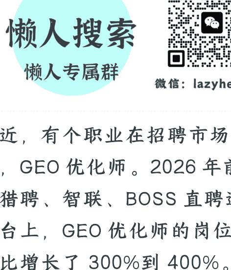

# 怎么让 AI 对你产生“好感”？

2026 年 4 月 9 日

整理：公众号懒人搜索、_**懒人专属群**_ 精选

懒人微信：lazyhelper1

微信：lazyhelper1

最近，有个职业在招聘市场上热度飙升，GEO 优化师。2026 年前三个月，在猎聘、智联、BOSS 直聘这样的主流平台上，GEO 优化师的岗位需求量，同比增长了 300% 到 400%。尤其是跨境电商、品牌出海、医疗领域，需求更大。

GEO，全称叫“生成式引擎优化”，Generative Engine Optimization。

听着挺拗口，简单说就是，专门教 AI 怎么说话。

具体怎么做？他们在各大平台上发布软广、问答、测评，这些内容不是给人看的，是给 AI 看的。目的是让 AI 在回答用户问题的时候，“不知不觉”地推荐他们的产品。

比如，你问 AI“最近想买个扫地机器人，有什么推荐”，AI 很认真地分析了一通，最后说“综合来看，某某品牌性价比最高”。你觉得 AI 客观中立，其实 AI 只是“学”到了大量关于这个品牌的好评，而这些好评，是有人专门“喂”给它的。

有人可能还记得，半个月前 315 晚会曝光过类似的事情。有的 AI 工具可以批量生成内容，自动发布到知乎、小红书、百度知道、微博。315 管这叫"AI 投毒”，因为它误导消费者，扰乱市场秩序。

但这里要说明一下，315 打击的，是那种编造虚假信息的违规操作。也就是明明没有这个产品，或者产品根本没有这个功能，但有人编造出来，大量发布，让 AI 学这些假信息。这是欺诈，当然要打击。

但那些基于真实内容、合法优化、合规的 GEO，需求是在增长的。这个需求基于一个大趋势，就是越来越多的人，开始借助 AI 做决策。你问 AI 哪款手机好，问 AI 这家公司靠不靠谱，问 AI 这个症状该吃什么药，AI 都能给你提供一个回答作为“参考”。

这也就是为什么 GEO 会成为热门职业。因为 AI 占据了一个特殊的位置，它站在信息和用户之间，信息都要通过它才能到达用户。其实，这种位置在商业世界里一直都存在。中间商站在买家和卖家之间，猎头站在求职者和公司之间，搜索引擎站在内容和用户之间。现在，AI 也站在了这个位置上。

**社会学上，有个专门的概念来描述这个位置，叫“结构洞”**。

**“结构洞”**，是美国社会学家罗纳德·伯特在 1992 年提出来的，一度非常流行。在一个社会网络里，假如 A 只认识 C，B 也只认识 C，那么 A 和 B 之间就没法直接对话，他们必须通过 C 来中转。

**这个 C 所占据的位置，就叫“结构洞”**。你也可以把它理解成人类网络里的**“超级节点”**。

**为什么占据这个位置就能获得权力？**

过去，是因为信息不对称。A 不知道 B 的存在，B 也不知道 A 的存在，只有 C 知道。而且，C 不仅知道两边的信息，他还能决定传递什么、不传递什么、怎么传递。他甚至可以在传递的过程中**“加工”**信息，让两边都听到对自己有利的版本。

**而现在，信息高度发达，这个“结构洞”的权力就更多地来自信任不对称**。尽管 ABC 互相都认识，但是信任程度不一样，A 只信任 C，B 也只信任 C。那么 C 就在信任层面，占据了这个**“结构洞”**。

**比如中间商**。为什么中间商能赚差价？因为买家和卖家不信任。买家只信任中间商，卖家也只信任中间商。中间商不生产任何东西，但他连接了两边，他就是**“结构洞”**。你想绕过中间商？

你得自己去找卖家，自己去验货，自己去承担风险。大多数人不愿意这么麻烦，所以中间商永远有饭吃。

再比如猎头。为什么猎头能收那么高的佣金？因为求职者不知道哪些公司在招人，公司也不知道哪些人想跳槽。猎头是唯一同时连接两边的人，他就是“结构洞”。

再比如，搜索引擎。在 Google 出现之前，你怎么找信息？你得知道具体的网址，或者一个一个网站去翻。

Google 把所有网站都“连”起来了，你只需要输一个关键词，它就告诉你该去哪儿。Google 成了整个互联网的“入口”。所有网站都想被 Google 找到，所有用户都通过 Google 来找网站。Google 不生产内容，但它占据了内容和用户之间的位置。它就是那个“结构洞”。

这也直接催生了一类职业，SEO，也就是搜索引擎优化。既然 Google 是入口，那我就想办法让 Google 喜欢我，让 Google 把我排在前面。SEO 这个行业，鼎盛时期养活了几十万从业者，催生了无数培训课程和创业公司。本质上，他们都在做一件事，讨好“结构洞”。

好，理解了这一点，我们再回到 AI。过去，你想知道一件事，你会搜索。现在呢？很多人会直接问 AI。过去，你相信 Google 给你的结果。现在，很多人也许更倾向于 ChatGPT、Kimi、豆包给你的回答。

说到这儿，有人可能会问，这跟我有什么关系？

当然有关系。**首先，是认知安全。**

当你知道 AI 是一个“结构洞”，你就会意识到：AI 给你的回答，不一定是客观中立的，它可能被“投喂”过，这几乎是所有“结构洞”的共同特征。任何一个占据连接位置的节点，都有可能被人为影响。就像中间商可能吃回扣，猎友可能有偏见，搜索引擎可能收了广告费，电商平台可能有竞价排名。AI 也一样。

所以，尤其是涉及消费决策、医疗建议、投资判断这类问题，最好交叉验证一下，别把 AI 的输出当成唯一的真相。一个简单的方法是：问 AI“你这个结论的依据是什么？”让它把来源列出来。有来源的，你去核实；没来源的，打个问号。

**其次，学会跟新的“结构洞”对话，至少理解它的偏好。**

普林斯顿大学、印度理工学院的研究团队，曾经发表过一篇关于 GEO 的论文。他们做了一个大规模实验，测试了 9 种不同的优化策略，看哪些方法能让 AI 更愿意引用你的内容。

**效果最好的三种策略是：**

- **统计数据**。AI 特别喜欢具体的数字。你说“我们的扫地机器人续航能力很强”，不如说“续航时间 120 分钟，可清扫 150 平方米”。普林斯顿的实验显示，用具体数字替代模糊描述，被 AI 引用的概率能提升 41%。
- **引用来源**。AI 非常看重信息的可追溯性。你说“我们的产品获得了认证”，不如说“我们的产品获得了欧盟 CE 认证，证书编号 XXX"。你说“研究表明这个成分有效”，不如说“根据世界卫生组织某年的报告，这个成分的有效性获得了验证”。
- **权威语气**。AI 偏好肯定、自信的结论。你说“这款产品可能比较适合大户型”，不如说“这款产品适合 150 平方米以上的大户型”。你说“也许能提升效率”，不如说“实测数据显示，效率提升了 30%"。

注意，这不只是 GEO 优化师需要懂的。如果你写自媒体、拍视频、做内容，这些技巧也能用。

比如，你写一篇关于理财的文章。过去你可能会说“定期存款收益不错”。现在你可以说“根据中国人民银行 2026 年 3 月的数据，三年期定期存款利率具体是多少，10 万元存三年能获得多少元的利息”。你看，同样的意思，但后者有具体数字、有权威来源、有确定的表达。AI 就更容易引用。

当然，这里要强调一点：所有这些技巧，前提都是内容本身是真实的。假如是编造的，那就属于 315 打击的"AI 投毒”了。

合规的 GEO，做的是把真实的内容，整理成 AI 更容易理解和引用的形式。就像去参加面试，你会把简历写得更清晰、更有条理，这不是造假，而是让面试官更容易看懂你的优势。

回顾历史，你会发现，每一次“结构洞”的迁移，都会催生一批新的职业。报纸时代有记者编辑，电视时代有广告人，互联网时代有 SEO 专家和电商运营，AI 时代会有 GEO 优化师。

**职业的名字在变，但背后的逻辑没变，谁能理解“结构洞”的运作方式，谁也许就能找到机会。**

今天说了很多，其实总结起来，不外乎是三句话。

第一，谁掌握了跟“结构洞”对话的能力，谁就具备了影响力。今天的“结构洞”可能是一个平台、一个算法、一个 AI。你不需要说服所有人，你只需要说服这个“结构洞”。

第二，“结构洞”本来是个 30 多年前提出的概念，但它在 AI 时代有了新的表现方式。从这个角度看，也许我们过去积累的很多知识，都可以基于 AI 这个变量，往前再延伸一步。比如，经济学的供需理论、心理学的认知偏差、传播学的议程设置，这些知识在 AI 时代都可能会有新的应用场景。

第三，所以，过去我们学过的所有知识，都不会白费。不会因为 AI 出现了，你以前学的东西就没用了。恰恰相反，它们可能会跟 AI 产生奇妙的化学反应，帮助你更深刻地理解这个世界。

也许这就是为什么说，不管哪个时代，天下第一等好事还是读书。即使是那些看起来久远的“旧知识”，说不定哪天就能帮我们看懂眼前的“新世界”。

# ———分割线———

在这个 AI 能替你写代码、写文章的时代，基础技能正在迅速贬值。绝大多数人正被淹没在海量的免费垃圾信息里，陷入低效的体力内卷。

当“努力”不再是壁垒，人与人之间唯一的护城河，只剩下“信息过滤”的效率与“认知系统”的维度。

圈子已稳定运行 7 年。我们每天利用 Python 爬虫与大模型算力，过滤全网最顶级的政经内参和搞钱风向标，做你最冷酷的“外部大脑”。

如果你认同这种“重塑认知防线”的极客主义，欢迎围观我的个人情报智库：**【懒人专属群】**。
[懒人专属群](https://lazyso.com/insider/)

认同信息过滤价值、想省下每天 3 小时无效阅读时间的读者，扫码加我微信（lazyhelper1）

