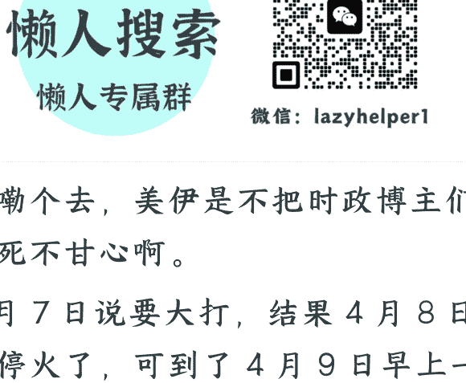

# 停火刚一天，霍尔木兹海峡再次被封锁？

260410 文/卢克文工作室 嘉宾 概略北方

整理：公众号懒人搜索，懒人专属群精选

懒人微信：lazyhelper1

我嘞个去，美伊是不把时政博主们折腾死不甘心啊。

4 月 7 日说要大打，结果 4 月 8 日早上停火了，可到了 4 月 9 日早上一起来，伊朗又指责美国违反停火要求，又把霍尔木兹海峡给封了。

这到底是要闹哪样啊？怎么停火刚维持了一天就变卦了？

对于伊朗这次变卦，我一点都不奇怪，因为这次美伊谈判，从根子上就带着毛病。

双方的立场相差巨大。

这几天，所谓“伊朗 10 项条件”被炒得火热，但很多人不知道的是，还有一个“美国 15 项条件”，主要包括：伊朗解除现有核能力、承诺不发展核武器、禁止在本土进行铀浓缩、移交约 60% 高丰度浓缩铀库存、拆除核设施，并允许国际原子能机构全面核查，伊朗停止支持地区盟友武装，禁止对其提供资金、指挥及武器支持，并限制弹道导弹的规模与射程。

作为交换，美国全面解除伊朗制裁，支持伊朗民用核电项目，并同意停火 1 个月。

显然，美国的盘算是，用取消制裁来换取伊朗放弃导弹和核计划，以及保证霍尔木兹海峡的畅通。

但伊朗不是傻子。

不仅坚持浓缩铀、霍尔木兹海峡，以及抵抗之弧的核心要求，还要求美国不再侵犯伊朗，美军从中东所有基地彻底撤出，全额赔偿伊朗在战争中的损失，解除所有制裁，释放所有海外冻结资产等等。

这差距实在太大了，根本没法谈。对这个问题，你我清楚，谈判的人也清楚。

而谈判代表的任务，是完成谈判，为了实现这个 KPI，一些必要的“外交模糊”就顺理成章地发生了。

所以，有人在伊朗十条中，划掉了“接受伊朗铀浓缩”，划掉了“美国撤军”，划掉了“赔偿损失”，把“伊朗在霍尔木兹海峡享有主导地位”修改成了含糊其辞的“安全地开放海峡”。

然后呢？这份新的“伊朗十条”就被送给了特朗普。

特朗普对“新伊朗十条”的态度，是能接受，但不完全满意，所以才在 4 月 7 日晚上玩了一套极限施压的手段，想额外讹诈一些东西出来，结果伊朗表现很强硬，最后特朗普只能就坡下驴，说可以以“伊朗十条”为基础来谈。

当然，特朗普宣布的“伊朗十条”，是他看到的那份修改过的。

但万万没想到的是，停火之后，伊朗那边欢天喜地，居然把旧的“伊朗十条”给公布了！而且，特朗普说的是“伊朗十条”是基础，但到了伊朗人嘴里，就变成了美国接受“伊朗十条”了！

显然，这就是只顾自己的赢学，不顾特朗普的赢学了。

所以，旧版“伊朗十条”被《纽约时报》转载后，特朗普大怒，骂报纸上的“伊朗十条”是“完全虚假的”“捏造的骗局”。

`一赢各表`？

- 1 一赢各表`？

显然不是，原意是“一赢各表”。

- 一赢各表”的好处，在于满足双方的内宣需求，缺点在于，对账的时候对不上，会出很多问题。

第一就是霍尔木兹海峡通航的问题。美国方面对通航的理解，是立即、安全、无条件地开放海峡，不能收费，不能检查。

但伊朗方面呢？坚持海峡是“有限、由伊朗控制的方式开放”，所有船只必须接受伊朗方面的协调。

啥叫“协调”？无非也就是收费。

问题来了，对于滞留波斯湾里的油轮来说，到底应该信谁的？

不是没有船只信特朗普的，比如油轮“AUROURA"号，一听说停战，马上往出口跑，刚跑到阿曼穆桑代姆半岛海岸附近，突然收到了伊朗的警告，于是赶紧掉头，灰溜溜地逃回了波斯湾深处。

美国一看，当然不干啊，于是万斯直接警告：不履行重开海峡的承诺，停火协议将终止，伊朗将面临“严重后果”。

白宫新闻秘书莱维特还提醒伊朗：停火协议以海峡“无条件开放”为前提，这句话要“按字面理解”。

伊朗懵了，我啥时候做出无条件开放的承诺了？你们不过是吧？好，那都别过了。

第二，黎巴嫩的问题。

伊朗的要求，是要停战都停战，不仅伊朗这边停，哈马斯、黎巴嫩真主党、也门胡塞武装那边也要停。

但在以色列看来，你们美伊停战和我有什么关系？内塔尼亚胡更是公开声明，停火协议不包括真主党。

伊朗一看，你这不是打我脸么？说好了全线停火，你怎么翻脸不认？

第三，浓缩铀的问题。

浓缩铀是伊朗的命脉，无论如何都不会放弃，所以这次在“旧十条”中，伊朗死咬浓缩铀条款绝不松口。

但如果特朗普认可了“伊朗十条”，那是不是就意味着特朗普认可伊朗拥有浓缩铀的权力呢？

不管是不是这样吧，反正伊朗这么认为，也这么公布出来了。

但特朗普马上辟谣了，他说，未来伊朗将不会进行铀浓缩活动，美国将与伊朗合作，挖掘并清除所有深埋的核“尘埃”。

伊朗能答应才怪。

这种情况下，双方停火或谈判都没有意义。所以，伊朗重新封锁了霍尔木兹海峡，海峡开放了一天，只跑出去两艘船。

这次的乌龙，不知道是伊朗还是美国或是巴基斯坦的谈判人员，在中间改了伊朗的谈判条件，最后闹出这种事情来。

说实话，这种解释听起来挺有意思，但别忘了，现在是互联网时代，信息非常畅通，你前脚这么玩，后脚双方一对账，不就露馅了？

所以，事情绝非那么简单，这次乌龙，本身就是谈判双方想停战，但又只想占便宜不想吃亏，不得不揣着明白装糊涂导致的。

- 首先，是停火到底包不包括黎巴嫩。
- 美国和伊朗各说各的，不过巴基斯坦总理夏巴兹明确表示，停火协议包括黎巴嫩，这也是伊朗的核心条件。

很简单，如果伊朗坐视不理，“抵抗之弧”的老大还能当得下去？

但在美国看来，美以对伊朗的战争，和以色列对黎巴嫩真主党的战争，是两场战争，我只管我的，至于以色列和别人打，跟我没关系。

- 美国心知肚明，但就是要模糊化处理。因为美国拦不住以色列。美国要是能拦住以色列，这场战争根本就不会发生。
- 以色列已经默认了，达不到此前规划战略目标（推翻伊朗政权）的现实了，但这并不影响以色列想最后捞一把，那就是黎巴嫩。

说个冷知识，此前被拆散的抵抗之弧，最近又有拼起来的迹象。

原来伊朗通过伊拉克、叙利亚通道，向真主党输送军事教官和弹药，虽然叙利亚变天，但是经过一系列努力，伊朗居然把北方交通线又给打通了，当然，朱拉尼大帅默认了这条交通线的存在，但要抽成一部分。

以色列怕的是，如果美伊真的达成协议，伊朗虽然可能不再向自己发射导弹，但会不会通过这条通道，帮真主党恢复力量？到时候伊朗的高超声速导弹、火箭弹、无人机，不用再途经海湾国家的拦截，就能直接打到以色列了。

所以，最好灭了真主党，如果灭不了，最起码也要在叙黎边境打出一道隔离带来，防止抵抗之弧再次成型。

这种关乎国运的大事，这么难得的机会，以色列怎能因为美国的一句话而放弃？

最关键的，美国也不是真心实现和平。

美国人的目的，是让伊朗把海峡打开，让油价降下来。

谈判的时候就是不说停火包不包括黎巴嫩。

其次，就是伊朗的盘算。

大家要明确一点，现在停火是停火了，但这个停火，没有任何的停火协议，具体细节是要在 4 月 10 日的谈判中再反复博弈的。

而这场谈判，其实伊朗的牌少得可怜，最大的筹码，无非也就是现在滞留波斯湾的那 425 艘油轮了。

现在知道为啥美国一个劲强调要无条件开放海峡了吧？

- 先让伊朗彻底开放海峡，把油轮全放出去，解除能源危机，然后谈判桌上随便拿捏伊朗，核问题、导弹问题、地区影响力问题，美国想怎么谈就怎么谈，伊朗没有任何反制手段。

可问题在于，伊朗也不傻啊！

对伊朗来说，425 艘油轮就是人质，不放油轮，美国就有求于伊朗，谈判时必须让步。一旦放了，油轮全走了，油价暴跌，美国没了软肋，伊朗还有什么牌可打呢？

所以，封锁不是目的，扣押油轮当筹码才是目的。

而且，从长远来看，伊朗的目的，是将海峡“内水”化，把海峡从“国际水道”变成“伊朗管控的收费通道”，弥补伊朗的战争损失。伊朗说开就开说关就关，就是强化“伊朗主导”的事实存在，谈判桌上先定这个基调，再谈其他问题。

以色列空袭黎巴嫩，刚好给了伊朗借题发挥的完美借口。

本质上来说，伊朗想开放海峡，再炸他也会开放。不想开放，随便一个理由都能封锁。

很多人觉得伊朗“出尔反尔”，但为了伊朗的未来，这也是没办法的事情，毕竟伊朗现在元气大伤，只能把油轮变成人质，用最小的成本，撬动最大的利益。

至于两周的停火能不能维持下去，伊朗到底能不能把军事上的筹码，换成保证国家安全的实实在在的利益，就看 4 月 10 日的谈判了。

这场战争何去何从？我们拭目以待。

——— 分割线 ———

绝大多数人只盯着眼前的工资，却不知道一次远在中东的冲突、一次降息的决议，就能在一夜之间洗牌普通人的财富。

看懂宏观，是为了在周期切换时，不被当作代价。

如果你认同这种“抬头看路”的长期主义，欢迎围观我的个人情报智库：【懒人专属群】。

圈子已稳定运行 7 年。我们每天利用 Python 爬虫与大模型算力，过滤全网最顶级的政经内参和搞钱风向标，做你最冷酷的“外部大脑”。

查阅圈子完整数字资产与上车门槛：https://lazyso.com/insider/

认同价值的。扫码加我微信，备注：【进群】

