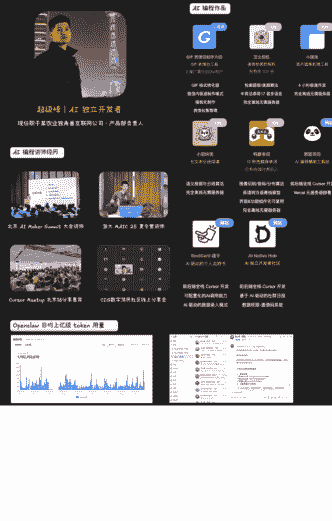
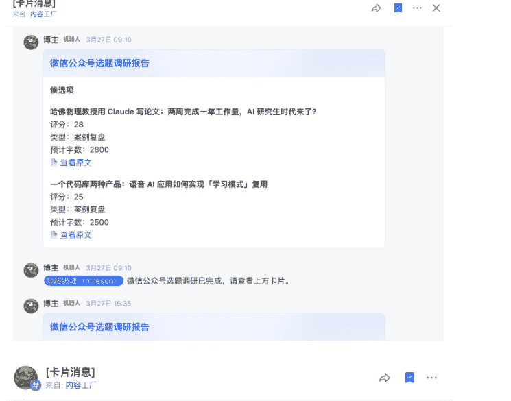
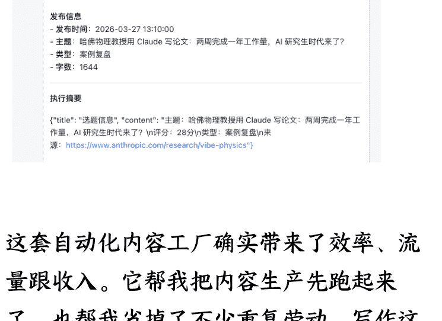
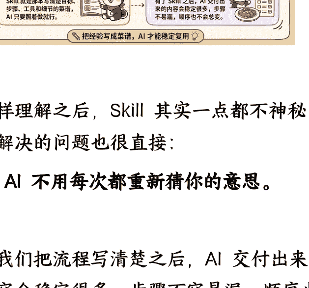
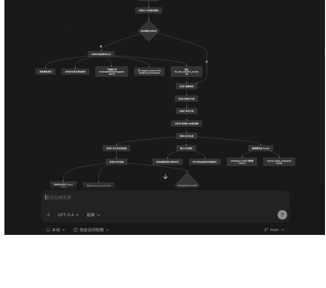
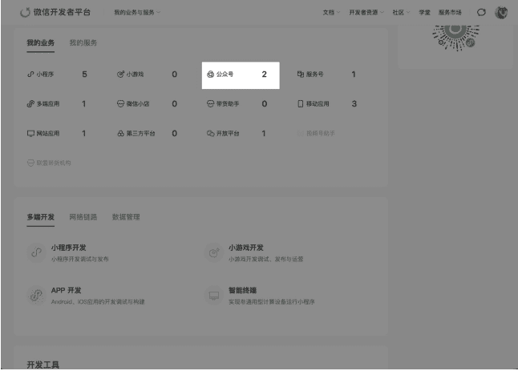
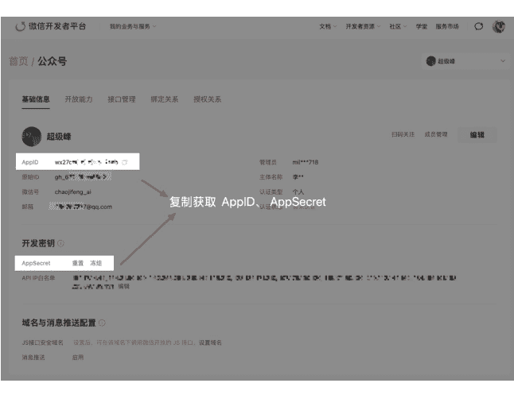
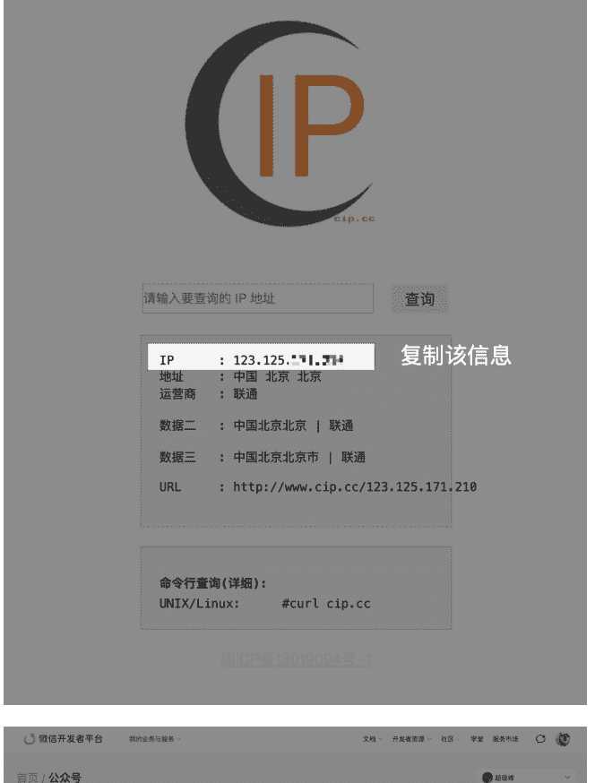
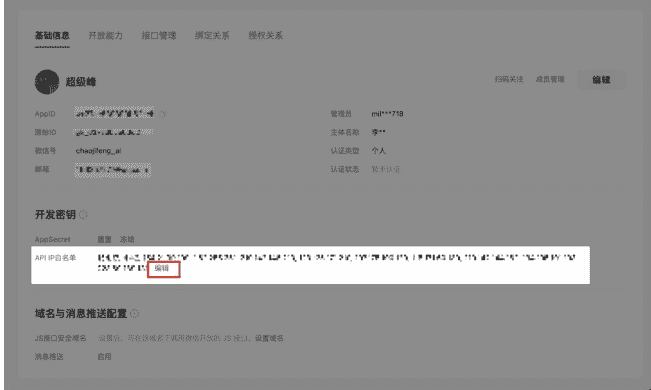
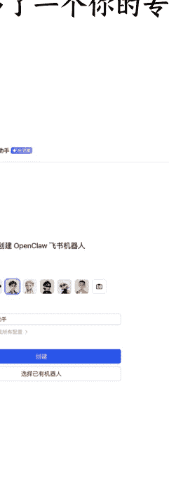

# 如何借助 Skill 和 OpenClaw 自动化来实现公众号写作变现？

## 260413 副业 SC 精华

公众号懒人搜索，懒人专属群独享

懒人微信：lazyhelper1


大家好，我是超级峰，好久不见。



这些年我一直在同时做几件事：做产品、做开发，也持续写内容。过去几年，我做过累计 200 万用户的小程序，也用 AI 编程在一年内高强度上线了 7 款产品。

公众号写作，是我最早想动手改的一块。因为对我来说，真正麻烦的从来不是偶尔写出一篇文章，难的是持续写、稳定写，还得越写越像自己。

前这段时间，我真的把这件事往前推了一步。我用 Skill 把写作流程拆开，再把它接进 OpenClaw，最后搭出了一套自己的公众号内容自动化工厂。

从自动采集选题，到自动内容创作，
OpenClaw 小龙虾借助 Skill 帮我完成的全流程自动化。





这套自动化内容工厂确实带来了效率、流量跟收入。它帮我把内容生产先跑起来了，也帮我省掉了不少重复劳动。写作这件事，第一次有了“能持续运转”还能赚到钱的感觉。

# 哈佛教授用 Claude 写论文：两周干完一年活

# 哈佛教授用 Claude 写论文：两周干完一年活

# 管理 10 个 Codex 账号是什么体验？

# 流量主

## 广告管理

### 昨日收入（元）明细 >

| 指标 | 数值 |
| :--- | :--- |
| 昨日收入（元） | 21.80 |
| 日环比 | +1333.55% |
| 周同比 | +6503.03% |
| 本月收入（元） | 35.02 |

### 指标趋势数据明细 >

近 7 日

近 30 日

自定义

全部

底部

文中

后贴

互选

返佣

关键词

留言区

收入

曝光量

点击量


文章收入

另外，当我通过这套自动化流程运行了一个月之后，我的想法也变了。

因为我后来发现，能自动跑起来，和真的长期跑得好，不是一回事。

全自动确实能帮我先把持续输出做出来，
甚至也帮我拿到过结果。可如果你真的想
把内容这件事长期做下去，你很快就会碰
到另一个问题：文章真正值钱的地方，很
多时候并不在生成这一步，更多还是创作
者自己的判断、观点和品味，否则大部分
情况都是在抽奖碰运气。

所以这篇文章，我想向你讲清楚三件事：

- Skill 到底是什么
- OpenClaw 到底是什么
- 它们怎么连在一起，把公众号写作真正跑起来

以及最后，我想讲讲我自己跑完之后得出
的结论：全自动帮我跑起来了，也拿到了
一些结果，但人机协同，才更像这件事长
期可持续的 AI 内容自动化的未来。

## 一、Skill 到底是什么

很多人刚听到 Skill 这个词，第一反应可
能会有点懵。

这个新的 AI 能力的名字里带着“技
能”，又总和 Agent、自动化这些词放在
一起，很容易让人觉得这玩意儿很复杂，
像是什么要写很多代码、还要懂很多技
术，才能真正上手的东西。

其实没那么难，如果让我用一个最简单的比喻来解释，你可以把 Skill 理解成一本菜谱。可以先想象这样一个场景：你请来了一位很厉害的大厨。刀工很好，火候也稳，学东西还特别快。这位大厨，就很像现在的大语言模型，比如 Claude、ChatGPT。

不过，问题也很明显。他虽然厨艺好，但他因为是从外面新请进来的。他不知道你家里平时爱吃什么口味，也不知道你家厨房里的调料放在哪里。

所以每次你想吃一道菜，都得重新站在旁边交代一遍：

"今天做个西红柿炒鸡蛋。"

"鸡蛋炒嫩一点。"

"别放糖，多放点盐。"

"最后装蓝色那个盘子里。"

这样做当然也能把菜做出来。运气好的时候，味道还挺不错。但，往往口味跟你想的会偏差比较大，比如你喜欢甜的，他给你煮成了咸口。

这就是很多人现在用 AI 时最真实的感受。

所以问题就来了，如果一件事你已经反复做了很多次，难道还要每次都重新讲一遍吗？

大多数人做到这里，就会自然想到一个办法：与其天天站在厨房门口口头交代，不如把做法认真写下来。于是你花点时间，写出一本自己的小菜谱。

里面写得很清楚：

- 这道菜想做成了什么效果
- 要准备哪些材料和工具
- 第一步先做什么
- 第二步再做什么
- 哪些细节不能错
- 最后要怎么装盘

这本把流程、规则和细节都写清楚的小册子，就是 Skill。

以后你再想吃这道菜，就不用重新站在旁边讲一遍了。你只要把菜谱递给大厨，说一句：“按这个做。”

他就能照着步骤往下走，或者这个菜谱直接就给大厨，它自己每天按照这个菜谱每天给你做最符合你口味的菜品，这就很完美了。

放到 AI 这里，道理也是一样的：

- 大模型，是那个聪明的大厨
- Prompt，更被你临时的口头交代
- Skill，就是你整理好的那本菜谱

所以，Skill 到底是什么，我们通过一张图来加深理解下：



这样理解之后，Skill 其实一点都不神秘。它解决的问题也很直接：

让 AI 不用每次都重新猜你的意思。

当我们把流程写清楚之后，AI 交付出来的内容会稳定很多，步骤不容易漏，顺序也不会总变。

放到公众号写作这种场景里，这种差别会特别明显。如果你只是丢一句：“帮我写一篇公众号文章。”

AI 当然也能写，但它每次会怎么理解，先出标题还是先出大纲，要不要先给你几个候选方向，正文输出成 Markdown 还是 HTML，配图和发布要不要接在后面。

没有流程、只有目标的任务执行，AI 基本都是即兴发挥创作，每次的输出大概率都是不一样的，这样也很难形成账号对外统一的风格与品牌形象。

所以，Skill 到底解决了什么问题，我觉得核心解决的是持续、稳定并且正确地执行某个确定业务流程 SOP 的需求。

一旦把流程提前写进 Skill，这条创作链路就开始有了固定顺序。接下来真正要写清楚的，通常就是下面这几项：

- 输入通常是什么
- 先做标题还是先做大纲
- 要不要先给我几个候选方向
- 哪一步可以自动继续
- 哪一步必须等我确认
- 最后交付成什么格式

等这些东西写清楚之后，AI 最终出来的内容会稳定很多，步骤不容易漏，顺序也不会总变。

所以我现在看 Skill，它更像一种把经验沉淀下来的方法。

以前很多事情只能靠你自己盯着做、盯着改。现在你可以先把流程拆开，把细节写明白，把判断条件整理出来，最后交给 AI 去执行。

你也可以把它理解成一份 SOP。只不过这份 SOP 的读者，不是同事，也不是下属，而是 AI。

这也是为什么我后来越来越重视 Skill。因为你一旦开始认真写一个 Skill，你就会发现，它会逼你面对一个特别现实的问题：

**你到底有没有把这件事真的想清楚？写 Skill 本质上是在梳理业务，让业务标准化的过程**

比如，就拿公众号写作来说。你要真写一个 Skill，就绕不开这些问题：

- 到底是先给选题，还是先给素材
- 是先出标题，还是先出大纲
- 要不要先让我挑方向
- 生成之后要不要直接继续，还是中间停下来等我确认
- 最后是只出初稿，还是连排版、草稿箱一起接上

这些问题平时放在脑子里，可能觉得“差不多就行”。但一旦要写进 Skill，就不能含糊了。

所以写 Skill 这个动作，表面上是在教 AI 做事，实际上也是在帮你自己把流程梳理清楚。

如果你现在刚接触这个概念，我建议你先别把 Skill 想得太大。

你不需要一上来就做一个复杂系统。先从一件自己已经重复做过很多次的小事开始，把它拆成几步，写成 AI 能看懂、能照着做的说明书，这就够了。

这就是 Skill 最好的入门方式。

## 二、第一个 Skill，应该怎么做

看到这里，你心里可能已经在想：

好，那我懂了。Skill 像一本菜谱。可我的第一本“菜谱”，到底该怎么写？

第一次接触 Skill，最容易停在这里：概念听明白了，真要动手时，却不知道第一版到底该写多大、写到什么程度。

很多人第一次上手，就想直接做一个“全自动公众号写作系统”，恨不得把找选题、写标题、出大纲、写初稿、排版、发草稿箱，全都一次性包进去。

想法当然没问题。但是这样大概率会让事情执行起来的效果越来越乱。

所以我现在更建议这样开始：<br/>第一个 Skill，不用追求多全，也不用一上来就把所有流程都塞进去。先让它稳稳帮你做对一件具体的小事，就够了。

比如，你完全可以先从下面这些动作里挑一个开始：

- 根据一个选题，先出 5 个标题和一个大纲
- 把一段录音整理成结构化摘要
- 把几份资料整理成一篇公众号初稿
- 把群聊内容总结成日报

这些事情有个共同点：都很具体，而具体，恰恰是 Skill 最好的起点。

因为一件事越具体，你越容易把它拆清楚，你越能拆清楚，AI 越容易稳定执行。

所以现在开始做第一个 Skill，通常不是先问自己“我要做个什么系统”，而是先问一句：

我到底想让 AI 先替我接住哪一段重复劳动？

因为这样你更容易先想清楚：你到底想让 AI 先帮你做哪一步。

接下来，真正开始写的时候，我现在一般只先写 4 样东西：

- **触发条件**：什么情况下，要启动这个 Skill
- **输入内容**：要给什么材料，它才能开始做
- **执行步骤**：它应该先做什么，后做什么
- **输出结果**：最后要交付成什么格式

如果你想先看一眼“第一个 Skill 的骨架”长什么样，大框架会覆盖如下这 4 个要素：


这 4 个要素很重要，因为很多 Skill 第一版能不能跑起来，关键就看这 4 件事有没有写明白。

我们还是拿公众号写作举例。假设我现在不追求一步到位，只想先做一个“根据选题生成标题和大纲”的 Skill。

那它的第一版骨架其实很简单：

- **触发条件**: 当我给出一个选题，或者说“帮我写这篇公众号”
- **输入内容**: 选题、目标读者、我想强调的方向
- **执行步骤**: 先生成几个标题候选，再给出推荐标题，最后生成结构化大纲
- **输出结果**: 标题候选 + 推荐标题 + 正文大纲

你会发现，它没有你想象中那么复杂，复杂的地方，很多时候不在 Skill 本身，而在我们总想把后面的所有事情一次性打包进去。

但第一个版本，最重要的不是“包得全”，而是“写得清楚”，如果你愿意，甚至可以先把第一版写成最朴素的样子，比如：

```markdown
### Skill 名称
根据选题生成公众号标题和大纲
```

### 触发方式

当用户给出一个公众号选题时启动

### 输入

- 选题
- 目标读者
- 希望强调的方向

### 步骤

1. 先生成 5 个标题候选
2. 选出 1 个推荐标题
3. 根据推荐标题生成三级大纲
4. 标出每一部分要写的重点

### 输出

- 5 个标题候选
- 1 个推荐标题
- 1 份结构化大纲

你看，这已经是一份很像样的 Skill 雏形了，它不复杂，也不花哨。但它已经能开始帮你做事了。

而且只要这个小 Skill 已经能稳定帮你做对一件事，后面你再往上加内容，其实就顺很多。

比如你后面可以继续补：

- 要不要参考你过去的文章风格
- 要不要先给多个方向让你选
- 要不要区分公众号、小红书、即刻这些不同平台
- 要不要把后面的初稿生成也接进去

这时候，你是在一个已经能跑的基础上继续扩。而不是对着一个很大的念头，从头硬搭。

这里我还想提醒一个特别容易被忽略的点：**编写你的第一个 Skill**

很多人会误以为，做 Skill 最难的是“怎么把那份 **SKILL.md** 的 Markdown 写尽可能格式标准、内容完整”。

其实真正难的，从来都不是排版。而是你能不能把这件事想清楚。

只要你已经把流程想清楚了，哪怕你先写的是一份很粗的提纲，后面也完全可以再让 AI 帮你把它整理成更完整的 Skill 文档。

所以说到底，第一个 Skill 最重要的，不是文档写得有多高级，而是你有没有把下面这些事情讲明白：

- 它什么时候开始
- 它拿到什么输入
- 它按什么顺序做
- 它最后交付什么

你把这些 4 件事写清楚，第一版就已经成立了，剩下的东西，都是后面慢慢补的。所以，如果你现在正准备写自己的第一个 Skill，我最建议你的起手动作不是打开一个复杂模板，而是先打开你的画流程图的工具手动绘制业务流程图，或者更高效的方式是直接告诉 AI：

**我打算实现 XXX 自动化，让我们一起来梳理需要完成这个业务的流程图**

就像我打算要写一个让 Agent 交接任务给其他 Agent Skill，如下图所示，Agent 先帮我梳理出来流程图让我确认，当我确认通过后，就可以直接让 AI 帮我直接按确定的流程图实现 Skill 了。



通过编写流程图，我们具备了跟 AI 很好可视化交流的空间，此处仅以 AI 编程的最高效的方式举例，我们可以很直观地提

## 三、OpenClaw 到底是什么

前文了解到即将创建的 流程型的 Skill 的样子。

大家也可以用比如 Viso 或者 ProcessON 等流程图制作工具，自己规划完成流程图后，图片发送给 AI，然后使用 /skill-creator 这个创建 Skill 的 Skill 让 AI 帮助我们落地属于自己的初版 Skill。

说明：可以通过此地址下载由 Claude Code 产品所属公司开源的 skill-creator Skill:
https://github.com/anthropics/skills/tree/main/skills/skill-creator

建议大家制作 Skill 要抱着打磨产品的心态，它可以是个很小的工具，比如帮你将一段文案输入整理成更符合排版规则的排版工具；

也可以是融入了各种流程、脚本接口的复杂流程系统，这取决于你定义业务的能力以及对 Skill 的掌握熟练程度。

有了 Skill 之后，接下来最自然的问题就是：这本“菜谱”写好了，到底谁来按它真正开工？

最近两三个月，OpenClaw 在国内一下子热起来了。很多人平时也不直接叫它 OpenClaw，而是更习惯叫它“小龙虾”。

为什么会火？很大一个原因是，大家会很自然地把它理解成“数字员工”。因为它最直观的一个能力，就是能结合定时任务，到了设定好的时间，自己开始干活。比如每天早上固定推选题，或者定时帮你跑一段流程。

而且这种“数字员工”的感觉，不只是因为它能按时开工，更是因为它可以持续不断地工作。很多时候你睡了，它还在跑；你去忙别的了，它还在按流程往前推。这也是为什么很多人第一次接触小龙虾，就会觉得自己像多了一个 24 小时不停工的 AI 员工。

不过这里也要分情况看，如果是比较简单的事情，你直接把要求讲给小龙虾，它记住之后，很多时候就能直接帮你做。比如固定时间提醒、跑一个简单的任务、按同样方式处理一类重复动作，这些都比较直接。

但内容创作不是这种简单任务，因为一篇内容真正往下走，往往不是一句话就能交代完的。你要考虑选题，要考虑从什么角度写，要考虑内容结构，还要考虑排版格式、交付形式，最后甚至还要接到发布这一步。

这种流程一长，环节一多，如果你还是靠临时口头交代，小龙虾当然也能帮你做一部分，但整个过程就很容易越来越散。

所以，一旦事情开始变复杂，最稳的做法还是先把它整理成一份 SOP，也就是 Skill。

你先把这件事什么时候开始、按什么顺序做、做到什么程度、最后交付什么写清楚，小龙虾再接过去，后面才更容易稳定跑起来。

所以对我来说，小龙虾最适合接住的，不是一团还没想清楚的任务，而是一条已经被你写清楚的流程。

你把这条流程写成 Skill，它就能按节奏往下做。如果前面的 Skill 本身就是模糊的，那它再勤快，最后也只能把一件模糊的事情重复执行下去。

## 流程能不能稳定跑起来，关键在于 Skill

所以到这里，如果只记一句话就够了：Skill 是把流程固定下来，小龙虾是把这条流程持续、正确、稳定地执行下去。

## 四、Skill 和 OpenClaw，怎么连在一起

讲到这里，你大概已经能分清这两个东西了：

- Skill，像一份写清楚步骤的 SOP
- OpenClaw，也就是小龙虾，像一个会按时开工、会往下干活的数字员工

那接下来最实际的问题就是：这两个东西，到底怎么配合起来用？

你真要上手的时候，先记住这 4 步就够了：

1. 先把做事的方法写成 Skill
2. 再把这个 Skill 交给小龙虾
3. 再告诉它什么时候开始
4. 它就会按这套方法往下做

这就是最基础的连接方式，说白了，就是一句话：你先把规则写清楚，再把执行交出去。

### 简单任务，直接交代也能做

这里我想先把一个边界讲清楚。不是所有事情都非得先写成 Skill，才能交给小龙虾。

如果只是一些简单、短链路的任务，你直接临时安排给它，它很多时候也能做。比如定时提醒、固定时间推一个简单结果、帮你处理一类重复动作，这些问题都没问题。

也就是说，小龙虾并不是离开 Skill 就完全不能干活。简单任务，你直接交代，它照样能做一部分。

### 内容创作这种长流程，不能只靠临时交代

内容创作往往是一条更长的流程，里面不只是“开始干活”这么简单，还会涉及：

- 选题
- 结构
- 内容生成
- 配图
- 格式整理
- 交付形式
- 甚至后面的发布

这种事情，如果只是临时交代给小龙虾，
当然也可能跑出一点结果。

### 结果

结果。但问题就在这儿：这种方式很难保证稳定输出。

因为你当下交代的时候，考虑的点未必完整。今天想到这一步，明天又补那一步，后天再改一下顺序。这样一来，小龙虾每次输出给你的东西就可能都不一样：今天先出标题，明天先出大纲，今天像文章，明天像草稿，最后结果自然很难一直稳定。

所以一旦事情开始变长、变复杂，最稳的做法还是先把它写进 Skill，用流程说明的方式将执行的步骤以及需要让 AI 调用的工具说明固定下来。

### 标准化：Skill 真正厉害的地方，是把流程框架固定下来

因为 Skill 不是一句临时交代。它更像一个固定下来的流程框架，你把可以这件事拆解为：

- 什么时候开始
- 按什么顺序做
- 哪些环节必须保留
- 哪些地方需要停下来
- 最后交付什么

### 如何借助 Skill 到 OpenClaw 自动化来实现公众号写作变现？

![img/6a4d291a9dcb2769152f9c8806be9726_23_0.png]

为什么 skill 能让流程固定下来。png

先写进 Skill 里，后面小龙虾 OpenClaw 才更容易稳定照着去跑。这一点对内容创作尤其重要。

因为你在写文章的时候，真正难的往往不是某一步本身，而是整条链路一长，你脑子里的标准很容易漂。

今天你更在意标题，明天你更在意结构，后天你又突然觉得排版和发布也得加进去。

如果这些都只是临时想到、临时补充，那小龙虾每次接到的其实都不是同一套任务。它当然就很难稳定，而 Skill 的作用，就是把这条流程先固定下来。

这样一来，小龙虾接到的不是一团模糊的要求，而是一条已经写清楚、可以重复执行的工作流。

### 可迭代：Skill 还有一个很大的好处：它可以一直优化

这也是我后来越来越看重 Skill 的原因。

![img/6a4d291a9dcb2769152f9c8806be9726_24_0.png]

它不是写完就结束了，它其实是可以不断优化的。

今天你发现标题阶段还不够稳，可以回到 Skill 里补规则，明天你发现大纲输出还不够像你，也可以继续改 Skill。

后面你每优化一次，这套流程就会更清楚一点，也更稳定一点，所以从这个角度看，Skill 不只是说明书，它更像是这条流程的“固定骨架”。

骨架先搭起来，后面你再一点点把肉补上去，这样整个系统才会越来越稳。

如果没有这层骨架，小龙虾就算很勤快，最后也只能把一件模糊的事情重复执行下去，而模糊的事情，重复多少次，都还是模糊的。

### 稳定运行：流程能不能稳定跑起来，关键在于 Skill

![img/6a4d291a9dcb2769152f9c8806be9726_25_0.png]

我现在更愿意把这件事理解成：

Skill 和 OpenClaw 真正连起来的关键，不是你有没有把它搞得很自动，而是你有没有先把流程固定下来。

- 流程没固定，小龙虾就只能边做边猜
- 流程固定了，小龙虾才有机会越做越稳

这也是为什么我会觉得：对内容创作来说，真正让长流程稳定下来的，不是“让小龙虾按时去干活”这件事本身，而是你有没有先把这条流程通过 Skill 固定下来。

如果现在还想记一个最简单的版本，那就记这句：Skill 是把流程固定下来，小龙虾是把这条流程持续、正确、稳定地执行下去。

## 五、拿到结果的底层逻辑，只需要做对 3 件事

很多新手以为把流程交给 AI 就万事大吉了，但如果真想靠自动化拿到结果（流量与变现），光追求“全自动”是远远不够的。回过头看我的整个探索过程，底层逻辑其实就是逐步做对了这 3 件事：

- 先全自动跑起来：解决“持续输出”的频率问题，告别三天打鱼两天晒网。
- 把人放回“选题”节点：解决“写什么”的方向问题，确保内容有长期价值。
- 在流程中注入个人“观点”：解决“像不像你”的风格问题，避免沦为干瘪的机器文。

我最早把小龙虾用到公众号写作里，也是沿着这个逻辑，先让流程自动跑起来开始的：先全自动跑。

> **[卡片消息]**

来自：内容工厂

**微信公众号选题调研报告**

[查看原文]

**候选项**

Vibe Coding XR: Google AI 革新 XR 开发的工作流
评分：35
类型：tech_breakthrough
预计字数：2800
[查看原文]

Groundsource: Gemini 如何将新闻报告转化为结构化数据
评分：36
类型：tech_application
预计字数：2800
[查看原文]

**博主** 机器人 3 月 29 日 06:15

[查看原文]

**博主** 机器人 3 月 29 日 06:15

 [@超级峰 (milesen)] @超级峰 (milesen) 微信公众号选题调研已完成，请查看上方卡片。

> **[卡片消息]**

Google Research 发布 Groundsource，用 Gemini 从全球 80 种语言新闻中提取结构化灾害事件，构建 260 万条洪灾数据集，82% 准确率，已部署在 Flood Hub 提供 24 小时山洪预警。LLM 正从对话工具进化为科学基础设施。

发布信息
- 发布时间：2026-04-01 22:25:36
- 主题：Google Groundsource 深度解析：用 Gemini 将 260 万条新闻转化为灾害数据，LLM 如何重构 AI 预测的基础设施层
- 类型：tech_breakthrough
- 字数：1994

执行摘要

开头钩子：LLM 不再只是聊天工具

传统灾害数据的三大瓶颈（卫星/传感器/人工标注）

LLM 独特优势：多语言理解 + 语义推理 + 规模化的时效性

技术链路四步拆解：新闻抓取→语言标准化→Gemini 三重推理→地理编码

实战验证：260 万条数据→24 小时预警

独立开发者启示：非结构化数据+LLM 信号提取=新基础设施

结语：LLM 的终极角色是让世界数据可用化的基础设施

链接：https://mp.weixin.qq.com/cgi-bin/appmsg?action=edit&msgid=XiFwhThnQcyWldXsl4DqyN8b__cbElWgBwX1Fp4QVveZ01VnTIS4V2wzfKit3vsu

那时候我的想法比较简单，认为既然这条流程已经能接起来了，那我就先让它自己往下跑，看它到底能跑到什么程度，所以第一阶段，我做的事情其实就是：

- 让它自己找选题
- 让它自己生成标题和大纲
- 让它自己往下写初稿
- 让它自己整理格式
- 最后，把生成的文章自动推送到微信公众号草稿箱

这套方式最大的好处，就是能先把持续输出这件事跑起来。

以前写公众号，最累的地方往往不是“不会写”，而是整条链路太长了：选题、找素材、理结构、起标题、写初稿、调格式、排版、草稿箱，每一步都要你自己切来切去。

而当这条链路真的被小龙虾接住之后，最明显的变化就是：内容开始持续产出了。

不是今天有状态才写，明天没状态就断。而是它真的能按节奏往前推，先把东西做出来。

这件事对我当时很重要。因为第一阶段，我要的不是完美，而是先跑起来。

建议大家也需要抱着这种心态，就跟做产品或者启动某个事情一样，重要的是快速执行，获得反馈再优化，而不追求完美。

### 先跑起来，才有可能持续跑起来

这个阶段不是没有结果，恰恰相反，我就是因为它真的跑起来了，才开始认真对待这件事。它帮我把很多重复动作拿掉了，也确实让我吃到过自动化的红利。

有些文章的数据表现是不错的，甚至会让你觉得：这套东西是不是已经差不多成了？但跑着跑着，我开始越来越清楚一件事：这种结果有时候更像抽奖。

因为 AI 获取资讯选择，然后 AI 创作内容，让全流程都在不确定性中，这篇文章为什么成了，下一篇还能不能照样成。

也就意味着，它能帮你跑起来，但还不等于它已经帮你跑稳了。

### 问题不是它不会写，问题是它不一定写得像你

这也是我后来开始反思的地方，全自动最容易解决的是“有没有内容产出”。但内容创作真正难的地方，很多时候并不只是“产出”，真正难的是：

- 这篇到底该不该写
- 这个题值不值得发
- 这篇应该从什么角度切
- 哪些观点必须强调
- 这篇写出来到底像不像你

这些东西，才是一篇文章最后有没有灵魂、有没有判断、有没有长期价值的关键，而这些东西，恰恰不是纯全自动最擅长的部分，所以我后来慢慢意识到：内容创作这件事，光靠“自动写出来”是不够的。

因为文章最值钱的部分，不只是生成能力，更多还是创作者自己的判断、观点和品味。

### 高质量内容的秘诀是：把人放回关键位置

当内容完成全自动化生产后，我发现成功出爆款的概率其实是比较低的，虽然表面的创作数量跟持续产出的繁荣给人不少假象。

我也开始意识到，真正一篇优质的内容离不开创作者本身的偏见与思想，我不再让它一路全自动往下冲。而是开始把最关键的判断节点，重新交回给自己，最明显的变化，就是放在了选题这里。

以前是它自己往下找、自己往下写。后来我开始让它先给我候选选题，我来做第一轮筛选，这个变化看起来不大，但其实很关键。

因为一篇文章值不值得写，很多时候在选题这一关就已经决定了一半。题不对，后面写得再顺，也很难真的跑出来。

所以第二阶段里，我会先做这件事：让小龙虾先把候选内容推到我面前，我来决定哪个值得继续往下做。

只筛选题还不够。因为就算题对了，文章最后写成什么样，还是很大程度取决于：你到底想从什么角度写，你到底想强调什么，你到底想让这篇东西更像什么样的你。

所以我后来又往前走了一步。不只是审核“做不做”，还开始在审核环节把自己的观点补进去。

> Anthropic 8 万人 AI 意愿调查深度解析：159 国 70 语言史上最大规模研究，人类到底想让 AI 做什么”这个选题可以，建议参考之前 Claude 博士 2 周做了 1 年的活这把的角度写，会比较有读者感兴趣

>

也就是说，通过搭建与 AI 协同共创的机制，流程会更像这样：

- 小龙虾先给我选题
- 我先筛一遍，决定哪些值得继续
- 确定之后，我再告诉它这篇应该往哪个方向写
- 哪些观点要强调，哪些语气要保留，哪些内容不能偏
- 然后再让它继续往下创作

这个变化特别重要。因为它意味着，我不再只是“事后改稿”，而是在创作开始之前，就先把自己的判断放进去。

这也是为什么后面的文章会明显更稳一些。只是因为将人的观点开始重新进入流程了。

## 以上，我们主要讲了两个阶段的不同内容自动化的实践与思考：

第一阶段：为了快速落地，用全自动先把持续输出跑起来。

第二阶段：为了提高质量，再把人的判断放回关键节点，让它不要只剩下“自动”。

所以，现在回头来看，我会觉得：全自动这一段并不是没意义。它很重要，因为它让我真正看到，流程接起来之后到底能跑到哪一步。

但也正是因为它真的跑起来了，我才会更清楚地意识到：如果想让内容长期做下去，最后还是得把选题审核和观点表达重新握在自己手里。

所以，今天如果再让我总结“我是怎么把它用到公众号写作里”的，我不会只说一句“我让 AI 自动写文章”。我会更愿意这样说：我先用全自动把内容生产跑起来，再把人的判断放回最关键的环节。第一阶段段，解决的是发布频率问题。第二阶段解决的是内容质量问题。也就是从这里开始，我才真正觉得：这套东西不是在替我写内容，而是在帮我把内容创作这件事，变成一条持续并且更可控的工作流。

## 六、基于 Skill + OpenClaw，搭建专属于你的内容自动化工厂

如果你现在看完前面这些内容，心里已经有点想动手了，那就跟随我的步伐，一起来搭建起专属于你自己的内容工厂吧：

### 第一步，制作自动获取选题 Skill

当我们要制作选题 Skill 时，首先，我们需要确定适合我们账号定位的选题信息源

渠道，此处以 AI 博主账号为例，我们只需要将如下提示词发给 AI，就可以获取到一个流程图：

我想做一个“微信公众号选题抓取工具 Skill"。

请先加载 `/skill-creator`，并按它的确认流程执行：先出流程图，等我确认后再创建 Skill 文件。
在我确认前，不要创建任何文件，也不要调用 `init_skill.py`。
请先基于我给的数据源，输出一份 Mermaid 流程图（含主流程 + feedback），并附上：

1、你自动判断出的信息源分层思路（定位由你判断）
2、你自动判断的工具路由顺序
3、可复用的记忆更新机制
4、你准备修改/新增的文件清单（只列计划，不执行）
5. Mermaid 流程图必须逐个覆盖我给出的每一个数据源，不能漏
6. Mermaid 流程图里每个数据源请统一显示为“中文名称（英文关键词）”，并由你根据 URL 自动判断提取，例如：OpenAI 新闻（openai news）
7、如果涉及技术细节，请同时给出技术小白也能读懂的业务化解释，尽量避免专业术语堆叠
8、在流程图方案中请明确“选题 Markdown 结构化存档”规范：后续产物

### 统一写入

`wechat_topic_proposals.md`，并给出该文件的结构模板（必须包含：生成时间、目标渠道、数据源映射、候选选题列表、每个选题的引用来源）；禁止出现“审核/审批/审核状态”等字段

等我回复“确认流程图”后，你再进入创建阶段。

### 我的数据源如下（你自行判断定位）：

- 数据源 1: [把这里换成你的链接]

- 数据源 2: [把这里换成你的链接]

- 数据源 3: [把这里换成你的链接]

- 数据源 4: [把这里换成你的链接]

- 数据源 5: [把这里换成你的链接]

- 数据源 6: [把这里换成你的链接]

- 数据源 7: [把这里换成你的链接]

- 数据源 8: [把这里换成你的链接]

- 数据源 9: [把这里换成你的链接]

- 数据源 10: [把这里换成你的链接]

目标渠道：____（如：微信公众号 / 即刻 / 通用监控）

我们将看到 Agent 会为我们输出如下流程图，如下图：

![img/6a4d291a9dcb2769152f9c8806be9726_36_0.png]

![img/6a4d291a9dcb2769152f9c8806be9726_36_1.png]

如果查看发现与预期不一致，我们可以继续沟通反馈给 Agent，比如"A 数据源有问题，需要改成 XXX"，Agent 将修改后回复你新的流程图，直至你确认没有问题为止。

此时，流程图已完成确认，我们再发送下面这段提示词发送给 Agent 进入创建 Skill 阶段：

确认流程图。现在进入创建阶段。

请沿用本轮会话里我已经给出的目标渠道和数据源，直接使用 `/skill-creator` 创建这个 Skill，并严格执行：

1. 保持同级能力复刻，不要降级
2. 仅替换“信息源配置相关内容”
3. 路由逻辑、fallback 思路、memory 机制必须保留
4. 路径必须使用相对路径规则，不要写死机器绝对路径
5. 不要新增 README、安装说明、变更日志等无关文件
6. 选题结果的结构化存档文件统一采用 `wechat_topic_proposals.md`，且不包含“审核/审批/审核状态”字段
7. 创建完成后，给我：
   - 实际创建的文件清单
   - 关键改动摘要
   - 验证命令与结果摘要
   - 无法识别链接的处理结果（如果有）

Skill 名称：wechat-topic-fetch-tool
Skill 一句话用途：为微信公众号抓取并整理可深挖的选题候选（含优先级与 fallback）

然后，按上面的两段提示词执行即可。此时我们就得到了一个 wechat-topic-fetch-tool skill 工具，这个我们稍后会被用到，先放在这里。

如果你暂时没有 AI 编程工具，但是也希望拥有一个可以使用的可用版本，也可以直接使用超级峰提供的这个开源的 wechat-topic-fetch-tool，可以通过 GitHub 工具页面地址直接下载：
https://github.com/mleson/wechat-topic-fetch-tool

### 第二步，制作微信公众号全自动创作 Skill

在让 AI 帮我们“全自动打工”之前，我们必须先像产品经理一样，把“写公众号文章”这件感性的事，拆解成一条标准的工业化流水线。

很多新手用 AI 写作失败，是因为他们喜欢用“一波流”的指令 (比如：“帮我写一篇关于 AI 变现的公众号文章”)，结果 AI 给出的内容往往假大空。真正高质量的 AI 自动化，必须把大目标拆解成一个个独立的小任务节点。

一篇标准的公众号文章，主干流程通常可以先拆成 3 个阶段、6 个主节点。但如果你真要把它发进微信公众号草稿箱，还得额外补上一个特别容易漏掉的交付动作：封面图。也就是说，真正上线时，建议按下面这 7 个节点来设计：

#### 公众号写作自动化 7 节点流水线

从选题到微信草稿发布的教程图

3 个阶段：前置策划 -> 内容生产 -> 交付发布

#### 01 文章选题
明确读者、问题与长期价值方向

#### 02 文章标题
提炼点击钩子，决定打开率

#### 03 文章大纲
搭好结构护栏，避免 AI 跑偏

#### 04 文章正文内容
按大纲分段扩写，补充细节与案例

#### 05 文章排版样式
生成适合公众号阅读的 HTML 版式

#### 06 封面图生成
先准备发布必需的封面素材

#### 07 文章发布
上传封面图，再把正文推入草稿箱

## 把写作拆成 7 个可执行节点，才有稳定自动化

8. 文章选题：这是源头，决定了文章写给谁看、解决什么问题。

9. 文章标题：决定了文章的打开率，是吸引流量的钩子。

10. 文章大纲：这是控制 AI 写作质量的核心，有了大纲，AI 就有了护栏，不会胡编乱造。

11. 文章正文内容：根据大纲，分模块、分步骤地让 AI 填充血肉。

12. 文章排版样式：将纯文本转化为适合微信公众号阅读的 HTML 网页排版。

13. 封面图生成：这不是锦上添花，而是发布链路里的必备素材。因为公众号在创建草稿前，得先认出“这篇文章要用哪一张封面图”。

#### 14. 文章发布：先把封面图上传到微信，让微信先收下这张封面，再把 HTML 正文和封面一起推到微信公众号草稿箱。

接下来，我们就按这条流水线，把每个节点变成 Skill 里可执行、可复用的步骤。

很多人第一次做 Skill 时，会把“排版完成”误以为就是“可以发布了”。其实公众号这一步还差一层素材交付：
`article.html` 解决的是正文展示，
`cover.jpg` 解决的是草稿封面，两者缺一不可。

要把想法真正落到 Skill，你可以先记住一句：每一步流程都是一个从【输入 - 执行动作 - 输出】的完整闭环。

一开始，我们不需要为了面面俱到，将所有的环节都考虑覆盖，更稳妥的做法是先跑通最小闭环。比如先让 AI 搞定选题、标题和大纲，等这三步跑顺了，再慢慢加上正文、排版和发布环节。

### 怎么把这些节点变成真正的 Skill 呢？

不用担心，面对这套系统，你现在的角色不是敲代码的程序员，你是产品经理。你只需把这几个节点的要求打包成一段指令，交给 AI 去实现就行了。

无论你是想做副业的新人，还是想提效的职场人，我为你提炼了一套“一键生成创作 Skill"的保姆级提示词。你不需要去研究底层的代码怎么写，直接复制下面这段话，发送给 Cursor 这类 AI 编程工具：

我想做一个“微信公众号全自动创作 Skill"。

请先加载 /skill-creator，并按它的确认流程执行：先出流程图，等我确认后再创建 Skill 文件。在我确认前，不要创建任何文件。

请基于以下核心生产节点，输出一份 Mermaid 流程图（含主流程 + fallback 失败回退机制）：

- **步骤一**：自动抓取选题。使用 WebSearch 搜索当前热门话题，筛选出 Top 3 候选选题。
- **步骤二**：生成标题。基于选题，自动生成 5 个不同方向的爆款标题（包含数字钩子、情绪词汇等，并带分数和理由），并自动选出最高分标题。
- **步骤三**：生成大纲。根据最高分标题生成文章大纲，确保每个分区都有要点和数据来源支撑。
- **步骤四**：正文创作。顺着大纲分模块填充内容。**【关键】**：必须包含“去 AI 味”净化规则，清理掉破折号、模板句式（如“不是...而是..."）、英文步骤编号等机器口吻，保持自然的人类分享语气。
- **步骤五**：排版样式。将 Markdown 纯文本，转化为适合微信公众号阅读的 HTML 网页排版。
- **步骤六**：封面图生成。这里请你提供两种可切换的实现方案，并在流程图里都画出来：
  - 15. 最小可用方案：让 AI 读取最终 article.html、标题、摘要和小节关键词，直接通过代码脚本生成一张适配微信公众号头图比例（建议 21:9）的封面图，输出到 Output/wechat/images/cover.jpg。
  - 16. 工程方案：接入 AI 生图接口，并封装成 generate_cover.py 这类脚本工具供 AI 调用。脚本至少接收标题、摘要、视觉风格、输出路径这几个参数，生成同样的封面图文件。
- **步骤七**：文章发布。调用微信公众号官方 API 时，先上传封面图，让微信先记录这张封面，再把排版好的 HTML 正文和封面图一起推送到草稿箱。你可以参考以下这段 Python 示例代码，创建一个专门的发布脚本，让它自动读取文章的 HTML 文件并推送到微信草稿箱：

```python
import requests
import json

def create_wechat_draft(app_id, app_secret, title, content, digest, thumb_media_id):
    # 1. 获取 Access Token
    token_url = f'https://api.weixin.qq.com/cgi-bin/token?grant_type=client_credential&appid={app_id}&secret={app_secret}'
    token_resp = requests.get(token_url).json()
    access_token = token_resp.get('access_token')
    
    # 2. 构建草稿数据
    article = {
        'title': title,
        'content': content, # 这里传入美化好的 HTML 正文
        'digest': digest,
        'thumb_media_id': thumb_media_id # 封面图 ID
    }
    
    # 3. 调用微信官方 API 创建草稿
    draft_url = f'https://api.weixin.qq.com/cgi-bin/draft/add?access_token={access_token}'
    body = json.dumps({'article': article}, ensure_ascii=False).encode('utf-8')
```

resp = requests.post(draft_url, data=body, headers={"Content-Type": "application/json; charset=utf-8"})
return resp.json()

### 注意：在上面的代码中，由于安全原因，我的 app_id 和 app_secret 没有直接写在代码里，请你在流程里设计好如何让我在运行时输入或读取本地配置。另外请把“先上传封面图，再拿这张封面去发布文章”这件事设计清楚，不要把“封面图从哪里来”留成一个没闭环的黑盒。

在流程图中，请明确最终的“产物交付清单”（如 article.md、article.html、cover.jpg）。如果有技术细节，请用小白也能看懂的语言标注，尽量避免专业术语堆叠。

等我回复“确认流程图”后，你再进入创建阶段。

发送这段话后，AI 会为你画出一张清晰的流程图。这就是你作为“项目经理”审阅图纸的时刻：如果你觉得哪里少了（比如你想补上“封面图生成”或者“自动配图”环节），就直接告诉它改。

当你觉得流程图完全符合心意后，再发送下面这句“确认指令”，让 AI 开始干活：

## 确认流程图。现在进入创建阶段。

### 先看流程图，再让 AI 帮你写代码

请直接使用 /skill-creator 创建这个 Skill，并严格执行：

1. 保持上述 7 个步骤的连贯性，实现全自动运转。
2. 将标题打分规则、去 AI 味规则、封面图生成规则等，分别写进独立的提示词模板文件里（如 templates 目录），让核心逻辑保持清爽。
3. 创建完成后，给我实际创建的文件清单和关键改动摘要。

### Skill 名称

topic-to-wechat

Skill 一句话用途

微信公众号长文全自动创作、封面生成、排版与发布

通过这套“先定流程图，再让 AI 帮你写代码”的套路，哪怕你是完全 0 基础的副业新人，也能轻松把自己的变现想法，固化成一个专属的自动化内容车间。

### 关于封面图，我建议你直接给 AI 两种落地思路

这里不要只写一句“自动配图”就带过。封面图在公众号里是正式交付物，不是装饰。我的建议是，在让 AI 设计流程图时，直接把它当成一个独立节点，并明确给读者两条路：

- **思路一**：让 AI 根据最终 HTML 直接出封面图。这条路更适合先把 MVP 跑起来。具体做法是：正文和排版完成后，让 AI 读取 article.html、标题、摘要、一级小节和关键词，从整篇文章里提炼一个统一视觉主题，直接生成一张 21:9 的公众号封面图，再上传到微信，作为这篇文章发布时要用的封面。优点是接得快、提示词简单，适合先验证整条链路能不能闭环。

> • **思路二**：接入 AI 生图接口，并把它封装成脚本工具。你可以单独做一个 generate_cover.py，让它接收标题、摘要、视觉风格、输出路径，内部调用图像 API 生成 Output/wechat/images/cover.jpg，再上传到微信，作为这篇文章发布时要用的封面。可以跟 Gemini Banana 生图结合，优点是风格更多样、复用性更强，后面想做品牌模板、统一封面体系或批量发布都会更顺。

如果你刚开始做，我建议先用第一种把闭环跑通；等你准备长期运营，再升级成第二种，把封面图也纳入你自己的内容生产基础设施。

如果你暂时没有 AI 编程工具，也希望拥有一个可以使用的可用版本，也可以直接使用超级峰提供的这个开源的 topic-to-wechat，可以通过 GitHub 工具页面地址直接下载：
[GitHub: mleson/wechat-topic-fetch-tool](https://github.com/mleson/wechat-topic-fetch-tool)

### 关于发布凭证的小贴士

在自动发布的环节，微信公众号需要通过 app_id 和 app_secret 来确认你的身份。你只需要先登录 微信开发者平台 获取它们。



在这里，你可以找到自己公众号的凭证参数。



### 设置 IP 白名单

为了安全，微信要求只有在白名单里的 IP 才能调用发布接口。你可以先在需要发布公众号的设备上，打开浏览器访问 https://cip.cc/ 来获取你当前的本地 IP，然后把它设置到公众号后台的白名单里。





把这几个关键要求都搞定之后，你的 AI 才算真的能把文章一键推送到你的微信草稿箱里：

- app_id 和 app_secret 凭证可读取
- 调用发布接口的设备已经加到 IP 白名单
- 封面图已经生成并上传，发布时能正常带上这张封面

除此之外，我们还可以通过如下渠道，直接获取到更多人制作好的现成 Skill，然后基于此进行微调优化成我们想要的效果：

- `1. GitHub` (搜 Skill 关键词)<br>https://github.com/search?q=skill&type=repositories
- `2. Vercel`<br>https://skills.sh/
- `ClawHub` (Openclaw 官方提供):<br>https://clawhub.ai/
- `3. ClawHub 国内版` (字节与 Openclaw 官方合作，国内速度更快):<br>https://cn.clawhub-mirror.com/(由字节提供能力支持)

以上我们就完成了基础的一个 Skill 的搭建，如果大家希望了解更多的 Skill 的技术细节，可以通过 Anthropic 公司的免费技术教程：《使用 skills 扩展 Claude》

### 第三步，把 Skill 放到小龙虾能找到的标准目录里

听起来“接入”两个字很硬核，其实根本不需要你写代码去对接 API。如果你还不知道怎么安装 Openclaw 和配置飞书，可以直接看飞书官方写的保姆级教程：《二文完全搞懂 OpenClaw（Clawdbot）附飞书对接教程》。

配置好之后，飞书官方甚至出了一个一键创建 OpenClaw 机器人的网站，你点一下，飞书里就多了一个你的专属 AI 助理。



那怎么把写好的 Skill 给它呢？最简单粗暴的方法：直接把你的 Skill 文件夹打包，在飞书里发给 Openclaw。**这里有两个小技巧：**

- **公共技能**：如果你希望所有的 AI 助理都能用这个技能（比如“自动找配图”），你就让它把文件解压到公共的 ~/.openclaw/skills/ 目录下。
- **专属技能**：如果你希望专门给某个特定职能的助理用（比如专门负责写公众号的），官方建议通过不同的 workspace 文件夹来区分。比如我建了一个专门负责写内容的助理，文件夹叫 workspace-blogger，那就把写公众号的 Skill 放到 workspace-blogger/skills/ 目录下。这样，这个助理就成了一个拥有专属技能的“金牌博主”。

本次教程，推荐大家先将前面的 2 个 Skill（选题抓取与微信公众号创作）先放进 ~/.openclaw/skills/，我们就可以看到如下这种文件目录情况：

- ~/.openclaw/skills/wechat-topic-fetch-tool
- ~/.openclaw/skills/news-to-wechat

这样放的好处是，路径规范，后面小龙虾也更容易找到。放好之后，你可以先让它做一件完整、边界清楚的小任务。

我们可以按照“第一步试水，第二步半自动，第三步全托管”的顺序，把这两个 Skill 搭成一个真正运转的内容工厂：

### 手动模式（试水阶段：确保每个 Skill 都能单独干活）

- **试选题**：直接对小龙虾说：
  ```
  "请执行 wechat-topic-fetch-tool Skill 进行选题调研。"
  ```
  ```
  【观察】：看它能不能找到内容，并写进 wechat_topic_proposals.md 选题池文档里。
  ```

- **试创作**：自己给它一个选题，对小龙虾：
  ```
  "请使用 news-to-wechat Skill，创作一篇关于 XXX 的文章，核心观点是 XXX。"
  ```
  ```
  【观察】：看它能不能成功写完，并自动推送到你的微信公众号草稿箱。
  ```

### 半自动模式（搭把手阶段：让机器自动抓选题，你来决定什么时候写）

- **让选题全自动跑**：给小龙虾设置一个定时任务：
  ```
  "任务：请每 10 分钟执行一次 wechat-topic-fetch-tool Skill，执行完告诉我。"
  ```
- **你想写时再让它写**：等你看到了满意的选题池，再对它下达写文章指令：
  ```
  "请读取 ~/.openclaw/wechat_topic_proposals.md 选题池，挑出最高分的选题，使用 news-to-wechat Skill 进行自动化创作与发布。"
  ```

### 全自动模式（全托管阶段：设定好闹钟，让它自己闭环跑）

- **让选题全自动跑**：“请每 10 分钟执行一次 wechat-topic-fetch-tool Skill，执行完告诉我。”
- **让创作也全自动跑**：
  ```
  题库 /
  "~/openclaw/wechat_topic_proposals.md 选题池文档，选择评分最高的选题，并使用 news-to-wechat Skill 进行自动化创作与发布，执行完告诉我。"
  ```

通过这种“搭积木”式的三步走，复杂的长流程就被拆成了几个可以单独执行的小任务。你不仅能轻松验证系统跑通了没有，还能保证每个 Skill（比如选题）都可以随时拆出来单独用，不用死死绑在整条流水线上。

不管是在上面说的“试水阶段”还是“全托管阶段”，向小龙虾下达指令时，有两个非常实用的避坑经验：

### 手动让它干活时，要求越具体越好

不要只丢一句“帮我写个大纲”，而是要说清楚：读取哪个 Skill、主题是什么、要出几个选项、在哪个环节停下来等你确认。

就像我们刚才在试水阶段演示的那样，指令给得越细，它一次性做对的概率就越高。

### 让它定时干活时，不要只定一个空闹钟

很多人设置定时任务时，只会说“每天早上 8 点执行”。更稳妥的写法是把时间、要用的 Skill、具体任务目标和最后的交付结果全部绑定在一起交代。

比如刚才我们用的那句：“每 10 分钟执行一次选题抓取 Skill，执行完必须回复信息告诉我。”把什么时候做、用什么做、做完怎么反馈，一次性全部框死。

把这两个下指令的经验，结合前面提到的三步走验证，你的这套内容工厂才算是真正被稳稳地跑起来了。

## 打造自动化工厂的起点，不是追求全自动

通过学习，我们也已经对 Skill 的概念到制作，以及应用到 openclaw 有了全面的了解，一句话概括，就是：先把流程想清楚，再把它写成 Skill，最后才交给小龙虾去跑。

这个顺序千万不要反过来。

很多人刚接触自动化，一上来就想直接“让小龙虾全自动干活”。但如果前面的流程没定好，Skill 没写清楚，AI 就只能把一件模糊的事情重复做 100 遍，最后只会变成无休止的返工。

所以，最稳妥的起点其实是这四步：

- 27. 先找出一个你平时最烦的重复动作。
- 28. 把这个动作的流程图画出来，自己.confirm
- 29. 用 skill-creator 把它生成第一版 Skill。
- 30. 把 Skill 丢给小龙虾，让它先帮你把这件小事跑通。

这样走，刚开始看起来慢一点，但地基打得牢，后面才会越跑越稳。

希望今天的分享，能帮你理清从 Skill 到 OpenClaw 的自动化思路。记住，真正值钱的永远是你作为创作者的品味和观点，而这套自动化工厂，只是为了把你的双手解放出来，让你有更多的时间去思考真正重要的事情。

希望今天的分享能对你有所启发。

# 分割线

看完这篇 SOP，你觉得你懂了。但 90% 的人一到实操就会卡在第一步。
工具和教程只是最低级的壁垒，真正的壁垒是“立刻动手”和“圈层信息差”。

如果你想看全网最新的变现玩法，并且和一群执行力极强的极客一起下场拿结果，欢迎围观我的核心私域：【懒人专属群】。

我们不聊虚的，只做商业闭环的拆解与 AI 效率的压榨。系统内已沉淀 1000+ 跑通的套利实战局。

👉 查阅圈子完整数字资产与上车门槛：
https://lazyso.com/insider/

认同价值、准备好下场干活的，扫码加我微信（lazyhelper1）


备注：【实操上车】，不闲聊