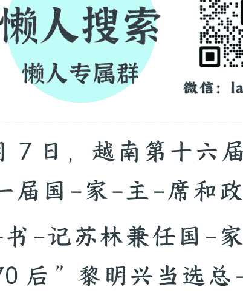

# 越南政坛和体制，大变天了？

260413 文/卢克文工作室嘉宾 低调老弟  
整理：公众号懒人搜索，[懒人专属群](https://lazyhelper1) 精选  
懒人微信：lazyhelper1



4 月 7 日，越南第十六届国会选举出了新一届国家主席和政府总理。  
总书记苏林兼任国家主席。  
"70 后”黎明兴当选总理。

消息一出，很多人第一反应是，苏林  
这不就集大权于一身了吗？还有人觉  
得，黎明兴就是苏林的小弟，总理就  
是个提线木偶。

事情还真没那么简单。

## 一、苏林的得与失

先说他兼任国家主席的事，这一定程度上堵住了潘文江坐大的可能。

很多人觉得，越南的国家主席本来就是个虚职，谁当不一样？

但这里头的门道恰恰就在这里。

这个位置虽然权力不大，但前提是坐上去的人，没有别的权力来源。一旦由非政工系统的军头儿坐上那把椅子，那可就大不一样了。

这事以前不是没有发生过。

1996 年，越南人民军元老、当年指挥侵柬越军的总司令黎德英当选国家主席。结果怎么样？他不仅说话比总书记杜梅还好使，还把自己的老部下黎可发推上了下一任总书记的位子。

所以，这个位高权轻的主席宝座，一旦跟“位低权重”的老将军结合起来，就能变身成为“超级国家主席”。

去年苏林由于“超龄豁免”的问题，在越共十三届十四中全会上卡住了，迟迟没个说法。潘文江一度被一些人看成“保二争一”的热门人选。

现在苏林自己兼任，不是为了加多少分，而是为了防止潘文江借这个位置放大自己的能量。

再说第二个好处，就是法理上的老大难问题，终于解决了。

越南的顶层设计是这样的：总书记自动兼任越共中央军委书记，但越南《宪法》又规定国家主席是武装力量最高统帅。

那么问题来了，谁是越南人民军的一把手？

现在这个问题终于解决了，现在苏林一个人全占了，法理上再也没有扯皮的余地了。

但法理归法理，现实归现实。苏林拿到了自己想要的，可他失去的，一样不少。

第一个“失”，是一系列干部的失落。

国家主席这个位置，过去有个很重要的功能，是给那些资历够、年龄超了、但又不方便直接退下去的人提供一个落点，相当于一个缓冲区。现在苏林自己兼任，这个缓冲区就没了。

最典型的是前总理范明政。

苏林超龄可以接着干，比他还小一岁的范明政却光荣退休。范明政在今年一月越共十四大之前才刚刚喊出未来越南 GDP 每年增速 10% 的目标。临退休最后几天还访问俄罗斯谈妥了核电站项目，就差把“向天再借五年”写脸上了。

而且，范明政的九个副手，最后只有两个人进了新一届中央委员会，进入政治局的更是一个都没有，这种比例，很难解释为正常更替，更像是整体被边缘化。

这么明显的失落，显然不是苏林笑嘻嘻给范明政戴个奖章就能弥补的。

再看国会系统。

在政治局名单中排名第二的国会主席陈青敏，倒是未必愿意去当国家主席，可陈青敏不挪地方，和他同岁的、越共中央政治局排名第五的委员、国会常务副主席杜文战就卡住了。一个位置的调整，带动的是一整片人的预期变化。

这些人未必立刻会有什么动作，但政治从来不是只看当下，更看预期。一旦预期被打乱，就会失落。失落，就容易把希望寄托在别的什么人身上。

第二个“失”，更微妙，也更关键——苏林在军队系统的影响力，其实是不进反退。

很多人觉得，苏林兼任国家主席，军权就稳了。但现实情况往往复杂得多。

潘文江虽然没当上国家主席，但他保住了国防部长，而且还是超龄连任，一方面说明潘文江的韧性比前总理范明政都强。另一方面说明，苏林还是没能插手国防部长和总参谋长的人事任免。

原本可以冲刺国防部长位置的郑文决大将被调离军队出任文职。有望冲刺总参谋长位置的苏林老乡——黄春战上将的前途更是因为国际丑闻毁于一旦。

换句话说，苏林在纸面上成了最高统帅，但在具体人事和组织控制上，并没有同步加强，甚至还有一点被动。把这些拼在一起，就能看出这一步的真实分量了。

### 二、黎明兴并非“苏林之翼”那么，新任总理黎明兴真的是苏林在政府系统的代言人吗？

很多人（包括我）在看待黎明兴和苏林关系时的第一印象是：这不就是苏林的低调小弟吗？

原因很简单：黎明兴的父亲曾担任公安部长，是苏林的老领导。黎明兴比苏林小十三岁，且在苏林上位后飞黄腾达。

但要是把历史脉络一展开，你就会发现，事情没那么简单。

三十年前，当黎明兴的父亲黎老爷子荣升公安部长时，苏林只是个副处级干部；2004 年黎家老爷子去世，苏林也才熬到正处。级别太过悬殊、接触显然有限。

也就是说，在黎家老爷子手下，苏林纯粹是在熬资历。

可公安部长换人后，苏林却像坐火箭似的急速蹿升：他三年升副厅、一年升正厅、一年升副部、五年升正部、副国……可以看出，苏林与黎明兴父子只能算有渊源，但谈不上亲近。真正让黎明兴不同凡响的是什么？是他在越南政坛如同 U 盘一样即插即用的适应能力。

南方派掌门、大买办阮晋勇掌权时期，黎明兴在越南国家银行步步高升；北方派领袖白头翁阮富仲当家时，黎明兴深得重用，先后担任国家银行行长、越共中央办公厅主任，成为阮富仲的大秘。

在苏林上位后，黎明兴飞黄腾达，荣升越共中央政治局委员、中央组织部部长，直到昨天当选政府总理。

更有意思的是，越南政坛教父——越共中央常务书记陈锦绣与黎明兴还是同一个县的老乡，这层地缘关系又成了他的加分项。

南方派、北方派、中间派，黎明兴都能搭得上，buff 全让他叠满了。

这还没完，黎明兴的国际经验更为他增添了筹码。

他在上海财经大学进修过三个月，在日本琦玉大学不到一年就拿到硕士学位，又以越南国家银行干部的身份，被借调到马尼拉的亚洲开发银行总部工作过两年。

综合来看黎明兴的履历，简直是横跨南北中三大派系，纵贯强力部门、经济战线和党务系统。

当然，黎明兴也不是纯粹的开挂人生。

在他后面还有比他小六岁的候补总理  
阮青谊虎视眈眈。苏林可以用黎明兴  
挡住这位大买办阮晋勇的长子，也可  
以用这位候补队员制衡黎明兴。

所以黎明兴还没有牛到可以和苏林分  
庭抗礼的地步。可真要是让阮家大少  
爷当了总理，北方派肯定要拍桌子，  
苏林恐怕更难进行派系平衡。

综上，虽然以黎明兴的资历，很难和  
前任范明政一样与苏林平起平坐，但  
以他如此雄厚的政治资本，把他当做  
苏林在政府系统的代言人、低调小  
弟，显然是小看他了。

**总结**
苏林这一步棋，终究是“控局”  
而非“定局”。

他暂时镇住了军方的躁动，整合了法理上的至高权杖，但这更像是在惊涛骇浪中稳住船身，距离靠岸至少还有 10 一个“军队一律不得经商”的距离。

黎明兴也绝非简单的“苏林之翼”，他横跨南北中的根基、纵贯政经的脉络，使其成为各方势力微妙平衡的交汇点，各方都能接受的“公约数”，而非某一派系力挫群雄的信号。

所以说，越南这场大戏，下半场还长着呢！

———分割线———

绝大多数人只盯着眼前的工资，却不知道一次远在中东的冲突、一次降息的决议，就能在一夜之间洗牌普通人的财富。

看懂宏观，是为了在周期切换时，不被当作代价。

如果你认同这种“抬头看路”的长期主义，欢迎围观我的个人情报智库：[懒人专属群]。

圈子已稳定运行 7 年。我们每天利用 Python 爬虫与大模型算力，过滤全网最顶级的政经内参和搞钱风向标，做你最冷酷的“外部大脑”。

查阅圈子完整数字资产与上车门槛:

```
https://lazyso.com/insider/
```

认同价值的，扫码加我微信，备注：[进群]

