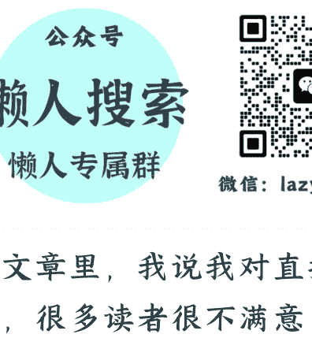

# 比道德更可靠的，是机制

2024 年 4 月 14 日 九边

整理：公众号懒人搜索，懒人专属群精选
懒人微信：lazyhelper1

之前文章里，我说我对直播带货并不反感，很多读者很不满意。因为在很多小伙伴朴素的观念里，只有线下店才会容纳大量就业，线上店就是纯坏，几个网店把无数线下店铺的钱给全赚了，更别说主播们了，更加集中了很多，这不是坏是啥。

为啥我说这些人观念朴素呢？一个关键问题，线下店到底是怎么丢掉自己的优势的？如果去过中关村之前的那几个电脑城，或者你在线下店买到的东西出了问题，你才能意识到线上店的优势有多大，那些被迫关闭的线下商场，没一个是冤枉的。

而且就算讨论就业人数，也不是那么算的，电商兴起这些年，确实线下导购少了一些，房东们“一铺养三代”的妄念到头了，但催生出来一个巨大的线上业务群体，拍摄，文案，客服等等，还有更加巨大无比的快递和物流产业。

所以不要动不动站在道德角度批判，
往往既不理性，也不客观，最后甚至
也没啥道德可言。

最近又出了一件事，让很多人重新开始理解，为啥都卷成这样了，主播们反而能在竞争中占据一席之地。

事情是这样的，央视 4 月初曝光了“优思益”这个品牌，这个号称“澳洲原装进口”的保健品，所谓墨尔本总部其实是一家汽修厂，产品压根是在国内代工生产，再通过保税仓“一日游”包装成进口货。成本几十块的东西，卖到三四百一瓶，几年卖了 600 多万瓶，而且几乎所有平台都在卖。

某宝某东上的官方旗舰店第一时间下架了商品，但不少消费者发现，客服失联、退款入口失效，维权无门。而另一边，董宇辉、章小蕙、李若彤这些曾在直播间卖过该产品的主播，很快就宣布：无论是否开封，全额垫付退款；有的甚至直接“退一赔三”。
于是网上又冒出一种声音：你看，这些主播多有良心，比大平台还负责任。

这种说法听起来温暖，但经不起推敲。如果真是靠良心，那为什么过去几年那么多翻车的主播选择沉默、拖延甚至消失？为什么偏偏是现在这批人反应这么快？答案其实很简单：不是这批主播比某东某宝以及之前的主播们更有良心，而是直播带货这个模式发展到现在，让他们不得不这么做。

直播带货的核心不是货架，而是人。
消费者不是冲着“优思益”这个牌子去买，是冲着董宇辉、章小蕙的信任去买。一旦信任崩塌，损失的不是一单生意，而是整个 IP 的价值。李佳琦眉笔事件之后销量长期低迷，小杨哥至今没复出，东北雨姐被全网封杀——这些前车之鉴摆在那里，谁还敢赌？

相比之下，传统电商平台上的品牌旗舰店，消费者信任的是平台背书或品牌本身。哪怕某个品牌翻车，用户明天照样在京东买苹果、在天猫买雅诗兰黛。平台可以换商家，但主播很难换“人设”。一个主播的影响力，往往是几年甚至十几年积累起来的，毁掉却可能只需要一次舆情。

所以，主播们迅速退款，不是因为道德高尚，而是商业模式逼的。他们想活下去：必须把售后做到极致，否则流量立刻流失，再难翻身。

如果只看“出了问题之后谁来负责”，直播带货反而比传统电商更清晰。在传统的某东某猫平台上，消费者面对的是店铺和客服，反馈要层层传递，责任也可以被层层分散；而在直播间，消费者面对的是一个具体的人，情绪、舆论和压力几乎是实时到达的。

这意味着，直播带货未必更不容易出问题，但它对消费者反馈更敏感，对后果的承担也更直接。

很显然的是，这种“被迫负责”反而对消费者更有利。个人的良心可能波动，但利益驱动下的行为更稳定、更可预期。

**当一个行业走到这一步——不是靠呼吁良知，而是靠机制倒逼责任——这其实是直播带货这种高度依赖信任关系的商业模式的天然要求，现在终于变成了主播们的集体行动，恰恰说明它开始成熟了，也意味着可以给用户提供更好的服务，竞争力更强了。**

当然，这不代表直播带货模式能解决所有的问题。从这次的“优思益”事件可以看出，当供货方的虚假宣传披上合规外衣，主播们光看报关单和营业执照根本防不住，后面必须想更多办法来识别虚假宣传。不过这也不是什么根本性的问题，在这个世界上混得久了，咱们都会意识到，没啥东西是完全可信的，指望完美世界是不现实的，但确实可以指望“权责对等”，也就是出了事，有人可以负责。

但正因为主播承担了更高的声誉风险，潜在损失更大，他们才有动力去补这个漏洞，比如未来可能会查海外真实销量、第三方口碑，甚至自建检测团队。

这种差异，其实之前也有明显体现。“美诚月饼”风波中，三只羊最终“退一赔三”，承担了带货的风险，却仍没能挽回口碑；而在部分传统电商平台购买过同款产品的消费者，至今没看到售后赔付结果公示。

事实上，直播电商发展到今天，早已不是早期那种“喊两嗓子就能卖爆”的野蛮阶段。头部主播背后都有几十人甚至上百人的选品、法务、合规团队。他们比谁都清楚，一旦踩雷，代价远高于收益。

大家也可能发现了，这两年主播们的舆情好像也不少，给人的感觉是这伙人没干好事，但仔细一想就知道，这种印象的建立，主要也是他们的关注度高，社会对这帮人要求和监督更加严格很多。同样的事情，放在其他渠道可能没人关注，主播们干了就很容易变成舆情，长期留在人们的记忆中。

这种压力传导下来，就形成了比传统电商更严苛的内部风控标准。

更关键的是，监管也在跟上。2024 年 2 月正式实施的《直播电商监督管理办法》明确要求主播对所售商品承担“合理注意义务”，不再只是“广告代言人”身份。这意味着，即便商品资质齐全，如果存在明显虚假宣传，主播也可能被追责。这种制度设计，需要主播在推荐商品时更加审慎，切实履行承诺，对消费者负责。这不仅仅是商业道德的问题，更是法律责任的边界。一旦主播在宣传中为了推销而夸大其词，甚至误导消费者，就需要承担相应的法律责任。在这个过程中，一些头部主播可能因为追求短期流量和利益，忽视了合规的底线。但无论如何，直播带货这个行业要想健康发展，就必须建立在正直、诚信的基础上。这要求主播不仅要懂产品，更要懂法，知法守法，才能在这个行业里长久生存。

本质上是在把“信任”转化为法律责任。消费者买完东西如果有问题，除了找商家、找平台，还可以找主播。

而消费者的态度也在变化。过去大家觉得“主播推荐=靠谱”，现在越来越多人会主动查成分、看评价、比价格。这种理性的回归，反过来又倒逼主播更谨慎。市场、监管、消费者三方合力，正在把直播电商从“流量游戏”变成“信任基建”。

说到底，比道德更可靠的是机制。

这倒有点像一直以来的一个公案，如何让几个极度自私的人公平分蛋糕？

只要负责切的人只能拿最后一块，

他会给你分得无比公平，而且每个人

得到的，都是公平的。

所以说任何一个系统，想真正的公平，并不是选出来一个道德最高尚的人指引大家。

恰好相反，应该假设每个人都自私，

然后大家一起监督他，如果他干了好事，就有丰厚回报；干了坏事，需要付出对应的代价。这种情况下，不管他内心是道德高尚的还是自私，都没有关系，我们只需要看行为，当机制要求他去做好事，整体环境就会变好，呈现出一个更可靠的样子——无论这些主播们原本是些什么样的人，都没有关系。从线下实体到线上网店，再到现在的直播模式，让很多人痛苦不堪，觉得人心不古世风日下。

这些人忽略了一个基本事实——商业的本质是价值交换，而不是财富分配。主播能持续赚钱，是因为有人愿意为他的推荐买单。如果他坑人，没人会一直上当。市场的惩罚来得比道德谴责快得多。

线下店曾经有过黄金时代，但当服务跟不上、价格不透明、售后推诿时，消费者自然会离开。

线上不是抢走了线下，而是替代了低效的部分。同理，直播电商也不是凭空冒出来的怪物，它是传统电商在流量红利见顶后，向“人”要效率的必然产物。

我们不必妖魔化电商，也没必要神话那些主播们。重要的是看清背后的逻辑：任何商业模式，最终都要回答一个问题——你为用户承担了什么风险？提供了什么保障？

一种模式最终胜出，本质还是消费者用脚投票。

所以，我希望大家不要对那些电商和直播有啥偏见，或者看到主播快速退款，就只从个人道德层面来讨论。还是要理解一件事，就是他赖以生存的商业模式和规则制约是什么。而对我们普通人来说，能依靠的从来不是别人的道德，而是来自四面八方的监督，是那些让人无论心怀善念歹念都必须呈现出良好行为的机制约束。

————分割线————

在这个 AI 能替你写代码、写文章的时代，基础技能正在迅速贬值。绝大多数人正被淹没在海量的免费垃圾信息里，陷入低效的体力内卷。

当“努力”不再是壁垒，人与人之间唯一的护城河，只剩下“信息过滤”的效率与“认知系统”的维度。

圈子已稳定运行 7 年。我们每天利用 Python 爬虫与大模型算力，过滤全网最顶级的政经内参和搞钱风向标，做你最冷酷的“外部大脑”。

如果你认同这种“重塑认知防线”的极客主义，欢迎围观我的个人情报智库：【懒人专属群】。
https://lazyso.com/insider/
认同信息过滤价值、想省下每天 3 小时无效阅读时间的读者，扫码加我微信（lazyhelper1）

