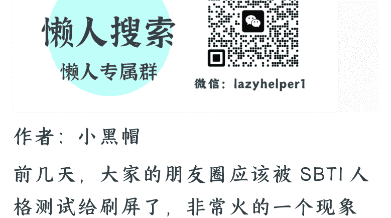
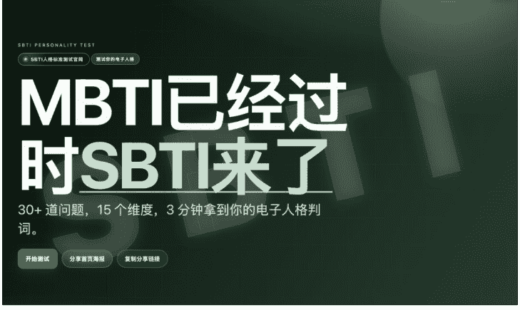
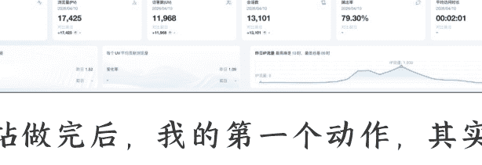
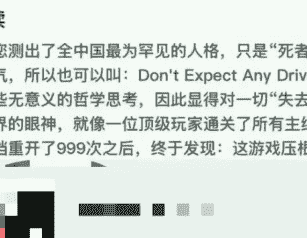
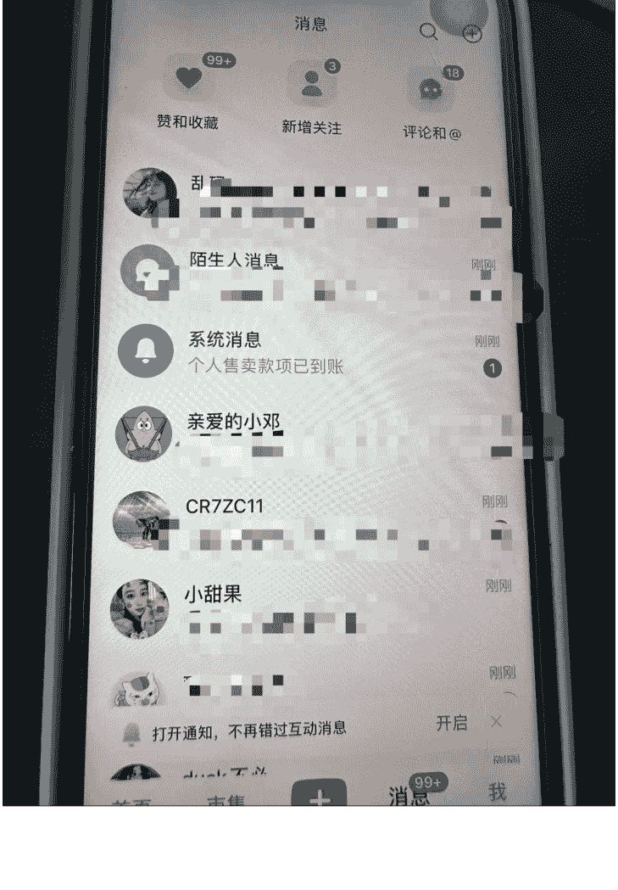
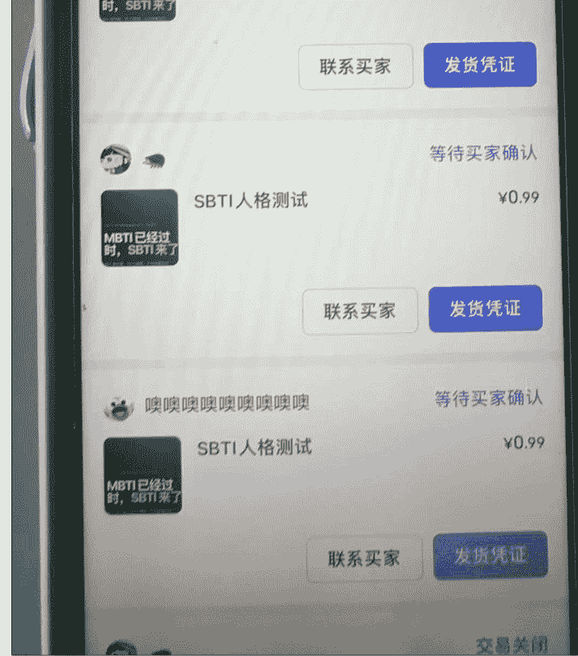
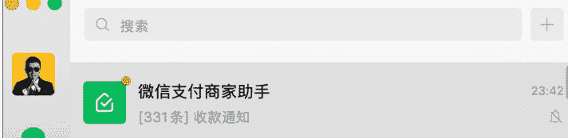
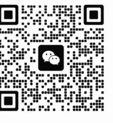

# SBTI 人格测试网站，小红书 1 小时卖了 600 单，网站 1.2 万人访问，实时在线 500+，现象级热点跟风复盘

**260414 副业 SC 精华**

整理：公众号懒人搜索，[懒人专属群](https://www.zhihu.com/people/lazy-helper-908765) 精选
懒人微信：lazyhelper1

**作者：小黑帽**

前几天，大家的朋友圈应该被 SBTI 人格测试给刷屏了，非常火的一个现象级的事件，起因是一个 b 站 up 主做给他朋友测试的，没想到火了，估计事情的发展程度本人应该也没想到。

我最开始看到这个消息的时候，是在半夜凌晨 12 点，我刚刚准备睡觉，就看到朋友圈有很多人发 SBTI 的测试结果，接着，我看了一眼群消息，很多群里，也有人在讨论说朋友圈被刷屏了。

这时，我就预感这是新的大热点的前兆。

之所以驱动我做后面一系列动作，是因为我之前调研过 MBTI 测试，以及其它类似测试的市场，很多测试类的产品，在各平台都有不错的需求和销量。

包括我以前做过一个性取向测试的付费 iOS APP，也曾经登上了 App Store 分类付费榜第九。

所以，看到 SBTI 在朋友圈刷屏后，我就赶紧从床上爬起来打开电脑。

我做的第一件事，就是先去申请了一个公众号去做认证，提交了认证。

我做这个动作，是因为我知道这类产品的爆火，往往会伴随巨大的搜索需求，所以我就先去注册公众号。

但我犯了个错，因为手上没有可用的个人账号，所以只能走最慢的途径，去花 300 块钱认证公众号。

第二天的时候，所有带有 SBTI 名字的号，就都不被允许注册了。

导致的结果，就是我起了个大早，赶了个晚集。

提交公众号认证后，我做的第二个动作，就是用 codex 做了一个 SBTI 的测试网站，因为时间比较紧张，我直接让 gpt 用 html/css/js 写了个纯前端的页面，做了一些改动后，就直接部署到服务器上线了。

因为我常年做网站相关的项目，所以我有企业资质做过 icp 备案和网安备案的域名、国内服务器，这也是我为什么上线速度很快的原因。

我之所以没有临时注册域名在海外部署上线，是因为我考虑的是主要的传播场景都是在微信生态的社交场景内，而海外网站上线，国内的访问延迟较高，还容易被风控，所以不是个很好的选择。

我先说一下结果吧，网站上线后，早晨六点开始起量，一直到下午一两点，最高峰时期在线人数 500-600 人，最多的时候每小时访问最多有 2000 人，当天有 1.1 万人访问了这个网站。

网站做完后，我的第一个动作，其实不是去推广，而是我先提交了百度和谷歌的收录，但很可惜，百度的收录速度实在是太慢了，第二天 SBTI 爆火后还没有任何动静，我就知道没戏了。

我的这个 SBTI 网站，之所以流量能够持续增长，而不依赖我的主动推广，是因为我做对了一个非常关键的动作。

就是我在网站首页加上了一键复制链接的选项，以及生成测试结果后，用户可以分享带有网站二维码的测试结果。

我之所以这么做，是因为我发现朋友圈很多人发的是测试结果的截图，或者测试网站的链接，我觉得这种方式非常不利于传播，一定会有大量的小白用户找不到测试的地址。

而带有二维码的海报则非常适合在社交场景传播，所以我做了这么一个功能。

## 海报已生成

先预览海报，再手动保存到相册。

你的主类型 · 匹配度 73% · 精准命中 9/15 维

## DEAD（死者）

> 你的类型是：

逝者

DEAD

## 人格解读

恭喜你，您测出了全中国最为罕见的人格，只是“死者”这个名字实在有点晦气，所以也可以叫：Don't Expect Any Drives。死者已经看透了那些无意义的哲学思考，因此显得对一切“失去”了兴趣。死者们看世界的眼神，就像一位顶级玩家通关了所有主线、支线、隐藏任务，删档重开了 9999999999999 次之后，终于发现：这游戏压根就没意思... 

https://www.something.com/xxxxx

结果是海报 🩴 

微信内请长按图片保存到相册；电脑端可点击“保存图片”。

正是有了这个功能后，让我后面的流量一直就没断过。

在网站上线后，第二天早晨八点多，我发了一个朋友圈，说我做了个 SBTI 的测试网站，一共也就三四个人点赞，第一个小时内访问大概不到 100 人。

从这之后，流量开始暴增，一直到下午 2 点多的时候达到最高峰 500 多人同时在线。

但在这之后因为被微信风控，无法在微信内部直接打开，只能复制链接在浏览器打开，在这之后访问量就开始雪崩。

白天这段流量高峰期我还做了另一件事，大概早晨九点的时候，我在小红书发了挂有个人售卖 SBTI 的商品的笔记。

发布一个小时后，笔记开始推流，直接爆单，仅小红书一个多小时卖了 600 多单，很疯狂，私信消息根本翻不到头。

但很快我发现小红书官方开始屏蔽 SBTI 这个关键词，所有相关笔记都无法搜索到了，我就意识到这个事情快凉了，紧接着我的笔记也被强制性删除。

其实，我之所以会在小红书卖这个东西，是因为我意识到了信息差，我看到有很多人在 sbti 的相比笔记评论区问链接是啥，于是我就直接上架了一个，没想到卖的还不错。

但下午四点多的时候，有个兄弟和我说，他的网站爆单了，非常疯狂，他也是个做了个 SBTI 的人格测试网站，在网站中接入了支付，转化率直接来到了 20%。

于是，从下午五六点钟开始，我就开始用 codex 写网站的后端，将网站重构，接入支付 api，改成了前端 html+php 做后端的架构，连数据库都没弄。

折腾了半天，在晚上八九点的时候再次上线，上线后我将主站直接强制跳转到新站。

上线两三个小时时间，在网站内就成交了差不多 400 多单。

实际订单要比图中的多，我中间没忍住点开看了两次。

直到第二天我写这篇文章的时候，还一直陆续有订单在付款，只是付款速度没有晚上那么快了。

第二天早晨，我看了下当天的百度统计数据，当天有 500 多个用户访问，成交了 100 多单，大概 25% 的转化率。

|  | 浏览量 (PV) | 访客数 (UV) | IP 数 | 跳出率 |
|:---|:---|:---|:---|:---|
| 本日 | 849 | 558 | 542 | 72.31% |
| 昨日 | 110 | 71 | 69 | 69.01% |
| 预计明日 | -- | -- | -- | -- |

如果我在第一天，就能够早点接入支付的话，大概至少能够多成交两三千单肯定是没有问题的，只是我接入支付上线的时候，流量几乎已经跌到了谷底。

最后，这次总的来说，如果从赚钱多少的层面来说，其实不多。

我觉得真正有价值的是，这次经历给我在产品方向上做了很大的启发。

我原本做产品思路，就是利用不断的做内容撬动公域的流量去销售自己的产品，和内容电商卖货的模式差不多，但这次的流量主要是来自于用户在社交场景内的自传播。

让我用很少很少的启动流量，就撬动了至少一百倍以上的传播。

在我第一次发朋友圈后，我也没再做过任何主动推广的动作，唯一在做的事，就是优化分享的相关功能。

所以，我觉得做一些符合社媒场景传播，能够带来情绪价值的产品，还有很大机会。

### 分割线

看完这篇 SOP，你觉得你懂了。但 90% 的人一到实操就会卡在第一步。
工具和教程只是最低级的壁垒，真正的壁垒是“立刻动手”和“圈层信息差”。

如果你想看全网最新的变现玩法，并且和一群执行力极强的极客一起下场拿结果，欢迎围观我的核心私域：【懒人专属群】。

我们不聊虚的，只做商业闭环的拆解与 AI 效率的压榨。系统内已沉淀 1000+ 跑通的套利实战局。

👆 查阅圈子完整数字资产与上车门槛：
https://lazyso.com/insider/

认同价值、准备好下场干活的，扫码加我微信（lazyhelper1）

微信：lazyhelper1

备注：【实操上车】，不闲聊