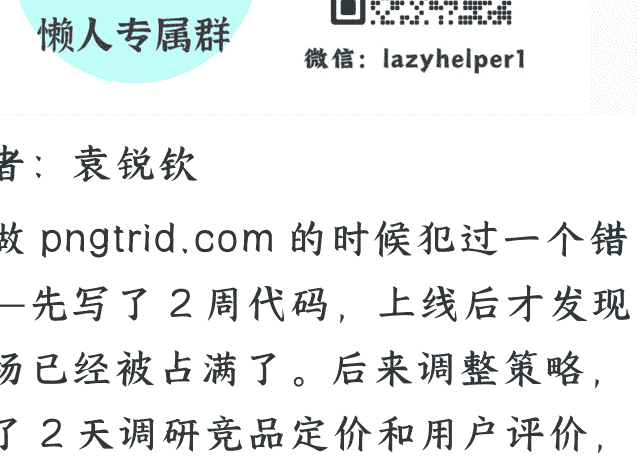

## 我花 3 小时调研了一个出海产品，发现 90% 的独立开发者第一步就走错了

260414 副业 SC 精华

整理：公众号懒人搜索，懒人专属群精选

懒人微信：lazyhelper

作者：袁锐钦

我做 pngtrid.com 的时候犯过一个错——先写了 2 周代码，上线后才发现市场已经被占满了。后来调整策略，花了 2 天调研竞品定价和用户评价，重新定位，上线 1 个月变现 5K。

那 2 天比 2 周有价值 10 倍。

今天我把这套调研方法完整走一遍。

不是讲理论，是你跟我一起做——我用一个真实的出海产品（在线抠图工具）当案例，从打开浏览器到得出结论，3 小时搞定。

你可以把这篇文章当操作手册，照着做你自己的产品。每个步骤我都写了具体用什么工具、搜什么关键词、看什么数据。你不需要任何调研经验，跟着做就行。

为什么写这篇文章？因为我在生财有术 AI 编程深海圈当教练，每周都有圈友问我"钦哥，我想做个 XX 产品，你觉得行不行？"。我的回答永远是："先做 3 小时调研，再来问我。” 但大多数人不知道调研该怎么做、去哪里找数据、怎么判断一个机会值不值得做。

你正在做的那个产品，有 90% 的概率没人要。

不是泼冷水，是统计规律。独立开发者的产品失败率超过 90%，排在第一位的原因就是——没做调研。

所以我把自己的调研方法系统化成了这套 6 步 BRD（Business Requirements Document）流程。一个做过 5 个产品、踩过无数坑的独立开发者的实战经验——用 AI 辅助开发，2 周就能出一个 MVP，但调研这件事，AI 替不了你。

## 第一步：先问自己一个问题（5 分钟）

做 pngtrid.com 的时候，我跳过了这一步。直接写代码，结果做了个"没有人要的功能"的完美产品。这一步，我绝不会再跳。

不是"我要做什么"，而是——"有没有人愿意为这个付钱？"

这句话我花了 2 周和一笔失败的投入才真正理解。做 pngtrid.com 的时候，我先写了 2 周代码，上线后才发现市场已经被占满了。90% 的独立开发者都在犯同一个错——他们直接打开 IDE 写代码，做完才发现没人要。

怎么回答？不是猜，是搜。

我打算做一个面向海外的在线抠图工具——帮电商卖家把商品图做成白底图。

打开 Google Trends，搜"remove background online"：

过去 3 年，搜索趋势稳步上升。没有暴涨也没有暴跌，是一条平稳向上的线。

这说明什么？持续存在的刚需。暴涨暴跌像过山车，平稳向上才是真需求。暴涨暴跌的曲线像过山车——ChatGPT 刚出来的时候，"AI writing tool"的搜索量 3 个月涨了 500%，然后半年后又跌回原点。那种趋势你追进去就是接盘。

平稳向上的线意味着：这个需求一直在，而且越来越多人有。好，继续。

再把时间范围拉长到 5 年。如果 5 年都是上行的，基本可以排除"疫情期间特殊需求"这类临时因素。"remove background"从 2020 年开始明显上台阶——正好是电商爆发的那几年，因果链很清楚。

再看搜索量最大的地区：US、UK、India、Philippines。前两个是成熟市场（用户有钱、付费意愿强），后两个是增长市场（量大、价格敏感）。英语是主战场。

然后把关键词换成"remove background from product photo"——注意加上了"product photo"。搜索量小了大约 60%，但趋势更陡。说明什么？电商这个垂直场景的增长速度远超大盘。你的切入点不是"所有抠图"，而是"电商商品图抠图"。

一个实操案例：我搜"background removal from product photo"时发生了什么

Google Trends 显示，这个关键词在过去 12 个月的搜索热度指数平均 65（满分 100），同比上升 12%。然后我点了"Related Queries"（相关搜索），发现一个有趣的词："bulk background removal"——搜索热度虽然低（指数 15），但同比上升了 48%。

意味着什么？有一小群人，增长速度远超大盘——有一小群人，增长速度远超大盘，他们的需求是"批量处理"。这部分人可能数量不多，但付费意愿更强——因为批量处理意味着他们在做商业用途。

如果你只看主关键词的总量，你会忽略这个信号。但"Related Queries"帮你发现了它。这就是 Google Trends 的正确用法：不只看主趋势，还要看细分方向的增长速度。

5 分钟，我知道三件事：需求在增长且非临时性，主战场是英语国家，电商商品图是增速最快的细分场景。

如果这一步发现趋势在下降呢？那就要小心了。下降的趋势意味着两种可能：一是市场在萎缩（需求真的没了），二是需求被更好的方案替代了（用户不需要单独的抠图工具，因为 Canva/Photoshop 已经内置了）。

两种情况的应对策略完全不同。前者意味着别碰，后者意味着你要找“内置方案没做好的部分”。

一个真实案例：我之前调研过“在线 PDF 压缩”工具。Google Trends 显示趋势在缓慢下降。进一步查才发现，Chrome 浏览器和 macOS 系统已经内置了 PDF 压缩功能。大部分普通用户不再需要单独的工具了。这种“被系统功能替代”的下降，独立开发者几乎没办法逆转。

所以趋势下降不等于一定不做，但你需要弄清楚“为什么在下降”，再做判断。

## 第二步：找人在哪里骂竞品（60 分钟）

这一步救了 pngtrid.com。如果我没有花 2 天去看用户在骂什么，pngtrid 到现在可能还是个没人用的网站。

这是整个调研最有价值的一步，也是你花时间最多的地方。

不要去看竞品的官网。那里写的都是他们想让你看到的——功能列表、客户案例、用户好评。这些东西不能帮你做决策。

去看用户在骂什么。用户愤怒时说的话才是真话。一个给 3 星的用户说“还不错但太贵了”，比一个给 5 星的用户说“非常好”有价值 100 倍。因为 3 星用户差的那 2 星，就是你的机会。

### 去哪里看？分三层找

不是所有平台的评价都一样。你要分三层找，每层看到的评价侧重点不同：

- 第一层：主流评价平台（数据最全）
G2.com——搜竞品名，看 Pros 和 Cons。企业用户多，评价写得很长很详细。
Capterra——和 G2 类似，也是企业用户为主。
Trustpilot——普通用户多，吐槽比 G2 更真实、更情绪化。
Product Hunt——早期用户反馈。评论短但尖锐，适合看第一印象。

- 第二层：社区（情绪最真实）
Reddit——搜"[竞品名]sucks/overpriced/alternative"。情绪最真实，匿名用户敢说真话。
Twitter/X——搜"[竞品名]frustrated"。能看到最新的反馈。
Hacker News——搜竞品名，看 Show HN 帖子下面的评论。技术用户多，关注点和普通用户不同。

### 第三层：应用商店（最容易被忽视）
Chrome 扩展商店 — 搜竞品扩展，看 1-3 星评论。这里全是痛点，没有人会专门去给好评。
App Store / Google Play — 如果竞品有 App，差评区是金矿。

### 四路搜索法：怎么搜

确定了去哪里看之后，搜什么也很重要。我用的方法叫“四路搜索”——从四个不同的角度搜，覆盖用户从“发现问题”到“准备付费”的完整过程：

**第一路：求助类搜索——找正在找解决方案的人**

搜索关键词：

- "how to remove background from product photos"
- "background removal tutorial"
- "XX 怎么做" / "XX 怎么搭"

如果搜出来大量教程和问答，说明很多人在主动找解决方案——需求是存在的。

注意看搜索结果的页面类型：如果前 10 个结果里有 5 个以上是教程/博客/论坛问答（而不是竞品官网），说明这个需求还没有被商业化完全覆盖——用户在“自己动手”而不是“直接买工具”。这意味着如果你做一个更方便的工具，很多人会愿意从"DIY"切换过来。

**第二路：吐槽类搜索——找对现有方案不满的人**

搜索关键词：

- "remove.bg overpriced"
- "remove.bg sucks"
- "remove.bg alternative"
- "XX 太贵了" / "XX 太难用了"

差评和吐槽是最值钱的数据。

好评告诉你竞品做了什么，差评告诉你该做什么。实操技巧：搜完之后，不要只看 Google 搜索结果。点进 Reddit 和 Twitter 的讨论帖，看回复区。帖子的标题可能只是"remove.bg 太贵了"，但回复区里会有人说"我转去了 XX"、"XX 也不便宜但至少不限制额度"——这些才是你需要的信息。评论区比标题有价值 10 倍。

**第三路：替代类搜索——找在对比选择的人**

搜索关键词：

- "remove.bg vs photoroom"
- "better than remove.bg"
- "switched from remove.bg to"

用户在对比，说明有付费意愿——他在认真选。

**第四路：交易类搜索——找已经准备付费的人**

搜索关键词：

- "best background removal tool 2025"
- "background removal pricing"
- "XX 推荐" / "XX 哪个好"

如果有人在搜定价，说明他已经过了"要不要用"的阶段，进入"买哪个"了。

### 五步看法 SOP

搜到了一堆评价，怎么看？不是一条一条看，是有方法的：

#### 第 1 步：看 1-2 星差评（5 分钟）

过滤关键词：
expensive、overpriced、slow、buggy、frustrating、ripoff、waste of money。

不要只看一条，看 10 条以上，找共同点。10 条差评里 6 条说"太贵"，那定价就是最大问题。

怎么看评论区才有用？不要只看第一条。Reddit 的差评排序是按 upvote 来的——点赞最多的不一定是问题最严重的，可能是情绪最激动的。把 1-3 星评论全部展开，用 Ctrl+F 搜关键词，统计每个关键词出现的次数。

#### 第 2 步：看竞品互相拉踩（5 分钟）

搜"switched from [竞品名] to"或"[竞品 A] vs [竞品 B]"。

用户在对比时说出真实的使用感受。

这些信息比竞品官网的 Feature 列表有价值 100 倍。

为什么"switched from"是金矿？因为用户主动切换工具意味着：①他之前有一个正在付费的方案（有付费能力）②他对之前的方案不满意（有痛点）③他已经花时间评估了替代品（有决策能力）。这三种特征的人，恰好是你最想要的用户。

#### 第 3 步：看 3-4 星评论（10 分钟）

给 3-4 星的人最有价值。他们觉得"还行，但差那一点"。

那一点，就是你的切入点。他们没给 1 星说明核心功能可以，没给 5 星说明有具体不满。找到那个不满，解决它。

实操技巧：在 G2 和 Capterra 上，3-4 星评论通常写得很长——因为用户觉得"这个产品不错，但我想让它更好"，所以会认真写建议。这些建议就是你的产品需求文档。不是你自己想出来的需求，是用户告诉你的需求。

#### 第 4 步：看时间线（5 分钟）

只看最近 3-6 个月的评论。老评论可能已经过时——竞品可能已经修复了那个问题。

如果最近的评论还在抱怨同一个问题，说明竞品确实没解决。这是你最好的机会。

#### 第 5 步：看用户身份（5 分钟）

评论者是谁？电商卖家？设计师？开发者？学生？

统计哪种身份出现最多，那就是你的核心用户群。不要试图服务所有人。

找到出现最多的那类用户，把产品做到极致。

### 真实评论案例：为什么差评比好评值钱

我翻到的几条典型差评（来源已脱敏）：

Reddit 用户 A（Shopify 卖家，经营饰品店）："我用 remove.bg 半年了，月的版。说实话抠图质量没问题，但我每天要处理张图，张额度根本不够。每次用完额度，我不得不手动选低质量模式那个质量根本没法用，边缘全是锯齿。要么加钱买更贵的套餐，要么等明天额度刷新。"

用户（独立开发者）："定价 0.20/张，我做个批量处理工具，1000 张就是 200。我的整个月收入才 500，光抠图 API 就吃掉 40%。"

G2 用户 C（电商运营，小团队）："PhotoRoom 的功能很全，但$49/月的团队版对我们 3 个人的小团队来说太贵了。我们只需要批量白底图这一个功能，不想为不需要的模板和 AI 背景付费。"

这三条评论分别来自三种不同身份——卖家、开发者、运营。但他们在说同一件事：现有的定价方案没有匹配他们的实际使用量。

这比任何行业报告都值钱。因为行业报告告诉你"市场在增长"，但这些评论告诉你"用户在为增长中的市场付费，但付得心不甘情不愿"。心不甘情不愿，就是你的机会。

#### 30 分钟整理出来的痛点表

| 痛点 | 频次 | 来源 | 核心信号 |
| --- | --- | --- | --- |
| $99/月只有 40 张，不够用 | ⭐⭐⭐⭐⭐ | Reddit/PH | 定价有巨大空间 |
| 转向更便宜的替代品 | ⭐⭐⭐⭐ | Reddit | 用户有流动性 |
| 积分系统坑，HD 额外扣 | ⭐⭐⭐⭐ | Product Hunt | 竞品定价策略有问题 |
| 需要登录才能用 | ⭐⭐⭐ | Reddit | 体验痛点 |
| API$0.20/张太贵 | ⭐⭐⭐ | 开发者论坛 | 开发者市场有空间 |
| 批量处理要 Pro$39/月 | ⭐⭐⭐ | Reddit | 功能付费门槛高 |

一个判断标准：同一个痛点出现 3 次以上，来自不同平台，才是真痛点。1-2 次可能是噪音——某个人碰到的个别问题。

频次最高的不一定最好——“太贵”被说最多，说明竞品也知道这个问题，甚至可能已经在调整。你要找的是“频次不低（3 次以上），但竞品一直没解决好的”痛点。比如“积分系统复杂”，出现了 4 次，但 remove.bg 到现在也没改。这就是你的切入点。

竞品知道问题但一直没改，就是你的护城河。我在这步犯过的错：第一次做调研的时候，我只搜了 Reddit 一个平台，发现“太贵”出现很多，就觉得找到了机会。后来才意识到，如果只看一个平台，你看到的可能是那个平台的“回音壁”——比如 Reddit 用户天然偏"反付费"。多平台交叉验证，才能确认痛点是真实的。

另一个常见误区：只看差评数量，不看差评内容。有人看到 remove.bg 在 Trustpilot 上有 2.3/5 的评分，就兴奋地认为"这个产品不行，我有机会"。但仔细看评论——大部分 1 星是"信用卡被扣款"，可以解决的。

#### 30 分钟的时间分配建议：四路搜索各 5-8 分钟（共 20-30 分钟），整理痛点表 10 分钟。不要在单条评论上花超过 30 秒——快速扫，找共同点，记录频次。

## 第三步：你的用户到底是谁？（20 分钟）

pngtrid.com 上线第一个月，我以为是"设计师"在用。后来才发现，80% 的用户是电商卖家。如果早一天做这一步，产品定位至少提前两周。

那是废话。

你需要一个具体的人。

我从评论里翻用户身份。10 条评论里有 6 条来自电商卖家——"I use this for my Shopify store"、"Need white backgrounds for 50+ products daily"。

核心用户出现了：英语市场的电商卖家。

然后我去 Reddit 的 r/ecommerce 和 r/Shopify 潜水。不是注册一个号发帖问，是潜水——看他们日常在聊什么。潜水 30 分钟，发现一个规律：每隔 2-3 天就有人问"你们用什么工具处理商品图"，每隔一周就有人吐槽 "remove.bg 又涨价了"。

这不是偶然。这是日常工作痛点，而且是反复出现的痛点。

我画了一个用户画像：

Alex，28 岁，Shopify 卖家，经营家居饰品店。每天上新 5-10 款产品，每款需要 3-5 张白底图。供应商发来的图都是带背景的，需要全部处理成白底图才能上架。现在用 remove.bg 的月付版，100 张额度但她每天就需要 50 张，永远不够用。每个月实际花费：39 基础 + 约额外购买额度 59/月。她不是不想付钱，是觉得"就抠个图，凭什么$59？而且质量还不稳定。"

画像必须包含付费意愿。

没有付费意愿的画像没有意义——你不可能从不愿付钱的人身上赚钱。

不愿意付费的用户画像，就是一份精心包装的自欺欺人。很多独立开发者的画像是"设计师需要好的抠图工具"，但从来没想过"设计师愿意为此付多少钱"。如果答案是一分钱都不想付，那你的产品再好也赚不到钱。

### Alex 的一天（还原工作场景）：

早上 9 点，供应商发了 15 张新产品的照片到 Dropbox。Alex 打开电脑，先把照片拖进 remove.bg，一张一张处理。每张处理完要检查边缘——有时候头发丝会被一起删掉，有时候产品阴影被当成背景删了。她手动修补，每张大约 2 分钟。

15 张图处理完，用了 40 张额度中的 15 张。上午还要上架 8 款老产品的新配色，每款 3 张图——又是 24 张。40 张额度已经不够了。她看着屏幕上"Upgrade to get more credits"的提示，叹了口气，点进去又买了 20 张。

"每个月都在上面花冤枉钱。但不用它，我一天能处理的图会少一半。"这就是你要进入的场景。不是"用户和抠图工具", 而是"Alex 每天因为抠图工具的额度和定价焦虑"。

怎么获取真实的价格预期？直接去社群问。我在 Reddit 的 r/ecommerce 发了一个帖："What do you pay monthly for background removal? What would you pay for a better tool?"

收到 23 个回复。整理出来：

- 8 人说$10-15/月（"如果质量稳定的话"）
- 6 人说$15-20/月（"取决于额度"）
- 4 人说$5-10/月（"我现在的预算有限"）
- 3 人说$20-30/月（"如果支持批量处理"）
- 2 人说免费就行（"我可以用 Canva 凑合"）

意外发现：82% 的人愿意付月付，中位数在 15 左右。这比我自己猜的"用户大概愿意付$5-10"高了 50%。如果你按自己的猜测定价，你反而少赚了。

还有一个意外发现：3 个人提到"如果支持批量处理，我可以付更多"。这说明批量处理是一个差异化功能——不是所有人都需要，但需要的人愿意为此付溢价。

### 常见错误：

- 太泛——"我的用户是所有需要 XX 的人"，等于没有画像。这种画像无法指导任何产品决策——你不知道该做什么功能、定什么价格、去哪里获客。
- 太假——没有真实数据支撑，你从哪知道用户愿意付？我见过有人写我的用户是 30 岁的电商运营经理，月收入 8000，每月愿意为效率工具付$50"。我问："你问过他们吗？"他说："我猜的。"猜的画像比没有画像更危险——你会基于一个错误的假设做所有决策。
- 没有付费意愿——画像写了用户的一切，唯独没写他愿意花多少钱。一个完美的画像如果最后一句是"用户愿意为好的产品"付费"——这句话等于没说。你得写清楚：付多少、多久付一次、现在已经在付给谁了。

只画像不验证——画完 Alex 的画像就完事了。你应该拿着这个画像去验证：去 r/ecommerce 搜"Shopify sellers background removal"，看真实的讨论是不是跟你的画像吻合。如果发现真实用户大部分是设计师而不是电商卖家——那就得改画像。

画像是 一个迭代过程，不是一个一次性产出。你先根据评论画一个初版，然后去社群验证，根据反馈修改，再验证。通常迭代 2-3 轮就能得到一个靠谱的画像。

## 第四步：这个盘子有多大？（20 分钟）

做 pngtrid 之前，我以为 AI 生图是个"小众市场"。查完数据才发现，光 AI 图片生成工具的市场规模就是$120 亿。我之前的眼界，太小了。

搜"background removal software market size"。

### 从上往下算：找行业报告

找到数据：2025 年全球抠图软件市场约 100 亿，预计年 31.9 亿，年复合增长率约 8%。

数据来源是 Market Growth Reports，免费摘要就能看到这些数字。

### 怎么判断数据靠不靠谱？**交叉验证**。

不要只看一份报告。再去 Statista 搜同一个关键词，看数字差多少。如果两份报告差不超过 30%，基本可以采信。如果差了 3 倍，那至少有一份是瞎编的。

还有一个方法：去看这个行业里的上市公司财报。如果 Adobe（Photoshop 母公司）的年报里提到了"AI-powered background removal"相关的收入增长，那就更有说服力。公开数据永远比付费报告可信。

市场在增长，年增 8%+。好。

### 从下往上算：用竞品数据反推

打开 SimilarWeb（免费版），查 remove.bg 的月访问量：约 3000 万。这个数量怎么理解？做一个对比——pngtrid.com（我自己做的 AI 生图网站）月访问量大约在 3-5 万。remove.bg 是我的 600 倍。这个差距不全是产品能力的差距，更多是首发优势和 SEO 积累。

然后估算收入。SaaS 行业平均付费转化率是 0.5%-2%。remove.bg 是工具型产品，免费用户多，保守取 0.1%：

### 两个数字对比看

+   - TAM（总市场）：$14.5 亿/年
- SAM（你能触达的）：英语国家的电商卖家 + 内容创作者，估算约$5 亿
- SOM（你第一年能拿到的）：500-1000 付费用户 × 月 5,400-10,800/年

TAM/SAM/SOM 是什么？简单说：

+   - TAM = 如果全世界所有人都买你的产品，市场有多大（理论天花板）
+   - SAM = 在你的能力范围内（语言、渠道、定位），能触达的那部分市场
+   - SOM = 你第一年实际能拿到的（最现实的数字）

大部分人在融资 PPT 里写 TAM，投资人看 SOM。你自己做决策，重点看 SAM 和 SOM。

这并不意味着你也能赚到。 remove.bg 月入$27 万，是因为它占了先发优势和 SEO 流量。

你作为一个新进入者，不能指望直接抢它的用户。关键是找到它没覆盖到的部分——这就是为什么前面的竞品分析那么重要。

SOM 怎么算更靠谱？ 不要拍脑袋说"我能拿 1% 的市场"。用倒推法：

1.  你的获客渠道每天能带来多少新用户？（比如 Reddit 每天发 1 个帖，平均带来 10 个注册）
2.  注册到付费的转化率是多少？（行业平均 2-5%，新站保守取 1%）
3.  每月能新增多少付费用户？（10 注册/天 × 30 天 × 1%＝3 人/月）
4.  前 6 个月累计：约 18 人
5.  前 12 个月（假设渠道扩大 3 倍）：约 100-150 人

100-150 人 × 月 10,800-16,200/年。

这个数字比前面"500-1000 用户"的乐观估算低很多，但更接近现实。前 6 个月不赚钱是正常计划，不是意外。

### 免费调查工具

| 工具 | 用途 | 费用 |
|---|---|---|
| Google Trends | 搜索趋势 | 免费 |
| SimilarWeb | 竞品流量 | 免费版有限 |
| Statista | 行业报告 | 部分免费 |
| Ubersuggest | 关键词数据 | 免费 3 次/天 |
| Google Keyword Planner | 搜索量 | 免费 |

## 第五步：**定价怎么定？**（20 分钟）

pngtrid.com 的第一个定价方案是$0——免费。我当时想"先吸引用户再收费"。结果呢？免费用户一堆，付费用户为零。定价不是事后补的，是产品的一部分。

大多数独立开发者的定价方式：看竞品最便宜的，再定个更低的。这是错的。你永远打不过免费。

为什么低价策略对独立开发者是陷阱？ 三个原因：

### 定价策略分析

你卖 5/月，remove.bg 卖$9/月，但 remove.bg 的毛利率可能比你高。

第二，低价吸引来的不是付费用户，是薅羊毛的。Indie Hackers 上有开发者分享：把价格从$19 降到$5 后，用户量涨了 40%，但付费转化率从 2% 降到了 0.8%，总收入反而降了 15%。

降价带来的新用户几乎都不续费。

第三，低价会锁死你未来的涨价空间。你一开始定月$19，半年后想涨到 9，老用户会骂。但如果你一开始定$9，后来做个促销降到$5，用户反而觉得占了便宜。

正确做法：列出所有竞品定价，找中位数，不是最低价。

| 竞品 | 免费额度 | 付费起步 | 高级版 |
|---|---|---|---|
| remove.bg | 1 张/天 | $9/月（40 张） | $39/月 |
| PhotoRoom | 10 张/天 | $12/月（300 张） | $49/月 |
| Removal.ai | 1 张/天 | $7/月（40 张） | $20/月 |
| Canva | 有限 | $13/月（含抠图） | $30/月 |
| Erase.bg | 免费（低质量） | — | — |

中位数约 $19/月。最低 7，最高$49。

#### 锚定策略

消费者用价格判断质量。这不是我说的，是行为经济学的经典结论。

锚定效应的心理学实验：丹尼尔·卡尼曼（诺贝尔经济学奖得主）做过一个实验——先让受试者看一个随机数字（比如从转盘上转出来的 65），然后问他们"非洲国家在联合国中所占比例是大于还是小于 65%？"。受试者的回答中位数是 45%。另一组受试者看到的随机数字是 10，回答中位数是 25%。

一个完全不相关的随机数字，影响了人们对真实问题的判断。

这就是锚定效应——人的大脑会不自觉地被第一个看到的数字"锚住"。

回到定价。用户打开 remove.bg，看到月$39。这个 39 就是他心里的"锚"。之后他看到你的产品$9，他不会觉得好便宜，而是觉得比$39 便宜。39 的存在让$9 看起来合理。

但如果你定价$3/月呢？用户不会觉得"太划算了"，而是觉得"这么便宜，是不是质量不行？"。

月$39 和 $5/月，差$34。但在用户心里，9 暗示"我和 remove.bg 一个档次，只是更便宜"，$5 暗示"我比 remove.bg 低一个档次"。

不要做最便宜的。做中偏上。用户选的不是"便宜"，是"划算"。

#### 验证心理价位

不要自己猜。去目标用户社群直接问："你们现在用哪个抠图工具？每月花多少？如果有更好的，愿意付多少？"

真实数字比你自己拍脑袋准 10 倍。

**提问技巧**：不要问"你愿意付多少钱"——这会让人往低了说。问"你现在每月花多少钱"——人们更愿意透露已有支出，而这个数字就是他们心里的价格锚点。你只要做到"同样的价格，体验更好"或者"更好的体验，价格差不多"就够了。

**一个坑**：社群里问价格的时候，总有人说"免费最好"。不要被这种人带偏。免费用户不是你的目标用户。你关注的是那些已经在付费的人——他们才是真正有付费意愿的。

#### 我的定价方案

免费 10 张/月（体验质量，让你知道用户做得好）  
Pro 版月 $9.9/月 200 张（对标最低价但额度翻倍）  
API 版 $0.03/张（remove.bg 是$0.20，我便宜将近 7 倍）

**Freemium 模式的秘密**：免费版的额度要让用户大约每周用完一次。太少——用户体验不到产品质量，不知道你好在哪里。太多——用户没有升级的动力，免费就够了。

10 张/月 对一个每天处理 50 张图的电商卖家来说，大约够用 1-2 天。刚好让他觉得"好用，但不够用"。

为什么不做$5/月？ 因为我测试过一个变体。

在 Reddit 发了两个版本的定价调查：版本 A 是$19/月 100 张，版本 B 是$9/月 200 张。选择版本 B 的人比版本 A 多 37%。

用户不是在选"便宜"，是在选"划算"。

这款（0.045/张）比买按张（0.05/张）单价更低，而且 200 张这个数字看起来"更够用"。

API 定价为什么定在$0.20/张？是$0.20/张，我的成本大约$0.10/张（用开源模型自部署），$0.03 有 10% 毛利空间。

更重要的是：处理量 30%，而 remove.bg 每 200$。这个价格差足以让开发者愿意迁移——迁移成本只是改几行代码的事。

#### 出海 SaaS 定价经验值

| 产品类型 | 常见定价 | 说明 |
| :--- | :---: | :---: |
| 单功能工具 | $9-19/月 | 抠图、压缩、格式转换 |
| 多功能效率工具 | $19-49/月 | 设计工具、项目管理 |
| 企业级 | $99+/月 | 团队协作、数据分析 |
| API 按量 | $0.01-0.10/次 | 按使用量计费 |

### 第六步：算账，做决定（15 分钟）

到了这一步，你手里已经有了答案。
问题是——你敢不敢看。

最后一步，也是最残酷的一步。

### 投入估算

| 项目 | 成本 | 说明 |
|:---|:---|:---|
| 开发时间 | 1-2 周 | AI 辅助 (Claude Code)，不请人 |
| 服务器 | $20-50/月 | Vercel/Railway/轻量云 |
| API 成本 | $0.01-0.10/次 | 取决于用的 AI 模型 |
| 域名 | $10/年 | .com |
| 营销初期 | $0-100/月 | SEO 免费，付费按需 |

总启动成本：约$100-300。对独立开发者来说门槛很低。

一个实际问题：你怎么做到$0.01-0.10/次的 API 成本？

remove.bg 自己训练了抠图模型，成本极低。你没有这个能力，但你有替代方案：

1.  RMBG-1.4（开源模型）：BRIAI 开源的抠图模型，效果接近商业级，自部署成本约$0.005/张
2.  Clipdrop API: Stability AI 旗下的 API，按量付费，约$0.02/张
3.  Photoroom API: 有免费额度，超出后$0.05/张

方案 1 成本最低但需要技术能力（部署 GPU 服务器），方案 2 和 3 更省事但利润薄。我的建议是先用方案 2 或 3 快速上线验证，有付费用户后再迁移到方案 1 降低成本。

这就是 MVP 思维：先用别人的 API 跑通商业模型，再用自己的技术降低成本。

先用别人的轮子跑通，再自己造轮子降本。顺序反了，就是烧钱。不要一上来就追求"技术自研"——除非你的核心竞争力就是技术。

#### 产出预估（做三个版本）

不要只做一个数字。做三个版本，看保守版能不能活：

+   保守版： 100 用户 × $9.9/月
中等版： 500 用户 × $4,500/月
乐观版： 2000 用户 × $18,000/月

问自己：保守版能不能覆盖成本？30 元服务器成本。能。

### 风险清单

| 风险 | 具体描述 | 应对策略 |
|---|---|---|
| 技术风险 | AI 模型更新导致产品过时 | 不绑定单一模型，保持可替换 |
| 市场风险 | 需求萎缩 | Google Trends 持续监控 |
| 获客风险 | SEO 竞争激烈 | 从垂直渠道切入 |
| 竞品风险 | 大厂入局 | 做大厂不做的事（垂直、定制） |

最大风险不是技术，是获客。这一点我必须强调。

技术问题你有 100 种方法解决——开源模型、商业 API、自研算法。

但获客不是你能"解决"的，你只能"找到一条路"。而且这条路随时可能被堵死。

"background removal"这个关键词，Google 第一页全是 remove.bg、Canva、Adobe 的页面。你一个新网站，就算内容写得再好，也很难排上去。

所以我前面说的三个垂直渠道（Reddit 社区、Shopify 插件市场、YouTube 教程）不是"锦上添花"，是"生存必需"。不走大搜索走垂直，不走广撒网走精准——这是独立开发者唯一的获客路径。

大厂的战场是 Google 首页，你的战场是 Reddit 第 3 页。竞品风险也值得展开说一下。Canva 在 2024 年把 AI 抠图做成了免费功能。Adobe 在 Photoshop 里加入了"Remove Background"一键功能。这两个巨头都在"把抠图免费化"。

但你仔细看——Canva 的免费抠图质量一般，边缘处理粗糙。Photoshop 虽然质量好，但$23/月的订阅费对电商卖家来说太贵了（他们不需要 Photoshop 的其他功能）。

大厂做了，不代表做好了。大厂做的是"让 80% 的人够用"，你做的是"让剩下 20% 的人满意"。

这 20% 的人（每天处理 50 张以上的电商卖家）恰恰是最愿意付费的人。

### GO/NO-GO 决策框架

这是整个调研的终点。用这套框架打分：

**GO 条件**（满足 3 条就做）：

+   • 有 3 个以上被不同平台验证的真实痛点
+   • 有明确的差异化切入点（竞品没做好的地方）
+   • TAM 在增长（Google Trends 上升）
+   • 启动成本可控（<$500）
+   • 6 个月可以回本

**NO-GO 信号**（满足 2 条就不做）：

+   * 找不到 3 个以上真实痛点
* 竞品已经做得很好且免费
* 市场在萎缩（Google Trends 下降）
* 启动成本超过承受能力
* 没有任何获客渠道

NO-GO 不是失败。花 3 小时发现不值得做，比花 3 个月做出来才发现要聪明 100 倍。

如果 6 条 GO 条件你只满足 2 条——别骗自己了。

我见过最贵的 NO-GO：一个朋友花了 4 个月做了一个在线简历生成器。功能很全，设计很漂亮。上线后发现：Canva 有免费的简历模板，而且 Google 搜索"online resume builder"前 5 个结果全是免费工具。他 4 个月的开发时间，市场价值为 0。4 个月，0 收入。比亏钱更惨——亏钱至少试过了，4 个月白做，连试都没试。

如果他花 3 小时先做个 BRD 调研，他会发现：

3 小时的调研可以帮他省下 4 个月。这就是 BRD 调研的价值。

### 我的决策

GO 条件打分：

+   - ✓ 3 个以上真实痛点（额度少、定价高、积分坑）
-   - ✓ 有差异化（中间价位 + 更简洁体验）
-   - ✓ 市场增长（年增 8%+）
-   - ✓ 启动成本< $500（约 100 美元）
-   - ⚠ 6 个月回本（需要中等版水平）

4 条满足，GO。

但我也看到了最大的风险：获客。SEO 竞争激烈，"background removal"这个关键词已经被 remove.bg 和 Canva 占据。你一个新网站，不可能排到前面。

我的应对策略是不走大搜索，走垂直渠道：

+   - 1、Reddit 电商社区（第一优先）

r/ecommerce 有 50 万 + 成员，r/Shopify 有 30 万 + 成员。这两个社区里每天有人在讨论"用什么工具处理商品图"。

具体怎么做：不要直接发广告（会被封号）。先花 2 周在社区里回答问题、提供价值。比如有人问"怎么把商品图做成白底"，你就详细回答，顺便提到"我最近发现一个工具挺好用的"。

#### 2. Shopify 插件市场（第二优先）

Shopify 有超过 400 万活跃商店。如果你的抠图工具做成 Shopify 插件，用户不需要离开 Shopify 就能用。这极大降低了使用门槛——用户在你的使用场景里直接找到你，而不是去 Google 搜索。

Shopify 插件商店的审核周期约 3-5 天，上架后如果功能好用 + 定价合理，自然流量就能带来首批用户。

#### 3. YouTube 教程（第三优先）

拍一个"怎么用免费工具做商品白底图"的视频，工具就是你自己的。

为什么是"免费工具"而不是"我的产品"？因为 YouTube 用户搜的是"免费"，不是你的产品名。在视频里展示工具的使用过程，最后说"这个工具免费版每月 10 张，如果需要更多可以升级 Pro 版"。先给价值，再收钱。

三个渠道的组合逻辑：Reddit 带来第一批种子用户和口碑，Shopify 插件市场带来稳定的长尾流量，YouTube 带来品牌曝光和信任。三个渠道不是同时做，而是按优先级逐步启动——第一个月只做 Reddit，第二个月加 Shopify 插件，第三个月开始做 YouTube 内容。

#### 3 小时调研 SOP（直接照做）

| 步骤 | 时间 | 做什么 | 用什么工具 |
| :--- | :--- | :--- | :--- |
| ① 趋势验证 | 5 分钟 | Google Trends 搜关键词，看趋势和地域 | Google Trends |
| ② 痛点搜索 | 30 分钟 | 四路搜索 + 五步看法 + 记录痛点表 | Reddit/Twitter / PH / G2 |
| ③ 用户画像 | 20 分钟 | 从评论推断身份 + 社群潜水 + 写 Persona | Reddit/Facebook Groups |
| ④ 市场规模 | 20 分钟 | 搜行业报告 + 查竞品流量 + 算 TAM/SAM/SOM | Statista/SimilarWeb |
| ⑤ 竞品定价 | 20 分钟 | 列定价表 + 问心理价位 + 定 Freemium 方案 | 竞品官网/Reddit |
| ⑥ 算账决策 | 15 分钟 | 投入产出 + 风险清单 + GO/NO-GO 打分 | 计算器 |

核心原则：3 小时调研 > 3 个月弯路。独立开发者只有一个人，没有试错的资本。

调研不是可选项，是生存技能。几个执行建议：

+   1、不要追求完美。3 小时能做完 70% 的调研，剩下 30% 可以在产品上线后持续补充。很多独立开发者卡在调研阶段——调研了 3 周还没动手。记住：调研的目标不是"100% 确定"，而是"大概率不踩大坑"。
+   2、做到 70% 就动手。剩下的 30%，市场会教你。
+   3、边调研边记录。建一个 Notion 页面或者 Google Sheet，每看到一个有用的数据/评论/洞察，立刻记下来。不要依赖记忆。

——你调研到第 3 步的时候，第 1 步的细节可能已经忘了。

- 3. 给自己设一个 deadline。3 小时就是 3 小时。到了时间，不管调研完没完，都要做 GO/NO-GO 判断。如果你调研了 3 小时还无法判断该不该做，说明这个方向本就不清晰——这也是一个信号。
- 4. 找人聊。如果你有做电商的朋友、独立开发的朋友，花 15 分钟跟他们聊你的发现。他们的反馈可能帮你发现盲点。

我调研 pngtrid.com 的时候，一个做电商的朋友告诉我“你做的不是生图工具，是电商视觉工具”——这句话改变了我整个产品定位。

## 最后说一句

调研能告诉你“该不该做”，但不能帮你“做成”。

该不该做，用 3 小时就能搞清楚。做成，需要产品能力、获客能力、持续迭代能力。那些是后面的故事。

但至少——别像我第一次那样。2 周代码，上线后发现市场已经被占满了。

先花 3 小时，再决定要不要花 3 周。

你可能会发现一个意想不到的机会，也可能发现不值得做。不管结果是什么，这 3 小时都不会白花。

调研的真正价值不是结论，是过程。
当你亲手翻了 200 条评论、自己算了市场数据、直接问了 20 个用户之后，
你对这个市场的理解深度，是看任何报告都比不了的。

这种理解会在后面帮到你——做产品时你知道该优先做什么功能，定价时你知道用户的心理价位，做营销时你知道该去哪里找用户。3 小时的调研，会在后面 3 个月甚至 3 年里持续给你回报。

调研是你最便宜的投资，写代码是最贵的赌博。最后一个提醒：BRD 调研不是一次性的。市场会变，竞品会变，用户需求也会变。建议每 3-6 个月重新跑一次这个流程，更新你的判断。特别是当你发现增长放缓、用户流失增加、或者竞品出了新功能的时候——这时候更需要重新调研，而不是盲目加功能。

### BRD 调研模板（直接复制使用）

| 项目分类 | 内容填写 |
| :--- | :--- |
| 项目名称 | ___（你要做的产品叫什么） |
| 问题定义 | 用户在做___时很痛苦，因为___ |
| 目标用户 | 名字___/职业___/当前方案___/每月花费___/最大痛点___/付费意愿___ |
| 市场数据 | TAM___/SAM___/SOM___/增长趋势___ |
| 体验用户 | 竞品 A 的用户___/竞品 B 的用户___/你的目标用户___ |
| 竞品弱点 | 竞品 A 的弱点___/竞品 B 的弱点___/你的差异化___ |
| 定价方案 | 免费版___/Pro$/次 |
| 投入成本 | 开发___周/服务器$ |
| 产出预估 | 保守___月乐观___/月 |
| 决策 | □ GO（满足___条 GO 条件）/ □ NO-GO（触发___条 NO-GO 信号） |

- Google Trends
- SimilarWeb
- Ubersuggest
- Reddit
- Product Hunt
- G2
- Capterra
- Trustpilot
- Chrome 商店
- Statista
- Google Keyword Planner
- Facebook Groups

---

看完这篇 SOP，你觉得你懂了。但 90% 的人一到实操就会卡在第一步。

工具和教程只是最低级的壁垒，真正的壁垒是“立刻动手”和“圈层信息差”。

如果你想看全网最新的变现玩法，并且和一群执行力极强的极客一起下场拿结果，欢迎围观我的核心私域：【懒人专属群】。

我们不聊虚的，只做商业闭环的拆解与 AI 效率的压榨。系统内已沉淀 1000+ 跑通的套利实战局。

👈 查阅圈子完整数字资产与上车门槛：
https://lazyso.com/insider/

认同价值、准备好下场干活的，扫码加我微信（lazyhelper1）

备注：【实操上车】，不闲聊