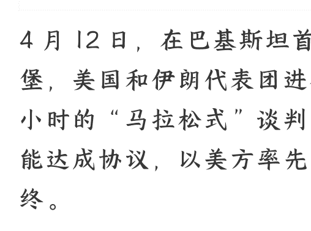

# 是谁搞砸了美伊谈判？

2024 年 4 月 14 日 文/卢克文工作室 嘉宾 云梦竹

整理：公众号懒人搜索，懒人专属群精选

懒人微信：lazyhelper1

4 月 12 日，在巴基斯坦首都伊斯兰堡，美国和伊朗代表团进行了长达 21 小时的“马拉松式”谈判，但最终未能达成协议，以美方率先宣布退场告终。

谈判结束后，伊朗外长阿拉格齐透露的一个消息，非常值得推敲。

他说就在准备签署《伊斯兰堡谅解备忘录》，距离达成协议仅“一步之遥”时，谈判戛然而止，原因是美方要价太高。

从这份表态可以看出，双方开始谈判时分歧并没有外界想象的那么大，但美国可能临时提出了在伊朗看来不可接受的要求。

## 01

从细节来看，在谈判破裂之后，万斯和特朗普都第一时间把矛头指向了伊朗核问题。

特朗普放话说，伊朗拒绝在核问题上妥协。

大家知道，早在 2 月 15 日的谈判中，伊朗副外长马吉德•塔赫特 - 拉万奇就透露，伊朗政府愿意稀释其手中 60% 纯度的浓缩铀，以此作为谈判的诚意。

换句话来讲，伊朗核问题已经不是个问题。

那么问题来了，特朗普和万斯在核问题上，到底要价高在哪里？

高就高在美国要求伊朗放弃所有铀浓缩活动、交出所有浓缩铀储备，甚至在 20 年内剥夺其铀浓缩权利。

而伊朗则拒绝交出浓缩铀或停止铀浓缩活动。

特朗普为什么坚持这个要价？因为这事关特朗普能否收场的体面。

咬死伊朗不愿意在核武器问题上让步，特朗普的战争合理性才能维持下去。

看到这里，估计有朋友会问，既然如此，那么为什么伊朗不直接宣布弃核，将特朗普一军嘞。毕竟德黑兰现在也有这个想法。

而这就是国际政治的精彩之处了，伊朗正是因为太清楚特朗普需要什么，所以必须在核计划上咬死。只要伊朗一天不宣布弃核，特朗普就不能宣布自己赢了。

一旦伊朗正式宣布放弃核计划，或者在没有附加条件的情况下交出关键核材料，美国完全可以一边宣布自己赢了，一边继续保留制裁和军事威慑，形成双赢，赢两次的局面。

这种局面，伊朗显然不会接受。

## 02

但如果把整场谈判的细节拼起来看，就会发现，核问题固然重要，却未必是最真实的症结。

真正卡住双方的，其实是另一个更现实也更敏感的问题：制裁怎么解除，资产怎么解冻。

在谈判开始前，伊朗方面就刻意放出风声，说美国已经同意解冻部分伊朗资产。

而美国很快就出面否认了这一说法。

这样的操作，其实很迷惑。

大概率是双方已经达成了不能公布的秘密默契。私下里，怎么说都行，你要是敢摆在台面上，我肯定否认。

伊朗方面提出，为了补偿战争造成的损失，美国应当解冻部分伊朗资产。

这个提法几乎第一时间就被万斯团队压了回去。

原因并不复杂：美国可以在制裁上让步，可以在某些框架下默许伊朗拿到一部分钱，但它绝不可能允许这笔钱被定义为“战争赔偿”。

所以后来伊朗又开始转换表述，希望把部分冻结资产说成战后重建资金。看起来似乎缓和了一点，但本质上其实差别不大。

无论叫赔偿，还是叫重建资金，伊朗真正想要的不仅仅是这笔钱，更有这笔钱背后的政治叙事。

过去几十年，伊朗国内其实一直有两套叙事在竞争。

一套是温和派的叙事，认为只要和美国谈，只要姿态足够柔软，只要伊朗展现克制，制裁迟早会解除，伊朗就能重新融入国际体系。

另一套则是强硬派，尤其是革命卫队的叙事。他们始终强调，伊朗今天的地位，源自美国对秩序颠覆者的杀鸡儆猴，美国绝不会放过伊朗，所以只有强硬对抗。

从过去这些年的结果看，温和派最尴尬的地方就在于：他们许诺的制裁解除，始终没有真正到来。

特朗普政府一次次撕毁了伊朗的希望。

而美以伊大战后，如果特朗普愿意解除部分制裁，这件事在伊朗国内的政治意义非同小可。

这就是革命卫队的政治需求，即温和派无法办到的事情，我们用抵抗做到了。

它意味着，革命卫队长期坚持的路线是正确的。

在伊核问题上，特朗普是否胜利需要由伊朗弃核去定义。

在制裁问题上，伊朗是否胜利，需要特朗普去决定。

这就意味着，伊朗和特朗普手中，分别握着对方最需要的东西，而且双方都没有先松手的意图。

理论上，最理想的结果当然是：伊朗在核问题上退一步，特朗普在制裁问题上退一步，双方各自拿到自己想要的政治成果，然后共同下台阶。

可问题在于，事情发展到这一步，互信早就已经被反复撕碎了。伊朗绝不会率先释放善意。

因为对德黑兰来说，过去这些年的经验已经足够清楚了，特朗普本身就是不可信的。

## 03

接下来，就是霍尔木兹海峡问题。

美国的要价高，估计就在“共同管制海峡”方案上。

根据《金融时报》消息人士披露，伊朗拒绝了美国提出的“共同管制海峡”方案。

这里有一点需要特别注意：是伊朗拒绝了美国提出的共同管制提议。

换句话说，“共同管制海峡”这个方案，并不是伊朗提出的，而是美国主动提出的，这一点必须记住。

伊朗媒体也披露，美国曾提出一项联合管理方案，建议两国共同运营并监管这条战略水道，同时引入一套收费体系。但这一建议最终被伊朗否决。因为在伊朗看来，自己对霍尔木兹海峡拥有完整的收费权。

所以说，双方现在博弈的焦点，确实在霍尔木兹海峡。

但跟大家预想中的不同，双方在这个问题上的默契远大于分歧。

默契在于双方已经认可了收费的可行性，并且就船只大小、运载货物等细节进行了磋商。分歧在于这笔钱到底怎么收、又该怎么分。

事实上，这个逻辑也并不难理解。

对于伊朗来说，如果能够在霍尔木兹海峡实施收费，就意味着其战争叙事获得了全面胜利。更重要的是，伊朗革命卫队手中将会握有一笔巨大且不菲的财政收入。

这么一笔巨大的收入，足够让革命卫队维持其权力的稳固。

而对于特朗普来说，如果美国能够在霍尔木兹海峡收费，那么他立刻就可以把此前因伊朗战争而离心离德的 MAGA 重新拉回来。

因为对于 MAGA 而言，美国既没有真正陷入伊朗战争的泥潭，又通过霍尔木兹海峡收费把战争成本赚了回来。

总统打仗这么多年，第一次还能见到“回头钱”，这还不算赢，那什么才算赢？

只要霍尔木兹海峡一收费，特朗普就不是那个被内塔尼亚胡骗入战争的蠢货，MAGA 也能宣传，懂王那是假装入局，实则准备血赚。这对于美国中期选举来讲，几乎是可以翻盘的消息。

看到这里，很多朋友估计会说了，那美国难道没有人看到这么做的危险吗？你看，有这种眼光的人，他们早就反对懂王了。

这就是当前美国大选的诡异之处，那些反对你的人，无论你做什么他们都会反对你，所以他们的意见不重要。

对于那些支持你的人，无论你做什么，他们都会支持你，所以他们的意见也不重要。

只要你能说服中间选民，这把就算你赢。

无论是对于伊朗，还是对于美国，霍尔木兹海峡收费本身，都是双方共同需要的。但问题也正出在这里。既然双方都需要，为什么最后还是谈崩了？

我的判断是，所谓美国目标的变动，本质上特朗普在分成问题上反悔了，要价太高，最终导致伊朗无法接受。

因为实际负责对航运进行稽查和控制的是伊朗。既然真正执行收费和检查的是伊朗，那么伊朗当然希望自己拿到大头。可如果伊朗拿了大头，特朗普又该如何向国内交代？

还是那句话，大家都需要对国内说自己赢了，所以，分成比例是至关重要的。

基于这些因素，我判断，双方接下来的一切动作，实际上都是在为第二轮谈判做准备。

哪怕这期间再次爆发军事冲突，其本质也不是为了彻底打垮对方，而是为了在新一轮谈判中继续堆叠筹码、抬高要价。

> 正所谓：“六朝何事，只成门户私计。”

这场博弈落到最后，真正主导谈判走向的，依然是两个政治集团的自身利益。

### 分割线

绝大多数人只盯着眼前的工资，却不知道一次远在中东的冲突、一次降息的决议，就能在一夜之间洗牌普通人的财富。

看懂宏观，是为了在周期切换时，不被当作代价。

如果你认同这种“抬头看路”的长期主义，欢迎围观我的个人情报智库：【懒人专属群】。

圈子已稳定运行 7 年。我们每天利用 Python 爬虫与大模型算力，过滤全网最顶级的政经内参和搞钱风向标，做你最冷酷的“外部大脑”。

查阅圈子完整数字资产与上车门槛：

https://lazyso.com/insider/

认同价值的。扫码加我微信，备注：【进群】

微信：lazyhelper1