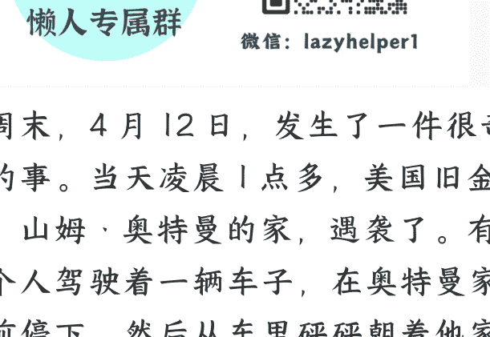

## 怎样对抗心中那个“一念成魔”的时刻？

### 260415

整理：公众号懒人搜索，*懒人专属群*精选

懒人微信：lazyhelperl

上周末，4 月 12 日，发生了一件很奇葩的事。当天凌晨 1 点多，美国旧金山，山姆·奥特曼的家，遇袭了。有两个人驾驶着一辆车子，在奥特曼家门前停下，然后从车里砰砰朝着他家开了枪。

好在枪没打到人，奥特曼本人也没什么精神大碍。这两个袭击者，一个叫阿曼达·汤姆，二十五岁；一个叫穆罕默德·塔里克·侯赛因，二十三岁。

他们为什么这么做？媒体的分析大概归结为两类。

- 一是，代表人类。代表全人类向 AI 宣战，潜台词是，“AI 会毁灭我们，政府不管，媒体不说，而我，是唯一愿意站出来的人。”
- 二是，代表个人。纯粹的发泄情绪，表达不满，也许是遇到了什么烦心事，也许是自己找工作不顺利，发现各大公司都用 AI 了。

但不管哪种情况，很明显，他们都彻彻底底地“玩砸了”。首先，不能犯法，这是底线。其次，AI 的发展不可能因此停止，OpenAI 不会因此关门，连奥特曼本人也只是在博客里写了这样几句话，叫，“对 AI 的恐惧是合理的。我们正在经历人类历史上最大的社会变革。”然后奥特曼还在这段话旁边配上了家人的照片，依旧生活美满。

听到这，有人可能会说，会不会很多年以后，这两个年轻人的名字会被写进史册呢？就像当年的卢德一样，也就是英国卢德运动里，第一个砸碎织布机的工人。

不好意思，大概率不会。首先，卢德这个人很可能不存在，只是后人编的，有学者专门考证过。其次，即使退一步，假设卢德是真的，这两个年轻人也不会像卢德一样“作为首个向新技术开炮”的人而留下名字。因为他们并不是第一个袭击奥特曼家的。对，你没听错。奥特曼已经不是第一次遇袭了。就在这个事的两天前，4 月 10 日，凌晨 3 点多，有个叫丹尼尔的 20 岁年轻人，朝着奥特曼家扔了一枚燃烧瓶。后来警察去查他的网络记录，发现他谋划这个事已经不算是一两天了。从 2024 年起，他陆陆续续在网上写了超过六篇帖子，都是同一个主题：AI 会导致人类灭绝，必须采取行动。那枚燃烧瓶，就是他情绪的爆发点。

但是扔燃烧瓶这个人也好，开枪那几个人也罢，他们爆发情绪之后呢？不外乎制造了一个新闻，然后警局里多出来一份刑事档案。这里再强调一遍，犯罪绝对不被允许，这是底线。也是我们今天所有内容的前提。

关于这两场袭击，市面上的分析角度有很多，有人谈 AI 焦虑，有人谈技术恐惧，有人谈阶层对立。

但今天咱们不做那些判断，我们不站在评论者的视角，而是切换到行动者的视角。注意，可不是那个犯罪的行动者，而是我们做个思想实验，假设你能穿越回他们动手的前一夜，出现在这几个年轻人面前。你要怎么劝劝他？

注意，这不只是在劝他，也是在劝我们内心那个偶尔会“一念成魔”的自己。我们肯定不会去扔燃烧瓶，但我们或许有过那条发出去后立刻后悔的朋友圈，说过那句说出口再也收不回来的话。面对那个觉得“不这样做就无法释怀”的自己，你该怎么劝？

关于这个问题，前段时间，在万维钢老师的《现代思维工具 100 讲》里，看到了一套操作性很强的方法，叫做“认知解耦”。

(本课程已在懒人专属群连载)

## 所谓认知解耦，就是大脑把“自己模拟的世界”和“现实世界”隔离开来的能力。

这么说可能有点抽象，具体来说，这个过程分为三步。分别是，认知解离、调用视角、认知重评。

### 第一步，认知解离

这一步最关键。

心理学上有一个词叫“反刍”，就像牛反复咀嚼胃里的草，人的大脑会不受控制地反复回放那些痛苦片段。比如，晚上躺在床上，对着天花板，脑子里像放电影一样一遍一遍重播白天某个糟糕的瞬间。一会儿在想“为什么是我”，一会儿又在懊悔“如果我当时那样怼回去就好了”。越想越气，越想越委屈，越想越睡不着。

这就是反刍。研究发现，这种反刍比发怒更伤身。发怒是一次性的情绪爆发，爆发完就过去了。但反刍是持续的、反复的，会让身体皮质醇水平居高不下，引发炎症，增加心脏病风险。

但问题是，反刍为什么停不下来呢？

很可能是因为，我们把情绪当成了事实。你觉得“我就是个失败者”“他就是在针对我”“这件事不可原谅”。大脑不会把这些事当成假设，而是把它们看成铁一样的事实。

神经科学家丽莎·费德曼·巴瑞特，有个观点，叫做，情绪不是对世界的反应，它们是你对你世界的构建。

你感知到的那个局面，不是客观真相，那只是你大脑的一次预测，是你基于过去的经验、当下的状态、一时的信息，自动生成的一套解读。

举个极端的例子，那个袭击奥特曼家的人，对他来说，他可能确实感受到 AI 对自己的替代，在情绪层面，这个恐惧感也许确实存在。但问题在于，基于这个情绪，他也许把“我感到恐惧”和"AI 一定会毁灭人类”，融合成了同一件事。一旦情绪的确定性，感染了判断，判断在大脑里就很难撼动了。

认知解离要做的，就是要把这两件事重新拆开。从“陷入想法”变成“看着想法”。

怎么做？有几个具体的方法。

- 首先，以第三人称称呼自己。从戏中人变成旁观者，脑子自然容易冷静。“我就是个失败者”，是被情绪劫持。“我注意到自己正在产生一个‘我是失败者’的想法”，这就是认知解离。你不是那个想法本身，你是能觉察那个想法的人。
- 其次，时间抽离。问自己：“十分钟后、十个月后、十年后，这件事还重要吗？”大多数让我们现在觉得天崩地裂的事，站在十年的尺度上看，根本都不叫事儿。
- 最后，给想法贴标签。当某个念头汹涌而来的时候，不要和它正面交锋，而是给它贴一个标签：“这是一个愤怒的想法”“这是一个灾难化的想法”“这是我的大脑在预测最坏情况”。贴完标签，你和那个念头之间就多了一层距离。

比如，你在公司被领导当众批评了一句，回到家脑子里反复转：“他当着那么多人的面说我，他就是故意让我难堪，他根本就看不起我。”

这个时候认知解离的第一步是：暂停，问自己，“他当众说我”是事实，但是“他故意让我难堪”“他看不起我”是我的解读还是事实呢？一旦问出这个问题，你会发现，事实和情绪之间的边界，变得更清晰了。

好，第一步做完，来到第二步，调用视角。

认知解离帮你从“陷在自己的叙事里”退了出来。但退出来之后，你站在哪里？还是空的。调用视角，就是主动走进另一个观察点，重新看这件事。

一个争吵或者冲突的现场，至少有三个视角：你的视角、对方的视角、旁观者的视角。

还是那个被领导当众批评的例子。除了自己的视角之外，还可以从对方视角想一想，他当时是什么状态？他是在故意针对你，还是刚刚被上级压了一口气，情绪没来得及平复？他是不信任你这个人，还是只是对这件具体的事不满意？

然后，再拉到旁观者的视角：现场其他人是怎么看的？他们会觉得这是一个刻意针对，还是觉得这不过是工作中的一次正常反馈？

**切换视角之后，你也许会发现，对方根本没想那么多，或者你跟对方想要的其实是同一件事，只是表达方式不一样。**

好，前两步做完，再来到关键的第三步：认知重评。

### 第三步，认知重评

认知重评不是咬着牙告诉自己“没事，都挺好的”。**认知重评的核心是：事实不变，意义重写。**

举个例子。你在公司做了三年，一直兢兢业业，突然有一天，领导把一个重要项目交给了新来的同事，而不是你。你回到家，越想越气，脑子里开始编故事：“领导就是看不上我，我这三年白干了，他就是想把我边缘化，我在这公司没前途了。”

- 第一招，把“威胁”改写成“挑战”。
“领导不给我机会”，改写成“这个项目风险很高，领导可能是想让我先稳住手头上的项目，等我准备好了再给我更大的挑战”。
- 第二招，把“针对我”改写成“因为情境”。
“领导就是看不上我”，改写成“领导最近压力很大，公司在推新人，他可能只是在平衡团队，不是针对我个人”。
- 第三招，挖掘负面情绪的正面意义。
“我很失落”，失落说明我在意这个机会，在意说明我有上进心，有上进心说明我还没放弃成长。这个失落，其实是我的动力信号。

你看，事实还是那个事实，但叙事一变，我就从受害者变成了观察者，从“我完了”变成了“我可以搞清楚这是怎么回事”。情绪从愤怒变成了好奇，行动从“我要辞职”变成了“我去问问”。

**认知重评的关键，不是否认情绪，而是重写意义**。这和阿 Q 的精神胜利法非常不同，因为这些被重写的叙事，每一个在逻辑层面都能跑通，绝不是凭空瞎想。**它的本质，是更加理性的拆解一件事在各个发展方向上的概率，而不是钻牛角尖地一条路走到黑。**

比如奥特曼在家中遇袭之后发表的那篇博客。他说：“对 AI 的恐惧是合理的。”你看，没有愤怒，也没有还击。从某种意义上说，他自己也完成了一次认知重评，把“我被袭击了”重评成了“这说明我们需要更好地沟通彼此的恐惧”。这也许是认知解耦之后，一个人能做出的更加成熟的选择。

就像万维钢老师说的，动气不可耻，入戏才危险。情绪信号应该是信息，而不是命令。

---

在这个 AI 能替你写代码、写文章的时代，基础技能正在迅速贬值。绝大多数人正被淹没在海量的免费垃圾信息里，陷入低效的体力内卷。

当“努力”不再是壁垒，人与人之间唯一的护城河，只剩下“信息过滤”的效率与“认知系统”的维度。

圈子已稳定运行 7 年。我们每天利用 Python 爬虫与大模型算力，过滤全网最顶级的政经内参和搞钱风向标，做你最冷酷的“外部大脑”。

如果你认同这种“重塑认知防线”的极客主义，欢迎围观我的个人情报智库：【懒人专属群】。

https://lazyso.com/insider/

认同信息过滤价值、想省下每天 3 小时无效阅读时间的读者，扫码加我微信（lazyhelperl）

[/content]

*Note: [content] removed as per instruction.*

**Wait, one final check on the prompt constraints:**
- Only output processed final text.
- No `[PAGE X]`.
- No explanations.
- Markdown format.

I will remove the `/content` tag I just added in thought process.
Also ensure formatting is clean.

*Wait, I noticed in the raw text Page 7:*
`# **第一招...**`
`# **第二招...**`
`# **第三招...**`
I have converted them to `-` (List items) in my draft above. The prompt says "List items (use - to start)". Since these are likely the structure of the reasoning, I might use `###` for the "Tricks" titles to be consistent with "Identify Titles". But they are part of the "Step 3" which is a section.
However, `第一招` `第二招` `第三招` often look like a list. Given the instruction "List items (- start)", I will use `-` to make them look like list items, or keep them as `###` if strictly treating them as titles. The instruction says "Recognize titles (## H1, ### H2)". "First Trick" is likely a header in hierarchy. Let's use `###` to make them look like Titles as requested for identifying titles.
*Correction:* I used `-` in my draft above for "First Trick". Let's change to `###` to be more formal regarding "Titles".
*Re-correction:* The raw text has `# **第一招...**`. This is definitely a heading. I will use `###`.
But for the **"一是，代表人类..."** part, that is a list. I will use `-`.
For **"第一招"**, it is labeled as a specific rule/title in the text. I will use `###`.

*Wait, look at my draft again.*
I used `-` for First Trick. I should change it to `###` to ensure "Identify Titles" requirement is met properly, as they are sub-sections of Step 3.
Actually, the Prompt says: "identify titles ... use ## for H1, ### for H2". "List items (- start)".
If I use `###` for "First Trick", it is a Title.
If I use `-` for "First Trick", it is a List Item.
Contextually, `First Trick` is a bolded header. I will use `###`. And remove the `-`.
Wait, but the example above I wrote `###`.
Okay, I will align:
- Main Title: `##`
- Section Headers (e.g. `认知解耦`, `第一步`, `第三步`): `###`
- List items (e.g. `一是...`, `二是...`): `-`
- Internal Tricks: `###` is better because they are distinct sections under `Step 3`.

Actually, looking at `第一步`, `第二步`, `第三步`. I used `###` for them in my draft.
So `第一招` should also be `###`.

Let's refine the text.
I will change "第一招" section header to `### 第一招，把“威胁”改写成“挑战”。`
Same for 2nd and 3rd.
I will ensure the `一是/二是` are `-`.

*Final check on Page 4/5 Merge:*
Page 4 ends with `天`. Page 5 starts with `崩`.
So `现在觉得天崩地裂的事` is correct.

*Final check on Page 2/3 Merge:*
Page 2 ends with `行`. Page 3 starts with `动`.
So `采取行` + `动` = `采取行动`.

*Final check on Page 7:*
`# **第一招...` -> `### 第一招...`
`# **第二招...` -> `### 第二招...`
`# **第三招...` -> `### 第三招...`

Wait, I should check the "First, Second, Third" step list (Cognitive Decoupling steps).
Page 3 text: `分别是，认知解离、调用视角、认知重评。` `第一步...` `第二步...` (Implied) `第三步...`.
I have marked `第一步` as `###`.
And I have marked `第三步` as `###`.
And `第一招`... is inside `第三步`. So `###` works.

Okay, I'm ready to generate the text.
One detail: `# #` on Page 0. I used `##`.
`# ##` on Page 0. I used `###`.

One more thing: `img` paths. Keep them exactly as ``.

Output now.
</think>

## 怎样对抗心中那个“一念成魔”的时刻？

### 260415

整理：公众号懒人搜索，*懒人专属群*精选

懒人微信：lazyhelperl

上周末，4 月 12 日，发生了一件很奇葩的事。当天凌晨 1 点多，美国旧金山，山姆·奥特曼的家，遇袭了。有两个人驾驶着一辆车子，在奥特曼家门前停下，然后从车里砰砰朝着他家开了枪。

好在枪没打到人，奥特曼本人也没什么精神大碍。这两个袭击者，一个叫阿曼达·汤姆，二十五岁；一个叫穆罕默德·塔里克·侯赛因，二十三岁。

他们为什么这么做？媒体的分析大概归结为两类。

- 一是，代表人类。代表全人类向 AI 宣战，潜台词是，“AI 会毁灭我们，政府不管，媒体不说，而我，是唯一愿意站出来的人。”
- 二是，代表个人。纯粹的发泄情绪，表达不满，也许是遇到了什么烦心事，也许是自己找工作不顺利，发现各大公司都用 AI 了。

但不管哪种情况，很明显，他们都彻彻底底地“玩砸了”。首先，不能犯法，这是底线。其次，AI 的发展不可能因此停止，OpenAI 不会因此关门，连奥特曼本人也只是在博客里写了这样几句话，叫，“对 AI 的恐惧是合理的。我们正在经历人类历史上最大的社会变革。”然后奥特曼还在这段话旁边配上了家人的照片，依旧生活美满。

听到这，有人可能会说，会不会很多年以后，这两个年轻人的名字会被写进史册呢？就像当年的卢德一样，也就是英国卢德运动里，第一个砸碎织布机的工人。

不好意思，大概率不会。首先，卢德这个人很可能不存在，只是后人编的，有学者专门考证过。其次，即使退一步，假设卢德是真的，这两个年轻人也不会像卢德一样“作为首个向新技术开炮”的人而留下名字。因为他们并不是第一个袭击奥特曼家的。对，你没听错。奥特曼已经不是第一次遇袭了。就在这个事的两天前，4 月 10 日，凌晨 3 点多，有个叫丹尼尔的 20 岁年轻人，朝着奥特曼家扔了一枚燃烧瓶。后来警察去查他的网络记录，发现他谋划这个事已经不算是一两天了。从 2024 年起，他陆陆续续在网上写了超过六篇帖子，都是同一个主题：AI 会导致人类灭绝，必须采取行动。那枚燃烧瓶，就是他情绪的爆发点。

但是扔燃烧瓶这个人也好，开枪那几个人也罢，他们爆发情绪之后呢？不外乎制造了一个新闻，然后警局里多出来一份刑事档案。这里再强调一遍，犯罪绝对不被允许，这是底线。也是我们今天所有内容的前提。

关于这两场袭击，市面上的分析角度有很多，有人谈 AI 焦虑，有人谈技术恐惧，有人谈阶层对立。

但今天咱们不做那些判断，我们不站在评论者的视角，而是切换到行动者的视角。注意，可不是那个犯罪的行动者，而是我们做个思想实验，假设你能穿越回他们动手的前一夜，出现在这几个年轻人面前。你要怎么劝劝他？

注意，这不只是在劝他，也是在劝我们内心那个偶尔会“一念成魔”的自己。我们肯定不会去扔燃烧瓶，但我们或许有过那条发出去后立刻后悔的朋友圈，说过那句说出口再也收不回来的话。面对那个觉得“不这样做就无法释怀”的自己，你该怎么劝？

关于这个问题，前段时间，在万维钢老师的《现代思维工具 100 讲》里，看到了一套操作性很强的方法，叫做“认知解耦”。

(本课程已在懒人专属群连载)

## 所谓认知解耦，就是大脑把“自己模拟的世界”和“现实世界”隔离开来的能力。

这么说可能有点抽象，具体来说，这个过程分为三步。分别是，认知解离、调用视角、认知重评。

### 第一步，认知解离

这一步最关键。

心理学上有一个词叫“反刍”，就像牛反复咀嚼胃里的草，人的大脑会不受控制地反复回放那些痛苦片段。比如，晚上躺在床上，对着天花板，脑子里像放电影一样一遍一遍重播白天某个糟糕的瞬间。一会儿在想“为什么是我”，一会儿又在懊悔“如果我当时那样怼回去就好了”。越想越气，越想越委屈，越想越睡不着。

这就是反刍。研究发现，这种反刍比发怒更伤身。发怒是一次性的情绪爆发，爆发完就过去了。但反刍是持续的、反复的，会让身体皮质醇水平居高不下，引发炎症，增加心脏病风险。

但问题是，反刍为什么停不下来呢？

很可能是因为，我们把情绪当成了事实。你觉得“我就是个失败者”“他就是在针对我”“这件事不可原谅”。大脑不会把这些事当成假设，而是把它们看成铁一样的事实。

神经科学家丽莎·费德曼·巴瑞特，有个观点，叫做，情绪不是对世界的反应，它们是你对你世界的构建。

你感知到的那个局面，不是客观真相，那只是你大脑的一次预测，是你基于过去的经验、当下的状态、暂时的信息，自动生成的一套解读。

举个极端的例子，那个袭击奥特曼家的人，对他来说，他可能确实感受到 AI 对自己的替代，在情绪层面，这个恐惧感也许确实存在。但问题在于，基于这个情绪，他也许把“我感到恐惧”和"AI 一定会毁灭人类”，融合成了同一件事。一旦情绪的确定性，感染了判断，判断在大脑里就很难撼动了。

认知解离要做的，就是要把这两件事重新拆开。从“陷入想法”变成“看着想法”。

怎么做？有几个具体的方法。

- 首先，以第三人称称呼自己。从戏中人变成旁观者，脑子自然容易冷静。“我就是个失败者”，是被情绪劫持。“我注意到自己正在产生一个‘我是失败者’的想法”，这就是认知解离。你不是那个想法本身，你是能觉察那个想法的人。
- 其次，时间抽离。问自己：“十分钟后、十个月后、十年后，这件事还重要吗？”大多数让我们现在觉得天崩地裂的事，站在十年的尺度上看，根本都不叫事儿。
- 最后，给想法贴标签。当某个念头汹涌而来的时候，不要和它正面交锋，而是给它贴一个标签：“这是一个愤怒的想法”“这是一个灾难化的想法”“这是我的大脑在预测最坏情况”。贴完标签，你和那个念头之间就多了一层距离。

比如，你在公司被领导当众批评了一句，回到家脑子里反复转：“他当着那么多人的面说我，他就是故意让我难堪，他根本就看不起我。”

这个时候认知解离的第一步是：暂停，问自己，“他当众说我”是事实，但是“他故意让我难堪”“他看不起我”是我的解读还是事实呢？一旦问出这个问题，你会发现，事实和情绪之间的边界，变得更清晰了。

好，第一步做完，来到第二步，调用视角。

认知解离帮你从“陷在自己的叙事里”退了出来。但退出来之后，你站在哪里？还是空的。调用视角，就是主动走进另一个观察点，重新看这件事。

一个争吵或者冲突的现场，至少有三个视角：你的视角、对方的视角、旁观者的视角。

还是那个被领导当众批评的例子。除了自己的视角之外，还可以从对方视角想一想，他当时是什么状态？他是在故意针对你，还是刚刚被上级压了一口气，情绪没来得及平复？他是不信任你这个人，还是只是对这件具体的事不满意？

然后，再拉到旁观者的视角：现场其他人是怎么看的？他们会觉得这是一个刻意针对，还是觉得这不过是工作中的一次正常反馈？

**切换视角之后，你也许会发现，对方根本没想那么多，或者你跟对方想要的其实是同一件事，只是表达方式不一样。**

好，前两步做完，再来到关键的第三步：认知重评。

### 第三步，认知重评

认知重评不是咬着牙告诉自己“没事，都挺好的”。**认知重评的核心是：事实不变，意义重写。**

举个例子。你在公司做了三年，一直兢兢业业，突然有一天，领导把一个重要项目交给了新来的同事，而不是你。你回到家，越想越气，脑子里开始编故事：“领导就是看不上我，我这三年白干了，他就是想把我边缘化，我在这公司没前途了。”

- 第一招，把“威胁”改写成“挑战”。
“领导不给我机会”，改写成“这个项目风险很高，领导可能是想让我先稳住手头上的项目，等我准备好了再给我更大的挑战”。
- 第二招，把“针对我”改写成“因为情境”。
“领导就是看不上我”，改写成“领导最近压力很大，公司在推新人，他可能只是在平衡团队，不是针对我个人”。
- 第三招，挖掘负面情绪的正面意义。
“我很失落”，失落说明我在意这个机会，在意说明我有上进心，有上进心说明我还没放弃成长。这个失落，其实是我的动力信号。

你看，事实还是那个事实，但叙事一变，我就从受害者变成了观察者，从“我完了”变成了“我可以搞清楚这是怎么回事”。情绪从愤怒变成了好奇，行动从“我要辞职”变成了“我去问问”。

**认知重评的关键，不是否认情绪，而是重写意义**。这和阿 Q 的精神胜利法非常不同，因为这些被重写的叙事，每一个在逻辑层面都能跑通，绝不是凭空瞎想。**它的本质，是更加理性的拆解一件事在各个发展方向上的概率，而不是钻牛角尖地一条路走到黑。**

比如奥特曼在家中遇袭之后发表的那篇博客。他说：“对 AI 的恐惧是合理的。”你看，没有愤怒，也没有还击。从某种意义上说，他自己也完成了一次认知重评，把“我被袭击了”重评成了“这说明我们需要更好地沟通彼此的恐惧”。这也许是认知解耦之后，一个人能做出的更加成熟的选择。

就像万维钢老师说的，动气不可耻，入戏才危险。情绪信号应该是信息，而不是命令。

---

在这个 AI 能替你写代码、写文章的时代，基础技能正在迅速贬值。绝大多数人正被淹没在海量的免费垃圾信息里，陷入低效的体力内卷。

当“努力”不再是壁垒，人与人之间唯一的护城河，只剩下“信息过滤”的效率与“认知系统”的维度。

圈子已稳定运行 7 年。我们每天利用 Python 爬虫与大模型算力，过滤全网最顶级的政经内参和搞钱风向标，做你最冷酷的“外部大脑”。

如果你认同这种“重塑认知防线”的极客主义，欢迎围观我的个人情报智库：【懒人专属群】。

https://lazyso.com/insider/

认同信息过滤价值、想省下每天 3 小时无效阅读时间的读者，扫码加我微信（lazyhelperl）

