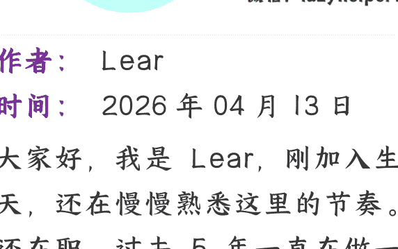

## 做了 5 年 5000 人大会，聊聊线下活动最容易踩的几个坑

260415 副业 SC 精华
整理：公众号懒人搜索，懒人专属群精选
懒人微信：lazyhelper1

作者：Lear

时间：2026 年 04 月 13 日

大家好，我是 Lear，刚加入生财 3 天，还在慢慢熟悉这里的节奏。目前还 在职，过去 5 年一直在做一件事：统筹一个全国规模 No.1 的教育类大会。

这个会议每年线下参会人数 5000+，
线上 10 万+，从最初的混乱摸索，到后来逐渐跑出一套稳定的执行体系，
简单说，我主要负责把一场“大型活动”
从 0 到 1，再到稳定复用。

从会场怎么选更不踩坑，到场地怎么搭建更高效;

从推广报名的节奏设计，到嘉宾接待的细节体验;

再到签到动线、现场控场，以及线上线下同步执行;

踩过的坑不少，也慢慢沉淀出一整套比较完整的活动统筹方法论。

最近参加了几场外部中大型活动，发现即使是很成熟的团队，在流程精细化、成本控制、风险防控上还有很大的优化空间。所以想结合这些年踩过的坑，想跟圈友们分享几个做线下活动最容易忽视、但影响很大的点。

先写第一场的感受吧，因为不管是做几十人的私享会、几百人的见面会，还是上千人的大型活动，底层逻辑其实是相通的。

## 一、签到这件事，80% 的人都低估了它的复杂度

很多人觉得签到就是“摆张桌子、放几个人、扫个码”。但当人数只要超过 200，签到就不是一个“点”，而是一个“系统”。最常见的问题是：所有人在同一个时间段涌到同一个入口，N 个签到窗口瞬间变成一个签到窗口，排队的 人越来越烦躁，活动开场时间到了还有一半人没进场。主持人在台上尬聊，台下稀稀拉拉，好不容易设计的开场气势直接就没了。

我们 5000 人活动的签到，前两年也最长堵过 40 分钟。后来摸索出几个办法，现在基本能做到 15 分钟全部入场：

- 提前一天晚上开放签到。很多参会者前一天就到了，让他们晚上就把签到手续办了，第二天早上的压力直接减掉三分之一。
- 设置多个签到点。不要只在会场门口放一个签到台。酒店大堂、电梯口、甚至餐厅旁边，都可以放。让人流在空间上分散开。
- 用一米栏做物理分流。这个最简单也最有效。没有一米栏的签到区，人会自然地挤成一团；有一米栏引导出蛇形通道，大家会自动排队，每个窗口都能被均匀利用。

这三个动作，即使你只做一个 100 人的私享会，提前签到和物理引导也是适用的。规模越大，效果越明显。

（还有很多方法，这里就不细讲了）

## 二、嘉宾的体验，直接决定了他的内容交付质量

很多活动把精力全花在“请到嘉宾”上，觉得人来了就行了。但嘉宾从下飞机那一刻起，他就已经“进入”你的活动了。他的状态好不好，直接影响他上台后的发挥。

我们 150 多位演讲嘉宾的活动，嘉宾接待是一个独立的工作组。每位嘉宾都有一个专属的“小助手”全程跟进——机场引导、交通安排、酒店房型、饮食禁忌、彩排时间、候场区域、上下场动线，全部提前确认。

一开始我们团队也觉得“是不是做过头了”，但做了之后发现其实回报远超成本：

- 嘉宾状态好，演讲质量明显更高，参会者满意度跟着上去。
- 嘉宾感受到被重视，参加了一次还想来第二次。
- 最关键在于，嘉宾回去之后会主动帮你做口碑传播——“这个活动的安排是我参加过所有活动里最好的”，这种评价比花钱投广告有效得多。

即使你的活动只有 3-5 位嘉宾，也值得安排一个专人对接。不需要多复杂，一份简单的对接清单（行程、住宿、饮食、彩排时间、上台流程）就够了。核心是让嘉宾感觉到：有人在管我的事，我不需要操心。这样嘉宾的注意力自然会集中在演讲内容上。

## 三、那些“不是你的问题”的问题，其实都是你的问题

这些看起来是场地方的责任，但作为主办方，这些问题的后果最终都由你来承担。能做的事，其实比大多数人想的多：

- 温度：人多了体感温度会明显升高，空场时觉得合适的温度，人一多就会闷。提前跟场地沟通好开机时间和温度设定，比等参会者开始抱怨再去处理，效果好得多。

空调温度不对、WIFI 太慢、午餐排队太长、洗手间不够用——参会者不会去找酒店或场馆方投诉，他们只会觉得“这个活动体验不好”。

- 人流：一千人同时涌入同一个场所，严重造成拥挤和踩踏事故。建议提前规划好分时段或分区域巡逻，能有效把人潮摊开，避免在场馆入口处扎堆。

声音：会场里前后左右的音量差异往往比想象中大。AV 设备的布点需要根据场地形状来设计，而不是“有音响就行”——坐在后排听不清楚的参会者，体验和坐在前排是完全不同的两件事。

卫生间：中场休息时间一到，人同时出来，卫生间立刻排队。提前确认数量够不够，必要时跟场地协调临时增加移动设施，或者在动线设计上引导人流分散到不同楼层。

这些细节单拿出来都不大，但叠加在一起，就是“这个活动很专业”和“这个活动差点意思”之间的差距。

## 四、细节能让你的办会总成本下降 20%

很多主办方觉得“办活动就是烧钱”，但我们自己一届一届优化下来，发现很多地方是真的能省出来的，而且省下来的同时，体验反而更好：

和会场方的费用谈判，是最容易被忽视的省钱机会。很多主办方拿到场地报价单就签了，觉得酒店的价格是“定死的”。但其实场地费、AV 设备租用费、餐饮费、服务费……几乎每一项都有空间可以谈。场地方的报价单通常预留了 20%~30% 的浮动空间，淡季或工作日场景下议价余地会更大。

- 谈判的时机比谈判技巧重要。AV 公司、搭建公司、餐饮供应商，他们的档期有淡旺季。同样的配置，旺季（一般是 10-12 月）和淡季（2-4 月）价格差可以到 30%-50%。而且越提前签，对方越愿意给优惠——因为他可以早点锁定收入去排期其他客户。很多团队习惯“活动日期确定了再去谈供应商”，其实已经晚了，能谈到的价格空间很有限。
- 哪些环节可以删，比“加什么”更值得想清楚。很多“看起来很重要”的环节，其实是成本黑洞。参会者不喜欢，嘉宾觉得占时间，主办方还花了不少钱去筹备。所以每个动作的原则都应该是：能说清楚这个环节对参会者有什么具体价值，说不清楚的就删。删完之后活动整体节奏反而更好，参会者满意度反而更高，成本也下来了。
- 人员配置要精而不要多。很多活动靠堆人解决问题，但没有人知道自己在哪个时段该干什么，最后忙的忙死、闲的闲死，互相还在问“这个你管吗”。每个人的职责要细化到具体时间段和具体点位，每个人的行动都有步骤和标准——这样不仅效率更高，人力成本也能随之降下来。

这些加在一起，基本能把办会总成本压低 10%-20%（这个数字不是拍脑袋估的，是我们自己一年又一年真实优化的结果）。

## 五、80% 的活动体验，在活动开始之前就已经决定了

做了这么多年活动，我越来越觉得，现场执行只是最后那 20%。真正决定活动体验的，是前期那些看不见的准备工作：

- 动线有没有不同的人真实走过三遍？
- 每个时间节点的人流峰值有没有算过？
- 嘉宾的需求有没有逐一确认？
- 各种“万一”有没有准备预案？
- 团队的每个人是不是清楚自己每个时间段该在哪里、做什么？

这些问题，其实都不是“必选项”。但为什么有些活动，你参加完就忘了，有些活动，会在你脑子里多停一会。差的，不是内容，就是这些“被认真对待过”的感觉。

说到这，我自己最近也在反复想一件事，这些年积累的这些经验如果一直只用在一个项目里好像有点浪费。有没有可能把它们拆开，变成一种更轻量的支持方式，比如在活动前期，帮团队一起把结构理清；比如哪些地方容易出问题？哪些地方可以省成本？哪些环节值得做？哪些其实可以直接砍掉等等。如果有人在活动开始前就帮着把这些理顺，后面的各项推进，应该都会好很多。

以上就是从一场线下活动看到的一些可以打磨的点，算是给大家一个不同视角的参考吧。如果你刚好在做活动，或者准备做一场活动，也欢迎来交流，我应该能帮你避开一些我当年踩过的坑——这种实战教训比任何方法论都值钱。

---

看完这篇 SOP，你觉得你懂了。但 90% 的人一到实操就会卡在第一步。

工具和教程只是最低级的壁垒，真正的壁垒是“立刻动手”和“圈层信息差”。

如果你想看全网最新的变现玩法，并且和一群执行力极强的极客一起下场拿结果，欢迎围观我的核心私域：【懒人专属群】。

我们不聊虚的，只做商业闭环的拆解与 AI 效率的压榨。系统内已沉淀 1000+ 跑通的套利实战局。

查阅圈子完整数字资产与上车门槛：
https://lazyso.com/insider/

认同价值、准备好下场干活的，扫码加我微信（lazyhelper1）

备注：【实操上车】，不闲聊