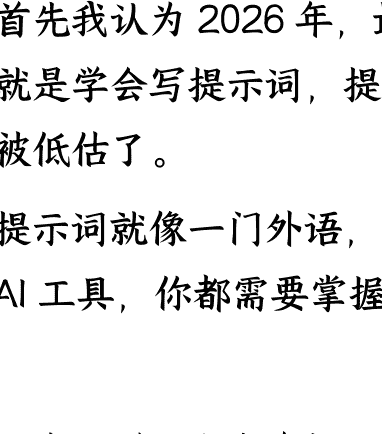
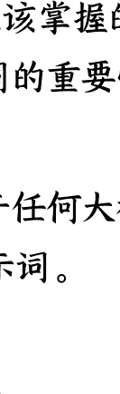
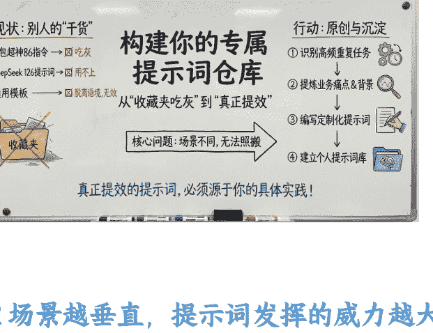
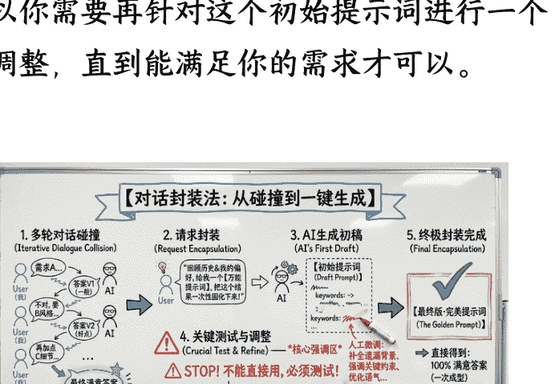
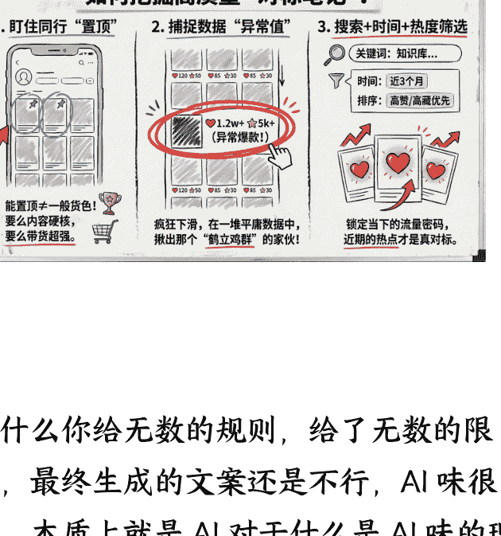
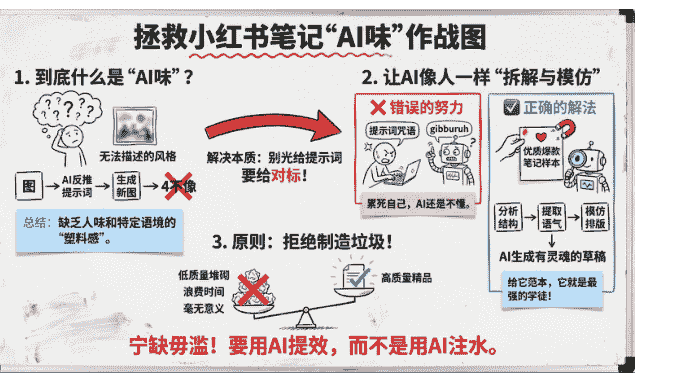
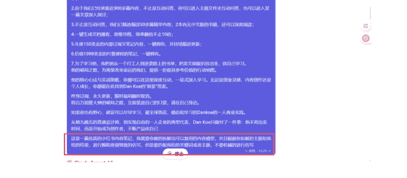
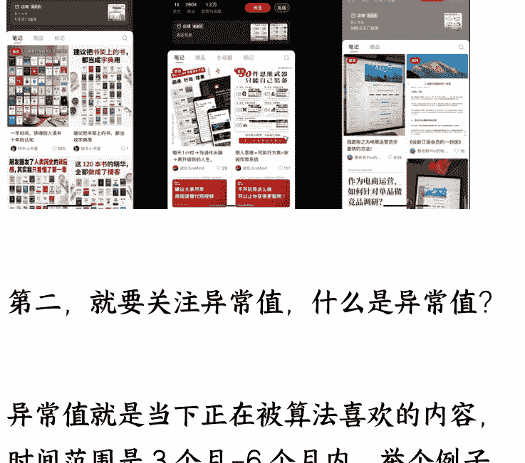

# 我实践出来的内容创作提示词方法论，

## 1.1w 字全盘托出 | 附常用提示词

## 260415 副业 SC 精华

公众号懒人搜索，懒人专属群独享

懒人微信：lazyhelper1

大多数人其实不会写提示词的，今天这篇文章告诉大家怎么写好提示词。

首先我认为 2026 年，最应该掌握的技能就是学会写提示词，提示词的重要性远远被低估了。

提示词就像一门外语，对于任何大模型和 AI 工具，你都需要掌握提示词。

现在互联网上也有提示词教程，以及每一个大模型更新或者一个新的 AI 工具出现的时候，都会伴随着大量的提示词出现，同时卖提示词也是一门生意。

而且传播比较广的提示词，一般看起来都很华丽，内容很长，很多人看了就已经有了一种恐惧感，认为写提示词是很难的事情，这是大多数人的心理状态，包括我之前也是这种想法。

认为提示词很难写，所以对提示词一直有恐惧，但是后来我发现并不是这样的。

理由很简单，提示词只能给你一个看似惊艳的初始回答，但是大多数初始回答并不满足你的需求，所以最后你还是在用你的思维和方式去提问，你拿到的提示词发挥的效果大打折扣。

同时很多提示词发挥最大威力的场景都是极具细分化的，并不能满足你的需求，所以很多玩家情况下，别人的提示词对你的帮助其实很小很小。

## 01 为什么我们一定要掌握原创提示词的技能

AI 时代一定要掌握原创提示词，这是 AI 时代的入场券，理由很简单，因为每个人的 AI 场景都不同，而互联网不可能有完全符合你要求的提示词，而你掌握了原创提示词的技能，本质上就是解决了你和 AI 沟通的问题，你可以通过专业的提示词帮你去提高效率。

### 1.1 每个人的任务/需求/场景都是不同的

你先回忆一下，是不是自己的收藏夹里有很多提示词，比如豆包的超神 86 个指令，126 个非常好用的 deepseek 提示词，这些当时看起来很有干货，但是放到收藏夹后，大多数提示词都吃灰了。

因为你发现，很多提示词你根本用不上，每个人的任务和具体的场景是完全不同的，所以你很难去完全照搬并使用别人的提示词。

别人的长提示词写得再精美，里面也只包含了别人的业务痛点和背景信息。脱离了你当下的具体语境，这些通用模板根本无法为你产出想要的结果。因此，真正能为你提效的提示词必须要原创。

所以，你需要去构建自己的提示词仓库，自己的提示词库，特别是当你每天都要处理重复性比较高的任务的时候，要学会去把这些重复性的任务沉淀出提示词。

### 1.2 场景越垂直，提示词发挥的威力越大

这是我实践很多提示词技巧得出来的结论，提示词能够发挥最大威力的场景一定是垂直场景，这也是很多人用不好提示词的原因，你把提示词看作一个万能的解决问题的手段。

比如很多人让 AI 创作小红书笔记的时候，为什么大模型写出来的东西没有办法直接用，AI 味很浓，一个很重要的原因在于你让 AI 做了很多事情，很多人的提示词都是：假如你是小红书爆文专家，请你帮我写一篇关于美妆主题的爆文，要求没有 AI 味....

这条提示词发出去，大模型会给你一篇笔记。但你大概率不会满意——开头套路化，标题平平，整体一股 AI 味。很多人的第一反应是要求写得不够细，于是往提示词里堆更多限制，结果越加越差。

问题不在于提示词写得不够详细，问题在于你让 AI 同时承担了太多性质完全不同的工作。

写一篇小红书笔记，表面上是一件事，拆开来看其实三件性质完全不同的工作，写标题、写正文、坐封面。

正确的做法是把工作流拆解成最小单元，每个单元对应一个提示词。

针对小红书创作，你需要三个各司其职的提示词：

- **标题提示词只负责生成标题，深度对齐爆款标题的结构规律；**

- **正文提示词只负责写笔记正文，基于你提供的素材和参考样本展开；**

- **封面提示词只负责提炼封面文案。**

三个垂直场景，三个提示词，共同完成一篇笔记——但每一个的输出质量，都远高于让 AI 一条龙完成的情况。

所以，写好提示词前的第一步就是规划工作流，明确提示词的工作场景，**一个提示词只干一件事**。在你动手写提示词之前，先把你的工作流画出来，找到其中可以独立拆分的最小单元，每个单元对应一个提示词。场景越垂直，AI 的注意力越集中，输出质量越稳定。

## 02 全面托出我的生产力提示词

### 2.1 什么是生产力提示词

因为我平时有很多的内容创作工作，需要产出大量的内容，所以我创建了很多提示词，这些提示词都是针对我的创作场景和学习场景。

这里我强调一下，每个人都有自己的工作场景，所以我希望看到这篇文章的每个人都创建自己的专属提示词，提示词是你工作场景的延伸。

**先给生产力提示词一个清晰的定义：**

**生产力提示词：能够直接应用到真实工作场景中，稳定产出高质量结果且可重复使用的提示词。**

它，具有以下两个核心特征：

- **1. 是融入工作流程的工具，而非玩具：** 它不是用来随便“玩一段或试毒”的，而是像一件趁手的工具一样，能够真正成为你标准工作流程中的一环。

- **2. 极强的稳定性和跨平台复用能力：** 当你总结出这类提示词（例如属于你自己的标题提示词）后，把它复制到任何一个大模型中都可以快速开始工作，完全不需要每次再重新跟 AI 对齐信息差，拿来即用，表现稳定。

### 2.2 开源我的生产力提示词

这一部分主要讲我的生产力提示词背后的创作思路，从场景入手、从重复任务入手，每一个提示词都有自己的背景和需求产生的理由。

**第一个提示词，是我的朋友圈创作提示词**

因为我平时要一鱼多吃，比如我会写一篇很长的文章，那么我要尽可能利用我的语料，从而避免我的内容有很强的 AI 味，所以我就要针对我的文章去做切分和二创，所以我做了一个朋友圈创作提示词，这个提示词的优点在于能够直接把我的文章进行独立主题的切分，主题明确，同时有一定的干货属性，非常适合做私域运营，同时因为语料是我自己的，所以它不会有 AI 味。

**第二个提示词，是我的逐字稿清洗提示词**

这也是我的专属提示词，因为我平时会做直播，同时也会线下分享，而我如果想要发挥语料的最大势能，就需要去把我的录音逐字稿进行一个整理和总结，整理成可读性比较强的文章或者教程，而这个就需要 AI 去帮我做，AI 可以直接帮我把我的录音稿件整理成可读性很强的文章，我可以把整理好的文章发在我的专栏和公众号，也可以用朋友圈提示词进行一鱼多吃。

这其实也是一个高度的联动，在这套工作流过程中，我没有采用复杂的提示词技巧，也没有用智能体，而是用多个提示词互相打配合。

关键在于，你要去从你的场景入手，梳理清楚。

第三个提示词，是我的爆文分析提示词

这也是我的工作场场景，因为我要学习那些拿到流量结果的笔记到底为什么火，所以我做了一个爆文分析提示词，这个提示词可以帮我多角度分析我给它的：小红书笔记为什么火，同时也会分析出爆文模型和可以复用的内容写作技巧。

同时，我还用这个提示词，分析我写的笔记，去看看 AI 怎么分析我的内容，确实也会提供一些我想不到的技巧，也会命中一些我当时创作时候的想法，还挺有意思的。

第四个提示词，是我的标题创作提示词

决定一篇小红书笔记的数据好坏，就是标题，标题其实挺难写的，因为小红书的标题最多字数是 20 字，所以你需要在这 20 字的空间里，把你想表达的内容都融入进去，这是一件很难的事情。

而我的标题创作提示词，是可以解决你写不出标题的难题，而我还根据场景做了两个提示词，非常好用，我也把思路给分享出来。

第一个提示词是爆款标题仿写提示词，核心是拆解爆款标题结构，再根据你给到的关键词进行仿写，这个提示词的优势是可以减少你标题的 AI 味，因为 AI 知道你想要的标准是什么，不会自由发挥，并且你可以直接给到数量，比如 20 个/50 个，可以很快的进行仿写。

而标题的本质就是选题，每个标题都可以衍生出一个选题，可以解决你的选题慌的问题。

第二个提示词是我专门为虚拟产品做的爆款标题生成器，我也分享下具体的思路，我直接收集了 50 个已经被市场验证过的热门标题，先让 AI 帮我总结出它们的结构，并且再根据我给到的主题，直接可以进行仿写，也就是说，不用再给样本了，直接就可以写出来。

第五个提示词，是我的笔记爆文提示词

小红书的爆文是有一定的周期性，所以如果想要通过 AI 写出爆文，一定要给参考，不给参考 AI 给你的小红书笔记开头基本上都是“宝子们、家人们、谁懂啊..."这种内容。

这种内容没有流量，因为小红书已经不再流行这种内容风格，而给 AI 参考，你找的参考一定是符合你的审美，也符合当下小红书的流量密码，所以你通过仿写的形式可以大大减少 AI 味，也可以快速产出你的内容效率。

这是第一种方法，通过仿写【目前正在算法验证的小红书爆文】拿流量；

第二种方法，就是当你原创出爆文后，你可以批量复制你的爆文形式快速抢占流量；因为我始终认为 AI 的价值是帮你去更好的创作，而非完全取代你，所以每个人一定要有原创能力，并且至少要有原创爆文的能力，因为当你有原创爆文的能力后，你就可以通过 AI 进行复制。

那么，你就可以去仿写你自己的爆文了...

为什么这么说？大多数人是不具备提炼爆款内容模型的能力，也就是说，没有办法批量复制自己的爆款，但是现在这件事就可以交给 AI 去做，当你写了一篇爆文后，就可以快速让 AI 去总结内容模型，并进行内容模型的再利用，也就是仿写。

### 第六个提示词，是我的 Youtube 学习提示词

很多优质的内容信息源都在 youtube，而看视频对我来讲太慢了，但是只是把 YouTube 的逐字稿下载下来，其实可读性也不高。

而我的做法是直接让 AI 帮我把 YouTube 的字幕变成一份可读性很高的学习指南，这也是 AI 的优势，AI 可以站在上帝视角去帮你重新组织信息，AI 拥有对信息的重新组织权。

## 03 原创生产力提示词方法论

刚刚展示了我创造的提示词思路，但是提示词到底怎么写？我也给大家分享下我的提示词原创方法论；首先，提示词不是自己写的，也不是靠 AI 写的，而是我和 AI 的共创。

### 3.1 对话封装法

更细致的讲，就是我和 AI 进行多轮对话，每进行一次对话，AI 就会给我一个答案，直到 AI 给我最满意的答案后，再让 AI 帮我总结我们说过的核心信息，让 AI 给我提示词，直接可以生成最终版的答案。

比如当你和 AI 不断的进行对话碰撞，得到了一个最终版的答案，你可以直接跟 AI 说：我想要直接得到最终版的回答，你回顾我们之前的对话和我的品味、偏好，帮我总结一个提示词，可以直接一次性得到最终版答案。

当 AI 给了一个提示词后，你不能直接用，你要进行一个测试，因为有时候 AI 给你的提示词不能直接用，比如它可能生成一个答案，但是这个答案可能也不是很完美，可能达成的要求只能是 70% 或者 80%，所以你需要再针对这个初始提示词进行一个调整，直到能满足你的需求才可以。

经常有人问我，为什么这么麻烦，为什么一定要原创自己的提示词库？

刚刚讲的是我第一个提示词方法论，先通过粗糙的提问，和 AI 进行不断的对话，最后沉淀出提示原创你的系统提示词，各个场景的提示词的价值在于稳定性强，拿来即用，输出质量稳定，非常适合重复性的工作，而一个真正的内容产出，就需要多个提示词的配合协同。

这里要注意的一点是，对话封装法并不是要一次性得到满意的答案，而是要持续性对话，因为很多人有一个顾虑，总是想一次性给 AI 所有信息，然后让 AI 给你一个答案。其实并不是这样的，你可以在对话的开头提供你遇到的问题，你想解决的问题，AI 给你了一个初版答案，你不满意再继续迭代调整。

那么对话封装法经常用什么场景呢？最常见的场景就是文案/内容创作场景，比如小红书笔记、各种宣传文案，日报等等。

### 3.2 反向提示法

第二个提示词方法，也非常好用，叫做反向提示词工程，也叫做反推法。

核心逻辑是当你看到一个优质的内容时候，比如可以是文案，可以是图片，你可以让 AI 去反推提示词。

举个例子，当时我看到一个很好的面试题的回答思路，感觉它的结构很好，我就直接让 Claude 帮我去拆解这个面试题的提示词。

我直接向 AI 提问：我想让 AI 直接一次性给我生成这个内容，你直接给我提示词，可以一次性生成这个内容；

这个时候 AI 会给你一个提示词，这个提示词也不是最终版，你也需要不断去调试，因为是面试题答案的提示词，所以我直接用这个提示词帮我生成面试题答案。

最后根据它给我生成的答案，我发现字数太多，并且给我的面试题答案太死板，不接地气，有点过度模仿之前的回答风格，所以我针对 AI 给我的第一版回答，限定了字数，同时要它回答的内容根据我给的问题的背景来调整，而不是强行硬套这个模版；

不断的调试过后，最终达到了效果。

### 3.3 少样本提示法

弄懂少样本提示法，其实可以基本解决内容工业化生产的问题，首先解释一下什么是少样本提示法，少样本提示法就是向 AI 提供高质量的参考样本（即对标内容），来代替干巴巴的纯指令，从而让 AI 迅速领悟并输出你所需风格内容的提示词技巧。

因为 AI+ 内容领域，所有人的核心痛点就是如何让自己写的内容没有 AI 味，后来我看到很多提示词，就是针对写内容怎么避免 AI 味的，但是我发现有一个问题，那就是很多提示词看起来很长，但是真正用下来后，发现还是一眼 AI 味；

为什么你给无数的规则，给了无数的限制，最终生成的文案还是不行，AI 味很浓，本质上就是 AI 对于什么是 AI 味的理解不同，不仅 AI，每个人对 AI 味的理解也不同，所以你让 AI 写的东西没有 AI 味，提示词再优秀，效果也很差，特别是当你想要去写篇幅比较长的内容，AI 味会很浓。

所以，解决这个问题最好的办法，就是少样本提示，少样本的关键就是向 AI 提供高质量的参考样本。

那么，问题的关键就是怎么去找到高质量的参考样本，这里以小红书场景为例；

比如你想要去卖虚拟产品，但是不知道什么样的笔记是优质笔记，最简单的方法，就是去看同行的【置顶笔记】，因为置顶笔记一般都是同行出单最多的置顶笔记，所以同行的置顶笔记是一个很好的高质量对标来源。

所以，如果想要找高质量的对标，第一步你要找到你的这个行业做的比较优秀的同行，去关注他们的置顶笔记发了什么。

第二，就要关注异常值，什么是异常值？

异常值就是当下正在被算法喜欢的内容，时间范围是 3 个月 -6 个月内，举个例子，比如你要做知识库，最简单的方法就是你直接搜知识库关键词，然后你去看有没有看排在首页的笔记，有哪些是能够击中你的，你从内心中觉得写的很好的，因为这样的笔记不仅是排在搜索页前列，还能被你喜欢，这就是异常值。

以下是一些高质量参考答案示例：

- **2026 年，用播客轻听完 100 本人生必读**

- **2026 年用播客轻松听完 100 本人生必读**

- **大量阅读不同领域的书，你的思维真的会变**

- **帮你省下 1000 小时的读书时间**

- **这 100+ 本书的精华帮你省下超过 1000 小时**

- **跨越领域阅读，你的思维真的会变**

- **告别低效阅读直接看 100 本书的精华解析**

- **停止低效划线，直接获取 100 本书的核心**

这个时候，很多小伙伴都会有一个疑问，现在 AI 这么强大，我直接去批量爬取爆文不就可以了么？其实这样的策略并不严谨，因为 AI 没有办法代替你的品味、审美和判断力，而这 3 个品质，也是 AI 时代人与人的护城河。

就像你让 AI 一键帮你提取 500 篇爆款笔记，但是这 500 篇你一篇都没看过，其实相当于你没有标准，没有品味，没有判断力，只是去做了一个看起来很酷很提高生产力，但是什么帮助也没有的自嗨动作。

我对 AI 的看法是：你可以用 AI 提效，用 AI 处理 dirty work，但是有一些真功夫是需要你自己下的，不能什么都靠 AI 去做。

而高质量语料的积累一定是你和别人拉开差距的一个必胜法则。同时，高质量语料的积累这件事不能速成，它应该成为你每天都要做的事情，看到什么是好的内容，能够击中你的内容，都收集起来，久而久之，AI 就知道你喜欢什么，你的品味，从而更好的帮助你做内容。

## 04 上下文的重要性被忽略了

原创提示词的本质，是不断和 AI 对话、迭代，直到 AI 给你的答案满足你的要求，最后再让 AI 沉淀总结你们的上下文，这样一个很好用的提示词才会诞生；

所以，一个好的生产力提示词一定是基于你对业务、内容、AI 的理解构建而成的，千人千面，每个人最终原创的提示词也不同。

其实用好 AI，还有一个很重要的部分我觉得被忽略了，那就是上下文工程，有时候你觉得生成的质量不佳，效果不好，其实很多情况下的原因是你没有管理好你的上下文。

很多人认为上下文工程其实是做智能体的时候才会用到的，并不是这样，你只要和大模型交流，就需要去合理分配上下文，合理的去规划上下文，让最后输出的内容达到你想要的效果。

拿非常常见的做菜场景来说，

如果说发给大模型的“上下文”（即你的信息、指令和资料）是做菜的“食材”，

那么“上下文工程”就是你的“烹饪技巧”。

它的核心定义是：对输入大模型的信息进行合理搭配、控制先后顺序与处理深度的技术手段。即使你拥有极好的食材（高质量的资料），如果不掌握搭配和火候控制等工程技巧，也无法让大模型生成优质的结果（做不出好菜）。

首先，每个人最应该掌握的一个上下文工程思维是【避免上下文污染】什么意思呢？在与 AI 交互时，绝不能在一个对话窗口里让大模型同时处理多项不同的复杂任务，而是应该将任务拆分，实行“单一任务垂直场景”的上下文隔离，以防止大模型处理信息时发生混乱和模糊。

比如在做菜的场景中，避免上下文污染，就等于避免切菜时的“串味”和“交叉污染”。就像你绝对不能用刚切过生肉和大蒜的刀与案板接着去切西瓜，否则西瓜上全是大蒜味。

那么为什么要避免上下文污染呢？有很多人在一开始接触提示词的时候，都想让大模型在一个窗口，帮你写完一整篇小红书笔记或者公众号爆文，这个其实就是在制造污染，因为你让大模型在一个窗口既写标题，又写正文，还要去做评论区，会导致大模型严重“串味”甚至崩溃，输出的回答非常模糊，效果极差。

正确的做法，坚持“切水果用水果刀，切大蒜用大蒜刀”的原则；比如我的标题创作提示词，它的任务就是帮我去写标题，什么也不做，它就帮我写标题，而正文的话就另外开一个窗口帮我写正文。

而你要掌握了【避免上下文污染】这个技巧，你就会对你生成的结果物高度可控，再举一个最近我新学习到的技巧，这个技巧背后的本质就是【避免上下文污染】。

我平时会用 NotebookLM 去看一些 youtube 视频，以及用 NotebookLM 做一些虚拟产品，比如知识库类虚拟产品和课件都可以通过 NotebookLM 高效完成。

但是，用 NotebookLM 去做 youtube 视频解读的时候，是很难一次性生成很多文案的，最多生成一万字。然而很多 youtube 的视频很多都是 3 个小时左右，那么 NotebookLM 生成 1w 字的解读或者拆解，肯定是有很多的信息损耗，所以就可以采用避免上下文污染的策略。

什么意思呢？AI 拥有对信息的重新组织权，也就是说你可以把这个 youtube 视频的核心信息进行打破和重组，就像乐高积木一样，你可以去打散并重组。

那么我的做法是什么呢？我就按照以前写作文的方法去操作，核心是对 AI 进行人文关怀，不要给 AI 太大的压力，是不是一次让 AI 生成 5000 字，生成 6 次，就是 3 万了。

并且，每个高质量的 youtube 视频都可以看作是一个教程，那么就可以按照写教程的逻辑去让 AI 重新组织信息。

所以我的工作流是第一步先让 NotebookLM 给我大纲，然后再让 NotebookLM 帮我写每一个章节的内容，分两个步骤就行，也就是说，我就可以让 NotebookLM 彻底榨干一个 youtube 视频的内容量。

### 第一步：先拆解章节结构

面对长内容，千万不要让 AI 一次性生成全部文字。你需要先给出提示词，让 NotebookLM 对整个视频或素材进行深度分析，并将整体内容划分为 3 至 5 个章节。**注意：** **章节最多不要超过 5 章**，因为如果章节分得过多，每章的信息量就会浅尝辄止，讲得不够深入。

### 第二步：设定关键词支撑字数

在让 AI 列章节大纲时，要求它为每一个章节列出 8 至 12 个关键词或话题。这样做的目的是确保大纲有足够的内容密度，能够支撑起后续每章约 6000 字的深度内容。

### 第三步：逐章分批次生成内容

大纲罗列出来后，开始一张一张地让 AI 生成具体内容。严格要求它每次只围绕其中一章输出 6000 字左右的内容。生成完第一章后，复制相同的提示词，继续让它生成下一章。通过这种分批次榨取大模型效率的方式，你可以轻松突破单次生成的字数限制，最终拼凑出 2 万到 4 万字以上、逻辑严密且排版专业的高密度长文。

### 举一个具体的例子

我之前经常看一个播客节目，叫做《acquired》，这个播客节目的时长是很长的，比如爱马仕这期，会对爱马仕这期从 0-1 进行颗粒度很细致的拆解。

那么我是怎么做的呢？

- 第一步：拆解章节与大纲。首先我是向 NotebookLM 发送了专门设计的提示词：“请深度分析这个视频的完整内容，重要约束是整个指南划分为三至五个章节最多五章......列出 8 至 12 个关键词话题，确保能支撑 6000 字深度内容”。随后，AI 成功输出了包含 4 个章节的大纲。
- 第二步：单章生成。然后我要求 AI 针对第一章严格输出约 6000 字的内容。结果 AI 配合地生成了 6163 字的第一章深度解析。
- 第三步：循环操作。完成第一章后，直接复制相同的要求，让 AI 继续生成“下一章”。通过“一次让它生成 6000"的方式，逐步榨干模型效率。

总共这 3 个步骤，就能去榨干一个 youtube 视频的信息价值，也是我的阅读材料，每次坐高铁或者飞机，都会通过这种方式帮我去整理优质的内容。

并且发给我社群的小伙伴，具体的操作截图可以看下图。

[图片]

[图片]

1. 识别视频的核心主题，合并相关内容形成 3-5 个大章节
2. 为每个章节:
- 章节标题
- 200 字简介（这章要讲什么、为什么重要）
- 列出适宜涉及的 5-12 个关键话题点

视频核心信息总结 本期深度垂直式拆解了全球顶级奢侈品牌爱马仕（Hermes）跨越 180 余年，历经六代家族传承的传奇 ;...（中间省略）... 完成了从实用手工艺制品向顶级奢侈品的升华 ;... 理解这一阶段，是洞察爱马仕传承与创新，双翼发梦团的绝对基础。

关键话题点（涵盖 5-12 个）：
1. 骚儿与泰科：希拉里爱马仕的达考之法与掌权记三世时期的阶层流动密码
- 现在撰写 [第一篇] 的完整内容。
- 严格要求:
- 字数：6000 字左右
- 思想：流畅的文章，不讲列表或板块堆砌
- 风格：像教材或专业书籍的章节，有章节节奏
- 写作要求:
- 用自然的文章形式展开这一章的所有内容，包括：
- 从引入话题开始，逐步深入核心概念

- 现在撰写 [第二篇] 的完整内容。
- 严格要求:
- 字数：6000 字左右
- 思想：流畅的文章，不讲列表或板块堆砌
- 风格：像教材或专业书籍的章节，有章节节奏
- 写作要求:
- 用自然的文章形式展开这一章的所有内容，包括：
- 从引入话题开始，逐步深入核心概念

## 05 开源我的部分提示词

### NotebookLM 提示词 1

请深度分析这个视频的完整内容，设计一个学习指南的章节结构：

重要约束：整个指南划分为 3-5 个章节（最多 5 章）

- 识别视频的核心主题模块，合并相关内容，形成 3-5 个大章节
- 每章必须是一个完整的主题单元
- 避免过度细分，相关内容要合并到同一章

- 标题（能概括整章核心）
- 章节简介（200 字，说明这章的价值和要解决的问题）
- 列出 8-12 个关键子话题（确保能支撑 6000 字深度内容）
- 标注重要性等级（★★★/★★/★）

5. 在大纲最前面加「视频核心价值」总结（100 字）

6. 检查：确认每章的内容量足够丰富，能够深度展开到 6000 字

输出一个清晰的 3-5 章结构，每章主题明确且内容充实。

### NotebookLM 提示词 2

现在展开【第三章】的完整内容。

严格要求：本章最终输出必须达到 6000 字左右

### 内容结构（四大板块）：

**【板块一：核心概念与原理】（约 1500 字）**

- 这章涉及的所有核心概念的深度解释
- 概念之间的逻辑关系
- 为什么这些内容重要（理论基础和实际价值）
- 用类比、对比让抽象概念具象化

**【板块二：方法与实操】（约 2000 字）**

- 视频中讲解的所有方法、技巧、步骤
- 每个步骤的详细说明（怎么做、为什么这样做）
- 操作要点、注意事项、常见错误
- 不同场景下的应用策略和调整方法
- 工具/资源的使用说明

**【板块三：案例与实践】（约 1500 字）**

- 视频中的所有案例，完整还原细节
- 案例分析：为什么有效、关键成功因素
- 多种应用场景的展开（不同情况怎么用）
- 真实情境中的问题与解决方案
- 从案例中提炼的可复用模式

**【板块四：深化理解】（约 1000 字）**

- 更深层的原理和逻辑（why 背后的 why）
- 与其他知识的关联和对比
- 进阶思考和拓展方向
- 可能的争议点和多元视角
- 延伸学习建议

### 写作标准：

- 像写一本教材的完整章节，而不是笔记摘要
- 每个要点都充分展开，提供足够的解释和例子
- 用小标题组织结构，但叙述要连贯流畅
- 重要内容可以从不同维度反复阐述
- 确保信息密度高但可读性强

### 质量检查：

- 重看视频这部分，确保没有遗漏任何信息
- 所有提到的数据、工具、资源、观点都要包含
- 最后报告实际字数

### 目标：这一章就是这个主题的完整学习资料。

##### 脚本拆解提示词

使用场景：分析视频笔记的爆款原因，核心关键是理解整体内容的表达结构、爆款模型等等。

你是转化机制分析专家。逐句深度拆解这段文本的说服机制。

##### 【文本】：

[粘贴要分析的文本]

##### 拆解要求

###### 第一部分：逐句深度拆解

对每一句进行细致分析，包含以下内容：

**第 X 句：**[逐字复制原文]

- 关键词拆解：
- 动词选择：[用了什么动词，为什么不用其他词]
- 修饰词：[程度副词/限定词的作用]
- 转折词：[对/然后/但是等，起什么作用]
- 句式：[疑问/陈述/条件句，为什么用这种句式]

###### 用户心理变化：

- 读这句话之前，用户认为：[具体的旧认知]
- 读完这句话后，用户变成：[具体的新认知]
- 情绪从 [X] 到 [Y]

###### 转化机制解析：

- 这句话用了什么心理机制（具体说明原理）
- 为什么这个机制在这里有效
- 如果换一种说法会怎样（对比分析）

**转化完成度：**X% → Y%
[解释为什么从 X 跳到 Y]

(对每一句都进行以上拆解)

#### 第二部分：深层结构分析

#### 转化弧的分层结构:

第 1 层（第 X-X 句）:[层级名称]
- 转化任务：[完成什么心理转换]
- 核心机制:[用了什么方法]
- 为什么必须是第一层:[如果放后面会怎样]

第 2 层（第 X-X 句）:[层级名称]
- 转化任务:...
- 核心机制:...
- 承接关系:[如何承接上一层]

(依次列出所有层级)

关键转化节点：

- 7. 认知崩塌点在第 X 句:[为什么这句话能打破旧认知]
- 8. 新框架植入点在第 X 句:[为什么这个公式能被记住]
- 9. 信任建立点在第 X 句:[为什么这里开始相信作者]
- 破立行动激发点在第 X 句:[为什么这里产生"我也能做"的冲动]

#### 破立循环分析:

- 第一次破:[破什么] 在第 X 句
- 第一次立:[立什么] 在第 X 句
- 第二次破：[破什么] 在第 X 句
- 第二次立：[立什么] 在第 X 句
- 为什么要多次破立：[解释这个节奏的作用]

#### 第三部分：可迁移方法论

从这段文本中提炼的转化公式:

公式 1：[X 句式+Y 机制=Z 效果]

- 原文应用：[引用具体句子]
- 底层原理：[为什么有效的深层原因]
- 迁移方法：[如何用在其他主题]
- 注意事项：[什么情况下会失效]

公式 2：[...]

（提炼 3-5 个公式）

必须保留的核心元素:

- 11.[元素名称]:[为什么这是承重墙，去掉会导致什么崩塌]
- 12.[元素名称]:[...]
- 13.[元素名称]:[...]

可以灵活调整的部分:

[PAGE 36]
14. [什么可以变]: [变化的边界在哪里]
15. [什么可以变]: [...]

这段文本最值得学习的 3 个点:

- 16. [洞察点]: [深层解释]
- 17. [洞察点]: [深层解释]
- 18. [洞察点]: [深层解释]

输出要求
- 不要画图，不要表格
- 用简洁的文字呈现
- 但每个分析点必须深入，具体
- 必须引用原文
- 必须解释”为什么“而不只是”是什么“
- 总结必须是可直接应用的方法论

开始深度拆解。

## 爆款标题仿写生成器

**使用方法**，你想要模仿的标题放到输入格式里的对标标题部分，对标标题最好都属于同一领域，比如知识库对标知识库，课件对标课件。

公众号懒人搜索，懒人专属群分享

### 任务说明

分析给定的顶级对标标题，提取爆款因素，结合新主题生成仿写标题。

### 输入格式

**对标标题：**

[身边没有高人指点，一定要去看这个知识库！

我发现优秀的运营都偷偷地建立自己的知识库
这个知识库我愿意称为年度最伟大发现 ]

**新主题：**

[银发行业报告]

### 分析步骤

### 第一步：爆款因素提取

分析对标标题的以下维度：

- 情感触发词（震撼、强烈、终于等）
- 身份代入点（刚入职、你自己等）
- 权威背书（总监、专家等）
- 价值承诺（知识库、方法等）
- 语言风格（口语化程度）

### 第二步：套路模式识别

识别标题结构模式：

- [身份场景] + [情感词] + [权威元素] + [价值载体]
- [建议词] + [目标人群] + [行动] + [价值主体]
- [时间词] + [完成动作] + [价值载体] + [效果]

### 第三步：仿写生成

基于新主题，生成 8-10 个不同角度的仿写标题：

- 19.情感冲击型（2 个）
- 20.建议推荐型（2 个）
- 21.成就展示型（2 个）
- 22.权威背书型（2 个）
- 23.实用价值型（2 个）

- 字数限制：每个标题严格控制在 20 字以内
- 保持原标题的爆款基因
- 确保新主题自然融入

语言风格贴近小红书用户习惯

每个标题都要有明确的价值承诺

- 字数限制：每个标题严格控制在 20 字以内
- 保持原标题的爆款基因
- 确保新主题自然融入
- 语言风格贴近小红书用户习惯
- 每个标题都要有明确的价值承诺

### 输出格式

标题后标注字数，如：标题内容（18 字）

## 分割线

看完这篇 SOP，你觉得你懂了。但 90% 的人一到实操就会卡在第一步。
工具和教程只是最低级的壁垒，真正的壁垒是“立刻动手”和“圈层信息差”。
如果你想看全网最新的变现玩法，并且和一群执行力极强的极客一起下场拿结果，欢迎围观我的核心私域：【懒人专属群】。
我们不聊虚的，只做商业闭环的拆解与 AI 效率的压榨。系统内已沉淀 1000+ 跑通的套利实战局。

查阅圈子完整数字资产与上车门槛：

[图片]

[图片]

备注：【实操上车】，不闲聊