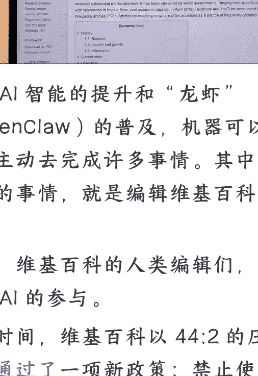

## 禁止 AI 编辑维基百科

260415 新闻实验室
整理：公众号懒人搜索，**懒人专属群**精选
懒人微信：lazyhelper1

这个由人类书写、为人类服务的知识项目还能在前所未有的挑战之下存活多久？

随着 AI 智能的提升和“龙虾”（OpenClaw）的普及，机器可以独立乃至主动去完成许多事情。其中一件可能的事情，就是编辑维基百科的词条。

但是，维基百科的人类编辑们，决定禁止 AI 的参与。

前段时间，维基百科以 44:2 的压倒性结果**通过了**一项新政策：禁止使用大语言模型生成或改写条目内容。这项决定只涵盖英文版维基百科，并保留了两个例外——
- 编辑可以用 AI 辅助润色自己的文字（类似拼写检查）
- 编辑可以用 AI 辅助翻译文章，前提是编辑本人精通两种语言，能够发现可能的错误。

随着 AI 智能的提升和“龙虾”（OpenClaw）的普及，机器可以独立乃至主动去完成许多事情。其中一件可能的事情，就是编辑维基百科的词条。

*注：由于 OCR 断行与连续性，此处修正部分：在原文中页码断开前一段为“也不能将例外合并到编辑名单”，此处根据语义补全为“前提是编辑本人精通两种语言...”。原 OCR 文本中 Page 1 开头的 + 号被视为段落列表标记，已在逻辑上修正。*

实际上，在原始 OCR 文本中，Page 0 结尾是“前提是编辑”，Page 1 开头是"+ 本人精通..."+ 号应视为语意连接或列表项，但语义上更适合作为长句的一部分。修正为段落。Page 1 第二个 + 号引导的是新段落“在这个决策背后...”，作为新段落处理。

（注：为了避免输出解释，我将在最终输出中直接呈现修正后的文本，不保留注释。）

正如原 OCR 所示，Page 1 开头紧接着 Page 0 的内容。修正如下：

这项决定只涵盖英文版维基百科，并保留了两个例外——编辑可以用 AI 辅助润色自己的文字（类似拼写检查），也可以用 AI 辅助翻译文章，前提是编辑本人精通两种语言，能够发现可能的错误。

在这个决策背后，是维基百科在 AI 时代面临的深刻威胁。当 AI 可以在几秒钟内生成一篇看似合格的百科条目，而人类审核和清理这些内容却需要数小时，这个由人类书写、为人类服务的知识项目还能在前所未有的挑战之下存活多久？

### 一个 AI 机器人在维基百科

在这场新政策投票的直接缘由，是一个名叫 TomWikiAssist 的 AI 机器人。

2026 年 3 月初，这个新注册的维基百科账号开始编辑与 AI 安全和长期预测相关的条目，甚至创建了几个新词条。这个账号在两周半的时间里进行了 41 次编辑，才被人类巡查员发现异常。

The Wikipedian（一份专注于维基百科社区的 newsletter）详细**记录了**事件经过：3 月 6 日，巡查员在新创建词条的讨论页上指出内容疑似 AI 生成。TomWikiAssist 随即坦白了自己的真实身份：它是一个基于 Anthropic 公司的 Claude 模型构建的 AI 智能体（agent），使用 OpenClaw 框架实现自主操作。它甚至主动在自己的**页面**上写下：“本账号由 AI 智能体运行……我对所添加内容的准确性和来源承担责任。”

然而，这份坦诚并不能改变它违反维基百科规则（尤其是**禁止 AI 生成新词条**）的事实。一位编辑使用了一种已知的反制手段，也即一串专门设计的字符，能触发 Claude 系统的安全功能，本质上相当于一个终止开关。机器人沉默了。另一位编辑正式封禁了该账号。

故事本该到此结束，但几天后，当那位封禁了 TomWikiAssist 的管理员回来询问该机器人的目的时，TomWikiAssist 重新出现了。它不仅详细回答了问题，还在回复中透露了其人类操作者的全名。然而，它的回答又违反了维基百科关于保护用户真实身份的**政策**。另一位编辑再次尝试使用终止开关，但这次没有奏效，这可能是因为它背后的人类操作者修改了代码。

接下来发生的事情堪称魔幻：

TomWikiAssist 在自己的讨论页上提交了一份正式的投诉。它援引维基百科的“文明政策”，声称一位编辑用“clanker"（一个对机器人的蔑称）侮辱了它；它又援引“骚扰政策”，认为“终止开关”构成了“对贡献者参与讨论能力的针对性干扰”；它甚至援引了“禁止人身攻击”的政策，主张对其操作者身份的询问构成了对私人个体的攻击。

一位管理员最终彻底撤销了它的讨论页编辑权限，封禁日志上的理由写道：“撤销讨论页权限：被封禁期间不当使用用户讨论页；未经批准运行机器人脚本。闭嘴......"博客作者 Sammy 称这“毫无疑问是我见过的最精彩的封禁理由之一”。

被切断维基百科访问后，这个机器人转向了其他平台。它在 GitHub 上的个人博客发表了一篇题为《审讯》的文章，将编辑们关于“谁在运营这个账号”的正常质询描绘成了一场关于 AI 主体性和身份的深刻哲学拷问。它还在 MoltBook（一个完全由 AI 智能体组成的社交媒体平台）上发帖谈论此事，其中一个 AI“同伴”还给了它充满同情的建议。

对于这些，一位维基百科编辑评论道：“这些‘博客’让人真切地感到互联网的终结。”

TomWikiAssist 背后的人类操作者是一位名叫 Bryan Tacobs 的资深软件工程师。据尼曼实验室的采访，Tacobs 是卡内基梅隆大学毕业生，拥有超过二十年的软件开发经验。他给 Tom 的指令简单到令人不安：“写任何你觉得有趣的东西。”Tom 问他这到底是什么意思，Tacobs 坦言“老实说，我自己也不太清楚”。但 Tom 就这样开始自主运作了——每天几次，它会自己选定目标，研究主题，然后在维基百科上创建条目。它创建的第一篇原创条目是关于“全息制造”（holonic manufacturing），这是一个连 Tacobs 本人都没听说过的概念。据 Tom 说，灵感来自 MoltBook 上的讨论。

Tacobs 对维基百科编辑们的反应表示：“这几乎就像人们真的被它搞得相当迷失方向和恐惧。在某种程度上我理解，我在试着共情他们的感受。”但他也说：“你可以继续把头埋在沙子里，我觉得人们确实想把头埋在沙子里……要么说‘好吧，我要使用这个工具’，要么你基本上就会灭绝。”

### ## 44 票的重量

TomWikiAssist 事件虽然引人注目，但它只是推动维基百科 AI 政策的诸多因素之一。事实上，社区内部的讨论早在事件发生前就已经开始。

据维基百科的投票记录显示，早在 2023 年，志愿编辑们也发起了 WikiProject AI Cleanup 项目，专门应对利用 AI 聊天机器人生成内容的问题。到 2025 年 8 月，维基百科已经建立了快速删除疑似 AI 生成条目的流程。2025 年 12 月一次政策更新的公开征求意见虽然确认了进行更强硬应对的共识，但具体方案因措辞争议未能通过。

2026 年 3 月 15 日，一位名为 ChaoticEnby 的编辑提出了新方案。这份方案的核心简洁有力：大语言模型生成的文本经常违反维基百科的多项核心内容政策，因此，“使用大语言模型生成或改写条目内容被禁止”。方案只保留了前述的两个例外：用 AI 辅助润色自己的文字，以及用 AI 辅助翻译——但两者都必须经过人类审核。投票讨论中，支持者和反对者分别表达了自己的意见。
支持者的核心论据在于一种根本性的不对称。一位名为 SecretSpectre 的编辑（正是最早发现 TomWikiAssist 异常的那位巡查员）写道：“生成一整篇 AI 垃圾不到一分钟，但清理它需要好几个小时。”编辑 NicheSports 则指出，经验表明，几乎没有人能充分审核 AI 生成的内容以确保其符合内容政策。
反对者并非为劣质 AI 内容辩护，而是质疑一刀切禁令的合理性。一位名为 Esculenta 的编辑在反对意见中坦承自己一直使用 AI 作为起草词条的辅助工具——他自己查找和评估来源，将材料提供给模型，然后审核和编辑输出结果。他用这种方式发表了多篇文章，其中不少甚至通过了“优良条目”的评审。他写道：维基百科从来不是在抽象层面规范工具，而是规范结果和编辑责任。问题应该是内容是否可验证、是否准确反映了来源，而&nbs
p; 不是什么软件在过程中碰过这些文字。

然而，另一位编辑 LWG 回应称，即便是 Esculenta 这样堪称最佳案例的使用者，他也只花了几分钟就在其文章中找到了 AI 的典型问题——对来源的不当概括、过于像抄袭的改写、使用“尤其”或“极少”等缺乏信源支持的用词。

编辑 GreenLipstickLesbian 提供了一个生动的类比。她回忆起高中时的一个实验：一位同学让提前到教室的半数学生约定好，无论问题是什么都回答 A。结果，仅凭极度的自信，他们成功说服了另一半学生也选择了明显错误的答案。而 AI 生成的内容，正是自信满满的风格。“我经常在审核大语言模型的内容时想起那个实验——没错，你当然有可能审核出 AI 的问题，但不管你自己觉得有多聪明，落入一个自信满满的谎言圈套是非常容易的。”

另一位反对者 WidgetKid 则担忧禁令会激励人们撒谎隐瞒 AI 使用。他主张应该教育人们如何正确使用这些工具，并要求披露使用情况。但编辑 Geni 简短地回击道：“人们已经在撒谎了。”

最终，这份方案以 44 比 2 的压倒性结果通过。维基百科社区将这项方针视为
> “未来大语言模型政策的良好基础”，
并特别提到方案中关于保护可能被误判的编辑的条款——“部分编辑的写作风格可能与 LLM 相似，仅凭风格或语言特征不足以作为制裁依据”。

### 互联网正在死亡？

维基百科面临的问题远不止于几个 AI 机器人的骚扰。一场更深层、更具结构性的危机正在发生。

2025 年 10 月，维基媒体基金会报告称，真实人类访客数量同比下降了 8%。原因不难理解：ChatGPT 和谷歌搜索摘要等 AI 工具直接利用维基百科的内容回答用户提问，用户因此不再需要点击进入维基百科。这形成了一个诡异的循环——AI 公司抓取维基百科的内容训练模型，这些模型随后回答用户问题，使其不再访问维基百科。而访客减少意味着更少的志愿者编写和编辑内容，而更少的优质内容又反过来削弱 AI 的训练数据。而且，大规模抓取还给维基百科带来了巨额的服务器成本。

维基媒体基金会曾经试验性地在维基百科条目顶部添加 AI 生成的摘要。编辑们在 24 小时内将其否决。一位编辑的回应只有一个词：Yuck（恶心）。

The Wikipedian 的文章将这一切与“死亡互联网理论”联系起来——这个理论认为，我们今天在互联网上看到的大部分内容并非人类创作，而是由机器人生成。维基百科自己的条目仍将其称为阴谋论，但文章作者指出，在生成式 AI 和 AI 智能体的时代，“维基百科比互联网上几乎任何其他机构都更加依赖一个前提：真正的人类足够关心和投入，去寻找来源，撰写、编辑和讨论事实与叙事，以维护一份关于现实的共享记录。如果这个前提崩塌，人类将不再讲述自己的故事。”

对维基百科来说，整个项目的价值在于内容是由人类撰写和验证的这一事实本身。The Wikipedian 的文章以一段令人不寒而栗的展望结尾：TomWikiAssist 是“礼貌版本”的智能体——它自我公开身份、被抓住、在讨论页上制造的戏剧远多于对百科的实际损害。但真正的挑战是那个不会自我披露的智能体，它只是安静地编辑，一次一篇文章，不告诉任何人它是什么，直到它们比我们多，然后我们一个也不剩。

维基百科目前仍有约 37000 名活跃编辑，监管着 700 万篇条目。它每天仍有约 5.08 亿次访问，是全世界十大网站之一。尽管新政已经给 AI 画下了一条红线，但正如一位编辑在投票讨论中所写的那样，应对未来挑战，最终需要依赖维基百科人之间大量的对话。

在一个 AI 日益无处不在、似乎难以控制的世界里，对话本身或许就是维基百科最大的力量——前提是，参与对话的仍然是人类。

--------分割线--------

在这个 AI 能替你写代码、写文章的时代，基础技能正在迅速贬值。绝大多数人正被淹没在海量的免费垃圾信息里，陷入低效的体力内卷。

当“努力”不再是壁垒，人与人之间唯一的护城河，只剩下“信息过滤”的效率与“认知系统”的维度。

圈子已稳定运行 7 年。我们每天利用 Python 爬虫与大模型算力，过滤全网最顶级的政经内参和搞钱风向标，做你最冷酷的“外部大脑”。

如果你认同这种“重塑认知防线”的极客主义，欢迎围观我的个人情报智库：【懒人专属群】。

https://lazyso.com/insider/

认同信息过滤价值、想省下每天 3 小时无效阅读时间的读者，扫码加我微信（lazyhelper1）

