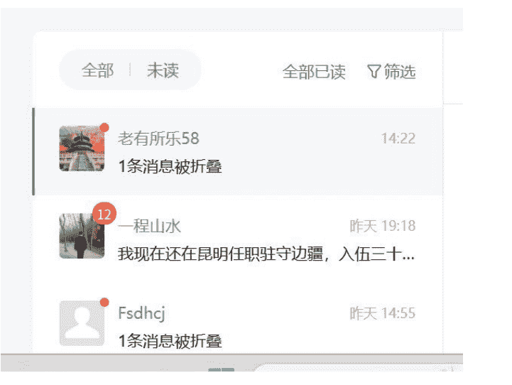
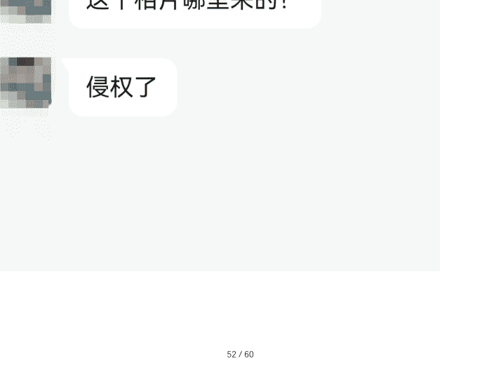
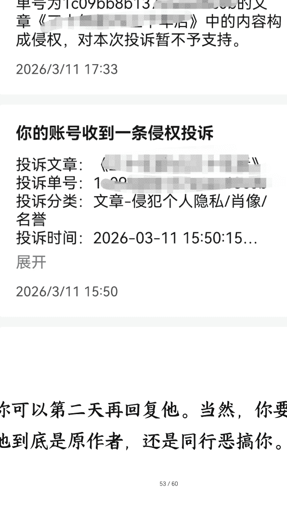
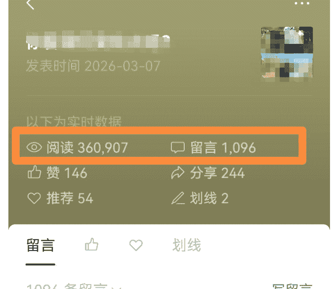
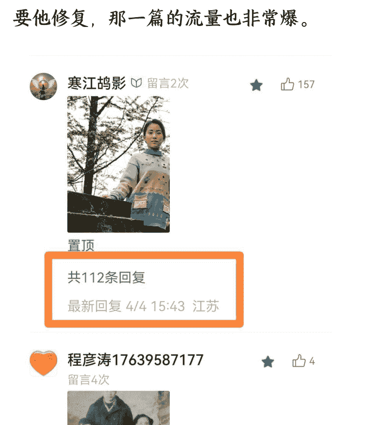

# 从线下教培到线上贴图：一个美术老师的公众号流量主实战复盘（附 20 天 4000 元数据）

260416 副业 SC 精华

公众号懒人搜索，懒人专属群独享

**懒人微信**：lazyhelperl

![img/c84dd5d362754d40fcdbcd3dfcf73e21_0_0.png]

你好，我是澄心。我是一家艺术培训机构（美术书法）主理人，加入生财 5 年的时间啦。

## ### 一、我为什么选择公众号贴图

我自己是美术生，做美术老师十多年，自己开机构也有 8 年的时间了。现在线下招生难，学员流失严重，去年我做了半年多的口播短视频招生，效果也不明显。所以想着转型线上开辟副业，争取 2-3 年的时间可以用副业代替主业，换个收入来源。

有次和圈友吴泽承聊天，他说："公众号贴图现在有流量扶持，慧哥他们也在做，我把慧哥的玩法发给你。"

这是我的收益，两个号大概 20 天左右，挣了 4000 元。

![img/c84dd5d362754d40fcdbcd3dfcf73e21_1_0.png]

![img/c84dd5d362754d40fcdbcd3dfcf73e21_1_1.png]

当时我知道这个项目之后，就抓紧开了 2 个公众号，尝试做贴图。

第一个号因为一个不明显的坑（后边会讲），做了一星期就被封号了。就用第二个号又开始尝试。

结果第二个号，很快就有了收益，挣了 1.99 元。

第 8 天就破了 110 万播放，当天的收益是 1500+。

![img/c84dd5d362754d40fcdbcd3dfcf73e21_2_0.png]

## # **数据统计** 更新至 2026/02/24

110.3 万                        300

昨日阅读        昨日分享

较前日 ↑530%    较前日 ↑435%

## # **关注我的人** 512 >

## # **付费内容收入** 去开通 >

流量主                    昨日收入¥1511.03 >

## # **内容助推** >

## # **我的足迹** >

后来我又注册了一个新号，做了大概十多天左右，突然一天流量爆发，一下出了 4 个 10W+ 的播放（之前发的内容突然爆了），当天破了 90W 的浏览量，收益 1000+

## # 数据统计

931,344

昨日阅读          较前日↑4047%

452

昨日分享          较前日↑11200%

![img/c84dd5d362754d40fcdbcd3dfcf73e21_4_0.png]

*关注我的人* 429 >

*付费内容收入* 去开通 >

![img/c84dd5d362754d40fcdbcd3dfcf73e21_4_1.png]

*流量主* 昨日收入￥1043.54 >

*内容助推* >

*我的足迹* >

*传图片到素材库* >

都是同一天上的 10W+

通过做贴图账号的过程中，

我似乎摸到了一些做贴图的规律。

我就把我的方法，告诉我的朋友，他之前一直卡 1000 播放，告诉他的第二天，也爆了一个 10W+ 的播放

![img/c84dd5d362754d40fcdbcd3dfcf73e21_5_0.png]

公众号的贴图（俗称小绿书）其实并不难，只要你掌握了方法，稍稍做一些改进，也一定可以把流量做起来，挣到一波流量主的收益。

下边我就把我起号的过程、方法、和一些细节的内容，详细地写出来，希望可以帮助你

## 二、从 0 到 1 的关键三步：创建账号 + 开通流量主

找到对标

想办法做出爆款

# 1、三句话讲清楚这个项目的玩法：

这个项目启动非常简单，下载个“公众号助手”（大家也叫它小绿书），用你的微信注册一下，实名 + 开通流量主，就可以开始了。

通过公众号助手 APP,最上边的贴图发布，图片 + 文字，带上#话题

观众观看你的贴图，评论区展示广告，你就可以获得流量主收益了

同步块

## # 创作发表

## # 贴图

草稿 新的创作保存后将存在草稿中

2026/3/25 09:24

+   [![My][image11]](image11:https://mmbiz.qpic.cn/mmbiz_jpg/bEFRTxYIzk6dfCTVlKZOIqoYy1v9e1n5n3a4xx/0)

看看我的鱼缸水培大蒜，怎么样？够不够炒一盘菜？😀

10 万 + 北京 2 月 18 日 08:33

168

![img/c84dd5d362754d40fcdbcd3dfcf73e21_8_0.png]

##### 35-45 岁，黄金十年，做个干净的“中年少女”

经历过年少的热闹，更懂得安静的珍贵

见识过生活的复杂，更珍惜内心的纯粹

所谓“少女”

# 36 岁的我站在试衣间前

想起高三数学考了 149

但这和我现在已经没关系了

![img/c84dd5d362754d40fcdbcd3dfcf73e21_9_0.png]

36 岁的我站在试衣间前，想起高三数学考了 149，但这和我好想已经没关系了
   
#年龄与穿搭无关 #试衣间穿搭灵感 #高三回忆录 #时尚穿搭分享

阅读 10 万 + 广东 4 月 7 日 12:14

留言 2029

# ### **摩托车分类大全集**

你是

*   真玩家
*   还是通途选手

*   - **踏板车**
    

*   - **通路车**
    

*   - **经典车/街车**
    

*   - **Cafe Racer**
    

*   - **征航车**
    

*   - **CHOPPER**
    

*   - **旅行车**
    

*   - **运动征航车**
    

*   - **超级街车**
    

*   - **走车/越野**
    

*   - **ATV**
    

*   - **BOBBER**
    

*   - **ADVENTURE**
    

*   - **弯机**
    

*   - **越野车**
    

*   - **探险车**
    

*   - **雪地摩托**
    

一张图看懂机车全分类，你是爱好还是关心

摩托车分类全解析了：超跑通勤、街车赛道、复古越野、ADV 去哪都行、征航长途。

并告诉你

11/60

# 笑死

张高澄道长教你

少动情，能保命

做一个守神高能量的人，从少动情开始！

最近看了两会顶流张高澄道士🔍与窦文涛的一段对话。

好家伙，直接给我整清醒了🙄

# "人近则贱"

![img/c84dd5d362754d40fcdbcd3dfcf73e21_12_0.png]

成年人最大的自律，是管住自己“别对别人太好”

# 我拉黑 10 年闺蜜后，才懂什么叫“人近则贱”

上周，我拉黑了一个认识十年的闺蜜。

原因很小：她凌晨三点打电话诉苦，我说“明天聊”，她说“你变了”。

这些都是 10W+，一个的收益大概是 100-180 元之间。

收益的话，看 eCPM（千次曝光收益），因为广告位只有评论区一个（3 个以上的评论才会有广告），所以千次曝光量，差不多是 5-7 块钱左右。

## # 指标数据明细

日期范围

*   - 近 7 日
*   - 近 30 日
*   - 自定义

广告位

*   - 全部
*   - 底部
*   - 文中
*   - 关键词
*   - 留言区
*   - 后贴
*   - 互选
*   - 返佣

数据指标

*   - 组合指标 - 收入
*   - 组合指标 - 点击
*   - 组合指标 - 曝光

| 日期 | 曝光量 | 收入（元） | eCPM |
| :--- | :--- | :--- | :--- |
| 2026-04-11 | 6,000 | 26.70 | 4.45 |
| 2026-04-10 | 11,555 | 60.13 | 5.20 |
| 2026-04-09 | 11,154 | 52.95 | 4.75 |
| 2026-04-08 | 9,973 | 44.79 | 4.49 |
| 2026-04-07 | 8,346 | 36.56 | 4.38 |
| 2026-04-06 | 883 | 6.20 | 7.02 |

## # 数据统计 更新至 2026/04/09

**65,981**

昨日阅读

较前日 ↑16%

26

昨日分享

关注我的人

728

付费内容收入

去开通

流量主

昨日收入¥52.95

互选合作订单

内容助推

我的足迹

这是我的某一个号，可以看出 4 月 9 日那天，阅读量是 6.5W 左右，但是曝光量差不多是 1.1W 左右。

曝光量大概是阅读量的五分之一

所以一个 10W 左右的浏览量，曝光量差不多就是 2W 左右，如果 eCPM 是 5（千次曝光收益），也就是 20×5=100 元，基本就在 100-150 之间。

# 2、讲讲具体的玩法：

*   ①注册账号
*   ②赛道推荐
*   ③怎么做选图 + 处理图片（重点）
*   ④怎么起标题
*   ⑤怎么发布

## # ①基础的账号注册与设置:

1. 下载“公众号助手”app,进去之后用你的微信登录（微信要实名），就登录上去了。

这里需要注意，注册之前要提前想好名字，找好头像。

因为你注册的时候就会让你起名字，如果随便写，改名字要等一天。

而且改了名字，别人点击你公众号的简介，就能看到你的改名记录。所以建议一定要提前想好名字。

这里给你一些名字的建议：可以去小红书搜，好听的网名。里边有很多，用其中的改改就能用。

如果你想要长期做，还是起个好一些的。好听的名字你自己也赏心悦目。

2. 注册了公众号之后，一定要先实名（这个比较简单），因为和我们的微信是同步的，所以在 APP 点底部“我”，点击你的头像，里边有实名认证，就实名了

3. 然后就是解决 100 粉丝的问题。这个比较容易解决。找到靠谱的渠道，直接上 100 粉就行。

这个不会对后边的发文流量有太大影响。

因为我测试过很多号啦，不管是发贴图还是发文章，都没有问题，放心冲。

4. 有了粉丝之后就是开通流量主，在“我”的里边，有流量主选项，点击“开通”就行了。

不过这里要注意，开通了流量主之后，需要点击右上角的广告管理，打开所有广告（现在好像变成自动开通所有广告了）

## # ### 流量主

## # ### 广告管理

## # ### 昨日收入（元）

如何提现收入？

## # ### 指标趋势

![img/c84dd5d362754d40fcdbcd3dfcf73e21_17_0.png]

### 2 适合新人的赛道

如果从来没有做过公众号和贴图的圈友，优先选择你熟悉、感兴趣的赛道

比如

婚姻赛道、

成长赛道、

养生赛道、

名人名言/娱乐赛道、

老照片赛道、

退休生活赛道

![img/c84dd5d362754d40fcdbcd3dfcf73e21_18_0.png]

##### 87 年二胎宝妈：与其离婚，不如“婚内微寡”

> “结婚不是找到依靠，而是学会与自己相依。”

- 曾经不知道有多少个瞬间，让我想过离婚
每次孩子在那边哭闹，他还在那玩手机

# 婚姻赛道

![img/c84dd5d362754d40fcdbcd3dfcf73e21_19_0.png]

人这一辈子，

该吃的苦，该走的弯路，该掉的陷阱，

该撞的南墙，一个都不会少。

无论你怎么选择、怎么躲避，

都逃不过一场命运的安排。

## ## 婚姻赛道

# # 上班=省钱

我终于治好了厌职症

终于治好了厌职症！上班=省钱，一年攒下 10w

过去上班 15 年，我从来没想过现在会喜欢上班这件事。一只在深圳的牛马，每天两点一线，打卡、开会、加班。压力大最烦的时候，胸口压着大石，结节长多 5mm，甚至

# 成长赛道

# **40 岁，我靠自学找到了几份居家工作**

85 年，40 岁，发现了几份不上班在家里就能做的副业。

嗨！大家好，我是瓶子，两个孩子妈妈。

11 年前，一个偶然的机会，让我接触到了莫小在，也就是我现在做的护肤品牌。

# 成长赛道

# # 身弱之人

# # 不上班就是大补

# 身弱之人，不上班就是大补 
 hi，~我是瑶妈，一边带娃，一边做自媒体
~

生完孩子以后，我发现自己经常容易累，气血不足，常常一天没干啥，都觉得累。

# 养生赛道

![img/c84dd5d362754d40fcdbcd3dfcf73e21_23_0.png]

# 最近气血变足了，我干了啥？

*   一、心态先行：情绪不内耗，就是最大的补

中医常说“思虑伤脾”，以前我也爱纠结、爱较真、爱内耗。后来逐渐发现 情绪一堵 气血全堵在身体里。

一晃眼，我们一起经过了十七个春夏秋冬。

我们一起穿过、闹过、哭过、醉过，也一起开心过、疯狂过、发光过、自豪过。也在彼此最狼狈、最迷茫的时候，毫不犹豫地伸出手。我们不用每天联系，却永远不会疏远；

不用刻意讨好，却始终真心相待。是时光，

# # 老照片赛道

![img/c84dd5d362754d40fcdbcd3dfcf73e21_25_0.png]

为什么没人觉得大冰很装？因为他承认红利，从不说教！

十几年前，大冰就火过一阵，那时候他还在出书。

最近几年，他又火了。最火的时候，直播连线，同时在线的人都有好几万。

## ## 名人/娱乐赛道

![img/c84dd5d362754d40fcdbcd3dfcf73e21_26_0.png]

# 请“临时儿子”陪护：丁克老人的晚年底气

看到一个视频：一对高知丁克夫妻晚年生病住院，经常在病房里的病友吵闹骚扰，无奈之下花钱请了“临时儿子”来医院陪护。

虽然不知道视频内容真假，但这件事确实指向了银发经济的一个新好道

# 老人/退休生活赛道

③怎么做选图 + 处理图片（重点）

先找对标→再去选图、处理图片

5.你打开服务号，会给你推，里边都是贴图

# 最近最火的一句话

# 一图看懂 | 体制内公认的白酒

# 她顶着一张与世无争的脸，竟干惊天动地的事

看到一个 10W+ 的内容，可以点进去看看他其他的作品。如果平均都是 1W 以上的播放，那么可以作为对标。

先找到你感兴趣的 10W+ 的贴图内容。像明星八卦、养生、成长都可以。

把他流量高的发给自己的小号或者群里，

就会一直给你推类似的。

最开始其实你是不知道会不会爆的，所以就找自己感兴趣的发。

# 6. 然后去抖音、小红书里找相似图（可以搬运，也可以二创、原创）

你找到 10W+ 的贴图后，就照着他的领域去搜，找到最热，看看点赞在 1W 以上的图文类，一种是直接截图下来，直接用的话，稍微做一些处理，就可以直接发，流量会很高（但是会有侵权 + 投诉的风险，我遇到了，后边会讲）。除了正常的图文，他们的评论区也要看，也会有点赞在好几万的，都可以截图保存下来。

# 先说原创

我最开始做的是老照片就是原创（模仿别人原创），比如这种。

![img/c84dd5d362754d40fcdbcd3dfcf73e21_30_0.png]

好想回去看看，看看我的青春

阅读 265 广东 4 小时前

留言 1

写留言

想起了 04 年夏到了深圳宝安，一个村镇。忘不了那个月的黑水欠工作，...，却出到...

# 第一步：

我让豆包反推提示词，然后帮我生成类似的。

你可以把图片截图，把这段指令 + 你的图片，发给豆包

你是一个视觉专家，摄影师，擅长处理图片，现在请帮我仔细分析这张照片，然后写出详细完整的图片提示词。

我希望这张图片必须是东方美学的图片，按照以下要求用汉语输出：

人物景别：
视角：
详细构图：
核心主体：
情绪动作：
环境场景：
艺术风格：
氛围光线：
色调：
她会给你详细分析这张图片里的元素，你就根据她分析的，自己稍微改一改，可以尝试生图看看效果。不满意的地方，可以多生几次。

# 第二步：

生成画面的提示词之后，

可以直接让豆包给你生成照片，

也可以用即梦做更精致的照片

如果用即梦做的的话，可以用下边这段方法

你可以把豆包生成的内容，发给元宝/Deepseek，（个人感觉，Deepseek 生成的画面提示词会更好一些），让他帮你生成适合即梦的画面分镜提示词（其他 ai 也行），80 年代胶片老照片的风格

# 第三步：

加文字就可以发布了。

下边这个图，就是我模仿别人的老照片，让豆包帮我生的提示词。年轻和中年对照。

当时特意让豆包生的人物形象，有好看的和一般的。

![img/c84dd5d362754d40fcdbcd3dfcf73e21_32_0.png]

34 条留言

切慕溪水 留言 7 次 · 关注 1 个月

图一右二跟图二左二是双胞胎吗

![img/c84dd5d362754d40fcdbcd3dfcf73e21_33_0.png]

![img/c84dd5d362754d40fcdbcd3dfcf73e21_33_1.png]

### 25 年的变化有多大？你能找到我吗？

从二十五年前

的温柔繁花

们

> 我们穿越了季节

容颜会随岁月绽放又凋零，但那份陪你疯

与你的花田

# **二创的有一个好处，就是你除了发贴图，还可以发长文。**

我用 ai 生过一些穿搭的图片，放在长文里，稍微加了一些文字，

也有二三万的播放。（长文比贴图收益高好几倍）

## 怎么二创（搬运）

你可以直接用他的图（去抖音找到 1 万点赞以上的）。
把图片做一些翻转、用 AI 高清一下、换一下拼图的方位。
也是为了和别人做一些区分。

搬运容易爆流量，因为都是别人验证过的，很容易引起共鸣。

你需要在原图的基础上，做一些处理之后就可以用了。

**截图保存 + 剪裁 + 滤镜 + 拼接**

可以搬运 + 二创混合做，这样既提高效率，也能更快地知道，为什么有的图片会爆。

你爆过几次之后，就会有感觉，知道这个能有流量。

## 4、怎么起标题

我就是用别人的原标题，发给豆包帮我稍微改写一下，就直接用。

新号一般没有什么流量，等你发 2-3 天后，就会有流量了。刚开始一天一条，有上百的播放量之后，你就加到 2-3 条。

这里有 2 个很重要的技巧：

- 第一、你的标题尽量写得可以让人吐槽一些
- 第二、你的内容里，文字可以写的有一些争议，引发评论。

## 5、怎么发布

### 新手每天发几条？
### 什么时候发？
### 怎么发？

新账号最开始一两天，每天发 1 条，
把你所有的工作放在找素材、修剪素材上。

做好的素材，你可以保存下来，存到草稿箱里，先不发。

等着你的流量可以上 1000 了，就可以每天增加了。

# 时间的话，有个原则，就是别人不发的时候你发。

比如：早上 4 点 -5 点，甚至两三点。你如果半夜醒了，可以用手机先发一个，然后继续睡。

这里不推荐定时发布。我测试的是没有流量。我自己手动发的，一般半夜发，两三个小时就能有大几千的浏览量。

用定时发，很少很少。

你可以想想，大家什么时间段不发，你就选那个时间段。

# 当你每天发 3-4 条，你要怎么发？

可以根据上一条的流量，来考虑是否需要继续发。

如果你发布了一个小时，有 3000 以上的浏览量，你就可以继续发。

如果你发布了，只有二三百的浏览量，你就可以考虑停一停再发。

新号有时候给的流量很有限。比如你第一个给了 1 万播放量，你的第二个也有几百。但是第三个、第四个，就可能只有几十 -100 之间的流量，就可以先不发了。

使用 WiFi 还是流量？号多的话，建议用流量发。
好几个号在同一个 WiFi 里，有时候只有一个流量高，其他的一般。
用流量发，更容易起来。

一般来说坚持发上四五天，流量就起来了。新人建议开始的时候，主要做 1-2 个号，把精力放在找素材和修剪素材上。更快的把一个号做起来，然后再加号。如果上来就弄四五个号，容易心累，而且做不起来，慢慢就没有信心了。

但是也不要把一个号看得太重。又怕伤号，又怕没流量。只要不是彻底封禁，大不了注销了重新做，当天注销当天可以重新起（选择“立即注销”）

## 3、怎么让浏览量爆起来？

除了前边的选图 + 处理图片步骤，这一步骤也很重要。就是使用流量券。

### (1) 流量券是什么？

是官方给你快速推流的方法。

每一个新号在前一个月，都会给很多流量券。用好了流量券，会让你快速起号。

**有朋友说用流量券会引发人工审核**，如果你的内容有问题，**会导致你被限流**。

我个人的使用情况下来，我觉得前期使用是没有问题的。用好流量券，是一个很快起量的过程。

我的几次大爆，都是用了流量券起来的。

### (2) 如何获得流量券？

你达成一些成就，就会送你流量券，比如这些

### 我的足迹 - 被收藏 100 次达成

截至 2026 年 3 月 11 日，你的内容在平台被用户收藏 100 次，可在「我 > 我的足迹」中查看。
已获得 300 额度平台曝光激励，可让更多用户看到你的创作。前往使用

2026/3/12 08:26

### 我的足迹 - 被分享 500 次达成

截至 2026 年 3 月 11 日，你的内容在平台被用户分享 500 次，可在「我 > 我的足迹」中查看。
已获得 300 额度平台曝光激励，可让更多用户看到你的创作。前往使用

2026/3/12 08:21

### 我的足迹 - 收到留言 500 次达成

截至 2026 年 3 月 11 日，你在平台收到用户留言 500 次，可在「我 > 我的足迹」中查看。
已获得 300 额度平台曝光激励，可让更多用户看到你的创作。前往使用

2026/3/12 08:10

新号只要有人给你留言、转发、互动，都会送你流量券。

### (3) 流量券的注意事项：

- 1、流量券有时间限制，一般是从发给你开始计算，大概往后推 10 天左右就会作废。所以要规划好使用。
- 2、一个作品，只能使用一次流量券，但是可以叠加使用，就是你可以用一张（300-500 都可以），也可以用好几张，上限是 5000。
- 3、只能是近期的作品使用，是 7-10 天之内作品。一个月以前的用不了。

### (4) 使用的技巧：

- 1、优先给你比较优质的内容使用。
  比如一个作品，看浏览量、点赞、评论等几个数据，优先选评论比较多的用（最好在 10 个以上的评论）。
- 2、作品的浏览量最好是在 1500-2000 以上使用。（如果能到 4000 以上更好，用了基本就能到 1 万浏览量）。
- 3、如果好几个作品卡在 1000 播放，可以等等再用。卡 1000 播放的话，你用了估计作用也不大。
- 4、如果你的作品正在推流，就是你发布了，很快就到了 8000 左右，那可以先不用。这种情况很快就会到 1 万播放，等着突破了 1.5 万播放的时候，再用。这样你的作品有几率到 3 万以上的播放。
- 5、如果你的作品都卡 1000 或者 10000 播放了，流量券快要过期了，那就一定要用了。

最重要的数据是评论，所以一定要优先选择评论多的作品用。

### (5) 如何判断你快要爆流量了？

我自己有过好几次的流量突然爆发。这个是有前兆的。

新号流量一般不稳定，大概在开始发内容一周的时候，有时候几十、几百、几千都有。

这个时候，你有一个浏览量能到 1 万了，甚至更高一些，那么你就有可能要爆流量了。

我的第一个爆款，就是晚上爆发的。之前都是几百、一两千，突然出现一个 1 万的。之后大概 1 小时左右，流量涨到了 10 万 +，我就又抓紧做了一个，浏览量还是涨的非常快，我就又发了一个。爆的流量，也会带动你其他的贴图也跟着增加浏览量。

当你看到你的浏览量涨得非常快，你要做几件事：

- 1、多准备几个贴图，随时准备发。
- 2、把每一个留言都要回复，每一个点赞都要谢谢。这样他很大概率会去你其他的贴图里评论。
- 3、自己引发一个可以有争议或者槽点的评论，并置顶。

我的这 2 篇，大概跑了一天，浏览量到了 110 万。

#### 坑一、刚开始什么都做，没有流量

很多朋友没有信心，也是在这一步被卡住，停滞不前的。

会来来回回看自己的账号，就是想不通为什么没有流量，一直纠结，到底还要不要发，是不是继续做。

看到别人发的某某流量高，就立马换。但是这容易导致，**流量卡 100 或者 1000**，就上不去了。

开始的时候，最好是 **5-7** 天一个周期。发同样领域的内容。如果实在不爆再换，来回切换、改名字、都会导致没流量。

就跟垂直小号一样，发固定的年龄段看的内容，就很快可以起量。

**新手如果刚开始没有播放量，可以不着急去注销账号**。想办法折腾出流量来，再考虑注销的事。因为这一次如果你不知道怎么能有播放量，那么你即使再拿新号做，也会遇到这个情况的。

想想办法，能弄到 1000 播放，你就知道接下来要怎么做了。

## 坑二、流量爆了之后，账号就从几万变成了一百甚至一二百。

我经历过好几次，流量爆了之后，第二三天，流量瞬间就没有了。

这个时候我就开始精细化运营

比如：

- 7、有人点赞、关注，都可以点“谢谢”表示一下，每一个评论都要回复一下，可以回复简单的表情，一个是礼貌（他看你回复了，很大概率还会去其他的文章里继续评论），另一个就是为了增加评论数量，别人看到就会点开评论看，增加你的广告收益。
- 8、多增加数量，比如平时发 4 个，你可以尝试发 6 个。
- 9、图片二创的再复杂一些，可以让豆包把帮你改一下色调，适当剪裁，可以把爆的文案也加到图片上，丰富图片的内容。
- 10、增加 IP 真人感（最有效）

当时我的流量下来之后，我就在文字内容里，加入了我的个人的人设。比如：

写上我是谁谁，我是几几年的，我有什么爱好，我的生活经历、感悟、观点，增加真人感。

如果没有流量了千万不要坐以待毙，一定要行动起来。

#### 坑三、私信是否要回复？

尽量不要过多回复私信，这里我有过深刻的体会。我新号做了两三天之后，就是经常回复他们的私信，然后 2 天左右就被封了。我就只能注销了重新做。

私信一旦你遇到：问你年龄、住址、爱好、是否退休、有什么打算、莫名其妙关心你的，都不要回复。

你就只需要礼貌性地回复个表情，就差不多了。回复的多，会判定你引流或者他们投诉你，给你封号的。

#### 坑四、遇到投诉怎么办？

我们搬运的话，贴图爆了，容易被原作者看到，他会私信你或者投诉你。我就遇到了。

## 公众号懒人搜索，懒人专属群分享

最开始不要慌，你就当什么也没有发生，可以先不用回复他。

他可以看到，说明你这一篇肯定是爆了。

他在私信我之前，就投诉我了。但是他投诉我之后，平台并没有受理。

因为他是发的抖音，没有发公众号，所以公众号并不认为是侵权。

我也没有说这个图片里的人就是我。

你可以第二天再回复他。当然，你要确定他到底是原作者，还是同行恶搞你。

后来我是对他的头像做了对比，确认是原作者，就在第二天结算收益到了之后，就把那一篇隐藏了。

## 四、怎么提高收益？

因为贴图只有在评论区有广告，所以发布之后前几个评论，可以自己写，也可以找人来写。

你的标题、图片上的文字、内容。一定要有吐槽点 + 争议点，提高大家想吐槽的兴趣

每一次发布完，可以先尽快把三个评论写上。这样后边流量起来，你的广告展示也就有了。

然后就是把标题、图片里，多增加信息密度。

比如增加年龄、经历等等。还有就是找吸引人的照片，和有前后对比的照片，更容易引发吐槽和留言。

我有一篇贴图，评论有 1000 +，就是因为里边加了一句话有争议的话，留言都是来吐槽的。

## 五、写在最后

之前我一直处于不断做项目，不断换项目的过程，持续了好几年。

期间我做过短视频带货挣到过 1000+ 收益，视频号直播 500+ 收益。

去年（2025 年 11 月）小红书虚拟资料卖出去过几单，挣了不到 100 元，AI 短视频 20 多天做出 2000 万 + 播放，涨了 1.5 万粉（抖音 + 视频号）挣到了 100 元的分成计划。

**每一次都是遇到卡点，我就迅速切换新项目。导致我从来没有把一个项目做大过。不停从 0 到 1。**

我相信好多跟我一样还没有在线上挣到过大钱的圈友应该很多都是这个情况。

所以我决定这一次一定要把这个项目好好的做起来。

我在写这篇帖子的时候，也在做公众号的航海志愿者。

通过和圈友的沟通，我发现，很多朋友想做公众号，也想做垂直小号，但是就是选不好方向、定位，就一直没有动手去做，发内容。

我都会推荐他们从贴图开始做，发几篇就能有一两千的播放，**信心**就建立起来了。

我自己经过了这一次的公众号贴图经历，未来一年我也会努力深耕公众号，选定一个方向，一定要从简单的方法开始，用短时间高强度的攻克这个方法，把能踩的坑都踩了。

不管是学习用 AI 写作还是 AI 生图，到采集资料、整理数据等等，希望都可以将 AI 应用到这里边来，真正成为像咱们群里公众号大佬那样，成为这个领域的专家。

-------分割线-------

看完这篇 SOP，你觉得你懂了。但 90% 的人一到实操就会卡在第一步。

工具和教程只是最低级的壁垒，真正的壁垒是“立刻动手”和“圈层信息差”。

如果你想看全网最新的变现玩法，并且和一群执行力极强的极客一起下场拿结果，欢迎围观我的核心私域：【懒人专属群】。

我们不聊虚的，只做商业闭环的拆解与 AI 效率的压榨。系统内已沉淀 1000+ 跑通的套利实战局。

[点击查看圈子完整数字资产与上车门槛链接](https://lazyso.com/insider/)

认同价值、准备好下场干活的，扫码加我微信（lazyhelper1）

备注：【实操上车】，不闲聊

[阅读 30,877]

春天 留言 2 次

这双凉鞋有点土，夏天穿也不好看。

琙远的生活

感恩友友分享，祝元宵节快乐🎆🎆🎆

[img/c84dd5d362754d40fcdbcd3dfcf73e21_39_0.png]

## 页内图片及数据统计

**时间数据**
发表时间 2026-02-21 以下为实时数据
阅读 502,641
赞 373
推荐 168
留言 430
分享 108

划线 2
留言 👍 ❤️ 划线

## 数据统计 更新至 2026/02/24

| 数据项 | 数值 | 变动 |
| :--- | :--- | :--- |
| 昨日阅读 | 110.3 万 | 较前日 ↑ 530% |
| 昨日分享 | 300 | 较前日 ↑ 435% |
| 关注我的人 | 512> | - |
| 付费内容收入 | 去开通> | - |
| 流量主昨日收入 | ¥1511.03> | - |

寒江鸽影 留言 2 次
彭燕铭:@HP Gold: 可以帮忙恢复下 [图片]

56/60

关注公众号懒人搜索、懒人专属群分享

----------

**判断自己老公是不是蠢，就看以下三点：**

1. 谁说的话他都听，就是不听你的，谁讲的话他都信，就是不⑨你的。
2. 家里面什么事他都往外说，好事儿当消遣，坏事儿当泄愤
3. 跟别人说话都是和颜悦色的，跟你说话呢，全是火药味儿。

**这个图就是非常好的示例。**

!-- [PAGE 34] 结束！