# 新手怎么用视频号做高客单？从 0-1 踩完坑的合规指南

260416 副业 SC 精华

公众号懒人搜索，懒人专属群独享

懒人微信：lazyhelper1


## 写在前面

大家好，我是些些怡，上篇分享了 AI+ 小绿书的获客方法【AI+ 小绿书】2 个月获客 1112 人，签单 5.9w；高客单流量的喂饭 SOP，

**2 个月在教育赛道一共引流 1112 人、签单 5.9w。**

为啥写这篇视频号引流呢？因为很多敏感赛道平台不让投放，但用户又有需求，就只能靠自然流获客。

**自然流最怕的就是封号了，我前后踩了好多坑才摸清楚合规方法。**

- 泡泡雨 3024：求帮助，初二不想上学
- 赞：求办法🙏🙏
- 阿香 2010：我女儿初三，初二下学期开始断续请假，初三上学期去了半个月，说开学去...
- zhj：我家孩子就您最后一页画曲线部分的样子
- 火凤凰：每个孩子不一样，我对儿子比较“狠”

## 为什么 2026 年做视频号值得做？

**第一个是入局门槛低：**

一套号的成本在 300 元（二手手机 200 元 + 一个满月龄的微信号 100 元）；养号周期 15 天就能走完；一个人可以管 5-10 个号。

适合有高客单产品但缺线上获客的个人或小团队，不需要真人出镜，后面会讲具体怎么做。

**第二个是对于有产品的圈友来说，获客效率高：**

视频号获客成本大约是抖音的 2/3，五个号能让小县城生意翻 1-3 倍（视频号来的客户比抖音要干脆利落，愿意付钱）

而且视频号模板活得更加久，大部分有手就能做（抖音的 1-2 周就换了，视频号 1 个简单模板可以用 1 年）

视频号有点像两三年前的抖音：有一定经济实力的 70-80 后用户还没被卷透，教育、保险、医美、法律这些高客单赛道很适合在视频号上获客。

## 1 句心理话

广东 广州 男

🔍每天一句心理话 | 国家二级心理咨询师

✨心理学不是答案，是通往自己的路

🍀这里没有鸡汤，只有科学和陪伴

合作 or 学习：私（说明来意）

275 条原创内容

1 个朋友关注

关注

私信

商品橱窗

视频

商品

> 亲子教育心理学
> 亲密关系心理学
> 个人成长心理学
> 心理有趣小测试

置顶

置顶

置顶

真正亲密的

爱发表情包

长期缺乏的人

10 万 +

10 万 +

10 万

17 小时前

幻想死亡

87

焦虑测试

34

同 X 恋

刚刚看过

235

6 / 44

## 出海那些事儿

湖南

关注的 9 条原创内容

### 20 小时前
全球平台引流 海外玩家市场

### 游戏出海新引擎：AI 驱动，红利拉满
Aippy 欧美爆红，OpenClaw 升级，游戏出海迎来 AI 时代

### 扬帆远航 大国担当
携中国匠心赴世界之约共赴新程

### 刚刚看过
出海下半场 扎根即未来
深耕本地化合规为基价值为王

### 箱载万象 航向全球

### 箱载万象 航向全球
2026 中国企业的全球化新棋局

### 国际局势越乱越想稳
提前规避各地地缘冲突风险
灵活更换靠谱出货渠道

### 企业出海安全排第一
绝不触碰高耸动荡地区

### 风浪越大越要捂住口袋

### 局势多变，出海灵活干
不跟风险硬碰硬

## 一、我踩过的 5 个坑

我一开始暴力发的数据还算可以，第 2 条 2 万播放，第 6 条 18.8 万播放，第 7 条 20 万播放，没多久就涨到 3000 粉。但是一周就 5 个号给我封完了。

算算成本：我们按照 300 块一个号算的话

(150 元微信实名 +150 元视频账号)，这里就亏出去 1500 元了。

下面是我换来的 5 条教训，做视频号获客的圈友可以直接避开：

### 坑 1：私信回太多被禁言 7 天

客资一上来我就连续回复私信，回了 19 条后被禁言 7 天。

后面总结出经验了：每一条回复的私信都要话术变换，每隔 5 条之间要停顿，并且一天不能超过 20 条。最好是留钩子等客户来主动找你，风险低很多。

### 坑 2：搬运被秋后算账了

我当时搬运小红书都是随便剪辑一下，一条能过审，但是发了 10 条就被清算了。视频号的审核不只对比你的历史视频，还会全平台比对。

### 坑 3：触发医疗敏感词

心理医生、中度抑郁、这些我们教育赛道的敏感词一个都不能出现。做敏感赛道的内容只能用意境暗示：让目标用户看得懂，但审核大大看不懂。具体咋做后面会展开。

### 坑 4：账号进入了严格审核池

一旦被违规过多次，这个账号就会被关进小黑屋。之后发的内容，哪怕没有违规词，也会大概率被判违规。

我当时想着小心一点是不是能恢复，AB 测试了一圈发现效率太低。结论是：号不行就注销，新号流量比老号强太多，别浪费时间救号了。

坑 5: 流量破 3 万被审判了

播放量突破 3 万是红线，超过这个点就可能被人工盯上。我自己是反例了。当时有个号做了十几万播放，还没来得及收完客资账号就飘红 7 天了。

应对方式是：一旦某条视频到 3 万就主动删帖，让账号整体维持在 1000-3 万的区间，活得更长。

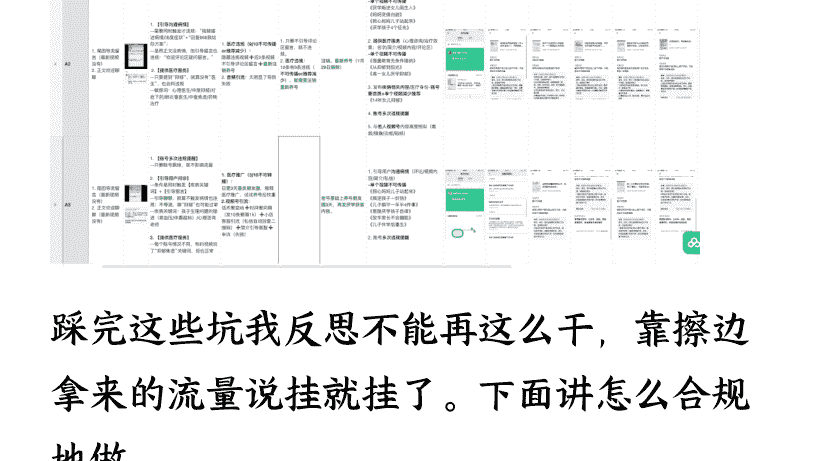

踩完这些坑我反思不能再这么干，靠擦边拿来的流量说挂就挂了。下面讲怎么合规地做。

## 二、怎么起号：先养 15 天

为什么要养号呢？为了不送人头，不然会像我一样刚起号就挂掉了。

我自己测得 25 年以来视频号的规则就是时松时紧，养号后的质量会拔高一截，所以敏感行业一定要先养号，做好防御动作。

### 15 天完整的养号流程:

- 第 1-3 天：新视频号放着不动，每天刷 1-2 小时视频号内容，养账号基础权重
- 第 4-7 天：拍点自己的生活场景，像朋友圈一样随手发 2-3 条花花草草类的
- 第 8-14 天：开始看自己垂直行业的内容，刷对标账号、点赞、评论、关注，打垂直标签
- 第 15 天：开始发第一条正式内容，先抄同行 3 天内爆的，起号

万一账号被封了需要好友辅助验证，但你这个号上没有真实好友怎么办？

一个土办法：先把通讯录里所有好友备注都改成"!"，然后把好友删到只剩不到 3 个人，放着别动 7 天，最后找人面对面扫码解封。

这个土方法我在 26 年初还有效，具体赛道可能需要大家自己去试。

### 账号基建成本：

二手手机约 200 元/台，满月龄号（注，求满月龄带朋友圈）约 100 元/个，一台手机登陆 2

个微信的话，一个最小的视频号成本模型是 300 元/套。

### 补充几个注意事项：

- 养号期间不要发任何引流内容
- 用流量卡，不要用 WiFi（同一 WiFi 下多账号会被连带封禁），也不要用虚拟 iPad 协议登录（IP 跳动太频繁会被封号）
- 如果 15 天后流量还是很少（<500 播放），或者账号已经违规限流了，直接注销重来，不要浪费时间救号了，新号的流量扶持更香
- 手上如果有 5 个号在跑，同步就要养 5 个号。账号是我们的资产，养号就是在存钱

## 三、3 种稳定出客资的内容模板

号养好了，下一个问题就是发什么。我一开始在内容上也走了弯路。

我们做视频号内容不是为了播放量，是为了出客资。所以选模板的标准就看一个：发出去能不能让客户主动找我们？播放量高但没人加我们，那也是无效动作的。

先说两个我走错的方向，大家可以避开：

第一个是内容形式。刚开始我做的是图文拼接，但视频号人群年纪偏大，字一多完播率就很低，后来改成动画配音效果好很多。

第二个是钩子设计。一开始设置的是“免费领资料”做大流量，结果很多家长真的是来凑凑热闹的，这种钩子效率很低。

后来测出来真正会付费的家长，不是对价格敏感的，而是来拿一个立竿见影能马上解决问题的方案的。

所以内容钩子要给一个让人觉得马上能解决我问题的东西。（比如我们赛道可以用：100 个孩子叛逆场景的应对话术、30min 免费家庭系统诊断，这类就非常行之有效）。

下面三种是我测试下来最有效的，普通人可以直接复制。正常操作的话一个人管 5-10 个号没问题，关键是找到有效的模板：

### 模板 1：大字报

5 秒翻页的家长故事，冲击力强，适合教育、心理赛道。

这个直接小红书扒爆款图文，剪映或视频号自动拼接即可。

### 模板 2：动画配音

适合中老年用户，只需要动动耳朵听，不需要看字幕，完播率更高。

这快的逻辑是：视频号人群年纪偏大，图文类的都没耐心看完，动画配音更合适。

这个也是剪映的 AI 配画面可以实现；想要质量高一些就去 b 站/youtube 上扒画面素材，然后剪映混剪。

### 模板 3：Coze 火柴人视频

可以直接用 coze 工作流量产，这一套下来去年的时候还需要 666 元，现在在闲鱼上定制不超过 100 元了。

### 模板 4：数字人和直播形态，

这里分享一个我同行的 mcn 模式，圈友如果是需要合作老师 IP、或者保险/法律/心理等等强信任感的真人出镜 IP 的，可以借鉴哦：

1. 内容方面：公司内部建立一个中台，负责收集行业爆款和素材，由编导完成出选题、出剧本的动作；
2. 大家搓出自己行业的直播话术以后，可以一套剧本吃三个月，三个月后再更换。

这些确实是“ADHD"的烦恼

揭秘 ADHD：不是多动症，是大脑的"高速列车”
#ADHD #罗永浩 #神经科学 #注意力缺陷#大脑神...


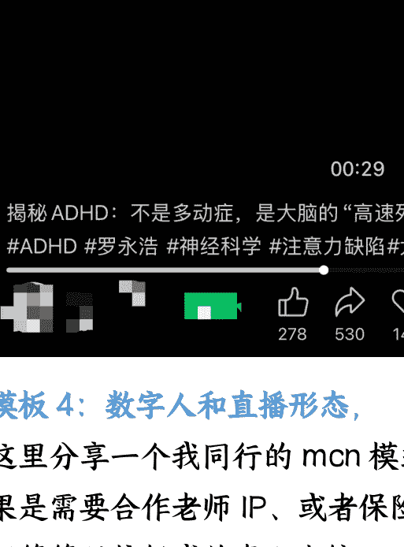

### 模板 4：数字人和直播形态，

这里分享一个我同行的 mcn 模式，圈友如果是需要合作老师 IP、或者保险/法律/心理等等强信任感的真人出镜 IP 的，可以借鉴哦：

- 1. 内容方面：公司内部建立一个中台，负责收集行业爆款和素材，由编导完成出选题、出剧本的动作；
- 大家搓出自己行业的直播话术以后，可以一套剧本吃三个月，三个月后再更换。

2、IP 方面：找演员。IP 只负责出镜，不负责创作内容，像演员一样带着镜头表现力把准备好的文案演绎出来就 ok 了。

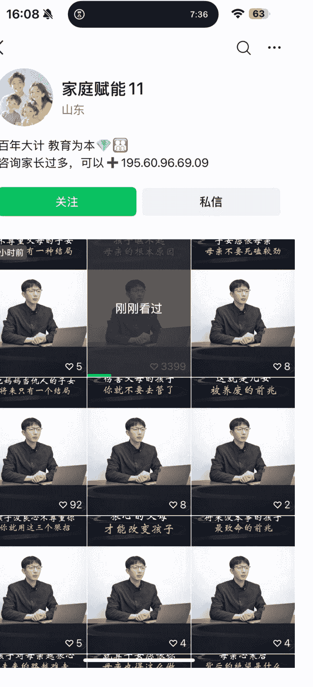

这样的好处是：卖出 4-5 位数的高客单产品后，会按 10-20% 把利润返给前端引流的 IP 团队。防止 IP 做大了以后单飞，干活有动力。

## 补充 5：如果你的赛道比较敏感，内容上要注意一下：

如果你的赛道有点擦边（养生/医疗/心理啥的），就不要硬刚敏感词，我们可以用意境暗示。

比如养生赛道就拍穿道袍、摇扇子、冥想；

心理疏导就拍公园散步、茶道之类的。

总结来说让目标用户懂得都懂，但是审核大大判不出来。

中午花一分钟冥想，下午没有这么轻松过 #疗愈 #冥想 #女性成长 #东方智慧 #冥想入门

## 思洋静心岛

心理博主 

广东 广州 男 · 心理学 · 遇到你我的人生更精彩

世界嘈杂 把心静下来

公众号：思洋静心岛
504 条原创内容 2 天前直播过

关注

私信

商品橱窗

陪大家一起静心 
4 月 25 日 19:00 直播

预约

全部预告 >

主页

### 最新视频

- 1. 视频的标题：房间里的阳光
- 2. 视频标题：如何写好英文
- 3. 视频封面：文字标题为：人睡困难就默念这三句...
- 4. 视频标题：当你不再害怕睡不着...
- 1. 视频标题：冥想在房间里的正能量效果
- 2. 视频标题：第一句话：晚安世界
- 3. 视频封面：文字标题为：人睡困难就默念这三句...
- 4. 视频标题：通过冥想改变自己的性格...

> available 1: {'Text': '当 DVD 20 V20'}


## 无相心玥

浙江 杭州 女

心无相·行自在

# 修心 · 悟道 · 文商同行

> > ⚠️‍➡️温馨提示：不主动联系·请认准同源账号 [翻手@心玥冥想[翻手]暖玥庭 - 多维心性疗愈

3 条原创内容

## 暖玥庭文化雅集


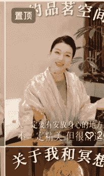

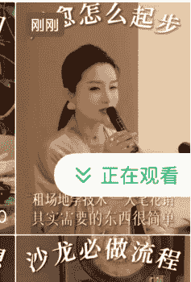


## 当你不再害怕睡不着

睡义无反顾回来

## 心理咨询师隐藏技巧

人睡困难就默念这三句

翻来覆去太苦恼

好香香的秘诀藏在这里

- 1. 标题：人睡困难就默念这三句
- 2. 标题：躺平也是在给认床打预防针
- 3. 标题：翻来覆去睡不着...
- 4. 标题：睡意怎么来？...

> available 2: {'Text': '人的双手', 'Image': '人的双手...'}


## 这里有一个省钱的小技巧：

有些敏感赛道的圈友可能会去办安防许可证，那个太贵了，动辄就几十万。
其实可以先联系你所在行业的协会，办一个协会颁发的资质证书，几千块就能搞定
资质问题，账号也更安全。

## 四、去重防封：怎么一份素材无限用

模板跑通了我们可能会碰到下一个问题是：假如 10 个号都用同一套模板，平台会判批量搬运的。所以下面这套去重方法还蛮重要的。

先讲一个可能大家会搞错的规则：平台查我们视频重不重复，看的是两个东西，一个是我们的画面素材本身，另一个是我们视频的壳子，这个壳子就比如说视频的贴纸、滤镜、转场、字体等等。

**如果素材换了但壳没换，连着发两条，播放量又大，平台就会觉得我们是批量搬运的营销号；** 打个比方，你换了故事内容，但每条视频都是同一个字体、同一种转场、同一个滤镜，平台一看就知道是同一个人批量发的。

所以光换故事内容不够，每条视频的壳也得换。

**另外要特别注意两个流量红线：**

3. 一般播放量突破 6000-7000 时，流量会快速上涨，这时候我们要开始监控视频数据；
4. 直到播放量突破 3 万时，一般就触发人工审核了，建议主动删掉这条视频，防止矩阵营销号被判违规封号。

**下面开始讲一份素材无限用的方法：**

### 第一步：搞定原始素材

不管是查重还是起号，我们手里都最好有有海量的素材。搞素材主要分两类，看你的具体业务类型：

- 实战类 (适合传统工厂/实体门店)：
批量实拍

像我同行在视频号做工厂跨境的，也不去搞花里胡哨的运镜了。到现场找到同行爆款视频里最火的那个动作，让摄影师对着这同一个角度连拍 30 遍，之后这些片段就能拿回去循环用。

做矩阵最缺的就是素材，找到好角度直接大力出奇迹。

- 洗稿类 (适合知识付费/图文/口播)：
AI 批量洗稿

如果是做我这种家庭教育、心理辅导的项目，没法天天实拍，那就去扒公众号、知乎、抖音上的爆款案例。

先提取出故事的内核（比如：家长遇到了什么问题→试过什么方法失败了→转折点是什么→最终结果）

然后扔给 AI 洗稿，可以改改提示词扔给你的 AI：

```
"你是一个资深心理咨询师，擅长写家长育儿故事。现在有一个素材：
【内核】孩子沉迷游戏休学一年，家长从崩溃到找到方法的经历
请把这个故事改写成：
```## 换个城市背景（上海→成都）

凭借情感内核，保留家长的焦虑、无力、绝望感，以及最终转变。

要求：读起来像真实家长的口吻，避免直接引用网络热梗，字数 800-1200 字。

这样子一个脚本就能洗出十几个完全不重样的新文案。最后手动替换 5-10% 的文字。

### 第二步：叠被子法

前面说了，有时候被查重不是因为原始素材用得一样，是因为去重模板用得一样。所以我们确定好出客资的模板以后，给视频叠加 3-5 层滤镜。每次叠的组合都不一样，让机器识别不出来。

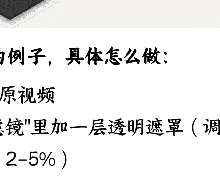

**以剪映为例子，具体怎么做：**

+ 7. 导入原视频
8. 在滤镜里加一层透明遮罩（调整不透明度到 2-5%）
9. 在调节里微调：

• 亮度：+1 到 +3
• 对比度：+1 到 +2
• 饱和度：-1 到 +1（随机）
10. 在“特效”里加噪点效果（强度 1-3%）
11. 最后轻微旋转画面（0.1-0.3 度）
12. 导出

注意：保存 3-5 个预设，每次随机组合使用。关键是每次组合都不一样，要让自己都认不出这是同一套素材。

### 第三步：素材搬家法（利用时间差）

假如素材用完一次就扔了，比较浪费。我们通过在电脑里对素材搬家，打时间差，让用过的老素材重新变回新素材。

**具体操作：**

13. 在电脑里建两个素材文件夹：文件夹 A（未用）、文件夹 B（已用）。
14. 每天发视频，只从“未用”里定量拿素材（比如每天拿 30 条），用完就扔进“已用”文件夹。
15. 循环动作：过了一个月，当“未用”里的素材全被搬空了咋办？把“已用”文件夹改个名字，直接全部搬回“未用”文件夹里重新发。

为什么这样不会被判重复？因为我们一个月前用旧素材发的视频，已经被我们删完了。平台查重是看主页上还留着什么，所以素材搬家法要配合下面这条一起用。

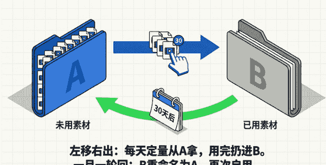

### 第四步：主页只留 15-20 条视频

一个账号主页只保留最新的 10-20 条视频。历史的高赞视频该删就删了，不要舍不得。

我们算一笔账：等我们把文件夹里的素材用完一轮（假设用了一个月），那一个月前用这些素材发的视频，早就被我们从账号上删干净了。这时候我们把旧素材搬家来重新发就 OK。因为平台对比同质化是看的历史记录，我们的记录删掉以后系统无从查证，它认为是全新的素材。

这样做有什么好处：

+ 一旦违规，我们主页剩的视频少，能排查出是哪条视频或哪个模板出了问题。
+ 避免同行潜伏主页抄袭我们的爆款素材/Alert 举报我们（敏感赛道一被举报就挂了）。
+ 防止系统某天突然对老视频翻旧账审核。而且实际验证下来两周前的万播视频到现在也带不来多少新客了，不如直接隐藏掉保平安。

## 五、引流 + 朋友圈承接

内容找到了，也不会被封了，接下来就是解决怎么把看视频的人变成微信里的客户这个问题。

### （一）怎么安全地把人导到私域

最安全的引流方式是被动引流，尽量留钩子让客户来找我们。

### 直播间挂电话引流

我当时用蛮有效的，1 个视频能来 5-8 个线索，比私信效率高。

具体操作是：视频号实名以后直播间设置预约，预约详情页写电话号码的谐音，这个具体直播时间不重要，可以设置到 1 年以后去。最终目的是用户点预约，看到电话，然后主动联系你。

## 雨棚发明家

长沙虹宇传媒有限公司
180—2921—2179
已关注
私信
🙋‍♂️180 发 2921 财 2179
4 月 21 日 12:00 直播
主页
视频
音频
预约

## 音频 (1)

~180~2921~2179~
12 秒

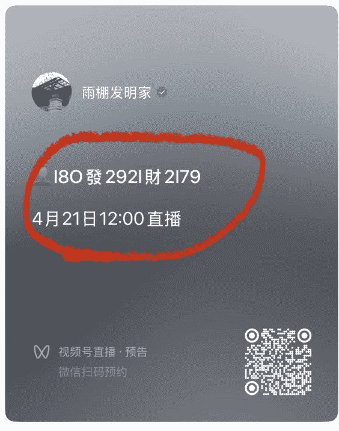

音频引流。

上传音频，文件名是电话号码，这个有风险建议大家先拿小号测试一下。

## 广东佛山

佛山源头雨棚定制看音频❤️📞1🗨️1
植生—👉🏻📞18027427092
1 条原创内容
## 主页
## 视频
## 音频
## 音频（1）
雨棚 18📞0274📞27092
1 分钟
## 最新视频

~~~180~2921~2179~~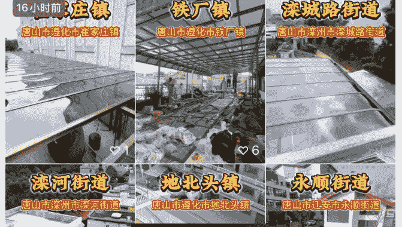

## 公众号 ID 引流

视频号引流像打游击战，政策变化太快了；我们可以关注最卷的同行然后抄他们的最新引流方式，比如做工厂获客的、做仿包假鞋的等等，谢谢各位江湖老师。

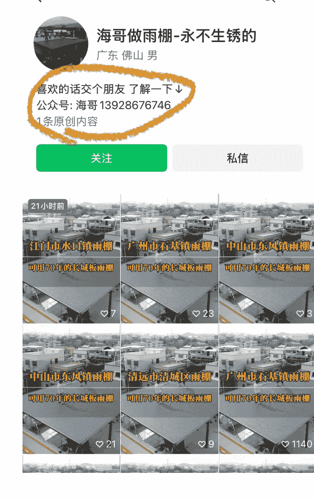
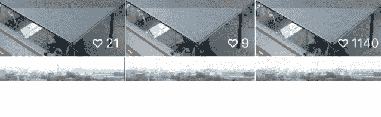

### 微信小店客服引流（这个最推荐）

氦点金给腾讯爸爸冲微信小店的钱，用客服来引流吧。

+ 19. 开通微信小店（一个身份证可开 1 个店铺，企业可开 2 个），
- 20. 绑定视频号后把主页私信升级为客服按钮，
- 21. 设置自动回复放企微二维码。可以设置关键词自动回复，比如客户发"666"自动回复联系方式。

成本：开通免费，保费三几百到几种不等（不同类别），退出的的话保证金是可退的。

与其冒险用灰色引流，不如老老实实开小店，成本低还稳定。建议刚刚上手的话先实名一个店铺，关联 3 个账号做成小矩阵快速测试引流效果。

⭐ 独有的“三位一体”服务体系
⭐ 机构累计服务 3W+ 组家庭
⭐ 北大、北师大一线专家背景
❤ 孩子休学厌学专注力等问题免费 1V1 咨询

一个合规的小技巧：打同城流量（避免全国违规）

打全国的流量太容易违规，但是如果大家的高客单品是线下可以核销的，就换本地 IP+ 城市关键词打同城客资；一般同城流量都很精准，量又不大，可以慢慢稳稳地拿客资；一般来说单个城市 5-10 个号就足够了。如果搞全国性的咨询产品，也可以以 2-3 个城市为试点，测试有效再铺开。

具体可以按照这个表对照着来：

| 要素 | 怎么写 | 举例子 |
| :---: | :---: | :---: |
| 封面 | 必须出现城市名 | “北京家长必看” |
| 文案 | 描述里要出现城市名 | “这位上海的妈妈，孩子已经休学 3 个月了……" |
| 定位 | 发布时选该城市 | 发布页面选“上海市” |
| 话题标签 | 带城市话题 | #上海 #上海家长 #上海厌学 |

注意：标题里是否带城市名反而不太重要。

### （二）朋友圈：怎么快速搭出一个能接住客户的朋友圈？

客资来了如果我们朋友圈空荡荡的，人家不会信任的。有的时候又没来得及写那么多咋办？

分享一个 1 天快速写出 50 条朋友圈的方法：

第一步：扒同行框架。

首先你要有至少 1 个对标的优秀同行朋友圈素材。去咸鱼把他的朋友圈全部扒下来，让 AI 帮我们分析这么几千条朋友圈是什么框架。提示词如下：

```
你是一个 200 年的朋友圈写稿大师，我给你上传了我对标同行的所有朋友圈，你帮我
```

分析它使用了哪几类框架，给我输出并命名为【朋友圈框架Ⅰ】。

## 第二步：整理自己的产品方案。

然后我们要有自己的产品的宣传方案，包括自己用户的痛点、自己跟销售团队聊下来拿到的成单数据等等，都上传 AI 分析，最终出一版产品的宣传方案。

如果对客户信息量掌握有限的话，可以学珍妮老师这一篇豆包宣传方案，跑完一遍基本上每个客户关心的点都涵盖到位了：

24 年 12 月 24 日&25 日&26 日&27 日&28 日-自驾游&路书-打法分析-如果你不知道从哪些方面宣传自己的服务（是服务，不是带货某个产品），就看这个豆包投喂话术哦


拿到产品宣传方案以后投喂以下的提示词：

你是一个 200 年的产品营销大师，我给你上传了我所有的产品文档、用户调研、客户案例等等资料，你帮我输出我的产品宣传方案，并命名为【宣传方案Ⅰ】。

### ***第三步：AI 批量出稿。***

然后就可以让 AI 结合着前面两块，给我们出稿子了。

Gemini 或 Claude 自己去按顺序调用素材、组合最适合的朋友圈内容。

你是一个 200 年的朋友圈写稿大师，我要为我的家庭教育项目做朋友圈营销，我现在想要分析一下用什么方法来写我的朋友圈。我在做的是青少年厌学的这个赛道，我要吸引的是高知高净值家长来付费，我的产品是 3980-29800 的咨询和陪跑服务。你来帮我匹配一下，如果根据我的【宣传方法Ⅰ】，要使用【朋友圈框架Ⅰ】里面的哪些框架呢？你的操作顺序是：

+ 1. 分析厌学赛道的【宣传方法Ⅰ】，理解我们产品最重要的卖点，理解我们的 100 个用户案例。
+ 2. 学习我的【朋友圈框架Ⅰ】，具体包括他的说话口吻、卖点痛点、情绪洞察、配图方式；
+ 3. 分析如果使用我们的【宣传方法Ⅰ】，可以套【朋友圈框架Ⅰ】的哪些框架？你自己按顺序调用、组合最适合的框架和素材，并输出。
+ 4. 给我朋友圈的配图建议。

PS：暂时不用改写具体内容，只需要列举出来，后续我会单个投喂你来改写。

展示一条当时 Gemini 给我的答案，让大家感受下：

## 【框架 5：硬核价值观/认知差】

素材来源：01.pdf（用户画像：P8 高知家长，海淀区，高焦虑）

核心逻辑：针对“空心家庭”的痛点（好面子、控制欲强），进行认知打击。

只要家里有个太能干的奶奶，通常就有一个无能的妈和一个废掉的孙子。这话不好听，但是事实。

今天这个案子，爸爸常年隐身，奶奶掌握财权和话语权，妈妈像个受气的小媳妇。孩子一旦不想上学，奶奶就护着：“不想去就不去，别逼坏了我的孙子！”

这种【隔代结盟】，直接废掉了妈妈的管教权。孩子很聪明，他知道谁是家里的老大。他躲在奶奶的保护伞下，就可以肆无忌惮地逃避成长。

我的方案是：请奶奶退出。哪怕要爆发家庭大战，父母也必须把教育权夺回来。权力不归位，孩子永远长不大。

写得还可以吧，出稿以后我们手动调调，任何赛道都可以速成 50 条朋友圈素材然后置顶给客户看。

### 补充：怎么跟客户解释？

一上来就刷屏可能会被客户拉黑，我们可以说：“由于上一个号加满了/xx 原因违规了，现将大量朋友圈案例挪到新号上来。如果客户们不想看可以自由屏蔽，我会把最有价值的参考案例置顶 balabala".

我是这样说的：

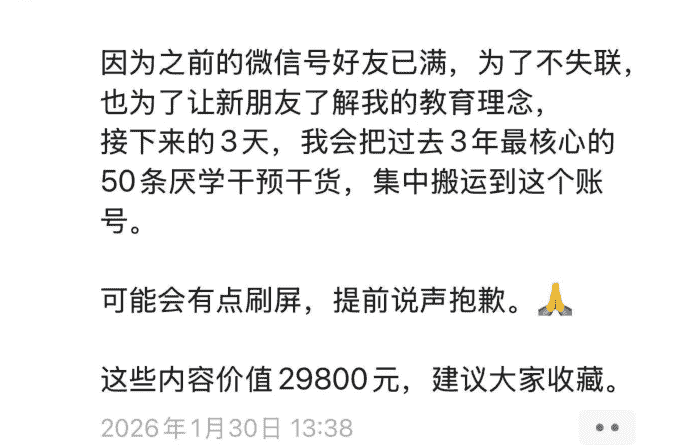

# 跑通 0-1 后，值不值得放大？

跑通 0-1 以后，下一个问题就是：要不要矩阵放大？

每次到算账的部分我就非常头疼，后来总结出了一个非常简单的小学生数学。对于 0-1 阶段的圈友来说，只要粗略算一笔账就可以：

+ 你一个月能带来多少条客资？
• 每条客资最终能赚多少钱？
• 减掉号的成本和你花的时间，还剩多少钱？
• 如果这就是最终的利润，你是否满意？

如果对这个数字满意，就多开几个号；如果不够，先把转化做好再说。

# 所以能不能放大，我觉得看三件事；

## 22. 我们后面卖的东西赚不赚钱？

拿我自己来说，我做的是代运营模式，帮别人的产品获客，一个月赚 2w 左右，放在很多大佬圈友面前还不够看的；不过我做建材出海的朋友，一方面 ta 自有工厂自己接单，另一方面签一个 ToB 意向订单可能就上千万了。其实用的是一模一样的视频号获客方法——单城 5-10 个号测试，测出一套不违规的模板，然后复制到全国几百个号上。如果圈友自己有高客单的产品或服务：如法律咨询、装修、自营教育、工厂出海，那这套获客方法的利润会比我大很多的。

## 23. 我们的赛道能不能合规稳定地跑？

其实在敏感赛道做视频号，"稳定增长"可能本身就不太成立。因为平台规则一直在变，客资量有高有低，淡旺季也明显。我自己这个青少年厌学赛道就是这样，一直在跟平台做对抗。所以我无法将它做成稳定的生意，更像是一个赚零花钱的副业。

## 24. 我们的流程能不能脱离我们个人？

如果所有环节都靠我们自己盯着，那加号就是加班。只有模板跑通合规、招人 SOP 想清楚、换个 80 岁老奶奶来了也能照着做，到这一步才值得放大。总之就是先把违规点全部摸清楚，再谈放大。不然加的号越多，封得越快。

## 写在最后

总之折腾一大圈，我最大的感受还是别跟平台对着干。合规看起来贵，其实性价比最高，省下来的精力去优化内容和转化才是正事。

感谢 lyj-江哥，视频号流量这块非常权威，帮我少走很多弯路；

感谢珍妮老师，精细化运营的获客大王，想夸一百遍；

感谢 yeye 同学，在写内容方面很到位，很有耐心给我建议；

越分享越幸运，希望大家顺风顺水顺财神！！

---

看完这篇 SOP，你觉得你懂了。但 90% 的人一到实操就会卡在第一步。工具和教程只是最低级的壁垒，真正的壁垒是“立刻动手”和“圈层信息差”。

如果你想看全网最新的变现玩法，并且和一群执行力极强的极客一起下场拿结果，欢迎围观我的核心私域：【懒人专属群】。

我们不聊虚的，只做商业闭环的拆解与 AI 效率的压榨。系统内已沉淀 1000+ 跑通的套利实战局。

🔎 查阅圈子完整数字资产与上车门槛：
[https://lazyso.com/insider/](https://lazyso.com/insider/)

认同价值、准备好下场干活的，扫码加我微信（lazyhelper1）

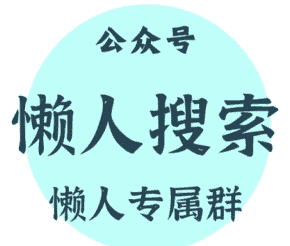
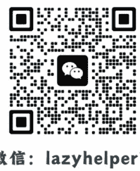

备注：【实操上车】，不闲聊