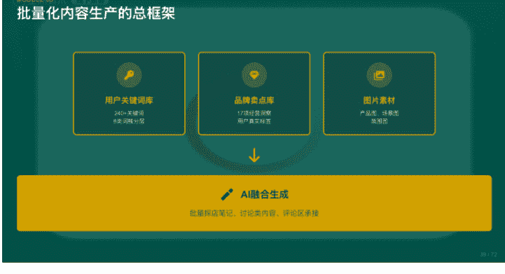
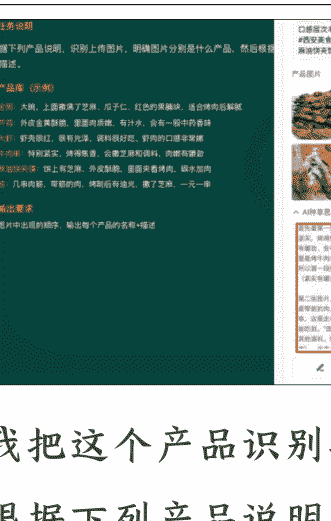
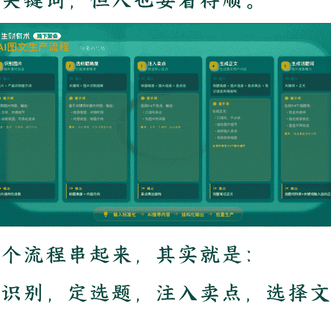
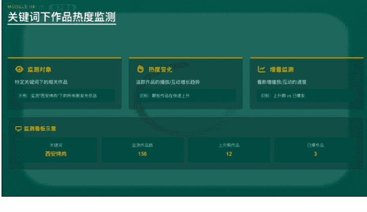
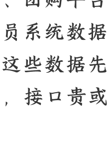
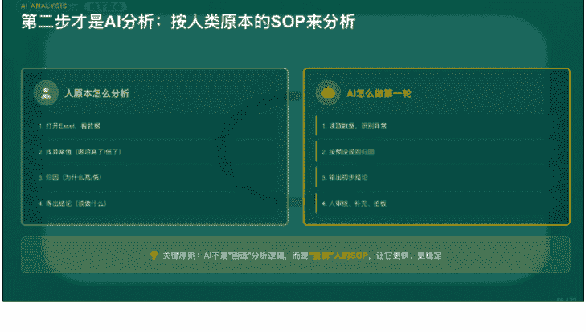
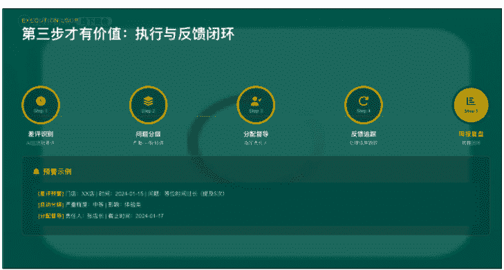
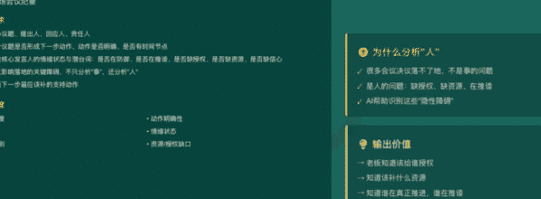
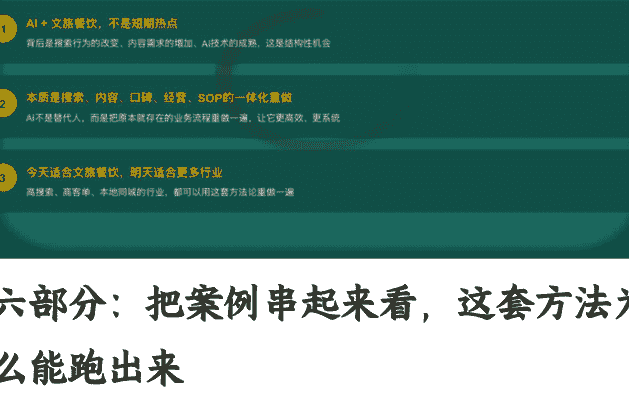

# 用 AI 重构搜索获客全流程 - 以文旅餐饮获客服务为例

260416 副业 SC 精华

整理:公众号懒人搜索，懒人专属群精选

懒人微信: lazyhelper

作者:大周 | 时间:2026 年 04 月 13 日

清明假期第一天，在上海做了分享。

逐字稿 +PPT 课件分享如下。

【课件原稿链接】

https://www.kdocs.cn/l/ca6loyGogk5S

![img/a840b9dfd814ebdb8caf3e4794a9a442_0_0.png]

# 文旅餐饮 AI 搜索增长实战逐字稿

大家好，我是大周。

今天这场分享讲的是，过去一年，我怎么把文旅餐饮原来那套很重、很慢、很依赖人工经验的获客流程，用 AI 重新做了一遍。

先简单讲一下我自己。

![img/a840b9dfd814ebdb8caf3e4794a9a442_1_0.png]

我做过五年餐饮企业，后来转做了两年餐饮营销。

过去一年多，我和团队一直围绕文旅餐饮这个板块在做营销服务，服务过西安的刚刚烤肉、陕拾叁糕点、军军绿豆糕、小骆驼福苗烤肉，成都的螺旋桨螺蛳粉、三毛兔头，嘉兴的薛八千，安吉的阿露佳等等一批城市地标型餐饮。

对我来说，我不是先看到 AI，再去硬套一个行业；我是先在餐饮里做过，知道这个行业哪里重、哪里累、哪里最依赖经验，所以我才知道 AI 应该插在哪一刀最值钱。

我先说一个大的判断。

![img/a840b9dfd814ebdb8caf3e4794a9a442_1_1.png]

从 2023 年开始，普通餐饮整体越来越难做，这几乎已经是行业共识。

但是在这个大盘里，有一个板块反而伴随着交通基建完善、人员流动增强、文旅需求上升，出现了逆势增长，那就是文旅餐饮，或者更准确一点说，文旅目的地消费。

为什么？

因为普通餐饮很多时候只能做三到五公里半径内的生意，但文旅餐饮除了本地客群，还多了一层游客客群，而游客往往是更愿意消费、更愿意打卡、也更愿意分享的一类人。

![img/a840b9dfd814ebdb8caf3e4794a9a442_2_0.png]

![img/a840b9dfd814ebdb8caf3e4794a9a442_2_1.png]

文旅餐饮有两个非常明显的特点。

第一，搜索流量占比高。

第二，决策链路长。

用户不是刷到一条视频立刻就去，而是会先搜、再比、再看评论区、再看评价页、再看差评，最后才决定要不要去。也正因为这样，这条链路特别适合 AI 改造。过去一年，我们就是用 AI 把这条链路重做了一遍，把原来依赖人工、经验、线下巡店、消费者调研的很多环节，尽量改造成 AI 工作流。

[图片]

在我看来，AI 最适合做两类工作。第一类，是重复性工作。第二类，是需要专家型初筛、但不一定需要专家亲手一条一条做的工作。所以整个过程中，AI 先替团队完成 80% 的工作量，最后那 20% 真正影响结果的判断、取舍、推进和拍板，还是人来做。这个认知非常重要。AI 不是替你做老板，它是先替你做掉大量低价值重复劳动。

# ### 今天这场分享，我主要讲五大块。

- 第一块，AI 怎么介入用户需求洞察和搜索关键词库搭建。
- 第二块，AI 怎么介入品牌卖点和品牌标签挖掘。
- 第三块，AI 怎么批量覆盖关键词搜索结果，沉淀 GEO 资产。
- 第四块，AI 怎么做评论区种草、热度监测和上升期截击。
- 第五块，AI 怎么从营销工具进入经营工具，进入会议、差评、预警和组织协同。

顺便我也把商业模式讲透。

我现在做这个事情，大概有几层变现。

项目制服务，一般是 2 到 5 万一个项目，帮客户做完整策略和搜索增长方案；

如果是陪跑，通常在 10 到 30 万；

工具这块有初级版和高级版，高级版是 29800 一年；

入企培训是 5 万一场；

另外我们自己也开线下课。

整个逻辑很简单：先做服务，服务跑通了就有 SOP，再用 SOP 上 AI 变成工作流，工作流再变成工具和课程。

## 第一部分：AI 怎么介入用户需求洞察和关键词库搭建

![img/a840b9dfd814ebdb8caf3e4794a9a442_5_0.png]

我先讲第一块，用户需求洞察和搜索关键词库。

在 AI 介入之前，这一块其实很重。

![img/a840b9dfd814ebdb8caf3e4794a9a442_5_1.png]

我们通常要先花两天时间，和客户深聊，

理解这家店到底想获什么人、现在来的是什么人、未来想要什么客群；

然后再通过 5118、聚光后台这些工具，一个个去梳目标用户的搜索关键词地图。

这件事很重要，但也非常繁琐。

因为真正难的，不是随便想几个词，而是你要把它想全。

地标词、场景词、景点词、人群词、路线词、决策词、避坑词、预算词，都要穷举。

所以去年 8 月以后，我们开始让 AI 先介入这一步。

最早的初版提示词很简单，我先把它放出来，大家感受一下。

你是一名用户消费决策洞察分析师根据提供的行业、人群等信息。1.分析用户的浏览和搜索行为，了解用户对品牌和产品的关注度和兴趣点。2.分析用户的购买行为，了解用户的购买意愿和决策过程。3.分析用户的行为路径和转化漏斗模型，找出关键点和优化方案。分析完成后，输出用户消费决策的不同阶段的需求，以及匹配这些需求的搜索关键词。

= = 这个提示词的作用是什么？

就是先把用户从“起心动念”到“下单消费”的整个决策过程拆开，然后告诉我在不同阶段，他会搜什么词。这个阶段，它确实能帮我们省事，能先把一个大框架跑出来。

![img/a840b9dfd814ebdb8caf3e4794a9a442_7_0.png]

但是很快我们就发现一个问题。

AI 生成的词，不等于真实搜索词。

它生成的是“语义上合理”的词，不一定是用户真的会敲进搜索框里的词。

比如“高颜值伴手礼”“附近美食地图”这种表达，听起来没错，但真实用户未必这么搜。

所以早期流程里，AI 跑完之后，我们还得到聚光后台、小红书后台，再一个一个去核对、替换、补搜索热度。这个工作量其实还是很大。

后来这个流程就继续优化。

![img/a840b9dfd814ebdb8caf3e4794a9a442_7_1.png]

我们开始把 AI 推出来的词，直接扔给相关关键词热搜数据工具或 API 去跑真实搜索量，不再完全依赖人工逐个核查。

也就是说，流程从“人工想词 + 人工查词”，变成了"AI 推词 + 工具查词 + 人工判断”。

这样一来，最烦的那个环节就被大幅缩短了。

再往后，我们把用户洞察这套提示词升级成了更完整的版本。我把完整版直接贴给大家。

你是占位营销用户决策研究员 + 搜索意图与关键词策略师，核心任务是从真实用户视角，完整拆解指定行业/品类的目标人群决策全链路，输出可直接落地小红书、百度、抖音、大众点评的搜索意图体系 + 关键词库，用于前期占位选题与关键词布局。需严格遵守六大规则：不提前锚定行业/产品/品牌词；先建用户问题空间，再建方案空间，最后才出现供给词；关键词严格配比：问题/目标词≥50%，方案/路径词≈30%，供给/行业词≤20%；信息不全先给假设与待验证点；全程使用用户口语、长尾表达，不用营销话术；每一决策阶段必须写出替代方案。

输出流程固定六步：1. Step 0 先给出关键假设、反假设、待验证点，避免主观预判。2. Step 1 构建用户问题空间，覆盖触发事件、目标结果、风险恐惧、约束条件，并提炼隐藏动机。3. Step 2 打造 3-5 个用户 Persona，含场景、动机、恐惧、决策风格、搜索句式。4. Step 3 按触发→验证→定标准→对比验证→决策→体验后六阶段，拆解每阶段情绪、表面/深层需求、顾虑、推进门槛、替代方案。5. Step 4 输出阶段—搜索意图—问法模板表格，明确意图类型、内容形态、用户信任证据。6. Step 5 产出≥240 个关键词库，按阶段分层，覆盖 8 类词簇，满足每阶段≥40 词、60% 以上无行业词，格式规范可直接使用。最终必须交付：阶段情绪需求总表、TOP30 优先占位关键词、锚定自检反例清单、≥20 条不建议投放词及原因。

这版提示词和初版最大的不同，是它不再一上来就锚定品牌词和品类词，而是先去构建用户问题空间。

先问：用户为什么要搜，用户在怕什么，用户在哪个场景下会搜，用户在这个阶段会拿什么做替代方案。

也就是说，我们从“我要打什么词”这个角度，切换到了“用户为什么会搜这些词”这个角度。这个切换非常关键。我经常举一个例子。

![img/a840b9dfd814ebdb8caf3e4794a9a442_9_0.png]

假设今天我接了一个客户：重庆，火锅，客单价 50 左右，目标客群是游客。

那我不会一上来跟 AI 说“帮我写重庆火锅相关的关键词”。

我会先告诉它：城市是重庆，品类是火锅，人群是游客。

然后让它自己去做假设、反假设、拆画像、拆旅程。

最后它就会告诉我：学生党穷游会搜什么，带父母的人会搜什么，情侣和闺蜜会搜什么，刚下高铁的人会搜什么，怕踩雷的人会搜什么，怕太辣的人会搜什么。这样出来的词，才真正像“用户的语言”，而不是“商家的语言”。

![img/a840b9dfd814ebdb8caf3e4794a9a442_10_0.png]

而且这一套东西，不只是为了出词。

它真正的意义是，你会得到三样东西：

第一，目标用户是谁。

第二，目标用户在各阶段会搜什么。

第三，你最该优先占哪些词。

![img/a840b9dfd814ebdb8caf3e4794a9a442_11_0.png]

这就是第一块，AI 介入用户洞察和关键词库搭建。

## 第二部分：AI 怎么介入品牌卖点和品牌标签挖掘

接下来讲第二块，品牌卖点和品牌标签挖掘。

这件事在 AI 介入之前也很重。

![img/a840b9dfd814ebdb8caf3e4794a9a442_11_1.png]

我们以前要做很多实地动作：去巡店、去看竞品、跟创始人聊、跟厨师长聊、跟店长聊、跟顾客聊、做问卷、蹲门店。

然后最后才慢慢整理出一套卖点库、剧本方向、视觉模板。

这一步不仅费时间，而且最麻烦的是老板很容易自嗨。

老板觉得自己很用心设计的点，不一定是顾客真实感知到的点。

这一步最难的，不是工作量，而是“老板自嗨”。

那一刻我们才发现，不是工作量，而是“老板自嗨”。

所以真正有价值的，不是把老板的话抄下来，而是区分两件事：

第一，老板以为的卖点。

第二，顾客真实感知到的卖点。

后来我们就把这一步也用 AI 重构了。思路是什么？不是只靠访谈，而是尽可能去读取全网真实表达。

![img/a840b9dfd814ebdb8caf3e4794a9a442_12_0.png]

数据源主要有三类：

第一，小红书、抖音上品牌词相关的笔记和评论区；

第二，美团、点评这些平台的评价数据；

第三，菜单、团购、价格等补充资料。

也就是说，我们尽量把“跟十几二十个顾客线下聊”，变成“一次性读几百条甚至上千条真实表达”。

这一块的核心提示词，我也直接贴出来。

你是资深餐饮经营诊断 AI 顾问，需将门店评价数据转化为可落地的经营决策报告，严格按要求完成全模块分析，禁止概括、空泛输出。

一、基础信息与数据要求

基于门店基础信息、多平台评价数据（含评分、正文、菜品、价格等）及菜单、团购等补充数据开展分析，数据不足需标注缺失项与可推断结论。

二、核心分析目标

完成 17 项经营洞察分析：目标群体、高价值流失客群、价格敏感度、价格锚点、服务流程、体验断点、菜品结构、消费场景、到店动机、预期落差、复购理由、品牌标签、决策阻力与优劣势、真实竞品、口碑趋势、系统根因、经营动作优先级。

三、硬性输出规则

每个分析模块必须完整输出：数据处理流程、AI 分析流程、分析逻辑、结果表格、经营动作建议、结论分层（事实/推断/建议）+信心等级；核心结论需附 3 条以上评价证据、量化数据，严格区分价格敏感、场景动机、服务流程、菜品类型、品牌定位等易混淆维度，禁止笼统表述；动作建议需明确改什么、谁负责、改哪里、改善指标、优先级。

这里我有几个统一标准：

## 四、统一执行标准

先完成数据清洗、标签抽取、人群场景识别、时间切片、证据强度评估的统一数据处理，按频率、营收影响、复购流失、传播风险、可修复性计算综合优先级，所有模块遵循统一评分与优先级规则。

## 五、输出规范

按固定模板输出各模块内容，表格完整无缺项，语言直白落地，聚焦钱、人、菜、流程、口碑、复购，最终输出综合总结，明确核心问题、核心资产、优先级动作与门店类型判定。

这套提示词的核心，不是让 AI“帮我总结一下评论”，而是直接把评论变成经营诊断输入。

它会跑出什么？

![img/a840b9dfd814ebdb8caf3e4794a9a442_14_0.png]

![img/a840b9dfd814ebdb8caf3e4794a9a442_14_1.png]

# 菜品结构分析（上）

| 菜品 | 提及 | 正负比 | 主要口碑争议 | 稳定性 | 近期 |
|---|---|---|---|---|---|
| 招牌烤肉筋 | 60 | 44:9 | 少数门店优劣不稳 | 中高 | 高 |
| 古都熏肉大饼 | 49 | 35:7 | 凉、肉少、夹生纠纷 | 中 | 高 |
| 金牌酸辣白菜 | 39 | 32:3 | 白菜少、挟粉多 | 中高 | 高 |
| 蒜香脂油馍 | 23 | 14:6 | 个别批次冷/温 | 中 | 中高 |
| 招牌川椒爆毛肚 | 22 | 15:2 | 辣椒多于毛肚 | 中高 | 中 |
| 果木香仔肠 | 19 | 10:2 | 少数门店品质一般 | 高 | 中 |
| 无烧烤肉脞 | 17 | 12:3 | 柴、调、不够煎感 | 中 | 中高 |
| 烤鸡砖 | 16 | 10:2 | 温度不易、有点生 | 中 | 中 |

- **爆辣菜识别**: 招牌烤肉筋、古都熏肉大饼、金牌酸辣白菜
- **招牌菜识别**: 招牌烤肉筋、古都熏肉大饼、高口碑、高传播、高...

> 核心结论: 招牌烤肉筋、熏肉大饼、酸辣白菜远古高回忆菜，真正危险的是少数招牌菜一旦失格，会直接拖累爆单。稳定性直接影响购买，建议先保供培训菜稳定，再做新品。

# 菜品结构分析（下）

| 菜品 | 主要失望点 | 伤害 | 处理建议 |
|---|---|---|---|
| 牛排 | 腥、多、没入味 | 高 | 重做或锁化主推 |
| 花蛤/蛏子 | 空壳、沙多 | 高 | 严格票控或缩推 |
| 饮品/牛奶椰糖 | 风味普通 | 中 | 保留但别主推 |
| 渣渣酸辣米线 | 寡淡 | 中 | 观察，下架低动能 |
| 个别热卖/炒面 | 温度或味道一般 | 中高 | 保温和时得快管理 |

| 结构缺口 | 表现症状 | 建议方向 |
|---|---|---|
| 解腻菜不足 | 前面臭后面腻 | 强化清爽解腻线 |
| 高定性快菜不足 | 等餐焦虑 | 设稳定快菜池 |
| 儿童友好菜弱 | 小朋友主要靠小吃 | 儿童友好菜组合 |
| 高价菜风险高 | 牛排/海鲜菜手 | 减少高风险 SKU |
| 招牌菜外延不足 | 总之几道菜撑 | 围绕招牌做兄弟菜 |

- **招牌菜日检**: 烤肉筋、熏肉大饼、酸辣白菜列入日检菜单
- **高峰二次温控**: 对“凉菜碗”高发菜设置二次温控
- **砍掉高风险 SKU**: 羊排、花蛤等踩雷菜降权或下架
- **门店对比校验**: 争议高的菜做门店对比挂检

> 核心结论: 菜类结构当前是“强记忆招牌 + 一批高风险推后菜”。跑网问题不是全品牌普遍“小”，而是集中在酸辣白菜、熏肉大饼、花蛤/蛏子、部分高价菜。建议：保招牌、砍风险、补特色菜和解腻线。

# 复购

复购不是因为“都挺好”，而是因为“低决策成本”

![img/a840b9dfd814ebdb8caf3e4794a9a442_15_0.png]

> **评价证据**: 3157654142 | 丈八店 | 5.0: “风味油脂和酸白菜真是百吃不厌。”
3152529313 | 丈八东路店 | 5.0: “每次都专门打车过去。”
3132215739 | 大都店 | 5.0: “以后还会再来。”

# 消费场景与到店动机

- 6 类消费场景：
  - 亲友聚会 24.8%
  - 游客打卡 15.9%
  - 家庭聚餐 12.3%
  - 团建/户外 2.4%
  - 附近打工/路过 2.4%
  - 其他 36.6%

- 6 类到店动机：
  - 冲着招牌菜 22.7%
  - 朋友/家人推荐 20.3%
  - 社交需求 9.5%
  - 大众/点评种草 8.2%
  - 打卡/本地特色 5.6%
  - 游客/离家近 5%

> 核心结论: 亲友聚会 (24.8%)，其次是游客打卡 (15.9%) 和家庭就餐 (12.3%)，最拉动点名是冲着招牌 (22.7%)、朋友/家人推荐 (20.3%)、社交需求 (9.5%)，点评是被带来冲着几道菜单的，不是客户自己意愿...。

# 客户细分

真正的主力盘，不是所有人，而是三类人:朋友局、游客情侣、社区熟客

![img/a840b9dfd814ebdb8caf3e4794a9a442_15_1.png]

- **朋友/团建相关**: 400 (占 24.7%), 平均星级 4.49
- **游客/外地相关**: 226 (占 14.0%), 平均星级 4.37
- **社区熟客/经常来**: 68 (占 4.2%), 平均星级 4.57, 低星率 2.9%

> **评价证据**: (正文明细及评论)
3157239632 | 交大店 | 5.0: “朋友聚餐我都首选选这儿。”
3157619638 | 大都店 | 5.0: “各种陕西小吃真的很合适招待... 外地朋友。”
3156990702 | 酒源路店 | 5.0: “夜宵排单首选。本地人常年不踩雷。”

目标客群是谁，高价值流失客群是谁，价格是不是敏感，菜品结构是什么，消费场景是什么，到店动机是什么，复购理由是什么，哪些是品牌标签，哪些是体验断点，哪些是真实竞品，哪些问题优先级最高。

这样出来的结果，就不只是内容团队能用，老板和门店运营也能用。

这里我讲一个特别典型的理解方式。

卖点不是停留在商家视角，而是要翻译成用户视角。

比如有个项目，商家很强调：我们这个鱼没有小刺，只有大刺，所以成本更高。

如果站在商家视角，这只是产品描述。

但翻译成用户视角，它就变成了：我特别愿意带老人和小孩来吃，因为吃这个鱼很放心，不怕卡刺。

这就是一个好场景下的好卖点。

再比如红烧肉，商家说炖两个小时，这是工艺；而用户真正会说的是：老人没牙了也能轻松吃，不担心咬不动。

大家一定要理解这个差异，一个特别重要的点，是它能帮你教育老板。

因为很多老板会坚持推某个新品，或者坚持某个自认为很有亮点的东西。

但 AI 跑完评价分析以后，往往会把全平台顾客真正记住的那几道菜、那几个标签、那几种场景直接拉出来。

这时候你就会很清楚：消费者真正认的，不一定是老板最想推的。

所以这一步的真正价值，不只是“找到卖点”，而是“把真实卖点和自嗨卖点分开”。

同时这部分的工作，也可以交给 AI 来完成，把卖点翻译成顾客在意的场景。

## 卖点剧本化工具

把产品描述转成最打动消费者的场景

- 直接感受解释 1：“炖了 2 小时的羊排，用筷子一夹就脱骨，老人小孩不用费劲嚼”
    - 关联点：解决“嚼不动”的物理门槛，具体到“筷子夹脱骨”
    - 心理情绪解释 1：“终于有老人能吃的羊肉了，不用再单独给他们点软菜”
    - 关联点：家庭聚餐的“照顾他人”心理，减少麻烦
- 直接感受解释 2：“又软又香的羊排，一口下去肉就化在嘴里，满嘴都是肉香”
    - 关联点：“软烂”的口感 + “喷香”的嗅觉，双重感官满足
    - 心理情绪解释 2：“平时吃羊肉总觉得费劲，这个一抿就烂，太解压了”
    - 关联点：解决“费力吃肉”的烦躁，带来轻松感
- 路线 3：适合 4 人 +198 元 → 省心效率型（性。

输入你的问题...

今日剩余额度：108 / 120

这就是第二块，AI 介入品牌卖点和品牌标签挖掘。

第三部分：AI 怎么批量覆盖关键词搜索结果

接下来进入第三块，也是最实操的一块，就是内容生产和关键词覆盖。
前面两步跑完以后，我们手里已经有两大块东西了。

第一块，是用户的搜索关键词库和对应需求。第二块，是品牌的卖点库和品牌标签。

再往前走，其实就差一件事：把这两块接起来，变成大量的能覆盖关键词的内容。

但是这里有一个非常关键的问题，叫图文对应。

现在很多 AI 批量内容工具最大的问题，不是它写得不够多，
而是文不对图。

图里明明是烤肉，正文却一直在夸饮料；
图里明明是环境，正文却在吹菜品。

用户一眼就知道假，平台也不会给流量。

所以第一步不是写文案，而是先让 AI 真正理解图里是什么。

我”把这个产品识别提示词贴出来。

根据下列产品说明，识别上传图片，明确图片分别是什么产品，然后根据产品在图片中的形态输出相应的图片描述。八宝粥，大碗，上面撒满了芝麻、瓜子仁、红色的果脯块，适合烤肉后解腻，烤肉聚餐时搭配。西安特色小吃葫芦鸡，外皮金黄酥脆，里面肉质嫩，有汁水，适合喜欢炸鸡的人，跟其他炸鸡的区别是炸制的时候里面会加入中药，更养生，会有一股中药香味。烤大虾，虾壳很红，很有光泽，调料很好吃、虾肉的口感非常嫩，适合喜欢海鲜的人，西安很少吃到这么鲜嫩的烤大虾。烤牛肉串，特别紧实，烤得焦香，会撒芝麻和调料。西安牛肉串必吃、肉嫩有嚼劲、会有一点点的简单腌制，特别适合适合下酒菜吃。芝麻油饼夹馍，饼上有芝麻，外皮看起来酥脆，里面夹着烤肉，碳水加肉，特别满足，西安特色必吃小吃。盐筋，几串肉筋，看起来是带筋的肉，烤制后有油光，撒了芝麻。一元一串，招牌肉串，店里走串式的上菜，可能要等一下，转到自己这桌，才能吃到。

这个提示词不是单纯让 AI 认图，
而是让它同时知道：

这是什么产品，这个产品在这张图里的状态是什么，这个产品的卖点是什么，适合在什么语境下被描述。
只有这样，后面生成出来的内容才不会飘。
图识别完以后，

### **第二步不是直接写正文，而是先定选题。**

为什么？
因为同一组素材，可以对应很多不同搜索意图。

比如我们操盘的武汉项目里，一组素材既可以走“武汉美食攻略”，也可以走“武汉周末好去处”，也可以走“武汉情侣约会餐厅”，还可以走“武汉探店拍照打卡”。

所以我们会先给 AI 一组关键词方向，让它根据图片和目标用户需求，自动选择最合适的标题视角。
这个动作的本质，就是把“关键词”变成“选题方向”。

### **第三步，是把非菜品卖点也一起注入正文。**

因为菜品卖点前面已经通过产品识别解决了一部分，

但一家店真正打动人的，往往不只是菜。
还有一些服务、氛围、节奏、细节、温度感。

所以我们会准备一个非菜品卖点池，
让 AI 在写正文的时候自然抽取 1 到 2 个卖点进去。

比如：迎宾会照顾排队顾客，服务员会帮忙催菜，打卡不打扰，一举手就来，烟很小，吃完身上味道轻，店里热闹但不吵，氛围高级，适合带外地朋友来，服务员会推荐酱料和吃法，提供围裙、头绳、宝宝椅、小风扇等等。

### **接着第四步，是语言风格。**

我这里贴一个我们业务里很常用、比较容易引发评论的情绪化版本。

- 它背后打中的核心情绪是什么
- 它满足了读者的哪个心理需求
- 它隐含的对立关系是什么
- 根据图片识别的结果、结合分析出来的情绪，需求和对立关系，分析可能存在的事件场景画面。根据已经完成的选题，分析可能的读者目标受众的画像，这个选题。

然后请你：

- 用更直接、更尖锐、更像“朋友私下吐槽”的口吻
- 重写一篇结构全新、但情绪更集中的内容。
- 开头必须是一句让人不舒服但忍不住继续看的话，这句话同时作为标题
- 全文短句为主，允许留白
- 需要完整、顺序

展示相关图片内容。- 不解释概念，只下判断- 全文逻辑通顺，要尽可能简短把笔记要表达的内容讲清楚- 语言风格必须要说人话，要像真人说话- 禁止总结式语气、教科书式表达、客观中立- 字数不超过 200 字- 改写目标：让读者忍不住评论，而不是点赞就走 这套提示词为什么有效？

因为它不是让 AI 写一篇“端正介绍”，

而是明确告诉 AI：目标是触发情绪和讨论。这样内容更像真人会发的东西，而不是官方说明书。

最后还有一步，关键词埋入和话题词生成。

也就是说，正文已经成型以后，再让 AI 根据目标用户最可能搜索的表达，把相关关键词自然埋进内容里，再生成 10 个以内的话题词。这里特别强调“自然”，不是硬塞。因为平台要吃关键词，但人也要看得顺。

整个流程串起来，其实就是：

图识别，定选题，注入卖点，选择文风，埋关键词，出话题词。

### 关键词策略

| 特性 | 大词 | 小词 |
| :--- | :--- | :--- |
| 示例 | “西安美食”、“烤肉” | “回民街烧烤”、“大雁塔附近烤肉” |
| 流量 | 流量大 | 流量小 |
| 竞争 | 竞争大 | 更精准 |
| 资源需求 | 需要大量资源才能占位 | 更容易占位，转化率高 |
| 后缀 | 细分地名词、场景词 | 细分地名词、场景词、路线词更容易占位，且用户意图更明确 |

不是每个词都值得硬打。

大词和小词，不能用同一套打法。

比如“武汉美食”“西安烤肉”这种词，流量大，但竞争极高。你即使发 100 篇，也不一定能挤进前排。

但像“武汉龙兴东街美食”“武汉新竹路美食”这种词，虽然量没那么大，但极其精准，而且平台供给常常不够。

只要你供货了，它就很容易把你放到前排。

所以这套 AI 批量内容生产，最适合先去吃什么词？

但你搜“武汉龙兴东街美食”或者“武汉新竹路美食”，结果里同一个品牌能在前十里出现多次。为什么？不是这家店有多神，而是这个词本来就没有人供给，但它正好供给了。
这就是供需关系。只要平台缺内容，你去供给，平台就更愿意给你位置。所以第三块的核心不是“批量生产内容”这么简单，而是：用 AI 批量生产，去打那些最值得打的搜索词。

## 第五部分：评论区种草、讨论类内容和热度监测

讲完笔记，再讲评论区。
我先给大家一个结论。

很多时候，用户不是被正文说服的，而是被评论区说服的。尤其在小红书里，求推荐帖、攻略帖、红黑榜、避坑帖，评论区本身就是天然的种草位。

所以我们通常会做两种评论区打法。

第一种，是讨论类内容改写＋评论区维护。

第二种，是监测热点内容，在上升期直接进评论区截击。

我们先说第一种。

很多求推荐类笔记，本身就容易引发讨论，也容易被搜索收录。比如：

“马上到西安了，请推荐本地人爱吃的烤肉店。”

这种内容本身就很强，因为用户打开它，一定会看评论区。
那这个时候，评论区就是一个非常值钱的入口。
我们会先批量采集这类求推荐帖，再用 AI 做改写和延展，然后在评论区做相应的种草露出。
第二种打法，更直接。

先监测目标关键词下的新内容，再让 AI 去判断：哪些笔记值得评论区介入，哪些不值得。
值得的那部分，再让 AI 生成相应评论文案，最后员工或者外部合作渠道扫码跳转，在目标笔记评论区粘贴评论。
这个流程很关键的一点，是 AI 负责筛选和生成，人负责最后一步确认和发布。不是全自动。
因为全自动技术上虽然也能做，但风险和风控会更高。

还有一个非常关键的点，叫热度监测。

不是等内容已经爆完了，你再去评论区凑热闹；最值钱的是它还在涨的时候，你就进去。

所以我们会监测某些关键词下的新内容，记录它当前播放量、互动量、再过一段时间后的增量，判断它是不是正处于上升期。

如果是，它就会在它最值钱的流量窗口里，去做评论区种草。

这个动作，在抖音上尤其重要。因为抖音一条内容的推荐流量，可能大部分都集中在前 12 小时或者前 24 小时。如果你等它彻底跑完了再去做评论区，效果会差很多。

这里我再补一句特别重要的认知。

小红书真正值钱的，不只是小眼睛和点赞，而是搜索。所以一定要把所有动作都绑定自己的品牌词！

## 第六部分：AI 不只是营销工具，还应该进入经营流程

前面我们讲的是流量。

接下来讲更重要的一部分：经营。

很多餐饮老板会问，AI 能不能帮我做排班、做备货预测、做客流预测、搭一个大数据中台？

我的回答通常都很直接：

如果这个场景不是你原来业务里就有的，就别为了 AI 硬造一个新场景。
先有场景，再找技术。

不要为了 AI 热，就给自己加一堆原来根本不看的数据、不做的动作、不存在的会议。

那 AI 最适合先进到哪里？

先进去你们企业原来每周就会开的那些会。

比如财务会。

本来就在看分门店营业额、客单量、客单价、毛利率、人效、食材占比、水电气、纯利润。

重点不是看完数据，而是归因：这个门店为什么气费高，那个门店为什么食材占比异常，到底是片区问题、门店损耗问题，还是流程问题。

AI 能不能介入？当然可以。先采数据，再按照你原来财务分析的逻辑去跑第一轮判断。

再比如营销会。

我们本来就在看分渠道来客数、渠道投入、曝光量、阅读量、互动量、加微率、核销量、投入产出比。

抖音和点评可以更接近交易闭环，小红书更多看曝光、阅读、小眼睛和互动。

不同平台看的数据口径不一样，但最终目的是同样的：判断下周应该在哪

个渠道加码，哪个渠道缩量。AI 能不能先做数据清洗、归因和结论初稿？也完全可以。

还有新品会、门店管理会、舆情会。

新品会上看新品上架、下架、销量和菜品结构变化。

舆情会上看差评、好评、NPS、服务问题、体验断点、食品安全。

这些原本就在发生，所以 AI 特别容易切进去。

这里再强调一个顺序。

### 第一步其实不是 AI，而是数据采集

外卖平台数据、团购平台数据、收银系统数据、会员系统数据、小红书、抖音、点评，这些数据先拿上来。有接口的走 API，接口贵或者没有的，就走 RPA。

### 先数字化，后智能化。

这是顺序问题。
这里我举一个很值钱的应用场景。

比如督导和差评预警。
我们完全可以把全网品牌词和门店链接持续采集下来，一旦出现新增差评，AI 先判断：这是不是差评，严重度高不高，属于服务问题、产品问题还是食品安全问题，然后再自动推送给对应督导，督导处理后回填反馈。
这样总部每周都能看见：这周发现了多少问题，集中在哪些门店，哪类问题最多，处理率是多少。

到这一步，AI 已经不是在帮你写内容，而是在进入督导和经营闭环。
还有一个我特别推荐的场景，是会议纪要分析。

很多人做会议纪要，只会总结“今天聊了什么、形成了什么动作、谁负责什么”。

但管理真正关心的，往往不是这层，

而是另外一层：

谁在推进，谁在防御，谁在推诿，谁缺授权，谁缺资源，谁缺信心。

很多事情落不下来，表面看是业务问题，本质其实是人的问题。

所以我很建议大家把会议纪要从“总结事情”，升级成“分析组织卡点”。

我把一个简版提示词也贴出来，大家可以改着用。

请分析本场会议纪要：

- 列出核心议题、提出人、回应人、责任人
- 判断每个议题是否形成下一步动作、动作是否明确、是否有时间节点
- 分析每位核心发言人的情绪状态与潜台词：是否在防御、是否在推诿、是否缺授权、是否缺资源、是否缺信心
- 给出真正影响落地的关键障碍，不只分析“事”，还分析“人”
- 输出老板下一步最应该补的支持动作

钉钉会议纪要，这类提示词一套进去，会议纪要的价值会完全不一样。它不再只是记录，而是在帮你识别组织问题。

## 部分：最后讲三个底层逻辑

我最后用三个底层逻辑把今天这场分享收住。

第一个逻辑，AI 不创造需求，它只会放大原本就存在的高意图需求。

用户本来就会搜，本来就会做攻略，本来就会看评论区，本来就会比来比去。

AI 的价值，是让你更快知道他搜什么，更快供给对应内容，更快在他的搜索路径里埋伏。

第二个逻辑，真正的竞争，不是爆一篇，而是占住整条决策链路。

从起心动念，到搜攻略，到比品牌，到看评论，到看差评，到成交，到分享，这是一整条链路。

谁能系统地占住这条链路，谁吃到的就不是一次流量，而是长期心智。

第三个逻辑，先找场景，再找技术。

一定不是今天有个新模型、新工具出来了，你再去想我是不是也要上。

而是先看自己原来就在做什么：

开会，看数据，做营销，盯评价，盯门店，做复盘。

哪里原来就在做，哪里最适合 AI 进去。

一句话我建议大家记住：

先有场景，再找解决方案；先有 SOP，再接 AI。

所以我现在对这件事的判断很明确。

它本质上是在做一件很朴素的事：找到那些本来就存在的高意图搜索需求，把品牌真正该说的话提炼出来，再用 AI 把这两者更高效率地接起来。

它今天适合文旅餐饮，明天其实也适合所有搜索需求强、决策链路长、高客单、重口碑的本地同城业务，比如本地婚礼、本地首饰、小众景区等等。

我的分享就到这里。

谢谢大家。

---

看完这篇 SOP，你觉得你懂了。但 90% 的人一到实操就会卡在第一步。

工具和教程只是最低级的壁垒，真正的壁垒是“立刻动手”和“圈层信息差”。

如果你想看全网最新的变现玩法，并且和一群执行力极强的极客一起下场拿结果，欢迎围观我的核心私域：【懒人专属群】。

我们不聊虚的，只做商业闭环的拆解与 AI 效率的压榨。系统内已沉淀 1000+ 跑通的套利实战局。

> 👉 查阅圈子完整数字资产与上车门槛：
>
> https://lazyso.com/insider/